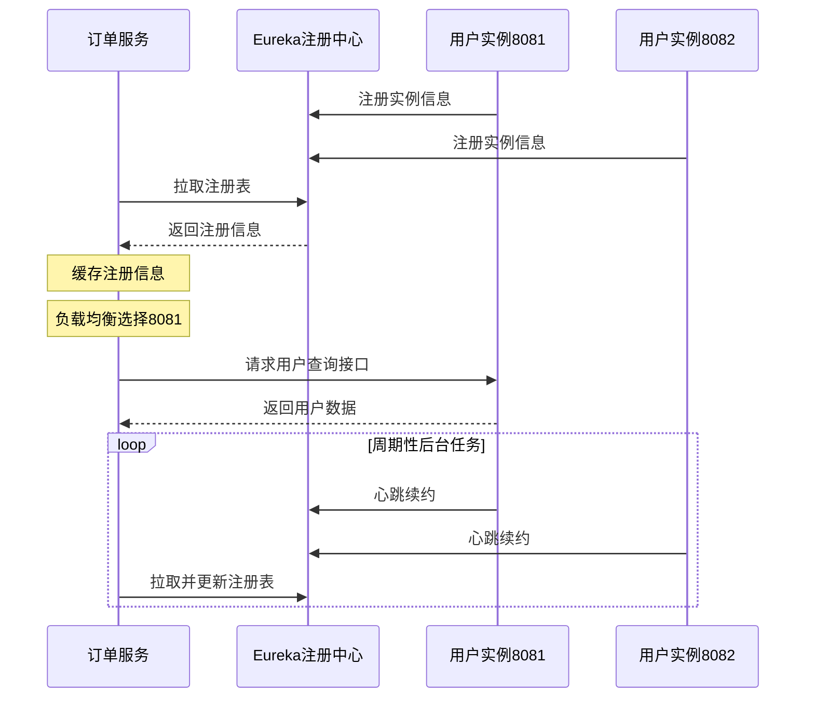

# 微服务技术栈

![[屏幕截图 2026-10-21 122036.png]]

## 一、 架构总览：微服务生态的两大核心板块

从图中可以看出，现代微服务架构主要由左侧的**微服务治理与业务集群**和右侧的**DevOps与容器化平台**两大部分组成：

  

1. **微服务治理层（左侧）**：负责业务逻辑的拆分、服务间通信、流量控制、数据存储以及系统监控。
    
      
    
2. **云原生与DevOps层（右侧）**：负责代码的持续集成、交付以及容器化编排管理，实现降本增效。
    
      
    

## 二、 微服务治理核心组件拆解（左侧核心）

针对图中的各个模块，在 **Spring Cloud 技术栈** 中通常有对应的成熟选型：

  
### 1. 流量入口与网关

- **服务网关**：作为整个微服务系统的唯一入口，负责**路由转发、权限校验、限流熔断、黑白名单**等功能。
    
      
    - _主流选型_：**Spring Cloud Gateway**（推荐，基于 WebFlux 反应式编程）、Zuul（老旧项目使用）。
        
          
        

### 2. 服务治理（核心底座）

- **注册中心**：微服务实例的“通讯录”，实现服务动态注册与发现。
    
      
    - _主流选型_：**Nacos**（阿里开源，兼具配置中心）、Eureka（Netflix，已进入维护期）、Consul。
        
          
        
- **配置中心**：实现应用配置的集中化管理与动态热更新。
    
      
    - _主流选型_：**Nacos**、Apollo（携程开源）、Spring Cloud Config。
        
          
        

### 3. 服务通信与容错

- **服务集群 & 负载均衡**：多个微服务实例协同工作，通过声明式客户端进行远程调用，并结合负载均衡策略分摊流量。
    
      
    - _主流选型_：**OpenFeign**（声明式 HTTP 客户端）、**Spring Cloud LoadBalancer**（替代已停更的 Ribbon）。
        
          
        
- **容错/降级/限流**：保障高并发下的系统高可用，防止雪崩效应。
    
      
    - _主流选型_：**Sentinel**（阿里开源）、Resilience4j。
        
          
        

### 4. 数据与存储层

- **分布式缓存**：减轻数据库压力，提升热点数据访问性能（如 Redis）。
    
      
    
- **分布式搜索**：支撑海量数据的复杂检索与全文搜索（如 Elasticsearch）。
    
      
    
- **消息队列（MQ）**：实现异步解耦、流量削峰和分布式事务最终一致性。
    
      
    - _主流选型_：RocketMQ、RabbitMQ、Kafka。
        
          
        

### 5. 运维与监控层

- **系统监控 & 链路追踪**：监控系统健康状态，排查微服务调用链中的性能瓶颈（“谁调用了谁，哪一步慢了”）。
    
      
    - _主流选型_：Prometheus + Grafana（监控）、SkyWalking / Zipkin（链路追踪）。
        
          
        
- **分布式日志服务**：收集、清洗并集中检索分散在各个容器中的日志。
    
      
    - _主流选型_：ELK 栈（Elasticsearch, Logstash, Kibana）或 EFK。
        
          
        

## 三、 DevOps 与容器化部署（右侧核心）

微服务架构如果脱离容器化和自动化运维，运维成本会呈指数级上升。图右侧展示了标准的**云原生部署链路**：

  

- **Jenkins**：老牌且强大的 CI/CD（持续集成与持续交付）工具，负责自动化拉取代码、打包、构建镜像。
    
      
    
- **Docker**：容器化技术，将微服务及其运行环境打包成镜像，实现“一次构建，到处运行”，彻底解决环境差异问题。
    
      
    
- **Kubernetes (K8s)**：容器编排的事实标准。负责微服务容器的**自动部署、弹性伸缩、故障自愈、滚动升级**。
    
      
    
- **Rancher**：企业级 Kubernetes 管理平台，提供图形化界面（UI），大大降低了 K8s 的学习和使用门槛。
    
      
    

> 💡 **小结**：
> 
> 这张图勾勒出的正是目前主流的 **Spring Cloud + Alibaba + Kubernetes** 云原生微服务架构。随着学习深入，我们将逐一攻克这些组件的底层原理与实战。
> 
>   


---
---


# 认识微服务——服务架构演变


## 一、 单体架构（Monolithic Architecture）

![[屏幕截图 2026-10-21 122422.png]]

- **定义**：将业务的所有功能集中在一个项目中进行开发，最后打包部署到一个服务器上。
    
      
    
- **优点**：
    
      
    - **架构简单**：项目初期开发、调试直观。
        
          
        
    - **部署成本低**：只需打成一个包，扔到服务器上运行即可。
        
          
        
- **缺点**：
    
      
    - **耦合度高**：随着业务扩展，代码越来越臃肿，牵一发而动全身，维护困难。
        
          
        

## 二、 分布式架构（Distributed Architecture）

![[屏幕截图 2026-10-21 125215.png]]

- **定义**：根据业务功能对系统进行拆分，每一个业务模块作为独立的项目开发，称为一个**服务**。
    
      
    
- **优点**：
    
      
    - **降低服务耦合**：不同模块解耦，团队可以分工协作开发。
        
          
        
    - **有利于服务升级拓展**：可以针对特定的高并发服务进行横向扩展。
        
          
        
- **分布式架构带来的新挑战（服务治理问题）**：
    
      
    - 1. **服务拆分粒度如何？**（怎么拆才合理？）
            
              
            
    - 2. **服务集群地址如何维护？**（服务多了，IP地址和端口怎么管理？）
            
              
            
    - 3. **服务之间如何实现远程调用？**（模块间如何高效通信？）
            
              
            
    - 4. **服务健康状态如何感知？**（某个服务挂了怎么知道？）
            
              
            

## 三、 微服务（Microservices）

![[屏幕截图 2026-10-21 130111.png]]

- **定义**：微服务是一种**经过良好架构设计的分布式架构方案**。它不仅是简单的代码拆分，更强调一套完整的治理体系。
    
      
    
- **核心特征**：
    
      
    - **单一职责**：微服务拆分粒度更小，每一个服务都对应唯一的业务能力，做到单一职责，避免重复业务开发。
        
          
        
    - **面向服务**：微服务对外暴露标准的业务接口（如 RESTful API）。
        
          
        
    - **自治（独立性）**：做到**团队独立、技术独立、数据独立、部署独立**。
        
          
        
    - **隔离性强**：服务调用做好隔离、容错、降级，避免出现级联问题（雪崩效应）。
        
          
        

> 💡 **核心总结**：
> 
> 架构的演变本质上是为了解决**业务复杂度**与**团队协作效率**之间的矛盾。单体架构适合业务初期；当业务膨胀后，演变为分布式；而为了更好地管理和治理分布式带来的复杂性，便诞生了**微服务**。而 **Spring Cloud** 就是实现微服务架构最流行、最成熟的工具箱。
> 
>   


---
---


# 认识微服务——微服务技术对比


### 一、微服务结构核心组件

微服务方案需要技术框架来落地，全球的互联网公司都在积极尝试自己的微服务落地技术，在国内最知名的是 **Spring Cloud** 和阿里巴巴的 **Dubbo**。一个标准的微服务架构通常包含以下几个核心模块：

  

- **注册中心**：服务实例进行注册与服务信息拉取的核心底座。
    
      
    
- **配置中心**：集中管理和拉取配置信息。
    
      
    
- **服务网关**：统一的流量入口，负责请求路由与负载均衡。
    
      
    
- **服务集群**：承载具体业务逻辑的微服务群体。
    
      
    

### 二、三大微服务技术栈横向对比

市场上主流的微服务技术栈主要有 **Dubbo**、**SpringCloud** 以及国内目前非常流行的 **SpringCloudAlibaba**，它们的组件选型差异如下表所示：


|**维度 / 组件**|**Dubbo**|**SpringCloud**|**SpringCloudAlibaba**|
|---|---|---|---|
|**注册中心**|ZooKeeper、Redis|Eureka、Consul|Nacos、Eureka|
|**服务远程调用**|Dubbo 协议|Feign (HTTP 协议)|Dubbo、Feign|
|**配置中心**|无|SpringCloudConfig|SpringCloudConfig、Nacos|
|**服务网关**|无|SpringCloudGateway、Zuul|SpringCloudGateway、Zuul|
|**服务监控和保护**|dubbo-admin（功能弱）|Hystrix|Sentinel|

### 三、企业常见需求与模式组合

在实际企业开发中，会根据公司技术积累和业务场景选择不同的模式组合：

  ![[屏幕截图 2026-10-21 132024.png]]


---
---


# 认识微服务——Spring Cloud


![[屏幕截图 2026-10-21 132657.png]]
## 1. Spring Cloud 是什么？

Spring Cloud 是一组用于构建分布式系统的工具和子项目，提供服务注册与发现、配置管理、服务调用、路由、负载均衡、熔断等能力，帮助开发者解决微服务之间的协作问题。[spring.io](https://spring.io/projects/spring-cloud?utm_source=chatgpt.com)

可以这样理解：

> **微服务是一种架构风格，Spring Cloud 是实现微服务架构时可以使用的一套技术体系。**

例如，将电商系统拆分为订单、商品、库存、支付等服务后，需要解决：

- **找到服务**：订单服务如何知道库存服务的地址？
- **调用服务**：不同服务之间如何通信？
- **管理配置**：多个服务的配置如何集中维护？
- **处理故障**：库存服务故障时，如何避免故障继续扩散？
- **定位问题**：一次下单涉及多个服务，如何找到出错或耗时的位置？

这些就是 Spring Cloud 及其相关生态组件关注的问题。

## 2. Spring Boot 与 Spring Cloud 的关系

|对比项|Spring Boot|Spring Cloud|
|---|---|---|
|主要关注|单个应用的创建、配置和运行|分布式系统中多个服务的协作与治理|
|常见能力|自动配置、依赖管理、应用启动等|服务发现、配置管理、网关、负载均衡等|
|两者关系|为应用开发提供基础|基于 Spring Boot 集成各类分布式能力|

例如：

- 使用 **Spring Boot** 开发订单服务、库存服务。
- 使用 **Spring Cloud 相关组件**实现服务发现、远程调用和故障保护。

注意：**Spring Boot 也能开发单体应用；使用 Spring Boot 不等于采用了微服务架构。**

## 3. 为什么说 Spring Cloud 提供“开箱即用”的体验？

许多 Spring Cloud 子项目提供了 Starter，并利用 Spring Boot 的自动配置机制，减少手工配置和集成工作。[spring.io](https://spring.io/projects/spring-cloud?utm_source=chatgpt.com)

一般使用过程是：

1. 引入所需组件的依赖。
2. 配置服务名称、组件地址等必要信息。
3. 按组件要求添加注解或声明接口。
4. 框架根据条件创建和配置相关对象。

但“开箱即用”仍然需要满足运行条件。例如，接入 Nacos 时，需要准备 Nacos 服务端，并正确配置连接信息。

## 4. 六类核心能力

| 核心能力     | 解决的问题              | 组件                        | 理解示例         |
| -------- | ------------------ | ------------------------- | ------------ |
| 服务注册与发现  | 服务在哪里？有哪些可用实例？     | Eureka、Nacos、Consul       | 订单服务发现库存服务   |
| 服务远程调用   | 如何调用其他服务的接口？       | OpenFeign、Dubbo           | 订单服务调用库存扣减接口 |
| 服务链路监控   | 请求经过哪些服务？哪里慢、哪里失败？ | Zipkin、Sleuth             | 排查下单接口耗时     |
| 统一配置管理   | 如何集中管理各服务的配置？      | Spring Cloud Config、Nacos | 管理不同环境的业务配置  |
| 统一网关路由   | 外部请求如何进入并到达目标服务？   | Spring Cloud Gateway、Zuul | 将订单请求转发到订单服务 |
| 流控、降级、保护 | 如何应对过量流量与下游故障？     | Hystrix、Sentinel          | 限制请求量、阻断异常调用 |

这些组件体现的是不同能力的实现方案，**实际项目按需求选择，不需要把表里的组件全部引入。**

## 5. 几组容易混淆的概念

**① 注册与发现**

- **服务注册**：服务实例把自身的服务名称、地址等信息登记到注册中心。
- **服务发现**：调用方根据服务名称，获取目标服务的实例信息。

注册中心通常提供服务信息，业务请求由调用方向目标实例发送。

**② 服务发现与负载均衡**

假设库存服务有三个实例：

- 服务发现负责获得这三个实例的信息。
- 负载均衡负责从中选择一个实例进行调用。

因此，**“找到有哪些实例”和“决定调用哪个实例”是两个步骤。** Spring Cloud LoadBalancer 是相关的负载均衡组件。

**③ OpenFeign 与 Dubbo**

- **OpenFeign**：声明式 HTTP 客户端，通过接口描述远程 HTTP 调用。
- **Dubbo**：独立的 RPC 框架，提供远程通信及服务治理等能力。[docs.spring.io](https://docs.spring.io/spring-cloud-openfeign/reference/spring-cloud-openfeign.html?utm_source=chatgpt.com)

它们都能用于服务间通信，但功能范围和使用方式不同。

**④ 限流、熔断与降级**

|概念|核心含义|示例|
|---|---|---|
|限流|控制进入系统或某个资源的请求量|超出处理能力的请求被拒绝或等待|
|熔断|下游异常达到条件时，暂时阻断调用|支付接口持续失败，暂时停止调用|
|降级|提供符合业务要求的替代行为|推荐服务异常时返回默认推荐|

降级不能破坏业务正确性。例如，支付失败时不能通过降级返回“支付成功”。

## 6. 截图中的组件需要注意版本差异

截图包含一些较早时期的组件组合，学习概念时可以参考，实践时需要结合目标版本。

|截图中的内容|需要补充的认识|
|---|---|
|Sleuth|不支持 Spring Boot 3.x 及之后版本，其核心能力已迁移到 Micrometer Tracing|
|Hystrix|已进入维护模式，学习服务保护时可进一步了解 Sentinel、Resilience4j|
|Zuul|旧版 Spring Cloud Netflix 的 Zuul 集成已进入维护模式，网关学习可重点关注 Spring Cloud Gateway|

以上分别有对应项目的官方说明。截图中的 `Hystix` 也应写为 **Hystrix**。[docs.spring.io](https://docs.spring.io/spring-cloud-sleuth/docs/current/reference/html/?utm_source=chatgpt.com)

另外，Spring Cloud OpenFeign 已被官方定位为 **feature-complete**，主要进行修复和有限的小改动，官方建议迁移到 Spring HTTP Service Clients；这不代表已有 OpenFeign 项目不能继续使用。[docs.spring.io](https://docs.spring.io/spring-cloud-openfeign/reference/index.html?utm_source=chatgpt.com)


---
---


# Maven 与微服务


>[!question] Maven 多模块工程已经能够实现业务代码的模块拆分与 jar 包依赖复用，从代码组织形式上看和微服务的模块划分十分相似，微服务架构相比单体项目的 Maven 模块化，其核心价值与定位是什么


**Maven 多模块只是【代码层面拆分】，微服务是【运行时拆分、独立部署独立进程】，这是本质差距。**

## 先分清两个东西

✅ Maven 所有模块**最后打包出来，依然是一个进程、一个 jar，跑在同一个 JVM 里**

- 只是把代码分成不同文件夹、不同 module，方便写代码、复用类
- 启动：**一次启动，全部模块一起起来**
- 挂了：一个地方崩，整个应用全崩
- 扩容：要扩就整套一起扩，不能只扩里面某个模块

> 本质：**代码组织方式，单体项目的内部模块化**

✅ 微服务 每个业务，**单独打成独立 jar，单独进程、独立容器、独立部署**

- 用户服务、订单服务、支付服务，是完全分开的几个程序
- 互相通过网络调用（HTTP / RPC，比如 Nacos+OpenFeign）
- 启动：可以单独启动订单服务，不动用户服务
- 挂了：订单崩了，用户登录还能用
- 扩容：订单流量大，只多部署几个订单服务实例就行，不用扩用户服务

---

## 举个很好懂的例子（电商）

### Maven 多模块单体（代码拆分）

```
shop-parent
├─ user-module
├─ order-module
└─ pay-module
```

打包之后：**shop.jar 一个包**，java -jar shop.jar 全部跑起来。 👉 所有代码在同一个 JVM。订单逻辑卡死，登录也卡死。

### 微服务

```
user-service.jar （独立进程，单独端口）
order-service.jar（独立进程，单独端口）
pay-service.jar  （独立进程，单独端口）
```

三个独立程序，分别部署在不同容器 / 服务器，互相远程调用。 👉 订单压力大，给 order 多开几个实例；用户服务不用动。

## 微服务到底解决啥问题（核心价值）

1. **独立扩容**：哪个业务流量大，单独扩哪个（电商下单高峰期只扩订单服务）
2. **故障隔离**：一个服务出问题，不会拖垮整个系统
3. **独立迭代发布**：改订单代码，只发布订单服务，不用重新打包、重启整个商城
4. **技术异构**：订单用 Java，推荐搜索可以用 Go；不用全部绑定一套技术栈
5. **团队拆分**：A 组维护用户，B 组维护订单，互不干扰

## 代价（微服务不是银弹）

代价就是复杂度暴涨： 需要服务注册发现 (Nacos/Eureka)、负载均衡、远程调用、分布式事务、链路追踪、统一配置中心…… **小项目完全没必要，用 Maven 多模块单体就足够。**


---
---


# 服务拆分——案例demo


本节重点是：**明确不同服务的业务边界和数据归属，再通过接口实现服务协作。**

## 1. 服务拆分的基本原则

![[Pasted image 20261021152041.png]]

截图提出了三个原则：

|原则|含义|举例|
|---|---|---|
|不重复开发相同业务|同一项业务能力应有明确的负责服务，其他服务通过调用复用|用户信息查询由用户服务负责|
|服务数据独立|服务管理自己的数据，其他服务不直接访问其数据库|订单服务不直接查询用户服务的用户表|
|对外提供业务接口|服务通过接口提供能力，支持其他服务调用|用户服务提供“根据 ID 查询用户”的接口|

拆分时应围绕业务能力划分，使服务内部的业务联系紧密，服务之间的依赖尽量清晰，也就是**高内聚、低耦合**。

例如：

- 用户服务：负责用户资料等用户相关业务。
- 订单服务：负责订单查询、订单状态等订单相关业务。
- 商品服务：负责商品信息等商品相关业务。
- 支付服务：负责支付处理等支付相关业务。

不能仅按 Controller、Service、Mapper 这样的技术层次，将它们分别拆成不同微服务。

## 2. 如何理解“不要重复开发相同业务”？

假设订单服务需要查询下单用户的信息。

合理的职责分工是：

- 用户服务实现用户查询逻辑。
- 订单服务调用用户服务，获取所需信息。
- 用户查询规则发生变化时，主要由用户服务维护。

如果订单服务也复制一套用户查询和修改逻辑，就容易出现：

- 相同业务规则需要修改多处。
- 不同服务的实现逐渐不一致。
- 用户数据被多个服务随意修改，难以维护。

这里强调的是**业务能力的归属**。通用工具类可以合理复用；为了展示或保留历史记录而保存部分用户数据，也不等于重复实现整套用户业务。

## 3. 如何理解“微服务数据独立”？

数据独立主要强调：**每个服务拥有自己负责的数据和访问边界。**

|服务|负责的数据|访问方式|
|---|---|---|
|`order-service`|订单数据|访问订单数据库|
|`user-service`|用户数据|访问用户数据库|

订单服务需要用户信息时，应通过用户服务提供的接口获取，避免直接连接用户数据库。

这样做是为了降低数据库结构带来的耦合。例如，用户服务调整了内部表结构，只要对外接口保持兼容，订单服务通常就不需要跟着修改。

需要注意：

- **数据独立不等于每个服务必须使用独立的物理数据库服务器。**
- 学习或小规模部署时，可以在同一个 MySQL 实例中使用不同数据库，并通过账号权限隔离。
- 订单表可以保存 `user_id`，表达订单属于哪个用户；这不意味着订单服务可以直接访问用户表。

## 4. 案例 Demo 的项目结构

课程工程名称为 `cloud-demo`，其中包含两个服务：

|工程或服务|作用|
|---|---|
|`cloud-demo`|容纳两个服务的根工程|
|`order-service`|提供根据 ID 查询订单的功能|
|`user-service`|提供根据 ID 查询用户的功能|

在常见的 Maven 多模块项目中，根工程还可以负责模块聚合和公共依赖管理，具体以工程中的 `pom.xml` 为准。

**放在同一个工程中，不代表必须运行在同一个进程中。** 两个服务应能够分别启动；部署到同一台机器时，需要使用不同的监听端口。

同样，仅创建两个 Maven 模块，还不足以说明完成了微服务拆分，还要看它们是否具备清晰的业务边界、数据边界和独立部署能力。

## 5. Demo 的准备与验证


1. 解压并导入 `cloud-demo` 工程。
2. 检查两个服务的依赖、启动类和配置。
3. 将 `cloud-user.sql`、`cloud-order.sql` 导入各自对应的数据库。
4. 检查数据库地址、账号、密码等连接配置。
5. 分别启动 `user-service` 和 `order-service`。
6. 分别验证“根据 ID 查询用户”和“根据 ID 查询订单”的接口。

数据库名称、端口、表名和接口路径，应以提供的 SQL 和工程代码为准，截图没有展示这些具体信息。

这个阶段先确认：

> **两个服务能够独立启动，并各自完成对所属数据的查询。**


---
---


# 服务拆分——服务远程调用

![[屏幕截图 2026-10-21 150949.png]]

## 一、案例需求

根据订单 ID 查询订单时，**同时返回订单所属的用户信息**。

目前两个服务的职责如下：

|服务|负责的业务|数据来源|
|---|---|---|
|`order-service`|根据订单 ID 查询订单|订单数据库|
|`user-service`|根据用户 ID 查询用户|用户数据库|

订单数据中的 `userId`，记录了订单所属用户的 ID。

因此，需要先查询订单，再根据 `userId` 获取用户信息，最后组装返回结果。

**订单服务负责组合查询结果，用户服务负责查询用户数据。**

## 二、远程调用的原理

### 1. 为什么不能直接调用另一个服务的方法？

单体应用中的对象通常处于同一个进程，可以通过注入对象进行本地方法调用。

拆分之后，订单服务和用户服务运行在不同进程中，各自拥有独立的 Spring 容器。订单服务无法通过普通的 `@Autowired`，直接获得另一个进程中的 `UserService` 对象。

本案例通过 **HTTP 请求**完成跨进程通信。

### 2. 服务也可以像浏览器一样发送 HTTP 请求

![[屏幕截图 2026-10-21 151142.png]]

截图中的用户查询接口为：

```
GET http://localhost:8081/user/1
```

对应的接口映射为：

```
@GetMapping("/user/{id}")
```

浏览器访问这个地址，可以获取用户信息；订单服务使用 HTTP 客户端访问相同地址，也可以获取用户信息。

区别在于：

- 浏览器将响应展示给用户。
- 订单服务将响应转换成 Java 对象，继续参与业务处理。

### 3. 完整执行流程

1. 客户端请求查询订单。
2. 订单服务查询自己的数据库，获得订单信息。
3. 从订单中取出 `userId`。
4. 订单服务发送 HTTP 请求，调用用户服务。
5. 用户服务查询自己的数据库，返回用户 JSON。
6. 订单服务将用户 JSON 转换成 `User` 对象。
7. 将 `User` 对象设置到订单中。
8. 向客户端返回包含用户信息的订单。

**查询用户数据库的仍然是用户服务，订单服务只调用它的接口。**

## 三、认识 RestTemplate

`RestTemplate` 是 Spring Framework 提供的**同步 HTTP 客户端**，可以在 Java 代码中发送 HTTP 请求，并处理响应。它并不是 Spring Cloud 专属组件。[docs.spring.io](https://docs.spring.io/spring-framework/docs/6.2.x/javadoc-api/org/springframework/web/client/RestTemplate.html?utm_source=chatgpt.com)

本案例使用的核心方法是：

```java
User user = restTemplate.getForObject(url, User.class);
```

它完成两个主要动作：

1. 向指定地址发送 HTTP GET 请求。
2. 通过消息转换器，将响应内容转换成指定类型的对象。

这里的“同步”表示：**调用线程需要等待请求完成或发生异常，才能继续执行后面的代码。**

## 四、代码实现

### 1. 注册 RestTemplate

在 `order-service` 的启动类中添加 `@Bean` 方法：

```java
@MapperScan("cn.itcast.order.mapper")
@SpringBootApplication
public class OrderApplication {

    public static void main(String[] args) {
        SpringApplication.run(OrderApplication.class, args);
    }

    @Bean
    public RestTemplate restTemplate() {
        return new RestTemplate();
    }
}
```

相关注解的作用：

|注解|作用|
|---|---|
|`@SpringBootApplication`|标识 Spring Boot 启动配置类|
|`@MapperScan`|扫描指定包下的 MyBatis Mapper 接口|
|`@Bean`|将方法返回的对象注册到当前 Spring 容器|

这里注册的是**订单服务自己的 HTTP 客户端对象**。

也可以将 `@Bean` 方法放在能够被扫描到的 `@Configuration` 配置类中。

### 2. 注入并调用 RestTemplate

修改订单服务的 `queryOrderById` 方法：

```java
@Service
public class OrderService {

    @Autowired
    private OrderMapper orderMapper;

    @Autowired
    private RestTemplate restTemplate;

    public Order queryOrderById(Long orderId) {
        // 1. 查询订单
        Order order = orderMapper.findById(orderId);

        // 2. 根据订单中的 userId，构造用户查询地址
        String url = "http://localhost:8081/user/"
                + order.getUserId();

        // 3. 远程调用用户服务，获取用户信息
        User user = restTemplate.getForObject(url, User.class);

        // 4. 将用户信息设置到订单中
        order.setUser(user);

        // 5. 返回组合后的结果
        return order;
    }
}
```


### 3. 理解 getForObject 的参数

```java
User user = restTemplate.getForObject(url, User.class);
```

|内容|含义|
|---|---|
|`url`|请求的目标地址|
|`User.class`|期望将响应体转换成的 Java 类型|
|返回值 `user`|转换得到的用户对象|

**`User.class` 不是传给用户服务的业务参数，而是告诉客户端如何处理响应。**

用户 ID 已经通过 URL 中的路径传递：

```
GET /user/1
```

也可以使用路径占位符：

```java
User user = restTemplate.getForObject(
        "http://localhost:8081/user/{id}",
        User.class,
        order.getUserId()
);
```

这里的 `order.getUserId()` 用于替换 `{id}`。[docs.spring.io](https://docs.spring.io/spring-framework/docs/6.2.x/javadoc-api/org/springframework/web/client/RestTemplate.html?utm_source=chatgpt.com)

### 4. Order 中需要能够承载用户信息

订单对象需要包含类似字段及相应的访问方法：

```
// 订单所属用户的 ID
private Long userId;

// 远程查询后组装的用户信息
private User user;
```

两者作用不同：

- `userId`：记录订单与用户的关联。
- `user`：承载查询后返回给客户端的用户信息。

**给 Java 对象增加 `user` 字段，并不意味着订单表必须增加一个对应字段。** 数据库映射需要按实际使用的持久层框架配置。

此外，`order.setUser(user)` 只是修改内存中的对象，本身不会执行数据库更新。

## 五、数据是怎样转换的？

本案例中发生了几次数据转换：

| 环节       | 转换过程                    |
| -------- | ----------------------- |
| 查询订单     | 订单数据库记录 → `Order` 对象    |
| 用户服务返回结果 | 用户对象 → HTTP 响应中的 JSON   |
| 订单服务接收结果 | JSON → 订单服务中的 `User` 对象 |
| 订单服务返回结果 | 组合后的 `Order` 对象 → JSON  |

在常见的 Spring Boot Web 配置中，JSON 与 Java 对象之间的转换通常由 Jackson 等消息转换组件完成。

需要注意：

> 网络上传输的是请求和响应数据。订单服务得到的 `User`，是根据响应内容创建的本地对象，并不是用户服务内存中的那个对象。

两个服务也不要求使用同一个 Java 实体类，但接口字段、数据类型和序列化约定需要兼容。

## 六、本案例中的服务角色

|服务|本次调用中的角色|
|---|---|
|`order-service`|服务消费者、调用方|
|`user-service`|服务提供者、被调用方|

这些角色是**相对于某一次调用关系**而言的。

订单服务调用用户服务时是消费者；它向客户端提供订单查询接口时，又是提供者。一个服务可以同时承担两种角色。

## 七、易错点与后续改进

### 1. 应使用用户 ID 查询用户

```
order.getUserId()
```

不能误用订单 ID：

```
order.getId()
```

订单 ID 和用户 ID 属于不同业务对象，即使某次恰好相同，也不能混用。

### 2. localhost 指向调用方自身所在的环境

```
http://localhost:8081
```

表示订单服务所在运行环境的本地地址。

两个服务都在同一台电脑直接运行时，这种写法可以用于练习。部署到不同服务器或独立容器后，需要使用能够访问用户服务的地址。

### 3. 需要处理订单不存在和远程调用失败

实际业务至少需要考虑：

- 订单不存在，`order` 为 `null`。
- 用户服务未启动、连接失败或响应超时。
- 用户接口返回错误状态。
- 响应体为空，或者无法转换成 `User`。

例如，订单查询为空时，应先进行处理，再执行：

```
order.getUserId()
```

否则会出现空指针异常。HTTP 调用失败也不能一概理解为“返回 `null`”，它可能直接抛出异常。

### 4. 地址写死只适合当前入门演示

```
"http://localhost:8081/user/"
```

存在两个后续问题：

- 用户服务地址变化时，调用方需要调整。
- 用户服务有多个实例时，需要决定调用哪一个。

后续的**服务发现与负载均衡**，就是围绕这些问题展开的。

### 5. 注意 RestTemplate 的版本定位

本节可以继续按课程使用 `RestTemplate`，重点理解 HTTP 远程调用和数据组装。

版本上，Spring Framework 6.1 引入了更现代的同步客户端 `RestClient`；Spring Framework 7.0 已将 `RestTemplate` 标记为弃用，并推荐使用 `RestClient`。实践时应结合项目版本选择。[docs.spring.io](https://docs.spring.io/spring-framework/docs/6.2.x/javadoc-api/org/springframework/web/client/RestTemplate.html?utm_source=chatgpt.com)


---
---


# Eureka——原理分析


## 一、为什么需要 Eureka？

上一节通过固定地址调用用户服务：

```java
String url = "http://localhost:8081/user/" + order.getUserId();
```

当用户服务部署多个实例，或者实例地址发生变化时，就会出现问题：

|问题|解决思路|
|---|---|
|消费者如何获取服务地址？|通过注册中心获取服务实例信息|
|同一服务有多个实例，选择哪一个？|消费者通过负载均衡策略选择实例|
|如何感知实例是否仍然可用？|结合心跳续约、实例状态和注册表更新进行判断|

**Eureka 提供服务注册与发现能力，维护“服务名称与服务实例信息”的对应关系。** [docs.spring.io](https://docs.spring.io/spring-cloud-netflix/reference/spring-cloud-netflix.html?utm_source=chatgpt.com)

## 二、Eureka 中的角色

![[屏幕截图 2026-10-21 153959.png]]

### 1. Eureka Server：注册中心

主要负责：

- 接收服务实例的注册。
- 保存实例地址、端口、状态等信息。
- 向客户端提供注册表查询。
- 接收心跳续约，按条件清理过期实例。

截图中的注册信息，可以简化理解为：

|服务名称|实例地址|
|---|---|
|`user-service`|`localhost:8081`|
|`user-service`|`localhost:8082`|
|`user-service`|`localhost:8083`|
|`order-service`|`localhost:8080`|

同一个服务名下可以有多个实例。

### 2. Eureka Client：服务中的客户端组件

订单服务和用户服务都可以集成 Eureka Client，用它与注册中心通信。

|业务服务|本次调用中的业务角色|Eureka Client 的相关工作|
|---|---|---|
|`order-service`|服务消费者|获取实例信息，也可以注册自身|
|`user-service`|服务提供者|注册自身、发送心跳，也可以发现其他服务|

**Eureka Client 是集成在业务服务中的客户端组件，不是必须单独启动的一个业务服务。**

服务提供者、消费者是相对于业务调用而言的角色，与 Eureka Server、Eureka Client 的分类不同。

## 三、服务注册与调用流程

### 1. 服务注册：登记“我在哪里”

用户服务实例启动后，通过 Eureka Client 向注册中心登记信息，例如：

```
服务名称：user-service
实例地址：localhost
实例端口：8081
实例状态：UP
```

另外两个实例分别登记 `8082`、`8083`。

Eureka Server 将它们组织在同一个服务名称下，供客户端发现。

### 2. 服务发现：获得“有哪些实例”

订单服务通过 Eureka Client 拉取注册表，并在本地缓存。

调用用户服务时，再根据服务名 `user-service`，从已有的注册信息中获得对应的实例列表。

这里需要补充一点：

> 常见默认流程是客户端拉取并**缓存注册表**，再按服务名查找实例；并不是每次业务调用都实时向 Eureka 查询一次。

客户端会周期性更新本地注册表，默认拉取间隔为 **30 秒**，可以配置。[docs.spring.io](https://docs.spring.io/spring-cloud-netflix/reference/configprops.html?utm_source=chatgpt.com)

### 3. 负载均衡：选择“这次调用谁”

假设获得三个实例：

```
localhost:8081
localhost:8082
localhost:8083
```

消费者侧的负载均衡组件，根据策略选出一个实例。

例如，本次选择：

```
localhost:8082
```

在采用轮询策略的示意情况下，多次请求可能依次选择不同实例；实际结果取决于策略和当时的实例列表。

**Eureka 提供实例信息，消费者侧的负载均衡组件执行实例选择。**

### 4. 远程调用：向选中的实例发送请求

选定实例后，订单服务直接调用用户服务：

```
GET http://localhost:8082/user/1
```

用户服务返回用户数据，订单服务继续完成结果组装。

**业务请求由订单服务直接发给用户服务，Eureka Server 通常不处于业务请求的转发路径上。**

## 四、心跳续约与实例失效

### 1. 什么是心跳？

服务实例注册后，会周期性向 Eureka Server 发送续约请求，表示：

> “我仍然能够与注册中心通信，请继续保留我的注册信息。”

截图中的“每 30 秒一次”是默认值，可以调整。

几个常见默认值如下：

|机制|默认值|含义|
|---|---|---|
|心跳续约间隔|30 秒|实例向注册中心续约的间隔|
|租约过期时长|90 秒|长时间未续约后，实例具备被判定为过期的条件|
|客户端注册表拉取间隔|30 秒|客户端周期性更新本地注册信息|

这些值来自 Spring Cloud Netflix 的配置说明，实际以项目配置为准。[docs.spring.io](https://docs.spring.io/spring-cloud-netflix/reference/configprops.html?utm_source=chatgpt.com)

### 2. 服务异常退出后会怎样？

假设 `user-service:8081` 突然宕机：

1. 该实例停止发送心跳。
2. 租约超过有效期。
3. Eureka Server 在允许清理时，通过清理任务移除过期实例。
4. 消费者后续刷新注册表，逐步感知这一变化。

因此：

**实例宕机后，消费者不会立即获得这一变化。**

租约过期、服务端清理、缓存刷新等环节都可能带来延迟。在这段时间内，消费者仍可能选到已经失效的实例。

### 3. 心跳正常，不代表所有业务正常

- 心跳成功：说明客户端能够向注册中心续约。
- 业务健康：还涉及数据库连接、下游依赖、线程资源等情况。

例如，用户服务还能发送心跳，但数据库连接已不可用，用户查询接口仍然可能失败。

默认情况下，Eureka 不会自动传播 Spring Boot Actuator 的完整应用健康状态；需要相应的健康检查集成。[docs.spring.io](https://docs.spring.io/spring-cloud-netflix/reference/spring-cloud-netflix.html?utm_source=chatgpt.com)

### 4. 自我保护机制

如果短时间内大量心跳丢失，可能是网络故障，而不是所有服务同时宕机。

Eureka 的自我保护机制会在特定条件下限制过期实例的清理，避免因网络问题误删大量注册信息。

这也意味着：**自我保护期间，注册表中可能保留已经失效的实例。** [GitHub](https://github.com/Netflix/eureka/wiki/Understanding-Eureka-Peer-to-Peer-Communication?utm_source=chatgpt.com)

## 五、调用时序图

下面使用两个用户服务实例示意注册、发现与业务调用的关系：


心跳和注册表刷新是后台周期性任务，不需要等一次业务调用结束后才开始。

## 六、容易混淆的问题

### 1. 接入 Eureka 后，普通 RestTemplate 就能识别服务名吗？

仅接入 Eureka，并不意味着普通 HTTP 客户端会自动将：

```
http://user-service/user/1
```

解析为注册中心中的实例地址。

还需要接入相应的服务发现与负载均衡调用机制，完成：

**服务名 → 实例列表 → 选择实例 → 实际地址。**

具体配置会在后续的客户端负载均衡实践中展开。

### 2. 服务正常关闭与突然宕机有什么区别？

- **正常关闭**：客户端通常会尝试主动注销，让注册中心移除该实例。
- **突然宕机**：通常无法主动注销，需要依靠租约过期等机制被发现。

主动注销也需要经过信息传播和客户端刷新，消费者感知变化仍可能存在延迟。

### 3. Eureka Server 不可用，业务调用一定立即失败吗？

已经缓存了实例信息的消费者，可能继续调用已知且仍然可访问的服务实例。

但注册中心不可用会影响新实例注册、注册表刷新等操作，客户端缓存也可能逐渐过时。因此，缓存提高了短期容错能力，但不能保证业务调用始终成功。

### 4. 有了 Eureka，还需要超时和熔断吗？

需要。注册发现提供的是实例信息，无法保证选中的实例在本次调用中一定成功。

调用方仍需要合理的超时控制，并根据业务需求配置熔断、降级等机制。


---
---


# Eureka——搭建 Eureka 服务

实践环节：

1. **搭建注册中心**：启动 Eureka Server。
2. **注册业务服务**：将用户服务、订单服务注册到 Eureka。
3. **服务发现与调用**：订单服务通过服务名查找用户服务，完成负载均衡调用。


## 一、明确项目与服务名称

|项目模块|`spring.application.name`|本地演示端口|
|---|---|---|
|`eureka-server`|`eurekaserver`|10086|
|`user-service`|`userservice`|8081、8082|
|`order-service`|`orderservice`|8080|

注意区分：

- **模块名**：用于组织项目，例如 `user-service`。
- **服务名**：用于服务注册与发现，由 `spring.application.name` 配置，例如 `userservice`。
- **实例**：服务运行中的一个副本，例如运行在 8081 端口的用户服务。

后续调用中的 `http://userservice/...`，使用的是**服务名**。

## 二、搭建 Eureka Server

### 1. 创建模块并引入依赖

在 `cloud-demo` 中创建 `eureka-server` 模块，在该模块的 `pom.xml` 中添加：

```java
<dependency>
    <groupId>org.springframework.cloud</groupId>
    <artifactId>spring-cloud-starter-netflix-eureka-server</artifactId>
</dependency>
```

这里省略版本号的前提是：父工程已经通过 Spring Cloud BOM 等方式管理依赖版本。

**跟随课程时，优先沿用工程中已有的兼容版本组合，不要单独把某个 Starter 改成最新版本。**

### 2. 编写启动类

```java
package cn.itcast.eureka;

import org.springframework.boot.SpringApplication;
import org.springframework.boot.autoconfigure.SpringBootApplication;
import org.springframework.cloud.netflix.eureka.server.EnableEurekaServer;

@EnableEurekaServer
@SpringBootApplication
public class EurekaApplication {

    public static void main(String[] args) {
        SpringApplication.run(EurekaApplication.class, args);
    }
}
```

两个注解的作用：

|注解|作用|
|---|---|
|`@SpringBootApplication`|启动 Spring Boot 应用及相关自动配置|
|`@EnableEurekaServer`|启用 Eureka 注册中心功能|

Eureka Server 提供控制台页面，以及位于 `/eureka/*` 下的注册发现 HTTP API。[docs.spring.io](https://docs.spring.io/spring-cloud-netflix/reference/spring-cloud-netflix.html?utm_source=chatgpt.com)

### 3. 添加配置文件

在 `src/main/resources/application.yml` 中配置：

```java
server:
  port: 10086

spring:
  application:
    name: eurekaserver

eureka:
  client:
    register-with-eureka: false
    fetch-registry: false
    service-url:
      defaultZone: http://127.0.0.1:10086/eureka/
```


**这里补充了两个适用于单机注册中心的配置：**

```
register-with-eureka: false
fetch-registry: false
```


配置含义：

|配置项|含义|
|---|---|
|`server.port`|注册中心监听端口|
|`spring.application.name`|当前应用名称|
|`register-with-eureka`|是否将当前应用自身注册到 Eureka|
|`fetch-registry`|是否从 Eureka 拉取注册表|
|`service-url.defaultZone`|客户端使用的 Eureka 服务地址|

Eureka Server 默认也具有 Eureka Client 的行为。单机演示中，可以关闭自身注册和注册表拉取；这不会关闭它接收其他业务服务注册的能力。

若未关闭这些行为，并把注册地址指向自己，可能在控制台中看到 `EUREKASERVER` 自身的注册记录。两种配置需要区分理解。[docs.spring.io](https://docs.spring.io/spring-cloud-netflix/reference/spring-cloud-netflix.html?utm_source=chatgpt.com)

### 4. 启动并访问控制台

启动 `EurekaApplication`，浏览器访问：

[http://localhost:10086/](http://localhost:10086/)

注意两个地址的用途：

|地址|用途|
|---|---|
|`http://localhost:10086/`|浏览器查看控制台|
|`http://localhost:10086/eureka/`|配置给 Eureka Client 使用|

此时还没有启动业务服务，注册列表为空是正常现象。

## 三、注册用户服务和订单服务

### 1. 两个业务模块引入客户端依赖

分别在 `user-service`、`order-service` 的 `pom.xml` 中添加：

```java
<dependency>
    <groupId>org.springframework.cloud</groupId>
    <artifactId>spring-cloud-starter-netflix-eureka-client</artifactId>
</dependency>
```

在自动配置正常启用的情况下，引入客户端依赖并配置注册地址，即可完成注册发现集成，通常不需要额外添加 `@EnableDiscoveryClient`。[docs.spring.io](https://docs.spring.io/spring-cloud-commons/reference/spring-cloud-commons/common-abstractions.html?utm_source=chatgpt.com)

### 2. 配置 user-service

在原有配置中合并以下内容：

```java
server:
  port: 8081

spring:
  application:
    name: userservice

eureka:
  client:
    service-url:
      defaultZone: http://127.0.0.1:10086/eureka/
```

这里有两类地址：

- `server.port: 8081`：用户服务自身的业务端口。
- `defaultZone` 中的 `10086`：注册中心的端口。

**`defaultZone` 指向注册中心，不是指向用户服务自己。**

### 3. 配置 order-service

```java
server:
  port: 8080

spring:
  application:
    name: orderservice

eureka:
  client:
    service-url:
      defaultZone: http://127.0.0.1:10086/eureka/
```

两个业务服务通常保留客户端默认行为：

- 注册自身实例。
- 拉取注册表。

不要把注册中心配置中的两个 `false`，直接复制到业务服务中。

另外，`defaultZone` 是 Map 中区分大小写的键，应保留这种写法，不要改成 `default-zone`。[docs.spring.io](https://docs.spring.io/spring-cloud-netflix/reference/spring-cloud-netflix.html?utm_source=chatgpt.com)

### 4. 保留已有业务配置

上述 YAML 只展示本节相关内容。合并配置时：

- 保留原来的数据库、MyBatis 等配置。
- 将 `application` 合并到已有的 `spring` 节点下。
- 避免重复声明多个同级 `spring:` 节点。

## 四、启动用户服务的多个实例

### 1. 同一份代码运行多个进程

可以通过复制 IDEA 启动配置，再覆盖端口，模拟多实例部署。

![[Pasted image 20261021185418.png]]

例如：

|实例|服务名称|端口|
|---|---|---|
|用户实例 1|`userservice`|8081|
|用户实例 2|`userservice`|8082|

**同一服务的多个实例保持相同服务名，通过不同的实例地址、端口等信息区分。**

不需要为第二个实例复制一份项目，也不应把它的服务名改成 `userservice2`。

### 2. 使用启动参数覆盖端口

截图在第二个启动配置的 **VM options** 中填写：

```
-Dserver.port=8082
```

也可以在 **Program arguments** 中填写：

```
--server.port=8082
```

两种写法的位置不同：

|配置位置|写法|
|---|---|
|VM options|`-Dserver.port=8082`|
|Program arguments|`--server.port=8082`|

它们都可以覆盖配置文件中的端口；如果同时设置，通常命令行参数优先于 Java 系统属性。[docs.spring.io](https://docs.spring.io/spring-boot/reference/features/external-config.html?utm_source=chatgpt.com)

启动后，Eureka 控制台中应能看到同一用户服务下的多个实例。

## 五、通过服务名调用用户服务

### 1. 修改请求地址

原来的固定地址：

```java
String url = "http://localhost:8081/user/"
        + order.getUserId();
```

修改为使用服务名：

```java
String url = "http://userservice/user/"
        + order.getUserId();
```

这里的 `userservice` 对应：

```java
spring:
  application:
    name: userservice
```

如果实际配置的是 `user-service`，请求地址也应相应使用 `http://user-service/...`。

### 2. 为 RestTemplate 启用负载均衡

修改订单服务中的 `RestTemplate` Bean：

```java
@Bean
@LoadBalanced
public RestTemplate restTemplate() {
    return new RestTemplate();
}
```

`@LoadBalanced` 的导包为：

```java
import org.springframework.cloud.client.loadbalancer.LoadBalanced;
```

配合负载均衡实现，这个 `RestTemplate` 会将请求中的主机部分作为服务 ID，获取实例并构造实际请求地址。[docs.spring.io](https://docs.spring.io/spring-cloud-commons/reference/spring-cloud-commons/common-abstractions.html?utm_source=chatgpt.com)

### 3. 确认负载均衡实现依赖


对于使用 **Spring Cloud LoadBalancer** 的版本，如果没有相应实现，应在 `order-service` 中添加：

```java
<dependency>
    <groupId>org.springframework.cloud</groupId>
    <artifactId>spring-cloud-starter-loadbalancer</artifactId>
</dependency>
```

*旧版课程可能使用 Ribbon，需要按原有版本体系理解，不能只根据注解判断底层实现。*

**`@LoadBalanced` 需要相应的负载均衡实现配合，并非仅添加注解就具备完整能力。** [docs.spring.io](https://docs.spring.io/spring-cloud-commons/reference/spring-cloud-commons/common-abstractions.html?utm_source=chatgpt.com)


### 4. 订单查询方法

沿用上一节注入的 `orderMapper` 和 `restTemplate`：

```java
public Order queryOrderById(Long orderId) {
    // 1. 查询订单
    Order order = orderMapper.findById(orderId);

    // 2. 使用服务名构造请求地址
    String url = "http://userservice/user/"
            + order.getUserId();

    // 3. 通过负载均衡调用某个用户服务实例
    User user = restTemplate.getForObject(url, User.class);

    // 4. 组装用户信息
    order.setUser(user);

    return order;
}
```

该方法继续沿用课程中“订单存在、调用成功”的演示前提；订单为空、远程超时等情况仍需要另外处理。


### 补充：关于 `@LoadBalanced`


@LoadBalanced 作用

给 RestTemplate / WebClient.Builder 加上**客户端负载均衡能力**； 底层：从注册中心（Nacos/Eureka）拿服务实例列表，默认轮询选一个地址访问（新版 SpringCloud 默认 SpringCloud LoadBalancer，不再是 Ribbon）

> 前提：必须引入注册中心 + spring-cloud-loadbalancer 依赖

#### 1. 完整示例（RestTemplate，最常用）

```java
import org.springframework.cloud.client.loadbalancer.LoadBalanced;
import org.springframework.context.annotation.Bean;
import org.springframework.context.annotation.Configuration;
import org.springframework.web.client.RestTemplate;

@Configuration
public class RestConfig {

    // 核心：@LoadBalanced 写在@Bean上
    @Bean
    @LoadBalanced
    public RestTemplate restTemplate(){
        return new RestTemplate();
    }
}
```

controller 使用：

```java
@RestController
public class TestController {
    @Autowired
    private RestTemplate restTemplate;

    @GetMapping("/test")
    public String test(){
        // ⚠️重点：url写【服务名】，不是ip:port
        String url = "http://service-order/order/get";
        return restTemplate.getForObject(url, String.class);
    }
}
```

#### 2. WebClient 写法（响应式）

```java
@Bean
@LoadBalanced
public WebClient.Builder webClientBuilder(){
    return WebClient.builder();
}
```

调用：

```java
@Autowired
private WebClient.Builder builder;

builder.build().get().uri("http://service-order/order/get")
    .retrieve().bodyToMono(String.class);
```

#### 3. 依赖（Nacos 示例）

```java
<!-- 注册中心客户端 -->
<dependency>
    <groupId>com.alibaba.cloud</groupId>
    <artifactId>spring-cloud-starter-alibaba-nacos-discovery</artifactId>
</dependency>
<!-- 负载均衡器，新版必须有 -->
<dependency>
    <groupId>org.springframework.cloud</groupId>
    <artifactId>spring-cloud-starter-loadbalancer</artifactId>
</dependency>
```

#### 高频坑点

1. URL 不能写 ip，**必须写注册中心里的服务名**
2. @LoadBalanced 加在 `@Bean` 方法上，**不要加在注入的字段上**（虽然也能写，但标准写法是 bean 定义处）
3. 不加这个注解 → RestTemplate 不具备解析服务名能力，直接报错 `Unknown host`
4. 多实例：自动轮询；想改策略（随机），自定义 LoadBalancer 配置
5. 区分：**客户端负载均衡**（本地选地址再发请求，不是网关）

#### 一句话总结

@LoadBalanced 就是给 http 客户端装上一个拦截器，遇到`http://服务名`的时候，去注册中心拉实例、选节点、替换成真实 ip 端口再请求。


#### 补充

**新版（Spring Cloud 2020.0 之后）底层：Spring Cloud LoadBalancer，官方自研，替代已经停更的 Ribbon**

> 坐标包：`spring-cloud-starter-loadbalancer`

底层链路拆解（@LoadBalanced 做了啥）

1. `@LoadBalanced` 是一个**标记注解**，不是负载均衡实现本身；它给 RestTemplate / WebClient.Builder 装配**拦截器**
    - RestTemplate：`LoadBalancerInterceptor`
    - WebClient：`ReactorLoadBalancerExchangeFilterFunction`
2. 拦截器拿到 `http://service-order/xxx` 这种服务名 URL
3. 通过 `DiscoveryClient`（Nacos/Eureka/Consul）拉取该服务的实例列表（ip+port）
4. 交给 `ReactiveLoadBalancer` 选择实例
    - 默认实现：`RoundRobinLoadBalancer` **轮询**；自带 RandomLoadBalancer（随机）Spring Fra...
5. 把服务名替换成真实 `ip:port`，再发起 http 请求


## 六、理解这次请求如何执行

订单服务执行：

```java
restTemplate.getForObject(
        "http://userservice/user/1",
        User.class
);
```

配合注册发现与负载均衡，处理过程可以理解为：

1. 从逻辑地址中识别服务名 `userservice`。
    
2. 根据服务发现信息获得用户服务实例列表。
    
3. 通过负载均衡选择一个实例，例如 `localhost:8082`。
    
4. 将逻辑地址转换为实际地址：
    
    ```
    http://localhost:8082/user/1
    ```
    
5. 向用户服务直接发送 HTTP 请求。
    
6. 将响应转换成 `User` 对象。
    

这里使用的是服务发现与客户端负载均衡机制，**不要求操作系统能通过 DNS 解析 `userservice`**。

## 七、启动与验证

### 1. 建议启动顺序

1. 启动 Eureka Server，端口 `10086`。
2. 启动用户服务实例，端口 `8081`、`8082`。
3. 启动订单服务，端口 `8080`。
4. 等待注册与客户端信息刷新。

先启动注册中心，可以减少初始连接失败日志。

### 2. 检查注册情况

访问控制台：

[http://localhost:10086/](http://localhost:10086/)

检查：

- 是否出现用户服务和订单服务。
- 用户服务下是否存在两个不同端口的实例。
- 实例状态是否为 `UP`。

### 3. 检查业务调用

先分别验证用户接口：

- [http://localhost:8081/user/1](http://localhost:8081/user/1)
- [http://localhost:8082/user/1](http://localhost:8082/user/1)

再访问工程已有的订单查询接口，检查是否返回用户信息。

如果两个用户实例查询相同数据库，返回内容可能完全相同。要观察请求具体落在哪个实例，可以查看两边控制台日志，或在用户查询方法中设置断点。

## 八、常见问题

|现象|优先检查|
|---|---|
|控制台无法打开|注册中心是否启动、10086 是否被占用|
|业务服务未出现在注册列表|Client 依赖、注册地址、注册开关及启动日志|
|第二个实例启动失败|是否仍使用相同端口，启动参数是否填对位置|
|服务名调用出现主机解析错误|是否实际注入了带 `@LoadBalanced` 的客户端，负载均衡实现是否存在|
|提示找不到可用实例|服务名是否匹配、实例是否注册为 `UP`、客户端是否已刷新|
|依赖或兼容性检查报错|Spring Boot 与 Spring Cloud 的版本组合、BOM 配置|
|复制配置后数据库连接失败|是否覆盖或遗漏了原来的数据源配置|


---
---


# Ribbon——负载均衡

本节按照课程中的 **Spring Cloud Netflix Ribbon 体系**整理。Ribbon 已进入维护模式；学习时要将它的类名、规则和配置，与新版 Spring Cloud LoadBalancer 区分开。[GitHub](https://github.com/Netflix/ribbon?utm_source=chatgpt.com)

![[屏幕截图 2026-10-22 103500.png]]
## 一、Ribbon 的作用

Ribbon 是客户端负载均衡组件，用于从同一服务的多个实例中选择一个，供调用方发送请求。

例如，用户服务有两个实例：

```
localhost:8081
localhost:8082
```

订单服务发起请求：

```
GET http://userservice/user/1
```

Ribbon 根据负载均衡规则选择一个实例，例如 `localhost:8081`，最终请求地址变为：

```
GET http://localhost:8081/user/1
```

### 1. Eureka 与 Ribbon 的分工

|组件|主要职责|
|---|---|
|Eureka|提供服务注册与发现，维护实例信息|
|Ribbon|维护调用所需的实例列表，并根据规则选择目标实例|
|HTTP 客户端|向选中的实例发送请求，接收响应|

可以分别理解为：

- **Eureka：有哪些实例？**
- **Ribbon：这次选择哪个实例？**
- **HTTP 客户端：怎样把请求发过去？**

### 2. 为什么叫“客户端负载均衡”？

因为实例选择发生在**服务消费者所在的进程中**。

本案例中，Ribbon 集成在订单服务内部，不需要单独部署一个 Ribbon 服务。订单服务选好目标后，直接请求用户服务。

## 二、回顾使用方式

在旧版 Ribbon 集成环境中，为 `RestTemplate` 添加负载均衡标记：

```java
@Bean
@LoadBalanced
public RestTemplate restTemplate() {
    return new RestTemplate();
}
```

请求地址使用服务名：

```java
String url = "http://userservice/user/"
        + order.getUserId();

User user = restTemplate.getForObject(url, User.class);
```

这里的 `userservice` 对应用户服务的配置：

```
spring:
  application:
    name: userservice
```

**服务名、客户端负载均衡机制、实例发现信息需要配合使用。**

`@LoadBalanced` 本身是 Spring Cloud 的集成标记，实际由哪个负载均衡组件完成调用，取决于项目版本和依赖。

## 三、负载均衡的执行流程


![[屏幕截图 2026-10-22 104236 1.png]]
### 1. 整体流程

以请求 `http://userservice/user/1` 为例：

1. `RestTemplate` 发起请求。
2. 负载均衡拦截器拦截请求。
3. 从 URL 的主机部分提取服务 ID：`userservice`。
4. 获得该服务对应的负载均衡器和实例列表。
5. 根据 `IRule` 定义的规则选择实例。
6. 将逻辑地址转换为实际地址。
7. 继续执行 HTTP 请求，返回响应。

例如：

|阶段|地址|
|---|---|
|业务代码提供的逻辑地址|`http://userservice/user/1`|
|选出的实例|`localhost:8082`|
|最终请求的实际地址|`http://localhost:8082/user/1`|

### 2. 核心组件

|组件|主要职责|
|---|---|
|`LoadBalancerInterceptor`|拦截请求，识别服务 ID，将处理委托给负载均衡客户端|
|`RibbonLoadBalancerClient`|衔接 Spring Cloud 调用机制与 Ribbon，协调实例选择和请求执行|
|`ILoadBalancer`|负载均衡器接口，提供实例列表管理和实例选择能力|
|`DynamicServerListLoadBalancer`|支持动态更新实例列表的负载均衡器|
|`IRule`|定义具体的实例选择策略|

图中的 `DynamicServerListLoadBalancer` 体现了动态实例列表管理能力。旧版 Spring Cloud 的默认负载均衡器通常是其子类 **`ZoneAwareLoadBalancer`**。[docs.spring.io](https://docs.spring.io/spring-cloud-netflix/docs/2.2.10.RELEASE/reference/html/?utm_source=chatgpt.com)

### 3. 不要把流程图理解成“每次请求都访问 Eureka”

在与 Eureka 配合的常见实现中：

- Eureka Client 在本地缓存注册信息。
- Ribbon 的服务列表组件从 Eureka Client 获取实例信息。
- 动态服务列表通过后台机制更新。
- 业务请求通常从本地已有列表中选择目标实例。

因此，**注册表更新、实例列表更新和业务请求执行，是相互配合的过程。**

Netflix 官方说明中，动态 `ServerList` 会通过后台任务刷新；Eureka 对应的实例列表实现从 Eureka Client 获取服务信息。[GitHub](https://github.com/Netflix/ribbon/wiki/Working-with-load-balancers?utm_source=chatgpt.com)

## 四、IRule 与负载均衡策略

![[屏幕截图 2026-10-22 192833.png]]


### 1. IRule 是什么？

`IRule` 是 Ribbon 中定义负载均衡规则的接口，核心选择方法为：

```
Server choose(Object key);
```

可以理解为：

> 根据当前规则，从实例列表中选择一个 `Server`。

截图中“每一个子接口都是一种规则”的说法应调整为：

**不同规则主要由不同的实现类提供，继承结构中还包含抽象类。**

例如：

- `AbstractLoadBalancerRule`：抽象基类。
- `RoundRobinRule`：轮询规则实现类。
- `RandomRule`：随机规则实现类。

### 2. 常见规则

|规则|核心思路|
|---|---|
|`RoundRobinRule`|按轮询方式选择实例|
|`RandomRule`|随机选择实例|
|`AvailabilityFilteringRule`|过滤被判定为短路或并发过高的实例，再选择目标|
|`WeightedResponseTimeRule`|根据响应时间计算权重，进行加权随机选择|
|`BestAvailableRule`|跳过被判定为短路的实例，倾向选择并发请求较少的实例|
|`ZoneAvoidanceRule`|综合区域和实例可用性进行过滤，再从候选实例中轮询选择|
|`RetryRule`|包装其他规则，在一定时间内重复尝试选择可用实例|

其中，加权响应时间策略通常使响应较快的实例获得更高的选择概率，**不代表每一次都选择最快的实例**。[GitHub](https://github.com/Netflix/ribbon/wiki/Working-with-load-balancers?utm_source=chatgpt.com)

### 3. 默认规则到底是什么？

需要区分两个层次：

|使用环境|默认规则的理解|
|---|---|
|Ribbon 的基础负载均衡实现|常见基础默认规则为 `RoundRobinRule`|
|截图所处的旧版 Spring Cloud Netflix 集成|默认提供的 `IRule` 通常为 `ZoneAvoidanceRule`|

Spring Cloud Netflix 官方旧版文档明确列出了：

```
IRule → ZoneAvoidanceRule
```

因此，不能因为测试时看到请求在两个实例间轮流分配，就断定项目使用的规则类一定是 `RoundRobinRule`。`ZoneAvoidanceRule` 在候选实例间也会使用轮询选择。[docs.spring.io](https://docs.spring.io/spring-cloud-netflix/docs/2.2.10.RELEASE/reference/html/?utm_source=chatgpt.com)

### 4. RetryRule 重试的是什么？

`RetryRule` 主要重试的是**实例选择**。

它会委托内部规则选择实例；如果未选到实例，或者选出的实例被标记为不可用，就在时间范围内继续尝试。

**它本身不等同于“HTTP 请求失败后自动重新发送请求”。** HTTP 请求重试还涉及客户端及其他重试配置。[GitHub](https://github.com/Netflix/ribbon/blob/master/ribbon-loadbalancer/src/main/java/com/netflix/loadbalancer/RetryRule.java?utm_source=chatgpt.com)

## 五、修改负载均衡策略

以下配置均放在**调用方 `order-service` 中**，因为本案例的实例选择由订单服务完成。

### 1. 方式一：通过 Java 配置 IRule

对于之前的项目，可以在 `OrderApplication` 中添加：

```java
@Bean
public IRule randomRule() {
    return new RandomRule();
}
```

相关导包：

```
import com.netflix.loadbalancer.IRule;
import com.netflix.loadbalancer.RandomRule;
import org.springframework.context.annotation.Bean;
```

其效果是：使用随机策略选择实例。

#### 作用范围

将这个 Bean 放在主应用上下文中，通常会成为**当前订单应用中各 Ribbon 命名客户端的默认规则来源**，除非某个客户端有更具体的覆盖配置。

这里的“全局”是指当前消费者应用的配置范围，不是修改所有微服务的策略。

如果需要通过 Java 配置仅影响指定服务，可以使用 `@RibbonClient` 关联专用配置类。专用配置类应避免被主应用的组件扫描意外纳入，否则可能扩大作用范围。

### 2. 方式二：在 YAML 中指定服务规则

在订单服务的 `application.yml` 中添加：

```
userservice:
  ribbon:
    NFLoadBalancerRuleClassName: com.netflix.loadbalancer.RandomRule
```

各部分含义：

|配置内容|含义|
|---|---|
|`userservice`|要调用的目标服务名称|
|`ribbon`|该命名客户端的 Ribbon 配置|
|`NFLoadBalancerRuleClassName`|规则实现类的完整类名|

这段配置表示：

> 订单服务调用 `userservice` 时，采用 `RandomRule`。

需要特别注意：

- `userservice` 要与目标服务名称匹配。
- 类名需要填写全限定名。
- 该配置位于 YAML 顶层，不放在 `spring:` 或 `eureka:` 下。
- YAML 行尾注释的 `#` 前应有空格，也可以单独写一行。

### 3. 两种方式的区别

|方式|常见作用范围|
|---|---|
|主上下文中声明 `IRule` Bean|作为当前应用多个 Ribbon 客户端的默认配置来源|
|`<服务名>.ribbon.NFLoadBalancerRuleClassName`|针对指定目标服务配置|

旧版 Spring Cloud Netflix 中，属性指定的规则类优先于 `@RibbonClient` 配置中的 Bean 和框架默认配置。学习时可以先每次使用一种方式，便于观察结果。[docs.spring.io](https://docs.spring.io/spring-cloud-netflix/docs/2.2.10.RELEASE/reference/html/?utm_source=chatgpt.com)

## 六、懒加载与饥饿加载

### 1. 默认懒加载

旧版 Spring Cloud 会为每个 Ribbon 命名客户端维护对应的子应用上下文。

例如：

```
userservice → 对应的客户端上下文
productservice → 对应的客户端上下文
```

这些上下文默认在**第一次调用对应服务时**初始化。**即第一次使用时，初始化该命名客户端的上下文及相关组件。**

首次调用除了执行业务请求，还可能承担客户端组件初始化开销，所以可能比后续调用慢。


### 2. 开启饥饿加载

在 `order-service` 的 `application.yml` 中配置：

```
ribbon:
  eager-load:
    enabled: true
    clients: userservice
```

含义：

|配置|作用|
|---|---|
|`enabled: true`|开启预先初始化|
|`clients: userservice`|指定需要预先初始化的命名客户端|

多个服务可以写为：

```
ribbon:
  eager-load:
    enabled: true
    clients: userservice,productservice
```

它会在应用启动阶段创建指定客户端的上下文，将这部分初始化开销提前。[docs.spring.io](https://docs.spring.io/spring-cloud-netflix/docs/2.2.10.RELEASE/reference/html/?utm_source=chatgpt.com)

### 3. 两种加载方式的取舍

|对比项|懒加载|饥饿加载|
|---|---|---|
|初始化时机|首次调用对应服务时|应用启动阶段|
|启动阶段开销|按需推迟|提前承担|
|首次调用|可能包含初始化开销|减少这部分开销|
|未调用的客户端|可以不初始化|配置指定后也会初始化|

饥饿加载不能消除网络连接建立、服务端预热、数据库查询等其他耗时，也不保证目标服务此时已经可用。

## 七、配置完成后如何验证？

### 1. 验证随机规则

1. 启动同名的两个用户服务实例，例如 8081、8082。
2. 在订单服务中配置 `RandomRule`。
3. 多次调用订单查询接口。
4. 通过用户服务日志或断点，观察实际处理请求的实例。

**随机选择允许连续多次命中同一个实例。** 只请求两三次，无法判断随机规则是否生效。

### 2. 验证饥饿加载

可以对比开启前后的启动日志和首次调用情况，观察指定客户端的初始化是否提前到了启动阶段。

测试耗时时，应注意网络、JVM 预热、数据库连接等因素，不能把所有首次请求延迟都归因于 Ribbon。

### 3. 常见误区

|误区|正确理解|
|---|---|
|Ribbon 需要单独部署|它是集成在调用方进程中的客户端组件|
|Eureka 为每次调用选择实例|本案例由消费者侧 Ribbon 选择实例|
|负载均衡意味着请求数始终完全相等|分配结果取决于策略、可用实例及调用方自身状态|
|轮询意味着整个系统严格交替|多个消费者实例通常各自维护选择状态|
|随机规则必须交替访问两个实例|随机允许重复命中同一个实例|
|规则过滤后就保证调用成功|实例状态存在延迟，网络和业务也可能在调用时失败|
|新版项目可以直接使用这些配置|`IRule`、`RandomRule`、`ribbon.*` 属于 Ribbon 体系，需要与新版组件区分|

---
---


# Nacos——认识、安装与入门

## 一、认识 Nacos

Nacos 提供**服务发现、配置管理和服务管理**等能力。在 Spring Cloud 项目中，主要用来承担两类职责：

|能力|解决的问题|示例|
|---|---|---|
|注册中心|服务有哪些实例、实例在哪里|订单服务发现用户服务|
|配置中心|配置如何集中管理、如何通知变更|集中管理业务开关、超时参数|

本节先学习**注册中心**能力：将原来注册到 Eureka 的服务，改为注册到 Nacos。

### 1. 与前面组件的关系

|组件|主要职责|
|---|---|
|Spring Boot|构建和运行各业务服务|
|Spring Cloud Alibaba|将 Nacos 等组件集成到 Spring Cloud 应用中|
|Nacos Server|接收注册信息，提供服务发现、配置管理等能力|
|Nacos Client|在业务服务中与 Nacos Server 通信|
|Ribbon|在本课程的旧版环境中完成客户端实例选择|

**切换注册中心后，服务间仍然通过业务接口通信。** Nacos 提供实例信息，业务请求由调用方发给目标实例。


- *Eureka / Nacos：注册中心（二选一），存所有服务实例地址，给消费者拉取实例列表*
- *Ribbon：客户端负载均衡组件（老版本），拿到实例列表后，选一个地址*
- *@LoadBalanced：注解开关，给 RestTemplate 开启负载均衡，底层绑定 Ribbon（新版底层换成 Spring Cloud LoadBalancer）*

### 2. 本节的版本范围

课程中的版本为：

| 项目                       | 版本              |
| ------------------------ | --------------- |
| Spring Cloud Alibaba BOM | `2.2.5.RELEASE` |
| Nacos Server             | `1.4.1`         |

官方历史版本说明中，Spring Cloud Alibaba `2.2.5.RELEASE` 对应的 Nacos 组件版本为 `1.4.1`。以下配置按这套旧课程环境整理。[GitHub](https://github.com/alibaba/spring-cloud-alibaba/wiki/%E7%89%88%E6%9C%AC%E8%AF%B4%E6%98%8E?utm_source=chatgpt.com)

注意区分：**BOM 版本、Nacos 客户端版本、Nacos 服务端版本是不同概念，不要求版本号相同。**

## 二、安装并启动 Nacos

下面补充单机安装步骤。

### 1. 准备 Java 环境

Nacos 是 Java 应用，需要 Java 环境。

复现这套旧课程时，可以使用 JDK 8，并检查：

```
java -version
```

同时确认 `JAVA_HOME` 配置正确。

Nacos 1.x 官方快速开始要求使用 64 位 JDK 1.8 或以上版本；这项要求不能直接套用到所有后续大版本。[Nacos 官网](https://nacos.io/docs/v1/quick-start/?utm_source=chatgpt.com)

### 2. 下载并解压服务端发行包

从 [Nacos 官方 Releases](https://github.com/alibaba/nacos/releases) 选择与课程匹配的服务端发行包，例如：

```
nacos-server-1.4.1.zip
```

应下载已经打包好的服务端发行包，而不是 GitHub 自动提供的源码压缩包。

解压后的常用目录：

|目录|用途|
|---|---|
|`bin`|启动、停止脚本|
|`conf`|服务端配置|
|`logs`|运行日志|

Nacos Server 通过发行包独立运行。本节不需要像搭建 Eureka Server 一样，再编写一个注册中心启动类。

### 3. 单机启动

进入解压后的 `nacos/bin` 目录。

**Windows：**

```
.\startup.cmd -m standalone
```

**Linux / macOS：**

```
bash startup.sh -m standalone
```

参数含义：

```
-m standalone
```

表示以**单机模式**启动，适合本地入门练习。上述启动方式来自 Nacos 1.x 官方文档。[Nacos 官网](https://nacos.io/docs/v1/quick-start/?utm_source=chatgpt.com)

### 4. 访问控制台

课程使用的 Nacos 1.4.1，默认控制台地址为：

[http://localhost:8848/nacos/](http://localhost:8848/nacos/)

启动后，可以进入“服务管理 → 服务列表”查看注册情况。

控制台登录方式按实际安装包配置操作。这里的控制台路径和端口对应旧版环境；后续大版本的控制台部署方式可能不同。

### 5. 停止服务

在 `bin` 目录执行：

**Windows：**

```
.\shutdown.cmd
```

**Linux / macOS：**

```
bash shutdown.sh
```

## 三、为项目引入 Nacos 集成

### 1. 在父工程导入 Spring Cloud Alibaba BOM

在 `cloud-demo` 父工程的 `pom.xml` 中，添加到 `dependencyManagement`：

```java
<dependencyManagement>
    <dependencies>
        <!-- 保留原有的 Spring Cloud 等版本管理配置 -->

        <dependency>
            <groupId>com.alibaba.cloud</groupId>
            <artifactId>spring-cloud-alibaba-dependencies</artifactId>
            <version>2.2.5.RELEASE</version>
            <type>pom</type>
            <scope>import</scope>
        </dependency>
    </dependencies>
</dependencyManagement>
```

配置含义：

|配置|作用|
|---|---|
|`dependencyManagement`|统一管理依赖版本|
|`type: pom`|导入的是 POM 类型|
|`scope: import`|导入该 BOM 中的依赖管理定义|
|`2.2.5.RELEASE`|本课程使用的 Spring Cloud Alibaba 版本|

**导入 BOM 只负责版本管理，并不会自动为子模块添加 Nacos 客户端依赖。**

如果父工程已经存在 `dependencyManagement`，将这项依赖合并进去，保留已有的 Spring Cloud 版本管理。

### 2. 移除原有 Eureka Client 依赖

在 `order-service` 和 `user-service` 中，移除或注释：

```java
<dependency>
    <groupId>org.springframework.cloud</groupId>
    <artifactId>spring-cloud-starter-netflix-eureka-client</artifactId>
</dependency>
```

本次练习将两个业务服务的注册发现组件切换为 Nacos，原来的 `eureka-server` 模块可以保留，测试时不需要启动。

### 3. 添加 Nacos Discovery 依赖

在两个业务服务中分别添加：

```java
<dependency>
    <groupId>com.alibaba.cloud</groupId>
    <artifactId>spring-cloud-starter-alibaba-nacos-discovery</artifactId>
</dependency>
```

由于版本由父工程 BOM 管理，这里可以省略版本号。

注意依赖名称：

- `nacos-discovery`：服务注册与发现。
- `nacos-config`：配置中心集成。

**本节使用 Discovery 依赖，不需要为了服务注册同时引入 Config 依赖。**

## 四、配置 Nacos 注册地址

### 1. 移除旧 Eureka 配置

删除或注释两个业务服务中原有的注册地址配置：

```
eureka:
  client:
    service-url:
      defaultZone: http://127.0.0.1:10086/eureka/
```

### 2. 配置用户服务

默认配置：

```
spring:
  cloud:
    nacos:
      server-addr: localhost:8848
```

也可以使用官方文档中明确针对**服务发现**的配置项。下面完整示例采用这种写法：

```
server:
  port: 8081

spring:
  application:
    name: userservice
  cloud:
    nacos:
      discovery:
        server-addr: localhost:8848
```

`spring.cloud.nacos.discovery.server-addr` 用于指定服务发现所连接的 Nacos Server 地址。[GitHub](https://github.com/alibaba/spring-cloud-alibaba/wiki/Nacos-discovery?utm_source=chatgpt.com)

### 3. 配置订单服务

```
server:
  port: 8080

spring:
  application:
    name: orderservice
  cloud:
    nacos:
      discovery:
        server-addr: localhost:8848
```

订单服务的名称可以沿用原工程 `order-service`，调用用户服务时，仍然使用用户服务自己的名称 `userservice`。

### 4. 区分三类地址

|配置或地址|含义|
|---|---|
|`server.port: 8081`|用户服务自身的业务端口|
|`server-addr: localhost:8848`|Nacos Server 的连接地址|
|`http://localhost:8848/nacos/`|旧版 Nacos 的浏览器控制台地址|

客户端配置中填写：

```
server-addr: localhost:8848
```

不要直接把浏览器控制台完整 URL 填进去。

合并 YAML 时，还需要保留原来的数据源、MyBatis 等配置，避免重复声明同级 `spring:` 节点。

## 五、保留原来的服务调用代码

### 1. 继续使用服务名调用

订单服务仍然通过服务名构造请求：

```java
String url = "http://userservice/user/"
        + order.getUserId();

User user = restTemplate.getForObject(url, User.class);
```

服务名对应：

```
spring:
  application:
    name: userservice
```

### 2. 保留负载均衡 RestTemplate

在本课程的旧版环境中，继续保留：

```java
@Bean
@LoadBalanced
public RestTemplate restTemplate() {
    return new RestTemplate();
}
```

切换前后可以这样理解：

|环节|原来|切换后|
|---|---|---|
|服务注册与发现|Eureka|Nacos|
|客户端负载均衡|Ribbon|仍使用课程环境中的 Ribbon|
|HTTP 调用|`RestTemplate`|仍使用 `RestTemplate`|
|用户查询接口|`/user/{id}`|保持原接口|

旧版 Nacos Discovery 集成支持与 Ribbon 配合使用。[GitHub](https://github.com/alibaba/spring-cloud-alibaba/wiki/Nacos-discovery?utm_source=chatgpt.com)

业务代码之所以可以继续使用服务名，是因为底层注册发现组件完成了适配；业务调用不需要直接操作 Nacos 的注册接口。

## 六、启动与验证

### 1. 启动顺序

1. 启动 Nacos Server。
2. 启动用户服务实例，端口为 `8081`。
3. 按上一节的方法，再启动一个用户实例，端口为 `8082`。
4. 启动订单服务，端口为 `8080`。

两个用户实例应保持相同服务名：

```
userservice
```

### 2. 查看服务列表

进入 Nacos 控制台的“服务管理 → 服务列表”，检查：

|服务|预期实例数|
|---|---|
|`userservice`|2|
|订单服务对应的服务名|1|

截图中的默认信息包括：

|项目|截图中的值|基本含义|
|---|---|---|
|命名空间|`public`|当前查看的命名空间|
|服务分组|`DEFAULT_GROUP`|默认分组|
|集群数目|`1`|当前服务实例所属集群的数量|
|实例数|用户服务为 `2`|已登记的实例数量|
|健康实例数|用户服务为 `2`|被判定为健康的实例数量|

这里的“集群数目”是**业务服务实例的集群分组数量**，不是 Nacos Server 节点数量。

### 3. 验证业务接口

先验证两个用户实例：

```
GET http://localhost:8081/user/1
```

```
GET http://localhost:8082/user/1
```

再调用原有订单查询接口，检查是否能返回订单及用户信息。

如果需要观察负载均衡是否分配到不同实例，可以查看两边用户服务日志，或在用户查询方法中设置断点。

## 七、常见问题

|现象|优先检查|
|---|---|
|Nacos 启动失败|Java 环境、`JAVA_HOME`、启动日志、端口占用|
|单机启动出现集群相关问题|是否指定了 `-m standalone`|
|服务列表为空|Discovery 依赖、注册地址、业务服务启动日志|
|控制台与客户端看见的服务不一致|是否查看了相同命名空间、分组和 Nacos Server|
|用户服务只有一个实例|第二个进程是否启动、端口是否不同、服务名是否一致|
|注册成功但调用失败|注册地址是否能从订单服务访问、业务接口是否正常|
|依赖类找不到或版本冲突|Spring Boot、Spring Cloud、Spring Cloud Alibaba 的版本组合|
|换成 Nacos 后配置没有自动刷新|本节仅接入了服务发现，配置中心需要另外集成|

特别注意：业务服务注册到 Nacos，并不意味着它的数据库配置、业务开关等内容已经由 Nacos 托管。**服务注册与发现、配置管理是两项独立能力。**


---
---


# Nacos——服务分级、流量分配与环境隔离

本节围绕三个问题展开：

- 同一服务部署在不同机房，如何组织这些实例？
- 调用时如何优先选择同机房实例，并按权重分配流量？
- 开发、测试、生产环境如何避免混用服务？

以下沿用课程中的 **Nacos 1.4.1、Spring Cloud Alibaba 与 Ribbon** 环境，服务名称统一使用 `userservice`、`orderservice`。

## 一、服务分级存储模型

### 1. 服务、集群与实例

![[屏幕截图 2026-10-23 174425.png]]

截图首先展示了三层关系：

**服务 → 集群 → 实例**

| 层级            | 含义                    | 示例                   |
| ------------- | --------------------- | -------------------- |
| 服务 `Service`  | 提供某种业务能力的一组实例         | `userservice`        |
| 集群 `Cluster`  | 同一服务内部的实例分组，常按机房或地域划分 | 杭州 `HZ`、上海 `SH`      |
| 实例 `Instance` | 实际运行并提供接口的进程          | `192.168.150.1:8081` |

例如，同一个 `userservice` 可以包含：

|服务名|集群|实例端口|
|---|---|---|
|`userservice`|`HZ`|8081|
|`userservice`|`HZ`|8082|
|`userservice`|`SH`|8083|

**它们提供相同的用户服务，只是被划分到了不同集群。**

这里的集群名称是人为配置的逻辑标签。写成 `HZ`，不会自动把应用部署到杭州，需要由部署配置保证标签与实际位置对应。

### 2. 补充 Namespace 和 Group 后的完整模型

服务发现中的层级可以理解为：

**Namespace → Group → Service → Cluster → Instance**

|层级|常见用途|示例|
|---|---|---|
|Namespace|区分环境或租户范围|`dev`、`test`、`prod`|
|Group|在命名空间内进一步组织服务|`DEFAULT_GROUP`、`TRADE_GROUP`|
|Service|标识具体服务|`userservice`|
|Cluster|对同一服务的实例进行分组|`HZ`、`SH`|
|Instance|实际提供服务的进程|IP、端口等信息|

Nacos 的命名空间可用于隔离不同环境的服务和配置；集群则是同一服务内部的实例划分。[Nacos 官网](https://nacos.io/docs/v1/concepts/?utm_source=chatgpt.com)

注意：**这里的服务集群，不是 Nacos Server 自身的高可用集群。**

## 二、配置服务实例所属集群

### 1. 配置用户服务

在 `user-service` 的 `application.yml` 中添加集群名称：

```
spring:
  application:
    name: userservice
  cloud:
    nacos:
      server-addr: localhost:8848
      discovery:
        cluster-name: HZ
```

其中：

```
cluster-name: HZ
```

表示当前用户服务实例属于 `HZ` 集群。

课程环境中，未指定集群名时，默认值为 `DEFAULT`。[GitHub](https://github.com/alibaba/spring-cloud-alibaba/wiki/Nacos-discovery?utm_source=chatgpt.com)

### 2. 配置多个实例

可以使用不同启动配置覆盖端口与集群名，例如在 IDEA 的 **VM options** 中填写：

**杭州实例 1：**

```
-Dserver.port=8081 -Dspring.cloud.nacos.discovery.cluster-name=HZ
```

**杭州实例 2：**

```
-Dserver.port=8082 -Dspring.cloud.nacos.discovery.cluster-name=HZ
```

**上海实例：**

```
-Dserver.port=8083 -Dspring.cloud.nacos.discovery.cluster-name=SH
```

三个实例保持相同的服务名称：

```
userservice
```

启动后，进入 Nacos 控制台：

**服务管理 → 服务列表 → userservice 详情**

可以查看不同集群及其下属实例。

## 三、使用 NacosRule 实现同集群优先

### 1. 为什么优先调用同集群？

如果订单服务部署在杭州，用户服务分别部署在杭州和上海，优先调用杭州实例通常可以降低跨机房通信开销。

当同集群没有可选实例时，再考虑其他集群，可以兼顾就近访问和可用性。

### 2. 配置消费者所属集群

在 `order-service` 中配置：

```
spring:
  application:
    name: orderservice
  cloud:
    nacos:
      server-addr: localhost:8848
      discovery:
        cluster-name: HZ
```

这样，订单服务自身的集群标签也是 `HZ`。

### 3. 在消费者中指定 NacosRule

在订单服务的 `application.yml` 顶层添加：

```
userservice:
  ribbon:
    NFLoadBalancerRuleClassName: com.alibaba.cloud.nacos.ribbon.NacosRule
```

这段配置表示：

> 当前订单服务调用 `userservice` 时，使用 `NacosRule` 选择实例。

注意：

- 配置写在**调用方 `order-service`** 中。
- 顶层的 `userservice` 是**目标服务名**。
- 该节点与 `spring:` 同级。
- 它会替换前面为 `userservice` 配置的 `RandomRule` 等规则。

### 4. NacosRule 的选择思路

在本课程的旧版实现中，可以按以下步骤理解：

1. 获取目标服务的可选实例。
2. 筛选与消费者集群名相同的实例。
3. 如果同集群存在可选实例，就在这些实例中选择。
4. 如果同集群没有可选实例，则回退到其他集群候选实例。
5. 在最终候选集合中，按权重进行随机选择。[GitHub](https://github.com/alibaba/spring-cloud-alibaba/issues/1480?utm_source=chatgpt.com)

例如，订单服务属于 `HZ`：

|用户实例|集群|同集群实例正常时是否参与选择|
|---|---|---|
|8081|`HZ`|是|
|8082|`HZ`|是|
|8083|`SH`|通常不参与|

因此，需要区分：

- **同集群优先**：优先选择相同集群，必要时允许跨集群。
- **严格隔离**：不属于指定范围的实例不参与该范围的发现。

**集群优先策略不等于严格的环境隔离。**

另外，“同集群没有候选实例时回退”，也不等于“一次 HTTP 调用失败后，自动跨集群重新发送请求”。请求重试属于另外的机制。

## 四、根据权重分配流量

### 1. 权重的含义

权重是实例级别的配置。

在使用相应的加权选择策略时：

- 权重越大，被选中的概率越高。
- 权重越小，被选中的概率越低。
- 权重相同，选择概率大致相同。

### 2. 在控制台修改权重

1. 打开 `userservice` 的实例详情。
2. 找到 8081 实例，点击“编辑”。
3. 将权重从 `1` 改为 `0.1`。
4. 保持 8082 实例权重为 `1`。
5. 保存后，多次调用订单查询接口，观察两个实例的访问情况。

### 3. 权重与概率的关系

假设最终候选集合中只有两个实例：

|实例|权重|理论选择概率|
|---|---|---|
|8081|0.1|约 9.1%|
|8082|1|约 90.9%|

计算方式为：

$$P_i=\frac{w_i}{\sum w} $$


8081 的概率为：

$$ \frac{0.1}{0.1+1}\approx9.1\% $$

**权重 `0.1` 不表示固定分到 10% 的请求。** 概率取决于当前候选集合中所有实例的权重总和。

随机选择还会有波动，少量请求不一定符合理论比例。

### 4. 集群优先与权重的先后关系

本课程中的 `NacosRule` 可以理解为：

**先确定候选集群范围，再在候选实例中按权重选择。**

例如：

|实例|集群|权重|
|---|---|---|
|8081|`HZ`|1|
|8082|`HZ`|1|
|8083|`SH`|100|

如果消费者属于 `HZ`，且杭州实例正常参与选择，上海实例不会仅因为权重更大，就抢占杭州实例的流量。

所以，权重比较必须放在**实际候选集合**内理解。

### 5. 权重调整的用途

常见用途包括：

- 为性能较强的实例分配更多流量。
- 降低某个实例承受的流量。
- 为新实例逐步增加流量，观察运行情况。
- 为实例维护逐步减少新流量。

将权重设为 `0`，在本节正常加权选择机制且客户端信息更新后，可以让实例不再被选中承担新请求；这不会停止实例进程，也不会终止已经进入的请求。

测试“同集群优先”时，可以先将各实例权重恢复为 `1`，避免同时改变多个因素。

## 五、使用 Namespace 隔离环境

![[屏幕截图 2026-10-23 180348.png]]

### 1. 为什么需要命名空间？

假设开发、测试、生产环境中，都有：

```
orderservice
userservice
```

如果这些实例混在同一发现范围内，就可能出现开发环境误调用生产实例的问题。

可以创建不同命名空间：

|Namespace 名称|用途|
|---|---|
|`dev`|开发环境|
|`test`|测试环境|
|`prod`|生产环境|

不同命名空间中可以存在相同服务名，并分别维护实例信息。

### 2. 创建命名空间

1. 进入 Nacos 控制台。
2. 点击左侧“命名空间”。
3. 点击“新建命名空间”。
4. 填写名称，例如 `dev`。
5. 填写描述，例如“开发环境”。
6. 保存并复制生成的**命名空间 ID**。

需要区分两个字段：

|字段|用途|
|---|---|
|命名空间名称|方便人在控制台辨认，例如 `dev`|
|命名空间 ID|客户端连接时使用的标识|

### 3. 配置时填写 ID

假如示例 ID 为：

```
492a7d5d-237b-46a1-a99a-fa8e98e4b0f9
```

在业务服务中配置：

```
spring:
  cloud:
    nacos:
      server-addr: localhost:8848
      discovery:
        namespace: 492a7d5d-237b-46a1-a99a-fa8e98e4b0f9
```


如果创建时自动生成了 UUID，就不能仅因为命名空间名称叫 `dev`，而直接写：

```
namespace: dev
```

只有实际 ID 本身就是 `dev`，这种写法才对应目标空间。

旧版课程中，未配置命名空间时使用默认的 `public` 空间，通常保持该配置为空即可。

### 4. 常见调用失败原因

如果只把订单服务移到了 `dev`，用户服务仍在 `public`：

|服务|所属 Namespace|
|---|---|
|`orderservice`|`dev`|
|`userservice`|`public`|

订单服务按自身配置的命名空间发现 `userservice` 时，无法获得 `public` 中的用户实例，因此出现：

```
No instances available for userservice
```

这个错误表示：

> 当前消费者使用的服务发现范围中，没有找到目标服务的可用实例。

它并不直接证明用户服务进程已经停止。

如果两个服务都属于开发环境，应将它们配置到相同的 `dev` 命名空间，再重启验证。

### 5. Namespace 隔离的边界

Namespace 隔离的是 Nacos 中的服务发现、配置等资源范围。

它不会自动：

- 隔离业务数据库。
- 创建网络防火墙规则。
- 阻止应用通过已知 IP、端口直接访问其他环境。

因此，环境隔离还需要数据库、网络和应用部署配置共同配合。

另外，本节配置的是：

```
spring.cloud.nacos.discovery.namespace
```

后续接入配置中心时，还需要单独检查配置中心使用的命名空间配置。

## 六、Group、Cluster 与 Namespace 的区别

|维度|主要作用|对本节调用的影响|
|---|---|---|
|Namespace|划分环境或租户范围|不同空间中的实例不在当前默认发现范围内|
|Group|在空间内进一步区分服务分组|默认集成中，消费者应使用目标服务所在分组|
|Cluster|对同一服务的实例分组|`NacosRule` 优先选择与消费者同集群的实例|
|Weight|控制实例选择概率|在候选集合内按权重随机选择|

课程中常见默认值：

|配置项|默认值|
|---|---|
|Namespace|`public` 空间|
|Group|`DEFAULT_GROUP`|
|Cluster|`DEFAULT`|
|Weight|`1`|

分组和集群名分别通过 `spring.cloud.nacos.discovery.group`、`cluster-name` 配置。[GitHub](https://github.com/alibaba/spring-cloud-alibaba/wiki/Nacos-discovery?utm_source=chatgpt.com)

**Namespace、Group 决定从哪里发现目标服务；Cluster、Weight 进一步影响如何选择实例。**

## 七、组合配置示例

### 1. 订单服务配置

以下示例将订单服务放在开发命名空间、杭州集群，并为用户服务启用 `NacosRule`：

```
server:
  port: 8080

spring:
  application:
    name: orderservice
  cloud:
    nacos:
      server-addr: localhost:8848
      discovery:
        # 示例 ID，替换为自己的命名空间 ID
        namespace: 492a7d5d-237b-46a1-a99a-fa8e98e4b0f9
        group: DEFAULT_GROUP
        cluster-name: HZ

userservice:
  ribbon:
    NFLoadBalancerRuleClassName: com.alibaba.cloud.nacos.ribbon.NacosRule
```

### 2. 用户服务配置

```
server:
  port: 8081

spring:
  application:
    name: userservice
  cloud:
    nacos:
      server-addr: localhost:8848
      discovery:
        # 与订单服务使用同一个开发命名空间
        namespace: 492a7d5d-237b-46a1-a99a-fa8e98e4b0f9
        group: DEFAULT_GROUP
        cluster-name: HZ
```

第二个用户实例可以覆盖端口为 `8082`；上海实例再将集群名覆盖为 `SH`。

合并这些内容时，保留原来的数据源、MyBatis 等业务配置。

## 八、验证与排错

### 1. 分阶段验证

|阶段|操作|预期现象|
|---|---|---|
|验证集群划分|用户实例分别设置 `HZ`、`SH`|控制台显示不同集群|
|验证同集群优先|订单服务设为 `HZ`，启用 `NacosRule`，实例权重均为 1|优先访问杭州用户实例|
|验证跨集群回退|让同集群没有可选实例，等待状态更新|可回退选择其他集群实例|
|验证权重|同一候选集合内，将某实例权重降为 0.1|大量请求中，该实例命中比例降低|
|验证环境隔离|订单服务移到 `dev`，用户服务保留在 `public`|按服务名调用找不到用户实例|
|恢复正常协作|两类服务使用相同 Namespace、Group|可以继续发现并调用|

### 2. 常见问题

|现象|优先检查|
|---|---|
|设置了 `HZ`，仍然访问其他集群|是否启用了 `NacosRule`；同集群是否有可选实例|
|权重修改后看不出变化|是否使用支持权重的规则；样本是否太少；实例是否属于候选集合|
|服务在控制台可见，但调用方找不到|是否查看了相同 Namespace、Group，服务名是否一致|
|配置了 `namespace: dev` 却找不到实例|`dev` 是名称还是实际命名空间 ID|
|修改配置后表现未变化|是否重启了对应实例，注册信息和客户端缓存是否已更新|
|不同命名空间的服务仍可通过 IP 访问|Namespace 提供逻辑发现隔离，不直接承担网络隔离|
|新版项目找不到 `NacosRule`|本节类名与 `ribbon.*` 配置属于课程使用的旧版 Ribbon 集成体系|


---
---


# Nacos 与 Eureka 的对比

两者都可以作为**服务注册中心**。本节主要比较服务发现机制、健康检查和实例生命周期，按照课程中的 **Nacos 1.4.1 环境**理解。
![[屏幕截图 2026-10-23 183216.png]]
## 一、共同点：都解决服务注册与发现问题

基本流程相似：

1. 服务提供者注册自身的实例信息。
2. 消费者获取目标服务的实例信息，并在本地缓存。
3. 消费者通过负载均衡机制选择实例。
4. 消费者直接调用目标实例的业务接口。

因此，无论使用 Eureka 还是 Nacos：

- 都需要维护实例的状态。
- 消费者都可能持有暂时过期的实例信息。
- 注册中心通常不负责转发业务请求。
- 服务发现成功，也不能保证本次业务调用一定成功。

## 二、核心区别

|对比项|Eureka|Nacos：课程中的 1.x 环境|
|---|---|---|
|主要能力|服务注册与发现|服务注册与发现、配置管理等|
|实例保活|客户端心跳续约|临时实例通过心跳；非临时实例通过服务端主动探测|
|异常实例处理|租约过期后按条件剔除，受自我保护等机制影响|临时实例可自动剔除；非临时实例通常保留记录并更新健康状态|
|服务列表更新|客户端周期性拉取注册表|客户端拉取，并接收服务端变更推送|
|实例类型|没有 Nacos 这种临时、非临时实例分类|支持临时实例和非临时实例|
|环境隔离|通常结合独立部署、配置等方式实现|提供 Namespace、Group 等逻辑划分|
|实例数据同步|偏向 AP、最终一致|根据数据类型采用不同一致性机制|

其中，**健康检查方式、异常后是否保留注册记录、服务变更如何通知消费者**，是重点。

## 三、健康检查与实例生命周期

### 1. Eureka：客户端发送心跳

服务实例注册后，周期性向 Eureka Server 发送续约请求。

如果长时间没有收到心跳，实例租约过期，服务端会在满足清理条件时将其移除。

需要注意：

- 不是一次心跳失败就立即剔除。
- 心跳正常主要说明客户端能够续约。
- 默认不会自动将 Spring Boot Actuator 的完整应用健康状态传播给 Eureka，需要额外集成。[docs.spring.io](https://docs.spring.io/spring-cloud-netflix/reference/spring-cloud-netflix.html?utm_source=chatgpt.com)

例如，用户服务的数据库连接失败，但心跳仍然正常，注册中心里的状态可能仍为 `UP`。

### 2. Nacos：区分临时与非临时实例

|对比项|临时实例|非临时实例|
|---|---|---|
|配置值|`ephemeral: true`|`ephemeral: false`|
|其他称呼|非持久化实例|持久化实例|
|课程中的保活方式|客户端主动上报心跳|服务端主动进行健康探测|
|异常后的处理|超过相关时间条件后，可自动清理注册记录|通常保留注册记录，标记健康状态变化|
|常见场景|动态扩缩容的业务服务|需要长期保留地址、由服务端探测的实例|

Nacos 官方设计说明明确区分了这两类实例：临时实例采用客户端上报，持久化实例采用服务端反向探测。[Nacos 官网](https://nacos.io/en/docs/ebook/ynstox/?utm_source=chatgpt.com)

本课程中，`userservice`、`orderservice` 这类应用通常采用默认的临时实例方式。

### 3. 配置实例类型

设置为非临时实例：

```
spring:
  cloud:
    nacos:
      discovery:
        ephemeral: false
```

设置为临时实例：

```
spring:
  cloud:
    nacos:
      discovery:
        ephemeral: true
```

在课程使用的集成中，默认通常为 `true`。

这项配置控制的是**Nacos 中注册实例的类型**，不会改变业务数据库数据是否持久化。

### 4. 非临时实例保留，不代表始终健康

非临时实例宕机后不会剔除：

> 不会仅因为失去心跳，就像临时实例一样自动清理其注册记录。

它不代表：

- 实例永远不能删除。
- 实例始终处于健康状态。
- 消费者应该继续调用这个异常实例。

服务端可以将其标记为不健康，也可以通过主动注销、管理接口等方式移除记录。

**“记录还在”和“实例可用”是两个不同概念。**

### 5. Eureka 的自我保护

Eureka 在短时间丢失大量心跳时，可能认为出现了网络故障，暂缓过期实例清理，以避免误删大量仍然正常运行的实例。

代价是：消费者可能继续获取到已经失效的实例地址。[GitHub](https://github.com/Netflix/eureka/wiki/Understanding-Eureka-Peer-to-Peer-Communication?utm_source=chatgpt.com)

这与 Nacos 非临时实例的“保留注册记录”不是同一种机制：

- **自我保护**：异常情况下限制清理行为。
- **非临时实例**：实例本身采用不同的生命周期管理方式。

## 四、服务列表更新：拉取与推送

### 1. Eureka：周期性拉取

消费者通过 Eureka Client 周期性获取注册表，并更新本地缓存。

例如，用户实例下线后：

1. Eureka Server 感知注销或实例过期。
2. 注册表发生变化。
3. 消费者后续拉取到更新。
4. 调用时使用更新后的实例信息。

因此，服务状态变化到消费者感知之间存在延迟。

### 2. Nacos：拉取配合变更推送


- **Pull**：客户端拉取实例信息，进行周期性刷新。
- **Push**：服务端在实例信息变化后，主动向订阅客户端推送变更。

消费者据此更新本地缓存，再从缓存中的候选实例选择目标。

课程对应的 Nacos 1.x 服务发现使用 **UDP 推送配合 HTTP 定期对账**；配置中心使用的长轮询是另一套机制。[Nacos Star破两万的回顾与展望](https://nacos.io/zh-cn/blog/up-to-2w-star.html?utm_source=chatgpt.com)

### 3. 推送不等于瞬间更新

推送可以减少只等待下一次轮询带来的延迟，但仍受到以下因素影响：

- 网络传输与丢包。
- 服务端处理耗时。
- 客户端缓存更新。
- 调用方已经选定或正在执行的请求。

所以，不能理解成“服务一宕机，所有消费者就立即停止调用它”。

另外，后续 Nacos 2.x 引入了基于 gRPC 的长连接机制，不能将本节的 HTTP 心跳、UDP 推送细节直接套用到所有版本。[Nacos Star破两万的回顾与展望](https://nacos.io/zh-cn/blog/up-to-2w-star.html?utm_source=chatgpt.com)

## 五、补充：AP 与 CP 如何理解？

### 1. 讨论的前提

这里讨论的是：**注册中心集群出现网络分区时，如何在数据一致性与请求可用性之间取舍。**

|取向|重点|
|---|---|
|AP|尽量继续提供服务，允许不同节点暂时存在数据差异|
|CP|优先维持一致性，对无法满足一致性要求的操作可能等待或拒绝|

这里的“一致性”主要涉及注册中心的数据，不是订单、库存等业务数据的事务一致性。

### 2. 两者的常见归纳

|对象|常见归纳|
|---|---|
|Eureka|偏向 AP，通过节点复制、续约等机制趋向最终一致|
|Nacos 临时实例数据|使用 Distro，偏向 AP|
|Nacos 持久化实例数据|使用 Raft 一类共识机制，偏向 CP|

Nacos 官方设计说明介绍了 AP 与 CP 一致性协议并存的设计，以及 Distro、Raft 两类实现。[Nacos 官网](https://nacos.io/en/docs/ebook/ynstox/?utm_source=chatgpt.com)

需要避免把它简化成：

```
ephemeral: false
```

会将**整个 Nacos 系统**切换为 CP。

更准确的理解是：**不同类型的数据采用不同的存储、生命周期与同步机制。** 对整个产品的所有读写行为，不能仅用一个标签概括。

## 六、易混淆点

|容易记错的说法|更准确的理解|
|---|---|
|Nacos 的健康检查全部由服务端主动完成|本课程中，临时实例上报心跳，非临时实例由服务端探测|
|临时实例宕机后立即删除|需要经过健康判断、超时清理等过程|
|非临时实例永远不会删除|不因心跳超时自动清理，不妨碍主动注销或管理删除|
|Nacos 只有推送，Eureka 只有缓存|两者客户端都有缓存，Nacos 1.x 同时使用拉取与推送|
|注册中心显示健康，业务就一定正常|还可能存在数据库、下游依赖、网络或业务异常|
|换用 Nacos 后就不需要调用保护|仍然需要超时控制，并按业务需要配置重试、熔断等机制|


---
---


# Nacos——配置管理、动态刷新与集群部署

本节沿用课程中的 **Nacos 1.4.1、Spring Cloud Alibaba 2.2.x** 环境，使用 `bootstrap.yml` 引导加载远程配置。新版项目的配置接入方式可能不同，需要按实际版本处理。

## 一、为什么需要统一配置管理？

原来，各服务把配置保存在自己的 `application.yml` 中。服务和实例增多后，容易出现：

- 同一项配置需要修改多处。
- 不同实例的配置不一致。
- 部分参数调整后，需要重新发布或重启应用。

Nacos 配置中心可以集中保存配置，让应用在启动时读取，并通过监听机制感知后续变更。

需要区分两项能力：

|能力|管理的内容|客户端依赖|
|---|---|---|
|注册中心|服务名、实例地址、健康状态等|`nacos-discovery`|
|配置中心|业务参数、开关、配置文件内容等|`nacos-config`|

**服务注册到 Nacos，不代表已经接入了 Nacos 配置中心。**

## 二、在 Nacos 中创建配置

### 1. 配置的定位方式

Nacos 中，一份配置主要由以下三个维度确定：

**Namespace + Group + Data ID**

|维度|含义|本例|
|---|---|---|
|Namespace|配置所在的命名空间|`public`|
|Group|配置分组|`DEFAULT_GROUP`|
|Data ID|配置集标识|`userservice-dev.yaml`|

应用读取配置时，需要与控制台中的这三个维度对应。

### 2. 创建配置文件

![[屏幕截图 2026-10-23 185021.png]]

![[屏幕截图 2026-10-23 185032.png]]


进入控制台：

**配置管理 → 配置列表 → 点击“＋”**

填写：

| 配置项     | 示例                     |
| ------- | ---------------------- |
| Data ID | `userservice-dev.yaml` |
| Group   | `DEFAULT_GROUP`        |
| 配置格式    | YAML                   |
| 描述      | 用户服务的开发环境配置            |


配置内容：

```
pattern:
  dateformat: "yyyy-MM-dd HH:mm:ss"
```

然后点击“发布”。

### 3. 理解 Data ID 命名规则

在本例未自定义配置前缀的情况下，环境配置的 Data ID 按以下规则生成：

```
${spring.application.name}-${spring.profiles.active}.${file-extension}
```

例如：

|参数|值|
|---|---|
|应用名称|`userservice`|
|激活环境|`dev`|
|配置扩展名|`yaml`|
|最终 Data ID|`userservice-dev.yaml`|

注意：

- 服务名称使用课程中的 `userservice`。
- `yaml` 和 `yml` 是不同的 Data ID 后缀，读取时要对应。
- 控制台选择 YAML 格式，不会自动纠正 Data ID。
- `dev` Profile 与名为 `dev` 的 Namespace 是两个独立概念。

**激活 `dev` Profile，不会自动切换到 `dev` 命名空间。**

## 三、业务服务读取远程配置

![[屏幕截图 2026-10-23 185430.png]]

### 1. 添加 Config 客户端依赖

在 `user-service` 的 `pom.xml` 中添加：

```java
<dependency>
    <groupId>com.alibaba.cloud</groupId>
    <artifactId>spring-cloud-starter-alibaba-nacos-config</artifactId>
</dependency>
```

版本由父工程已有的 Spring Cloud Alibaba BOM 管理。

如果用户服务同时需要注册发现，保留原来的 Discovery 依赖即可。两项依赖可以一起使用。

### 2. 添加 bootstrap.yml

在 `src/main/resources` 下创建：

```
bootstrap.yml
```

配置：

```
spring:
  application:
    name: userservice

  profiles:
    active: dev

  cloud:
    nacos:
      server-addr: localhost:8848
      config:
        file-extension: yaml
        group: DEFAULT_GROUP
```

这几项信息决定应用：

1. 去哪个 Nacos Server。
2. 使用哪个应用名称。
3. 加载哪个 Profile 对应的配置。
4. 按什么格式解析配置内容。

旧版 Nacos Config 在 bootstrap 阶段将远程配置加载到 Spring 环境中。[GitHub](https://github.com/alibaba/spring-cloud-alibaba/wiki/Nacos-config?utm_source=chatgpt.com)

如果使用自定义命名空间，还需要在 `config` 下添加：

```
namespace: 你的命名空间ID
```

对应完整属性为：

```
spring.cloud.nacos.config.namespace
```

它与注册发现的：

```
spring.cloud.nacos.discovery.namespace
```

需要分别检查，不能假设配置一项就会自动影响另一项。

### 3. 为什么需要引导配置？

应用在读取远程业务配置前，必须先知道 Nacos 地址以及目标配置的身份信息。

可以把启动过程简化理解为：

1. 读取引导配置。
2. 根据应用名、Profile、Namespace、Group 等信息获取远程配置。
3. 将远程配置与其他配置源合并到 Spring `Environment`。
4. 创建业务 Bean，完成属性注入。

### 4. “加载得早”与“覆盖优先级”不同

图中“`bootstrap.yml` 优先级高于 `application.yml`”是一种简化表达，需要进一步区分：

- **加载时机**：引导配置较早参与初始化。
- **覆盖优先级**：同一个属性存在多个值时，最终采用哪个。

bootstrap 阶段加载的远程配置源通常具有较高优先级，但 **`bootstrap.yml` 文件自身的普通本地属性，并不天然高于 `application.yml`**。[docs.spring.io](https://docs.spring.io/spring-cloud-commons/reference/spring-cloud-commons/application-context-services.html?utm_source=chatgpt.com)

因此，引导所需的应用名、Nacos 地址等信息，尽量保持明确，避免在多个文件中配置冲突值。

## 四、读取配置与动态刷新

### 1. 方式一：@Value 配合 @RefreshScope

```java
@RefreshScope
@RestController
@RequestMapping("/user")
public class UserController {

    @Value("${pattern.dateformat}")
    private String dateformat;

    @GetMapping("/now")
    public String now() {
        return LocalDateTime.now()
                .format(DateTimeFormatter.ofPattern(dateformat));
    }
}
```

相关类型：

```java
import java.time.LocalDateTime;
import java.time.format.DateTimeFormatter;
import org.springframework.beans.factory.annotation.Value;
import org.springframework.cloud.context.config.annotation.RefreshScope;
import org.springframework.web.bind.annotation.*;
```

作用如下：

|注解|作用|
|---|---|
|`@Value`|将配置值注入字段|
|`@RefreshScope`|使 Bean 能在刷新机制作用下重新创建目标对象、获取更新后的配置|

普通单例 Bean 的 `@Value` 字段，通常在初始化时完成注入。配置源更新后，字段不会仅凭 `@Value` 自动重新赋值。

`@RefreshScope` 配合刷新事件，可以让后续访问使用重新初始化后的对象。[docs.spring.io](https://docs.spring.io/spring-cloud-commons/reference/spring-cloud-commons/application-context-services.html?utm_source=chatgpt.com)

### 2. 方式二：使用 @ConfigurationProperties

先定义配置属性类：

```java
@Component
@ConfigurationProperties(prefix = "pattern")
public class PatternProperties {

    private String dateformat;

    public String getDateformat() {
        return dateformat;
    }

    public void setDateformat(String dateformat) {
        this.dateformat = dateformat;
    }
}
```

相关导包：

```
import org.springframework.boot.context.properties.ConfigurationProperties;
import org.springframework.stereotype.Component;
```

Lombok `@Data`，可以用于自动生成这些访问方法。

然后在 Controller 中注入并使用：

```java
@Autowired
private PatternProperties patternProperties;

@GetMapping("/now")
public String now() {
    return LocalDateTime.now().format(
            DateTimeFormatter.ofPattern(
                    patternProperties.getDateformat()
            )
    );
}
```

以上是另一种实现方式，练习时不要在同一个 Controller 中重复声明相同的 `/now` 接口。

在课程对应的刷新环境中，这类可变的配置属性 Bean 可以通过重新绑定获得更新后的值。

**动态更新依赖 Nacos Config 与 Spring Cloud 的刷新机制，并不是 `@ConfigurationProperties` 注解单独完成的。**

### 3. 两种方式如何选择？

|方式|适合场景|
|---|---|
|`@Value` + `@RefreshScope`|少量、分散的配置项|
|`@ConfigurationProperties`|一组相关配置，便于集中管理和类型绑定|

使用配置属性类时，应在业务执行时读取其当前属性。若初始化时把值复制到另一个普通字段，那个副本不会自动跟随更新。

### 4. 热更新的边界

“配置已经更新”与“已有组件已经重新配置”是两回事。

例如：

- 日期格式、业务开关等，适合通过上述方式动态读取。
- 端口、连接池、启动时创建的客户端等，需要看对应组件是否支持刷新。
- 某些对象只在启动时读取一次参数，修改配置不会自动重建它们。

因此，不能把热更新理解为“任何配置修改后都无需重启”。

### 5. 验证动态刷新

1. 在 Nacos 发布：
    
    ```
    pattern:
      dateformat: "yyyy-MM-dd HH:mm:ss"
    ```
    
2. 启动用户服务，访问：
    
    ```
    GET http://localhost:8081/user/now
    ```
    
3. 将远程配置修改并发布为：
    
    ```
    pattern:
      dateformat: "yyyy/MM/dd HH:mm:ss"
    ```
    
4. 不重启应用，再次访问接口，观察分隔符是否变化。
    

Nacos 1.x 配置监听采用 HTTP 长轮询机制，更新生效需要经过客户端感知与应用刷新过程，并非所有实例在同一瞬间切换。

## 五、多环境与多服务配置共享

### 1. 同一服务的多环境共享

![[屏幕截图 2026-10-23 191421.png]]

本例重点关注两份配置：

|Data ID|用途|
|---|---|
|`userservice.yaml`|用户服务的通用配置|
|`userservice-dev.yaml`|用户服务在 `dev` Profile 下的配置|

例如：

**userservice.yaml：**

```
pattern:
  dateformat: "yyyy-MM-dd"
  name: "用户服务通用配置"
```

**userservice-dev.yaml：**

```
pattern:
  dateformat: "yyyy-MM-dd HH:mm:ss"
```

在本课程环境下，激活 `dev` 后会加载相应的环境配置及基础配置。

最终结果为：

```
pattern:
  dateformat: "yyyy-MM-dd HH:mm:ss"
  name: "用户服务通用配置"
```

**同名属性按优先级覆盖，未冲突的属性可以共同生效。**

### 2. 共享范围需要明确

`userservice.yaml` 的“多环境共享”，指在当前配置 Namespace、Group 范围内，用户服务不同 Profile 可以共同读取它。

它不会自动：

- 跨命名空间共享。
- 被 `orderservice` 按默认应用名规则加载。

### 3. 多个服务共享同一份配置

如果用户服务和订单服务都需要读取 `common.yaml`，可以分别在各自的引导配置中添加：

```
spring:
  cloud:
    nacos:
      config:
        shared-configs:
          - data-id: common.yaml
            group: DEFAULT_GROUP
            refresh: true
```

这段配置需要合并到已有节点中。

其中：

|配置|含义|
|---|---|
|`data-id`|要额外加载的共享配置|
|`group`|共享配置所在分组|
|`refresh: true`|允许该共享配置参与动态刷新|

旧版集成中，共享配置的 `refresh` 默认是 `false`，需要动态刷新时应显式开启。[GitHub](https://github.com/alibaba/spring-cloud-alibaba/wiki/Nacos-config?utm_source=chatgpt.com)

### 4. 配置优先级

![[屏幕截图 2026-10-23 191935.png]]

对于截图涉及的配置，在课程默认环境下可以记为：

**userservice-dev.yaml > userservice.yaml > 普通本地 application.yml**

这只是本例涉及的配置源之间的关系，不能直接推广为整个 Spring Boot 系统的完整优先级表。

另外，Nacos Config 中三类远程配置的优先级为：

**应用自动匹配配置 > extension-configs > shared-configs**。[GitHub](https://github.com/alibaba/spring-cloud-alibaba/wiki/Nacos-config?utm_source=chatgpt.com)

多个来源配置同一个属性时，应结合实际版本、覆盖选项和最终 `Environment` 判断。

## 六、配置管理常见问题

|现象|优先检查|
|---|---|
|找不到 `${pattern.dateformat}`|Config 依赖、Data ID、Namespace、Group 是否匹配|
|注册服务成功，但远程配置读取失败|Discovery 与 Config 是两套接入配置，需要分别检查|
|创建了配置却没有生效|是否点击“发布”，应用是否连接到正确的 Nacos|
|配置后缀不匹配|`file-extension: yaml` 是否对应 `.yaml` Data ID|
|修改配置后，@Value 字段不更新|所在 Bean 是否使用了合适的刷新方式|
|配置属性类没有绑定值|是否注册为 Spring Bean，是否有正确前缀和访问方法|
|共享配置不刷新|是否设置 `shared-configs[].refresh: true`|
|读取到意料之外的值|是否存在更高优先级配置覆盖|
|新版项目不读取 bootstrap.yml|是否启用了对应引导机制，或应使用新版 Config Data 接入方式|

## 七、补充：Nacos 集群搭建步骤

下面采用与课程对应的 **Nacos 1.4.1 + Linux + 外部 MySQL + Nginx** 方案。

这里搭建的是 **Nacos Server 集群**，与前面业务服务的 `cluster-name: HZ` 不是同一概念。

### 1. 规划部署地址

以下地址均为示例，实际部署时替换为自己的机器地址：

|组件|示例地址|
|---|---|
|Nacos 节点 1|`192.168.150.101:8848`|
|Nacos 节点 2|`192.168.150.102:8848`|
|Nacos 节点 3|`192.168.150.103:8848`|
|MySQL|`192.168.150.110:3306`|
|Nginx 统一入口|`192.168.150.100:80`|

准备工作：

- 三个节点安装相同版本的 Nacos 发行包和兼容的 Java 环境。
- 三个节点之间能够正常通信。
- 节点可以访问 MySQL。
- 准备与发行包自带驱动兼容的 MySQL；旧课程常使用 MySQL 5.7。

官方集群部署文档采用多节点部署，并支持通过统一入口访问节点。[Nacos 官网](https://nacos.io/docs/v1/cluster-mode-quick-start/?utm_source=chatgpt.com)

### 2. 初始化 Nacos 数据库

在 MySQL 中创建数据库：

```
CREATE DATABASE nacos_config
DEFAULT CHARACTER SET utf8;
```

将 **Nacos 1.4.1 安装包自带的**以下脚本导入该库：

```
conf/nacos-mysql.sql
```

例如，在 Nacos 安装根目录执行：

```
mysql -h 192.168.150.110 -u root -p nacos_config < conf/nacos-mysql.sql
```

同时准备一个能够从三个节点连接、并具有该库所需读写权限的数据库账号。

**数据库初始化只需要针对这个共享库执行一次，不需要每个节点重复建表。**

外部 MySQL 用于本方案中的配置持久化等数据，不意味着所有临时注册实例都写入 MySQL。

### 3. 配置每个节点的 cluster.conf

在每个节点的 Nacos `conf` 目录中，准备：

```
cluster.conf
```

如果只有 `cluster.conf.example`，可以复制后修改。

三个节点均填写相同的成员列表：

```
192.168.150.101:8848
192.168.150.102:8848
192.168.150.103:8848
```

注意：

- 每行一个真实节点地址。
- 包含当前节点自己。
- 填节点的实际地址，不填 Nginx 地址。
- 三个节点的成员列表保持一致。

### 4. 配置共享 MySQL

修改每个节点的：

```
conf/application.properties
```

配置示例：

```
server.port=8848

spring.datasource.platform=mysql

db.num=1
db.url.0=jdbc:mysql://192.168.150.110:3306/nacos_config?characterEncoding=utf8&connectTimeout=1000&socketTimeout=3000&autoReconnect=true&useSSL=false
db.user=nacos
db.password=替换为实际数据库密码
```

其中：

- `db.user` 填前面准备好的数据库账号。
- 三个节点连接同一个 `nacos_config` 库。
- `db.num=1` 表示此处配置的数据源数量，不是 Nacos 节点数量。

如果机器存在多网卡，可以明确指定当前节点使用的地址。例如节点 1：

```
nacos.inetutils.ip-address=192.168.150.101
```

其他节点分别改成自己的 IP。

### 5. 以集群模式启动

进入每个节点的 `bin` 目录：

```
bash startup.sh
```

对于该版本的外部数据源集群方案，使用集群启动方式，不添加下面的单机参数：

```
-m standalone
```

查看启动日志：

```
tail -f ../logs/start.out
```

然后分别访问三个节点的控制台，并检查“集群管理”中的节点状态。官方 1.x 文档给出了外部数据源下的集群启动方式。[Nacos 官网](https://nacos.io/docs/v1/cluster-mode-quick-start/?utm_source=chatgpt.com)

### 6. 配置 Nginx 统一入口

在入口机器安装并准备好 Nginx，将以下内容放入 `nginx.conf` 的 `http` 块，或放入由其包含的配置文件：

```
upstream nacos_cluster {
    server 192.168.150.101:8848 max_fails=2 fail_timeout=10s;
    server 192.168.150.102:8848 max_fails=2 fail_timeout=10s;
    server 192.168.150.103:8848 max_fails=2 fail_timeout=10s;
}

server {
    listen 80;
    server_name _;

    location /nacos/ {
        proxy_pass http://nacos_cluster;
        proxy_set_header Host $host;
        proxy_set_header X-Real-IP $remote_addr;

        proxy_connect_timeout 5s;
        proxy_read_timeout 90s;
    }
}
```

这里的 `proxy_pass` 不附加新的 URI，保留请求原有的 `/nacos/…` 路径。

Nginx 可以通过 `upstream` 将 HTTP 请求分发给多个节点，并依据通信失败进行被动故障处理。[nginx.org](https://nginx.org/en/docs/http/load_balancing.html?utm_source=chatgpt.com)

检查配置：

```
nginx -t
```

如果 Nginx 已经运行，重新加载：

```
nginx -s reload
```

统一控制台地址为：

[http://192.168.150.100/nacos/](http://192.168.150.100/nacos/)

### 7. 业务服务改用集群入口

课程中的公共地址配置可以调整为：

```
spring:
  cloud:
    nacos:
      server-addr: 192.168.150.100:80
      config:
        file-extension: yaml
```

保留已有的应用名、Profile、Namespace、Group 等配置。

这里填写的是：

```
192.168.150.100:80
```

而不是浏览器控制台完整 URL。

如果使用独立地址配置，则分别修改：

```
spring.cloud.nacos.config.server-addr
spring.cloud.nacos.discovery.server-addr
```

### 8. 验证集群

建议依次验证：

1. 三个节点均正常启动，成员列表符合预期。
2. 通过统一入口发布配置。
3. 从不同节点查看同一 Namespace、Group、Data ID，确认配置一致。
4. 启动业务服务，确认能够读取配置并完成注册。
5. 修改日期格式，确认业务服务能够动态刷新。
6. 停止一个 Nacos 节点，等待故障处理后，验证其余节点仍能提供相关能力。
7. 恢复该节点，检查其是否重新加入并完成数据同步。

做故障验证时，不要只观察“业务接口还能访问”：应用可能使用本地缓存。还应检查**新配置发布、配置更新感知和新实例注册**等操作。

### 9. 集群部署的边界

- 三个节点放在同一台机器，可以练习集群流程，但无法抵抗宿主机故障。
- 多个 Nacos 节点，不会自动消除单机 Nginx、单机 MySQL 的故障风险；完整高可用还需要入口和数据库配套。
- 上述代理示例对应课程的 Nacos 1.4.1。后续版本引入新的连接方式和端口要求，不能仅复制这段 HTTP 代理配置就认定部署完成。


---
---


# Feign——基于接口声明实现远程调用

## 一、为什么使用 Feign？

之前使用 `RestTemplate` 查询用户信息：

```java
String url = "http://userservice/user/"
        + order.getUserId();

User user = restTemplate.getForObject(url, User.class);
```

当远程接口越来越多时，业务代码需要反复处理请求地址、参数和响应类型，容易出现：

- URL 拼接分散在业务代码中。
- 参数复杂时，代码不易阅读和维护。
- 不同接口的调用方式缺少统一组织。

Feign 可以将这些请求信息集中声明在接口中，让业务代码通过调用接口方法发起 HTTP 请求。

改造后的调用方式：

```java
User user = userClient.findById(order.getUserId());
```

**写法类似本地方法调用，实际执行的仍然是跨进程的 HTTP 请求。**

## 二、认识 Feign 与 Spring Cloud OpenFeign

### 1. Feign 是什么？

Feign 是一个**声明式 HTTP 客户端**。

“声明式”表示：通过接口描述目标地址、请求方法、参数和返回类型，由框架完成请求构建、执行与响应转换。

项目地址：[OpenFeign/feign](https://github.com/OpenFeign/feign?utm_source=chatgpt.com)。

### 2. Spring Cloud OpenFeign 提供什么？

课程使用的依赖是：

```
spring-cloud-starter-openfeign
```

它将 Feign 集成到 Spring Cloud 中，支持：

- Spring 管理的客户端对象。
- Spring MVC 风格的请求映射注解。
- 请求编码和响应解码。
- 与服务发现、负载均衡组件配合。[docs.spring.io](https://docs.spring.io/spring-cloud-openfeign/docs/2.2.10.RELEASE/reference/html/?utm_source=chatgpt.com)

本课程中的调用关系可以理解为：

|组件|主要职责|
|---|---|
|Nacos|提供服务实例信息|
|Ribbon|按规则选择目标实例|
|Feign|根据接口声明组织请求，通过底层 HTTP 客户端执行并解码响应|

这里按照课程的旧版环境使用 Ribbon；新版 Spring Cloud 的负载均衡集成有所不同。

## 三、接入 Feign 的四个步骤

本案例由订单服务调用用户服务，因此将 Feign 客户端定义在**调用方 `order-service` 中**。

### 1. 引入依赖

在 `order-service` 的 `pom.xml` 中添加：

```java
<dependency>
    <groupId>org.springframework.cloud</groupId>
    <artifactId>spring-cloud-starter-openfeign</artifactId>
</dependency>
```

版本沿用父工程已有的 Spring Cloud 依赖管理，不需要单独指定。

原有 Nacos Discovery 依赖和注册发现配置继续保留。

### 2. 开启 Feign 客户端扫描

在订单服务启动类上添加：

```
@EnableFeignClients
```

启动类示例：

```java
@EnableFeignClients
@MapperScan("cn.itcast.order.mapper")
@SpringBootApplication
public class OrderApplication {

    public static void main(String[] args) {
        SpringApplication.run(OrderApplication.class, args);
    }
}
```

对应导包：

```
import org.springframework.cloud.openfeign.EnableFeignClients;
```

三个注解分别负责：

|注解|作用|
|---|---|
|`@EnableFeignClients`|扫描并注册 Feign 客户端接口|
|`@MapperScan`|扫描 MyBatis Mapper 接口|
|`@SpringBootApplication`|启动 Spring Boot 应用及相关自动配置|

### 3. 编写 Feign 客户端接口

例如，在 `cn.itcast.order.clients` 包下创建 `UserClient`：

```java
@FeignClient("userservice")
public interface UserClient {

    @GetMapping("/user/{id}")
    User findById(@PathVariable("id") Long id);
}
```

主要导包：

```
import org.springframework.cloud.openfeign.FeignClient;
import org.springframework.web.bind.annotation.GetMapping;
import org.springframework.web.bind.annotation.PathVariable;
```

`User` 沿用订单工程中用于接收用户响应的类型。

### 4. 在业务代码中注入并调用

```java
@Service
public class OrderService {

    @Autowired
    private OrderMapper orderMapper;

    @Autowired
    private UserClient userClient;

    public Order queryOrderById(Long orderId) {
        // 1. 查询订单
        Order order = orderMapper.findById(orderId);

        // 2. 通过 Feign 调用用户服务
        User user = userClient.findById(order.getUserId());

        // 3. 组装用户信息
        order.setUser(user);

        // 4. 返回订单
        return order;
    }
}
```

该方法沿用课程中“订单存在、调用成功”的演示前提。实际业务仍需处理订单不存在、用户不存在和远程调用失败等情况。

## 四、理解 UserClient 中的声明

### 1. 一段接口描述了一次 HTTP 调用

```java
@FeignClient("userservice")
public interface UserClient {

    @GetMapping("/user/{id}")
    User findById(@PathVariable("id") Long id);
}
```

逐项解释：

|声明|含义|
|---|---|
|`@FeignClient("userservice")`|目标服务名称为 `userservice`|
|`@GetMapping`|使用 HTTP GET 请求|
|`"/user/{id}"`|目标接口路径|
|`@PathVariable("id")`|将参数填入路径中的 `{id}`|
|`Long id`|Java 方法接收的参数|
|返回类型 `User`|期望将响应解码为 `User` 对象|

执行：

```
userClient.findById(1L);
```

可以理解为先描述出逻辑请求：

```
GET http://userservice/user/1
```

再由服务发现和负载均衡机制选出实际实例，例如：

```
GET http://localhost:8081/user/1
```

### 2. 服务名称需要匹配

```
@FeignClient("userservice")
```

对应用户服务中的：

```
spring:
  application:
    name: userservice
```

按课程约定，服务名称去掉模块名中间的短横杠：

|模块名|服务名称|
|---|---|
|`user-service`|`userservice`|
|`order-service`|`orderservice`|

### 3. 客户端声明要与服务端 HTTP 接口匹配

**Feign 通过 HTTP 请求方式和路径，找到对方的接口。**

用户服务中的代码：

```java
@RequestMapping("/user")  // 类上的路径
public class UserController {

    @GetMapping("/{id}") // 方法上的路径
    public User queryById(@PathVariable("id") Long id) {
        // 查询用户
    }
}
```

两个路径拼起来就是 **`/user/{id}`**，例如通过 `GET /user/1` 查询用户 1。

订单服务里的 Feign 接口这样写：

```java
@FeignClient("userservice")
public interface UserClient {

    @GetMapping("/user/{id}")
    User findById(@PathVariable("id") Long id);
}
```

当订单服务执行：

```
userClient.findById(1L);
```

实际过程就是：

1. Feign 向用户服务发送 **`GET /user/1`**。
2. 用户服务根据请求方式和路径，找到 `queryById()`。
3. 执行查询，再把用户信息返回给订单服务。

所以，客户端叫 **`findById`**、服务端叫 **`queryById`** 完全可以，**因为 HTTP 请求里并没有传递这两个 Java 方法名。**


- **订单服务（调用方）**：使用 Feign 发请求，本身不要求有 Controller。定时任务、Service 等也可以调用 `userClient.findById()`。
- **用户服务（提供方）**：需要有一个真实的 HTTP 接口来接收请求。本案例中，就是 `UserController` 提供的 `GET /user/{id}`。

**Feign 的 `UserClient` 只负责发请求，不会替用户服务创建接口。**

## 五、为什么接口没有实现类也能注入？

### 1. 框架创建代理对象

`UserClient` 只有接口：

```java
public interface UserClient {
    User findById(Long id);
}
```

接入 Feign 后，框架会根据接口声明创建代理对象，并将其注册到 Spring 容器。

因此可以直接注入：

```java
@Autowired
private UserClient userClient;
```

这里注入的是**当前订单服务进程中的客户端代理对象**，不是用户服务进程里的 `UserService` 或 Controller。

不需要自己编写：

```
UserClientImpl
```

也不需要为了使它生效而再给接口添加 `@Component`。

### 2. 方法调用背后的处理过程

调用：

```
userClient.findById(1L);
```

可以按以下过程理解：

1. 客户端代理接收到方法调用。
2. 根据注解和参数构造请求。
3. 通过服务发现与负载均衡确定目标实例。
4. 使用底层 HTTP 客户端发送请求。
5. 接收用户服务响应。
6. 将响应体解码为 `User`。
7. 将结果返回给订单业务代码。

常规情况下，这仍然是同步调用，订单服务的当前调用线程需要等待响应或异常。

## 六、常见参数如何声明？

Spring Cloud OpenFeign 可以使用 Spring MVC 风格的注解描述请求。常见对应关系如下：

|参数位置|客户端写法示例|请求形式|
|---|---|---|
|路径参数|`@PathVariable("id") Long id`|`/user/1`|
|查询参数|`@RequestParam("name") String name`|`/user?name=zhangsan`|
|请求体|`@RequestBody UserDTO user`|通常通过 JSON 请求体传递|
|请求头|`@RequestHeader("Authorization") String token`|HTTP Header|

例如，查询参数：

```java
@GetMapping("/user/search")
List<User> search(@RequestParam("name") String name);
```

请求体参数：

```java
@PostMapping("/user")
User create(@RequestBody UserDTO user);
```

这些是参数声明示例，实际方法必须与用户服务已有的接口对应。

路径参数建议显式写出名称：

```
@PathVariable("id")
```

使其与：

```
/user/{id}
```

清晰对应，避免依赖编译时保留的方法参数名。

## 七、与 RestTemplate 的关系

|对比项|原来的 RestTemplate 写法|Feign 写法|
|---|---|---|
|请求信息|通过 URL、方法参数等组织|集中声明在接口注解中|
|业务代码|构造地址并调用客户端方法|调用业务含义明确的接口方法|
|参数维护|在各调用处组织|在客户端接口中统一描述|
|返回类型|例如传入 `User.class`|由方法返回类型描述|
|网络通信|HTTP 请求|仍然是 HTTP 请求|

需要注意：

- Feign 有自己的请求编码、执行和响应解码链路，不应理解为业务上简单包装了一次 `RestTemplate`。
- Feign 客户端不需要添加 `@LoadBalanced`。
- 原来的 Ribbon `NacosRule` 等配置，应结合课程版本继续检查其作用。
- 改造后的这条调用链不再使用原来的 `RestTemplate`；如果项目其他位置仍使用它，应继续保留相应 Bean。

## 八、启动验证与排错

### 1. 验证步骤

1. 启动 Nacos。
2. 启动用户服务实例。
3. 确认订单服务可以在相同 Namespace、Group 中发现 `userservice`。
4. 启动添加了 Feign 配置的订单服务。
5. 调用原来的订单查询接口。
6. 检查返回结果是否包含用户信息。

如果需要验证实例选择，查看用户服务实例的日志或设置断点即可。

### 2. 常见问题

|现象|优先检查|
|---|---|
|无法注入 `UserClient`|是否添加 `@EnableFeignClients`，接口是否在扫描范围内|
|找不到 `userservice` 实例|服务名、Namespace、Group、实例状态是否匹配|
|返回 404|客户端声明的完整路径是否与服务端一致|
|返回 405|HTTP 请求方法是否匹配|
|参数绑定异常|路径变量名、查询参数名、请求体结构是否正确|
|响应无法转换为 `User`|返回结构是否匹配，服务端是否实际返回了统一包装对象|
|调用超时|用户服务是否可访问、处理是否缓慢、超时配置是否合理|

如果客户端接口位于默认扫描范围之外，可以明确指定：

```
@EnableFeignClients(
        basePackages = "cn.itcast.order.clients"
)
```

也可以只注册指定客户端：

```
@EnableFeignClients(clients = UserClient.class)
```

### 3. 版本补充

本节继续按课程使用 Spring Cloud OpenFeign。当前官方将该集成项目定位为 **feature-complete**，主要进行修复和有限的小改动，并建议迁移到 Spring HTTP Service Clients。

这指的是 **Spring Cloud OpenFeign 集成项目的定位**，不能直接等同于 OpenFeign 核心项目停止维护。[docs.spring.io](https://docs.spring.io/spring-cloud-openfeign/reference/index.html?utm_source=chatgpt.com)


---
---


# Feign——自定义配置

Feign 提供了默认的请求处理方式，也允许我们通过配置文件或 Java 配置，修改日志、编码解码、注解解析和重试等行为。

**本节配置放在调用方 `order-service` 中，沿用课程中的旧版配置前缀 `feign.client.config`。**

## 一、Feign 可以自定义哪些内容？

| 类型                    | 作用              | 理解示例                               |
| --------------------- | --------------- | ---------------------------------- |
| `feign.Logger.Level`  | 控制请求日志的详细程度     | 是否输出请求头、响应体                        |
| `feign.codec.Encoder` | 请求体编码           | 将 Java 对象转换为 JSON 请求体              |
| `feign.codec.Decoder` | 响应体解码           | 将返回的 JSON 转换为 `User`               |
| `feign.Contract`      | 解析客户端接口上的注解     | 识别 `@GetMapping`、`@PathVariable` 等 |
| `feign.Retryer`       | 控制 Feign 层的重试行为 | 哪些异常需要重新尝试请求                       |

在本课程的 Spring Cloud OpenFeign 环境中，默认使用 `SpringMvcContract`，因此可以使用 Spring MVC 风格的注解。

关于`feign.Retryer`说明，需要补充：

**Spring Cloud OpenFeign 默认使用 `Retryer.NEVER_RETRY`，关闭 Feign 层的重试。** Ribbon 是否执行其他重试，还取决于版本、依赖和配置，不能理解为所有失败请求都会自动重试。[docs.spring.io](https://docs.spring.io/spring-cloud-openfeign/docs/2.2.10.RELEASE/reference/html/?utm_source=chatgpt.com)

本节主要练习日志配置。

## 二、Feign 的四种日志级别

### 1. 各级别记录什么？

| 级别        | 记录内容                  |
| --------- | --------------------- |
| `NONE`    | 不记录 Feign 请求交互日志，默认级别 |
| `BASIC`   | 请求方法、URL、响应状态码和执行时间   |
| `HEADERS` | 在 BASIC 基础上，增加请求头和响应头 |
| `FULL`    | 记录请求与响应的头、正文及相关元信息    |

例如，调用：

```
userClient.findById(1L);
```

采用 `BASIC` 时，主要关注：

```
发送了什么请求？
请求地址是什么？
响应状态码是多少？
执行了多久？
```

采用 `FULL` 时，还可以查看服务返回的 JSON 等内容。

### 2. Feign 详细程度与应用日志级别不同

这里有两个需要同时检查的设置：

|设置|决定什么|
|---|---|
|Feign 的 `Logger.Level`|请求交互信息记录多详细|
|`logging.level`|日志框架是否允许这些日志输出|

**Feign 的请求日志通过 `DEBUG` 级别输出。**

因此，仅设置：

```
loggerLevel: FULL
```

不一定能看到日志，还需要为对应的客户端开启 `DEBUG`。默认日志名称是 Feign 接口的全限定名。[docs.spring.io](https://docs.spring.io/spring-cloud-openfeign/docs/2.2.10.RELEASE/reference/html/?utm_source=chatgpt.com)

## 三、方式一：通过 YAML 配置

### 1. 全局默认配置

在 `order-service` 的 `application.yml` 中添加：

```
feign:
  client:
    config:
      default:
        loggerLevel: FULL
```

这里的：

```
default:
```

表示为**当前订单应用中的 Feign 客户端**提供默认配置。

它不会修改用户服务、支付服务等其他应用自身的配置。

### 2. 指定客户端配置

如果只想配置 `userservice`：

```
feign:
  client:
    config:
      userservice:
        loggerLevel: FULL
```

`userservice` 对应：

```java
@FeignClient("userservice")
public interface UserClient {
    // ...
}
```

**这里填写客户端名称，本例就是目标服务名，不是 Java 接口名 `UserClient`。**

### 3. 全局默认与指定配置可以一起使用

例如：

```
feign:
  client:
    config:
      default:
        loggerLevel: BASIC
      userservice:
        loggerLevel: FULL
```

含义：

- 其他客户端默认记录 `BASIC` 日志。
- `userservice` 客户端记录更详细的 `FULL` 日志。

对于相同配置项，指定客户端的配置覆盖默认值。

### 4. 补充开启 DEBUG 输出

假设接口位置为：

```
cn.itcast.order.clients.UserClient
```

配置：

```
logging:
  level:
    cn.itcast.order.clients.UserClient: DEBUG
```

也可以对整个客户端包开启：

```
logging:
  level:
    cn.itcast.order.clients: DEBUG
```

接口或包名需要按实际工程填写。

### 5. 本案例可以直接参考的组合

```
feign:
  client:
    config:
      userservice:
        loggerLevel: FULL

logging:
  level:
    cn.itcast.order.clients.UserClient: DEBUG
```

这两部分分别控制：

1. 记录完整的请求交互信息。
2. 允许对应日志以 DEBUG 级别输出。

## 四、方式二：通过 Java 配置

### 1. 创建配置类

```java
import feign.Logger;
import org.springframework.context.annotation.Bean;

public class FeignClientConfiguration {

    @Bean
    public Logger.Level feignLogLevel() {
        return Logger.Level.BASIC;
    }
}
```

这里注册了一个 `Logger.Level` Bean，告诉 Feign 使用 `BASIC` 详细程度。

如果需要完整日志：

```
return Logger.Level.FULL;
```

注意导包必须是：

```
import feign.Logger;
```

不要误用：

```
org.slf4j.Logger
```

它们是不同类型。

### 2. 让配置作为全局默认配置

在订单服务启动类上指定：

```java
@EnableFeignClients(
        defaultConfiguration = FeignClientConfiguration.class
)
@MapperScan("cn.itcast.order.mapper")
@SpringBootApplication
public class OrderApplication {

    public static void main(String[] args) {
        SpringApplication.run(OrderApplication.class, args);
    }
}
```

其中：

```
defaultConfiguration = FeignClientConfiguration.class
```

表示为当前应用中的 Feign 客户端提供默认配置。

### 3. 让配置只作用于 UserClient

在客户端接口上指定：

```java
@FeignClient(
        value = "userservice",
        configuration = FeignClientConfiguration.class
)
public interface UserClient {

    @GetMapping("/user/{id}")
    User findById(@PathVariable("id") Long id);
}
```

这里的：

```
configuration = FeignClientConfiguration.class
```

表示将配置关联到这个客户端。

### 4. 为什么配置类`FeignClientConfiguration`没有 @Configuration？

Feign 可以通过：

```
configuration = FeignClientConfiguration.class
```

显式加载配置类，所以这个类不要求一定添加 `@Configuration`。

如果添加了 `@Configuration`，又被主应用的组件扫描发现，其中的 Bean 可能进入主应用上下文，成为其他 Feign 客户端的默认配置来源，从而扩大作用范围。

**需要局部配置时，应避免配置类被主应用意外扫描。** [docs.spring.io](https://docs.spring.io/spring-cloud-openfeign/docs/2.2.10.RELEASE/reference/html/?utm_source=chatgpt.com)

### 5. Java 配置仍然需要 DEBUG

即使已经注册：

```java
@Bean
public Logger.Level feignLogLevel() {
    return Logger.Level.FULL;
}
```

仍然需要检查：

```
logging:
  level:
    cn.itcast.order.clients.UserClient: DEBUG
```

Java 配置改变的是 Feign 记录内容的详细程度，不会自动开启日志框架的 DEBUG 输出。

## 五、配置方式与作用范围

| 配置方式 | 全局默认                                             | 指定客户端                              |
| ---- | ------------------------------------------------ | ---------------------------------- |
| YAML | `feign.client.config.default`                    | `feign.client.config.userservice`  |
| Java | `EnableFeignClients(defaultConfiguration = ...)` | `FeignClient(configuration = ...)` |

这里的全局范围，始终是**当前调用方应用中的 Feign 客户端**。

### 两种方式同时设置时，谁优先？

在课程对应的旧版 Spring Cloud OpenFeign 中，如果同一项同时存在 Java 配置和配置文件配置，**默认配置文件优先**。

例如，Java 设置：

```
return Logger.Level.BASIC;
```

YAML 设置：

```
feign:
  client:
    config:
      userservice:
        loggerLevel: FULL
```

默认情况下，`userservice` 使用配置文件中的 `FULL`。

如果需要调整为 Java 配置优先，可以使用旧版配置：

```
feign:
  client:
    default-to-properties: false
```

注意：它与 `config` 同级，不放在 `userservice` 下。[docs.spring.io](https://docs.spring.io/spring-cloud-openfeign/docs/2.2.10.RELEASE/reference/html/?utm_source=chatgpt.com)

入门练习时，可以先每次只选择一种方式，方便观察效果。

## 六、验证与常见问题

### 1. 验证步骤

1. 为 `userservice` 设置 `FULL`。
2. 为 `UserClient` 的日志名称开启 `DEBUG`。
3. 重启订单服务。
4. 调用订单查询接口，触发 `userClient.findById()`。
5. 在**订单服务控制台**中查看请求日志。

Feign 日志记录的是客户端侧的请求交互，因此主要在调用方观察。

### 2. 排错对照

|问题|优先检查|
|---|---|
|设置 FULL 后没有日志|对应客户端日志是否开启 DEBUG|
|DEBUG 已开启，但没有请求交互信息|Feign 详细程度是否仍为 NONE，是否真的触发调用|
|指定配置不生效|`userservice` 是否与 `@FeignClient` 名称对应|
|局部配置影响了其他客户端|配置类是否被主应用组件扫描|
|Java 配置不生效|是否被配置文件中的同一项覆盖|
|`Logger.Level` 无法识别|是否导入 `feign.Logger`|
|看不到请求体|本次 GET 请求可能本来就没有请求体|
|新版项目不识别配置|新版通常使用 `spring.cloud.openfeign.client.config`，需要匹配版本|

`FULL` 适合调试请求细节，但可能输出较大的正文以及请求头中的敏感内容，实际使用时应按排查需要选择日志级别。


---
---


# Feign——性能优化

## 一、优化思路

根据课程，Feign 的性能优化主要从两个方面入手：

1. **使用支持连接池的 HTTP 客户端，提高连接复用和并发处理能力。**
2. **降低日志级别，减少日志处理与输出的开销。**

这里优化的是**服务调用方**。例如 `orderservice` 通过 Feign 调用 `userservice`，应在 `order-service` 模块中添加依赖和配置。

## 二、Feign 底层的 HTTP 客户端

Feign 帮我们把 Java 接口方法调用转换为 HTTP 请求，而真正发送请求的是底层的 **HTTP 客户端**。

课程中主要涉及以下三种实现：

|客户端|说明|
|---|---|
|JDK `HttpURLConnection`|Feign 的默认底层实现，连接管理主要依赖 JDK|
|Apache HttpClient|支持连接池，能够配置总连接数、每个路由的连接数等|
|OkHttp|支持连接池，也是可选的底层实现|

**补充纠正：** 课程中说“URLConnection 不支持连接池”的说法比较简化。JDK 的 HTTP 实现本身支持 Keep-Alive，也会缓存和复用连接。因此，不能理解成默认实现“每次请求都必须重新建立 TCP 连接”。改用 Apache HttpClient 的重点是获得更明确、可配置的连接池管理能力。[docs.oracle.com](https://docs.oracle.com/javase/8/docs/technotes/guides/net/http-keepalive.html?utm_source=chatgpt.com)

## 三、连接池为什么能提高性能？

### 1. 建立连接需要成本

远程调用除了执行业务，还可能涉及：

- 建立 TCP 连接。
- HTTPS 场景下进行 TLS 握手。
- 发送请求、等待响应。
- 关闭连接。

如果频繁建立和关闭连接，会增加延迟和资源消耗。

### 2. 连接池可以复用已有连接

连接池统一管理连接：

1. 请求到来时，从池中获取可用连接。
2. 没有可用连接且未达到上限时，按需创建连接。
3. 请求完成后，将可复用的连接归还池中。
4. 后续请求可以继续使用这些连接。

**归还连接不等于关闭连接。** 连接复用可以减少握手开销，连接池还可以控制并发连接数量。[hc.apache.org](https://hc.apache.org/httpcomponents-client-4.5.x/current/tutorial/html/connmgmt.html?utm_source=chatgpt.com)

> 连接池复用的是网络连接，不会缓存接口的业务结果。再次查询用户，仍然会向 `userservice` 发起请求。

## 四、配置 Apache HttpClient

下面沿用课程版本的 `feign.*` 配置方式。

### 1. 引入依赖

在调用方 `order-service` 的 `pom.xml` 中添加：

```java
<!-- Feign 对 Apache HttpClient 的适配支持 -->
<dependency>
    <groupId>io.github.openfeign</groupId>
    <artifactId>feign-httpclient</artifactId>
</dependency>
```

如果项目已经通过 Spring Cloud BOM 管理依赖版本，通常不需要额外填写 `<version>`。

这里引入的是 **Feign 与 Apache HttpClient 的适配模块**。课程版本中，将适配模块放入依赖并启用对应配置后，自动配置会选择该客户端。[docs.spring.io](https://docs.spring.io/spring-cloud-openfeign/docs/2.2.10.RELEASE/reference/html/?utm_source=chatgpt.com)

### 2. 配置连接池和日志

在调用方的 `application.yml` 中配置：

```
feign:
  client:
    config:
      default:
        loggerLevel: BASIC

  httpclient:
    enabled: true
    max-connections: 200
    max-connections-per-route: 50
```

参数含义：

|配置|含义|
|---|---|
|`feign.client.config.default.loggerLevel`|当前应用中所有 Feign 客户端的默认日志详细程度|
|`feign.httpclient.enabled`|启用 Feign 对 Apache HttpClient 的支持|
|`feign.httpclient.max-connections`|对应连接池允许的最大总连接数|
|`feign.httpclient.max-connections-per-route`|每个 HTTP 路由允许的最大连接数|

**配置上限为 200，不代表启动时立即建立 200 个连接。** 连接通常按需创建。

### 3. 理解“每个路由”

课程把 `route` 翻译成“路径”，容易让人误以为是 Controller 的接口路径。

在没有代理的常见场景下，可以将它理解为：**由协议、目标主机和端口确定的连接目标**。代理等场景下，路由还包含其他信息。

例如：

|请求地址|路由关系|
|---|---|
|`http://localhost:8081/user/1`|与下一行属于同一路由|
|`http://localhost:8081/user/2`|接口路径不同，但连接目标相同|
|`http://localhost:8082/user/1`|端口不同，属于另一路由|

因此：

```
max-connections: 200
max-connections-per-route: 50
```

表示：

- 整个对应连接池最多允许 **200** 个连接。
- 单个路由最多允许 **50** 个连接。
- 各路由连接数还要共同受到总上限约束。

**它不是“每个 Controller 接口最多 50 个连接”。**

### 4. 连接数达到上限会怎样？

如果某个路由的连接都正在使用，新的请求通常需要等待连接被归还；如果等待超过所配置的获取连接超时时间，可能抛出连接池超时异常。[hc.apache.org](https://hc.apache.org/httpcomponents-client-4.5.x/current/tutorial/html/connmgmt.html?utm_source=chatgpt.com)

所以连接数要结合并发量、接口耗时和下游承载能力调整。单纯调大连接池，也可能让更多请求同时压向下游服务。

## 五、降低日志开销

### 1. 根据用途选择日志级别

|Feign 日志级别|记录内容|常见用途|
|---|---|---|
|`NONE`|不记录 Feign 请求、响应日志|减少日志开销|
|`BASIC`|请求方法、URL、响应状态码、耗时|查看基本调用信息|
|`HEADERS`|BASIC 信息，以及请求头、响应头|排查请求头问题|
|`FULL`|请求与响应的头、正文等详细信息|临时排查详细问题|

`FULL` 会增加正文处理、日志格式化和输出开销，尤其在响应体较大、请求频繁时更明显。日常可以根据需要选择 `BASIC` 或 `NONE`。

### 2. BASIC 日志仍然需要 DEBUG 开关

上一节的两个配置要一起理解：

- `loggerLevel: BASIC`：决定 **Feign 记录哪些内容**。
- `logging.level...: DEBUG`：决定 **日志框架是否输出这些内容**。

例如：

```
feign:
  client:
    config:
      default:
        loggerLevel: BASIC

  httpclient:
    enabled: true
    max-connections: 200
    max-connections-per-route: 50

logging:
  level:
    cn.itcast.order.clients.UserClient: DEBUG
```

这里的包名要与实际 `UserClient` 接口一致。

**`BASIC` 不对应日志框架的 `INFO`。Feign 自带的请求、响应日志只响应 `DEBUG` 级别。**[docs.spring.io](https://docs.spring.io/spring-cloud-openfeign/docs/2.2.10.RELEASE/reference/html/?utm_source=chatgpt.com)

如果不需要这些日志，可以设置：

```
feign:
  client:
    config:
      default:
        loggerLevel: NONE
```

## 六、应用到课程案例

完成配置后：

1. 重新加载 Maven 依赖。
2. 重启 `orderservice`。
3. 访问订单查询接口，触发真实的 Feign 调用。
4. 如果启用了 `DEBUG`，在调用方查看 BASIC 日志。

原来的 Feign 接口和业务调用代码可以继续使用：

```java
@FeignClient("userservice")
public interface UserClient {

    @GetMapping("/user/{id}")
    User findById(@PathVariable("id") Long id);
}
```

更换底层 HTTP 客户端后，连接管理方式随之改变，业务层仍然通过 `userClient.findById(...)` 发起远程调用。

> **记忆要点：连接池负责复用和管理连接，日志级别控制记录开销；连接池大小需要结合实际负载调整。**


---
---


# Feign——最佳实践

## 一、为什么要抽取 Feign 客户端？

之前，我们直接在 `order-service` 中编写：

- `UserClient`：声明调用用户服务的 HTTP 接口。
- `User`：接收用户服务返回的数据。
- Feign 配置类：配置日志等行为。

如果支付服务、购物车服务也要调用 `userservice`，每个服务都复制这些代码，会出现：

1. **重复代码较多。**
2. **接口发生变化时，需要分别修改多个消费者。**
3. **容易出现请求路径、参数或返回类型不一致的问题。**

因此，这一节主要解决的是：**如何组织和复用 Feign 调用代码。**

## 二、方式一：通过继承复用接口

![[屏幕截图 2026-10-24 110947.png]]
### 1. 实现思路

给消费者的 FeignClient 和提供者的 Controller 定义一个公共父接口，统一声明接口规范。

例如，定义公共接口：

```java
public interface UserAPI {

    @GetMapping("/user/{id}")
    User findById(@PathVariable("id") Long id);
}
```

消费者的 FeignClient 继承它：

```java
@FeignClient("userservice")
public interface UserClient extends UserAPI {
}
```

提供者的 Controller 实现它：

```java
@RestController
public class UserController implements UserAPI {

    private final UserService userService;

    public UserController(UserService userService) {
        this.userService = userService;
    }

    @Override
    public User findById(@PathVariable("id") Long id) {
        return userService.queryById(id);
    }
}
```

两边职责不同：

|组件|作用|
|---|---|
|`UserAPI`|声明接口规范|
|`UserClient`|由 Feign 创建代理，向远程服务发送请求|
|`UserController`|接收 HTTP 请求并执行业务|

**Controller 依然存在。** 继承公共接口只是复用声明，服务端仍然需要实际处理请求的代码。

### 2. 存在的问题

主要问题是：**客户端与服务端共同依赖同一个 Java 接口，增加了代码层面的耦合。**

例如修改公共接口的方法签名后，两边升级依赖时，都可能需要跟着调整。

截图还提到了：

> 父接口参数列表中的映射不会被继承。

这句话有版本背景，不能作为所有 Spring 版本的通用结论。**Spring Framework 5.1 已支持识别 Controller 接口上的参数注解**，因此不能简单认为这种写法一定无法运行。[GitHub](https://github.com/spring-projects/spring-framework/wiki/Spring-Framework-5.1-Release-Notes?utm_source=chatgpt.com)

课程后面采用的是第二种方式：**抽取供消费者复用的 Feign 客户端模块。**

## 三、方式二：抽取独立的 Feign 模块

![[屏幕截图 2026-10-24 111142.png]]
### 1. 实现思路

创建普通 Maven 模块 `feign-api`，将远程调用需要的公共代码放进去：

|内容|示例|
|---|---|
|Feign 客户端接口|`UserClient`|
|接口相关的数据对象|`User`|
|公共 Feign 配置|`DefaultFeignConfiguration`|

需要调用用户服务的消费者，引入 `feign-api` 依赖即可。

例如：

- `order-service` 引入 `feign-api`，调用用户服务。
- `pay-service` 引入 `feign-api`，也可以调用用户服务。
- `user-service` 保留自己的 Controller，提供 HTTP 接口。

### 2. 理解模块依赖与远程调用

这两种关系要分清：

|关系|含义|
|---|---|
|消费者依赖 `feign-api`|获得接口、数据类型和配置等 Java 代码|
|消费者调用 `userservice`|运行时通过 HTTP 请求访问用户服务|

**`feign-api` 是共享代码模块，通常打包成 JAR，无须单独启动、配置端口或注册到 Nacos。**

引入它以后，实际请求仍然由消费者进程发送，最终由用户服务的 Controller 处理。


### 3. 存在的问题

**方式二主要减少了提供者与消费者在 Java 代码层面的直接绑定，但依旧保留了消费者对共享模块的依赖。**

方式一中，公共接口声明：

```java
User findById(Long id);
```

Controller 实现这个接口，就必须遵守这个 Java 方法签名。

方式二中：

```java
// 消费者的 UserClient
@GetMapping("/user/{id}")
User findById(@PathVariable("id") Long id);
```

```java
// 提供者的 UserController
@GetMapping("/user/{id}")
public User queryById(@PathVariable("id") Long id) {
    return userService.queryById(id);
}
```

提供者可以独立选择 Java 方法名、组织内部代码，**双方只需遵守 HTTP 接口约定**：请求方式、路径、参数和返回数据结构。

但消费者依赖同一个 `feign-api`，公共模块发生不兼容修改时，消费者升级依赖仍然可能需要改代码。


## 四、抽取模块的具体步骤

### 1. 创建 `feign-api` 模块

在现有父工程下创建 Maven 模块：

```java
<artifactId>feign-api</artifactId>
<packaging>jar</packaging>
```

引入 OpenFeign：

```java
<dependency>
    <groupId>org.springframework.cloud</groupId>
    <artifactId>spring-cloud-starter-openfeign</artifactId>
</dependency>
```

这里沿用父工程已经管理的 Spring Cloud 依赖版本。

### 2. 迁移公共代码

可以按照下面的包结构组织：

|类|所在包|
|---|---|
|`UserClient`|`cn.itcast.feign.clients`|
|`User`|`cn.itcast.feign.pojo`|
|`DefaultFeignConfiguration`|`cn.itcast.feign.config`|

迁移后的 `UserClient`：

```java
package cn.itcast.feign.clients;

import cn.itcast.feign.pojo.User;
import org.springframework.cloud.openfeign.FeignClient;
import org.springframework.web.bind.annotation.GetMapping;
import org.springframework.web.bind.annotation.PathVariable;

@FeignClient("userservice")
public interface UserClient {

    @GetMapping("/user/{id}")
    User findById(@PathVariable("id") Long id);
}
```

`User` 可以先沿用课程中的字段和 getter、setter。

实际项目中，共享对象更适合表达**接口传输的数据结构**，避免直接把数据库实体、Mapper 或内部业务实现一起抽出去。

### 3. 迁移公共配置类

```java
package cn.itcast.feign.config;

import feign.Logger;
import org.springframework.context.annotation.Bean;

public class DefaultFeignConfiguration {

    @Bean
    public Logger.Level feignLogLevel() {
        return Logger.Level.BASIC;
    }
}
```

**把配置类放进公共模块，不代表它会自动生效。** 消费者还需要通过 Feign 的配置入口使用它。

这种显式交给 Feign 加载的配置类，可以不加 `@Configuration`；这样也能避免它被普通组件扫描意外加载，影响其他客户端。[docs.spring.io](https://docs.spring.io/spring-cloud-openfeign/docs/2.2.10.RELEASE/reference/html/?utm_source=chatgpt.com)

### 4. 消费者引入模块依赖

在 `order-service` 中添加：

```java
<dependency>
    <groupId>cn.itcast</groupId>
    <artifactId>feign-api</artifactId>
    <version>${project.version}</version>
</dependency>
```

这里的 `groupId` 要填写实际坐标；`${project.version}` 适用于两个模块版本一致的情况。

然后修改原来代码中的 import：

```java
import cn.itcast.feign.clients.UserClient;
import cn.itcast.feign.pojo.User;
```

业务调用方式保持一致：

```java
User user = userClient.findById(order.getUserId());
order.setUser(user);
```

**迁移完成后，删除消费者中不再使用的旧副本，统一使用公共模块中的类型。**

注意：这里迁移的是消费者侧的公共代码，提供者中用于自身业务的 `User` 不需要因此直接删除。

## 五、解决 Feign 客户端扫描问题

### 1. 为什么迁移后可能无法注入？

假设启动类位于：

```
cn.itcast.order.OrderApplication
```

迁移后的客户端位于：

```
cn.itcast.feign.clients.UserClient
```

如果启动类仅使用：

```
@EnableFeignClients
```

默认会从**该注解所在类的包及其子包**查找 Feign 客户端。

`cn.itcast.feign.clients` 不在 `cn.itcast.order` 下面，因此可能找不到 `UserClient`，导致启动时注入失败。

更准确地说：**这里需要调整的是 Feign 客户端的扫描范围。**

仅仅扩大 `@SpringBootApplication` 的普通组件扫描范围，不能代替 Feign 客户端注册配置。

### 2. 方式一：指定扫描包

```java
@EnableFeignClients(
    basePackages = "cn.itcast.feign.clients"
)
```

表示扫描指定包及其子包中的 `@FeignClient` 接口。

适合需要统一加载该包下多个客户端的情况。

### 3. 方式二：明确指定客户端

```java
@EnableFeignClients(
    clients = {UserClient.class}
)
```

表示明确注册 `UserClient`。

需要多个客户端时，可以继续添加：

```java
@EnableFeignClients(
    clients = {UserClient.class, OtherClient.class}
)
```

这里的 `OtherClient` 代表项目中实际存在的其他 Feign 接口。

两种方式通常选择一种即可：

|方式|特点|
|---|---|
|`basePackages`|按包批量扫描|
|`clients`|明确列出需要注册的客户端|

### 4. 同时应用公共配置

例如，订单服务只需要 `UserClient`，可以这样配置启动类：

```java
package cn.itcast.order;

import cn.itcast.feign.clients.UserClient;
import cn.itcast.feign.config.DefaultFeignConfiguration;
import org.springframework.boot.SpringApplication;
import org.springframework.boot.autoconfigure.SpringBootApplication;
import org.springframework.cloud.openfeign.EnableFeignClients;

@SpringBootApplication
@EnableFeignClients(
    clients = {UserClient.class},
    defaultConfiguration = DefaultFeignConfiguration.class
)
public class OrderApplication {

    public static void main(String[] args) {
        SpringApplication.run(OrderApplication.class, args);
    }
}
```

如果原启动类还有 `@MapperScan` 等注解，应继续保留。

这里两个属性分别负责：

- `clients`：注册哪些 Feign 客户端。
- `defaultConfiguration`：为当前应用中的 Feign 客户端提供默认配置。

若配置仅供 `UserClient` 使用，也可以在它的 `@FeignClient` 上通过 `configuration` 指定。[docs.spring.io](https://docs.spring.io/spring-cloud-openfeign/docs/2.2.10.RELEASE/reference/html/?utm_source=chatgpt.com)

## 六、迁移后需要检查的地方

|检查项|说明|
|---|---|
|Maven 依赖|消费者已经引入 `feign-api`|
|import|使用公共模块中的 `UserClient`、`User` 和配置类|
|客户端注册|已通过 `basePackages` 或 `clients` 注册|
|配置生效|公共配置类已被显式引用|
|提供者接口|`userservice` 仍然提供 `GET /user/{id}`|
|日志配置|接口包名变化后，日志配置也要相应调整|

例如，原来日志配置指向：

```
logging:
  level:
    cn.itcast.order.clients.UserClient: DEBUG
```

迁移后应改为：

```
logging:
  level:
    cn.itcast.feign.clients.UserClient: DEBUG
```

最后重启订单服务，访问订单查询接口，确认返回结果仍然包含用户信息。

## 七、实际项目中的进一步拆分

课程将多个客户端放进一个 `feign-api` 模块，便于学习。

当服务较多时，可以按业务服务分别维护客户端模块：

|模块|内容|
|---|---|
|`user-client`|用户服务的客户端与相关 DTO|
|`pay-client`|支付服务的客户端与相关 DTO|
|`inventory-client`|库存服务的客户端与相关 DTO|

这样消费者可以按需引入依赖，避免一个公共模块越来越大。

抽取公共客户端能减少重复代码，但**接口变更仍需考虑兼容性和依赖版本**。消费者引入的是某个版本的 JAR，提供者升级后，消费者也不会自动获得新的 Java 接口代码。


## 八、两种方式的对比

### 一、方式一：消费者和提供者共用父接口

消费者的 `UserClient` 继承公共接口，提供者的 `UserController` 实现公共接口。

#### 优点

- **减少重复声明**：请求映射、参数和返回类型可以集中定义。
- **统一接口规范**：两边遵守相同的 Java 方法签名。
- **部分问题能在编译时发现**：例如公共接口修改后，Controller 的实现不匹配，升级依赖并重新编译时就能发现。

#### 缺点

- **提供者与消费者的代码耦合较强**：两边都依赖公共接口，Controller 的方法签名也受到约束。
- **接口变更可能需要两边协调调整**：不兼容修改会影响依赖它的代码。
- **存在框架兼容细节**：接口上注解的识别需要结合 Spring MVC、Feign 的具体版本确认。
- **Java 接口一致不代表运行时一定兼容**：双方可能使用不同版本的公共模块，仍可能出现调用失败。

### 二、方式二：抽取独立的 Feign 客户端模块

将 `UserClient`、相关数据对象和配置放入 `feign-api`，供消费者引入。提供者独立编写 Controller。

#### 优点

- **方便多个消费者复用**：不用各自编写相同的 Feign 接口和数据对象。
- **集中维护调用代码**：请求路径、参数声明等在客户端模块中统一维护。
- **提供者实现更独立**：Controller 不必实现公共父接口，可以自行组织 Java 方法。
- **消费者接入方便**：引入依赖、注册客户端后，就可以注入调用。

#### 缺点

- **消费者仍与公共模块耦合**：公共模块的不兼容修改，可能影响多个消费者。
- **需要管理依赖版本**：发布新版客户端模块后，消费者需要主动升级，才能获得修改。
- **客户端与服务端可能不一致**：服务端修改了 HTTP 接口，客户端模块却没同步，通常要到测试或运行时才发现。
- **公共模块可能越来越大**：如果所有服务的客户端都放在一起，消费者可能引入不需要的代码，可以按业务拆成 `user-client`、`pay-client` 等模块。

### 三、核心区别

|对比维度|方式一：公共父接口|方式二：公共客户端模块|
|---|---|---|
|主要复用内容|双方共同遵守的接口声明|消费者使用的调用代码|
|提供者是否依赖公共接口|是|不要求|
|Controller 方法签名|受公共接口约束|自主定义，满足 HTTP 约定即可|
|编译期约束|能约束接口与实现的签名|无法直接检查远程 Controller 是否匹配|
|主要代价|双方代码绑定更紧|客户端模块的版本与同步维护|
|是否完全解耦|否|否|


---
---


# Gateway 网关——认识与入门

## 一、为什么需要网关？

![[屏幕截图 2026-10-24 134155.png]]

微服务拆分后，系统中会存在多个服务，例如：

|服务名称|功能|示例端口|
|---|---|---|
|`userservice`|用户业务|8081、8082|
|`orderservice`|订单业务|8080|

如果前端直接访问各个服务，就需要了解不同服务的地址，还可能在多个服务中重复处理身份认证、限流等公共需求。

**网关是系统对外的统一入口，接收客户端请求，再根据规则转发到对应的微服务。**

例如，客户端统一访问网关的 `10010` 端口：

|客户端请求|网关转发目标|
|---|---|
|`/user/1`|用户服务|
|`/order/101`|订单服务|

客户端只需要知道网关地址，具体服务的实例地址由网关结合服务发现和负载均衡确定。

## 二、网关的主要作用

### 1. 身份认证与权限校验

网关可以集中处理一些通用校验，例如：

- 是否携带登录凭证。
- 凭证是否有效。
- 是否允许访问某类接口。

但**添加 Gateway 依赖并不会自动完成认证和授权**，仍需要配置或编写相应逻辑。订单是否属于当前用户等业务权限，通常还需要业务服务判断。

### 2. 服务路由与负载均衡

这两个概念负责不同的选择：

|功能|解决的问题|示例|
|---|---|---|
|服务路由|请求应该交给哪个服务？|`/user/1` 交给 `userservice`|
|负载均衡|应该交给该服务的哪个实例？|从 8081、8082 中选择一个|

### 3. 请求限流

限制一定时间内允许通过的请求量，避免突发流量压垮系统。

限流也需要单独配置，本节先完成最基础的路由转发。

## 三、Gateway、Feign 和 Nacos 的区别

|组件|主要职责|
|---|---|
|Gateway|接收外部请求，统一处理并路由转发|
|Feign|在业务代码中声明和发起服务间的 HTTP 调用|
|Nacos 注册中心|保存、提供服务实例信息，支持服务发现|

例如，查询订单及其用户信息：

1. 浏览器请求 Gateway。
2. Gateway 把订单请求转发给 `orderservice`。
3. `orderservice` 使用 Feign 调用 `userservice`。
4. 订单服务组合结果，经网关返回浏览器。

**服务间的 Feign 调用通常直接访问目标服务实例，不需要再次经过外部入口网关。**

Nacos 提供实例信息，业务请求也不经过 Nacos 转发。

## 四、认识路由的基本组成

Gateway 中，一条路由主要包含：

|配置项|含义|
|---|---|
|`id`|路由的唯一标识|
|`uri`|请求转发的目标|
|`predicates`|判断请求是否匹配该路由的条件，即“断言”|
|`filters`|在转发前后处理请求或响应的过滤器|

可以先把断言理解为一个判断：

> 当前请求是否符合这条路由的条件？

例如：

```
predicates:
  - Path=/user/**
```

表示根据请求路径匹配，`/user/1`、`/user/list` 等路径都可以匹配。

过滤器则用于添加请求头、修改路径等操作。路由、断言和过滤器是 Gateway 的基本概念。[docs.spring.io](https://docs.spring.io/spring-cloud-gateway/docs/2.2.9.RELEASE/reference/html/?utm_source=chatgpt.com)

## 五、搭建 Gateway 服务

以下配置沿用课程的 Spring Boot 2.x、Spring Cloud 技术栈。

### 1. 创建模块并引入依赖

在现有父工程下创建 `gateway` 模块，添加：

```java
<!-- Gateway 网关 -->
<dependency>
    <groupId>org.springframework.cloud</groupId>
    <artifactId>spring-cloud-starter-gateway</artifactId>
</dependency>

<!-- Nacos 服务注册与发现 -->
<dependency>
    <groupId>com.alibaba.cloud</groupId>
    <artifactId>spring-cloud-starter-alibaba-nacos-discovery</artifactId>
</dependency>
```

版本继续由父工程的依赖管理统一控制。

**课程使用的 Gateway 基于 WebFlux 和 Netty，应避免在该模块中引入 `spring-boot-starter-web`，包括通过其他模块间接引入。** 这一版本不使用传统的 Servlet 容器运行方式。[docs.spring.io](https://docs.spring.io/spring-cloud-gateway/docs/2.2.9.RELEASE/reference/html/?utm_source=chatgpt.com)

### 2. 编写启动类

```java
package cn.itcast.gateway;

import org.springframework.boot.SpringApplication;
import org.springframework.boot.autoconfigure.SpringBootApplication;

@SpringBootApplication
public class GatewayApplication {

    public static void main(String[] args) {
        SpringApplication.run(GatewayApplication.class, args);
    }
}
```

基础路由转发由 Gateway 完成，**不需要自己编写接收 `/user/**` 请求并手动转发的 Controller**。

用户服务中的 Controller 仍然需要保留，它负责实际处理用户请求。

### 3. 编写配置文件

在 `application.yml` 中配置：

```
server:
  port: 10010

spring:
  application:
    name: gateway

  cloud:
    nacos:
      server-addr: localhost:8848

    gateway:
      routes:
        - id: user-service
          uri: lb://userservice
          predicates:
            - Path=/user/**
```

这段配置的含义是：

> 网关监听 10010 端口，将路径符合 `/user/**` 的请求，通过负载均衡转发给 `userservice`。

## 六、详细理解路由配置

### 1. `id`：路由标识

```
id: user-service
```

它是自定义的路由 ID，只要唯一即可。

**路由 ID 不要求与 Nacos 中的服务名称一致。**

因此，这两个配置可以同时存在：

```
id: user-service
uri: lb://userservice
```

其中：

- `user-service`：路由 ID。
- `userservice`：真正用于服务发现的服务名称，沿用课程去掉短横杠的命名。

### 2. `uri`：目标地址

#### 固定地址

```
uri: http://127.0.0.1:8081
```

表示转发到明确的主机和端口。

#### 按服务名负载均衡

```
uri: lb://userservice
```

`lb` 表示使用负载均衡`loadbalance`，根据服务名称找到实例，再选择一个实例转发请求。

例如，最终可能选择：

```
http://127.0.0.1:8082
```

**`lb://userservice` 是网关内部使用的目标配置，不是供浏览器直接访问的地址。**

它需要服务发现和相应的负载均衡实现配合。课程旧版技术栈中使用 Ribbon；Gateway 的负载均衡过滤器会将服务名解析成实际主机和端口。[docs.spring.io](https://docs.spring.io/spring-cloud-gateway/docs/2.2.9.RELEASE/reference/html/?utm_source=chatgpt.com)

### 3. `predicates`：匹配条件

```
predicates:
  - Path=/user/**
```

匹配示例：

|请求路径|是否匹配|
|---|---|
|`/user/1`|是|
|`/user/list`|是|
|`/user/address/1`|是|
|`/order/1`|否|
|`/users/1`|否|

**路径匹配本身不会删除 `/user` 前缀。**

因此，在当前配置下：

```
访问网关：http://localhost:10010/user/1
转发目标：http://localhost:8081/user/1
```

如果需要删除或修改路径，要额外配置过滤器。

## 七、添加订单服务路由

`routes` 是一个列表，可以配置多条路由：

```
server:
  port: 10010

spring:
  application:
    name: gateway

  cloud:
    nacos:
      server-addr: localhost:8848

    gateway:
      routes:
        - id: user-service
          uri: lb://userservice
          predicates:
            - Path=/user/**

        - id: order-service
          uri: lb://orderservice
          predicates:
            - Path=/order/**
```

对应关系：

|网关请求路径|目标服务|
|---|---|
|`/user/**`|`userservice`|
|`/order/**`|`orderservice`|

如果网关或业务服务配置过 Nacos namespace、group，需要确保网关能够发现目标服务所在范围内的实例。

## 八、请求转发流程与测试

![[屏幕截图 2026-10-24 135106.png]]
### 1. 启动服务

启动：

1. Nacos。
2. `userservice`，可以启动 8081、8082 两个实例。
3. `orderservice`，如需测试订单路由。
4. Gateway，端口为 10010。

然后访问：

```
http://localhost:10010/user/1
```

### 2. 请求处理过程

以用户查询为例：

1. 网关收到 `/user/1` 请求。
2. 判断它符合 `Path=/user/**`。
3. 找到该路由的目标 `lb://userservice`。
4. 通过服务发现获得可用实例信息。
5. 负载均衡选择其中一个实例。
6. 转发 `/user/1`，由用户服务的 Controller 处理。
7. 网关将下游响应返回客户端。

这里的服务发现会利用客户端维护的实例信息，**不代表每收到一个业务请求，就必须实时访问一次 Nacos**。

### 3. 常见问题

|现象|优先检查|
|---|---|
|请求返回 404|路由是否匹配；下游是否存在对应接口|
|请求返回 503|是否能找到可用实例；服务名称、namespace、group 是否正确|
|网关启动出现 Web 技术栈冲突|是否引入了 `spring-boot-starter-web`|
|直接访问用户服务成功，通过网关失败|路由配置、服务发现以及转发后的路径|
|请求没有按预期去掉路径前缀|`Path` 只负责匹配，需要另外配置路径过滤器|

在默认配置下，负载均衡找不到目标服务实例时，Gateway 返回 **503**。[docs.spring.io](https://docs.spring.io/spring-cloud-gateway/docs/2.2.9.RELEASE/reference/html/?utm_source=chatgpt.com)

另外，截图把 Nacos 端口标成了 `10086`，与前面配置的 `8848` 不一致。本例按 `localhost:8848` 配置，实际应以你的 Nacos 监听端口为准。

# Gateway 与 Nginx 的对比

**两者都能转发请求、负载均衡，也可以同时使用。主要区别在于定位和扩展方式。**

## 一、主要区别

|对比项|Nginx|Spring Cloud Gateway|
|---|---|---|
|定位|通用 Web 服务器、反向代理和负载均衡器|Spring 生态中的 API 网关|
|常见用途|静态资源、HTTPS 接入、请求转发、负载均衡|微服务路由、认证过滤、接口限流|
|使用方式|主要编写 Nginx 配置|YAML 配置，也可以编写 Java 过滤器|
|服务发现|对接 Nacos 通常需要额外集成|可以结合 Spring Cloud 服务发现，使用 `lb://服务名`|
|自定义逻辑|通过模块、脚本或外部服务扩展|方便复用 Spring Bean 和 Java 代码|
|运行环境|独立的原生进程|Java 应用，需要 JVM|

Nginx 本身就支持反向代理和多种负载均衡策略；Gateway 则提供路由、断言和过滤器，并能结合服务发现选择目标实例。[nginx.org](https://nginx.org/en/docs/http/ngx_http_proxy_module.html?utm_source=chatgpt.com)

## 二、Nginx 已经能转发，为什么还用 Gateway？

**当需求涉及较多应用逻辑时，Java 团队用 Gateway 实现和维护通常更方便。**

例如，请求进来后需要：

1. 解析登录凭证，获取用户身份。
2. 根据用户或租户查询访问规则。
3. 按用户身份进行限流。
4. 将可信的用户信息传给下游服务。

这些逻辑可以在 Gateway 的过滤器中，结合 Spring 管理的组件实现。

不过，**Nginx 也能做认证和限流**。例如，`auth_request` 模块可以将认证交给外部服务，`limit_req` 模块可以按指定键限制请求速率。两者的差别主要在实现方式和生态集成。[nginx.org](https://nginx.org/en/docs/http/ngx_http_auth_request_module.html?utm_source=chatgpt.com)

## 三、两者可以怎样配合？

一种可采用的部署方式是：**Nginx 接收公网请求，再将 API 请求转发给多个 Gateway 实例。**

|层次|可以承担的职责|
|---|---|
|Nginx|提供前端静态资源、处理 HTTPS、将请求分配给 Gateway 实例|
|Gateway|执行统一认证等过滤逻辑，根据路由选择业务服务|
|业务服务|处理订单、用户等具体业务|

这里可能出现两次负载均衡：

- **Nginx**：选择一个 Gateway 实例。
- **Gateway**：选择一个 `userservice` 或 `orderservice` 实例。

Nginx 可以提供静态内容和代理服务，因此前端资源与 API 请求可以在入口处分别处理。[nginx.org](https://nginx.org/en/docs/beginners_guide.html?utm_source=chatgpt.com)

## 四、是不是必须两个都用？

**不必须，按需求选择。**

- 只是托管前端页面、转发少量固定接口，Nginx 可能已经足够。
- Spring Cloud 项目需要服务发现，以及用 Java 实现统一的接口处理逻辑，可以使用 Gateway。
- 同时需要公网接入、静态资源和微服务网关能力，可以组合使用。

就你当前的课程而言，先理解 **Gateway 如何通过 Nacos 找到服务，再根据路由转发请求** 即可；入门案例可以直接访问 Gateway 的 `10010` 端口。


---
---


# Gateway 网关——路由断言工厂

## 一、什么是路由断言工厂？

**路由断言用于判断：当前请求是否符合某条路由的匹配条件。**

例如：

```
predicates:
  - Path=/user/**
```

这里配置的只是字符串，Gateway 需要把它转换为实际的判断逻辑。

负责这一转换的组件，就是 **路由断言工厂（Route Predicate Factory）**。

以 `Path` 为例：

|内容|示例|
|---|---|
|配置中的名称|`Path`|
|负责处理的工厂类|`PathRoutePredicateFactory`|
|配置参数|`/user/**`|
|判断内容|请求路径是否符合 `/user/**`|

可以理解为：

> 配置声明匹配规则，工厂根据规则创建断言，请求到来时执行判断。

上面的 `PathRoutePredicateFactory` 位于：

```
org.springframework.cloud.gateway.handler.predicate
```

## 二、配置的基本格式

常用的简写格式是：

```
predicates:
  - 断言名称=参数1,参数2
```

例如：

```
predicates:
  - Path=/user/**
  - Method=GET,POST
```

含义是：

- 路径符合 `/user/**`。
- 请求方法是 GET 或 POST。

**配置名称通常是工厂类名去掉 `RoutePredicateFactory` 后缀。**

例如：

|工厂类|配置名称|
|---|---|
|`PathRoutePredicateFactory`|`Path`|
|`MethodRoutePredicateFactory`|`Method`|
|`HeaderRoutePredicateFactory`|`Header`|

## 三、常见的 11 种路由断言工厂

|名称|判断条件|配置示例|
|---|---|---|
|`After`|当前时间在指定时间之后|`After=2030-01-01T00:00:00+08:00`|
|`Before`|当前时间在指定时间之前|`Before=2030-01-01T00:00:00+08:00`|
|`Between`|当前时间在两个时间之间|`Between=2030-01-01T00:00:00+08:00,2030-01-02T00:00:00+08:00`|
|`Cookie`|存在指定 Cookie，且值匹配正则表达式|`Cookie=chocolate,ch.p`|
|`Header`|存在指定请求头，且值匹配正则表达式|`Header=X-Request-Id,\d+`|
|`Host`|请求的 Host 符合指定模式|`Host=**.example.com`|
|`Method`|请求方法符合要求|`Method=GET,POST`|
|`Path`|请求路径符合指定模式|`Path=/user/**`|
|`Query`|存在指定查询参数，可进一步匹配参数值|`Query=name,Jack`|
|`RemoteAddr`|请求的远端 IP 位于指定范围|`RemoteAddr=192.168.1.0/24`|
|`Weight`|在同一分组的路由之间按权重分配流量|`Weight=user-group,8`|

这是课程版本列举的基本类型，具体可用类型以项目版本为准。

## 四、常用断言详解

### 1. Path：根据路径匹配

```
predicates:
  - Path=/user/**
```

匹配示例：

|请求路径|是否匹配|
|---|---|
|`/user/1`|是|
|`/user/list`|是|
|`/user/address/1`|是|
|`/order/1`|否|

还可以使用路径变量：

```
predicates:
  - Path=/user/{id}
```

例如匹配 `/user/1`，其中 `{id}` 对应一段路径。

**Path 使用路径模式进行匹配，不能直接当作 Java 正则表达式来写。**

另外，Path 只判断路径，**不会自动删除或修改路径前缀**。

### 2. Method：根据 HTTP 请求方法匹配

```
predicates:
  - Method=GET,POST
```

表示 GET、POST 任意一种都可以匹配。

|请求方法|是否匹配|
|---|---|
|GET|是|
|POST|是|
|DELETE|否|

这里的 GET、POST 是“或”的关系，不是要求一个请求同时具有两种方法。

### 3. Query：根据查询参数匹配

只判断参数是否存在：

```
predicates:
  - Query=name
```

下面的请求可以匹配：

```
/user/1?name=Jack
/user/1?name=Tom
```

进一步约束参数值：

```
predicates:
  - Query=name,Jack
```

此时：

|请求|是否匹配|
|---|---|
|`/user/1?name=Jack`|是|
|`/user/1?name=Tom`|否|
|`/user/1`|否|

第二个参数实际是**正则表达式**。例如：

```
predicates:
  - Query=name,Jack.*
```

可以匹配 `Jack`、`Jackson` 等值。

注意：Query 判断的是 URL 查询参数，不能用它直接匹配 JSON 请求体中的字段。

### 4. Header、Cookie：匹配名称与值

例如，要求存在 `X-Request-Id` 请求头，并且值全部由数字组成：

```
predicates:
  - 'Header=X-Request-Id,\d+'
```

|请求头|是否匹配|
|---|---|
|`X-Request-Id: 123`|是|
|`X-Request-Id: abc`|否|
|没有该请求头|否|

这里使用 YAML 单引号，避免双引号对反斜杠的转义处理。

Cookie 的使用方式类似：

```
predicates:
  - Cookie=chocolate,ch.p
```

`ch.p` 中的 `.` 是正则表达式中的任意单个字符，因此可以匹配 `chip`、`chop`。

### 5. Host：根据请求访问的主机匹配

```
predicates:
  - Host=**.example.com
```

例如匹配请求中的：

```
Host: api.example.com
```

**它判断的是客户端请求中的 Host，不是 `uri` 中配置的目标服务名称。**

### 6. After、Before、Between：根据时间匹配

例如：

```
predicates:
  - 'After=2030-01-01T00:00:00+08:00[Asia/Shanghai]'
```

表示网关当前时间在该时间点之后，才满足条件。

时间字符串中：

|部分|含义|
|---|---|
|`2030-01-01`|日期|
|`T`|日期与时间的分隔符|
|`00:00:00`|时间|
|`+08:00`|与 UTC 相差 8 小时|
|`[Asia/Shanghai]`|时区名称|

**判断依据是网关的当前时间，不是请求参数里的时间。**

测试时应修改为合适的时间；配置未来的 `After` 时间后，当前请求就不会匹配。`Between` 要求结束时间晚于开始时间，两个边界本身不包含在匹配范围内。[docs.spring.io](https://docs.spring.io/spring-cloud-gateway/docs/2.2.9.RELEASE/reference/html/?utm_source=chatgpt.com)

### 7. RemoteAddr：根据来源 IP 匹配

```
predicates:
  - RemoteAddr=192.168.1.0/24
```

表示匹配指定网段内的远端地址。

结合前面学到的 Nginx：**如果 Gateway 前面还有 Nginx，默认看到的远端地址可能是 Nginx 的地址。**要识别真实客户端地址，需要结合可信代理配置地址解析方式。[docs.spring.io](https://docs.spring.io/spring-cloud-gateway/docs/2.2.9.RELEASE/reference/html/?utm_source=chatgpt.com)

### 8. Weight：根据权重分配路由流量

假设两条路由设置了相同的其他匹配条件，并属于同一权重组：

|路由|权重配置|预期流量占比|
|---|---|---|
|路由 A|`Weight=user-group,8`|约 80%|
|路由 B|`Weight=user-group,2`|约 20%|

权重按组计算。这里是长期统计意义上的比例，不保证每 10 次请求严格分成 8 次和 2 次。[docs.spring.io](https://docs.spring.io/spring-cloud-gateway/docs/2.2.9.RELEASE/reference/html/?utm_source=chatgpt.com)

要与 Nacos 实例权重区分：

- **Gateway Weight**：在不同路由之间分配流量。
- **Nacos 实例权重**：供相应负载均衡策略在服务实例之间选择时使用。

## 五、多条断言是什么关系？

### 1. 同一路由下，多条断言默认是“与”

例如：

```
spring:
  cloud:
    gateway:
      routes:
        - id: user-service
          uri: lb://userservice
          predicates:
            - Path=/user/**
            - Method=GET
            - Query=name,Jack
```

请求必须同时满足：

1. 路径匹配 `/user/**`。
2. HTTP 方法为 GET。
3. 查询参数 `name` 的值匹配 `Jack`。

|请求|是否匹配这条路由|
|---|---|
|`GET /user/1?name=Jack`|是|
|`POST /user/1?name=Jack`|否|
|`GET /user/1?name=Tom`|否|
|`GET /order/1?name=Jack`|否|

配置文件中，同一路由的多条断言会组合为逻辑 AND。[docs.spring.io](https://docs.spring.io/spring-cloud-gateway/docs/2.2.9.RELEASE/reference/html/?utm_source=chatgpt.com)

### 2. 一条断言内部可以支持多个候选值

例如：

```
predicates:
  - Path=/user/**,/account/**
  - Method=GET,POST
```

表示：

> 路径满足 `/user/**` 或 `/account/**`，并且方法是 GET 或 POST。

因此，不要写成：

```
predicates:
  - Method=GET
  - Method=POST
```

这会要求同一个请求同时满足 GET 和 POST，无法按预期匹配。

## 六、断言与过滤器的区别

|对比项|路由断言|过滤器|
|---|---|---|
|核心职责|判断请求是否匹配路由|对请求、响应执行处理|
|示例|匹配路径、方法、查询参数|添加请求头、修改路径、执行认证逻辑|
|不满足条件时|当前路由不匹配|可以按具体逻辑拒绝或继续处理|

**某条断言不满足，只表示这条路由不匹配，请求仍可能匹配其他路由。**

因此，不能把“带有某个参数才能匹配路由”直接当作完整的登录认证。身份是否真实、凭证是否有效，仍需要相应的认证逻辑。


---
---


# Gateway 网关——过滤器

![[屏幕截图 2026-10-24 140838.png]]

## 一、过滤器的作用

**过滤器用于处理经过网关的请求和响应。**

常见用途包括：

- 添加、删除请求头或响应头。
- 修改请求路径。
- 校验身份、决定是否放行。
- 请求限流、记录日志、统计耗时。

与上一节的路由断言区分：

|组件|核心职责|示例|
|---|---|---|
|路由断言|判断请求是否匹配某条路由|路径是否符合 `/user/**`|
|过滤器|对请求或响应执行处理|添加请求头、拒绝访问|

请求匹配路由后，Gateway 会组织对应的过滤器链，由各个过滤器依次处理。

## 二、路由过滤器与过滤器工厂

### 1. 两个概念的区别

|概念|作用|
|---|---|
|`GatewayFilter`|实际执行请求、响应处理逻辑|
|`GatewayFilterFactory`|根据配置参数创建 `GatewayFilter`|

例如：

```
filters:
  - AddRequestHeader=Truth,Itcast is freaking awesome!
```

Gateway 使用 `AddRequestHeaderGatewayFilterFactory` 解析参数，创建向下游请求添加请求头的过滤器。

配置名称通常是工厂类名去掉 `GatewayFilterFactory` 后缀。

### 2. 常见过滤器工厂

|名称|作用|
|---|---|
|`AddRequestHeader`|添加请求头|
|`RemoveRequestHeader`|删除请求头|
|`SetRequestHeader`|设置请求头，替换同名值|
|`AddResponseHeader`|添加响应头|
|`RemoveResponseHeader`|删除响应头|
|`AddRequestParameter`|添加查询参数|
|`StripPrefix`|删除指定数量的路径前缀段|
|`RewritePath`|根据规则重写请求路径|
|`RequestRateLimiter`|请求限流|


## 三、案例：给用户服务的请求添加请求头

### 1. 配置路由过滤器

在 Gateway 的 `application.yml` 中配置：

```
spring:
  cloud:
    gateway:
      routes:
        - id: user-service
          uri: lb://userservice
          predicates:
            - Path=/user/**
          filters:
            - AddRequestHeader=Truth,Itcast is freaking awesome!
```

请求匹配该路由后，网关转发给用户服务的请求会增加：

```
Truth: Itcast is freaking awesome!
```

注意配置层级：

- `predicates`：匹配路由的条件。
- `filters`：这条路由使用的过滤器。
- 两者与 `id`、`uri` 同级。

### 2. 在用户服务中验证

可以在原来的用户查询方法上增加请求头参数：

```java
@GetMapping("/user/{id}")
public User queryById(
        @PathVariable("id") Long id,
        @RequestHeader(value = "Truth", required = false) String truth) {

    System.out.println("Truth 请求头：" + truth);
    return userService.queryById(id);
}
```

通过网关访问：

```
http://localhost:10010/user/1
```

然后查看用户服务控制台。

这里设置 `required = false`，方便同时测试直接访问用户服务的情况。

### 3. 理解生效范围

**过滤器修改的是网关转发给下游的请求。**

因此：

- 经过这条路由访问用户服务，会添加请求头。
- 直接访问用户服务，不会执行该网关过滤器。
- Feign 直接调用用户服务，也不会自动执行它。
- 请求头不会因此自动变成返回浏览器的响应头。

另外，`AddRequestHeader` 是追加；如果想替换同名请求头，应考虑 `SetRequestHeader`。

## 四、默认过滤器：`default-filters`

### 1. 为什么需要默认过滤器？

如果多条路由都要使用相同过滤器，逐条配置会产生重复。

可以通过：

```
spring.cloud.gateway.default-filters
```

为所有路由添加公共过滤器。

### 2. 配置示例

```
spring:
  cloud:
    gateway:
      default-filters:
        - AddRequestHeader=Truth,Itcast is freaking awesome!

      routes:
        - id: user-service
          uri: lb://userservice
          predicates:
            - Path=/user/**

        - id: order-service
          uri: lb://orderservice
          predicates:
            - Path=/order/**
```

这样，匹配用户路由和订单路由的请求，都会添加该请求头。

**`default-filters` 与 `routes` 同级，不写在某一条路由里面。**

### 3. 默认过滤器与路由过滤器可以同时存在

默认过滤器会与当前路由配置的过滤器一起使用，**不是由路由过滤器自动覆盖默认过滤器**。

如果两处重复配置同一个 `AddRequestHeader`，可能产生重复的请求头值。

## 五、全局过滤器：`GlobalFilter`

### 1. 什么是全局过滤器？

`GlobalFilter` 是作用于所有网关路由的过滤器接口，常用于编写统一的自定义处理逻辑。

课程中通过实现它，完成一个简单的访问校验。

|对比项|路由过滤器|默认过滤器|全局过滤器|
|---|---|---|---|
|作用范围|指定路由|所有路由|所有路由|
|常见使用方式|路由下配置 `filters`|配置 `default-filters`|注册 `GlobalFilter` Bean|
|本质|`GatewayFilter`|批量应用到路由的 `GatewayFilter`|`GlobalFilter`|

这里的“默认过滤器”是一种配置方式，不是第三种独立的过滤器接口。

**GlobalFilter 在请求匹配网关路由后进入过滤器链，不等同于处理整个应用所有请求的 WebFilter。** 没有匹配路由的请求，不保证经过它。[docs.spring.io](https://docs.spring.io/spring-cloud-gateway/docs/2.2.9.RELEASE/reference/html/?utm_source=chatgpt.com)

### 2. 核心方法

```java
Mono<Void> filter(
        ServerWebExchange exchange,
        GatewayFilterChain chain);
```

参数含义：

|内容|含义|
|---|---|
|`exchange`|当前请求上下文，包含请求、响应和共享属性|
|`chain`|过滤器链，用来继续执行后续处理|
|`Mono<Void>`|表示异步处理过程，不携带业务返回值|

常用操作：

```java
// 获取请求
exchange.getRequest();

// 获取响应
exchange.getResponse();

// 获取 URL 查询参数
exchange.getRequest().getQueryParams();
```

## 六、案例：自定义全局访问校验

### 1. 需求

检查 URL 查询参数：

- 存在 `authorization`。
- 参数值为 `admin`。

满足条件就放行，否则返回 403。

### 2. 编写过滤器

在 Gateway 启动类能够扫描到的包下创建：

```java
package cn.itcast.gateway.filters;

import org.springframework.cloud.gateway.filter.GatewayFilterChain;
import org.springframework.cloud.gateway.filter.GlobalFilter;
import org.springframework.core.annotation.Order;
import org.springframework.http.HttpStatus;
import org.springframework.stereotype.Component;
import org.springframework.web.server.ServerWebExchange;
import reactor.core.publisher.Mono;

@Component
@Order(-1)
public class AuthorizeFilter implements GlobalFilter {

    @Override
    public Mono<Void> filter(
            ServerWebExchange exchange,
            GatewayFilterChain chain) {

        // 1. 获取 URL 查询参数
        String authorization = exchange.getRequest()
                .getQueryParams()
                .getFirst("authorization");

        // 2. 校验通过，继续过滤器链
        if ("admin".equals(authorization)) {
            return chain.filter(exchange);
        }

        // 3. 校验失败，返回 403
        exchange.getResponse()
                .setStatusCode(HttpStatus.FORBIDDEN);

        return exchange.getResponse().setComplete();
    }
}
```

### 3. 关键代码解释

#### `@Component`

将过滤器注册为 Spring Bean，Gateway 才能发现并使用它。

#### `@Order(-1)`

指定执行顺序。

**order 数值越小，前置逻辑执行越早。**`-1` 不代表一定是整个过滤器链的第一个。

#### `getFirst("authorization")`

获取名为 `authorization` 的第一个查询参数值；没有该参数时返回 `null`。

这里读取的是：

```
?authorization=admin
```

**不是 HTTP 请求头中的 `Authorization`。**

#### `"admin".equals(authorization)`

把固定字符串放在前面，即使参数为 `null`，也不会发生空指针异常。

#### `return chain.filter(exchange)`

继续执行后面的过滤器。

“放行”不代表立刻调用微服务，后面可能还有其他过滤器需要处理。

#### `return response.setComplete()`

结束当前响应，不再调用后续过滤器。

先设置 403 状态，再结束响应，才实现了当前示例的拒绝访问。

### 4. 测试结果

|请求|校验结果|
|---|---|
|`/user/1?authorization=admin`|放行|
|`/user/1?authorization=user`|返回 403|
|`/user/1`|返回 403|
|`/order/101?authorization=admin`|放行，前提是配置了订单路由|

这里的“放行”只表示通过当前过滤器，最终能否成功，还取决于后续过滤器和下游服务。

> 这是演示过滤器机制的简化案例。真实登录认证需要验证凭证，不能仅根据客户端填写的 `admin` 字符串判断身份。

## 七、过滤器链与执行顺序

### 1. 三类来源会合并排序

请求匹配路由后，Gateway 会组合：

1. 当前路由使用的默认过滤器。
2. 当前路由单独配置的过滤器。
3. 全局过滤器。

它们最终进入同一个过滤器链，**按 order 排序，越小优先级越高，不是先完整执行一种类型，再执行另一种类型**。

### 2. 前置与后置逻辑的顺序相反

假设有三个过滤器：

|过滤器|order|
|---|---|
|A|-1|
|B|1|
|C|2|

正常放行、处理成功时：

|阶段|执行顺序|
|---|---|
|前置逻辑|A → B → C|
|后置逻辑|C → B → A|

因此可以记住：

**order 越小，前置越早，后置越晚。**[docs.spring.io](https://docs.spring.io/spring-cloud-gateway/docs/2.2.9.RELEASE/reference/html/?utm_source=chatgpt.com)

后置逻辑需要通过响应式操作组织，例如：

```java
return chain.filter(exchange)
        .then(Mono.fromRunnable(() -> {
            // 后续链正常完成后执行
            System.out.println("后置处理");
        }));
```

不能仅仅在调用 `chain.filter(exchange)` 后面写一行普通代码，就认为它一定会等到下游响应结束才执行。

### 3. 如何指定 order？

自定义全局过滤器可以使用：

```
@Order(-1)
```

也可以实现 `Ordered` 接口：

```java
@Override
public int getOrder() {
    return -1;
}
```

后一种方式需要让类同时实现：

```
GlobalFilter, Ordered
```

两种方式选择一种即可。

### 4. 默认过滤器和路由过滤器的 order

课程版本中，通过配置加载的过滤器，**如果本身没有实现 `Ordered`**，通常按各自配置列表的位置包装为 order 从 1 递增的过滤器。

但有些过滤器自带顺序，不能认为所有过滤器都单纯按 YAML 声明顺序执行。

### 5. 对课程中“同 order 排序”的纠正

课程写道：

> 相同 order 时，默认过滤器先于路由过滤器，路由过滤器先于全局过滤器。

**不要把这条当成通用规则。**

以核对过的 Gateway 2.2.9 源码为例：

- 路由过滤器集合中，先加入默认过滤器，再加入该路由的过滤器。
- 最终合并时，先放入全局过滤器，再加入路由过滤器集合，然后排序。

因此，同 order 时可能保留上述合并顺序，全局过滤器并不一定最后执行。相关实现见 [FilteringWebHandler](https://github.com/spring-cloud/spring-cloud-gateway/blob/v2.2.9.RELEASE/spring-cloud-gateway-server/src/main/java/org/springframework/cloud/gateway/handler/FilteringWebHandler.java) 和 [RouteDefinitionRouteLocator](https://github.com/spring-cloud/spring-cloud-gateway/blob/v2.2.9.RELEASE/spring-cloud-gateway-server/src/main/java/org/springframework/cloud/gateway/route/RouteDefinitionRouteLocator.java)。

**如果业务依赖明确的先后关系，应设置不同的 order，避免依赖相同 order 时的类型顺序。**


---
---


# Gateway 网关——CORS 跨域配置

## 一、什么是跨域？

浏览器判断两个地址是否同源，主要比较：

**协议、主机、端口。三者全部相同，才是同源。**

以 `http://localhost:8090` 为基准：

|目标地址|是否跨域|原因|
|---|---|---|
|`http://localhost:8090/user/1`|否|只有路径不同|
|`http://localhost:10010/user/1`|是|端口不同|
|`https://localhost:8090/user/1`|是|协议不同|
|`http://127.0.0.1:8090/user/1`|是|主机不同|
|`http://api.example.com/user/1`|是|主机不同|

在课程案例中：

- 前端页面：`http://localhost:8090`
- 网关接口：`http://localhost:10010`

前端通过 JavaScript 请求网关接口，就属于跨域请求。

## 二、跨域问题与 CORS

### 1. 浏览器限制的是什么？

同源策略会限制网页脚本读取其他来源的数据。

“浏览器禁止发起跨域 Ajax 请求”是简化说法，更准确地说：

- 有些请求能够发送到服务端，但浏览器不允许 JavaScript 读取响应。
- 有些请求需要先通过预检，预检失败后，实际业务请求不会发送。

**因此，出现跨域报错，不代表请求一定没有到达服务端。**

Feign、后端 HTTP 客户端等服务间调用，不受浏览器同源策略限制。

### 2. CORS 如何解决？

CORS 全称是 **Cross-Origin Resource Sharing，跨源资源共享**。

服务端通过响应头告诉浏览器：

> 允许哪些来源，以哪些方式、携带哪些请求头访问接口。

例如：

```
Access-Control-Allow-Origin: http://localhost:8090
Access-Control-Allow-Credentials: true
```

浏览器检查响应是否符合要求，再决定是否把响应提供给前端 JavaScript。[fetch.spec.whatwg.org](https://fetch.spec.whatwg.org/?utm_source=chatgpt.com)

**CORS 需要在服务端配置，不能靠前端给请求随便添加一个响应头来解决。**

## 三、认识 OPTIONS 预检请求

### 1. 为什么要预检？

对于需要预检的跨域请求，浏览器会先发送一次 `OPTIONS` 请求，询问服务器是否允许后续调用。

常见触发场景包括：

- 使用 PUT、DELETE 等请求方法。
- 携带 `Authorization` 等非简单请求头。
- 使用 `Content-Type: application/json`。

**不是所有跨域请求都会预检，GET 请求带有特定请求头时也可能预检。**

### 2. 预检请求示例

假设前端准备发送带 `Authorization` 请求头的 GET 请求，浏览器可能先发送：

```
OPTIONS /user/1
Origin: http://localhost:8090
Access-Control-Request-Method: GET
Access-Control-Request-Headers: authorization
```

这里表达的是：

> 来源为 `http://localhost:8090` 的页面，能否用 GET 方法并携带 Authorization 请求头访问这个接口？

预检通过后，浏览器再发送实际请求。预检请求本身不携带实际请求的登录 Cookie 等凭证。[fetch.spec.whatwg.org](https://fetch.spec.whatwg.org/?utm_source=chatgpt.com)

## 四、Gateway 的全局 CORS 配置

在 **Gateway 模块**的 `application.yml` 中配置。下面沿用课程版本的配置方式：

```
spring:
  cloud:
    gateway:
      globalcors:
        add-to-simple-url-handler-mapping: true

        corsConfigurations:
          '[/**]':
            allowedOrigins:
              - "http://localhost:8090"
              - "http://www.leyou.com"

            allowedMethods:
              - GET
              - POST
              - DELETE
              - PUT
              - OPTIONS

            allowedHeaders: "*"

            allowCredentials: true

            maxAge: 3600
```

已有的 `routes`、`default-filters` 等配置继续保留，与 `globalcors` 同级，不要重复声明多份 `spring` 节点。

### 1. `globalcors`

表示网关的全局跨域配置。

### 2. `'[/**]'`

表示这份跨域规则适用于所有请求路径。

也可以缩小范围，例如：

```
corsConfigurations:
  '[/user/**]':
    allowedOrigins:
      - "http://localhost:8090"
    allowedMethods:
      - GET
```

这里的路径范围，与路由中的 `Path` 断言不是同一个配置项。

### 3. `allowedOrigins`

指定允许的**前端页面来源**：

```
allowedOrigins:
  - "http://localhost:8090"
```

它不是：

- 网关自己的地址。
- Nacos 地址。
- `userservice` 的实例地址。

应填写完整来源：**协议 + 主机 + 端口**，不包含接口路径。

例如：

```
正确：http://localhost:8090
错误：http://localhost:8090/user/1
```

### 4. `allowedMethods`

指定允许跨域使用的 HTTP 方法：

```
allowedMethods:
  - GET
  - POST
```

它只表达 CORS 层面的允许范围。

**配置了 POST，不代表下游 Controller 就自动拥有 POST 接口。**

### 5. `allowedHeaders`

指定允许实际请求携带的请求头：

```
allowedHeaders: "*"
```

表示允许所有请求头，由框架处理相应的预检响应。

它与“前端能够读取哪些响应头”不同。若前端需要读取自定义响应头，可以额外配置：

```
exposedHeaders:
  - X-Request-Id
```

### 6. `allowCredentials`

```
allowCredentials: true
```

表示允许浏览器向前端共享带凭证请求的响应，例如使用 Cookie 的请求。

但它**不会自动让浏览器携带 Cookie**，前端还需要相应设置：

```
// fetch
credentials: "include"
```

或者：

```
// Axios
withCredentials: true
```

Cookie 能否发送，还受其 Domain、SameSite、Secure 属性及浏览器策略影响。

另外，**`allowCredentials: true` 时，`allowedOrigins` 不能配置为 `"*"`**，应像示例一样列出明确来源。[docs.spring.io](https://docs.spring.io/spring-framework/docs/5.3.30/javadoc-api/org/springframework/web/cors/CorsConfiguration.html?utm_source=chatgpt.com)

### 7. `maxAge`

```
maxAge: 3600
```

表示浏览器可以缓存预检许可的时间，**单位是秒**。缓存有效且请求条件匹配时，可以减少重复预检。

注意：

- `3600` 秒是 1 小时。
- 截图中的 `360000` 秒是 **100 小时**。
- 它不是业务响应缓存时间，也不是登录有效期。
- 浏览器可能有自己的缓存时长上限。[docs.spring.io](https://docs.spring.io/spring-framework/docs/5.3.30/javadoc-api/org/springframework/web/cors/CorsConfiguration.html?utm_source=chatgpt.com)

## 五、为什么配置 `add-to-simple-url-handler-mapping`？

```
add-to-simple-url-handler-mapping: true
```

主要解决：**预检请求没有匹配到网关路由时，仍然能够使用全局 CORS 配置。**

例如，路由要求：

```
predicates:
  - Path=/user/**
  - Method=GET
```

实际业务请求是 GET，但预检请求使用 OPTIONS，可能无法匹配这条路由。

开启上述配置后，Gateway 可以通过 SimpleUrlHandlerMapping 对这类未匹配路由的预检请求应用跨域配置。[docs.spring.io](https://docs.spring.io/spring-cloud-gateway/docs/2.2.9.RELEASE/reference/html/?utm_source=chatgpt.com)

**它不是“绕过所有拦截器”的开关。** 如果前面还有 Spring Security、自定义 WebFilter 或 Nginx 拦截预检，也需要检查对应处理。

## 六、如何验证与排查？

### 1. 从前端页面发起请求

在 `http://localhost:8090` 的页面中执行：

```
fetch("http://localhost:10010/user/1?authorization=admin", {
  headers: {
    "X-Test": "demo"
  },
  credentials: "include"
})
  .then(response => response.json())
  .then(data => console.log(data));
```

这里：

- `X-Test` 用于触发预检，方便观察。
- `authorization=admin` 用于通过上一节保留的演示校验。
- `credentials: "include"` 演示携带凭证的配置。

打开浏览器开发者工具，在 Network 中观察 OPTIONS 和实际请求。

**直接在地址栏打开接口，或者 Postman 调用成功，都不能证明网页跨域请求已经配置正确。**

### 2. 常见问题

| 现象                            | 优先检查                                                      |
| ----------------------------- | --------------------------------------------------------- |
| 来源不允许                         | 页面实际来源是否与 `allowedOrigins` 一致                             |
| `localhost` 可以，`127.0.0.1` 不行 | 两者是不同主机，需要分别配置 *（因为 CORS 比较的是来源地址中的主机名，不会先把它们解析成 IP 再比较）* |
| OPTIONS 返回 401、403、404        | CORS 配置、路由方法限制，以及是否被其他组件提前拦截                              |
| Cookie 没有发送                   | 前端凭证设置、Cookie 属性和浏览器策略                                    |
| 浏览器提示多个 Allow-Origin 值        | 网关、Nginx、下游是否重复添加 CORS 响应头                                |
| 请求成功，但读不到自定义响应头               | 是否配置 `exposedHeaders`                                     |

建议在明确的入口统一管理 CORS，避免网关与下游重复添加响应头。

结合前面学到的 Nginx，如果把前端页面和 API 都通过**同一个协议、主机、端口**对外提供，让浏览器使用相对路径请求 API，也可以形成同源访问；Nginx 到 Gateway 的内部转发不受浏览器同源策略限制。


---
---


# Docker——认识与安装

## 一、为什么需要 Docker？

### 1. 传统部署的问题

部署一个应用，往往不只是复制程序，还需要准备运行环境：

|应用|可能需要的环境|
|---|---|
|Spring Boot 应用|对应版本的 JRE、配置文件|
|Node.js 应用|Node.js、npm 依赖|
|MySQL|数据库程序、系统库、配置文件|
![[屏幕截图 2026-10-25 102048.png]]

当多个应用部署在同一台服务器上时，容易遇到：

- **依赖冲突**：不同应用需要不同版本的运行环境。
- **环境不一致**：开发环境能运行，测试或生产环境不能运行。
- **部署步骤繁杂**：换一台服务器，就需要重新准备环境。

### 2. Docker 的解决思路

![[屏幕截图 2026-10-25 102158.png]]

Docker 将应用及其所需的运行时、依赖库等打包成**镜像**，再基于镜像创建**容器**运行。

两个核心思路是：

1. **打包环境**：减少对宿主机已安装软件的依赖。
2. **隔离运行**：让不同应用拥有相对独立的运行环境。

例如，不同 Java 应用可以分别使用包含 Java 8、Java 17 运行时的镜像，不必要求宿主机同时维护这些 Java 环境。

注意：Docker 不会自动分析程序并打包所有依赖，需要通过 Dockerfile 等方式明确构建过程。数据库地址等环境配置，也可以在运行时注入。

## 二、Docker 为什么能跨 Linux 发行版运行？

### 1. 先理解内核与用户空间

Linux 系统可以简化为：

|层次|职责|
|---|---|
|应用程序|执行业务，例如 Java 应用、MySQL|
|用户空间的库和工具|提供运行库、命令等环境|
|Linux 内核|管理进程、内存、网络、文件系统与硬件资源|
|硬件|CPU、内存、磁盘等|

程序可以通过库函数，在需要时发起系统调用，由内核完成相关操作。

Ubuntu、CentOS 都属于 Linux 发行版，但它们使用的运行库、软件版本、包管理工具等可能不同，内核版本和配置也可能不同。

### 2. 镜像携带用户空间环境，容器共享内核

例如，一个镜像包含：

- 应用程序。
- Ubuntu 用户空间中的相关库。
- 应用所需的运行时和文件。

它可以在兼容的 CentOS 主机上运行，使用镜像内的库，最终通过**宿主机的 Linux 内核**执行系统调用。

**容器不会因为使用 Ubuntu 镜像，就启动一个独立的 Ubuntu 内核。** 多个 Linux 容器共享运行它们的 Linux 内核。[Docker Docs](https://docs.docker.com/get-started/docker-concepts/the-basics/what-is-a-container/?utm_source=chatgpt.com)

### 3. “任何 Linux 都能运行”需要前提

不能简单认为通过 Docker 仅依赖 Linux 内核就可以在任意 Linux 操作系统上运行，实际还需要考虑：

- CPU 架构是否匹配，例如 `amd64` 与 `arm64`。
- 宿主机内核是否提供应用需要的功能。
- 容器运行时及其他运行条件是否兼容。

因此，Docker 提高了可移植性，但不能保证任意镜像在任意机器上直接运行。

在 Windows 上运行 Linux 容器，也需要 Linux 内核环境。例如 Docker Desktop 可以使用 WSL 2 提供的 Linux 内核，并非直接使用 Windows 内核运行 Linux 程序。[Docker Docs](https://docs.docker.com/desktop/features/wsl/?utm_source=chatgpt.com)

## 三、Docker 容器与虚拟机的区别

![[屏幕截图 2026-10-25 104602.png]]


|对比项|Docker 容器|虚拟机|
|---|---|---|
|核心方式|操作系统层面的隔离|通过虚拟化提供独立机器环境|
|内核|多个容器共享宿主内核|每台虚拟机拥有自己的内核|
|环境内容|应用及所需用户空间文件|完整的客户操作系统及应用|
|启动与资源开销|通常较小|通常较大|
|隔离边界|共享内核，隔离程度受配置影响|通常具有更强的隔离边界|
|常见用途|应用部署、依赖环境、服务实例|运行不同系统、提供完整机器环境|

**容器与虚拟机可以配合使用。** 例如，在 Windows 中启动 CentOS 虚拟机，再在 CentOS 中安装 Docker，运行多个容器。[Docker Docs](https://docs.docker.com/get-started/docker-concepts/the-basics/what-is-a-container/?utm_source=chatgpt.com)

## 四、Docker 的几个核心概念

### 1. 镜像：Image

![[屏幕截图 2026-10-25 105425.png]]

**镜像是创建容器的只读模板。**

其中可以包含：

- 应用程序。
- 运行时和依赖库。
- 文件系统内容。
- 默认配置与启动信息。

例如，MySQL 镜像包含运行 MySQL 所需的相关文件。

镜像通常由多层组成，同一镜像可以创建多个容器。

### 2. 容器：Container

**容器是基于镜像创建的实例，可以启动、停止和删除。**

运行中的容器，本质上是一组受到隔离和管理的进程，并配有文件系统、网络等运行环境。

镜像与容器的区别：

|镜像|容器|
|---|---|
|只读模板|基于模板创建的实例|
|保存应用及运行所需文件|承载应用的实际运行|
|可以重复使用|可以创建多个，相对独立|
|不会因某个容器写入而自动变化|通常拥有自己的可写层|

补充两个容易混淆的点：

- **容器停止后仍然存在**，停止不等于删除。
- 隔离不代表“宿主机完全看不见”，宿主机仍然可以管理容器进程。

数据库等重要数据通常通过**数据卷或目录挂载**持久保存，避免只留在容器的可写层中。

### 3. 镜像仓库：Registry

Registry 是存储、分发镜像的服务，例如 Docker Hub，也可以部署私有 Registry。

![[屏幕截图 2026-10-25 105524.png]]


常用操作：

|命令|含义|
|---|---|
|`docker pull`|从仓库拉取镜像|
|`docker push`|向仓库推送镜像|
|`docker build`|根据构建规则生成镜像|
|`docker run`|基于镜像创建并启动容器|

严格区分：

- **Registry**：镜像托管服务。
- **Repository**：Registry 中某个镜像的仓库，例如 `library/nginx`。
- **Tag**：镜像标签，用于区分不同版本或变体。

例如 `mysql:5.7` 中，`mysql` 是镜像仓库名称，`5.7` 是标签。标签是名称引用，并不天然保证内容永远不变。

## 五、Docker 的客户端与服务端

Docker 采用 **Client/Server 架构**。

![[屏幕截图 2026-10-25 105703.png]]

|组件|作用|
|---|---|
|Docker Client|接收用户命令，例如 `docker run`|
|Docker Daemon：`dockerd`|管理容器、镜像、网络、数据卷等|
|Registry|存储和分发镜像|

客户端可以连接本机或远程 Docker 服务端。

以执行下面的命令为例：

```
docker run hello-world
```

基本过程是：

1. Docker 客户端向服务端发送请求。
2. 服务端检查本地是否存在所需镜像。
3. 按默认拉取策略，本地没有时从仓库拉取。
4. 创建并启动容器。
5. 容器中的程序执行并输出结果。

**命令行工具与 Docker 服务端是两个部分。** 能运行 `docker --version`，只说明客户端可用，不代表服务端已经正常启动。[Docker Docs](https://docs.docker.com/get-started/docker-overview/?utm_source=chatgpt.com)

## 六、在 CentOS 上安装 Docker

### 1. 先确认系统版本

在你的 CentOS 终端执行：

```
cat /etc/os-release
uname -m
```

分别查看操作系统版本与 CPU 架构。

**下面采用 Docker 官方 RPM 仓库安装，面向当前官方支持的 CentOS Stream 9/10。**[Docker Docs](https://docs.docker.com/engine/install/centos/?utm_source=chatgpt.com)

如果课程虚拟机使用 CentOS 7，需要注意：它已于 **2024 年 6 月 30 日**停止维护，不能把当前安装步骤直接机械改成 `yum` 后照搬，旧系统的软件源和 Docker 版本兼容性都可能成为问题。新建学习环境可以使用 CentOS Stream 9。[blog.centos.org](https://blog.centos.org/2023/04/end-dates-are-coming-for-centos-stream-8-and-centos-linux-7/?utm_source=chatgpt.com)

以下命令使用 `sudo`；如果已经以 root 身份登录，可以省略。

### 2. 按需卸载冲突的旧版本

新系统没有安装过旧版 Docker，可以跳过。

如果存在以下旧包，先查看卸载计划，再确认执行：

```
sudo dnf remove docker \
  docker-client \
  docker-client-latest \
  docker-common \
  docker-latest \
  docker-latest-logrotate \
  docker-logrotate \
  docker-engine
```

此步骤不是要求清空 Docker 数据目录，不需要删除 `/var/lib/docker`。

### 3. 安装仓库管理工具

```
sudo dnf install -y dnf-plugins-core
```

### 4. 添加 Docker 官方软件源

```
sudo dnf config-manager --add-repo \
  https://download.docker.com/linux/centos/docker-ce.repo
```

这是 **Docker 软件包的安装源**，与之后拉取应用镜像使用的镜像仓库不同。

### 5. 安装 Docker Engine

```
sudo dnf install \
  docker-ce \
  docker-ce-cli \
  containerd.io \
  docker-buildx-plugin \
  docker-compose-plugin
```

主要组件：

|软件包|作用|
|---|---|
|`docker-ce`|Docker Engine 服务端|
|`docker-ce-cli`|Docker 命令行客户端|
|`containerd.io`|容器运行相关组件|
|`docker-buildx-plugin`|镜像构建工具|
|`docker-compose-plugin`|多容器应用管理工具|

若安装时提示导入 GPG 密钥，可与官方文档中的指纹核对：

```
060A 61C5 1B55 8A7F 742B 77AA C52F EB6B 621E 9F35
```

以上软件源和安装命令来自 Docker 官方 CentOS 安装步骤。[Docker Docs](https://docs.docker.com/engine/install/centos/?utm_source=chatgpt.com)

### 6. 启动并设置开机自启

```
sudo systemctl enable --now docker
```

查看状态：

```
sudo systemctl status docker --no-pager
```

出现：

```
Active: active (running)
```

说明服务正在运行。

其中：

- `enable`：设置开机自启。
- `--now`：同时立即启动。

### 7. 验证客户端与服务端

```
sudo docker version
```

正常情况下，会同时看到：

```
Client:
 ...

Server:
 ...
```

还可以查看运行环境：

```
sudo docker info
```

### 8. 运行测试容器

```
sudo docker run hello-world
```

看到：

```
Hello from Docker!
```

说明镜像拉取、容器创建及程序运行成功。

`hello-world` 输出完成后会退出，这是正常行为。

查看本地镜像和容器：

```
sudo docker images
sudo docker ps
sudo docker ps -a
```

|命令|查看内容|
|---|---|
|`docker images`|本地镜像|
|`docker ps`|正在运行的容器|
|`docker ps -a`|所有容器，包括已经停止的容器|

因此，执行完 `hello-world` 后，`docker ps` 中没有它，`docker ps -a` 中通常能看到退出记录。

### 9. 验证 Compose 和 Buildx

```
docker compose version
docker buildx version
```

当前安装的是插件形式的 Compose，命令写作：

```
docker compose
```

课程旧教程中可能出现独立工具的写法：

```
docker-compose
```

两者的安装方式与命令形式不同。

## 七、安装后的常见问题

### 1. 提示无法连接 Docker Daemon

例如：

```
Cannot connect to the Docker daemon
```

先检查：

```
sudo systemctl status docker --no-pager
```

如果启动失败，查看日志：

```
sudo journalctl -u docker -n 100 --no-pager
```

### 2. 不加 sudo 时提示权限不足

初学时可以继续使用：

```
sudo docker ps
```

如需让当前普通用户直接操作 Docker，可以执行：

```
sudo usermod -aG docker "$USER"
```

然后退出登录并重新登录。

需要明确：**加入 `docker` 组，通常意味着获得相当于 root 的 Docker 管理权限，不只是普通命令的使用权限。**[Docker Docs](https://docs.docker.com/engine/install/linux-postinstall/?utm_source=chatgpt.com)

### 3. Docker 服务正常，但拉取镜像超时

如果：

```
sudo docker info
```

正常，而：

```
sudo docker run hello-world
```

在下载镜像时超时，优先检查镜像仓库连通性、DNS 或代理配置。

**安装 Docker 成功与访问 Docker Hub 成功，是两件事。**

国内网络环境下，不要直接照抄旧教程中的公共镜像加速地址；应使用你实际可访问、仍然提供服务的镜像仓库或加速服务。

### 4. 是否需要关闭防火墙和 SELinux？

**安装 Docker 不需要先永久关闭它们。**

后续从其他机器访问容器服务时，再结合端口映射、防火墙和云服务器安全组检查具体端口。安装验证使用的 `hello-world` 不需要对外开放应用端口。


---
---


# Docker——镜像、容器、数据卷命令

下面的命令在安装 Docker 的 Linux 主机上执行。如果当前用户没有 Docker 操作权限，在命令前添加 `sudo`。

## 一、镜像相关命令

![[屏幕截图 2026-10-25 114158.png]]
### 1. 镜像名称

常见格式：

```
仓库名称:标签
repository:tag
```

例如：

```
mysql:5.7
nginx:latest
```

|部分|含义|
|---|---|
|`mysql`|镜像仓库名称|
|`5.7`|标签，通常用于表示版本或变体|

没有指定标签时，默认使用 `latest`：

```
docker pull nginx
```

等价于：

```
docker pull nginx:latest
```

**`latest` 只是一个默认标签名称，不保证它一定对应最新版本，也不会让已有容器自动升级。** 省略标签时使用 `latest` 的行为见 Docker 官方说明。[Docker Docs](https://docs.docker.com/reference/cli/docker/image/pull/?utm_source=chatgpt.com)

### 2. 常用命令总览

|命令|作用|
|---|---|
|`docker pull 镜像名:标签`|拉取镜像|
|`docker images`|查看本地镜像|
|`docker image inspect 镜像名:标签`|查看镜像详细信息|
|`docker rmi 镜像名:标签`|删除本地镜像引用|
|`docker save -o 文件名.tar 镜像名:标签`|将镜像保存为归档文件|
|`docker load -i 文件名.tar`|从归档文件加载镜像|
|`docker build -t 镜像名:标签 构建上下文`|根据 Dockerfile 构建镜像|
|`docker tag 原镜像 新镜像名:标签`|为镜像添加标签|
|`docker push 镜像名:标签`|推送镜像到仓库|

其中，推送镜像需要具有目标仓库的写入权限。

### 3. 拉取与查看镜像

```
docker pull nginx:latest
docker images
```

常见输出字段：

|字段|含义|
|---|---|
|`REPOSITORY`|镜像仓库名称|
|`TAG`|标签|
|`IMAGE ID`|镜像 ID|
|`CREATED`|镜像创建时间|
|`SIZE`|镜像大小|

查看详细信息：

```
docker image inspect nginx:latest
```

### 4. 保存和加载镜像

保存：

```
docker save -o nginx.tar nginx:latest
```

加载：

```
docker load -i nginx.tar
```

适合将镜像复制到另一台机器，或者使用课程提供的离线镜像包。

**课程里把 `save` 的结果称为“压缩包”，严格来说默认生成的是 tar 归档，没有进行 gzip 压缩。** 需要压缩时可以执行：[Docker Docs](https://docs.docker.com/reference/cli/docker/image/save/?utm_source=chatgpt.com)

```
docker save nginx:latest | gzip > nginx.tar.gz
```

另外，**`docker save` 保存的是镜像，不包含容器运行后写入的数据卷，也不是数据库备份命令。**

### 5. 删除镜像

```
docker rmi nginx:latest
```

也可以指定镜像 ID：

```
docker rmi 镜像ID
```

注意：

- `rmi` 操作镜像，`rm` 操作容器。
- 镜像被容器引用时，删除操作可能受到限制。
- 同一个镜像拥有多个标签时，删除某个标签，不一定立即删除底层镜像数据。

## 二、容器相关命令

![[屏幕截图 2026-10-25 115949.png]]

### 1. 常用命令总览

以下示例使用容器名称 `mn（my nginx）`：

|命令|作用|
|---|---|
|`docker run ...`|创建并启动新容器|
|`docker ps`|查看正在运行的容器|
|`docker ps -a`|查看所有容器，包括已停止的|
|`docker stop mn`|停止容器|
|`docker start mn`|启动已有的停止状态容器|
|`docker restart mn`|重启容器|
|`docker pause mn`|暂停容器进程|
|`docker unpause mn`|恢复暂停的容器|
|`docker logs mn`|查看容器日志|
|`docker exec ...`|在运行中的容器里执行命令|
|`docker inspect mn`|查看容器详细信息|
|`docker rm mn`|删除已停止的容器|

容器名称通常也可以替换为能够唯一识别容器的 ID 或 ID 前缀。

### 2. 创建并运行 Nginx 容器

![[屏幕截图 2026-10-25 121306.png]]

```
docker run \
  --name mn \
  -p 8080:80 \
  -d \
  nginx:latest
```

命令解释：

|参数|含义|
|---|---|
|`docker run`|创建并启动一个新容器|
|`--name mn`|将容器命名为 `mn`|
|`-p 8080:80`|将宿主机 8080 端口映射到容器 80 端口|
|`-d`|后台运行，并输出容器 ID|
|`nginx:latest`|使用的镜像|

Linux 中的 `\` 表示命令换行续写，它后面不要再添加空格。

### 3. 理解端口映射

作用：**把宿主机端口的流量转发到容器内部端口，外部才能访问容器里的服务**

原理：宿主机 iptables 做转发。

- 容器内部有独立网络（默认 bridge），容器 IP 内网可达，外部访问不到
- 端口映射 = 在宿主机开一个端口，流量转给容器端口

要点：

1. 宿主机端口不能被别的程序占用
2. 一个宿主机端口只能绑定一个容器
3. 可以不写宿主机端口，则随机分配宿主机端口

格式：

```
-p 宿主机端口:容器端口
```

例如：

```
-p 8080:80
```

表示：

> 访问宿主机的 8080 端口，将流量转发给容器内的 80 端口。

如果 Docker 安装在虚拟机中，从 Windows 浏览器访问：

```
http://虚拟机IP:8080
```

在虚拟机自身访问，可以使用：

```
http://localhost:8080
```

**从 Windows 浏览器访问 `localhost`，指向的是 Windows 本机，不是默认指向 Linux 虚拟机。**

不同容器可以都使用内部 80 端口，但发布到同一宿主机地址时，需要选择不同的宿主机端口。

>[!question] 为什么容器也有端口？端口的概念不应该只存在于一台主机中吗？

端口本质是**传输层（TCP/UDP）的标识**，绑定在**IP 上**，不是绑定在物理主机上。 容器拥有独立的网络协议栈（net namespace），有自己独立 IP，所以它里面也有一套独立的端口空间。

#### 拆解理解

1. 一台物理机可以有**多个独立网络协议栈** Docker 靠 `net namespace` 给每个容器分配一套隔离的网络栈：独立 IP、独立 TCP/UDP 端口表、路由、网卡。 宿主机是一套网络栈；每个容器各自一套，互相隔离。

> 所以：宿主机的 3306 和 容器里的 3306，是两套栈里的端口，互不冲突。

2. 端口映射 `-p 宿主机端口:容器端口` 做了什么 宿主机网络栈监听宿主机端口，收到流量，通过 iptables 转发数据包，送到**容器网络栈**里对应的容器端口。

- 外部客户端 → 宿主机 IP: 宿主机端口
- 宿主机转发 → 容器 IP: 容器端口

3. 举个直观例子 宿主机：192.168.1.100，网络栈 A 容器：172.17.0.2，网络栈 B A 里的 3306、B 里的 3306，属于两套完全分开的端口表，不打架。

#### 易混点

✅ 端口属于**网络协议栈**，不是物理主机。
✅ 一台物理机可以跑多个网络命名空间，每个都有自己完整的 0~65535 端口范围。


### 4. 区分 run、start、restart

|命令|是否创建新容器|
|---|---|
|`docker run`|是|
|`docker start`|否|
|`docker restart`|否|

例如，容器停止后应执行：

```
docker start mn
```

如果再次执行带相同 `--name mn` 的 `docker run`，通常会出现名称冲突，因为旧容器仍然存在。

**停止不会删除容器，重新启动同一个容器时，其可写层中的修改仍然保留。**[Docker Docs](https://docs.docker.com/reference/cli/docker/container/run/?utm_source=chatgpt.com)

### 5. 查看状态与日志

```
docker ps
docker ps -a
```

常见状态：

|状态|含义|
|---|---|
|`Up`|正在运行|
|`Exited`|已退出|
|`Paused`|已暂停|
|`Restarting`|正在重启|

查看日志：

```
docker logs mn
```

持续跟踪最近 100 行日志：

```
docker logs --tail 100 -f mn
```

按 `Ctrl+C` 结束日志跟踪，不会因此停止容器。

`docker logs` 主要查看容器进程的标准输出、标准错误日志，不会自动读取任意应用日志文件。

### 6. 进入容器执行命令

```
docker exec -it mn bash
```

参数含义：

|内容|含义|
|---|---|
|`exec`|在运行中的容器里启动一个新命令|
|`-i`|保持标准输入打开|
|`-t`|分配伪终端|
|`mn`|容器名称|
|`bash`|要执行的程序|

如果镜像没有安装 Bash，可以尝试：

```
docker exec -it mn sh
```

执行：

```
exit
```

退出本次 `exec` 启动的 Shell，通常不会停止仍在运行的 Nginx 主进程。

**`exec` 要求容器正在运行，而且指定的程序必须存在。**[Docker Docs](https://docs.docker.com/reference/cli/docker/container/exec/?utm_source=chatgpt.com)

### 7. 案例：修改 Nginx 首页

进入容器：

```
docker exec -it mn bash
```

在容器中执行：

```
cd /usr/share/nginx/html
```

修改默认欢迎语并增加字符编码声明：

```
sed -i 's#Welcome to nginx#传智教育欢迎您#g' index.html
sed -i 's#<head>#<head><meta charset="UTF-8">#g' index.html
```

然后刷新浏览器。

`sed` 命令中的：

- `-i`：直接修改文件。
- `s#旧内容#新内容#g`：替换匹配内容。
- `g`：替换每行中所有匹配项。

这种方式适合学习验证。但如果文件位于容器可写层中，删除容器后，这些修改也会随之丢失。

**sed：非交互式流编辑器，命令行批量处理文本，适合脚本自动化；Vim：交互式编辑器，手动打开文件编辑。**

|sed|vim|
|---|---|
|流式、非交互，不进入编辑界面|交互式，打开文件进入编辑界面|
|适合写在 shell 脚本里批量替换、删行|适合人手动修改、浏览文件|
|一次性处理，处理完就退出|常驻编辑会话，手动光标跳转|
|默认不修改原文件，-i 才就地修改|保存后改动写入文件|

一句话区分：**批量自动化用 sed，手动改文件用 vim**。

### 8. 复制文件

将容器文件复制到当前主机目录：

```
docker cp mn:/usr/share/nginx/html/index.html ./index.html
```

将本地文件复制到容器：

```
docker cp ./index.html mn:/usr/share/nginx/html/index.html
```

`docker cp` 可以操作运行中或已停止的容器。它是一次复制，不会建立持续的挂载关系。[Docker Docs](https://docs.docker.com/reference/cli/docker/container/cp/?utm_source=chatgpt.com)

### 9. 删除容器

通常先停止，再删除：

```
docker stop mn
docker rm mn
```

强制删除运行中的容器：

```
docker rm -f mn
```

`-f` 会强制终止容器进程。

**删除容器不会自动删除它使用的镜像，也不会自动删除命名数据卷。**

### 10. 为什么加了 `-d`，容器还是退出了？

**`-d` 只表示后台运行，不负责让程序一直存活。**

容器主进程结束后，容器通常也会退出。因此，服务程序需要以适合容器的前台方式运行；官方 Nginx 镜像已经配置了相应启动方式。

## 三、数据卷与挂载(Volume)

### 1. 为什么需要持久化？

![[屏幕截图 2026-10-25 143218.png]]

把业务数据仅保存在容器可写层中，会存在几个问题：

- 修改与维护不方便。
- 新建容器不会自动获得旧容器的修改。
- 删除容器时，可写层随之删除。

可以将需要保留的数据放到容器生命周期之外，通过挂载让容器访问。

常见方式有：

1. **数据卷挂载：Volume。**
2. **宿主机目录或文件挂载：Bind Mount。**

### 2. 数据卷是什么？

![[屏幕截图 2026-10-25 150046.png]]

**数据卷是由 Docker 创建和管理的持久化存储。**

在普通 Linux、本地卷驱动场景下，它通常对应 Docker 主机上的一个目录。

把宿主机这边的 volume，挂载（映射）到容器内部的某个目录。

容器本来只有自己内部的文件系统；挂载之后，容器访问挂载点，实际上是在访问数据卷中的文件，不是定时把两个目录互相复制一遍。容器里这个目录，就不再用容器自身的空间，而是指向外面 volume 的存储空间。 访问容器内这个路径 = 读写宿主机上 volume 的数据。

数据卷的生命周期独立于容器，删除使用它的容器后，卷可以继续保留。[Docker Docs](https://docs.docker.com/engine/storage/volumes/?utm_source=chatgpt.com)

### 3. 数据卷命令

|命令|作用|
|---|---|
|`docker volume create html`|创建名为 `html` 的数据卷|
|`docker volume ls`|查看数据卷|
|`docker volume inspect html`|查看数据卷详细信息|
|`docker volume rm html`|删除指定数据卷|
|`docker volume prune`|清理符合条件的未使用数据卷|

示例：

```
docker volume create html
docker volume ls
docker volume inspect html
```

输出中关注：

```
"Mountpoint": "/var/lib/docker/volumes/html/_data"
```

这是课程常见环境下的存储路径，**以实际 inspect 结果为准**。Docker 数据目录、Rootless 模式或 Docker Desktop 环境不同，位置也可能不同。

### 4. 挂载命名数据卷

格式：

```
-v 数据卷名称:容器内绝对路径
```

例如：

```
docker run \
  --name mn-vol \
  -p 8081:80 \
  -v html:/usr/share/nginx/html \
  -d \
  nginx:latest
```

含义是：

> 将 `html` 数据卷挂载到容器内的 `/usr/share/nginx/html`。

|部分|含义|
|---|---|
|`html`|数据卷名称，不是宿主机目录路径|
|`/usr/share/nginx/html`|容器内的挂载位置|

**如果指定的命名卷不存在，Docker 通常会自动创建。**

### 5. 新数据卷为什么会出现默认网页？

默认情况下：

- 空数据卷挂载到容器内已有文件的目录时，Docker 会将这些文件复制到卷中。
- 已有内容的数据卷挂载后，以卷里的内容为准，遮住容器目录原有内容。

所以，首次将空卷挂载到 Nginx 网页目录，通常可以在卷中看到默认首页。

**这不是持续同步镜像文件，也不会自动复制另一个旧容器里已经修改的内容。**[Docker Docs](https://docs.docker.com/engine/storage/volumes/?utm_source=chatgpt.com)

### 6. 修改并验证数据保留

可以通过挂载卷的容器修改文件：

```
docker exec -it mn-vol sh
```

在容器内执行：

```
sed -i 's#Welcome to nginx#数据卷中的页面#g' \
  /usr/share/nginx/html/index.html
```

修改发生在数据卷中。随后：

```
exit
docker stop mn-vol
docker rm mn-vol
```

再挂载同一个卷创建新容器：

```
docker run \
  --name mn-vol \
  -p 8081:80 \
  -v html:/usr/share/nginx/html \
  -d \
  nginx:latest
```

访问 `http://虚拟机IP:8081`，之前的修改仍然存在。

课程直接进入 `Mountpoint` 修改文件，有助于理解其存储位置；实际使用中，Docker 管理的卷尽量通过容器或相关工具操作。需要经常从宿主机编辑的网页、配置文件，更适合使用 Bind Mount。

### 7. 删除卷与清理卷

删除指定卷：

```
docker volume rm html
```

如果还有容器引用它，即使容器已经停止，通常也不能直接删除。

**“未使用”指没有容器引用，不代表里面没有重要文件。**

当前 Docker 中：

```
docker volume prune
```

默认清理未使用的匿名卷；支持相应选项的版本中：

```
docker volume prune -a
```

还会包含未使用的命名卷。旧版本行为可能不同，以 `docker volume prune --help` 为准。[Docker Docs](https://docs.docker.com/reference/cli/docker/volume/prune/?utm_source=chatgpt.com)

这些命令会删除卷数据，不能把它们当成普通的缓存清理命令。

## 四、宿主机目录与文件挂载(Bind Mount)

### 1. 基本语法

目录挂载：

```
-v 宿主机目录:容器目录
```

文件挂载：

```
-v 宿主机文件:容器文件
```

例如：

```
-v /tmp/nginx/html:/usr/share/nginx/html
```

这里的 `/tmp/nginx/html` 是 **Docker 服务端所在主机的目录**。

如果 Docker 安装在 CentOS 虚拟机里，这个路径属于 CentOS，不是 Windows。

### 2. 案例：挂载网页目录

在宿主机准备目录与文件：

```
mkdir -p /tmp/nginx/html
```

创建页面：

```
cat > /tmp/nginx/html/index.html <<'EOF'
<!DOCTYPE html>
<html lang="zh-CN">
<head>
  <meta charset="UTF-8">
  <title>Docker 挂载测试</title>
</head>
<body>
  <h1>通过宿主机目录修改 Nginx 页面</h1>
</body>
</html>
EOF
```

启动容器：

```
docker run \
  --name mn-bind \
  -p 8082:80 \
  -v /tmp/nginx/html:/usr/share/nginx/html:ro \
  -d \
  nginx:latest
```

访问：

```
http://虚拟机IP:8082
```

以后可以直接修改宿主机文件，再刷新页面。

`:ro` 表示容器只读访问这个挂载点，宿主机仍可以修改文件。

### 3. Bind Mount 与数据卷的区别

![[屏幕截图 2026-10-25 152733.png]]

|对比项|命名数据卷|Bind Mount|
|---|---|---|
|示例|`-v html:/app/data`|`-v /srv/data:/app/data`|
|存储位置|由 Docker 管理|由用户指定|
|是否显示在 `docker volume ls` 中|是|否|
|常见用途|应用生成的数据、数据库数据|配置文件、源码、网页目录|
|空挂载源的行为|默认可以复制容器目录已有内容|不会自动复制容器目录原内容|
|删除容器后|卷通常保留|宿主机文件保留|

**把空的宿主机目录挂载到 Nginx 网页目录，会遮住默认网页，不会自动将默认网页复制出来。** 因此，上面的案例先准备了 `index.html`。[Docker Docs](https://docs.docker.com/engine/storage/bind-mounts/?utm_source=chatgpt.com)

### 4. 文件挂载前，要确保文件存在

如果使用：

```
-v /tmp/mysql/conf/my.cnf:/etc/mysql/conf.d/my.cnf
```

但宿主机的 `my.cnf` 不存在，`-v` 可能把它创建成**目录**，导致文件与目录类型不匹配。

更明确的写法是：

```
--mount type=bind,src=宿主机路径,dst=容器路径
```

默认情况下，源路径不存在会报错，更容易发现路径写错的问题。[Docker Docs](https://docs.docker.com/engine/storage/bind-mounts/?utm_source=chatgpt.com)

如果在启用 SELinux 的 CentOS 上遇到挂载权限问题，还要检查文件权限和 SELinux 标签；专用目录可按需要使用 `:Z`，多个容器共享时考虑 `:z`，不要直接用关闭 SELinux 或 `chmod 777` 代替排查。

## 五、案例：运行 MySQL 并挂载数据与配置

下面沿用课程中的 `mysql:5.7`，用于理解挂载方式。若从课程镜像包加载，应先查看实际镜像名称与标签。

### 1. 准备镜像

联网拉取：

```
docker pull mysql:5.7
```

或者加载课程提供的归档：

```
docker load -i mysql.tar
docker images
```

两种方式按实际条件选择。

### 2. 创建宿主机目录

```
mkdir -p /tmp/mysql/data
mkdir -p /tmp/mysql/conf
```


`/tmp` 适合课堂演示；长期保存数据库数据时，应选择不会被临时目录清理机制处理的位置，例如 `/srv/mysql`。

### 3. 准备配置文件

如果已有课程提供的 `my.cnf`，放入：

```
/tmp/mysql/conf/my.cnf
```

也可以使用下面的简单示例：

```
cat > /tmp/mysql/conf/my.cnf <<'EOF'
[mysqld]
character-set-server=utf8mb4
collation-server=utf8mb4_unicode_ci
EOF
```

### 4. 创建并启动容器

```
docker run \
  --name mysql \
  -p 3306:3306 \
  -e MYSQL_ROOT_PASSWORD='StudyPass_123' \
  -v /tmp/mysql/data:/var/lib/mysql \
  -v /tmp/mysql/conf/my.cnf:/etc/mysql/conf.d/my.cnf:ro \
  -d \
  mysql:5.7
```

参数含义：

|配置|作用|
|---|---|
|`--name mysql`|容器名称|
|`-p 3306:3306`|发布数据库端口|
|`-e MYSQL_ROOT_PASSWORD=...`|首次初始化时设置 root 密码|
|`/tmp/mysql/data:/var/lib/mysql`|持久化数据库文件|
|`my.cnf:...:ro`|只读挂载自定义配置|

这里的密码只是学习示例。

1. **数据目录挂载（data 那一行）** 容器里 `/var/lib/mysql` 是 MySQL 存库表数据的目录。 挂载成功后：

	- MySQL 写的数据，**实际存在宿主机 `/tmp/mysql/data`**
	- 删掉 mysql 容器，数据库文件还留在宿主机，重建容器重新挂载就能找回数据
	- 在宿主机这个目录里，能直接看到 MySQL 的数据文件

2. **配置文件挂载（my.cnf 那一行，ro = 只读）** 容器内 MySQL 读取 `/etc/mysql/conf.d/my.cnf`，实际读的是宿主机的 `/tmp/mysql/conf/my.cnf`

	- 修改宿主机这个 my.cnf，重启容器，MySQL 配置就生效
	- `ro` 代表容器**只能读这个配置，不能修改**，防止容器内改动把配置弄坏


### 5. 验证启动

```
docker logs -f mysql
```

等待初始化完成、数据库服务就绪后，在容器中登录：

```
docker exec -it mysql mysql -uroot -p
```

按提示输入密码。

**已有数据库目录再次启动时，修改 `MYSQL_ROOT_PASSWORD` 环境变量不会自动修改原来的数据库密码。** 这类初始化变量主要在首次初始化空数据目录时生效。[Docker Hub](https://hub.docker.com/_/mysql?utm_source=chatgpt.com)

### 6. 删除容器后，数据在哪里？

当前案例的数据实际保存在：

```
/tmp/mysql/data
```

删除 MySQL 容器，不会自动删除这个宿主机目录。

但这不意味着可以任意更换 MySQL 大版本后直接读取旧数据；数据库升级仍需遵循版本兼容与迁移规则。

## 六、最容易混淆的命令与概念

|对比|区别|
|---|---|
|`pull` 与 `run`|拉取镜像；创建并启动容器|
|`run` 与 `start`|创建新容器；启动已有容器|
|`stop` 与 `pause`|停止进程；冻结进程执行|
|`stop` 与 `rm`|停止后容器仍在；删除容器及其可写层|
|`rm` 与 `rmi`|删除容器；删除镜像引用|
|`save/load` 与 `push/pull`|通过归档文件传递镜像；通过仓库分发镜像|
|`cp` 与挂载|一次复制；持续访问挂载的数据|
|`-p` 与 `-v`|发布网络端口；挂载存储|
|命名卷与目录挂载|Docker 管理存储位置；用户指定宿主机路径|

另外，`docker rm -v` 删除的是关联的**匿名卷**，不会顺便删除命名卷；命名卷通常需要通过 `docker volume rm` 等操作明确删除。[Docker Docs](https://docs.docker.com/reference/cli/docker/container/rm/?utm_source=chatgpt.com)


---
---


# Docker——自定义镜像

## 一、自定义镜像的思路

前面使用的 Nginx、MySQL 镜像，是别人已经构建好的镜像。

如果要部署自己的 Java 项目，就需要把以下内容组合成镜像：

- 应用运行所需的基础环境。
- Java 运行时及相关依赖。
- 应用的 JAR 包。
- 容器启动时执行的命令。

**自定义镜像通常是在已有镜像的基础上，添加应用所需的文件和配置。**

例如：

|组成部分|Java 应用示例|
|---|---|
|基础镜像|Ubuntu 镜像，或者已经包含 Java 的镜像|
|应用文件|`docker-demo.jar`|
|运行环境|Java 8|
|启动命令|`java -jar /app/app.jar`|

## 二、镜像的分层结构

![[屏幕截图 2026-10-25 163153.png]]

### 什么是镜像层？

镜像由多个只读层及相关配置组成。文件系统层记录文件的新增、修改和删除。

例如：

1. 基础镜像提供用户空间环境。
2. 安装 Java。
3. 复制应用 JAR 包。
4. 设置启动信息。

**不同镜像可以复用相同的基础层，减少重复存储和下载。** 容器运行时，会在镜像层之外使用自己的可写层，运行中的修改不会直接改变原镜像。[Docker Docs](https://docs.docker.com/get-started/docker-concepts/building-images/understanding-image-layers/?utm_source=chatgpt.com)

并非每条指令都会新增文件系统层

## 三、什么是 Dockerfile？

**Dockerfile 是描述镜像构建步骤的文本文件。**

Docker 读取其中的指令，构建出镜像。

默认文件名是：

```
Dockerfile
```

没有扩展名，注意避免保存成 `Dockerfile.txt`。

### 1. 常用指令

|指令|作用|示例|
|---|---|---|
|`FROM`|指定基础镜像|`FROM ubuntu:22.04`|
|`ENV`|设置环境变量|`ENV APP_HOME=/app`|
|`WORKDIR`|设置后续指令及容器的工作目录|`WORKDIR /app`|
|`COPY`|将构建上下文中的文件复制进镜像|`COPY docker-demo.jar /app/app.jar`|
|`RUN`|构建时执行命令|`RUN java -version`|
|`EXPOSE`|声明应用预期使用的端口|`EXPOSE 8080`|
|`ENTRYPOINT`|设置容器启动时的入口程序|`ENTRYPOINT ["java","-jar","/app/app.jar"]`|
|`CMD`|设置默认命令，或为 ENTRYPOINT 提供默认参数|`CMD ["--server.port=8080"]`|

指令通常使用大写，便于与参数区分。

### 2. RUN 与 ENTRYPOINT 的区别

|对比项|`RUN`|`ENTRYPOINT`|
|---|---|---|
|执行时间|构建镜像时|启动容器时|
|常见用途|安装依赖、解压文件、准备环境|启动应用|
|示例|`RUN java -version`|启动 Spring Boot 应用|

不要把长期运行的应用写成：

```
RUN java -jar /app/app.jar
```

这会尝试在构建过程中启动它，不能达到“以后每次创建容器都自动启动应用”的目的。

### 3. EXPOSE 不会发布端口

```
EXPOSE 8080
```

只是声明端口信息：

- 不会自动把程序改为监听 8080。
- 不会自动建立宿主机端口映射。

运行时仍然需要：

```
docker run -p 8090:8080 镜像名称
```

程序本身也必须实际监听容器的 8080 端口。[Docker Docs](https://docs.docker.com/reference/dockerfile/?utm_source=chatgpt.com)

### 4. ENTRYPOINT 建议使用数组形式

```
ENTRYPOINT ["java", "-jar", "/app/app.jar"]
```

这里每个元素都是一个独立参数。

这种形式直接启动程序，更便于 Java 进程接收容器停止信号。它不会自动通过 Shell 执行，因此也不会自动完成 `$变量`、管道等 Shell 操作。


### 补充：不要简单理解为“每一个指令都会形成一层”


更准确地说：

- `RUN`、`COPY` 等指令通常产生文件系统变更。
- `ENV`、`EXPOSE`、`ENTRYPOINT` 等主要设置镜像配置，不等于新增一层文件数据。

另外，**`ENTRYPOINT` 是镜像的启动配置，不是一个独立运行的程序层。**


## 四、方式一：基于 Ubuntu，自己准备 Java 环境


**假设应用需要 Java 8，并监听 8080 端口；实际使用时应与项目配置保持一致。**

### 1. 准备构建目录

例如创建目录：

```
mkdir -p docker-demo
cd docker-demo
```

将以下文件放到其中：

|文件|用途|
|---|---|
|`Dockerfile`|构建说明|
|`docker-demo.jar`|可通过 `java -jar` 启动的应用|
|`jdk8.tar.gz`|Linux 版 JDK 8 安装包|

JDK 安装包的 CPU 架构需要与镜像运行平台匹配。

如果使用自己的 Spring Boot 项目，应先通过相应构建插件打包出可执行 JAR，而不是仅复制普通的类文件 JAR。

### 2. 编写 Dockerfile

下面假设 `jdk8.tar.gz` 最外层是一个 JDK 目录：

```
FROM ubuntu:22.04

# 准备解压工具与常见运行库
RUN apt-get update \
    && apt-get install -y --no-install-recommends \
       tar gzip zlib1g libstdc++6 ca-certificates \
    && rm -rf /var/lib/apt/lists/*

# 复制并解压 JDK
COPY jdk8.tar.gz /tmp/jdk8.tar.gz

RUN mkdir -p /opt/java \
    && tar -xzf /tmp/jdk8.tar.gz \
       -C /opt/java --strip-components=1 \
    && rm -f /tmp/jdk8.tar.gz

# 设置 Java 环境
ENV JAVA_HOME=/opt/java
ENV PATH="${JAVA_HOME}/bin:${PATH}"

# 构建时检查 Java 是否可运行
RUN java -version

WORKDIR /app

COPY docker-demo.jar /app/app.jar

EXPOSE 8080

ENTRYPOINT ["java", "-jar", "/app/app.jar"]
```

其中：

- `--strip-components=1`：解压时去掉最外层目录。
- `JAVA_HOME`：Java 安装位置。
- `PATH`：让后续可以直接执行 `java`。
- `WORKDIR /app`：设置工作目录，不存在时会创建。
- `COPY` 将源文件 `docker-demo.jar` 在镜像中命名为 `app.jar`。

具体 JDK 包可能需要不同的运行库或解压路径，应结合安装包调整。

### 3. 构建镜像

在上述目录执行：

```
docker build -t javaweb:1.0 .
```

| 内容               | 含义                                                                                                                                                                     |
| ---------------- | ---------------------------------------------------------------------------------------------------------------------------------------------------------------------- |
| `docker build`   | 构建镜像                                                                                                                                                                   |
| `-t javaweb:1.0` | 为结果设置镜像名称和标签                                                                                                                                                           |
| `.`              | 使用当前目录作为构建上下文。*当前目录（docker-demo）放好：Dockerfile + jdk 压缩包 + jar 包 build 的时候，docker 把这几个文件读进来，按 Dockerfile 步骤： ubuntu → 装依赖 → 装 jdk → 复制 jar 包 → 设置启动命令 → 打包成 javaweb 镜像* |


**构建成功后得到的是镜像，还没有因此创建长期运行的应用容器。**

### 4. 创建并启动容器

```
docker run \
  --name javaweb-demo \
  -p 8090:8080 \
  -d \
  javaweb:1.0
```

查看运行情况：

```
docker ps
docker logs -f javaweb-demo
```

从宿主机或其他能访问它的机器，请求：

```
http://Docker主机IP:8090/项目实际接口路径
```

如果 Docker 安装在虚拟机里，从 Windows 访问时填写虚拟机 IP。

## 五、方式二：直接使用包含 Java 的基础镜像

### 1. 为什么可以更简单？

方式一需要自己完成：

- 准备 JDK 安装包。
- 解压安装。
- 配置环境变量。
- 处理相关系统依赖。

如果基础镜像已经包含 Java，就可以直接添加应用。

**基础镜像不一定是 Ubuntu、CentOS，也可以是别人已经配置好的 Java 运行环境。**

### 2. 关于课程中的 `java:8-alpine`

课程使用：

```
FROM java:8-alpine
```

学习重点是“复用已有 Java 环境”。

新建示例时，可以使用仍提供 Java 8 运行环境的：

```
FROM eclipse-temurin:8-jre-jammy
```

该标签对应 Eclipse Temurin 的 Java 8 JRE 镜像，无须另外复制 JDK 安装包。[GitHub](https://github.com/docker-library/docs/blob/master/eclipse-temurin/README.md?utm_source=chatgpt.com)

这里只运行已经编译好的应用，一般可以使用 JRE；如果还要编译代码或使用 JDK 工具，再选择对应的 JDK 镜像。

### 3. 简化后的 Dockerfile

准备 `Dockerfile` 和 `docker-demo.jar`：

```
FROM eclipse-temurin:8-jre-jammy

WORKDIR /app

COPY docker-demo.jar app.jar

EXPOSE 8080

ENTRYPOINT ["java", "-jar", "/app/app.jar"]
```

由于设置了：

```
WORKDIR /app
```

所以：

```
COPY docker-demo.jar app.jar
```

会将文件复制为 `/app/app.jar`。

### 4. 构建与运行

在使用该 Dockerfile 的目录中执行：

```
docker build -t javaweb:2.0 .
```

运行另一个容器，使用不同名称与宿主机端口：

```
docker run \
  --name javaweb-demo-v2 \
  -p 8091:8080 \
  -d \
  javaweb:2.0
```

两种方式的区别：

|对比项|基于 Ubuntu 手动准备 Java|使用 Java 基础镜像|
|---|---|---|
|JDK/JRE 环境|自己准备|基础镜像提供|
|Dockerfile|较复杂|较简单|
|维护工作|需要维护更多安装步骤|主要维护基础镜像选择与应用|
|适合目的|理解环境如何组成、特殊定制|快速构建常规 Java 应用|

## 六、理解构建上下文与 COPY

### 1. 命令末尾的点表示什么？

```
docker build -t javaweb:2.0 .
```

这里的 `.` 是**构建上下文目录**。

构建上下文决定 Dockerfile 能使用哪些本地文件，不是说“把当前目录所有文件都自动放进镜像”。

例如：

```
COPY docker-demo.jar /app/app.jar
```

源文件相对于构建上下文寻找。[Docker Docs](https://docs.docker.com/build/concepts/context/?utm_source=chatgpt.com)

### 2. Dockerfile 所在目录不一定等于上下文

例如：

```
docker build \
  -f docker/Dockerfile \
  -t javaweb:2.0 \
  .
```

表示：

- 使用 `docker/Dockerfile`。
- 仍然使用当前目录作为构建上下文。
- `COPY` 的本地源路径不会因此改为相对于 `docker/`。

普通 `COPY` 不能随意读取构建上下文外的本地文件。

### 3. 使用 `.dockerignore`

在上下文根目录创建 `.dockerignore`，排除不需要参与构建的文件，例如：

```
.git/
.idea/
*.log
```

不要排除 Dockerfile 中需要复制的 JAR 包。

## 七、构建缓存与常见问题

### 1. 稳定的步骤放前面，经常变化的文件放后面

例如：

```
FROM eclipse-temurin:8-jre-jammy
WORKDIR /app
COPY docker-demo.jar app.jar
```

应用 JAR 变化时，前面的基础环境步骤更容易复用缓存。

如果先复制全部源码，再执行耗时的环境安装，源码变化可能导致后续安装步骤也需要重新执行。Docker 官方建议尽量按照从不常变化到经常变化的顺序安排步骤。[Docker Docs](https://docs.docker.com/build/cache/invalidation/?utm_source=chatgpt.com)

### 2. 删除文件，不一定能消除旧层占用

方式一先使用 `COPY` 放入 JDK 压缩包，后面再删除，**前面镜像层里的压缩包数据仍可能占据镜像空间**。

这也是直接使用合适的 Java 基础镜像，可以简化构建和维护的原因之一。

### 3. 重新构建不会自动更新已有容器

修改 JAR 后重新执行：

```
docker build -t javaweb:2.0 .
```

已有容器仍然使用创建时的镜像，不会自动换成新构建结果。

需要基于新镜像重新创建容器；仅执行 `docker restart` 不会切换镜像。

### 4. 常见问题速查

|现象|优先检查|
|---|---|
|`COPY` 找不到文件|文件名、构建上下文、`.dockerignore`|
|`java: not found`|基础镜像是否包含 Java，PATH 是否正确|
|`Unable to access jarfile`|COPY 目标位置与启动路径是否一致|
|`UnsupportedClassVersionError`|容器 Java 版本是否低于编译版本|
|构建一直不结束|是否误用 `RUN` 启动了长期运行的应用|
|容器启动后退出|使用 `docker logs` 查看启动错误|
|容器运行但接口无法访问|应用监听端口、`-p` 映射、监听地址及网络配置|
|能访问但返回 404|请求的接口路径是否真实存在|
|容器里连不上宿主机数据库|容器中的 `localhost` 通常指容器自己，应改为可达的数据库地址|

---
---


# Docker——Docker Compose

## 一、什么是 Docker Compose？

一个微服务项目可能需要同时运行：

- MySQL。
- Nacos。
- `userservice`。
- `orderservice`。
- Gateway。

如果逐个使用 `docker run`，需要反复指定镜像、端口、环境变量、挂载等参数。

**Docker Compose 可以通过一个 YAML 文件定义这些服务，再使用命令统一构建、启动、停止和管理。** 它可以管理服务、网络和数据卷。[Docker Docs](https://docs.docker.com/compose/?utm_source=chatgpt.com)


### Dockerfile 与 Compose 的区别

|文件|主要解决的问题|
|---|---|
|Dockerfile|一个应用的镜像如何构建？|
|Compose 文件|多个服务分别使用什么镜像、如何运行和连接？|

两者配合使用：**Dockerfile 构建镜像，Compose 组织运行。**

## 二、命令与配置文件版本

### 1. 新旧命令形式

课程使用：

```
docker-compose up -d
```

当前常用的插件形式是：

```
docker compose up -d
```

下面统一使用 `docker compose`。

检查是否安装：

```
docker compose version
```

如果没有安装插件，按上一节 CentOS 的安装方式补充：

```
sudo dnf install docker-compose-plugin
```

### 2. 配置文件名称

常见名称：

```
compose.yaml
docker-compose.yml
```

下面沿用课程的 `docker-compose.yml`。

也可以明确指定文件：

```
docker compose -f docker-compose.yml up -d
```


## 三、Compose 文件的基本结构

### 1. 服务定义在 `services` 下

```
services:
  mysql:
    image: mysql:5.7.25
    environment:
      MYSQL_ROOT_PASSWORD: "123"
    volumes:
      - ./mysql/data:/var/lib/mysql

  web:
    build: .
    ports:
      - "8090:8090"
```

这份配置定义两个服务：

- `mysql`：使用已有的 MySQL 镜像。
- `web`：根据当前目录的 Dockerfile 构建镜像并运行。

`"123"` 是学习示例密码，使用引号明确表达字符串。

*docker compose 内部服务通过网桥通信，依靠服务名 + 容器原生端口访问，不需要端口映射；ports 端口映射的作用是开放给宿主机外部访问。*

1. 容器之间互相通信（web 服务连 mysql）

同一个 compose 里的所有服务，默认处在**同一个自定义网桥**里面。

- mysql 容器内部端口就是 3306
- web 服务连接数据库的时候，直接写服务名 `mysql:3306` 就能连通 👉 **这种内部通信，不需要 `-p` 端口映射！** 端口映射（ports）是给**宿主机（外面电脑）** 访问容器用的，容器之间走网桥，直接用容器原始端口通信。

 2. ports 端口映射的作用（web 这里写了 "8090:8090"）

```
ports:
  - "8090:8090"
```

意思：把容器的 8090 端口，映射到宿主机 8090，**让你自己的电脑（宿主机浏览器）可以访问这个 web 项目**。 如果不加 ports： web 容器在网桥里能被 mysql 之外的同 compose 服务访问，但是**你宿主机访问不到**。


### 2. 常用配置项

|配置项|含义|对应操作|
|---|---|---|
|`services`|定义服务集合|组织多个容器|
|`image`|使用的镜像|指定镜像名称|
|`build`|镜像构建配置|`docker build`|
|`ports`|发布端口|`docker run -p`|
|`environment`|设置容器环境变量|`docker run -e`|
|`volumes`|挂载数据卷、目录或文件|`docker run -v`|
|`depends_on`|定义服务启动依赖|组织启动顺序|
|`restart`|容器重启策略|`docker run --restart`|

### 3. `build` 的写法

简写：

```
build: ./user-service
```

表示将该目录作为构建上下文，默认读取其中的 Dockerfile。

也可以展开：

```
build:
  context: ./user-service
  dockerfile: Dockerfile
```

这里的相对路径通常相对于 Compose 文件所在目录理解。

### 4. `volumes` 的两种形式

宿主机目录挂载：

```
volumes:
  - ./mysql/data:/var/lib/mysql
```

命名数据卷：

```
services:
  mysql:
    image: mysql:5.7.25
    volumes:
      - mysql-data:/var/lib/mysql

volumes:
  mysql-data:
```

注意：

- 服务下的 `volumes`：声明容器如何挂载。
- 顶层的 `volumes`：声明由 Compose 管理的命名卷。
- 宿主机目录挂载不需要在顶层声明卷名。

## 四、容器之间如何通过服务名通信？

### 1. Compose 默认创建共享网络

普通情况下，Compose 会为项目创建默认网络，服务加入这个网络。

**同一网络中的容器，可以通过 Compose 服务名找到彼此。** 不必手工固定容器 IP。[Docker Docs](https://docs.docker.com/compose/how-tos/networking/?utm_source=chatgpt.com)

例如：

```
services:
  mysql:
    image: mysql:5.7.25
    ports:
      - "3307:3306"
```

不同位置使用的地址不同：

|访问位置|地址|
|---|---|
|同一 Compose 网络中的 Java 容器|`mysql:3306`|
|Docker 主机自身|`localhost:3307`|
|其他能访问 Docker 主机的机器|`Docker主机IP:3307`|

**容器间访问使用容器端口，不使用映射后的宿主机端口。**

即使不配置 MySQL 的 `ports`，同一网络中的 Java 容器也可以访问 `mysql:3306`。

### 2. 容器中的 localhost 指向谁？

在 Java 容器里：

```
localhost:3306
```

通常表示访问 **Java 容器自己**。

因此，数据库运行在另一个名为 `mysql` 的服务中时，应使用：

```
mysql:3306
```

Nacos 同理：

```
nacos:8848
```

这些服务名默认用于容器网络内部，Windows 浏览器不会自动认识 `nacos` 这个名称。

### 3. Compose 服务名与 Nacos 服务名不是一回事

|名称|配置位置|作用|
|---|---|---|
|Compose 服务名|`services` 下的键|容器网络中的名称解析|
|Spring 应用名|`spring.application.name`|通常作为注册到 Nacos 的服务名|
|容器名|Docker 容器名称|管理具体容器实例|

1. **Compose 服务名（services 下面的 key）**

```
services:
  mysql:   # 这就是compose服务名
    image: mysql:5.7
```

作用：**Docker 内部网桥 DNS 域名** 同一份 compose 里别的容器，可以直接用 `mysql:3306` 访问它。 只在 docker 网络里面生效，**和 Nacos 没关系**，属于容器网络层面。

2. **Spring 应用名（spring.application.name）**

```
spring:
  application:
    name: order-service
```

作用：**注册到 Nacos 的服务标识** 项目启动后，会把自己以 `order-service` 这个名字注册进 Nacos 注册中心；OpenFeign 调用时写这个名字，用来做微服务发现、负载均衡。 👉 这是**微服务注册中心层面**的名字。

> 重点：这两个名字可以写成不一样！ 比如 compose 服务名叫 `order`，spring.application.name 叫 `order-service`，完全合法，互不干扰。只是大家图省事经常写成一样，很容易混淆。

3. **容器名（container_name）**

```
services:
  order:
    container_name: order-01
```

作用：docker ps、docker stop 这种 docker 命令管理容器实例用的名字，是 docker 实例标识，上面两个都和它不是一回事。


- *Compose 服务名：Docker 网桥内 DNS 域名，容器之间网络寻址用；*
- *spring.application.name：微服务注册到 Nacos 的服务名称，给 Feign 远程调用做服务发现；*
- *容器名：Docker 管理单个容器实例的名字。*


当然，它们也可以取相同名称，便于理解，但不会自动互相设置。

例如，Compose 服务叫 `userservice`，仍应确保应用配置：

```
spring:
  application:
    name: userservice
```

Feign 继续使用：

```
@FeignClient("userservice")
```

Gateway 继续使用：

```
uri: lb://userservice
```

**Compose 的名称解析不会代替 Nacos 的注册发现与负载均衡机制。**

## 五、案例：使用 Compose 部署 cloud-demo

下面按相同思路补充一个教学示例，版本沿用课程；数据库、配置文件和 SQL 内容应与实际项目一致。

### 1. 准备目录和文件

|位置|内容|
|---|---|
|`cloud-demo/docker-compose.yml`|整体部署配置|
|`cloud-demo/gateway/`|Gateway 的 `Dockerfile`、`app.jar`|
|`cloud-demo/user-service/`|用户服务的 `Dockerfile`、`app.jar`|
|`cloud-demo/order-service/`|订单服务的 `Dockerfile`、`app.jar`|
|`cloud-demo/mysql/data/`|数据库数据目录|
|`cloud-demo/mysql/conf/my.cnf`|MySQL 配置文件|
|`cloud-demo/mysql/init/`|首次初始化使用的课程 SQL 脚本|

不同服务的 JAR 可以都叫 `app.jar`，因为它们位于不同目录。

### 2. 修改项目中的连接地址

用户服务示例：

```
spring:
  application:
    name: userservice

  datasource:
    url: jdbc:mysql://mysql:3306/cloud_user?useSSL=false&characterEncoding=utf8
    username: root
    password: "123"

  cloud:
    nacos:
      server-addr: nacos:8848
```

订单服务调整为自己的应用名和数据库名：

|服务|Spring 应用名|数据库示例|
|---|---|---|
|用户服务|`userservice`|`cloud_user`|
|订单服务|`orderservice`|`cloud_order`|
|网关|`gateway`|通常不需要业务数据库|

数据库名应以课程 SQL 和实际项目为准。

如果使用 Nacos 配置管理，也要检查配置中心地址，并在新 Nacos 实例中准备相应的 namespace、group 和配置文件。

### 3. 打包应用

使用项目已有的 Maven 构建方式，例如：

```
mvn clean package
```

将生成的可执行 JAR 分别复制到对应部署目录，命名为 `app.jar`。

每个 Java 服务目录都可以使用类似的 Dockerfile：

```
FROM eclipse-temurin:8-jre-jammy

WORKDIR /app

COPY app.jar /app/app.jar

ENTRYPOINT ["java", "-jar", "/app/app.jar"]
```

Java 版本应满足项目要求。

### 4. 编写 Compose 文件

```
services:
  mysql:
    image: mysql:5.7.25
    environment:
      MYSQL_ROOT_PASSWORD: "123"
    volumes:
      - ./mysql/data:/var/lib/mysql
      - ./mysql/conf/my.cnf:/etc/mysql/conf.d/my.cnf:ro
      - ./mysql/init:/docker-entrypoint-initdb.d:ro

  nacos:
    image: nacos/nacos-server:1.4.1
    environment:
      MODE: standalone
    ports:
      - "8848:8848"

  userservice:
    build: ./user-service
    environment:
      SERVER_PORT: "8081"
    depends_on:
      - mysql
      - nacos

  orderservice:
    build: ./order-service
    environment:
      SERVER_PORT: "8080"
    depends_on:
      - mysql
      - nacos

  gateway:
    build: ./gateway
    environment:
      SERVER_PORT: "10010"
    ports:
      - "10010:10010"
    depends_on:
      - nacos
      - userservice
      - orderservice
```

说明：

- Java 应用中的数据库、Nacos 地址，已经在上一步修改。
- `SERVER_PORT` 用于设置 Spring Boot 的监听端口。
- MySQL、用户服务、订单服务没有发布宿主机端口，仍能在内部网络通信。
- Gateway 发布 10010，作为外部业务入口。
- Nacos 发布 8848，便于从浏览器访问控制台。
- `my.cnf` 必须提前准备成实际文件。
- 初始化 SQL 应创建项目所需的数据库、表和测试数据。

**MySQL 的初始化脚本主要在首次初始化空数据目录时执行，已有数据库后重启容器，不会自动重新导入全部脚本。**

### 5. 启动项目

将完整的 `cloud-demo` 目录上传到 Docker 主机，进入目录：

```
cd cloud-demo
```

先检查配置：

```
docker compose config
```

再构建并后台启动：

```
docker compose up -d --build
```

查看状态和日志：

```
docker compose ps
docker compose logs -f
```

访问：

```
网关：http://Docker主机IP:10010/项目实际接口
Nacos：http://Docker主机IP:8848/nacos
```

## 六、启动顺序不等于服务就绪

下面的配置：

```
depends_on:
  - mysql
  - nacos
```

表示依赖服务先启动，**不保证 MySQL 已经完成初始化，也不保证 Nacos 已经能够接受请求**。

例如，MySQL 容器正在运行，但数据库仍在执行首次建库脚本，Java 服务此时连接就可能失败。

可以采用：

- 应用自身的连接重试。
- 服务健康检查 `healthcheck`。
- 长格式 `depends_on` 配合 `condition: service_healthy`。
- 学习时先启动基础服务，确认就绪后再启动应用。

Compose 对启动顺序和健康状态的区分见官方说明。[Docker Docs](https://docs.docker.com/compose/how-tos/startup-order/?utm_source=chatgpt.com)

分步启动示例：

```
docker compose up -d mysql nacos
```

查看日志，确认数据库初始化及 Nacos 启动完成，再执行：

```
docker compose up -d --build userservice orderservice gateway
```

## 七、常用命令

在 Compose 文件所在目录执行：

|命令|作用|
|---|---|
|`docker compose config`|校验并展示解析后的配置|
|`docker compose up -d`|创建或更新并后台启动服务|
|`docker compose up -d --build`|先构建，再创建或更新服务|
|`docker compose build`|构建配置了 build 的服务镜像|
|`docker compose pull`|拉取服务使用的镜像|
|`docker compose ps`|查看项目容器状态|
|`docker compose ps -a`|包含已停止的项目容器|
|`docker compose logs -f`|跟踪所有服务日志|
|`docker compose logs -f userservice`|跟踪用户服务日志|
|`docker compose exec userservice sh`|在用户服务容器中执行 Shell|
|`docker compose stop`|停止服务，保留容器|
|`docker compose start`|启动已有容器|
|`docker compose restart userservice`|重启用户服务容器|
|`docker compose down`|停止并删除项目容器及相关网络|

这里的 `userservice` 是 **Compose 服务名**，不需要填写实际生成的完整容器名。

### 更新 JAR 后如何部署？

替换对应目录中的 `app.jar`，执行：

```
docker compose up -d --build userservice
```

**仅执行 `restart`，不会把新 JAR 重新构建进镜像。**`up` 可以根据镜像或配置变化重新创建容器。[Docker Docs](https://docs.docker.com/reference/cli/docker/compose/up/?utm_source=chatgpt.com)

### down 会不会删除数据库数据？

默认：

```
docker compose down
```

不会删除本例绑定挂载的 `./mysql/data` 目录，也不会默认删除命名数据卷。

但是：

```
docker compose down -v
```

会额外删除项目中声明的非 external 命名卷，以及容器关联的匿名卷；**不会因此删除 Bind Mount 对应的宿主机目录**。使用命名卷保存数据库时，需要注意这个区别。[Docker Docs](https://docs.docker.com/reference/cli/docker/compose/down/?utm_source=chatgpt.com)


---
---


# Docker——私有镜像仓库的搭建

## 一、为什么需要私有仓库？

Docker Hub 是公共镜像托管平台。企业或团队也可以搭建自己的 Registry，用来保存和分发内部镜像。

例如：

1. 开发者构建 `javaweb:1.0`。
2. 将镜像推送到私有仓库。
3. 测试、生产服务器从仓库拉取镜像。
4. 根据镜像创建容器。

**仓库负责存储和分发镜像，不负责运行镜像中的业务应用。**

下面假设仓库主机地址为：

```
192.168.150.101
```

仓库端口为：

```
5000
```

操作时替换为自己的实际地址。

## 二、启动 Registry 服务

下面使用官方部署文档中的 `registry:3`。

**本节先搭建无认证的 HTTP 仓库，适合隔离的学习网络；对外或正式使用时应配置 HTTPS 和访问认证。**[CNCF Distribution](https://distribution.github.io/distribution/about/deploying/?utm_source=chatgpt.com)

### 1. 准备持久化目录

在仓库主机执行：

```
sudo mkdir -p /srv/registry
```

### 2. 创建并启动容器

```
docker run \
  --name registry \
  --restart=always \
  -p 5000:5000 \
  -v /srv/registry:/var/lib/registry:Z \
  -e OTEL_TRACES_EXPORTER=none \
  -d \
  registry:3
```

参数解释：

|配置|作用|
|---|---|
|`--name registry`|容器名称|
|`--restart=always`|配置自动重启策略|
|`-p 5000:5000`|发布仓库服务端口|
|`/srv/registry:/var/lib/registry`|将镜像仓库数据持久化到宿主机|
|`:Z`|为 CentOS 等 SELinux 环境设置专用挂载标签|
|`OTEL_TRACES_EXPORTER=none`|关闭此示例不需要的遥测追踪导出|
|`registry:3`|仓库服务镜像|

未使用 SELinux 时，可以省略 `:Z`。

仓库数据保存在：

```
/srv/registry
```

删除、重建容器时，重新挂载该目录即可继续使用原有数据。

### 3. 验证仓库

```
docker ps
docker logs registry
```

访问 API：

```
curl -i http://192.168.150.101:5000/v2/
```

无认证的正常仓库通常返回 HTTP 200，响应体为：

```
{}
```

**这不是可视化管理页面，Registry 默认主要提供镜像分发 API。**

这里的 `/v2/` 是 API 版本路径，与使用 `registry:3` 并不矛盾。

## 三、允许 Docker 访问 HTTP 仓库

### 1. 为什么需要额外配置？

Docker 默认尝试通过 HTTPS 访问仓库。

当前只启动了 HTTP 服务，如果直接推送，可能报错：

```
server gave HTTP response to HTTPS client
```

学习环境中，可以将这个明确的仓库地址加入：

```
insecure-registries
```

### 2. 修改 Docker 服务端配置

在**需要推送或拉取镜像的每一台 Docker 主机**上编辑：

```
sudo mkdir -p /etc/docker
sudo vi /etc/docker/daemon.json
```

如果文件原来没有其他配置，可以写成：

```
{
  "insecure-registries": [
    "192.168.150.101:5000"
  ]
}
```

如果已经配置了镜像加速等内容，**将这个字段合并进原有 JSON，保留已有配置**。

注意：

- 地址不加 `http://`。
- 地址不加 `/v2/`。
- 不允许 JSON 注释或末尾多余的逗号。

该配置需要在每个访问仓库的 Docker Engine 上生效，而不只是仓库服务器。[CNCF Distribution](https://distribution.github.io/distribution/about/insecure/?utm_source=chatgpt.com)

### 3. 校验并重启 Docker

支持该选项的 Docker 版本可以先校验：

```
sudo dockerd --validate \
  --config-file=/etc/docker/daemon.json
```

然后重启：

```
sudo systemctl restart docker
```

重启 Docker 可能影响正在运行的容器，应在合适的时间执行。

查看配置是否生效：

```
docker info
```

在 `Insecure Registries` 中确认存在：

```
192.168.150.101:5000
```

如果使用 Docker Desktop，应在其 **Docker Engine** 配置中设置，而不是修改一个未被使用的 Linux 配置文件。

## 四、向私有仓库推送镜像

### 1. 为本地镜像添加仓库地址

假设上一节已经构建：

```
javaweb:1.0
```

执行：

```
docker tag \
  javaweb:1.0 \
  192.168.150.101:5000/javaweb:1.0
```

目标名称可以拆分为：

|部分|含义|
|---|---|
|`192.168.150.101:5000`|Registry 地址|
|`javaweb`|镜像仓库名称|
|`1.0`|标签|

**`docker tag` 只是添加一个本地引用，不会重新构建镜像，也不会立即上传。**

推送目标由镜像名称中的仓库地址决定。[Docker Docs](https://docs.docker.com/reference/cli/docker/image/tag/?utm_source=chatgpt.com)

### 2. 推送镜像

```
docker push 192.168.150.101:5000/javaweb:1.0
```

完成后，镜像就存入了私有仓库。

如果只执行：

```
docker push javaweb:1.0
```

目标不是刚搭建的私有仓库，因为名称中没有它的地址。

## 五、从私有仓库拉取并运行

在另一台 Docker 主机上，先完成前面的 HTTP 仓库配置，再执行：

```
docker pull 192.168.150.101:5000/javaweb:1.0
```

查看本地镜像：

```
docker images
```

假设应用在容器中监听 8080：

```
docker run \
  --name javaweb-demo \
  -p 8090:8080 \
  -d \
  192.168.150.101:5000/javaweb:1.0
```

仓库与业务服务的端口不同：

|端口|用途|
|---|---|
|仓库主机的 5000|上传、下载镜像|
|应用主机的 8090|访问运行中的 Java 应用|

**拉取镜像之后，应用可以在另一台主机运行，不要求与仓库位于同一台机器。**

## 六、查询仓库中的镜像

查看镜像仓库列表：

```
curl http://192.168.150.101:5000/v2/_catalog
```

示例结果：

```
{
  "repositories": [
    "javaweb"
  ]
}
```

查看某个镜像仓库的标签：

```
curl http://192.168.150.101:5000/v2/javaweb/tags/list
```

示例结果：

```
{
  "name": "javaweb",
  "tags": [
    "1.0"
  ]
}
```

这些地址属于 Registry HTTP API。[CNCF Distribution](https://distribution.github.io/distribution/spec/api/?utm_source=chatgpt.com)

另外，**`docker images` 查看的是当前 Docker Engine 的本地镜像，不是私有仓库中的全部镜像**。即使在仓库主机上执行，也不会自动列出 Registry 存储的所有内容。

## 七、使用 Compose 搭建仓库

也可以用下面的配置替代前面的 `docker run`，**两种启动方式选择一种，避免重复占用 5000 端口**。

```
services:
  registry:
    image: registry:3
    restart: always

    ports:
      - "5000:5000"

    environment:
      OTEL_TRACES_EXPORTER: none

    volumes:
      - /srv/registry:/var/lib/registry:Z
```

启动：

```
docker compose up -d
```

查看日志：

```
docker compose logs -f registry
```

客户端仍然需要按前文配置 HTTP 仓库访问。

### 业务 Compose 文件如何使用私有镜像？

开发主机构建、推送：

```
docker build \
  -t 192.168.150.101:5000/team/userservice:1.0 \
  ./user-service
```

```
docker push 192.168.150.101:5000/team/userservice:1.0
```

部署主机配置：

```
services:
  userservice:
    image: 192.168.150.101:5000/team/userservice:1.0
```

然后执行：

```
docker compose pull userservice
docker compose up -d userservice
```

这样部署服务器主要负责拉取和运行，无须每次都上传源码、重新构建。

## 八、HTTPS 与认证补充

**“自己搭建的仓库”不等于“已经限制访问”。** 前面的 HTTP 示例没有开启账号认证，网络上能访问它的机器可能可以推送和拉取镜像。

正式使用通常需要：

1. 为仓库配置域名和 TLS 证书。
2. 在 Registry 或前置 Nginx 中配置 HTTPS。
3. 开启账号认证，例如 Registry 的 htpasswd 认证。
4. 客户端信任证书后登录：

```
docker login registry.example.com:5000
```

然后推送：

```
docker push registry.example.com:5000/team/javaweb:1.0
```

Registry 的原生 htpasswd 认证要求使用 bcrypt 格式密码，并配合 TLS。**仅执行 `docker login`，不会替服务器自动开启认证。**[CNCF Distribution](https://distribution.github.io/distribution/about/deploying/?utm_source=chatgpt.com)

### 常见问题

|现象|优先检查|
|---|---|
|HTTPS 请求收到 HTTP 响应|HTTP 仓库地址是否加入对应 Engine 的配置|
|`connection refused`|Registry 是否运行、端口是否正确发布|
|连接超时|网络路由、防火墙、安全组|
|`unauthorized`|仓库是否要求认证、是否正确登录|
|`manifest unknown`|仓库名称和标签是否存在|
|`x509` 证书错误|证书信任、有效期，以及访问地址是否匹配|
|Registry 无法写入数据|挂载目录权限与 SELinux 标签|

`docker rmi` 只删除本地镜像引用，**不会删除远程仓库中的镜像**；`registry-mirrors` 配置的镜像加速，也不能代替指定私有仓库地址和推送操作。


---
---


# MQ——同步通信、异步通信与消息队列

## 一、同步通信与异步通信

微服务之间需要相互协作，常见的通信方式有两种：**同步通信**和**异步通信**。

### 1. 同步通信

同步通信是指：**调用方发出请求后，需要等待被调用方返回结果，才能继续执行依赖该结果的操作。**

生活中的例子：打电话，需要对方接听并即时交流。

之前学习的基于 Feign 的远程调用，通常就属于同步通信：

```java
User user = userClient.findById(userId);
order.setUser(user);
```

执行第一行时，需要等待用户服务返回查询结果，才能执行第二行。

**特点：结果能够直接返回，调用逻辑容易理解，但调用方需要等待。**

### 2. 异步通信

异步通信是指：**发送方发出消息后，不需要等待接收方完成业务处理，就可以继续执行后续操作。**

生活中的例子：发微信。消息发出去后，可以先做自己的事情，对方稍后再回复。

例如，支付成功后：

1. 支付服务发送“支付成功”的消息。
2. 订单服务收到消息，修改订单状态。
3. 仓储服务收到消息，安排后续出库。
4. 短信服务收到消息，通知用户。

支付服务不必等待这些下游业务全部完成。

> **异步不代表完全没有等待。**  
> 发送方可能仍需要等待消息中间件确认接收成功，但不必等待消费者完成业务处理。

### 3. 两者对比

|对比项|同步通信|异步通信|
|---|---|---|
|通信方式|发起调用，等待结果|发送消息，由接收方后续处理|
|业务结果|通常通过本次调用直接返回|通常通过查询、回调或后续事件获取|
|时间上的依赖|调用时，下游通常需要可用|消息被可靠保存后，下游可以稍后处理|
|常见实现|Feign、RestTemplate|RabbitMQ、RocketMQ、Kafka|
|适合场景|需要立即获取结果|通知、后台任务、事件传播|

**异步通信不一定通过 MQ 实现**，线程池、异步 HTTP、回调等也可以实现异步。MQ 是跨服务异步通信的常见方案。

## 二、同步调用存在的问题

以“支付成功后，通知订单、仓储、短信服务”为例，如果支付服务逐个同步调用下游服务，会出现以下问题。

### 1. 耦合度高

支付服务需要知道：

- 应该调用哪些服务。
- 每个服务的接口是什么。
- 需要传递哪些参数。
- 调用失败后应该如何处理。

假如后续增加“积分服务”，支付服务还需要增加调用积分服务的代码。

**下游业务越多，支付服务需要维护的调用逻辑就越多。**

### 2. 响应时间增加

假设各项操作耗时如下：

|操作|耗时|
|---|---|
|支付服务自身处理|100 ms|
|更新订单状态|50 ms|
|通知仓储|150 ms|
|发送短信|200 ms|

如果这些操作**串行执行**，总耗时大约是：

```
100 + 50 + 150 + 200 = 500 ms
```

用户需要等待所有操作完成，才能收到响应。

> 课件中“耗时等于每次调用时间之和”，适用于串行调用。并行调用可以缩短等待时间，但仍需要考虑下游响应及失败处理。

### 3. 等待过程占用资源

在课程使用的阻塞式 Feign 调用中，等待下游响应时，请求线程通常仍被占用。

当大量请求同时等待时，可能导致：

- 请求线程不足。
- 连接资源耗尽。
- 后续请求排队。
- 系统吞吐量下降。

这里的资源占用主要指线程、连接、内存等，**并不意味着等待期间 CPU 一直在执行计算**。

### 4. 可能发生级联故障

假设短信服务响应很慢：

1. 支付服务的请求等待短信服务。
2. 等待中的请求越来越多。
3. 支付服务线程池或连接池被占满。
4. 支付服务自身也无法正常处理新请求。
5. 故障继续影响其他调用方。

这种故障沿调用链传播的现象称为**级联故障**，严重时可能形成服务雪崩。

它不是必然发生的，可以通过超时、熔断、隔离等机制缓解。

## 三、事件驱动与 MQ

![[屏幕截图 2026-10-26 101922.png]]

### 1. 什么是事件驱动

**事件是对已经发生的事实的描述。**

例如：

- 用户已经注册。
- 订单已经创建。
- 订单已经支付。
- 商品信息已经修改。

事件驱动的思路是：

> 一个服务发布“发生了什么”，其他服务根据这个事件执行自己的业务。

以支付为例，支付服务发布：

```
{
  "eventId": "evt-1001",
  "eventType": "PAYMENT_SUCCEEDED",
  "orderId": 1001
}
```

各个下游服务决定如何处理：

|服务|收到支付成功事件后的操作|
|---|---|
|订单服务|将订单更新为已支付|
|仓储服务|安排出库|
|短信服务|发送支付成功通知|
|积分服务|增加用户积分|

新增积分业务时，通常可以通过增加消费者和订阅配置来实现，无须在支付服务中增加一次积分服务调用。

但各方仍然需要约定消息字段、事件含义等，**解耦并不代表完全没有依赖**。

### 2. 什么是 MQ

**MQ，全称 Message Queue，中文叫消息队列。**

从字面上理解，就是用于存放消息的队列。实际开发中，“MQ”通常指提供消息接收、存储和分发能力的**消息中间件**。


在事件驱动架构中，消息中间件承担消息代理的角色，也就是课件中的 **Broker**。

需要区分：

- **Broker**：提供消息代理能力的服务端。
- **Queue**：Broker 中用于保存、投递消息的一种结构。
- 一个 Broker 可以管理多个队列，并不等于只有一个队列。[RabbitMQ](https://www.rabbitmq.com/docs/publishers?utm_source=chatgpt.com)

### 3. 核心角色

|角色|中文名称|作用|支付案例|
|---|---|---|---|
|Producer / Publisher|生产者 / 发布者|产生并发送消息|支付服务|
|Broker|消息代理|接收、存储和分发消息|MQ 服务端|
|Consumer|消费者|接收消息，执行业务逻辑|订单、仓储、短信服务|
|Message|消息|服务之间传递的数据|支付成功事件|

一个服务可以同时是生产者和消费者。

例如，订单服务消费“支付成功”消息，处理完成后，又可以发布“订单状态已更新”消息。

### 4. 基本执行过程

1. 支付服务完成本地支付状态处理。
2. 支付服务向 MQ 发布支付成功事件。
3. MQ 按配置保存、路由消息。
4. 支付服务不必等待下游业务全部完成，即可继续处理。
5. 各消费者收到消息，执行自己的业务。

**消息发布成功，不等于下游业务处理成功。** 以 RabbitMQ 为例，生产者确认与消费者确认分别负责不同环节，两者相互独立。[RabbitMQ](https://www.rabbitmq.com/docs/confirms?utm_source=chatgpt.com)

## 四、使用 MQ 的主要作用

### 1. 异步处理

将不需要立即完成的业务移出当前请求的等待过程。

例如：

- 注册成功后发送欢迎邮件。
- 支付成功后发送短信。
- 上传文件后生成缩略图。

这样可以缩短用户等待时间。

**缩短的是当前请求的响应时间，并不意味着所有后台工作都更早完成。**

### 2. 服务解耦

生产者面向消息约定发布事件，不必逐个调用每个消费者。

例如，支付服务只需要发布“支付成功”，订单、仓储、短信服务分别订阅并处理。

减少了支付服务对下游接口、地址和调用逻辑的直接依赖。

### 3. 削峰填谷

当请求短时间大量涌入时，可以先进入 MQ，由消费者按照自身处理能力逐步消费。

假设：

- 高峰持续 10 秒。
- 每秒产生 10,000 条消息。
- 消费者每秒只能处理 2,000 条。

在忽略其他因素的情况下，高峰期间大约积压：

```
(10,000 - 2,000) × 10 = 80,000 条消息
```

高峰结束后，如果没有新消息，需要约 40 秒处理完积压消息。

**MQ 起到了缓冲作用，但没有凭空增加消费者的处理能力。**

如果消息长期产生得比消费快，积压仍会持续增长，需要扩容、限流或优化业务。

### 4. 缓解故障传播

在消息已经可靠保存、保留策略允许的前提下，消费者暂时不可用时，生产者可以继续发布消息，消费者恢复后再处理积压消息。

例如，短信服务短暂故障，不必直接拖住支付请求。

但系统增加了对 MQ 的依赖，MQ 自身也需要考虑可用性。

## 五、引入 MQ 后的新问题

MQ 能解决部分调用问题，也会增加系统复杂度。

|问题|示例|常见处理方向|
|---|---|---|
|消息丢失|支付成功，但消息没有可靠送达|发送确认、持久化、消费确认|
|重复消费|同一支付消息被处理两次|幂等处理|
|消息积压|消费速度长期跟不上生产速度|扩容、优化、监控|
|顺序问题|后发生的状态变化先被处理|按业务标识有序处理|
|数据一致性|支付已成功，订单状态尚未更新|可靠事件投递、重试、补偿|
|排查困难|一个业务跨越多个异步步骤|消息标识、链路追踪、日志|

其中，**幂等**可以简单理解为：

> 同一项操作执行一次或多次，产生的业务效果相同。

例如，同一笔支付成功消息重复到达，不能导致积分重复增加。

另外，“更新数据库成功”和“发送消息成功”是两个独立动作。要避免前者成功、后者失败，可以进一步学习本地消息表、事务消息等方案。

## 六、常见 MQ 产品

![[屏幕截图 2026-10-26 103634.png]]

课件列出了 RabbitMQ、ActiveMQ、RocketMQ 和 Kafka。

学习时先掌握各自的主要特点，不必死记“谁一定最快”“谁可靠性一般”。

### 1. 产品特点对比

|产品|主要特点|典型应用场景|
|---|---|---|
|RabbitMQ|消息路由灵活，队列与确认机制完善|业务异步通知、任务分发、服务协作|
|ActiveMQ|Java 消息中间件，支持 JMS 和多种通信协议|企业应用集成、已有 JMS 系统|
|RocketMQ|面向分布式消息，提供事务消息、顺序消息等能力|订单、支付等业务事件处理|
|Kafka|分布式事件流平台，支持事件保留、重复读取与流处理|日志采集、数据管道、实时分析|

这些是主要特点，使用场景可以重叠。Kafka 也可以用于业务事件，RabbitMQ 也可以处理较高吞吐量的消息。ActiveMQ 官方提供持久化及高可用能力，不能简单归为“可靠性一般”。[RabbitMQ](https://www.rabbitmq.com/docs/publishers?utm_source=chatgpt.com)

### 2. 对课件表格的补充

**① 吞吐量、延迟、可靠性不能只看产品名字。**

实际表现受到消息大小、持久化、副本数量、批量发送、网络、硬件及确认策略等因素影响。

因此，课件中的“微秒级”“毫秒级”“高”“一般”，可以作为课程中的粗略印象，不能直接作为项目选型结论。

**② RabbitMQ 的协议列表需要修正。**

课程通常使用 **AMQP 0-9-1**。RabbitMQ 还支持 AMQP 1.0，并可通过插件支持 MQTT、STOMP 等。不要把截图中的 XMPP、SMTP 当成常规内置消息协议来记忆。[RabbitMQ](https://www.rabbitmq.com/docs/protocols?utm_source=chatgpt.com)

**③ Kafka 不只是传统意义上的“消费后删除的队列”。**

Kafka 中的事件通常按保留策略保存，消费并不会立即将其删除，因此可以支持重复读取和事件回放。[Apache Kafka](https://kafka.apache.org/intro?utm_source=chatgpt.com)

## 七、几个容易混淆的地方

### 1. 发送一条消息，所有消费者都会收到吗？

**不一定，取决于消息模型和配置。**

以 RabbitMQ 常见队列模型为例：

- 多个消费者监听**同一个队列**，通常是竞争消费，用于分担任务。
- 订单、仓储、短信服务都需要收到同一个事件，应分别配置自己的队列，再通过交换机将事件路由到这些队列。

因此，**增加消费者实例**和**增加一类业务订阅者**是两件不同的事。

### 2. 使用 MQ 就一定按发送顺序处理吗？

不一定。

多个消费者并行处理、消息重试等因素，都可能改变业务完成顺序。需要顺序保证时，要根据具体产品和业务单独设计。

### 3. 有了 MQ，还需要 Feign 吗？

需要，两者适合不同需求。

|业务需求|通常采用的方式|
|---|---|
|查询订单时，立即获取用户信息|Feign 等同步调用|
|注册成功后发送欢迎短信|MQ 异步通知|
|商品修改后更新搜索索引|MQ 异步同步|
|必须根据库存校验结果决定是否继续下单|同步校验，或专门设计异步业务流程|

**选择的关键是：当前操作是否必须立即得到对方的业务处理结果。**


---
---


# RabbitMQ——基本概念、消息模型与安装

## 一、认识 RabbitMQ

**RabbitMQ 是一个开源的消息中间件，用于接收、存储和转发消息。**

它使用 Erlang 语言开发，支持多种消息协议。课程主要学习基于 **AMQP 0-9-1** 的消息通信。

AMQP 的全称是 Advanced Message Queuing Protocol，即**高级消息队列协议**，规定了客户端与消息中间件之间如何进行消息通信。

可以这样区分：

- **AMQP**：通信协议，规定如何交流。
- **RabbitMQ**：实现消息通信能力的具体产品。
- **Java 客户端、Spring AMQP**：Java 程序操作 RabbitMQ 的工具。

## 二、RabbitMQ 的核心概念

### 1. 核心角色

![[屏幕截图 2026-10-26 104715.png]]

| 概念                   | 中文名称      | 作用                     |
| -------------------- | --------- | ---------------------- |
| Publisher / Producer | 发布者 / 生产者 | 产生并发送消息                |
| Consumer             | 消费者       | 接收消息，执行业务处理            |
| Broker               | 消息代理      | RabbitMQ 服务端，负责管理和传递消息 |
| Virtual Host         | 虚拟主机      | 对交换机、队列等资源进行逻辑隔离       |
| Exchange             | 交换机       | 接收消息，并按照规则路由到队列        |
| Queue                | 队列        | 保存消息，等待消费者处理           |
| Binding              | 绑定        | 建立交换机与队列之间的路由关系        |
| Routing Key          | 路由键       | 生产者发送消息时携带的路由信息        |

### 2. Broker：消息代理

可以先将 Broker 理解为 **RabbitMQ 服务端**。

生产者和消费者分别连接 Broker，通过 Broker 传递消息，不需要直接连接对方。

Broker 管理交换机、队列、绑定关系等资源。

### 3. Virtual Host：虚拟主机

**Virtual Host，简称 vhost，是 RabbitMQ 中的一种逻辑隔离机制。**

例如，同一个 RabbitMQ 中可以创建：

|vhost|用途|
|---|---|
|`/`|默认虚拟主机|
|`/dev`|开发环境|
|`/test`|测试环境|
|`/mall`|商城项目|

不同 vhost 中可以存在同名队列：

```
/dev 中有一个 order.queue
/test 中也有一个 order.queue
```

它们是两个独立的队列。

客户端连接时，需要指定 vhost，并且连接用户必须拥有该 vhost 的访问权限。

> vhost 提供的是逻辑隔离，多个 vhost 仍可能共用同一台机器的 CPU、内存和磁盘，不等于启动了多套独立的 RabbitMQ。[RabbitMQ](https://www.rabbitmq.com/docs/vhosts?utm_source=chatgpt.com)

### 4. Exchange：交换机

**交换机负责接收生产者发送的消息，并决定将消息路由到哪些队列。**

根据规则，一条消息可能被路由到：

- 一个队列。
- 多个队列。
- 没有任何队列。

在课程使用的消息模型中，**交换机负责路由，队列负责存储**。不要将交换机理解为一个等待消费者读取的消息仓库。

### 5. Queue：队列

**队列负责保存消息，供消费者接收和处理。**

需要区分两种情况：

- **多个消费者监听同一个队列**：通常是竞争消费，用于分担任务。
- **多个业务都要收到同一个事件**：通常为每个业务分别建立队列，再通过交换机分发。

例如，支付成功后，订单和短信都需要处理：

|队列|消费者|
|---|---|
|`order.queue`|订单服务|
|`sms.queue`|短信服务|

如果订单服务和短信服务监听同一个队列，就不能实现“两个业务各收到一份消息”。

### 6. Binding 与 Routing Key

**Binding 是交换机与队列之间的绑定关系，可以包含匹配规则。**

**Routing Key 是消息发送时携带的路由键。**

例如：

```
消息的 Routing Key：order.paid
队列的绑定条件：order.paid
```

使用 Direct 交换机时，二者精确匹配，消息就会被路由到对应队列。

注意：是否使用 Routing Key、如何匹配，取决于交换机类型。

### 7. Connection 与 Channel

这两个概念在后续 Java 代码中也会出现。

|概念|含义|
|---|---|
|Connection|客户端与 RabbitMQ 之间的网络连接，通常基于 TCP|
|Channel|建立在 Connection 上的逻辑通信通道|

一个 Connection 可以创建多个 Channel。

发送消息、声明队列、绑定交换机、订阅消息等操作，通常通过 Channel 完成。

**Channel 不是 Queue，也不是另一个独立的 TCP 连接。**

## 三、一条消息如何流转

在 AMQP 0-9-1 模型下，基本过程是：

1. 生产者连接 RabbitMQ，指定用户和 vhost。
2. 生产者通过 Channel 向 Exchange 发送消息。
3. Exchange 根据类型、Binding 和 Routing Key 等信息进行路由。
4. 消息进入匹配的 Queue。
5. 消费者从 Queue 接收消息，执行业务处理。
6. 使用手动确认时，消费者处理成功后向 RabbitMQ 发送确认。

**生产者向交换机发送消息，消费者从队列接收消息。**[RabbitMQ](https://www.rabbitmq.com/tutorials/amqp-concepts?utm_source=chatgpt.com)

## 四、课程中的五种消息模型

![[屏幕截图 2026-10-26 120230.png]]

课件重点介绍以下五种入门用法，它们并不是 RabbitMQ 全部的使用方式。

|模型|核心结构|主要用途|
|---|---|---|
|基本消息队列 Basic Queue|一个队列，一个消费者|最基础的消息收发|
|工作队列 Work Queue|一个队列，多个消费者|分担任务，提高处理能力|
|发布订阅 Fanout|一个交换机绑定多个队列|将消息广播到多个队列|
|路由模式 Direct|根据路由键精确匹配队列|按消息类型分发|
|主题模式 Topic|根据路由键的通配规则匹配队列|灵活订阅某类消息|

### 1. Basic Queue：基本消息队列

一个生产者向队列发送消息，一个消费者监听队列并处理消息。

适合学习：

- 如何建立连接。
- 如何声明队列。
- 如何发送消息。
- 如何接收消息。

### 2. Work Queue：工作队列

多个消费者共同监听一个队列，竞争处理其中的消息。

例如，图片处理任务进入同一个队列，由多个处理程序分担。

**同一条消息通常交给其中一个消费者处理，不会给每个消费者都发一份。**

但发生失败、重投等情况时，消息可能再次投递，因此业务仍需要考虑幂等性。

### 3. Fanout：广播

将消息路由到与交换机绑定的所有队列，**不根据 Routing Key 筛选**。

例如，支付成功事件同时发给订单队列、短信队列、积分队列。

### 4. Direct：精确路由

根据消息的 Routing Key 与绑定键进行**精确匹配**。

例如：

|Routing Key|对应队列|
|---|---|
|`error`|错误日志队列|
|`info`|普通日志队列|

同一个绑定键也可以绑定多个队列，因此 Direct 并不意味着只能发送给一个队列。

### 5. Topic：通配路由

根据 Routing Key 的模式进行匹配，通常使用点号分隔单词。

两个常用通配符：

|通配符|含义|示例|
|---|---|---|
|`*`|匹配一个单词|`order.*` 匹配 `order.paid`|
|`#`|匹配零个或多个单词|`order.#` 匹配 `order`、`order.paid`、`order.pay.success`|

例如：

```
order.* 不能匹配 order.pay.success
order.# 可以匹配 order.pay.success
```

## 五、使用 Docker 安装 RabbitMQ

前面已经学习过 Docker，这里使用 Docker 搭建单节点学习环境，宿主机不需要额外安装 Erlang。

### 1. 选择镜像

选择带 `management` 后缀的镜像，它默认启用管理插件，方便通过浏览器查看队列和消息。

下面使用官方安装文档中的 `rabbitmq:4-management`：[RabbitMQ](https://www.rabbitmq.com/docs/download?utm_source=chatgpt.com)

```
docker pull rabbitmq:4-management
```

如果使用课件提供的 `mq.tar`，可以导入课程镜像：

```
docker load -i mq.tar
docker images
```

然后把后续启动命令最后的镜像名称替换为**实际导入的镜像及标签**。

> 复现旧课程可以使用配套镜像；自行安装可以使用下面的 4.x 示例。不同大版本使用不同数据卷，不要直接共用旧版本的数据目录。

### 2. 创建数据卷

```
docker volume create rabbitmq_data
```

用于保存 RabbitMQ 的数据。

### 3. 启动容器

以下为 Linux Bash 命令：

```
docker run -d \
  --name mq \
  --hostname mq \
  --restart unless-stopped \
  -p 5672:5672 \
  -p 15672:15672 \
  -e RABBITMQ_DEFAULT_USER=itcast \
  -e RABBITMQ_DEFAULT_PASS='StudyMq_123' \
  -e RABBITMQ_DEFAULT_VHOST=/ \
  -v rabbitmq_data:/var/lib/rabbitmq \
  rabbitmq:4-management
```

参数说明：

|参数|作用|
|---|---|
|`--name mq`|指定容器名称，方便执行管理命令|
|`--hostname mq`|固定容器主机名，保持默认 RabbitMQ 节点名称稳定|
|`--restart unless-stopped`|自动重启，手动停止的容器除外|
|`-p 5672:5672`|映射 AMQP 客户端连接端口|
|`-p 15672:15672`|映射管理页面端口|
|`RABBITMQ_DEFAULT_USER`|设置初始化用户|
|`RABBITMQ_DEFAULT_PASS`|设置初始化密码|
|`RABBITMQ_DEFAULT_VHOST`|设置初始化 vhost|
|`-v ...:/var/lib/rabbitmq`|持久保存 RabbitMQ 数据|

RabbitMQ 的数据与节点名称有关，因此持久化时固定 `--hostname` 很有必要。`management` 镜像以及初始化用户、密码、vhost 的环境变量均由官方镜像支持。[Docker Hub](https://hub.docker.com/_/rabbitmq?utm_source=chatgpt.com)

示例密码用于学习，实际部署时自行更换，并限制端口访问范围。

### 4. 检查启动状态

查看容器：

```
docker ps --filter name=mq
```

查看启动日志：

```
docker logs --tail 100 -f mq
```

检查 RabbitMQ 是否正在运行：

```
docker exec mq rabbitmq-diagnostics check_running
```

查看监听端口：

```
docker exec mq rabbitmq-diagnostics listeners
```

容器处于 `Up` 状态后，RabbitMQ 仍可能需要一点时间完成初始化。

### 5. 访问管理页面

如果 Docker 运行在当前电脑，访问：

```
http://localhost:15672
```

如果 Docker 运行在 Linux 虚拟机，访问：

```
http://虚拟机IP:15672
```

例如：

```
http://192.168.150.101:15672
```

登录信息：

```
用户名：itcast
密码：StudyMq_123
```

两个端口一定要分清：

|端口|用途|使用方|
|---|---|---|
|`5672`|AMQP 消息通信|Java 程序等客户端|
|`15672`|管理页面与 HTTP API|浏览器、管理工具|

**Java 程序发送消息连接 5672，浏览器查看控制台访问 15672。**

## 六、管理页面与连接配置

### 1. 常用页面

|页面|用途|
|---|---|
|Overview|查看节点和消息的总体情况|
|Connections|查看客户端连接|
|Channels|查看逻辑通道|
|Exchanges|查看交换机|
|Queues / Queues and Streams|查看队列、消息数量、消费者|
|Admin|管理用户、vhost 和权限|

### 2. 创建 vhost

例如，创建一个 `/dev`：

```
docker exec mq rabbitmqctl add_vhost /dev
```

给 `itcast` 用户授予该 vhost 内的权限：

```
docker exec mq rabbitmqctl set_permissions \
  -p /dev itcast ".*" ".*" ".*"
```

三个正则表达式依次表示：

- **configure**：配置资源的权限。
- **write**：写入资源的权限。
- **read**：读取资源的权限。

`".*"` 表示匹配所有资源名称，适合当前学习环境。

**创建 vhost 后，还需要授予用户权限，客户端才能正常访问。**[RabbitMQ](https://www.rabbitmq.com/docs/vhosts?utm_source=chatgpt.com)

### 3. Java 程序需要配置哪些信息

无论使用原生客户端还是 Spring AMQP，都需要明确：

|配置项|示例|
|---|---|
|地址|`192.168.150.101`|
|端口|`5672`|
|用户名|`itcast`|
|密码|`StudyMq_123`|
|vhost|`/`|

原生 Java 客户端的连接配置示例：

```
ConnectionFactory factory = new ConnectionFactory();

factory.setHost("192.168.150.101");
factory.setPort(5672);
factory.setUsername("itcast");
factory.setPassword("StudyMq_123");
factory.setVirtualHost("/");
```

如果后续使用 Spring Boot 和 Spring AMQP，可配置：

```
spring:
  rabbitmq:
    host: 192.168.150.101
    port: 5672
    username: itcast
    password: StudyMq_123
    virtual-host: /
```

**生产者与消费者必须使用相同的 vhost，才能访问其中相同的队列。**

## 七、常见问题

|问题|优先检查|
|---|---|
|浏览器打不开控制台|容器是否启动、是否使用 `management` 镜像、15672 是否映射|
|控制台能访问，Java 连接失败|是否误用 15672、5672 是否可达、连接配置是否正确|
|用户认证失败|用户名、密码，以及 RabbitMQ 日志|
|提示无权访问 vhost|vhost 是否存在，用户是否被授予权限|
|发出消息但消费者收不到|是否连接相同 vhost，队列名和绑定规则是否一致|
|`PRECONDITION_FAILED`|同名队列或交换机的声明参数是否冲突|
|修改环境变量后密码没变|数据卷中是否已经存在初始化完成的用户数据|
|虚拟机内能访问，电脑上不能访问|虚拟机网络、宿主机端口映射、防火墙规则|

默认 `guest` 用户通常只允许从 RabbitMQ 所在节点的本机回环接口连接。跨机器连接时，使用这里创建的 `itcast` 用户更清楚，也避免依赖不同镜像对 `guest` 限制的处理方式。[RabbitMQ](https://www.rabbitmq.com/docs/access-control?utm_source=chatgpt.com)

初始化环境变量也不是修改已有账号的工具。已有数据卷中的用户需要显式修改密码，例如：

```
docker exec mq rabbitmqctl change_password itcast 'NewStudyMq_456'
```

最后要区分：**挂载数据卷、队列持久化、消息持久化是不同层面的设置。挂载数据卷，并不意味着所有消息自动获得可靠性保证。**


---
---


# Spring AMQP——概念与入门案例(基本消息队列)
## 一、认识 Spring AMQP

### 1. 什么是 AMQP

**AMQP，全称 Advanced Message Queuing Protocol，即高级消息队列协议。**

它是一种用于应用程序之间传递消息的开放协议，与具体编程语言和平台无关。

例如，Java 程序发送的消息，可以由其他语言编写的程序接收，只要双方使用兼容的协议，并约定好消息格式。

课程主要使用 **AMQP 0-9-1**。

### 2. 什么是 Spring AMQP

**Spring AMQP 是 Spring 提供的消息开发框架，对消息发送、接收、连接管理等操作进行了封装。**

使用 RabbitMQ 原生 Java 客户端时，需要自己编写：

- 创建连接。
- 创建 Channel。
- 转换消息内容。
- 发送消息。
- 注册消费者回调。
- 管理资源。

使用 Spring AMQP 后，可以通过 `RabbitTemplate` 发送消息，通过 `@RabbitListener` 接收消息，减少重复代码。

它主要包含两个模块：

|模块|作用|
|---|---|
|`spring-amqp`|提供消息、队列、交换机等基础抽象和通用接口|
|`spring-rabbit`|提供面向 RabbitMQ 的具体实现，例如 `RabbitTemplate`、监听容器|

课件将它称为“一套 API 规范”，可以进一步理解为：**它既包含抽象接口，也提供具体实现和配套功能，是一个完整的开发框架。**[docs.spring.io](https://docs.spring.io/spring-amqp/docs/2.4.17/reference/html/?utm_source=chatgpt.com)

### 3. 几个概念之间的关系

|名称|属于什么|解决什么问题|
|---|---|---|
|AMQP|通信协议|规定消息如何通信|
|RabbitMQ|消息中间件|接收、存储、路由和投递消息|
|Spring AMQP|Java 开发框架|简化 Java 程序操作消息中间件|
|Spring Boot AMQP Starter|依赖与自动配置入口|简化 Spring AMQP 的集成配置|

**引入 Starter，只是在 Java 项目中加入客户端能力，不会自动安装或启动 RabbitMQ 服务端。**

## 二、入门案例的目标

使用 Spring AMQP 实现最基础的消息收发：

1. `publisher` 向 `simple.queue` 发送字符串消息。
2. RabbitMQ 保存消息。
3. `consumer` 监听 `simple.queue`，收到消息后打印到控制台。

生产者和消费者通过 RabbitMQ 通信，彼此不需要直接调用。

本案例只需要普通的 Spring Boot 程序，**不需要 Controller，也不依赖 Nacos、Eureka 或 Feign。**

## 三、引入依赖

### 1. 添加 AMQP Starter

生产者和消费者都需要：

```java
<dependency>
    <groupId>org.springframework.boot</groupId>
    <artifactId>spring-boot-starter-amqp</artifactId>
</dependency>
```

使用 Spring Boot 的依赖管理后，一般无须单独指定版本。

课件将它放在父工程 `mq-demo` 的 `<dependencies>` 中，让 `publisher` 和 `consumer` 继承。

注意区分：

|放置位置|效果|
|---|---|
|父工程 `<dependencies>`|子模块通常会继承该依赖|
|父工程 `<dependencyManagement>`|只管理版本等信息，子模块仍需声明使用|

### 2. 测试依赖

生产者使用测试方法发送消息，还需要测试依赖。课程工程中如果已经存在，就不必重复添加：

```java
<dependency>
    <groupId>org.springframework.boot</groupId>
    <artifactId>spring-boot-starter-test</artifactId>
    <scope>test</scope>
</dependency>
```


## 四、配置 RabbitMQ 连接信息

在 `publisher` 和 `consumer` 各自的 `src/main/resources/application.yml` 中添加：

```
spring:
  rabbitmq:
    host: 192.168.150.101
    port: 5672
    virtual-host: /
    username: itcast
    password: "123321"
```

参数说明：

| 配置项            | 含义               |
| -------------- | ---------------- |
| `host`         | RabbitMQ 所在机器的地址 |
| `port`         | AMQP 客户端连接端口     |
| `virtual-host` | 当前连接的虚拟主机        |
| `username`     | 连接用户名            |
| `password`     | 连接密码             |

这里沿用课件的密码 `"123321"`。**如果你使用了上一节安装示例中的密码 `StudyMq_123`，这里也要改成对应密码。**

另外需要注意：

- Java 程序连接的是 **5672**，管理页面访问的是 **15672**。
- 生产者和消费者需要连接相同的 vhost。
- RabbitMQ 如果在虚拟机中，`host` 应填写虚拟机 IP。
- 两个模块不会因为属于同一个父工程，就自动共用其中一个模块的配置文件。

在正常的 Spring Boot 自动配置下，Starter 会根据这些配置创建连接工厂、`RabbitTemplate` 和监听所需的基础设施。[docs.spring.io](https://docs.spring.io/spring-boot/docs/2.7.18/reference/html/messaging.html?utm_source=chatgpt.com)

## 五、准备消息队列

**运行案例必须满足的前提：`simple.queue` 需要先存在。**

如果上一节 HelloWorld 案例已经创建了该队列，可以继续使用。

### 方式一：通过管理页面创建

进入 RabbitMQ 管理页面，在队列页面新增：

|配置项|示例值|
|---|---|
|Virtual host|`/`|
|Name|`simple.queue`|
|Type|Classic|
|Durable|true|
|Auto delete|false|

队列名称需要与发送代码、监听注解保持一致。

### 方式二：通过 Spring 声明

也可以在 `publisher` 模块中添加配置类：

```java
import org.springframework.amqp.core.Queue;
import org.springframework.context.annotation.Bean;
import org.springframework.context.annotation.Configuration;

@Configuration
public class RabbitConfig {

    @Bean
    public Queue simpleQueue() {
        return new Queue("simple.queue", true);
    }
}
```

其中：

```
new Queue("simple.queue", true);
```

表示声明一个名为 `simple.queue` 的持久化队列，默认非独占、不自动删除。

在正常的 Spring Boot 自动配置下，`RabbitAdmin` 会根据 `Queue` Bean 向 RabbitMQ 声明队列。配置类需要位于启动类能够扫描到的包中。[docs.spring.io](https://docs.spring.io/spring-boot/docs/2.7.18/reference/html/messaging.html?utm_source=chatgpt.com)

**两种方式选择一种即可。** 如果同名队列已经存在，新的声明参数必须与原队列一致，否则可能出现 `PRECONDITION_FAILED`。

> 注意导入的是 `org.springframework.amqp.core.Queue`，不是 `java.util.Queue`。

## 六、生产者：使用 RabbitTemplate 发送消息

### 1. 编写测试类

在 `publisher` 模块的 `src/test/java` 下创建：

```java
import org.junit.Test;
import org.junit.runner.RunWith;
import org.springframework.amqp.rabbit.core.RabbitTemplate;
import org.springframework.beans.factory.annotation.Autowired;
import org.springframework.boot.test.context.SpringBootTest;
import org.springframework.test.context.junit4.SpringRunner;

@RunWith(SpringRunner.class)
@SpringBootTest
public class SpringAmqpTest {

    @Autowired
    private RabbitTemplate rabbitTemplate;

    @Test
    public void testSimpleQueue() {
        String queueName = "simple.queue";
        String message = "hello, spring amqp!";

        rabbitTemplate.convertAndSend(queueName, message);
    }
}
```

注解作用：

|注解|作用|
|---|---|
|`@RunWith(SpringRunner.class)`|在 JUnit 4 中集成 Spring 测试环境|
|`@SpringBootTest`|加载 Spring Boot 应用上下文|
|`@Autowired`|注入 Spring 管理的 `RabbitTemplate`|
|`@Test`|标记测试方法|

如果项目使用 JUnit 5，则使用：

```
import org.junit.jupiter.api.Test;
```

并去掉 `@RunWith(SpringRunner.class)`，保留 `@SpringBootTest` 即可。

### 2. RabbitTemplate 是什么

**`RabbitTemplate` 是 Spring AMQP 提供的 RabbitMQ 操作模板。**

在本案例中，它帮助完成消息转换、连接与 Channel 的使用以及消息发送，无须手动编写这些底层步骤。

### 3. convertAndSend() 的含义

```
rabbitTemplate.convertAndSend(queueName, message);
```

可以拆成两部分：

- **convert**：通过消息转换器，将 Java 数据转换为 AMQP 消息。
- **send**：将转换后的消息发送出去。

这里发送的是字符串，默认消息转换器能够处理，接收端也可以将其转换回字符串。

**不要将 `convert` 理解为“自动转成 JSON”。** 后续发送复杂对象时，需要明确约定格式和消息转换器。

### 4. 实际使用了默认交换机

本案例没有显式配置交换机，使用的是名称为 `""` 的默认交换机。

因此：

```
rabbitTemplate.convertAndSend("simple.queue", message);
```

在默认配置下，可以理解为：

```
rabbitTemplate.convertAndSend("", "simple.queue", message);
```

三参数版本分别表示：

```
convertAndSend(交换机名称, 路由键, 消息内容);
```

严格来说，两参数版本的第一个参数是 **Routing Key**。因为使用默认交换机，路由键与队列名相同，所以课件将它命名为 `queueName`。[docs.spring.io](https://docs.spring.io/spring-amqp/docs/2.4.17/api/org/springframework/amqp/rabbit/core/RabbitTemplate.html?utm_source=chatgpt.com)

**`convertAndSend()` 本身不会自动创建目标队列。**

## 七、消费者：使用 @RabbitListener 接收消息

### 1. 编写监听类

在 `consumer` 模块中创建：

```java
import org.springframework.amqp.rabbit.annotation.RabbitListener;
import org.springframework.stereotype.Component;

@Component
public class SpringRabbitListener {

    @RabbitListener(queues = "simple.queue")
    public void listenSimpleQueueMessage(String msg) {
        System.out.println(
            "spring 消费者接收到消息：[" + msg + "]"
        );
    }
}
```


### 2. @Component 的作用

```
@Component
```

将监听类注册为 Spring Bean。

这个类需要放在启动类所在包或其子包下，或者通过其他方式加入 Spring 扫描范围。

**只有被 Spring 管理，监听注解才能正常生效。**

### 3. @RabbitListener 的作用

```
@RabbitListener(queues = "simple.queue")
```

表示将这个方法注册为指定队列的消息监听方法。

应用启动后，Spring 创建监听容器。收到消息时，框架负责转换数据并调用该方法，消息内容通过 `msg` 参数传入。[docs.spring.io](https://docs.spring.io/spring-amqp/docs/2.4.17/api/org/springframework/amqp/rabbit/annotation/RabbitListener.html?utm_source=chatgpt.com)

这里有两个要点：

- **不需要自己调用监听方法。**
- **`queues = "simple.queue"` 只是指定监听目标，不代表自动创建这个队列。**

### 4. 是否需要 @EnableRabbit

在课程使用的 Spring Boot Starter 和正常自动配置下，通常不需要额外添加 `@EnableRabbit`。

如果是普通 Spring 项目，或者关闭、替换了相关自动配置，则需要自行启用和配置监听基础设施。

## 八、运行与验证

### 1. 先观察消息进入队列

为了看清消息暂存过程：

1. 确认 RabbitMQ 已启动。
2. 确认 `simple.queue` 已创建。
3. 暂时不启动消费者。
4. 运行生产者的 `testSimpleQueue()`。
5. 在管理页面查看 `simple.queue`。

正常情况下，`Ready` 数量会增加。

### 2. 启动消费者

运行 `consumer` 的 Spring Boot 启动类。

控制台应输出：

```
spring 消费者接收到消息：[hello, spring amqp!]
```

消息处理并确认后，队列中的消息数量通常会减少。

消费者保持运行时，再执行一次生产者测试，消费者就会再次收到消息。

### 3. 理解队列中的消息数量

|指标|含义|
|---|---|
|Ready|等待投递的消息|
|Unacked|已投递但尚未确认的消息|
|Total|Ready 与 Unacked 的总和|

如果消费者处理得很快，`Ready` 可能一直显示为 0。这不代表消息没有发送成功。

## 九、入门阶段容易混淆的地方

### 1. 监听方法名需要和生产者对应吗？

不需要。

```
testSimpleQueue()
```

和：

```
listenSimpleQueueMessage(String msg)
```

没有方法名上的对应关系。

双方通过 **RabbitMQ 地址、vhost、交换机路由及队列**建立联系，不是通过 Java 方法名调用。

### 2. 消费者必须在发送消息前启动吗？

不必须。

**只要队列已经存在，并且消息没有被过期、删除等策略清理，生产者可以先发送，消费者稍后再处理。**

需要区分：

- 消费者暂时没启动：消息可以等待。
- 目标队列根本不存在：不能指望消息自动保存下来等队列创建。

### 3. 发送方法返回，是否说明消费成功？

不是。

```
rabbitTemplate.convertAndSend(...);
```

不会等待消费者完成业务处理。

而且，**方法没有抛异常，也不能单独作为消息已经可靠进入目标队列的证明**。可靠投递还涉及生产者确认、消息返回等机制，后续再学习。

### 4. 为什么没有手动编写确认代码？

默认监听配置通常使用 Spring 的 **AUTO 确认模式**：由监听容器根据方法执行结果处理确认。

对于本案例的普通监听方法，正常执行完成后，由框架负责确认。

这里的 `AUTO` **不同于 RabbitMQ 原生的自动确认 `autoAck=true`**，不要将二者混淆。[docs.spring.io](https://docs.spring.io/spring-amqp/docs/2.4.17/reference/html/?utm_source=chatgpt.com)

### 5. 常见错误排查

|现象|优先检查|
|---|---|
|连接被拒绝或超时|RabbitMQ 是否运行，IP、5672 端口和网络是否正确|
|用户认证失败|用户名、密码是否与实际安装一致|
|无权访问 vhost|vhost 是否存在，用户是否有权限|
|提示队列不存在|是否提前创建队列，是否连接了正确的 vhost|
|`RabbitTemplate` 无法注入|Starter 是否引入，测试是否加载了 Spring Boot 上下文|
|监听方法没有执行|监听类是否被扫描，消费者是否启动，队列名是否一致|
|`PRECONDITION_FAILED`|同名队列的持久化等声明参数是否冲突|

本案例最核心的两行代码是：

```
// 生产者：发送消息
rabbitTemplate.convertAndSend("simple.queue", message);
```

```
// 消费者：监听队列
@RabbitListener(queues = "simple.queue")
```


---
---


# Spring AMQP——工作队列、消息预取与发布订阅

## 一、本节学习内容

在上一节基本消息队列的基础上，继续学习：

|内容|解决的问题|
|---|---|
|Work Queue 工作队列|多个消费者如何共同处理一个队列中的任务|
|Prefetch 消息预取|如何避免慢消费者提前占用过多消息|
|Fanout 广播|如何让多个业务分别收到同一条消息|
|Direct 精确路由|如何按照指定类型分发消息|
|Topic 通配路由|如何根据消息分类进行灵活订阅|

下面沿用上一节的 `publisher`、`consumer` 工程，以及 RabbitMQ 连接配置，不再重复引入依赖。

## 二、Work Queue——工作队列

![[屏幕截图 2026-10-28 103918.png]]

### 1. 基本概念

**工作队列：多个消费者监听同一个队列，共同分担消息处理任务。**

例如，一个图片处理队列有大量任务，可以启动多个消费者并行处理，提高总体处理能力。

需要注意：

- 多个消费者之间是**竞争消费**。
- 正常的一次投递只交给其中一个消费者，不会向每个消费者都发送一份。
- 失败重投等情况下，同一条消息仍可能被再次处理，因此不能理解为“业务绝对只执行一次”。

**增加消费者可以缓解积压，但效果取决于数据库、外部接口等资源是否也能承受并发。**

### 2. 案例目标

按照课件，向 `simple.queue` 连续发送 50 条消息，并设置两个处理速度不同的消费者。

|角色|模拟方式|理论速度，不计其他开销|
|---|---|---|
|生产者|每发送一条，休眠 20 ms|约 50 条/秒|
|消费者 1|每处理一条，休眠 25 ms|约 40 条/秒|
|消费者 2|每处理一条，休眠 100 ms|约 10 条/秒|


### 3. 生产者发送消息

在上一节的 `SpringAmqpTest` 测试类中添加：

```java
@Test
public void testWorkQueue() throws InterruptedException {
    String queueName = "simple.queue";
    String message = "hello, message__";

    for (int i = 0; i < 50; i++) {
        rabbitTemplate.convertAndSend(queueName, message + i);

        // 模拟消息产生间隔
        Thread.sleep(20);
    }
}
```

`simple.queue` 需要提前存在。

### 4. 编写两个消费者

在 `consumer` 中，用下面两个方法替换上一节监听 `simple.queue` 的方法：

```java
import org.springframework.amqp.rabbit.annotation.RabbitListener;
import org.springframework.stereotype.Component;

@Component
public class WorkQueueListener {

    @RabbitListener(queues = "simple.queue")
    public void listenWorkQueue1(String msg)
            throws InterruptedException {

        Thread.sleep(25);
        System.out.println("消费者1处理完成：[" + msg + "]");
    }

    @RabbitListener(queues = "simple.queue")
    public void listenWorkQueue2(String msg)
            throws InterruptedException {

        Thread.sleep(100);
        System.out.println("消费者2处理完成：[" + msg + "]");
    }
}
```

两个监听方法可以放在同一个应用中，也可以分布在不同应用实例中。

**关键是它们监听同一个队列，而不是是否位于同一个 Java 类或同一个进程中。**

> 如果保留了上一节监听 `simple.queue` 的方法，就会多出一个消费者，影响实验结果。

### 5. 为什么快消费者可能没有处理更多消息？

当多个消费者都具备接收能力时，RabbitMQ 通常会在它们之间轮流投递消息。

但**消息投递不等于消息已经处理完成**。消费者可以预先接收一批消息，再逐条执行监听方法。

这可能出现：

1. 两个消费者都提前收到了一批消息。
2. 快消费者很快处理完自己收到的消息。
3. 慢消费者仍在处理自己已经收到的消息。
4. 快消费者无法直接取走慢消费者手中的消息，只能等待新任务。

因此，少量消息测试中，可能观察到两个消费者接收数量接近，但慢消费者明显更晚完成。

## 三、Prefetch——消息预取限制

### 1. 什么是预取

**Prefetch 用于限制消费者最多可以持有多少条尚未确认的消息。**

例如：

```
prefetch: 10
```

可以理解为，消费者最多持有 10 条未确认消息；确认部分消息后，Broker 才有额度继续投递。

它限制的不是：

- 每秒消费多少条。
- 队列最多存多少条。
- 创建多少个消费线程。[RabbitMQ](https://www.rabbitmq.com/docs/consumer-prefetch?utm_source=chatgpt.com)

### 2. 配置 prefetch 为 1

在 **consumer 模块**的 `application.yml` 中配置：

```
spring:
  rabbitmq:
    host: 192.168.150.101
    port: 5672
    virtual-host: /
    username: itcast
    password: "123321"

    listener:
      simple:
        prefetch: 1
```

用户名、密码等信息应与实际安装一致。

这里的 `simple` 指 **Simple 类型的监听容器配置**，不是 `simple.queue` 队列名称。

### 3. 为什么可以实现“能者多劳”

在本案例默认的 AUTO 确认模式下：

1. 消费者收到一条消息。
2. 执行监听方法。
3. 方法正常完成，框架确认消息。
4. 释放预取额度，允许继续投递。

设置 `prefetch: 1` 后，慢消费者不能提前占用大量消息。

快消费者更早完成并确认，就更早具备继续接收消息的条件，因此通常能处理更多消息。

**RabbitMQ 不需要提前知道谁快谁慢，而是根据消费者是否还有未确认消息额度进行投递。**

### 4. 默认值与取值选择

课程常见的 Spring AMQP 2.x 监听容器，默认预取值通常是 **250**，并不是默认每次只接收一条。[docs.spring.io](https://docs.spring.io/spring-amqp/docs/2.4.17/reference/html/?utm_source=chatgpt.com)

|取值倾向|特点|
|---|---|
|较小，例如 1|减少提前占用，适合观察不同速度消费者的分工|
|较大|有利于持续投递、减少等待，但可能让慢消费者持有较多消息|

`prefetch: 1` 适合当前实验，**实际项目中需要结合消息大小、处理耗时、网络延迟等因素调整，不是越小越好。**

### 5. 验证步骤

1. 启动两个消费者，确认都已经监听成功。
2. 运行生产者测试。
3. 观察消息分配和处理完成时间。
4. 设置 `prefetch: 1`，重启消费者后重新测试。

每次测试前应确认上一批消息已经处理完。

另外：

- `Ready = 0`：没有等待投递的消息。
- `Unacked > 0`：仍有已经投递、尚未确认的消息。

**Ready 为 0，不代表业务全部处理完成。**

## 四、发布订阅——让多个业务分别收到消息

![[屏幕截图 2026-10-28 110252.png]]
### 1. 与工作队列的区别

假设“支付成功”后，需要：

- 订单服务修改订单状态。
- 短信服务发送通知。

如果两个服务监听同一个队列，它们会竞争消息，不能保证两个业务各自收到一份。

正确做法是：

|队列|对应消费者|
|---|---|
|订单队列|订单服务|
|短信队列|短信服务|

生产者发送一次消息，由交换机路由到多个队列，各队列独立消费。

**同一个队列内竞争消费，不同队列可以各自收到同一事件。**

### 2. 常见交换机类型

|类型|Spring AMQP 对应类|路由方式|
|---|---|---|
|Fanout|`FanoutExchange`|向所有绑定队列广播|
|Direct|`DirectExchange`|根据路由键精确匹配|
|Topic|`TopicExchange`|根据路由键进行通配匹配|
|Headers|`HeadersExchange`|根据消息头匹配，本节不展开|

课件中提到的 `Exchange` 是接口，具体交换机类提供相应实现。

### 3. 两个容易混淆的地方

**① 工作队列也使用交换机。**

前面的代码：

```
rabbitTemplate.convertAndSend("simple.queue", message);
```

使用的是默认交换机。发布订阅案例开始显式声明和使用其他交换机，并不是之前完全没有交换机。

**② 交换机负责路由，不负责替队列暂存消息。**

课件中“路由失败则消息丢失”是简化表述：

- 没有匹配队列，且没有配置返回或备用路由时，消息通常被丢弃。
- 设置 `mandatory` 并处理返回消息，可以检测无法路由的情况。
- 也可以配置备用交换机。[RabbitMQ](https://www.rabbitmq.com/docs/publishers?utm_source=chatgpt.com)

## 五、Fanout——广播模式

![[屏幕截图 2026-10-28 111638.png]]

### 1. 路由规则

**Fanout Exchange 将消息路由到所有与其绑定的队列，忽略 Routing Key。**

本案例使用：

|资源|名称|
|---|---|
|交换机|`itcast.fanout`|
|队列 1|`fanout.queue1`|
|队列 2|`fanout.queue2`|

生产者发送一条消息，两个队列分别收到一份。

### 2. 声明交换机、队列和绑定

在 `consumer` 模块中创建配置类：

```java
import org.springframework.amqp.core.Binding;
import org.springframework.amqp.core.BindingBuilder;
import org.springframework.amqp.core.FanoutExchange;
import org.springframework.amqp.core.Queue;
import org.springframework.beans.factory.annotation.Qualifier;
import org.springframework.context.annotation.Bean;
import org.springframework.context.annotation.Configuration;

@Configuration
public class FanoutConfig {

    @Bean
    public FanoutExchange fanoutExchange() {
        return new FanoutExchange("itcast.fanout");
    }

    @Bean
    public Queue fanoutQueue1() {
        return new Queue("fanout.queue1");
    }

    @Bean
    public Queue fanoutQueue2() {
        return new Queue("fanout.queue2");
    }

    @Bean
    public Binding fanoutBinding1(
            @Qualifier("fanoutQueue1") Queue queue,
            @Qualifier("fanoutExchange") FanoutExchange exchange) {

        return BindingBuilder.bind(queue).to(exchange);
    }

    @Bean
    public Binding fanoutBinding2(
            @Qualifier("fanoutQueue2") Queue queue,
            @Qualifier("fanoutExchange") FanoutExchange exchange) {

        return BindingBuilder.bind(queue).to(exchange);
    }
}
```

这里使用 `@Qualifier` 明确指定注入哪个 Bean，避免存在多个 `Queue` Bean 时产生歧义。

三个核心对象：

|对象|含义|
|---|---|
|`FanoutExchange`|描述交换机|
|`Queue`|描述队列|
|`Binding`|描述绑定关系|

```
BindingBuilder.bind(queue).to(exchange);
```

表示：**将这个队列绑定到这个交换机。**

`new Queue("fanout.queue1")` 默认声明持久化、非独占、不自动删除的队列。

正常自动配置下，Spring 通过 `RabbitAdmin` 将这些声明应用到 RabbitMQ，**真正执行路由和保存消息的是 RabbitMQ 服务端**。

### 3. 编写消费者

在 `consumer` 中创建：

```java
import org.springframework.amqp.rabbit.annotation.RabbitListener;
import org.springframework.stereotype.Component;

@Component
public class FanoutListener {

    @RabbitListener(queues = "fanout.queue1")
    public void listenFanoutQueue1(String msg) {
        System.out.println("消费者1收到Fanout消息：[" + msg + "]");
    }

    @RabbitListener(queues = "fanout.queue2")
    public void listenFanoutQueue2(String msg) {
        System.out.println("消费者2收到Fanout消息：[" + msg + "]");
    }
}
```

### 4. 生产者发送消息

在原来的测试类中添加：

```java
@Test
public void testFanoutExchange() {
    String exchangeName = "itcast.fanout";
    String message = "hello, everyone!";

    rabbitTemplate.convertAndSend(exchangeName, "", message);
}
```

参数依次为：

```
convertAndSend(交换机名称, RoutingKey, 消息内容);
```

这里 Routing Key 使用 `""`，因为 Fanout 不根据它筛选队列。

**广播的原因是交换机类型为 Fanout，不是因为 Routing Key 为空。**

### 5. 运行与预期结果

先启动 `consumer`，确保交换机、队列和绑定创建完成，再运行发送测试。

预期两个方法都打印：

```
消费者1收到Fanout消息：[hello, everyone!]
消费者2收到Fanout消息：[hello, everyone!]
```

如果给 `fanout.queue1` 再增加一个消费者：

- `fanout.queue1` 中的一份消息，由它的消费者竞争处理。
- `fanout.queue2` 中的一份消息，仍然独立处理。

**Fanout 向每个绑定队列广播，并不是向每个消费实例广播。**

## 六、Direct——精确路由模式

![[屏幕截图 2026-10-28 111619.png]]

### 1. 路由规则

Direct 根据消息的 **Routing Key** 与绑定关系中的 **Binding Key** 进行精确匹配。

|名称|设置位置|作用|
|---|---|---|
|Routing Key|生产者发送消息时|标记这条消息的路由信息|
|Binding Key|队列绑定交换机时|定义队列接收什么消息|

课件中的绑定关系：

|队列|Binding Key|
|---|---|
|`direct.queue1`|`red`、`blue`|
|`direct.queue2`|`red`、`yellow`|

路由结果：

|消息 Routing Key|queue1|queue2|
|---|---|---|
|`red`|收到|收到|
|`blue`|收到|不收到|
|`yellow`|不收到|收到|
|`green`|不收到|不收到|

因此，**Direct 也可以把同一条消息发送给多个队列，前提是它们的绑定键都匹配。**[RabbitMQ](https://www.rabbitmq.com/tutorials/amqp-concepts?utm_source=chatgpt.com)

### 2. 使用注解声明资源并监听

在 `consumer` 中创建：

```java
import org.springframework.amqp.core.ExchangeTypes;
import org.springframework.amqp.rabbit.annotation.Exchange;
import org.springframework.amqp.rabbit.annotation.Queue;
import org.springframework.amqp.rabbit.annotation.QueueBinding;
import org.springframework.amqp.rabbit.annotation.RabbitListener;
import org.springframework.stereotype.Component;

@Component
public class DirectListener {

    @RabbitListener(bindings = @QueueBinding(
        value = @Queue(
            name = "direct.queue1",
            durable = "true"
        ),
        exchange = @Exchange(
            name = "itcast.direct",
            type = ExchangeTypes.DIRECT
        ),
        key = {"red", "blue"}
    ))
    public void listenDirectQueue1(String msg) {
        System.out.println("消费者1收到Direct消息：[" + msg + "]");
    }

    @RabbitListener(bindings = @QueueBinding(
        value = @Queue(
            name = "direct.queue2",
            durable = "true"
        ),
        exchange = @Exchange(
            name = "itcast.direct",
            type = ExchangeTypes.DIRECT
        ),
        key = {"red", "yellow"}
    ))
    public void listenDirectQueue2(String msg) {
        System.out.println("消费者2收到Direct消息：[" + msg + "]");
    }
}
```

各注解作用：

|注解或属性|作用|
|---|---|
|`@RabbitListener`|注册消息监听|
|`bindings`|指定需要声明的绑定信息|
|`@QueueBinding`|描述队列、交换机以及绑定键|
|`@Queue`|描述队列|
|`@Exchange`|描述交换机|
|`key`|指定绑定键|

*上面的广播模式也可以用这种注解绑定方式改写，更简洁*

这里：

```
key = {"red", "blue"}
```

表示创建两条绑定关系，不是将两个键拼成一个字符串。[docs.spring.io](https://docs.spring.io/spring-amqp/docs/2.4.17/api/org/springframework/amqp/rabbit/annotation/QueueBinding.html?utm_source=chatgpt.com)

注意区分两个同名类型：

```
// FanoutConfig 中使用的队列类
org.springframework.amqp.core.Queue
```

```
// @QueueBinding 中使用的注解
org.springframework.amqp.rabbit.annotation.Queue
```

### 3. 生产者发送消息

在测试类中添加：

```java
@Test
public void testDirectExchange() {
    String exchangeName = "itcast.direct";

    rabbitTemplate.convertAndSend(
        exchangeName, "red", "这是一条red消息"
    );

    rabbitTemplate.convertAndSend(
        exchangeName, "blue", "这是一条blue消息"
    );

    rabbitTemplate.convertAndSend(
        exchangeName, "yellow", "这是一条yellow消息"
    );
}
```

先启动消费者完成资源声明，再运行测试。

预期：

- 消费者 1 收到 `red`、`blue` 消息。
- 消费者 2 收到 `red`、`yellow` 消息。

### 4. Direct 不支持通配匹配

例如，绑定键为：

```
order.*
```

在 Direct 中，`*` 没有通配含义，只是普通字符，不能匹配 `order.paid`。

需要通配匹配时，应使用 Topic。

## 七、Topic——主题与通配路由

![[屏幕截图 2026-10-28 113247.png]]

### 1. 为什么需要 Topic

Direct 适合精确分类，但业务有时需要按多个维度订阅。

例如，新闻消息使用：

```
china.news
china.weather
usa.news
usa.weather
```

两个消费者分别关注：

- 消费者 1：所有中国相关消息。
- 消费者 2：所有新闻消息。

Topic 可以通过通配规则实现这种订阅。

### 2. 通配规则

Routing Key 通常由多个单词组成，使用 `.` 分隔。

绑定键可以使用：

|通配符|含义|
|---|---|
|`*`|匹配恰好一个单词|
|`#`|匹配零个或多个单词|

匹配示例：

|Binding Key|Routing Key|是否匹配|
|---|---|---|
|`china.*`|`china.news`|是|
|`china.*`|`china.sports.news`|否|
|`china.#`|`china.news`|是|
|`china.#`|`china.sports.news`|是|
|`china.#`|`china`|是|
|`#.news`|`usa.news`|是|
|`#.news`|`china.sports.news`|是|

**匹配单位是点号分隔的单词，不是单个字符；这些规则也不是 Java 正则表达式。**[RabbitMQ](https://www.rabbitmq.com/tutorials/tutorial-five-java?utm_source=chatgpt.com)

### 3. 补充完整的消费者案例


|队列|Binding Key|关注内容|
|---|---|---|
|`topic.queue1`|`china.#`|中国相关消息|
|`topic.queue2`|`#.news`|新闻消息|

在 `consumer` 中创建：

```java
import org.springframework.amqp.core.ExchangeTypes;
import org.springframework.amqp.rabbit.annotation.Exchange;
import org.springframework.amqp.rabbit.annotation.Queue;
import org.springframework.amqp.rabbit.annotation.QueueBinding;
import org.springframework.amqp.rabbit.annotation.RabbitListener;
import org.springframework.stereotype.Component;

@Component
public class TopicListener {

    @RabbitListener(bindings = @QueueBinding(
        value = @Queue(
            name = "topic.queue1",
            durable = "true"
        ),
        exchange = @Exchange(
            name = "itcast.topic",
            type = ExchangeTypes.TOPIC
        ),
        key = "china.#"
    ))
    public void listenTopicQueue1(String msg) {
        System.out.println("消费者1收到Topic消息：[" + msg + "]");
    }

    @RabbitListener(bindings = @QueueBinding(
        value = @Queue(
            name = "topic.queue2",
            durable = "true"
        ),
        exchange = @Exchange(
            name = "itcast.topic",
            type = ExchangeTypes.TOPIC
        ),
        key = "#.news"
    ))
    public void listenTopicQueue2(String msg) {
        System.out.println("消费者2收到Topic消息：[" + msg + "]");
    }
}
```

### 4. 生产者发送消息

向 `itcast.topic` 发送 `china.news`：

```java
@Test
public void testTopicExchange() {
    String exchangeName = "itcast.topic";
    String message = "喜报！孙悟空大战哥斯拉，胜！";

    rabbitTemplate.convertAndSend(
        exchangeName,
        "china.news",
        message
    );
}
```

`china.news` 同时匹配：

```
china.#
#.news
```

因此，两个队列都会收到消息。

注意：**交换机匹配的是 Routing Key，不会分析消息正文来判断是不是中国新闻。**

### 5. 修改 Routing Key 观察结果

|Routing Key|`topic.queue1`：`china.#`|`topic.queue2`：`#.news`|
|---|---|---|
|`china.news`|收到|收到|
|`china.weather`|收到|不收到|
|`usa.news`|不收到|收到|
|`usa.weather`|不收到|不收到|
|`china.sports.news`|收到|收到|

### 6. 一个队列匹配多条绑定，会收到多份吗？

如果同一个队列同时绑定：

```
china.#
#.news
```

一条 `china.news` 消息虽然匹配两条绑定，但这次路由只会向该队列投递一份，不会因为匹配两次就生成两份。失败重投等原因导致的重复消息，需要另外考虑。[RabbitMQ](https://www.rabbitmq.com/tutorials/tutorial-five-java?utm_source=chatgpt.com)

## 八、资源声明与实验注意事项

### 1. 两种声明方式如何选择

| 方式                               | 特点                    |
| -------------------------------- | --------------------- |
| `@Configuration` + `@Bean`       | 集中管理交换机、队列、绑定，结构清楚    |
| `RabbitListener(bindings = ...)` | 将资源声明与消费方法放在一起，适合简单案例 |

两种方式都可以声明 Fanout、Direct、Topic 资源。

**并不是 Fanout 必须使用配置类，Direct、Topic 必须使用注解；课件只是借不同案例演示两种写法。**

还要区分：

```
@RabbitListener(queues = "xxx")
```

只是指定监听现有队列。

```
@RabbitListener(bindings = @QueueBinding(...))
```

则在正常配置下还包含队列、交换机及绑定关系的声明。

### 2. 声明放在消费者中，不代表生产者直接依赖消费者

本案例将资源声明放在 `consumer` 中，所以第一次测试时，需要先启动它，把资源创建到 RabbitMQ。

资源创建完成后，只要队列和绑定仍然存在，即使消费者暂时停止，生产者也可以继续发送，消息进入队列等待处理。

**需要先准备好的是 RabbitMQ 中的资源，不是必须让消费者始终在线。**

### 3. 同名资源的参数必须一致

重复声明已经存在的队列、交换机时，关键参数需要保持一致，例如：

- 交换机类型。
- 是否持久化。
- 是否自动删除。
- 队列参数。

例如，同一个 vhost 中已经存在 Fanout 类型的 `itcast.fanout`，不能再把它直接声明为 Direct 类型。

声明操作不会自动修改已有资源的这些属性。实验时可以换一个名称；如需删除重建，应先确认其中数据可以丢弃。

### 4. 各模型的核心区别

|模型|队列关系|消息分配依据|典型用途|
|---|---|---|---|
|Work Queue|多个消费者共享一个队列|消费者接收能力、预取额度等|分担同类任务|
|Fanout|多个队列绑定同一交换机|所有绑定队列|广播业务事件|
|Direct|队列按精确键绑定|Routing Key 精确匹配|按类型分发|
|Topic|队列按模式绑定|Routing Key 通配匹配|多维度订阅|

**交换机决定消息进入哪些队列；队列中的消费者再竞争处理该队列的消息。**


---
---


# Spring AMQP——消息转换器

## 一、为什么需要消息转换器

前面的案例发送的是字符串：

```
rabbitTemplate.convertAndSend("simple.queue", "hello");
```

实际开发中，还可能发送：

- Map。
- 用户信息、订单信息等对象。
- 对象集合。

但是，**通过网络传输的消息体最终是字节数据，并不是 Java 内存中的对象。**

因此，需要完成两个方向的转换：

|阶段|转换过程|常用说法|
|---|---|---|
|发送端|Java 对象转换为消息体字节及相关属性|序列化|
|接收端|根据消息体字节、属性和目标类型还原数据|反序列化|

**消息转换器负责 Java 数据与 AMQP 消息之间的转换。RabbitMQ 服务端负责路由和保存消息，不负责把 JSON 转成 Java 对象。**

## 二、认识 MessageConverter

### 1. 核心接口

Spring AMQP 使用以下接口处理消息转换：

```
org.springframework.amqp.support.converter.MessageConverter
```

它主要定义两个方向的操作：

|方法|作用|
|---|---|
|`toMessage(...)`|将 Java 对象转换为 AMQP Message|
|`fromMessage(...)`|将 AMQP Message 转换为 Java 对象|

这里的 AMQP `Message` 主要包括：

- **body**：消息体，类型为 `byte[]`。
- **messageProperties**：消息属性，例如内容类型、编码和自定义消息头。

### 2. convertAndSend() 做了什么

```
rabbitTemplate.convertAndSend("object.queue", msg);
```

主要过程是：

1. 将 `msg` 交给消息转换器。
2. 转换器生成消息体字节，并设置相关消息属性。
3. `RabbitTemplate` 将消息发送给 RabbitMQ。

接收时，监听容器使用转换器处理消息，再将转换后的数据传入监听方法。

**`convertAndSend()` 中的 `convert`，并不意味着默认转换为 JSON。**

## 三、默认转换器：SimpleMessageConverter

### 1. 支持哪些类型

课程使用的默认转换器通常是：

```
SimpleMessageConverter
```

它根据数据类型采用不同的处理方式：

|发送的数据|处理方式|常见 Content Type|
|---|---|---|
|`String`|按字符编码转换为字节|`text/plain`|
|`byte[]`|直接作为消息体|`application/octet-stream`|
|其他实现 `Serializable` 的对象|使用 JDK 原生序列化|`application/x-java-serialized-object`|

因此，课程中说“默认使用 JDK 序列化”主要针对第三类情况，**字符串和字节数组不会统一走 JDK 对象序列化。**[docs.spring.io](https://docs.spring.io/spring-amqp/docs/2.4.17/api/org/springframework/amqp/support/converter/SimpleMessageConverter.html?utm_source=chatgpt.com)

### 2. Object 参数不代表支持任意对象

虽然发送方法的消息参数类型是 `Object`：

```
convertAndSend(String routingKey, Object message)
```

但它只是允许在 Java 方法调用层面传入不同类型的数据。

**实际能否发送成功，取决于当前消息转换器能否处理这个对象。**

例如，默认转换器处理自定义对象时，通常要求对象实现 `Serializable`，对象中参与序列化的成员也需要满足序列化要求。

更换为 JSON 转换器后，则取决于 Jackson 能否正确处理该对象。

## 四、先测试默认的对象消息发送

### 1. 声明队列

在 `consumer` 模块中添加配置类，或者将下面的 Bean 加入已有配置类：

```java
import org.springframework.amqp.core.Queue;
import org.springframework.context.annotation.Bean;
import org.springframework.context.annotation.Configuration;

@Configuration
public class ObjectQueueConfig {

    @Bean
    public Queue objectMessageQueue() {
        return new Queue("object.queue");
    }
}
```

启动 `consumer`，让 Spring 将队列声明到 RabbitMQ。

### 2. 发送 Map

在 `publisher` 原来的测试类中添加：

```java
@Test
public void testSendMap() {
    Map<String, Object> msg = new HashMap<>();
    msg.put("name", "Jack");
    msg.put("age", 21);

    rabbitTemplate.convertAndSend("object.queue", msg);
}
```

需要导入：

```
import java.util.HashMap;
import java.util.Map;
```

这里使用的 `HashMap` 实现了 `Serializable`，其中的字符串、整数也可以进行 JDK 序列化，因此默认转换器能够处理。

### 3. 观察消息

暂时不添加 `object.queue` 的消费方法，运行发送测试后，在 RabbitMQ 管理页面查看消息。

通常可以看到：

```
content_type: application/x-java-serialized-object
```

消息体是 JDK 序列化后的二进制数据，不能直接当成 JSON 阅读。

### 4. 为什么业务对象常用 JSON

JDK 原生序列化主要存在以下问题：

- 可读性差，不方便查看消息内容。
- 与 Java 类型、类版本等信息存在较强关联。
- 不利于其他语言的程序接收和处理。

Spring AMQP 官方文档也不推荐依赖 Java 原生序列化传递业务对象，JSON 是更便于跨语言、跨平台协作的一种选择。[docs.spring.io](https://docs.spring.io/spring-amqp/docs/2.4.17/reference/html/?utm_source=chatgpt.com)

## 五、替换为 JSON 消息转换器

下面沿用课程的 Spring Boot 2.x、Jackson 2 写法，使用：

```
Jackson2JsonMessageConverter
```

它使用 Jackson 完成 Java 数据与 JSON 消息之间的转换。[docs.spring.io](https://docs.spring.io/spring-amqp/docs/2.4.17/api/org/springframework/amqp/support/converter/Jackson2JsonMessageConverter.html?utm_source=chatgpt.com)

### 1. 引入 Jackson 依赖

在 `publisher` 和 `consumer` 中都确保存在 Jackson JSON 依赖：

```java
<dependency>
    <groupId>com.fasterxml.jackson.core</groupId>
    <artifactId>jackson-databind</artifactId>
</dependency>
```

如果使用 Spring Boot 的依赖管理，一般不需要单独指定版本。

如果项目已经通过其他依赖引入了 Jackson，就不必重复添加。


### 2. 在两个模块中声明转换器

在 `publisher` 和 `consumer` 中分别添加下面的配置类：

```java
import org.springframework.amqp.support.converter.Jackson2JsonMessageConverter;
import org.springframework.amqp.support.converter.MessageConverter;
import org.springframework.context.annotation.Bean;
import org.springframework.context.annotation.Configuration;

@Configuration
public class MessageConverterConfig {

    @Bean
    public MessageConverter jsonMessageConverter() {
        return new Jackson2JsonMessageConverter();
    }
}
```

配置类需要位于启动类能够扫描到的包中。

这里的 `MessageConverter` 要导入：

```
org.springframework.amqp.support.converter.MessageConverter
```

不要误导入其他模块中的同名接口。

### 3. 为什么两个模块都需要配置

|模块|转换器的作用|
|---|---|
|publisher|将 Map 等 Java 数据转换为 JSON 字节|
|consumer|将 JSON 字节转换为监听方法需要的 Java 数据|

在正常的 Spring Boot 自动配置下：

- 声明的 `MessageConverter` Bean 会关联到自动配置的消息模板。
- 消费端默认监听容器工厂也会使用该转换器。[docs.spring.io](https://docs.spring.io/spring-boot/docs/2.7.18/reference/html/messaging.html?utm_source=chatgpt.com)

**生产者中的 Bean 只影响生产者自己的 Spring 容器，不会自动配置另一个消费者应用。**

如果自己手动创建了 `RabbitTemplate` 或监听容器工厂，则需要确保这些自定义对象也使用了正确的转换器。

>[!question] Spring IOC容器不是全局唯一吗
>
>**不是。Spring IoC 容器并不是整个项目、整台电脑中全局唯一的。** 它通常属于某个正在运行的应用。
>
>结合当前案例：
>
>|启动的应用|运行环境|Spring 容器|
>|---|---|---|
>|`publisher`|一个 JVM 进程|管理生产者自己的 Bean|
>|`consumer`|另一个 JVM 进程|管理消费者自己的 Bean|
>
>两者分别启动，内存相互独立。因此，在 `publisher` 中注册 `MessageConverter`，`consumer` 无法直接拿来使用，需要在自己的容器中也注册。
>
>你可能想到的是 **Bean 默认是单例**。它的准确含义是：
>> **同一个容器内，同一个 Bean 定义默认只创建一个实例。**
>
> 它不是跨应用、跨 JVM 的全局单例；甚至同一个 JVM 内，也可以存在多个 Spring 容器。
> 
> 另外，我前面用“两个模块”表述不够精确：**是否共用容器，关键看如何启动和加载，而不是 Maven 模块怎么划分。**
> - 多个模块被同一个应用加载，可以共用容器。
> - 当前 `publisher`、`consumer` 分别作为应用启动，所以各有自己的容器。
> - 公共配置也可以放进共享模块，但两个应用都必须引入并加载它，才会各自创建对应的 Bean。


## 六、使用 JSON 发送和接收 Map

### 1. 生产者代码不需要修改

仍然发送原来的 Map：

```java
@Test
public void testSendMap() {
    Map<String, Object> msg = new HashMap<>();
    msg.put("name", "Jack");
    msg.put("age", 21);

    rabbitTemplate.convertAndSend("object.queue", msg);
}
```

更换转换器后，消息体会以 JSON 格式编码，例如：

```
{
  "name": "Jack",
  "age": 21
}
```

JSON 字段顺序不保证与上面完全一致。

此时消息属性通常为：

```
content_type: application/json
```

**消息体仍然是字节，只是这些字节表达的是 JSON 文本。**

### 2. 消费者使用 Map 接收

在 `consumer` 模块中创建监听类：

```java
import java.util.Map;

import org.springframework.amqp.rabbit.annotation.RabbitListener;
import org.springframework.stereotype.Component;

@Component
public class ObjectMessageListener {

    @RabbitListener(queues = "object.queue")
    public void listenObjectQueue(Map<String, Object> msg) {
        System.out.println("收到消息：[" + msg + "]");

        System.out.println("name：" + msg.get("name"));
        System.out.println("age：" + msg.get("age"));
    }
}
```

框架收到消息后，先进行转换，再调用监听方法。

预期输出类似：

```
收到消息：[{name=Jack, age=21}]
name：Jack
age：21
```

这里显示的是 **Map 的 `toString()` 结果**，所以使用 `=`；RabbitMQ 中的消息体则是使用 `:` 的 JSON。

### 3. 验证步骤

1. 确认 `object.queue` 已创建。
2. 两个模块都配置 JSON 转换器。
3. 确认队列中没有干扰实验的旧格式消息。
4. 启动消费者。
5. 运行生产者的 `testSendMap()`。
6. 查看消费者控制台输出。

如果需要在管理页面观察 JSON，可以先暂停消费者，再发送消息。

## 七、补充：也可以使用 DTO 接收

业务数据结构固定时，可以用明确的 DTO 代替 Map：

```java
@RabbitListener(queues = "object.queue")
public void listenObjectQueue(UserMessage msg) {
    System.out.println(msg.getName());
    System.out.println(msg.getAge());
}
```

例如 `UserMessage` 包含：

```
private String name;
private Integer age;
```

并提供适当的构造方法、getter、setter，满足 Jackson 的转换要求。

JSON 转换通常不要求 DTO 实现 `Serializable`。

方法级 `@RabbitListener` 可以利用参数类型推断目标类型，但成功转换仍取决于消息字段、类型及转换器配置是否兼容。[docs.spring.io](https://docs.spring.io/spring-amqp/docs/2.4.17/reference/html/?utm_source=chatgpt.com)

|接收方式|特点|
|---|---|
|`Map<String, Object>`|灵活，适合简单实验或结构变化较多的数据|
|明确的 DTO|字段含义和类型更清楚，适合稳定的业务消息|

生产者和消费者使用 JSON 通信时，不一定要依赖同一个 Java DTO 模块，但仍需要约定字段名称、字段类型和业务含义。

## 八、常见问题与注意事项

### 1. 更换转换器不会修改队列中的旧消息

此前已经发送的 JDK 序列化消息，不会因为配置了 JSON 转换器就自动变成 JSON。

如果旧消息还在队列中，新的消费者可能转换失败。

实验时可以：

- 在确认可丢弃的前提下清理旧测试消息。
- 或换一个新队列测试。

### 2. 不要重复进行 JSON 序列化

配置 JSON 转换器后，应直接传入对象：

```
rabbitTemplate.convertAndSend("object.queue", msg);
```

如果先把对象转换为 JSON 字符串，再交给 JSON 转换器，字符串可能被再次编码为 **JSON 字符串值**，导致正文出现额外引号和转义字符，与期望的 JSON 对象不同。

### 3. 发送端与接收端需要约定兼容的格式

双方不一定必须使用同一个转换器类，但应当对消息格式达成一致。

例如：

- Java 生产者使用 JSON 转换器。
- Python 消费者使用自己的 JSON 库。

只要消息格式、编码和字段约定一致，就可以协作。

### 4. 转换器不改变消息路由

无论消息内容是字符串、Map 还是 DTO：

- 交换机仍按照原有规则路由。
- 队列仍负责保存消息。
- 消费者仍从队列接收消息。

**消息转换器解决的是“消息内容如何表达和还原”，交换机解决的是“消息发到哪里”。**


---
---


# ES——核心概念与倒排索引

## 一、认识 Elasticsearch

**Elasticsearch，简称 ES，是一个基于 Lucene 的分布式搜索与分析引擎。**

它能够存储数据，并提供全文搜索、条件筛选、排序、聚合分析等能力。

常见应用场景：

|场景|示例|
|---|---|
|商品搜索|搜索手机，按品牌、价格筛选|
|内容搜索|搜索文章、新闻、知识库|
|日志检索|根据关键词、时间范围查找异常日志|
|数据分析|按品牌统计商品数量、计算平均价格|
|地理位置搜索|查找附近的酒店、商家|

ES 提供 HTTP REST API，因此 Java、Python 等不同语言的程序都可以访问它。

## 二、Elasticsearch、Lucene 与 Elastic Stack

### 1. Lucene 是什么

**Lucene 是一个使用 Java 编写的搜索引擎类库，提供索引建立、全文检索、相关性排序等能力。**

直接使用 Lucene 时，需要自己处理较多底层工作，例如索引管理，以及应用层的服务封装。

Lucene 本身并不提供 Elasticsearch 那样完整的分布式集群管理能力，但可以被上层系统用于构建分布式搜索服务。

### 2. Elasticsearch 与 Lucene 的关系

可以这样理解：

|项目|定位|
|---|---|
|Lucene|提供底层搜索与索引能力的类库|
|Elasticsearch|基于 Lucene 构建的搜索服务，增加分布式管理、REST API 等能力|

**使用 ES 时，通常不需要直接操作 Lucene API。**

ES 可以把数据拆分为多个分片，分布到不同节点，并通过副本提高可用性。具体的分片与集群机制，后续再学习。

### 3. Elastic Stack 是什么

**Elastic Stack 是围绕 Elasticsearch 构建的一组工具。**

|组件|主要作用|
|---|---|
|Elasticsearch|存储、搜索与分析数据|
|Kibana|数据探索、可视化、管理及开发调试|
|Logstash|接收数据，进行解析、转换后输出|
|Beats|轻量级数据采集，例如采集日志、指标|

其中：

- **E**：Elasticsearch。
- **L**：Logstash。
- **K**：Kibana。

这三个组件的组合通常称为 **ELK**。Elastic Stack 的范围更广，还包括 Beats 等其他组件。[Elastic](https://www.elastic.co/elastic-stack?utm_source=chatgpt.com)

这些组件不一定必须全部部署。例如，Java 程序可以直接调用 ES API 写入和搜索数据。

## 三、为什么搜索场景会使用 ES

假设有如下商品数据：

|id|title|price|
|---|---|---|
|1|小米手机|3499|
|2|华为手机|4999|
|3|华为小米充电器|49|
|4|小米手环|299|

使用 MySQL 搜索包含“手机”的商品，可以写：

```
SELECT *
FROM tb_goods
WHERE title LIKE '%手机%';
```

但这种写法存在局限：

- `id` 上的索引不能直接加速 `title` 的内容匹配。
- 即使 `title` 有普通 B+Tree 索引，前面带 `%` 的这种条件，通常也无法利用它进行有效的范围定位。
- 搜索还可能涉及分词、相关性排序、高亮、同义词等需求，单纯使用 `LIKE` 很难完整实现。[dev.mysql.com](https://dev.mysql.com/doc/refman/8.4/en/range-optimization.html?utm_source=chatgpt.com)

**但不能由此得出“MySQL 所有搜索都要全表扫描”。**

MySQL 的主键查询、范围查询等可以利用相应索引，而且 MySQL 本身也支持全文索引。ES 的价值是提供了更完整的搜索、分析及分布式能力。[dev.mysql.com](https://dev.mysql.com/doc/refman/8.4/en/innodb-fulltext-index.html?utm_source=chatgpt.com)

## 四、正向索引与倒排索引

### 1. 正向关系：从文档找到内容

![[屏幕截图 2026-10-28 152139.png]]

为了理解原理，可以把下面这种关系称为正向关系：

> **文档编号 → 文档内容或其中包含的词条。**

例如：

|文档编号|商品标题|
|---|---|
|1|小米手机|
|2|华为手机|
|3|华为小米充电器|
|4|小米手环|

已知编号 `2`，就能找到“华为手机”。

但如果要找“哪些文档包含手机”，只根据这种关系，就需要检查各文档的内容。

### 2. 倒排关系：从词条找到文档

![[屏幕截图 2026-10-28 152534.png]]

倒排索引反过来组织数据：

> **词条 → 包含该词条的文档列表。**

假设对商品标题进行分析后，得到：

|文档编号|标题|分析得到的词条|
|---|---|---|
|1|小米手机|小米、手机|
|2|华为手机|华为、手机|
|3|华为小米充电器|华为、小米、充电器|
|4|小米手环|小米、手环|

就可以建立：

|词条 Term|对应文档编号|
|---|---|
|小米|1、3、4|
|手机|1、2|
|华为|2、3|
|充电器|3|
|手环|4|

搜索“手机”时，可以先找到词条“手机”，再定位文档 `1、2`，不必逐条检查所有商品标题。

这就是倒排索引的核心思路。真实的索引还可以记录词频、词条位置等信息，用于评分和短语查询。[Elastic Docs](https://www.elastic.co/docs/solutions/search/full-text/how-full-text-works?utm_source=chatgpt.com)

### 3. 两者对比

|对比项|正向关系|倒排关系|
|---|---|---|
|查找方向|文档 → 内容|词条 → 文档|
|适合解释的问题|某篇文档是什么内容|哪些文档包含这个词|
|示例|文档 2 → 华为手机|手机 → 文档 1、2|

**建立倒排索引，是提前组织数据，以额外的构建和存储成本，换取搜索时的高效定位。**

## 五、分词与多词查询

### 1. 什么是分词

在全文搜索中，需要先把文本分析成便于检索的词条。

例如，假设使用合适的中文分词器：

```
华为手机 → 华为、手机
```

这只是教学示例，**实际分词结果由配置的分析器决定**，不是 ES 对任何中文都自动得到这样的结果。

分析过程也不只是“切开词语”，还可以包含大小写转换、停用词处理等操作。

### 2. 词条 Term 是什么

**Term 是分析后用于索引和匹配的词项。**

它不一定等同于自然语言中完整的词语，也不意味着系统已经理解了文本的业务语义。

在全文搜索中，文档建立索引时和用户搜索时都可能进行文本分析，双方规则需要相互匹配。

### 3. 课件中“华为手机”的搜索结果

假设查询文本被分析为：

```
华为、手机
```

对应的文档列表：

|词条|文档编号|
|---|---|
|华为|2、3|
|手机|1、2|

如何组合这些结果，取决于查询条件：

|匹配要求|运算方式|结果|
|---|---|---|
|包含“华为”或“手机”|并集 OR|1、2、3|
|同时包含“华为”和“手机”|交集 AND|2|

**课件返回文档 1、2、3，演示的是 OR 匹配，并不是倒排索引只能取并集。**

常见的 `match` 全文查询默认使用 OR，也可以通过 `operator: "and"` 要求所有分析后的词项都匹配。[Elasticsearch Reference](https://www.elastic.co/docs/reference/query-languages/query-dsl/query-dsl-match-query?trk=article-ssr-frontend-pulse_little-text-block&utm_source=chatgpt.com)

此外：

- 同时包含两个词，不代表两个词一定连续出现。
- 需要考虑词序、位置时，可以使用短语查询等方式。
- 搜索结果通常还会计算相关性得分，而不是只判断是否命中。

## 六、ES 的核心数据概念

### 1. Document：文档

**文档是 ES 中的一条数据，通常以 JSON 形式表示。**

例如，一件商品可以表示为：

```
{
  "id": 1,
  "title": "小米手机",
  "price": 3499
}
```

这里的“文档”不是指 Word 文件，而是一条结构化数据。

一条 ES 文档可以对应数据库的一行，也可以整合多张表中的信息。例如，将商品名称、品牌名称、分类名称组合成一条用于搜索的商品文档。

### 2. Field：字段

JSON 中的各个属性就是字段：

```
id、title、price
```

字段具有类型，例如字符串、整数、日期、地理位置等。

字符串中尤其需要区分：

|类型|主要特点|示例用途|
|---|---|---|
|`text`|通常进行分词，用于全文搜索|商品标题、文章正文|
|`keyword`|通常保留完整值，用于精确匹配、排序和聚合|商品编号、品牌、状态|

**不是所有字符串都应该分词，也不是 ES 的所有字段都采用完全相同的底层索引结构。**

### 3. Index：索引

**Index 是组织和管理一组文档的逻辑集合。**

例如：

|索引名称|保存的内容|
|---|---|
|`goods`|商品文档|
|`users`|用户文档|
|`orders`|订单文档|

可理解为“相同类型文档的集合”，即业务含义和结构相近的一组数据。

需要区分“索引”的不同含义：

| 表达           | 含义                 |
| ------------ | ------------------ |
| 商品索引 `goods` | 一组文档的逻辑集合          |
| 倒排索引         | 支持检索的底层数据结构        |
| 索引一条文档       | 将文档写入 ES 并建立相关检索结构 |

**ES 的 Index 不等同于 MySQL 中为了加速查询而创建的某个 B+Tree 索引。**

### 4. Mapping：映射

**Mapping 定义文档字段如何存储和建立索引。**

它可以指定：

- 字段类型。
- 是否建立索引。
- 文本使用什么分析器。
- 日期格式等。

例如：

|字段|类型示例|用途|
|---|---|---|
|`title`|`text`|全文搜索|
|`brand`|`keyword`|按品牌精确筛选、分组|
|`price`|数值类型|价格范围筛选、排序|
|`createTime`|`date`|时间范围查询|

ES 支持自动推断字段的动态映射，也支持显式定义映射。**能够动态添加字段，不代表没有结构和类型约束。**[Elastic](https://www.elastic.co/guide/en/elasticsearch/reference/7.12/mapping.html?utm_source=chatgpt.com)

### 5. `_id`：文档标识

每条文档具有 `_id`，用于标识该文档。

需要区分：

```
{
  "id": 1
}
```

这里的 `id` 是普通业务字段，**不会仅因为字段名叫 `id`，就自动成为 ES 的 `_id`**。写入时需要显式指定，或者让 ES 自动生成 `_id`。

## 七、与 MySQL 的概念对照

下面的对应关系用于辅助理解，不代表二者机制完全相同。

|MySQL|Elasticsearch|含义|
|---|---|---|
|Table|Index|一组相关数据|
|Row|Document|一条数据|
|Column|Field|数据中的字段|
|表结构 Schema|Mapping|字段类型和相关规则|
|SQL 查询|Query DSL|表达查询条件|

### DSL 是什么

**DSL 是 Domain Specific Language，即领域特定语言。**

ES 的 **Query DSL** 使用 JSON 描述查询条件，例如：

```
GET /goods/_search
{
  "query": {
    "match": {
      "title": "手机"
    }
  }
}
```

可以先理解为：

> 在 `goods` 索引中，对 `title` 字段执行“手机”的全文查询。

这里：

- `GET /goods/_search` 是请求方法与路径。
- JSON 中的 `query` 部分是 Query DSL。

课件将 DSL 泛指 ES 的 JSON 操作语句。更准确地说，**Query DSL 主要用于表达查询，新增、修改、删除等操作还需要相应的 REST API。**[Elastic](https://www.elastic.co/guide/en/elasticsearch/reference/7.12/query-dsl.html?utm_source=chatgpt.com)


## 八、ES、Redis、MySQL——在商品搜索中如何分工

在一个常见的商品系统中，可以先记住：

|组件|主要职责|解决的问题|
|---|---|---|
|**MySQL**|保存业务数据，处理事务|商品、订单、库存等数据如何可靠地维护|
|**ES**|搜索、筛选、排序和聚合|如何从大量商品中找到符合要求的商品|
|**Redis**|缓存热点数据|如何避免相同数据被反复查询，提高访问速度|

这是本案例的常见分工，不代表它们只能做这些事情。

### 一、举例：一件小米手机

假设系统中有商品：

```
商品ID：1001
名称：小米手机
价格：2499元
库存：100件
品牌：小米
```

用户的操作过程是：

**搜索手机 → 点击商品详情 → 下单购买。**

#### 1. 搜索商品：主要使用 ES

用户输入：

```
小米手机，价格3000元以内，按价格升序
```

后端查询 ES，由 ES 完成：

- 对“小米手机”进行全文检索。
- 筛选价格不超过 3000 元的商品。
- 按价格排序。
- 返回商品名称、价格、图片等列表展示信息。

ES 中通常保存一份适合搜索的商品文档，可以整合商品表、品牌表、分类表中的数据。它以 JSON 文档组织数据，并提供相应检索能力。[Elastic Docs](https://www.elastic.co/docs/manage-data/data-store?utm_source=chatgpt.com)

**如果 ES 返回的数据已经足够展示搜索列表，这次请求不必再逐条查询 MySQL 或 Redis。**

#### 2. 查看详情：Redis 缓存，MySQL 提供业务数据

用户点击商品 `1001`，后端可以先查 Redis：

```
Key：product:detail:1001
Value：商品详情数据
```

分为两种情况：

|情况|处理过程|
|---|---|
|Redis 中有缓存|直接返回缓存的商品详情|
|Redis 中没有缓存|查询 MySQL，将结果写入 Redis 并设置过期时间，再返回|

这样，热门商品一天被查看十万次时，大量请求可以由 Redis 承担，减少 MySQL 的重复查询。这属于常见的 **Cache-Aside，旁路缓存模式**。[redis.io](https://redis.io/solutions/caching/?utm_source=chatgpt.com)

**Redis 在这里缓存的是“查询结果”，不需要每次重新去数据库组装详情。**

#### 3. 下单购买：由业务服务校验并处理 MySQL 数据

用户购买两件手机，需要：

- 校验当前价格和商品状态。
- 确认库存充足。
- 扣减库存。
- 创建订单。

在这个简化案例中，可以利用 MySQL InnoDB 的事务，将相关数据库操作组织起来，避免出现“订单创建成功，但库存没有正确扣减”等问题。[dev.mysql.com](https://dev.mysql.com/doc/refman/8.4/en/mysql-acid.html?utm_source=chatgpt.com)

**不能直接根据 ES 搜索结果中“库存100件”，就认定下单时仍有100件。** ES 和缓存可能存在更新延迟，交易环节需要重新校验。

### 二、商品信息修改后，三者怎么更新

假设商家将价格从 `2499` 改成 `2399`，一种常见做法是：

1. **更新 MySQL**：保存新的业务价格。
2. **删除 Redis 中对应的详情缓存**：后续查询未命中时，重新读取并缓存。
3. **更新 ES 商品文档**：让搜索列表、价格筛选和排序使用新价格，可以通过前面学过的 MQ 异步同步。

这几个动作并不是天然的一个原子事务，需要考虑失败重试和短暂不一致。

特别注意：

> 修改 MySQL，不会让 Redis 缓存和 ES 文档自动一起变化，需要应用或同步机制完成更新。

### 三、为什么三处可能都有商品名称和价格

虽然数据看起来重复，但使用目的不同：

|保存位置|保存商品数据的目的|
|---|---|
|MySQL|维护商品业务记录|
|ES|建立适合搜索的数据结构|
|Redis|缓存经常被读取的结果|

因此，**不是每个请求都依次经过 MySQL、ES、Redis**：

| 用户操作          | 本案例的主要访问路径              |
| ------------- | ----------------------- |
| 搜索“小米手机”      | 后端 → ES                 |
| 查看商品详情，缓存命中   | 后端 → Redis              |
| 查看商品详情，缓存未命中  | 后端 → MySQL，并回填 Redis    |
| 修改商品、创建订单、扣库存 | 后端 → MySQL，再协调缓存和搜索数据更新 |

小项目也不一定需要三者齐全。可以先用 MySQL 完成业务，再根据搜索复杂度和访问压力引入 ES、Redis。


### 四、ES 对比 Redis


**ES 的核心优势是：根据商品内容，完成复杂搜索。你课程里常用的 Redis，擅长根据已知 Key 快速取数据。**

举个具体例子，保存了三件商品：

|ID|名称|价格|
|---|---|---|
|1001|小米14 5G手机|2999|
|1002|小米13 手机|2499|
|1003|小米手机保护壳|39|

用户提出需求：

> **找同时包含“小米”和“手机”的商品，价格在2000～3000元，按价格升序。**

#### ES 可以直接完成

ES 会提前为商品字段建立检索索引，收到请求后：

1. 找到名称包含“小米”和“手机”的商品。
2. 按价格范围筛选，排除保护壳。
3. 排序，返回 `1002、1001`。

**不需要提前知道商品 ID，也不需要提前保存这组查询条件的结果。**

#### 普通 Redis 没有这套现成能力

如果 Redis 里保存的是：

```
product:1001 → 商品信息
product:1002 → 商品信息
product:1003 → 商品信息
```

它能很快取出 `product:1001`，但执行：

```
GET 小米手机
```

**不会自动搜索这些商品的内容**，因为你根本没有存过名为“小米手机”的 Key。

你可以自己用 Redis 的集合、有序集合等结构，维护“关键词对应哪些商品”“商品价格如何排序”，再编写组合查询逻辑。但这些索引维护、分词和查询工作，需要你自己实现。

#### ES 还现成提供这些搜索功能

- **相关性排序**：按关键词与商品内容的匹配程度排名。
- **短语、同义词、拼写容错等查询**：通过相应配置和查询实现。
- **搜索高亮**：在商品名称中标出命中的关键词。
- **搜索结果统计**：返回“各品牌分别有多少件符合条件的商品”。

**这些是 ES 已经封装好的搜索能力，普通 Redis 的 GET、Hash、Set 等基础操作没有直接提供。** Redis 加上专门的搜索能力后也能覆盖其中不少功能，但那已经是在使用 Redis 的搜索引擎能力了。


### 五、与前面 MQ 知识的联系

可以使用 MQ 传播商品变更事件：

1. 商品服务更新 MySQL。
2. 可靠发布商品变更消息。
3. 搜索服务消费消息，更新 ES 中的商品文档。

这里仍然需要处理消息丢失、重复、乱序，以及同步失败后的重试等问题，**引入 MQ 不会自动保证 MySQL 与 ES 一致。**


### 六、理解“近实时搜索”

即使 ES 已经接收写入，新数据也不一定立刻能通过搜索查到，通常还需要等待 **refresh** 使其对搜索可见。

这称为**近实时搜索**。它与“MySQL 的变更尚未同步到 ES”是两个不同环节的延迟。[Elastic Docs](https://www.elastic.co/docs/manage-data/data-store/near-real-time-search?utm_source=chatgpt.com)

因此，搜索页面短暂显示旧价格、旧库存时，关键业务不能仅凭搜索结果决定，仍需要在实际操作时重新校验。


---
---


# ES——安装 Elasticsearch、Kibana、IK 分词器

## 一、先认识三个组件

### 1. Elasticsearch：存储与搜索引擎

**Elasticsearch，简称 ES，负责存储、搜索和分析数据。**

例如：

- 保存商品搜索数据。
- 根据关键词搜索商品。
- 按价格筛选和排序。
- 按品牌统计商品数量。

ES 通过 HTTP API 对外提供服务，默认 HTTP 端口为 **9200**。

### 2. Kibana：可视化与开发工具

**Kibana 是配套 Elasticsearch 使用的 Web 应用。**

常见功能：

- 查看和分析 ES 中的数据。
- 创建图表、仪表盘。
- 管理部分 ES 资源。
- 在 **Dev Tools → Console** 中编写请求，操作 ES。

默认访问端口为 **5601**。

可以先理解为：

> ES 提供存储和搜索能力，Kibana 提供便于操作和观察的界面。

Java 程序可以直接访问 ES，不必经过 Kibana。

### 3. IK：中文分词插件

ES 内置了 `standard` 等分析器，但对于中文文本，标准分析器通常会拆分成单个汉字，不能直接得到我们希望的中文词语。

例如：

```
华为手机
```

使用标准分析器，通常得到：

```
华、为、手、机
```

使用合适的中文分词器，则可能得到：

```
华为、手机
```

**IK 是第三方中文分词插件，安装在 Elasticsearch 中，不是安装在 Kibana 中。**

它提供两种常用分析器：

|名称|特点|
|---|---|
|`ik_smart`|较粗粒度切分，倾向于保留较完整的词语|
|`ik_max_word`|更细粒度切分，产生较多可能的词语组合|

它们基于词典和分词规则工作，不等于使用 AI 自动理解文本语义。[GitHub](https://github.com/infinilabs/analysis-ik?utm_source=chatgpt.com)

## 二、安装环境与版本

### 1. 本节使用的版本

沿用课程环境：

|组件|版本|
|---|---|
|Elasticsearch|`7.12.1`|
|Kibana|`7.12.1`|
|IK|对应 ES `7.12.1` 的插件包|

**学习时让 ES、Kibana 使用相同版本，IK 必须与 ES 版本匹配。**

下面是在 **Linux 虚拟机或 Linux 主机上使用 Docker** 的安装方式，命令使用 Bash 语法。

示例虚拟机 IP：

```
192.168.150.101
```

操作时替换为自己的实际地址。

本节搭建不启用认证的单节点学习环境，只在自己的学习网络中使用；正式部署需要配置认证、TLS 和访问控制。

### 2. 准备内存

ES 和 Kibana 都需要一定内存。学习环境可以给 Linux 虚拟机分配 **4 GB 或更多内存**，再根据其他服务的占用调整。

下面给 ES 设置：

```
JVM 堆内存：512 MB
容器内存上限：1 GB
```

**JVM 堆内存不等于 ES 进程的全部内存**，还需要为堆外内存等开销留出空间。

### 3. 检查内核参数

在运行 Docker 的 Linux 主机上执行：

```
sysctl vm.max_map_count
```

对于课程使用的 ES 7.x 环境，通常应至少为：

```
262144
```

如果当前值更小，可以设置：

```
sudo sysctl -w vm.max_map_count=262144
```

需要重启后仍生效，可以写入配置：

```
sudo tee /etc/sysctl.d/99-elasticsearch.conf >/dev/null <<'EOF'
vm.max_map_count=262144
EOF
```

然后加载：

```
sudo sysctl --system
```

**已有值高于要求时，不需要调低。** 这个参数限制进程能够使用的内存映射区域数量，不是直接分配内存。[Elastic](https://www.elastic.co/guide/en/elasticsearch/reference/7.17/docker.html?utm_source=chatgpt.com)

## 三、安装 Elasticsearch

### 1. 创建 Docker 网络

```
docker network create elastic
```

后面将 ES 和 Kibana 加入同一个网络，使它们可以通过容器名称通信。

### 2. 拉取镜像

```
docker pull docker.elastic.co/elasticsearch/elasticsearch:7.12.1
```

如果课程提供了镜像归档，也可以使用：

```
docker load -i es.tar
```

导入后通过 `docker images` 查看实际镜像名称，启动时使用对应名称。

### 3. 创建数据卷

```
docker volume create es-data
docker volume create es-plugins
```

|数据卷|用途|
|---|---|
|`es-data`|保存 ES 数据|
|`es-plugins`|保存安装的插件|

### 4. 启动 ES

```
docker run -d \
  --name es \
  --network elastic \
  --restart unless-stopped \
  --memory 1g \
  -p 9200:9200 \
  -e "discovery.type=single-node" \
  -e "xpack.security.enabled=false" \
  -e "ES_JAVA_OPTS=-Xms512m -Xmx512m" \
  -v es-data:/usr/share/elasticsearch/data \
  -v es-plugins:/usr/share/elasticsearch/plugins \
  docker.elastic.co/elasticsearch/elasticsearch:7.12.1
```

参数说明：

|参数|作用|
|---|---|
|`--name es`|容器名称为 `es`|
|`--network elastic`|加入指定网络|
|`--memory 1g`|限制容器最多使用约 1 GB 内存|
|`-p 9200:9200`|映射 HTTP API 端口|
|`discovery.type=single-node`|使用单节点发现模式|
|`xpack.security.enabled=false`|本学习环境不启用安全认证|
|`-Xms512m -Xmx512m`|设置 JVM 初始堆和最大堆|
|两个 `-v`|保存数据和插件|

官方的 7.12 示例也使用了单节点模式、`ES_JAVA_OPTS` 和数据卷等配置。[Elastic](https://www.elastic.co/guide/en/apm/get-started/7.12/quick-start-overview.html?utm_source=chatgpt.com)

ES 还常用 **9300** 端口进行节点间通信，本节单节点学习不需要将它映射到宿主机。

### 5. 验证 ES

查看容器：

```
docker ps --filter name=es
```

查看日志：

```
docker logs --tail 100 -f es
```

在 Linux 主机中访问：

```
curl http://localhost:9200
```

正常情况下，会返回类似：

```
{
  "name": "...",
  "cluster_name": "docker-cluster",
  "version": {
    "number": "7.12.1"
  },
  "tagline": "You Know, for Search"
}
```

如果从自己电脑的浏览器访问虚拟机中的 ES，地址是：

```
http://192.168.150.101:9200
```

也可以检查集群健康状态：

```
curl "http://localhost:9200/_cluster/health?pretty"
```

## 四、安装 Kibana

### 1. 拉取镜像

```
docker pull docker.elastic.co/kibana/kibana:7.12.1
```

### 2. 启动 Kibana

```
docker run -d \
  --name kibana \
  --network elastic \
  --restart unless-stopped \
  -p 5601:5601 \
  -e 'ELASTICSEARCH_HOSTS=["http://es:9200"]' \
  -e "I18N_LOCALE=zh-CN" \
  docker.elastic.co/kibana/kibana:7.12.1
```

主要配置：

|参数|作用|
|---|---|
|`--network elastic`|与 ES 使用同一个 Docker 网络|
|`-p 5601:5601`|映射 Kibana 页面端口|
|`ELASTICSEARCH_HOSTS`|配置 Kibana 连接的 ES 地址|
|`I18N_LOCALE=zh-CN`|配置中文界面|

Kibana Docker 镜像支持通过环境变量配置 ES 地址，数组值需要按 JSON 数组形式传入。[Elastic](https://www.elastic.co/guide/en/kibana/7.17/docker.html?utm_source=chatgpt.com)

### 3. 为什么连接 `http://es:9200`

这里的 `es` 是 ES 的容器名称。

因为两个容器处于同一个自定义 Docker 网络，Kibana 可以通过名称找到 ES。

**不要在这里写 `http://localhost:9200`。**

Kibana 容器中的 `localhost` 指向 Kibana 容器自身，不是 ES 容器。

不同位置使用不同地址：

|访问位置|地址|
|---|---|
|Linux 宿主机访问 ES|`http://localhost:9200`|
|自己电脑访问虚拟机中的 ES|`http://虚拟机IP:9200`|
|Kibana 容器访问 ES|`http://es:9200`|
|自己电脑访问虚拟机中的 Kibana|`http://虚拟机IP:5601`|

### 4. 访问管理页面

查看启动日志：

```
docker logs --tail 100 -f kibana
```

浏览器访问：

```
http://192.168.150.101:5601
```

Kibana 第一次启动需要一些时间，容器显示 `Up` 不代表页面已经准备完成。

### 5. 使用 Dev Tools

进入：

```
开发工具 / Dev Tools → Console
```

执行：

```
GET /
```

应该看到 ES 的版本等信息。

再执行：

```
GET /_cluster/health
```

可以查看集群健康状态。

**这些命令写在 Kibana Console 中，不是直接粘贴到 Linux 终端执行。** 在终端中应使用 `curl` 等 HTTP 工具。

## 五、安装 IK 分词器

### 1. 下载匹配的插件包

本节需要：

```
elasticsearch-analysis-ik-7.12.1.zip
```

项目地址：[IK Analysis](https://github.com/infinilabs/analysis-ik?utm_source=chatgpt.com)。

在 Linux 主机中下载：

```
curl -fL \
  -o elasticsearch-analysis-ik-7.12.1.zip \
  https://release.infinilabs.com/analysis-ik/stable/elasticsearch-analysis-ik-7.12.1.zip
```

也可以使用课程配套的相同版本插件 ZIP 包。

**使用编译好的插件包，不要误下载 GitHub 的 Source code 源码压缩包。**

### 2. 将安装包复制进 ES 容器

在安装包所在目录执行：

```
docker cp \
  elasticsearch-analysis-ik-7.12.1.zip \
  es:/tmp/analysis-ik.zip
```

### 3. 使用插件工具安装

```
docker exec -u 0 -it es \
  /usr/share/elasticsearch/bin/elasticsearch-plugin \
  install file:///tmp/analysis-ik.zip
```

说明：

- `file:///tmp/analysis-ik.zip` 指向**容器内部**的文件。
- 插件工具会处理解压和插件目录布局。
- `-u 0` 用于本次安装操作，避免插件目录写入权限问题，不会改变 ES 服务进程的运行用户。
- 如果提示插件所需权限，阅读提示后按需确认。

不要再将同一个插件重复解压到其他插件子目录中。

### 4. 重启 ES

```
docker restart es
```

观察日志，等待重新启动完成：

```
docker logs --tail 100 -f es
```

Kibana 在 ES 重启期间可能短暂提示连接失败，ES 恢复后通常会重新连接。

### 5. 验证插件

查看插件列表：

```
docker exec es \
  /usr/share/elasticsearch/bin/elasticsearch-plugin list
```

应能看到：

```
analysis-ik
```

也可以在 Kibana 中执行：

```
GET /_cat/plugins?v
```

本节挂载了 `es-plugins` 数据卷，重建容器时继续挂载相同卷，可以保留插件。**后续更换 ES 版本时，需要配套更新插件，不能直接复用不兼容的旧插件。**

## 六、测试分词效果

`_analyze` API 用于分析文本并返回词条，适合验证分析器是否正常工作。[Elastic](https://www.elastic.co/guide/en/elasticsearch/reference/7.17/indices-analyze.html?utm_source=chatgpt.com)

下面都在 **Kibana Console** 中执行。

### 1. 测试标准分析器

```
POST /_analyze
{
  "analyzer": "standard",
  "text": "华为手机"
}
```

通常会得到：

```
华、为、手、机
```

### 2. 测试 ik_smart

```
POST /_analyze
{
  "analyzer": "ik_smart",
  "text": "中华人民共和国国歌"
}
```

通常得到较完整的词语，例如：

```
中华人民共和国、国歌
```

### 3. 测试 ik_max_word

```
POST /_analyze
{
  "analyzer": "ik_max_word",
  "text": "中华人民共和国国歌"
}
```

会尝试产生更多细粒度、可能重叠的词条。

具体结果取决于插件版本和词典内容，以实际返回为准。

需要注意：

- `ik_max_word` 不一定在所有场景下效果更好。
- `ik_smart` 的结果不应简单理解为 `ik_max_word` 结果的固定子集。
- `_analyze` 只是测试分析结果，**不会把这段文本保存为业务文档**。

### 4. 认识返回值

返回内容类似：

```
{
  "tokens": [
    {
      "token": "华为",
      "start_offset": 0,
      "end_offset": 2,
      "type": "CN_WORD",
      "position": 0
    }
  ]
}
```

|字段|含义|
|---|---|
|`token`|分析得到的词条|
|`start_offset`|在原文中的起始偏移|
|`end_offset`|在原文中的结束偏移|
|`type`|词条类型|
|`position`|词条位置|

## 七、让字段真正使用 IK

### 1. 安装插件不等于所有字段自动使用 IK

安装 IK，只是让 ES 具备使用它的能力。

**业务字段使用什么分析器，需要通过 Mapping 等配置指定。**

例如，在 Kibana 中创建一个测试索引：

```
PUT /goods_demo
{
  "mappings": {
    "properties": {
      "title": {
        "type": "text",
        "analyzer": "ik_max_word",
        "search_analyzer": "ik_smart"
      },
      "brand": {
        "type": "keyword"
      },
      "price": {
        "type": "integer"
      }
    }
  }
}
```

其中：

|配置|作用|
|---|---|
|`analyzer`|写入文档、建立索引时使用的分析器|
|`search_analyzer`|执行需要分析文本的搜索时使用的分析器|

“建立索引时细分、搜索时粗分”是一种常见配置思路，IK 项目也提供了这样的示例，但实际效果仍需要结合业务测试。[GitHub](https://github.com/infinilabs/analysis-ik?utm_source=chatgpt.com)

### 2. 写入文档

```
PUT /goods_demo/_doc/1?refresh=wait_for
{
  "title": "华为手机",
  "brand": "华为",
  "price": 4999
}
```

这里使用 `refresh=wait_for`，方便实验时等待文档对搜索可见。

### 3. 搜索文档

```
GET /goods_demo/_search
{
  "query": {
    "match": {
      "title": "手机"
    }
  }
}
```

正常情况下，可以搜索到刚才写入的商品。

### 4. 已有数据不会自动重新分词

安装 IK、修改词典，或者调整分析器设置，都不会自动重建已有文档的倒排索引。

如果原来的字段使用其他分析器，后来希望改用 IK，通常需要：

1. 创建具有正确 Mapping 的新索引。
2. 重新导入或使用 Reindex 迁移文档。
3. 让数据按新规则重新建立索引。

## 八、常见问题

|现象|优先检查|
|---|---|
|ES 启动后立即退出|查看 ES 日志、内存是否充足、目录权限|
|提示 `vm.max_map_count` 太低|在 Docker 所在 Linux 主机中调整内核参数|
|容器退出码为 `137`|可能被强制终止，检查内存及 `OOMKilled`|
|虚拟机内能访问，电脑上不能访问|端口映射、虚拟机网络、防火墙|
|Kibana 提示 `server is not ready yet`|ES 是否就绪、版本是否配套、ES 连接地址|
|Kibana 连接 `localhost:9200` 失败|容器内应使用 `http://es:9200`|
|提示找不到 `ik_smart`|IK 是否正确安装、是否重启 ES|
|安装 IK 后 ES 无法启动|插件与 ES 版本是否完全匹配、是否重复安装|
|IK 测试成功，但业务搜索效果没变|字段是否配置 IK，已有数据是否重新建立索引|

### 1. 检查是否发生内存不足

```
docker inspect es \
  --format '{{.State.ExitCode}} {{.State.OOMKilled}}'
```

`137` 不一定都是内存不足，需要结合 `OOMKilled` 和日志判断。

### 2. 单节点集群为什么可能是 yellow

如果索引配置了副本，但集群只有一个节点，副本无法与主分片放在同一个节点上，就可能出现：

```
yellow
```

它表示存在未分配的副本分片，**不等于 ES 完全不可用**。需要结合健康信息进一步判断。

### 3. 常用管理命令

```
# 查看容器资源占用
docker stats es kibana

# 停止
docker stop kibana es

# 再次启动
docker start es
docker start kibana

# 查看日志
docker logs --tail 100 es
docker logs --tail 100 kibana
```

三个端口最后区分清楚：

|端口|用途|
|---|---|
|`9200`|ES 的 HTTP API，程序及 Kibana 连接它|
|`9300`|ES 节点间通信|
|`5601`|Kibana 的 Web 页面|


---
---


# ES——操作索引库和文档

本节沿用课程的 **Elasticsearch 7.12.1**。下面的请求都在 **Kibana → Dev Tools → Console** 中执行。

## 一、区分索引库操作与文档操作

|操作对象|含义|类比 MySQL|
|---|---|---|
|索引库 Index|管理一组文档，以及字段映射等信息|表|
|文档 Document|一条具体的数据|表中的一行|

例如：

```
GET /heima
```

查看的是索引库信息。

```
GET /heima/_doc/1
```

查看的是 `heima` 索引库中，`_id` 为 `1` 的文档。

**操作对象不同，请求路径就不同。不能只看 GET、PUT、POST 来判断具体业务含义。**

## 二、Mapping——字段映射

### 1. Mapping 的作用

**Mapping 是对索引库中文档的约束，定义文档中的字段如何存储、建立索引和参与搜索。**

常见配置：

|属性|含义|
|---|---|
|`type`|字段数据类型|
|`index`|是否为该字段建立检索索引，通常默认为 `true`|
|`analyzer`|文本建立索引时使用的分析器|
|`search_analyzer`|搜索文本时使用的分析器|
|`properties`|定义字段，或者对象内部的子字段|

Mapping 类似表结构，但不完全等同于数据库约束。例如，定义了字段不代表每条文档都必须提供它。

### 2. 常见字段类型

|类别|类型|示例|
|---|---|---|
|分词文本|`text`|文章正文、个人介绍|
|精确字符串|`keyword`|品牌、国家、邮箱、编号|
|整数|`byte`、`short`、`integer`、`long`|年龄、数量|
|浮点数|`float`、`double`|体重、评分|
|布尔|`boolean`|是否已婚|
|日期|`date`|创建时间|
|对象|`object`|姓名对象、地址对象|

字符串类型尤其需要区分：

- **`text`**：用于全文搜索，通常会分词。
- **`keyword`**：通常保留完整值，用于精确匹配、排序和聚合。


### 3. 数组没有单独的 array 类型

例如：

```
{
  "score": [99.1, 99.5, 98.9]
}
```

可以将 `score` 定义为：

```
{
  "type": "float"
}
```

ES 没有专门的 `array` 字段类型，同一个字段可以保存多个值，但这些值需要具有兼容的数据类型。[Elastic](https://www.elastic.co/guide/en/elasticsearch/reference/7.17/array.html?utm_source=chatgpt.com)

### 4. 对象通过 properties 定义子字段

例如文档中的：

```
{
  "name": {
    "firstName": "云",
    "lastName": "赵"
  }
}
```

对应 Mapping：

```
{
  "name": {
    "type": "object",
    "properties": {
      "firstName": {
        "type": "keyword"
      },
      "lastName": {
        "type": "keyword"
      }
    }
  }
}
```

后续访问子字段时，通常使用：

```
name.firstName
name.lastName
```

这里只是普通的 `object` 类型，不要因为 JSON 中有嵌套结构，就将它与 ES 的专门类型 `nested` 混为一谈。

### 5. index: false 的含义


```
{
  "email": {
    "type": "keyword",
    "index": false
  }
}
```

表示不为 `email` 建立检索索引。本节 7.x 环境下，不应将它作为普通字段搜索的条件。[Elastic](https://www.elastic.co/guide/en/elasticsearch/reference/7.17/mapping-index.html?utm_source=chatgpt.com)

但是：

**`index: false` 不等于不保存这个字段。**

默认情况下，邮箱仍然保存在文档的 `_source` 中，通过文档 ID 查询时，仍然可以看到。

>[!question] ES中不参与搜索的字段为什么只是index：false，都不搜索了干嘛还要写到索引库中
>
>因为**索引库既负责为字段建立检索结构，也负责保存文档**。一个字段可以不用于查找，却仍然需要保存和展示。
>
>比如搜索讲师，文档是：
>
>```
{
  "info": "黑马程序员Java讲师",
  "name": "赵云",
  "email": "zy@itcast.cn"
>}
>```
>用户搜索“Java讲师”，我们希望：
>
>
>|字段|用途|
>|---|---|
>|`info`|用来搜索，找到这位讲师|
>|`name`|展示讲师姓名|
>|`email`|展示联系方式|
>
>即使不用邮箱搜索，**搜索结果仍然需要展示邮箱**，所以可以保存在文档中，同时设置：
>
>```
"email": {
  "type": "keyword",
  "index": false
>}
>```
>
>它表达的是：
>> **保存邮箱数据，但不为邮箱建立检索索引。**
>
>默认情况下，邮箱仍保存在 `_source` 中，搜索命中文档后可以一起返回，避免为了展示邮箱再查询一次 MySQL。
>
>这里容易混淆的是两个“索引”：
>- **索引库 Index**：保存、管理一组文档的逻辑集合。
>- **`index` 属性**：控制某个字段是否建立检索索引。
>
>如果一个字段**既不用于检索，也不用于展示或其他处理**，当然可以不写入 ES。是否保存它，取决于业务需要。
>
>

## 三、创建索引库

### 1. 基本语法

```
PUT /索引库名称
{
  "mappings": {
    "properties": {
      "字段名": {
        "type": "字段类型"
      }
    }
  }
}
```

索引名称通常使用小写英文，不应包含空格等非法字符。[Elastic](https://www.elastic.co/guide/en/elasticsearch/reference/7.17/indices-create-index.html?utm_source=chatgpt.com)

### 2. 创建 heima 索引库

```
PUT /heima
{
  "mappings": {
    "properties": {
      "info": {
        "type": "text",
        "analyzer": "ik_smart"
      },
      "email": {
        "type": "keyword",
        "index": false
      },
      "name": {
        "type": "object",
        "properties": {
          "firstName": {
            "type": "keyword"
          },
          "lastName": {
            "type": "keyword"
          }
        }
      }
    }
  }
}
```

各字段含义：

|字段|配置目的|
|---|---|
|`info`|使用 IK 分词，支持全文搜索|
|`email`|保存邮箱，本案例不为其建立检索索引|
|`name.firstName`|精确字符串|
|`name.lastName`|精确字符串|

前提是 ES 已正确安装 IK 插件。

成功响应通常包含：

```
{
  "acknowledged": true,
  "shards_acknowledged": true,
  "index": "heima"
}
```

**重复创建同名索引通常会报“索引已经存在”，不会自动覆盖原索引。**

## 四、查看和修改索引库

### 1. 查看索引库信息

```
GET /heima
```

主要返回：

- aliases：别名信息。
- mappings：字段映射。
- settings：索引设置。

**它不是查询索引中的全部文档。**

只查看 Mapping：

```
GET /heima/_mapping
```

判断索引是否存在：

```
HEAD /heima
```

通常以 HTTP 状态码判断：存在为 `200`，不存在为 `404`。

### 2. 添加新字段

例如，为 `heima` 添加年龄字段：

```
PUT /heima/_mapping
{
  "properties": {
    "age": {
      "type": "integer"
    }
  }
}
```

注意与创建索引的结构区别：

|操作|请求体结构|
|---|---|
|创建索引并定义映射|`mappings` → `properties`|
|更新已有索引的映射|直接使用 `properties`|

**添加字段映射，不会自动给已有文档补上该字段的值。**

### 3. 已有 Mapping 能修改吗？

如果认为“索引库和 Mapping 一旦创建无法修改”，则过于绝对。

更准确地说：

- 可以添加新字段。
- 可以添加对象的子字段。
- 某些映射参数支持更新。
- **已有字段的类型、索引时分析器等关键定义，通常不能直接修改。**[Elastic](https://www.elastic.co/guide/en/elasticsearch/reference/7.17/indices-put-mapping.html?utm_source=chatgpt.com)

例如，不能直接把已有的：

```
age：integer
```

改成：

```
age：keyword
```

需要变更这类定义时，通常创建新索引，再重新导入或 Reindex 数据。

## 五、新增文档

### 1. 指定文档 ID

推荐使用：

```
PUT /heima/_doc/1
{
  "info": "黑马程序员Java讲师",
  "email": "zy@itcast.cn",
  "age": 21,
  "name": {
    "firstName": "云",
    "lastName": "赵"
  }
}
```

路径含义：

|部分|含义|
|---|---|
|`heima`|索引名称|
|`_doc`|文档操作使用的固定路径|
|`1`|文档的 `_id`|

课件中的：

```
POST /heima/_doc/1
```

也可以指定 ID 写入文档。

**指定 ID 的写入操作，在该 ID 已存在时会替换原文档，并不是永远只新增。**

### 2. 让 ES 自动生成 ID

不在路径中指定 ID：

```
POST /heima/_doc
{
  "info": "另一位Java讲师",
  "email": "teacher@itcast.cn",
  "age": 25,
  "name": {
    "firstName": "三",
    "lastName": "张"
  }
}
```

ES 会生成 `_id`，需要从响应中获取。

重复执行这种请求，通常会生成多个不同 ID 的文档。

### 3. 只允许新增，不允许覆盖

可以使用 `_create`：

```
PUT /heima/_create/2
{
  "info": "新讲师",
  "age": 23
}
```

|文档状态|执行结果|
|---|---|
|`_id=2` 不存在|创建成功|
|`_id=2` 已存在|返回 `409` 冲突，不覆盖|

这与普通 `_doc` 写入的行为不同。[Elastic](https://www.elastic.co/guide/en/elasticsearch/reference/7.17/docs-index_.html?utm_source=chatgpt.com)

### 4. Mapping 不等于每条文档都必须字段齐全

上面的文档可以不提供 `email`、`name`，通常仍能写入。

反过来，文档包含未声明字段时，默认动态映射通常会尝试添加字段并推断类型。因此，业务中应提前设计重要字段，避免自动推断出不符合预期的类型。

## 六、查询文档

### 1. 根据 ID 查询

```
GET /heima/_doc/1
```

响应中的关键内容类似：

```
{
  "_index": "heima",
  "_id": "1",
  "found": true,
  "_source": {
    "info": "黑马程序员Java讲师",
    "email": "zy@itcast.cn",
    "age": 21,
    "name": {
      "firstName": "云",
      "lastName": "赵"
    }
  }
}
```

|字段|含义|
|---|---|
|`_index`|文档所属索引|
|`_id`|文档标识|
|`found`|是否找到文档|
|`_source`|保存的原始文档内容|

只查看文档内容：

```
GET /heima/_source/1
```

### 2. 查看搜索结果

如果想查看索引中的文档，可以执行：

```
GET /heima/_search
{
  "query": {
    "match_all": {}
  }
}
```

注意：搜索默认只返回一页结果，不能理解为一定一次性返回全部文档。

### 3. ID 查询与搜索的实时性不同

- `GET /heima/_doc/1` 默认是实时读取。
- `_search` 属于近实时搜索，可能需要等待 refresh。

因此，可能出现“按 ID 能查到，搜索暂时查不到”的情况。[Elastic](https://www.elastic.co/guide/en/elasticsearch/reference/7.17/docs-get.html?utm_source=chatgpt.com)

实验时，如果希望写入后立即进行搜索验证，可以使用：

```
PUT /heima/_doc/3?refresh=wait_for
{
  "info": "用于测试搜索的文档"
}
```

## 七、修改文档

### 1. 全量修改：替换整条文档

语法与指定 ID 写入相同：

```
PUT /heima/_doc/1
{
  "info": "黑马程序员高级Java讲师",
  "email": "zy@itcast.cn",
  "age": 21,
  "name": {
    "firstName": "云",
    "lastName": "赵"
  }
}
```

行为：

|文档状态|结果|
|---|---|
|ID 不存在|新增文档，通常返回 `created`|
|ID 已存在|替换文档，通常返回 `updated`|

**全量修改需要提交修改后完整的文档内容。**

如果请求体只包含：

```
{
  "info": "黑马程序员高级Java讲师"
}
```

原来的 `email`、`age`、`name` 就不会自动保留。

注意：**文档中的字段消失，不代表 Mapping 中的字段定义也被删除。**

### 2. 局部修改：只提交要变更的字段

语法：

```
POST /索引名/_update/文档ID
{
  "doc": {
    "字段名": "新值"
  }
}
```

例如修改邮箱：

```
POST /heima/_update/1
{
  "doc": {
    "email": "ZhaoYun@itcast.cn"
  }
}
```

效果：

- 修改 `email`。
- 保留原来的 `info`、`age`、`name`。

**局部更新必须使用 `doc` 包裹要合并的字段，不能直接套用全量写入的请求体。**

### 3. 修改对象中的子字段

例如，只修改名字：

```
POST /heima/_update/1
{
  "doc": {
    "name": {
      "firstName": "子龙"
    }
  }
}
```

普通对象会合并更新：

```
name.firstName：变成“子龙”
name.lastName：仍保留“赵”
```

### 5. 两种修改方式对比

| 对比项     | 全量替换                | 局部更新                    |
| ------- | ------------------- | ----------------------- |
| 请求      | `PUT /heima/_doc/1` | `POST /heima/_update/1` |
| 请求体     | 完整文档                | `doc` 包裹局部字段            |
| 未提交的原字段 | 不保留                 | 通常保留                    |
| 文档不存在   | 创建                  | 默认报错                    |
| 适用场景    | 已获得完整的新文档           | 只需要修改部分字段               |

另外：

- 更新不存在的文档，默认会报错，不会自动新增。
- 更新后的值没有变化时，可能返回 `noop`。
- 普通局部更新仍需要在 ES 内部读取、合并并重新索引文档，不是直接原地修改倒排索引中的几个字节。[Elastic](https://www.elastic.co/guide/en/elasticsearch/reference/7.17/docs-update.html?utm_source=chatgpt.com)

## 八、删除文档与索引库

删除操作放在实验最后执行，避免影响前面的修改、查询案例。

### 1. 删除一条文档

```
DELETE /heima/_doc/1
```

仅删除 `_id=1` 的文档，索引库、Mapping 和其他文档仍然保留。[Elastic](https://www.elastic.co/guide/en/elasticsearch/reference/7.17/docs-delete.html?utm_source=chatgpt.com)

课件这一页将标题写成“删除索引库的语法”，但它展示的路径包含 `_doc/文档ID`，实际是**删除文档**。

### 2. 删除整个索引库

```
DELETE /heima
```

删除整个索引库，包括其中的文档、Mapping 等信息。

|请求|删除范围|
|---|---|
|`DELETE /heima/_doc/1`|一条文档|
|`DELETE /heima`|整个索引库|

## 九、常用语法速查

|操作|请求|
|---|---|
|创建索引|`PUT /heima`|
|查看索引信息|`GET /heima`|
|判断索引是否存在|`HEAD /heima`|
|查看 Mapping|`GET /heima/_mapping`|
|添加字段映射|`PUT /heima/_mapping`|
|指定 ID 新增或全量替换|`PUT /heima/_doc/1`|
|自动生成 ID 新增|`POST /heima/_doc`|
|只新增、不覆盖|`PUT /heima/_create/1`|
|根据 ID 查询|`GET /heima/_doc/1`|
|只查询原始内容|`GET /heima/_source/1`|
|搜索文档|`GET /heima/_search`|
|局部更新|`POST /heima/_update/1`|
|删除文档|`DELETE /heima/_doc/1`|
|删除整个索引|`DELETE /heima`|


---
---


# ES——RestClient 操作索引库和文档


## 一、认识 Java RestClient

之前在 Kibana 中发送请求：

```
GET /hotel/_doc/1
```

现在改为在 Java 程序中创建请求对象，再由客户端发送 HTTP 请求。

**客户端封装了请求构建、HTTP 通信和响应解析，真正保存数据、建立索引和执行查询的仍然是 Elasticsearch。**

课程使用的是：

```
RestHighLevelClient
```

即 **Java High Level REST Client，高级 REST 客户端**。

|客户端|特点|
|---|---|
|`RestClient`|低级客户端，主要提供 HTTP 通信能力|
|`RestHighLevelClient`|在低级客户端之上，提供各类请求、响应对象|

> 本节按课程使用 ES 7.12.1。高级 REST 客户端从 7.15 起被标记为弃用，后续新项目会使用 Java API Client，注意不要混用两套 API。[Elastic](https://www.elastic.co/guide/en/elasticsearch/client/java-rest/7.17/java-rest-high.html?utm_source=chatgpt.com)

## 二、酒店案例：先设计文档结构

### 1. 数据库对象与 ES 文档不必完全相同

课件中有两个对象：

|对象|用途|
|---|---|
|`Hotel`|对应 MySQL 酒店表|
|`HotelDoc`|对应 ES 中的酒店文档|

例如，数据库分别保存：

```
latitude：纬度
longitude：经度
```

ES 文档则合并为：

```
location：地理坐标
```

**数据库结构侧重业务存储，ES 文档结构侧重搜索，两者可以不同。**

### 2. 酒店字段设计

结合课件，可以采用以下 Mapping：

|字段|类型|用途|
|---|---|---|
|`id`|`keyword`|酒店编号，主要进行精确匹配|
|`name`|`text`|酒店名称，支持全文搜索|
|`address`|`keyword`，`index: false`|保存地址，用于展示|
|`price`|`integer`|价格筛选、排序|
|`score`|`integer`|评分筛选、排序|
|`brand`|`keyword`|品牌精确匹配、聚合|
|`city`|`keyword`|城市筛选|
|`starName`|`keyword`|星级筛选|
|`business`|`keyword`|商圈筛选|
|`location`|`geo_point`|距离搜索、距离排序|
|`pic`|`keyword`，`index: false`|保存图片地址，用于展示|
|`all`|`text`|汇总多个字段的内容，用于综合搜索|

几个细节：

- `id` 虽然来自数据库的数字主键，但没有数值范围计算需求，可以使用 `keyword`。
- 课件中评分使用整数保存，例如 `45` 表示 `4.5` 分，导入时应保持约定一致。
- `address`、`pic` 不参与本案例的搜索，但搜索结果需要展示，所以仍保存在文档中。
- Java 属性使用 `starName`，序列化后的字段名也需要与 Mapping 一致。

### 3. 地理坐标 geo_point

`geo_point` 表示一个地理位置点，能够支持距离查询、范围查询和距离排序。

常见格式：

|格式|示例|顺序|
|---|---|---|
|字符串|`"31.2497,120.3925"`|纬度、经度|
|数组|`[120.3925,31.2497]`|经度、纬度|
|对象|`{"lat":31.2497,"lon":120.3925}`|使用字段名区分|

**字符串和数组的经纬度顺序相反。** 本案例使用字符串，所以应拼成：

```
hotel.getLatitude() + "," + hotel.getLongitude()
```

不是经度在前。[Elastic](https://www.elastic.co/guide/en/elasticsearch/reference/7.17/geo-point.html?utm_source=chatgpt.com)

课件还提到 `geo_shape`，它用于表示线、面等地理形状；酒店位置使用 `geo_point` 即可。

### 4. copy_to：构建综合搜索字段

假设用户输入关键词，希望同时匹配：

- 酒店名称。
- 酒店品牌。
- 所在商圈。

可以将这几个字段的值复制到 `all` 字段中参与索引：

```
{
  "brand": {
    "type": "keyword",
    "copy_to": "all"
  },
  "all": {
    "type": "text",
    "analyzer": "ik_max_word"
  }
}
```

以后搜索 `all`，就能检索这些字段汇总后的内容。

注意：

- 复制的是**原始字段值**，不是源字段已经分析好的词条。
- 复制后的值按照目标字段 `all` 的规则进行分析。
- 原字段仍然存在。
- **`copy_to` 不会自动在 `_source` 中增加一个拼接好的 `all` 属性。**[Elastic](https://www.elastic.co/guide/en/elasticsearch/reference/7.17/copy-to.html?utm_source=chatgpt.com)

## 三、引入依赖与初始化客户端

### 1. 添加依赖

```java
<dependency>
    <groupId>org.elasticsearch.client</groupId>
    <artifactId>elasticsearch-rest-high-level-client</artifactId>
</dependency>
```

课程工程继承 Spring Boot 父工程，可以通过属性覆盖对应的 ES 依赖版本：

```java
<properties>
    <java.version>1.8</java.version>
    <elasticsearch.version>7.12.1</elasticsearch.version>
</properties>
```


如果项目只是导入 Spring Boot BOM，没有继承其父工程，不能想当然地认为这个属性一定能覆盖 BOM 中的版本，需要检查实际依赖管理。

查看最终依赖：

```
mvn dependency:tree "-Dincludes=org.elasticsearch:*,org.elasticsearch.client:*"
```

**相关 ES 依赖应保持版本协调，避免只改了高级客户端，底层依赖仍被管理成其他版本。**

### 2. 创建客户端

```java
RestHighLevelClient client = new RestHighLevelClient(
    RestClient.builder(
        HttpHost.create("http://192.168.150.101:9200")
    )
);
```

连接的是：

```
ES 地址：9200
```

不是 Kibana 的 `5601`。

### 3. 测试类的基础结构

下面使用课件风格的 **JUnit 5**。后续测试方法放进这个类中：

```java
import com.fasterxml.jackson.databind.ObjectMapper;
import org.apache.http.HttpHost;
import org.elasticsearch.client.RestClient;
import org.elasticsearch.client.RestHighLevelClient;
import org.junit.jupiter.api.AfterEach;
import org.junit.jupiter.api.BeforeEach;
import org.springframework.beans.factory.annotation.Autowired;
import org.springframework.boot.test.context.SpringBootTest;

import java.io.IOException;

@SpringBootTest
class HotelRestClientTest {

    private RestHighLevelClient client;

    private final ObjectMapper objectMapper = new ObjectMapper();

    @Autowired
    private IHotelService hotelService;

    // 替换为数据库中实际存在的酒店ID
    private static final long HOTEL_ID = 61083L;

    @BeforeEach
    void setUp() {
        client = new RestHighLevelClient(
            RestClient.builder(
                HttpHost.create("http://192.168.150.101:9200")
            )
        );
    }

    @AfterEach
    void tearDown() throws IOException {
        if (client != null) {
            client.close();
        }
    }

    // 后续测试方法写在这里
}
```

其中 `Hotel`、`IHotelService` 等沿用课程工程，包名根据实际项目导入。数据库连接也需要配置正确。

本节用 Jackson 完成对象与 JSON 的转换；如果项目尚未包含，可添加由 Spring Boot 管理版本的：

```java
<dependency>
    <groupId>com.fasterxml.jackson.core</groupId>
    <artifactId>jackson-databind</artifactId>
</dependency>
```

### 4. 为什么需要关闭客户端

客户端内部维护连接池和线程，使用结束后需要释放资源。[Elastic](https://www.elastic.co/guide/en/elasticsearch/client/java-rest/7.12/java-rest-high-getting-started-initialization.html?utm_source=chatgpt.com)

测试中按测试方法创建、关闭，是为了演示方便。

实际应用中通常将客户端注册为 Spring Bean，统一复用，在应用关闭时再关闭，避免每次业务请求都新建一个客户端。

## 四、操作索引库

### 1. 准备创建索引的 JSON

指的是**创建索引的完整 JSON 请求体字符串**

为了避免 Java 8 中大量字符串转义，也可以在项目的：

```
src/main/resources/hotel-mapping.json
```

保存以下内容：

```json
{
  "mappings": {
    "properties": {
      "id": {
        "type": "keyword"
      },
      "name": {
        "type": "text",
        "analyzer": "ik_max_word",
        "copy_to": "all"
      },
      "address": {
        "type": "keyword",
        "index": false
      },
      "price": {
        "type": "integer"
      },
      "score": {
        "type": "integer"
      },
      "brand": {
        "type": "keyword",
        "copy_to": "all"
      },
      "city": {
        "type": "keyword"
      },
      "starName": {
        "type": "keyword"
      },
      "business": {
        "type": "keyword",
        "copy_to": "all"
      },
      "location": {
        "type": "geo_point"
      },
      "pic": {
        "type": "keyword",
        "index": false
      },
      "all": {
        "type": "text",
        "analyzer": "ik_max_word"
      }
    }
  }
}
```

### 2. 创建索引库

对应请求：

```
PUT /hotel
```

Java 代码：

```java
@Test
void testCreateHotelIndex() throws IOException {
    CreateIndexRequest request = new CreateIndexRequest("hotel");

    try (InputStream input = getClass()
            .getResourceAsStream("/hotel-mapping.json")) {

        if (input == null) {
            throw new IllegalStateException("找不到hotel-mapping.json");
        }

        String mapping = StreamUtils.copyToString(
            input, StandardCharsets.UTF_8
        );

        request.source(mapping, XContentType.JSON);
    }

    CreateIndexResponse response = client.indices()
        .create(request, RequestOptions.DEFAULT);

    System.out.println(response.isAcknowledged());
}
```

相关导包包括：

```java
import org.elasticsearch.client.indices.CreateIndexRequest;
import org.elasticsearch.client.indices.CreateIndexResponse;
import org.elasticsearch.client.RequestOptions;
import org.elasticsearch.common.xcontent.XContentType;
import org.junit.jupiter.api.Test;
import org.springframework.util.StreamUtils;

import java.io.InputStream;
import java.nio.charset.StandardCharsets;
```

注意 `XContentType` 在课程 7.12.1 中的包名是：

```
org.elasticsearch.common.xcontent.XContentType
```

### 3. 理解创建过程

分为三步：

```java
// 1. 指定要创建的索引
CreateIndexRequest request = new CreateIndexRequest("hotel");

// 2. 设置请求体
request.source(mapping, XContentType.JSON);

// 3. 发送请求
client.indices().create(request, RequestOptions.DEFAULT);
```

其中：

- `request.source(...)`：设置完整创建请求体，可以包含 `mappings`、`settings` 等。
- `request.mapping(...)`：只设置 Mapping 部分，请求体层级不同。
- `client.indices()`：获得索引管理相关 API。
- `RequestOptions.DEFAULT`：使用默认请求选项，不是 Mapping 或文档内容。[Elastic](https://www.elastic.co/guide/en/elasticsearch/client/java-rest/7.12/java-rest-high-create-index.html?utm_source=chatgpt.com)

**创建 Request 对象不会立即发送请求，调用客户端执行方法后才会发出 HTTP 请求。**

### 4. 判断索引是否存在

对应：

```
HEAD /hotel
```

Java：

```java
@Test
void testExistsHotelIndex() throws IOException {
    GetIndexRequest request = new GetIndexRequest("hotel");

    boolean exists = client.indices()
        .exists(request, RequestOptions.DEFAULT);

    System.out.println(exists);
}
```

这里导入：

```
org.elasticsearch.client.indices.GetIndexRequest
```

返回值：

|值|含义|
|---|---|
|`true`|索引存在|
|`false`|索引不存在|

### 5. 删除索引库

对应：

```
DELETE /hotel
```

Java：

```java
@Test
void testDeleteHotelIndex() throws IOException {
    DeleteIndexRequest request = new DeleteIndexRequest("hotel");

    client.indices().delete(request, RequestOptions.DEFAULT);
}
```

导入：

```
org.elasticsearch.action.admin.indices.delete.DeleteIndexRequest
```

**删除索引会删除其中全部文档，学习时放在最后执行。不要将创建和删除测试一次性随机运行。**

## 五、操作文档

### 1. 将 Hotel 转换为 HotelDoc

#### ①. 定义文档对象

如果课程工程已经提供 `HotelDoc`，可以直接使用。核心是复制普通字段，并将经纬度合并成 `location`。

例如，项目已经启用 Lombok 时：

```java
import lombok.Data;
import lombok.NoArgsConstructor;
import org.springframework.beans.BeanUtils;

@Data
@NoArgsConstructor
public class HotelDoc {

    private Long id;
    private String name;
    private String address;
    private Integer price;
    private Integer score;
    private String brand;
    private String city;
    private String starName;
    private String business;
    private String location;
    private String pic;

    public HotelDoc(Hotel hotel) {
        BeanUtils.copyProperties(hotel, this);

        this.location = hotel.getLatitude()
            + "," + hotel.getLongitude();
    }
}
```

注意：

- `Hotel` 中的属性名称需要与复制目标对应。
- 经纬度必须是有效值，不能拼成 `"null,null"`。
- 无参构造和访问方法方便后续 JSON 反序列化。
- 没有 Lombok 时，需要自行编写相应构造方法、getter、setter。

#### ②. 为什么没有 all 属性

因为 `all` 由 Mapping 中的 `copy_to` 在建立索引时处理。

只需要提交：

```
name、brand、business
```

不需要在 Java 中再手动拼接并发送 `all`。

### 2. 新增和全量替换文档

#### ①. 从数据库读取并导入 ES

```java
@Test
void testIndexDocument() throws IOException {
    // 1. 查询数据库
    Hotel hotel = hotelService.getById(HOTEL_ID);

    if (hotel == null) {
        throw new IllegalArgumentException("数据库中不存在该酒店");
    }

    // 2. 转换为ES文档结构
    HotelDoc hotelDoc = new HotelDoc(hotel);

    // 3. 序列化为JSON
    String json = objectMapper.writeValueAsString(hotelDoc);
    //或者String json = JSON.toJSONString(hotelDoc)

    // 4. 指定索引和文档ID
    IndexRequest request = new IndexRequest("hotel")
        .id(hotelDoc.getId().toString());

    // 5. 设置文档内容
    request.source(json, XContentType.JSON);

    // 6. 发送请求
    IndexResponse response = client.index(
        request, RequestOptions.DEFAULT
    );

    System.out.println(response.getResult());
}
```

核心对应关系：

|Java 代码|对应含义|
|---|---|
|`new IndexRequest("hotel")`|写入 `hotel` 索引|
|`.id("61083")`|指定文档 `_id`|
|`.source(json, XContentType.JSON)`|设置 JSON 文档内容|
|`client.index(...)`|执行文档写入|

#### ②. IndexRequest 不只是新增

默认情况下：

|`_id` 状态|执行结果|
|---|---|
|不存在|新增，返回 `CREATED`|
|已存在|全量替换，返回 `UPDATED`|

因此，修改 `HotelDoc` 后，重新发送相同 `_id` 的 `IndexRequest`，即可进行全量替换。

**请求体中未提交的旧字段不会自动保留。**

如果只允许创建、不允许覆盖，可以设置：

```
request.opType(DocWriteRequest.OpType.CREATE);
```

对应 `_create` 的行为，ID 已存在时会发生冲突。[Elastic](https://www.elastic.co/guide/en/elasticsearch/client/java-rest/7.12/java-rest-high-document-index.html?utm_source=chatgpt.com)

#### ③. `_id `与文档里的 `id`是两回事

```
request.id(hotelDoc.getId().toString());
```

设置的是 ES 元数据 `_id`。

JSON 中的：

```
{
  "id": 61083
}
```

则是普通业务字段。

本案例主动让二者对应，方便后续按照数据库主键更新、删除 ES 文档。

### 3. 根据 ID 查询文档

对应：

```
GET /hotel/_doc/61083
```

Java：

```java
@Test
void testGetDocumentById() throws IOException {
    GetRequest request = new GetRequest(
        "hotel", String.valueOf(HOTEL_ID)
    );

    GetResponse response = client.get(
        request, RequestOptions.DEFAULT
    );

    if (!response.isExists()) {
        System.out.println("文档不存在");
        return;
    }

    String json = response.getSourceAsString();

    HotelDoc hotelDoc = objectMapper.readValue(
        json, HotelDoc.class
    );
    //或者 HotelDoc hotelDoc = JSON.parseObject(json, HotelDoc.class)

    System.out.println(hotelDoc);
}
```

#### ①. getSourceAsString() 返回什么

它返回的是：

```
_source 中的文档 JSON
```

不是包含 `_index`、`_id`、`found` 等元数据的整份响应。

也可以使用：

```
Map<String, Object> source = response.getSourceAsMap();
```

直接获取 Map。

#### ②. 查询不到时怎么处理

应先检查：

```
response.isExists()
```

再进行反序列化。

需要区分：

- **索引存在，文档不存在**：通常返回 `GetResponse`，`isExists()` 为 `false`。
- **索引不存在**：通常会抛出相应异常。[Elastic](https://www.elastic.co/guide/en/elasticsearch/client/java-rest/7.12/java-rest-high-document-get.html?utm_source=chatgpt.com)

### 4. 局部更新文档

对应：

```
POST /hotel/_update/61083
{
  "doc": {
    "price": 336,
    "starName": "四钻"
  }
}
```

Java：

```java
@Test
void testUpdateDocumentById() throws IOException {
    UpdateRequest request = new UpdateRequest(
        "hotel", String.valueOf(HOTEL_ID)
    );

    request.doc(
        "price", 336,
        "starName", "四钻"
    );

    UpdateResponse response = client.update(
        request, RequestOptions.DEFAULT
    );

    System.out.println(response.getResult());
}
```

#### ①. doc() 参数如何理解

这里每两个参数为一组：

```
request.doc(
    "字段名1", 新值1,
    "字段名2", 新值2
);
```

客户端会将它们组织成更新请求的 `doc` 部分。

也可以通过 Map 提交：

```java
Map<String, Object> fields = new HashMap<>();
fields.put("price", 336);
fields.put("starName", "四钻");

request.doc(fields);
```

#### ②. 局部更新与全量替换

|对比项|`IndexRequest`|`UpdateRequest`|
|---|---|---|
|主要操作|新增或全量替换|局部更新|
|未提交的原字段|替换时不保留|通常保留|
|文档不存在|默认新增|默认报错|

局部更新会将提交的字段合并到已有文档中；有实际变更时，ES 内部仍需要重新索引文档。[Elastic](https://www.elastic.co/guide/en/elasticsearch/client/java-rest/7.12/java-rest-high-document-update.html?utm_source=chatgpt.com)

另外，**本测试修改的是 ES 文档，不会自动修改 MySQL**。如果随后重新从 MySQL 导入，可能覆盖这里的修改。

### 5. 删除文档

对应：

```
DELETE /hotel/_doc/61083
```

Java：

```java
@Test
void testDeleteDocumentById() throws IOException {
    DeleteRequest request = new DeleteRequest(
        "hotel", String.valueOf(HOTEL_ID)
    );

    DeleteResponse response = client.delete(
        request, RequestOptions.DEFAULT
    );

    System.out.println(response.getResult());
}
```

注意区分：

|操作|Request|执行方法|
|---|---|---|
|删除整个索引|`DeleteIndexRequest`|`client.indices().delete(...)`|
|删除一条文档|`DeleteRequest`|`client.delete(...)`|

删除 ES 文档，同样不会自动删除 MySQL 中的数据。

## 六、Bulk——批量导入酒店数据

### 1. 为什么使用 Bulk

如果逐条执行：

```
client.index(...);
```

每条文档都需要一次独立请求，存在较多网络开销。

**Bulk 可以将多个文档操作合并到一次 HTTP 请求中。**

它支持组合：

- 新增或替换。
- 局部更新。
- 删除。

它不是批量创建索引库的 API。

### 2. 批量导入代码

下面适用于课程中的小规模酒店数据：

```java
@Test
void testBulk() throws IOException {
    // 1. 从数据库查询酒店
    List<Hotel> hotels = hotelService.list();

    if (hotels.isEmpty()) {
        System.out.println("没有需要导入的数据");
        return;
    }

    // 2. 创建批量请求
    BulkRequest request = new BulkRequest();

    // 3. 加入每条文档的写入操作
    for (Hotel hotel : hotels) {
        HotelDoc hotelDoc = new HotelDoc(hotel);

        String json = objectMapper.writeValueAsString(hotelDoc);

        IndexRequest indexRequest = new IndexRequest("hotel")
            .id(hotelDoc.getId().toString())
            .source(json, XContentType.JSON);

        request.add(indexRequest);
    }

    // 4. 一次提交
    BulkResponse response = client.bulk(
        request, RequestOptions.DEFAULT
    );

    // 5. 检查每条操作是否成功
    if (response.hasFailures()) {
        for (BulkItemResponse item : response.getItems()) {
            if (item.isFailed()) {
                System.err.println(
                    "文档ID：" + item.getId()
                    + "，失败原因：" + item.getFailureMessage()
                );
            }
        }

        throw new IllegalStateException("部分酒店导入失败");
    }

    System.out.println(
        "导入成功，文档数：" + response.getItems().length
    );
}
```

导入流程是：

1. MySQL 查询得到 `Hotel`。
2. 转换为 `HotelDoc`。
3. 序列化为 JSON。
4. 为每条文档创建 `IndexRequest`。
5. 加入 `BulkRequest`。
6. 调用 `client.bulk()`。
7. 检查各条操作结果。

### 3. Bulk 不是事务

**Bulk 请求完成，不代表里面每条操作都成功。**

例如，一批 100 条：

- 98 条成功。
- 2 条因为字段类型不匹配而失败。

成功的 98 条不会因为另外 2 条失败而自动回滚，所以需要检查：

```
response.hasFailures()
```

以及各个 `BulkItemResponse`。[Elastic](https://www.elastic.co/guide/en/elasticsearch/client/java-rest/7.12/java-rest-high-document-bulk.html?utm_source=chatgpt.com)

实际系统应记录失败项，区分错误原因后修复或重试。

### 4. 大量数据需要分批

课程使用：

```
hotelService.list()
```

适合少量演示数据。数据较多时，应分页或按主键分段读取，并分批提交 Bulk。

例如，可以从每批几百条开始测试，再根据文档大小和 ES 负载调整。**批次数量没有一个适用于所有项目的固定最佳值。**

### 5. 重复导入与搜索可见性

本案例使用数据库 ID 作为 `_id`：

```
.id(hotelDoc.getId().toString())
```

重复导入同一个酒店时，会替换对应文档，不会因为每次生成新 ID 而不断增加重复文档。

写入完成后，如果立即进行 `_search`，还可能需要等待 refresh。实验时可以设置：

```
request.setRefreshPolicy(
    WriteRequest.RefreshPolicy.WAIT_UNTIL
);
```

这表示等待写入对搜索可见，不应为了每条数据立即可查而频繁强制刷新。

## 十一、常用 API 对照

|操作|请求对象|执行方法|
|---|---|---|
|创建索引|`CreateIndexRequest`|`client.indices().create(...)`|
|判断索引存在|`GetIndexRequest`|`client.indices().exists(...)`|
|删除索引|`DeleteIndexRequest`|`client.indices().delete(...)`|
|新增或全量替换文档|`IndexRequest`|`client.index(...)`|
|根据 ID 查询文档|`GetRequest`|`client.get(...)`|
|局部更新文档|`UpdateRequest`|`client.update(...)`|
|删除文档|`DeleteRequest`|`client.delete(...)`|
|批量操作文档|`BulkRequest`|`client.bulk(...)`|

这些操作通常遵循同一个流程：

```
// 1. 创建请求对象
// 2. 设置请求参数
// 3. 调用客户端发送请求
// 4. 读取响应并处理失败
```

其中，**`client.indices()` 管理索引库；`client.index()` 中的 index 是“写入文档并建立索引”的动作。两者名称相近，但操作对象不同。**


---
---


# ES——DSL 查询语法

## 一、认识 DSL 查询

DSL，全称 **Domain Specific Language（领域专用语言）**。Elasticsearch 使用基于 JSON 的 DSL 来描述查询条件。

例如，搜索名称中匹配“如家”的酒店：

```
GET /hotel/_search
{
  "query": {
    "match": {
      "name": "如家"
    }
  }
}
```

各部分的含义：

- `hotel`：要查询的索引库。
- `_search`：搜索接口。
- `query`：查询条件的入口。
- `match`：查询类型。
- `name`：查询的字段。
- `"如家"`：用户输入的搜索内容。

|名称|作用|示例|
|---|---|---|
|`_search`|按条件搜索文档，支持排序、分页、聚合等|`GET /hotel/_search`|
|`_doc`|根据 `_id` 操作单条文档，例如读取、新增、整条替换、删除|`GET /hotel/_doc/1`|
|`_source`|表示文档保存的原始业务数据，也提供单独获取这些数据的接口|`GET /hotel/_source/1`|


### 1. 常见查询分类

|查询类型|作用|常见语法|
|---|---|---|
|查询所有|匹配全部文档|`match_all`|
|全文检索|对搜索内容进行分析，再匹配字段中的词条|`match`、`multi_match`|
|精确查询|按词条、ID、数值范围等查询|`term`、`terms`、`ids`、`range`|
|地理查询|根据位置、距离查询|`geo_bounding_box`、`geo_distance`|
|复合查询|组合条件或调整相关性评分|`bool`、`function_score`|

以下示例沿用课程中的 `hotel` 索引：

|字段|类型|用途|
|---|---|---|
|`name`|`text`|酒店名称，支持分词搜索|
|`brand`|`keyword`|酒店品牌，适合精确查询|
|`city`|`keyword`|所在城市|
|`price`|`integer`|酒店价格|
|`score`|`integer`|酒店业务评分，如 `45` 表示 `4.5` 分|
|`location`|`geo_point`|酒店经纬度|
|`all`|`text`|通过 `copy_to` 汇集多个字段的搜索内容|

## 二、查询所有：match_all

`match_all` 用于匹配索引库中的所有文档，常用于查看数据、测试接口。

```
GET /hotel/_search
{
  "query": {
    "match_all": {}
  }
}
```

**“匹配所有文档”不代表“一次返回所有文档”。** 搜索接口默认只返回前 `10` 条，可以通过 `size` 控制返回数量：

```
GET /hotel/_search
{
  "size": 20,
  "query": {
    "match_all": {}
  }
}
```

## 三、全文检索查询

### 1. match：查询一个字段

`match` 常用于搜索 `text` 字段。

查询过程可以理解为：

1. 使用字段的搜索分析器处理用户输入。
2. 得到搜索词条。
3. 根据词条查找倒排索引。
4. 对匹配文档计算相关性得分。

例如：

```
GET /hotel/_search
{
  "query": {
    "match": {
      "name": "虹桥如家"
    }
  }
}
```

假设分析后得到两个词条：

```
虹桥、如家
```

**默认情况下，词条之间是 OR 关系，匹配其中一个就可能被查出。**

因此，以下酒店都可能命中：

|酒店名称|匹配情况|
|---|---|
|虹桥如家酒店|匹配“虹桥”和“如家”|
|外滩如家酒店|匹配“如家”|
|虹桥商务酒店|匹配“虹桥”|

实际分词结果取决于分词器和词典，可以通过 `_analyze` 接口验证。

如果要求所有词条都匹配，可以设置：

```
GET /hotel/_search
{
  "query": {
    "match": {
      "name": {
        "query": "虹桥如家",
        "operator": "and"
      }
    }
  }
}
```

这里要求匹配分析后得到的全部词条，**并不要求它们连续出现或保持顺序**。需要按词序进行短语匹配时，可以使用 `match_phrase`。[Elastic](https://www.elastic.co/guide/en/elasticsearch/reference/7.17/query-dsl-match-query.html?utm_source=chatgpt.com)

> `match` 不是简单的字符串“包含”判断，也不等同于 SQL 的 `LIKE '%虹桥如家%'`。

### 2. multi_match：查询多个字段

`multi_match` 可以用同一段搜索内容查询多个字段。

例如，在酒店名称、商圈中搜索“外滩”：

```
GET /hotel/_search
{
  "query": {
    "multi_match": {
      "query": "外滩",
      "fields": ["name", "business"]
    }
  }
}
```

默认情况下，匹配任意一个字段即可，并不是要求每个字段都匹配。

如果认为酒店名称更重要，可以给它设置更高的权重：

```
GET /hotel/_search
{
  "query": {
    "multi_match": {
      "query": "外滩",
      "fields": ["name^2", "business"]
    }
  }
}
```

`name^2` 表示提高 `name` 字段的评分权重。默认的 `multi_match` 使用 `best_fields` 模式，主要采用匹配效果最好的字段得分。[Elastic](https://www.elastic.co/guide/en/elasticsearch/reference/7.17/query-dsl-multi-match-query.html?utm_source=chatgpt.com)

### 3. multi_match 与 copy_to

课程中还可以将多个字段通过 `copy_to` 汇集到 `all` 字段，再使用：

```
GET /hotel/_search
{
  "query": {
    "match": {
      "all": "外滩"
    }
  }
}
```

两种方式的区别：

|方式|思路|特点|
|---|---|---|
|`multi_match`|查询时指定多个字段|灵活，可以分别设置字段权重|
|`copy_to` + `match`|建索引时将内容汇集到一个字段|适合固定的统一搜索入口|

它们的分词和评分方式可能不同，查询结果不一定完全一致。

## 四、精确查询

### 1. term：精确匹配词条

`term` 不会像 `match` 那样，对输入执行全文检索分析，而是直接查找对应的索引词条。

例如，查询品牌为“如家”的酒店：

```
GET /hotel/_search
{
  "query": {
    "term": {
      "brand": {
        "value": "如家"
      }
    }
  }
}
```

也可以简写为：

```
{
  "term": {
    "brand": "如家"
  }
}
```

对于普通的 `keyword` 字段，“如家”和“如家酒店”是不同的值。

#### 为什么通常不建议用 term 查询 text 字段？

假设 `name` 的原始内容是：

```
虹桥如家酒店
```

建立索引时，假设它被分成：

```
虹桥、如家、酒店
```

这时使用：

```
{
  "term": {
    "name": "虹桥如家酒店"
  }
}
```

可能查不到，因为倒排索引中没有这个完整词条。

而查询：

```
{
  "term": {
    "name": "如家"
  }
}
```

如果索引中确实存在“如家”这个词条，就可能查到。

所以要准确理解：

> **`term` 精确匹配的是索引中的词条，而不是直接比较 `_source` 中的原始字符串。** 因此，它通常用于 `keyword` 等适合精确匹配的字段。[Elastic](https://www.elastic.co/guide/en/elasticsearch/reference/7.12/query-dsl-term-query.html?utm_source=chatgpt.com)

### 2. match 与 term 对比

|对比项|`match`|`term`|
|---|---|---|
|如何处理输入|根据字段配置进行分析|不对输入进行全文检索分析|
|常见字段|`text`|`keyword`、数值、布尔等|
|常见用途|搜索酒店名称、文章内容|筛选品牌、城市、状态|
|典型需求|搜索“外滩酒店”|品牌必须是“如家”|

**是否计算相关性得分，还取决于查询所处的上下文，不能简单理解为“`match` 算分、`term` 不算分”。**

### 3. terms：匹配多个精确值

例如，品牌为“如家”或者“速8”：

```
GET /hotel/_search
{
  "query": {
    "terms": {
      "brand": ["如家", "速8"]
    }
  }
}
```

数组中的值是 **OR 关系**：匹配任意一个即可。

### 4. ids：根据文档 `_id` 查询

```
GET /hotel/_search
{
  "query": {
    "ids": {
      "values": ["1", "2", "3"]
    }
  }
}
```

注意：

- `ids` 查询的是文档元数据中的 **`_id`**。
- 业务字段 `id` 与 `_id` 是两个概念，只是课程中可能将它们设成相同的值。

### 5. range：范围查询

例如，查询价格在 `100～300` 元之间的酒店，包含两个边界：

```
GET /hotel/_search
{
  "query": {
    "range": {
      "price": {
        "gte": 100,
        "lte": 300
      }
    }
  }
}
```

|参数|含义|
|---|---|
|`gt`|大于 `>`|
|`gte`|大于等于 `>=`|
|`lt`|小于 `<`|
|`lte`|小于等于 `<=`|

范围查询常用于价格、评分、日期等字段。

## 五、地理位置查询

课程中的酒店位置字段需要映射为：

```
{
  "location": {
    "type": "geo_point"
  }
}
```

### 1. geo_bounding_box：矩形范围查询

查询位置落在指定矩形范围内的酒店。

矩形通过两个角确定：

- `top_left`：左上角。
- `bottom_right`：右下角。

```
GET /hotel/_search
{
  "query": {
    "geo_bounding_box": {
      "location": {
        "top_left": {
          "lat": 31.1,
          "lon": 121.5
        },
        "bottom_right": {
          "lat": 30.9,
          "lon": 121.7
        }
      }
    }
  }
}
```

常见场景：用户拖动地图后，只查询当前地图显示范围内的酒店。[Elastic](https://www.elastic.co/guide/en/elasticsearch/reference/7.17/query-dsl-geo-bounding-box-query.html?utm_source=chatgpt.com)

### 2. geo_distance：距离范围查询

查询指定中心点周围一定距离内的酒店。

例如，查询坐标附近 `15km` 范围内的酒店：

```
GET /hotel/_search
{
  "query": {
    "geo_distance": {
      "distance": "15km",
      "location": {
        "lat": 31.21,
        "lon": 121.5
      }
    }
  }
}
```

各部分含义：

- `distance`：距离范围。
- `location`：酒店位置字段。
- `lat`、`lon`：查询中心点的纬度、经度。[Elastic](https://www.elastic.co/guide/en/elasticsearch/reference/7.17/query-dsl-geo-distance-query.html?utm_source=chatgpt.com)

**经纬度的顺序要特别注意：**

|写法|顺序|示例|
|---|---|---|
|对象|根据属性名区分|`{"lat": 31.21, "lon": 121.5}`|
|字符串|纬度，经度|`"31.21,121.5"`|
|数组|经度，纬度|`[121.5, 31.21]`|

推荐优先使用对象形式，含义最清楚。

另外：

- 查询的是地理距离，不是驾车路线距离。
- `geo_distance` 只限定距离范围，**不会自动按“由近到远”排序**。

## 六、相关性评分：`_score`

![[屏幕截图 2026-11-01 103634.png]]

### 1. 为什么搜索结果会有先后顺序？

全文检索不仅要判断“是否匹配”，还要判断：

> **这条文档与用户输入有多相关？**

ES 使用 `_score` 表示相关性得分。没有指定其他排序规则时，搜索结果默认按 `_score` 降序排列。

例如，搜索“虹桥如家”，同时匹配这两个词的酒店通常更有机会排在前面，但具体排名还会受到词频、字段长度等因素影响。

### 2. TF-IDF 的基本思想

|概念|含义|直观理解|
|---|---|---|
|TF：词频|搜索词在当前文档中出现的情况|出现次数较多，可能更相关|
|IDF：逆文档频率|搜索词在全部文档中的稀有程度|越少见的词，区分能力通常越强|

例如，如果大多数酒店名称都有“酒店”二字，那么这个词对区分结果的帮助较小；“虹桥”可能更有区分作用。

课件中的 TF-IDF 公式主要用于理解思想，不必把它当成 ES 实际打分的完整公式。

### 3. BM25：课程版本中的默认算法

**ES 7.x 默认使用 BM25 计算文本相关性评分。**

主要理解三个因素：

|因素|对评分的影响|
|---|---|
|词条稀有程度|越少见的词，通常越有区分价值|
|词频|出现次数增加可能提高得分，但增益逐渐变小|
|字段长度|在其他条件相近时，会考虑字段长短，避免长文本天然占优|

BM25 的一个重要特点是**词频饱和**：重复出现一个词，不会让得分无限地按比例增长。[Elastic](https://www.elastic.co/guide/en/elasticsearch/reference/7.17/index-modules-similarity.html?utm_source=chatgpt.com)

### 4. score 与 `_score` 不要混淆

|字段|含义|
|---|---|
|`score`|酒店自己的业务评分，例如 `45` 表示 `4.5` 分|
|`_score`|ES 根据当前查询计算出的相关性得分|

同一家酒店，业务评分没有变化，换一个搜索词后，相关性得分可能发生变化。

`_score` 也不是百分比，可以大于 `1`。

## 七、修改相关性评分：function_score

### 1. 为什么需要修改评分？

默认相关性评分主要衡量文本匹配程度，而业务中可能还希望：

- 某个品牌的酒店更靠前。
- 热门商品更靠前。
- 新发布的内容获得一定加权。

`function_score` 可以在原始查询得分的基础上，引入额外的评分规则。

### 2. 核心组成

|配置|作用|
|---|---|
|`query`|确定参与查询的文档，以及原始相关性得分|
|`functions`|定义一个或多个算分函数|
|`functions.filter`|指定哪些文档应用当前函数|
|`boost_mode`|指定函数得分如何与原始查询得分结合|

**这里的 `functions.filter` 只控制函数是否生效，不会把未匹配它的文档直接排除出结果。**[Elastic](https://www.elastic.co/guide/en/elasticsearch/reference/7.17/query-dsl-function-score-query.html?utm_source=chatgpt.com)

### 3. 案例：提高“如家”品牌的排名

先搜索“外滩”，再给其中品牌为“如家”的酒店加权：

```
GET /hotel/_search
{
  "query": {
    "function_score": {
      "query": {
        "match": {
          "all": "外滩"
        }
      },
      "functions": [
        {
          "filter": {
            "term": {
              "brand": "如家"
            }
          },
          "weight": 2
        }
      ],
      "boost_mode": "multiply"
    }
  }
}
```

可以分成三步理解：

1. `query`：先找出匹配“外滩”的酒店，得到原始得分。
2. `filter`：判断这些酒店中，哪些品牌是“如家”。
3. `weight` 与 `boost_mode`：让“如家”酒店的原始得分乘以 `2`。

假设原始得分如下：

|酒店|品牌|原始得分|加权后得分|
|---|---|---|---|
|外滩商务酒店|其他品牌|8|8|
|外滩如家酒店|如家|6|12|

加权后，“外滩如家酒店”就排到了前面。

注意：

- 未匹配原始 `query` 的酒店，不会因为是“如家”就被加入结果。
- 加权只是影响排名，不保证某个品牌一定排第一。

### 4. 常见算分函数

|函数|作用|例子|
|---|---|---|
|`weight`|提供一个固定函数得分|给指定品牌设置权重|
|`field_value_factor`|根据数值字段计算函数得分|结合热度、销量加权|
|`random_score`|生成随机得分|随机展示内容|
|`script_score`|使用脚本自定义得分|根据业务公式计算|

### 5. boost_mode：如何结合两种得分

假设：

- 原始查询得分为 `Q`。
- 函数得分为 `F`。

|`boost_mode`|计算方式|
|---|---|
|`multiply`|`Q × F`，默认方式|
|`sum`|`Q + F`|
|`replace`|直接使用 `F`|
|`avg`|两者平均值|
|`max`|两者较大值|
|`min`|两者较小值|

课件案例使用：

```
"weight": 2
```

配合：

```
"boost_mode": "sum"
```

表示命中该函数条件的“如家”酒店，在原始得分上增加 `2`。

**补充一个细节：** 在该配置下，未命中任何函数时，默认函数得分为 `1`，因此其他酒店会得到“原始分 + 1”。如果希望实现“如家得分翻倍，其他酒店得分不变”，使用上面示例中的 `multiply` 更直观。该行为可在 [ES 7.12.1 的实现](https://github.com/elastic/elasticsearch/blob/v7.12.1/server/src/main/java/org/elasticsearch/common/lucene/search/function/FunctionScoreQuery.java)中看到。

### 6. score_mode 与 boost_mode 的区别

当 `functions` 中有多个函数时，还会涉及 `score_mode`：

|参数|处理的问题|
|---|---|
|`score_mode`|多个函数产生的得分，如何合并成一个函数得分|
|`boost_mode`|合并后的函数得分，如何与原始查询得分结合|

可以理解为：**先合并函数得分，再与原始查询得分运算。**

## 八、布尔查询：bool

### 1. 作用

`bool` 用于组合多个查询条件，实现“与、或、非”等逻辑。

例如：

> 搜索名称匹配“如家”、价格不高于 400 元、距离当前位置不超过 10km 的酒店。

这个需求同时包含全文检索、价格限制和地理限制，可以使用 `bool` 组合。

### 2. 四种组合方式

|类型|匹配要求|是否参与相关性评分|
|---|---|---|
|`must`|必须匹配其中的每个条件|是|
|`filter`|必须匹配其中的每个条件|否|
|`must_not`|必须不匹配其中的每个条件|否|
|`should`|是否必须匹配取决于配置|匹配时通常参与评分|

这些规则按当前查询处于评分上下文的常见情况理解。

#### must 与 filter 有什么区别？

二者都可以要求“必须满足”，主要区别是：

- `must`：既判断是否满足，也保留子查询的评分贡献。
- `filter`：只判断是否满足，不使用子查询得分。

因此，通常这样选择：

|需求|常用位置|
|---|---|
|搜索名称与“外滩酒店”有多相关|`must`|
|城市必须是上海|`filter`|
|价格必须不超过 400 元|`filter`|
|必须位于附近 10km|`filter`|
|排除某个品牌|`must_not`|

过滤条件还可能被 ES 考虑用于缓存，但不代表每个过滤条件都会被缓存。[Elastic](https://www.elastic.co/guide/en/elasticsearch/reference/7.17/query-dsl-bool-query.html?utm_source=chatgpt.com)

### 3. should 的关键规则

**`should` 不能简单理解为永远必须满足一个的“或”。**

默认行为如下：

|当前这一层 `bool` 的条件|`should` 默认要求|
|---|---|
|存在 `should`，但没有 `must`、`filter`|至少满足一个|
|存在 `must` 或 `filter`|可以一个都不满足，匹配时用于增加得分|

可以通过 `minimum_should_match` 明确要求至少匹配多少个 `should` 条件。

例如：

```
"minimum_should_match": 1
```

表示至少满足一个。[Elastic](https://www.elastic.co/guide/en/elasticsearch/reference/7.17/query-dsl-bool-query.html?utm_source=chatgpt.com)

### 4. 分析课件中的查询

```
GET /hotel/_search
{
  "query": {
    "bool": {
      "must": [
        {
          "term": {
            "city": "上海"
          }
        }
      ],
      "should": [
        {
          "term": {
            "brand": "皇冠假日"
          }
        },
        {
          "term": {
            "brand": "华美达"
          }
        }
      ],
      "must_not": [
        {
          "range": {
            "price": {
              "lte": 500
            }
          }
        }
      ],
      "filter": [
        {
          "range": {
            "score": {
              "gte": 45
            }
          }
        }
      ]
    }
  }
}
```

逐项解释：

|条件|含义|
|---|---|
|`must`|城市必须是上海|
|`should`|品牌为皇冠假日或华美达时，增加评分贡献|
|`must_not`|排除价格小于等于 500 的酒店|
|`filter`|酒店业务评分必须大于等于 45|

**这里存在 `must` 和 `filter`，所以两个品牌条件默认都是可选的。其他品牌的酒店也可能被查出来。**

如果要求品牌必须是这两个之一，可以添加：

```
"minimum_should_match": 1
```

如果品牌只用于筛选、不需要影响相关性得分，也可以在 `filter` 中使用：

```
{
  "terms": {
    "brand": ["皇冠假日", "华美达"]
  }
}
```

## 九、综合案例：名称、价格、距离组合查询

### 1. 需求拆解

查询满足以下条件的酒店：

- 酒店名称匹配“如家”。
- 价格不高于 `400` 元。
- 位于纬度 `31.21`、经度 `121.5` 周围 `10km` 范围内。

|条件|查询方式|放置位置|
|---|---|---|
|名称匹配“如家”|`match`|`must`|
|价格不高于 400|`range`|`filter`|
|附近 10km|`geo_distance`|`filter`|

### 2. 完整查询

```
GET /hotel/_search
{
  "query": {
    "bool": {
      "must": [
        {
          "match": {
            "name": "如家"
          }
        }
      ],
      "filter": [
        {
          "range": {
            "price": {
              "lte": 400
            }
          }
        },
        {
          "geo_distance": {
            "distance": "10km",
            "location": {
              "lat": 31.21,
              "lon": 121.5
            }
          }
        }
      ]
    }
  }
}
```

这里的价格和距离只负责筛选，相关性评分主要由名称查询贡献。

**最终结果默认按名称匹配的相关性排序，不会自动按价格或距离排序。**

### 3. 与课件中 must_not 写法的区别

课件通过以下条件排除价格超过 `400` 的酒店：

```
"must_not": [
  {
    "range": {
      "price": {
        "gt": 400
      }
    }
  }
]
```

对于都有价格的文档，两种写法达到相同的价格筛选效果。但如果某条文档缺少 `price`：

|写法|缺少 `price` 的文档|
|---|---|
|`filter` 要求 `price <= 400`|无法满足条件，被排除|
|`must_not` 排除 `price > 400`|没有命中排除条件，可能保留|

因此，表达“必须有一个不高于 400 元的价格”时，使用 **`filter` + `range.lte`** 更直接。


---
---


# ES——DSL 搜索结果处理

查询条件决定“哪些文档能够被查出来”，搜索结果处理主要解决：

|功能|解决的问题|主要参数|
|---|---|---|
|排序|哪些结果排在前面|`sort`|
|分页|本次返回哪一部分结果|`from`、`size`、`search_after`|
|高亮|如何突出显示搜索关键词|`highlight`|

这些参数通常与 `query` **处于同一层级**，并不是写在 `query` 内部。

## 一、搜索结果排序

### 1. 默认排序

没有指定排序规则时，ES 默认按照相关性得分 **`_score` 降序**排列。

相关性得分越高，通常排得越靠前。

如果业务要求“价格从低到高”“距离从近到远”，就需要使用 `sort` 指定排序规则。

### 2. 普通字段排序

例如，查询所有酒店，按照价格从低到高排列：

```
GET /hotel/_search
{
  "query": {
    "match_all": {}
  },
  "sort": [
    {
      "price": "asc"
    }
  ]
}
```

排序方向：

|参数值|含义|价格排序效果|
|---|---|---|
|`asc`|升序|从低到高|
|`desc`|降序|从高到低|

也可以使用完整写法：

```
"sort": [
  {
    "price": {
      "order": "asc"
    }
  }
]
```

### 3. 多字段排序

例如：

1. 优先按照酒店业务评分从高到低排序。
2. 业务评分相同时，按照价格从低到高排序。
3. 两者都相同时，按照唯一的业务 `id` 排序。

```
GET /hotel/_search
{
  "query": {
    "match_all": {}
  },
  "sort": [
    {
      "score": "desc"
    },
    {
      "price": "asc"
    },
    {
      "id": "asc"
    }
  ]
}
```

**数组中越靠前的排序条件，优先级越高。**

注意：

- `score` 是酒店的业务评分。
- `_score` 是当前搜索的相关性得分。
- 课程中的 `id` 是 `keyword`，按照字符串顺序排序，不是数值大小顺序。

### 4. 哪些字段适合排序？

|字段类型|常见排序需求|
|---|---|
|数值类型|按价格、销量、评分排序|
|日期类型|按发布时间排序|
|`keyword`|按完整字符串排序|
|`geo_point`|按到指定位置的距离排序|

`text` 字段会被分词，**默认不支持直接进行普通字段排序**。如果需要按名称排序，通常为名称设置一个 `keyword` 子字段，再对该子字段排序。

例如，只有映射中确实定义了 `name.keyword`，才可以对它排序，不能直接假定这个字段一定存在。

### 5. 指定字段排序后，`_score` 还起作用吗？

如果配置：

```
"sort": [
  {
    "price": "asc"
  }
]
```

结果就按照价格排序，相关性得分不会自动参与排序。

此时 ES 通常也不会计算相关性得分，返回的 `_score` 可能是 `null`。如果仍需要获取得分，可以设置：

```
"track_scores": true
```

**获取得分与使用得分排序是两件事。** 如果希望先按相关性排序，相关性相同时再按价格排序，应明确写：

```
"sort": [
  {
    "_score": "desc"
  },
  {
    "price": "asc"
  }
]
```

这些行为也说明：使用 `function_score` 加权后，如果最终只按价格排序，加权得分通常不会改变结果顺序。[Elastic](https://www.elastic.co/guide/en/elasticsearch/reference/7.17/sort-search-results.html?utm_source=chatgpt.com)

## 二、地理距离排序

### 1. 基本语法

使用 **`_geo_distance`**，按照文档位置到指定中心点的距离排序。

例如，查询所有酒店，按照距离当前位置由近到远排列：

```
GET /hotel/_search
{
  "query": {
    "match_all": {}
  },
  "sort": [
    {
      "_geo_distance": {
        "location": {
          "lat": 31.21,
          "lon": 121.5
        },
        "order": "asc",
        "unit": "km"
      }
    }
  ]
}
```

|配置|含义|
|---|---|
|`_geo_distance`|使用地理距离排序|
|`location`|酒店的位置字段，类型为 `geo_point`|
|`lat`、`lon`|查询中心点的纬度、经度|
|`order: asc`|从近到远|
|`unit: km`|返回的距离排序值以千米为单位|

距离排序时，每条命中结果中的 `sort` 数组会包含对应的距离值。例如：

```
{
  "_source": {
    "name": "某酒店"
  },
  "sort": [2.35]
}
```

在上面的查询配置下，`2.35` 表示用于排序的距离约为 `2.35km`。

### 2. 与 geo_distance 查询的区别

名称很接近，但用途不同：

|语法|所处位置|作用|
|---|---|---|
|`geo_distance`|查询条件中|筛选指定距离范围内的文档|
|`_geo_distance`|`sort` 中|根据距离给结果排序|

例如：

- “只看附近 10km 的酒店”：使用 `geo_distance` 查询。
- “所有酒店按由近到远排列”：使用 `_geo_distance` 排序。
- “附近 10km 的酒店，按由近到远排列”：两者结合使用。

> 地理距离通常指坐标之间的地理距离，不是驾车路线距离。

## 三、普通分页：from + size

### 1. 两个分页参数

ES 默认返回前 `10` 条命中结果。

可以通过以下参数控制分页：

|参数|含义|默认值|
|---|---|---|
|`from`|跳过前面多少条结果，从 `0` 开始计算|`0`|
|`size`|本次最多返回多少条结果|`10`|

如果页码从 `1` 开始：

```
from = (page - 1) × size
```

例如，每页 `10` 条：

|页码|`from`|`size`|返回范围|
|---|---|---|---|
|第 1 页|0|10|第 1～10 条|
|第 2 页|10|10|第 11～20 条|
|第 3 页|20|10|第 21～30 条|
|第 100 页|990|10|第 991～1000 条|

### 2. 分页查询示例

按价格从低到高，查询第 `100` 页，每页 `10` 条：

```
GET /hotel/_search
{
  "query": {
    "match_all": {}
  },
  "from": 990,
  "size": 10,
  "sort": [
    {
      "price": "asc"
    },
    {
      "id": "asc"
    }
  ]
}
```

这里增加唯一业务 `id` 作为最后的排序条件，使价格相同时也有明确的先后顺序。

**分页是在整体排序结果上截取一部分，不是先随便取出 10 条再排序。**

## 四、深度分页问题

### 1. 为什么只返回 10 条，也可能很慢？

对于：

```
from = 990
size = 10
```

ES 需要确定整体排序后的前 `1000` 条，再返回其中最后 `10` 条。

如果查询涉及多个分片，可以这样理解：

1. 每个参与查询的分片，维护本分片排名靠前的至多 `1000` 个候选结果。
2. 协调节点汇总各分片候选结果，合并排序。
3. 确定全局第 `991～1000` 条。
4. 获取并返回这些命中文档的内容。

假设有 `4` 个参与查询的分片，就可能需要处理最多约：

```
4 × (990 + 10) = 4000 个候选结果
```

**虽然最终只返回 10 条，但为了确定这 10 条的位置，需要处理更多候选结果。**

这里的“候选结果”主要包含文档标识、排序值等信息，不代表每个分片都先把前 `1000` 条完整 `_source` 全部传回来。

### 2. 分页越深，代价越大

例如：

```
from = 99990
size = 10
```

每个参与查询的分片可能需要维护前 `100000` 个候选结果。

因此，随着 `from + size` 增大，排序、合并等操作会消耗更多内存和 CPU。

深度分页在单分片上也有开销，多分片会进一步放大问题。

### 3. 默认的 10000 限制

普通 `from + size` 分页默认要求：

```
from + size <= 10000
```

由索引设置控制：

```
index.max_result_window
```

需要区分：

- 不是索引库最多只能保存 `10000` 条。
- 不是搜索条件最多只能匹配 `10000` 条。
- 是普通分页默认不能访问超过该窗口的结果。

虽然可以提高这个设置，但**提高限制不会消除深度分页的资源开销**。需要继续遍历更多结果时，应考虑 `search_after`。[Elastic](https://www.elastic.co/guide/en/elasticsearch/reference/7.17/paginate-search-results.html?utm_source=chatgpt.com)

## 五、深度分页方案

### 1. search_after：接着上一页往后查

`search_after` 的思路是：

> 记录上一页最后一条文档的排序值，下一次查询从这个位置之后继续。

它使用的是**排序值组成的游标**，而不是页码。

#### 第一步：查询第一页

为了演示，每页只取 `2` 条：

```
GET /hotel/_search
{
  "size": 2,
  "query": {
    "match_all": {}
  },
  "sort": [
    {
      "price": "asc"
    },
    {
      "id": "asc"
    }
  ]
}
```

假设本页最后一条结果包含：

```
{
  "_source": {
    "id": "102",
    "name": "某酒店",
    "price": 200
  },
  "sort": [200, "102"]
}
```

`sort` 数组与请求中的排序字段一一对应：

|位置|排序字段|排序值|
|---|---|---|
|第 1 个|`price`|`200`|
|第 2 个|`id`|`"102"`|

#### 第二步：查询下一页

将上一页最后一条结果的完整 `sort` 数组传给 `search_after`：

```
GET /hotel/_search
{
  "size": 2,
  "query": {
    "match_all": {}
  },
  "sort": [
    {
      "price": "asc"
    },
    {
      "id": "asc"
    }
  ],
  "search_after": [200, "102"]
}
```

之后继续重复：**取本页最后一条结果的 `sort`，作为下一页的 `search_after`。**

#### 使用注意事项

- 各次请求的查询条件和排序规则需要保持一致。
- 排序值的数量、顺序、类型必须对应。
- 仅按价格排序时，可能有很多文档价格相同，因此应增加唯一字段打破并列。
- 这里使用课程中的业务 `id` 字段，要求它有值且唯一。
- 不再通过不断增大的 `from` 翻页。
- 适合“下一页”“加载更多”，不能仅凭页码直接跳到任意深页。

如果翻页期间数据发生更新，仅使用 `search_after` 仍可能出现结果变化。需要保持多次查询所看到的数据状态一致时，可以结合 **PIT（Point in Time，时间点视图）** 使用；使用结束后应关闭 PIT。[Elastic](https://www.elastic.co/guide/en/elasticsearch/reference/7.17/paginate-search-results.html?utm_source=chatgpt.com)

### 2. scroll：保持搜索上下文，分批读取

`scroll` 会在服务端保留搜索上下文，客户端通过返回的 `_scroll_id`，继续获取下一批结果。

它返回的数据反映首次搜索时的索引状态，适合后台批量处理这类场景。

对课件中的表述，需要补充两点：

- “形成快照”可以理解为保留首次搜索的数据视图，**不是把所有完整文档一次性复制到内存**。
- 官方不推荐将 `scroll` 作为深度分页的首选方案；需要稳定遍历时，优先考虑 **`search_after + PIT`**。

使用 `scroll` 时，需要保留最新返回的 `_scroll_id`，完成后及时清理搜索上下文。[Elastic](https://www.elastic.co/guide/en/elasticsearch/reference/7.17/paginate-search-results.html?utm_source=chatgpt.com)

### 3. 分页方案对比

|方式|如何定位下一页|任意跳页|常见用途|
|---|---|---|---|
|`from + size`|指定跳过的条数|支持，受结果窗口限制|普通列表的浅分页|
|`search_after`|使用上一页末尾的排序值|通常不支持直接跳页|下一页、滚动加载|
|`search_after + PIT`|排序游标配合固定数据视图|通常不支持直接跳页|需要一致性的连续遍历|
|`scroll`|使用服务端搜索上下文|不支持按页码直接跳转|已有的后台批量读取流程|

## 六、搜索结果高亮

### 1. 什么是高亮？

高亮就是在搜索结果中，把匹配的关键词突出显示。

例如，原始酒店名称：

```
上海如家酒店
```

搜索“如家”后，ES 可以返回：

```
上海<em>如家</em>酒店
```

基本过程：

1. ES 找出需要高亮的词语，并添加指定标签。
2. 前端使用高亮结果展示内容。
3. CSS 决定标签内文字的颜色、字体等效果。

**ES 返回的是带标签的文本，具体视觉样式由页面决定。**

### 2. 基本语法

搜索酒店名称中的“如家”，并高亮 `name` 字段：

```
GET /hotel/_search
{
  "query": {
    "match": {
      "name": "如家"
    }
  },
  "highlight": {
    "fields": {
      "name": {
        "pre_tags": ["<em>"],
        "post_tags": ["</em>"],
        "number_of_fragments": 0
      }
    }
  }
}
```

|参数|含义|
|---|---|
|`fields`|指定要高亮的字段|
|`pre_tags`|高亮词前面的标签|
|`post_tags`|高亮词后面的标签|
|`number_of_fragments: 0`|不截取片段，返回完整字段的高亮内容|

默认标签就是 `<em>` 与 `</em>`，因此不自定义标签时可以省略。

对于酒店名称、文章标题这类短文本，设置 `number_of_fragments: 0` 比较方便；长文章则通常只返回部分高亮片段。[Elastic](https://www.elastic.co/guide/en/elasticsearch/reference/7.17/highlighting.html?utm_source=chatgpt.com)

### 3. 高亮结果在哪里？

下面是单条命中结果的简化结构：

```
{
  "_id": "101",
  "_source": {
    "name": "上海如家酒店",
    "price": 200
  },
  "highlight": {
    "name": [
      "上海<em>如家</em>酒店"
    ]
  }
}
```

要注意：

- `_source.name` 仍然是原始内容。
- 高亮内容单独放在 `highlight.name` 数组中。
- ES 不会自动用高亮内容覆盖 `_source.name`。
- 高亮不会修改索引库中保存的文档。

因此，后端处理结果时通常需要：

1. 读取 `_source`，转换成酒店对象。
2. 查看是否存在 `highlight.name`。
3. 如果存在，使用高亮文本作为用于展示的名称。
4. 如果不存在，继续使用原始名称。

### 4. 查询 all，为什么 name 可能没有高亮？

课程中经常这样搜索：

```
"query": {
  "match": {
    "all": "如家"
  }
}
```

但页面希望高亮的是：

```
name
```

这里存在区别：

- 查询字段是 `all`。
- 高亮字段是 `name`。

高亮默认要求字段匹配，可以通过以下配置放宽限制：

```
"require_field_match": false
```

完整写法：

```
GET /hotel/_search
{
  "query": {
    "match": {
      "all": "如家"
    }
  },
  "highlight": {
    "require_field_match": false,
    "fields": {
      "name": {
        "number_of_fragments": 0
      }
    }
  }
}
```

它允许将查询中的词用于指定的其他高亮字段，**并不意味着 `name` 一定会产生高亮**：名称中仍需有可高亮的匹配内容。

例如，某条酒店仅因为品牌或商圈命中 `all`，但名称中没有相应词语，就可能没有 `highlight.name`。[Elastic](https://www.elastic.co/guide/en/elasticsearch/reference/7.17/highlighting.html?utm_source=chatgpt.com)

## 七、综合案例：查询、排序、分页与高亮

### 1. 需求

- 搜索内容匹配“如家”。
- 酒店价格不高于 `400` 元。
- 按距离当前位置由近到远排序。
- 返回第 `1` 页，每页 `10` 条。
- 高亮酒店名称中的匹配词。

### 2. 完整 DSL

```
GET /hotel/_search
{
  "query": {
    "bool": {
      "must": [
        {
          "match": {
            "all": "如家"
          }
        }
      ],
      "filter": [
        {
          "range": {
            "price": {
              "lte": 400
            }
          }
        }
      ]
    }
  },
  "sort": [
    {
      "_geo_distance": {
        "location": {
          "lat": 31.21,
          "lon": 121.5
        },
        "order": "asc",
        "unit": "km"
      }
    },
    {
      "id": "asc"
    }
  ],
  "from": 0,
  "size": 10,
  "highlight": {
    "require_field_match": false,
    "fields": {
      "name": {
        "pre_tags": ["<em>"],
        "post_tags": ["</em>"],
        "number_of_fragments": 0
      }
    }
  }
}
```

各部分职责：

|部分|作用|
|---|---|
|`query`|确定哪些酒店符合搜索条件|
|`sort`|确定符合条件的酒店如何排列|
|`from`、`size`|确定本次返回排序结果中的哪一段|
|`highlight`|为本次返回的命中结果生成高亮内容|

这里按距离排序，但没有限定距离范围。如果还要求“只看附近 10km”，需要在 `filter` 中额外添加 `geo_distance` 条件。


---
---


# ES——RestClient 中使用 DSL API

> 以下沿用课程中的 **Elasticsearch 7.12.x + `RestHighLevelClient`**。本节重点是：将前面学过的 JSON DSL 转换成 Java 代码，并完成酒店搜索功能。

## 一、Java API 与 DSL 的对应关系

### 1. 搜索的基本步骤

使用 RestClient 搜索文档，通常分为四步：

1. 创建 `SearchRequest`，指定查询的索引库。
2. 构建查询、排序、分页、高亮等参数。
3. 调用 `client.search()`，发送请求。
4. 解析 `SearchResponse`，获取总条数和文档数据。

### 2. 几个核心对象

|对象|作用|
|---|---|
|`SearchRequest`|表示整个搜索请求|
|`SearchSourceBuilder`|构建搜索请求体，包括查询、分页、排序、高亮等|
|`QueryBuilders`|创建各种查询条件的工具类|
|`SearchResponse`|ES 返回的搜索响应|
|`SearchHits`|命中结果的整体信息，包括总条数和本次返回的文档|
|`SearchHit`|一条命中文档，包括 `_source`、高亮、排序值等|

**注意：构建请求体使用的是 `SearchRequest.source()`，不是客户端自身的 `source()`。**

例如：

```java
SearchRequest request = new SearchRequest("hotel");

request.source()
        .query(QueryBuilders.matchAllQuery())
        .from(0)
        .size(5)
        .sort("price", SortOrder.ASC);
```

对应的 DSL：

```
GET /hotel/_search
{
  "query": {
    "match_all": {}
  },
  "from": 0,
  "size": 5,
  "sort": [
    {
      "price": "asc"
    }
  ]
}
```

`request.source()` 返回的是 `SearchSourceBuilder`，也可以将它单独保存成变量：

```java
SearchSourceBuilder source = request.source();

source.query(QueryBuilders.matchAllQuery());
source.from(0);
source.size(5);
source.sort("price", SortOrder.ASC);
```

这两种写法组织的是同一个请求体。[Elastic](https://www.elastic.co/guide/en/elasticsearch/client/java-rest/7.12/java-rest-high-search.html?utm_source=chatgpt.com)

## 二、快速入门：查询所有酒店

### 1. 构建请求并发送

![[屏幕截图 2026-11-01 151824.png]]

假设已经准备好 `RestHighLevelClient client`：

```java
// 1. 创建请求，指定索引库
SearchRequest request = new SearchRequest("hotel");

// 2. 构建查询条件
request.source().query(QueryBuilders.matchAllQuery());

// 3. 发送请求
SearchResponse response = client.search(
        request,
        RequestOptions.DEFAULT
);
```

需要注意：

```
QueryBuilders.matchAllQuery();
```

只是创建查询条件，并没有向 ES 发送请求。

真正发送请求的是：

```
client.search(request, RequestOptions.DEFAULT);
```

### 2. 解析响应

![[屏幕截图 2026-11-01 152218.png]]

```java
// 1. 获取命中结果的整体信息
SearchHits searchHits = response.getHits();

// 2. 获取命中总条数
long total = searchHits.getTotalHits().value;
System.out.println("总条数：" + total);

// 3. 获取本次返回的文档数组
SearchHit[] hits = searchHits.getHits();

// 4. 遍历文档
for (SearchHit hit : hits) {
    // 获取当前文档的 _source
    String json = hit.getSourceAsString();

    System.out.println(json);
}
```

这几个方法不要混淆：

|Java 代码|对应内容|
|---|---|
|`response.getHits()`|外层 `hits` 对象|
|`searchHits.getTotalHits()`|命中总条数及其统计关系|
|`searchHits.getHits()`|本次返回的文档数组|
|`hit.getSourceAsString()`|当前文档的 `_source` JSON|
|`hit.getId()`|文档元数据 `_id`|
|`hit.getScore()`|当前文档的相关性得分|

例如：

- 符合条件的酒店总共有 `271` 家。
- 本次每页返回 `5` 家。

那么：

```
total = 271
hits.length = 5
```

**总条数与当前页条数不是一回事。**

### 3. 总条数一定精确吗？

总条数需要结合 `relation` 理解：

|JSON 中的 `relation`|含义|
|---|---|
|`eq`|精确等于该数量|
|`gte`|至少有这么多|

如果页面需要精确总条数，可以设置：

```
request.source().trackTotalHits(true);
```

这样会要求 ES 精确统计命中数量，但可能增加统计开销。

如果关闭总条数统计，`getTotalHits()` 可能为 `null`，解析时也要考虑这一情况。[Elastic](https://www.elastic.co/guide/en/elasticsearch/client/java-rest/7.12/java-rest-high-search.html?utm_source=chatgpt.com)

## 三、各种查询条件的 Java API

### 1. 常用方法对照表

|DSL 查询|Java API|
|---|---|
|`match_all`|`QueryBuilders.matchAllQuery()`|
|`match`|`QueryBuilders.matchQuery(...)`|
|`multi_match`|`QueryBuilders.multiMatchQuery(...)`|
|`match_phrase`|`QueryBuilders.matchPhraseQuery(...)`|
|`term`|`QueryBuilders.termQuery(...)`|
|`terms`|`QueryBuilders.termsQuery(...)`|
|`range`|`QueryBuilders.rangeQuery(...)`|
|`ids`|`QueryBuilders.idsQuery()`|
|`bool`|`QueryBuilders.boolQuery()`|
|`geo_distance`|`QueryBuilders.geoDistanceQuery(...)`|
|`geo_bounding_box`|`QueryBuilders.geoBoundingBoxQuery(...)`|
|`function_score`|`QueryBuilders.functionScoreQuery(...)`|

`QueryBuilders` 是工具类，而 `QueryBuilder` 是表示查询条件的接口。[Elastic](https://www.elastic.co/guide/en/elasticsearch/client/java-rest/7.17/java-rest-high-query-builders.html?utm_source=chatgpt.com)

### 2. match：单字段全文检索

查询 `all` 字段中匹配“如家”的酒店：

```java
request.source().query(
        QueryBuilders.matchQuery("all", "如家")
);
```

对应 DSL：

```
{
  "query": {
    "match": {
      "all": "如家"
    }
  }
}
```

如果要求分析后得到的词条全部匹配：

```java
request.source().query(
        QueryBuilders.matchQuery("name", "虹桥如家")
                .operator(Operator.AND)
);
```

这里的 `Operator` 来自：

```
org.elasticsearch.index.query.Operator
```

### 3. multi_match：多字段全文检索

在名称、商圈两个字段中搜索“如家”：

```java
request.source().query(
        QueryBuilders.multiMatchQuery(
                "如家",
                "name",
                "business"
        )
);
```

注意参数顺序：

```
multiMatchQuery(搜索内容, 字段1, 字段2, ...)
```

而 `matchQuery` 的参数顺序是：

```
matchQuery(字段名, 搜索内容)
```

### 4. term：精确查询

查询城市为“杭州”的酒店：

```java
request.source().query(
        QueryBuilders.termQuery("city", "杭州")
);
```

查询品牌为“如家”的酒店：

```java
request.source().query(
        QueryBuilders.termQuery("brand", "如家")
);
```

课程中的 `city`、`brand` 都是 `keyword`，适合精确查询。

### 5. terms：多个精确值

查询品牌为“如家”或者“速8”的酒店：

```java
request.source().query(
        QueryBuilders.termsQuery("brand", "如家", "速8")
);
```

### 6. range：范围查询

查询价格在 `100～150` 元之间的酒店：

```java
request.source().query(
        QueryBuilders.rangeQuery("price")
                .gte(100)
                .lte(150)
);
```

|Java 方法|含义|
|---|---|
|`.gt(value)`|大于|
|`.gte(value)`|大于等于|
|`.lt(value)`|小于|
|`.lte(value)`|小于等于|

### 7. ids：根据文档`_id` 查询

```java
request.source().query(
        QueryBuilders.idsQuery()
                .addIds("1", "2", "3")
);
```

这里查询的是文档的 **`_id`**，不是 `_source` 中的业务字段 `id`。

### 8. bool：组合多个查询条件

查询城市为杭州、价格不高于 `250` 元的酒店：

```java
BoolQueryBuilder boolQuery = QueryBuilders.boolQuery();

// 必须满足的条件
boolQuery.must(
        QueryBuilders.termQuery("city", "杭州")
);

// 只用于过滤，不参与相关性评分
boolQuery.filter(
        QueryBuilders.rangeQuery("price").lte(250)
);

// 将完整布尔查询设置到请求中
request.source().query(boolQuery);
```

或直接：

```java
request.source().query(
    QueryBuilders.boolQuery()
        .must(QueryBuilders.termQuery("city", "杭州"))
        .filter(QueryBuilders.rangeQuery("price").lte(250))
);
```

四种组合方式的对应方法：

|DSL|Java 方法|
|---|---|
|`must`|`.must(query)`|
|`filter`|`.filter(query)`|
|`must_not`|`.mustNot(query)`|
|`should`|`.should(query)`|

明确要求至少满足一个 `should` 条件：

```
boolQuery.minimumShouldMatch(1);
```

对于城市、品牌、价格这类纯筛选条件，通常优先放入 `filter`。

**特别注意：多次调用 `source.query(...)` 会替换原来的查询条件，不会自动将条件组合起来。**

```java
// ❌ 错误写法！第二个query直接覆盖掉第一个
request.source().query(termQuery1);
request.source().query(rangeQuery2);
```

要组合条件，应先构建 `boolQuery`，最后统一设置：

```
request.source().query(boolQuery);
```

## 四、分页与排序

### 1. 分页

```java
int page = 2;
int size = 5;

request.source()
		.query(QueryBuilders.matchAllQuery())
        .from((page - 1) * size)
        .size(size);
```

对应：

```
{
  "query": { 
	 "match_all": {} 
	},
  "from": 5,
  "size": 5
}
```

公式：

```
from = (page - 1) × size
```

- `page` 是业务页码，通常从 `1` 开始。
- `from` 是跳过的条数，从 `0` 开始计算。
- Java API 同样受 `index.max_result_window` 限制，不会自动解决深度分页问题。

### 2. 普通字段排序

价格升序：

```
request.source().sort("price", SortOrder.ASC);
```

业务评分降序：

```
request.source().sort("score", SortOrder.DESC);
```

多字段排序：

```java
request.source()
		.query(QueryBuilders.matchAllQuery())
        .sort("score", SortOrder.DESC)
        .sort("price", SortOrder.ASC)
        .sort("id", SortOrder.ASC);
```

**先添加的排序条件优先级更高。**

### 3. 地理距离排序

按照酒店到指定位置的距离，由近到远排列：

```java
GeoPoint point = new GeoPoint(31.21, 121.5);

request.source().sort(
        SortBuilders.geoDistanceSort("location", point)
                .order(SortOrder.ASC)
                .unit(DistanceUnit.KILOMETERS)
);
```

也可以使用课件中的字符串形式：

```
GeoPoint point = new GeoPoint("31.21,121.5");
```

这里的参数顺序是：

```
纬度，经度
```

### 4. 排序顺序的细节

如果代码是：

```java
request.source().sort("price", SortOrder.ASC);

request.source().sort(
        SortBuilders.geoDistanceSort("location", point)
                .order(SortOrder.ASC)
                .unit(DistanceUnit.KILOMETERS)
);
```

实际含义是：

> **先按价格排序，价格相同时，再按距离排序。**

如果要实现“我附近的酒店”，应将距离作为第一排序条件，或者根据用户选择，只添加相应的排序规则。

### 5. 读取距离排序值

距离不会自动写入 `_source`，可以从当前文档的排序值中读取：

```java
Object[] sortValues = hit.getSortValues();

double distance = ((Number) sortValues[0]).doubleValue();
```

这里使用下标 `0` 的前提是：**距离确实是第一个排序条件**。

如果距离是第二个排序条件，就应读取下标 `1`。

## 五、高亮的构建与解析

### 1. 构建高亮请求

查询 `all` 字段中的“如家”，高亮酒店名称 `name`：

```java
request.source().query(
        QueryBuilders.matchQuery("all", "如家")
);

HighlightBuilder highlightBuilder = new HighlightBuilder()
        .field("name")
        .requireFieldMatch(false)
        .preTags("<em>")
        .postTags("</em>")
        .numOfFragments(0);

request.source().highlighter(highlightBuilder);
```

|Java 配置|含义|
|---|---|
|`.field("name")`|高亮名称字段|
|`.requireFieldMatch(false)`|允许查询字段与高亮字段不同|
|`.preTags("<em>")`|前置标签|
|`.postTags("</em>")`|后置标签|
|`.numOfFragments(0)`|返回完整字段的高亮内容|

### 2. 为什么需要单独解析高亮？

ES 返回的结构类似：

```
{
  "_source": {
    "name": "如家酒店（北京良乡西路店）"
  },
  "highlight": {
    "name": [
      "<em>如家</em>酒店（北京良乡西路店）"
    ]
  }
}
```

`_source` 与 `highlight` 是两部分数据。

**只把 `_source` 转成 `HotelDoc`，不会自动获得高亮名称。**

### 3. 解析文档并替换展示名称


```java
// 1. 将 _source 转成酒店对象
HotelDoc hotelDoc = objectMapper.readValue(
        hit.getSourceAsString(),
        HotelDoc.class
);
//或者 HotelDoc hotelDoc = JSON.parseObject(
//        hit.getSourceAsString(),
//        HotelDoc.class

// 2. 获取名称的高亮结果
HighlightField nameHighlight = hit.getHighlightFields().get("name");

// 3. 存在高亮片段时，替换用于展示的名称
if (nameHighlight != null) {
    Text[] fragments = nameHighlight.getFragments();

    if (fragments != null && fragments.length > 0) {
        hotelDoc.setName(fragments[0].string());
    }
}
```

需要检查具体字段和片段数组，不能仅凭“高亮 Map 不为空”，就直接访问：

```
getFragments()[0]
```

替换的是当前 Java 对象中用于展示的名称，**没有修改 ES 中保存的原始文档**。[Elastic](https://www.elastic.co/guide/en/elasticsearch/client/java-rest/7.12/java-rest-high-search.html?utm_source=chatgpt.com)

## 六、广告酒店加权：function_score

### 1. 给酒店添加广告标记

在 `HotelDoc` 中增加：

```
private Boolean isAD;
```

建议在索引映射中明确添加：

```
PUT /hotel/_mapping
{
  "properties": {
    "isAD": {
      "type": "boolean"
    }
  }
}
```

再为指定酒店设置广告标记：

```
POST /hotel/_update/339952837
{
  "doc": {
    "isAD": true
  }
}
```

这里更新的是 ES 文档。**只修改 Java 类，不会自动更新已有的 ES 文档。**

如果已有业务同步流程，后续同步时也需要保留或重新设置该标记。

### 2. 使用 Java 构建加权查询

假设 `boolQuery` 已经包含关键词和筛选条件：

```java
FunctionScoreQueryBuilder.FilterFunctionBuilder[] functions = {
        new FunctionScoreQueryBuilder.FilterFunctionBuilder(
                QueryBuilders.termQuery("isAD", true),
                ScoreFunctionBuilders.weightFactorFunction(10)
        )
};

FunctionScoreQueryBuilder functionQuery =
        QueryBuilders.functionScoreQuery(boolQuery, functions)
                .boostMode(CombineFunction.MULTIPLY);

request.source().query(functionQuery);
```

含义：

1. `boolQuery` 确定哪些酒店符合查询条件。
2. 在符合条件的酒店中，找到 `isAD = true` 的酒店。
3. 将广告酒店的原始相关性得分乘以 `10`。

未命中原始查询条件的广告酒店，不会因为加权而出现在结果中。

函数中的过滤条件只决定是否应用算分函数，不会把普通酒店直接排除。[artifacts.elastic.co](https://artifacts.elastic.co/javadoc/org/elasticsearch/elasticsearch/7.12.1/org/elasticsearch/index/query/functionscore/FunctionScoreQueryBuilder.html?utm_source=chatgpt.com)

### 3. 加权不等于保证置顶

需要区分三个需求：

|需求|实现思路|
|---|---|
|提高广告酒店在相关性排序中的排名|`function_score` 加权|
|不论相关性多少，都要求广告优先|将广告标记作为更高优先级的排序条件|
|用户选择价格或距离排序|按明确的业务排序规则处理|

**`function_score` 修改的是 `_score`。**

如果最终优先按价格或距离排序，广告加权不会自动改变价格、距离的先后关系。

即使按 `_score` 排序，乘以 `10` 也只是提高得分，并不从数学上保证广告一定排第一。

## 七、酒店搜索功能：整合案例

### 1. 功能需求

将课件中的几个案例整合起来：

- 关键词搜索。
- 品牌、城市、星级、价格筛选。
- 分页。
- 价格、评分、距离排序。
- 名称高亮。
- 默认相关性排序时，给广告酒店加权。

本例约定：

|情况|排序规则|
|---|---|
|传入 `location`|优先按照距离由近到远|
|没有位置，`sortBy = price`|价格升序|
|没有位置，`sortBy = score`|酒店业务评分降序|
|其他情况|相关性得分降序|

这是为了将课件案例组合成一套明确规则；实际项目可以按产品需求调整优先级。

### 2. 请求参数对象

```java
@Data
public class RequestParams {

    private String key;

    private Integer page = 1;

    private Integer size = 5;

    private String sortBy = "default";

    private String brand;

    private String city;

    private String starName;

    private Integer minPrice;

    private Integer maxPrice;

    // 用户位置，字符串格式：纬度,经度
    private String location;
}
```

例如，前端发送：

```
{
  "key": "如家",
  "page": 1,
  "size": 5,
  "sortBy": "default",
  "city": "上海",
  "minPrice": 100,
  "maxPrice": 400,
  "location": "31.21,121.5"
}
```

注意：关键词中的“如家”表示全文检索。如果要限制品牌必须为“如家”，还应传：

```
"brand": "如家"
```

### 3. 分页结果对象

```java
@Data
@NoArgsConstructor
@AllArgsConstructor
public class PageResult {

    private Long total;

    private List<HotelDoc> hotels;
}
```

其中：

- `total`：符合条件的酒店总条数。
- `hotels`：当前页的酒店列表。

如果页面需要展示距离，在已有 `HotelDoc` 中再添加：

```
private Double distance;
```

`distance` 由本次查询的排序值计算得到，不需要作为酒店固定属性写入 ES。

### 4. Controller

```java
@RestController
@RequestMapping("/hotel")
@RequiredArgsConstructor
public class HotelController {

    private final IHotelService hotelService;

    @PostMapping("/list")
    public PageResult search(
            @RequestBody RequestParams params
    ) throws IOException {
        return hotelService.search(params);
    }
}
```

接口信息：

|项目|内容|
|---|---|
|请求方式|`POST`|
|请求路径|`/hotel/list`|
|请求体|`RequestParams` 对应的 JSON|
|返回值|`PageResult`|

`@RequestBody` 用于将请求体中的 JSON 转成 Java 对象。

### 5. Service 接口

在已有的 `IHotelService` 中增加：

```java
PageResult search(RequestParams params) throws IOException;
```

已有的数据库相关接口和继承关系继续保留。

### 6. Service：构建基础查询

以下方法加入现有 `HotelServiceImpl`：

```java
private BoolQueryBuilder buildBasicQuery(RequestParams params) {
    BoolQueryBuilder boolQuery = QueryBuilders.boolQuery();

    // 1. 关键词：未填写时查询所有
    if (StringUtils.hasText(params.getKey())) {
        boolQuery.must(
                QueryBuilders.matchQuery(
                        "all",
                        params.getKey().trim()
                )
        );
    } else {
        boolQuery.must(QueryBuilders.matchAllQuery());
    }

    // 2. 城市
    if (StringUtils.hasText(params.getCity())) {
        boolQuery.filter(
                QueryBuilders.termQuery("city", params.getCity())
        );
    }

    // 3. 品牌
    if (StringUtils.hasText(params.getBrand())) {
        boolQuery.filter(
                QueryBuilders.termQuery("brand", params.getBrand())
        );
    }

    // 4. 星级
    if (StringUtils.hasText(params.getStarName())) {
        boolQuery.filter(
                QueryBuilders.termQuery(
                        "starName",
                        params.getStarName()
                )
        );
    }

    // 5. 价格上下限分别判断
    if (params.getMinPrice() != null
            || params.getMaxPrice() != null) {

        RangeQueryBuilder priceQuery =
                QueryBuilders.rangeQuery("price");

        if (params.getMinPrice() != null) {
            priceQuery.gte(params.getMinPrice());
        }

        if (params.getMaxPrice() != null) {
            priceQuery.lte(params.getMaxPrice());
        }

        boolQuery.filter(priceQuery);
    }

    return boolQuery;
}
```

这里的几个关键点：

- 只传了哪个筛选参数，就添加哪个条件。
- 品牌、城市、星级、价格之间是 **AND 关系**。
- 价格可以只设置下限，也可以只设置上限。
- 不应将未传入的价格默认写成 `0`，导致意外限制查询范围。
- 没有关键词时使用 `match_all`，也为后续乘法加权提供基础得分。

`StringUtils` 使用的是：

```
org.springframework.util.StringUtils
```

### 7. Service：解析结果

```java
private PageResult parseResponse(
        SearchResponse response,
        boolean distanceSort
) throws IOException {

    SearchHits searchHits = response.getHits();

    // 搜索方法中开启了精确总条数统计
    long total = searchHits.getTotalHits().value;

    List<HotelDoc> hotels = new ArrayList<>();

    for (SearchHit hit : searchHits.getHits()) {
        // 1. 解析原始文档
        HotelDoc hotelDoc = objectMapper.readValue(
                hit.getSourceAsString(),
                HotelDoc.class
        );

        // 2. 解析名称高亮
        HighlightField highlightField =
                hit.getHighlightFields().get("name");

        if (highlightField != null) {
            Text[] fragments = highlightField.getFragments();

            if (fragments != null && fragments.length > 0) {
                hotelDoc.setName(fragments[0].string());
            }
        }

        // 3. 距离作为第一排序条件时，读取距离值
        if (distanceSort) {
            Object[] sortValues = hit.getSortValues();

            if (sortValues.length > 0
                    && sortValues[0] instanceof Number) {
                hotelDoc.setDistance(
                        ((Number) sortValues[0]).doubleValue()
                );
            }
        }

        hotels.add(hotelDoc);
    }

    return new PageResult(total, hotels);
}
```

这里的 `objectMapper` 是 Spring 注入的 Jackson `ObjectMapper`。

### 8. Service：完整搜索流程

在现有实现类中注入客户端与 JSON 转换器；如果已经注入，不必重复添加：

```java
@Autowired
private RestHighLevelClient client;

@Autowired
private ObjectMapper objectMapper;
```

搜索方法：

```java
@Override
public PageResult search(RequestParams params) throws IOException {
    // 1. 检查分页参数
    int page = params.getPage() == null ? 1 : params.getPage();
    int size = params.getSize() == null ? 5 : params.getSize();

    long from = ((long) page - 1) * size;

    if (page < 1 || size < 1 || from + size > 10000) {
        throw new ResponseStatusException(
                HttpStatus.BAD_REQUEST,
                "分页参数不合法，或超出默认分页窗口"
        );
    }

    // 2. 检查价格区间
    if (params.getMinPrice() != null
            && params.getMaxPrice() != null
            && params.getMinPrice() > params.getMaxPrice()) {
        throw new ResponseStatusException(
                HttpStatus.BAD_REQUEST,
                "最低价格不能高于最高价格"
        );
    }

    // 3. 创建搜索请求
    SearchRequest request = new SearchRequest("hotel");
    SearchSourceBuilder source = request.source();

    // 4. 构建关键词和筛选条件
    BoolQueryBuilder boolQuery = buildBasicQuery(params);

    // 5. 给广告酒店加权
    FunctionScoreQueryBuilder.FilterFunctionBuilder[] functions = {
            new FunctionScoreQueryBuilder.FilterFunctionBuilder(
                    QueryBuilders.termQuery("isAD", true),
                    ScoreFunctionBuilders.weightFactorFunction(10)
            )
    };

    source.query(
            QueryBuilders.functionScoreQuery(boolQuery, functions)
                    .boostMode(CombineFunction.MULTIPLY)
    );

    // 6. 设置分页和精确总条数统计
    source.from((int) from);
    source.size(size);
    source.trackTotalHits(true);

    // 7. 设置排序
    boolean distanceSort =
            StringUtils.hasText(params.getLocation());

    if (distanceSort) {
        GeoPoint point;

        try {
            point = new GeoPoint(params.getLocation());
        } catch (IllegalArgumentException e) {
            throw new ResponseStatusException(
                    HttpStatus.BAD_REQUEST,
                    "location 格式应为：纬度,经度",
                    e
            );
        }

        source.sort(
                SortBuilders.geoDistanceSort("location", point)
                        .order(SortOrder.ASC)
                        .unit(DistanceUnit.KILOMETERS)
        );
    } else if ("price".equals(params.getSortBy())) {
        source.sort("price", SortOrder.ASC);
    } else if ("score".equals(params.getSortBy())) {
        source.sort("score", SortOrder.DESC);
    } else {
        source.sort("_score", SortOrder.DESC);
    }

    // 主排序值相同时，用唯一业务 id 确定顺序
    source.sort("id", SortOrder.ASC);

    // 8. 有关键词时，请求名称高亮
    if (StringUtils.hasText(params.getKey())) {
        source.highlighter(
                new HighlightBuilder()
                        .field("name")
                        .requireFieldMatch(false)
                        .preTags("<em>")
                        .postTags("</em>")
                        .numOfFragments(0)
        );
    }

    // 9. 发送请求
    SearchResponse response = client.search(
            request,
            RequestOptions.DEFAULT
    );

    if (response.isTimedOut() || response.getFailedShards() > 0) {
        throw new IOException("ES 搜索未完整完成");
    }

    // 10. 解析并返回
    return parseResponse(response, distanceSort);
}
```

这里按照默认 `10000` 的结果窗口进行检查；如果索引修改过 `index.max_result_window`，业务检查应与实际设置保持一致。

### 9. 常见类的导包位置

以下几个类容易导错包：

```java
import com.fasterxml.jackson.databind.ObjectMapper;

import org.elasticsearch.action.search.SearchRequest;
import org.elasticsearch.action.search.SearchResponse;
import org.elasticsearch.client.RequestOptions;
import org.elasticsearch.client.RestHighLevelClient;

import org.elasticsearch.common.geo.GeoPoint;
import org.elasticsearch.common.lucene.search.function.CombineFunction;
import org.elasticsearch.common.text.Text;
import org.elasticsearch.common.unit.DistanceUnit;

import org.elasticsearch.index.query.BoolQueryBuilder;
import org.elasticsearch.index.query.QueryBuilders;
import org.elasticsearch.index.query.RangeQueryBuilder;
import org.elasticsearch.index.query.functionscore.FunctionScoreQueryBuilder;
import org.elasticsearch.index.query.functionscore.ScoreFunctionBuilders;

import org.elasticsearch.search.SearchHit;
import org.elasticsearch.search.SearchHits;
import org.elasticsearch.search.builder.SearchSourceBuilder;
import org.elasticsearch.search.fetch.subphase.highlight.HighlightBuilder;
import org.elasticsearch.search.fetch.subphase.highlight.HighlightField;
import org.elasticsearch.search.sort.SortBuilders;
import org.elasticsearch.search.sort.SortOrder;

import org.springframework.util.StringUtils;
```

## 八、容易出错的地方

|问题|正确理解或处理方式|
|---|---|
|连续调用两次 `.query(...)`|后一次会替换前一次，组合条件使用 `bool`|
|把页码直接传给 `.from(...)`|应传 `(page - 1) × size`|
|将 `hits.length` 当成总条数|它只是当前页条数|
|只解析 `_source`，却期待名称自动高亮|还要读取 `hit.getHighlightFields()`|
|直接访问 `getFragments()[0]`|先判断字段、数组是否存在且非空|
|查询 `all`，高亮 `name` 没有效果|检查 `requireFieldMatch(false)` 及名称中是否有匹配词|
|同时添加价格、距离排序，期待距离优先|排序条件有先后优先级|
|从 `_source` 中读取本次计算的距离|应读取对应位置的 `hit.getSortValues()`|
|广告加权后按价格排序，广告没有置顶|加权修改的是相关性得分，不是价格|
|只给 `HotelDoc` 增加 `isAD`|还需更新 ES 映射和相应文档数据|
|每次搜索都创建、关闭客户端|应复用应用中的客户端，在应用关闭时释放|


---
---


# ES——数据聚合


## 一、什么是数据聚合？

**聚合（Aggregation）用于对文档进行分组、统计和计算。**

例如：

- 各个品牌分别有多少家酒店？
- 上海酒店的平均价格是多少？
- 每个品牌的最高、最低、平均评分是多少？
- 当前搜索结果中，有哪些品牌、城市和星级可供筛选？

查询和聚合的侧重点不同：

|功能|主要解决的问题|示例|
|---|---|---|
|查询|哪些文档符合条件|查询上海、价格不超过 400 元的酒店|
|聚合|这些文档有什么统计特征|统计这些酒店分别属于哪些品牌|

**查询和聚合可以放在同一个搜索请求中，查询条件可以限定聚合的数据范围。**

### 1. 聚合的分类

|类型|作用|常见聚合|
|---|---|---|
|桶聚合 `Bucket`|根据条件将文档分组|`terms`、`range`、`date_histogram`|
|度量聚合 `Metric`|计算具体指标|`avg`、`max`、`min`、`sum`、`stats`|
|管道聚合 `Pipeline`|对其他聚合的结果继续计算|`avg_bucket`、`max_bucket`、`derivative`|

可以这样理解：

- **桶聚合：先分组。**
- **度量聚合：计算数值。**
- **管道聚合：对统计结果继续计算。**

例如，先按月份分组，再统计每月销售额，最后计算这些月份销售额的平均值。最后一步就可以使用管道聚合。[Elastic](https://www.elastic.co/guide/en/elasticsearch/reference/7.17/search-aggregations.html?utm_source=chatgpt.com)

### 2. 聚合字段的选择

课程中以下字段适合聚合：

|字段|类型|聚合用途|
|---|---|---|
|`brand`|`keyword`|按品牌分组|
|`city`|`keyword`|按城市分组|
|`starName`|`keyword`|按星级分组|
|`price`|数值|计算平均价格、价格区间分组|
|`score`|数值|计算酒店业务评分|

对于字符串分组，通常使用 `keyword`。

`text` 字段默认不能直接执行 `terms` 聚合；即使开启相关能力，统计的也是分词后的词条，通常也不符合“按完整品牌名称分组”的需求。

## 二、桶聚合：terms

### 1. 按品牌分组

需求：

> 统计酒店中有哪些品牌，以及各个品牌分别有多少家酒店。

类似于 SQL 中的：

```
SELECT brand, COUNT(*)
FROM hotel
GROUP BY brand;
```

ES 使用 **`terms` 聚合**实现。

注意名称：

- `term`：前面学过的精确查询。
- `terms`：这里使用的分桶聚合类型。
- 它们所处的位置和用途不同。

### 2. DSL 语法

```
GET /hotel/_search
{
  "size": 0,
  "aggs": {
    "brand_agg": {
      "terms": {
        "field": "brand",
        "size": 20
      }
    }
  }
}
```

逐项解释：

|配置|含义|
|---|---|
|外层 `"size": 0`|不返回命中文档列表，只获取统计结果等信息|
|`aggs`|定义聚合，也可以写成 `aggregations`|
|`brand_agg`|自定义的聚合名称|
|`terms`|根据字段值分组|
|`"field": "brand"`|按品牌分组|
|内层 `"size": 20`|最多返回 20 个品牌桶|

**`brand_agg` 是自己起的名字，不是固定关键字，也不是字段名。**

### 3. 两个 size 的区别

```
{
  "size": 0,
  "aggs": {
    "brand_agg": {
      "terms": {
        "field": "brand",
        "size": 20
      }
    }
  }
}
```

|位置|控制的内容|
|---|---|
|搜索请求外层的 `size`|返回多少条命中文档|
|`terms` 内部的 `size`|返回多少个桶|

因此：

> **外层 `size = 0`，不代表没有文档参与统计，而是不用把命中文档列表返回给客户端。**

聚合仍然会在对应的数据范围内执行。

### 4. 如何理解返回结果？

下面只展示响应中的聚合部分，数据仅作示例：

```
{
  "aggregations": {
    "brand_agg": {
      "buckets": [
        {
          "key": "如家",
          "doc_count": 13
        },
        {
          "key": "速8",
          "doc_count": 2
        },
        {
          "key": "汉庭",
          "doc_count": 1
        }
      ]
    }
  }
}
```

|返回字段|含义|
|---|---|
|`aggregations`|聚合结果入口|
|`brand_agg`|对应请求中定义的聚合名称|
|`buckets`|分组结果数组|
|`key`|当前桶的字段值，这里是品牌名|
|`doc_count`|当前桶中的文档数量|

这里表示：

- “如家”桶中有 13 条酒店文档。
- “速8”桶中有 2 条。
- “汉庭”桶中有 1 条。

### 5. terms 不一定返回全部品牌

`terms` 默认返回前 `10` 个桶，示例中改成了 `20`。

如果实际存在 `30` 个品牌，只返回 `20` 个桶，就不能认为总共只有 `20` 个品牌。

对于品牌、城市这类种类较少的字段，可以设置合适的桶数量；如果不同值非常多，并且需要遍历全部分组，可以考虑 `composite` 聚合。

另外，多分片下的 `terms` 是先收集分片候选桶再合并，部分情况下桶计数可能存在误差，不能无条件认为所有结果都绝对精确。[Elastic](https://www.elastic.co/guide/en/elasticsearch/reference/7.17/search-aggregations-bucket-terms-aggregation.html?utm_source=chatgpt.com)

## 三、聚合结果排序

### 1. 默认按文档数量降序

`terms` 聚合默认按照桶内的文档数量，从多到少排列：

```
"order": {
  "_count": "desc"
}
```

注意两个名称的区别：

|名称|用途|
|---|---|
|`_count`|在 `order` 中表示按桶内文档数量排序|
|`doc_count`|返回结果中的文档数量字段|

### 2. 修改排序规则

例如，按品牌名称升序：

```
GET /hotel/_search
{
  "size": 0,
  "aggs": {
    "brand_agg": {
      "terms": {
        "field": "brand",
        "size": 20,
        "order": {
          "_key": "asc"
        }
      }
    }
  }
}
```

常见规则：

|配置|含义|
|---|---|
|`"_count": "desc"`|文档数量从多到少，默认|
|`"_count": "asc"`|文档数量从少到多|
|`"_key": "asc"`|按桶的键升序|
|`"_key": "desc"`|按桶的键降序|

课件使用的是：

```
"order": {
  "_count": "asc"
}
```

它可以用于认识语法，但**多分片下按数量升序容易得到不准确的结果**。如果确实要寻找少见值，可以了解 `rare_terms` 聚合。[Elastic](https://www.elastic.co/guide/en/elasticsearch/reference/7.17/search-aggregations-bucket-terms-aggregation.html?utm_source=chatgpt.com)

### 3. 聚合排序与文档排序不同

|配置|排序对象|
|---|---|
|搜索请求中的 `sort`|命中文档，例如酒店列表|
|`terms` 中的 `order`|聚合桶，例如品牌分组|

给酒店列表配置：

```
"sort": [
  {
    "price": "asc"
  }
]
```

不会让品牌桶自动按照某种价格顺序排列。

## 四、查询条件限定聚合范围

### 1. 不写 query 时

普通顶层聚合没有其他范围限制时，会统计目标索引中的全部文档。

例如：

```
GET /hotel/_search
{
  "size": 0,
  "aggs": {
    "brand_agg": {
      "terms": {
        "field": "brand",
        "size": 20
      }
    }
  }
}
```

表示从所有酒店中统计品牌。

### 2. 添加 query 后

需求：

> 搜索“外滩”，价格在 300～600 元之间，再统计这些酒店有哪些品牌。

```
GET /hotel/_search
{
  "size": 0,
  "query": {
    "bool": {
      "must": [
        {
          "match": {
            "all": "外滩"
          }
        }
      ],
      "filter": [
        {
          "range": {
            "price": {
              "gte": 300,
              "lte": 600
            }
          }
        }
      ]
    }
  },
  "aggs": {
    "brand_agg": {
      "terms": {
        "field": "brand",
        "size": 20
      }
    }
  }
}
```

这里统计的是：

> **符合“外滩 + 价格区间”条件的全部酒店中的品牌。**

不是统计整个索引，也不是只统计当前页面显示的几家酒店。[Elastic](https://www.elastic.co/guide/en/elasticsearch/reference/7.17/search-aggregations.html?utm_source=chatgpt.com)

### 3. 分页不会缩小聚合范围

假设：

- 一共有 `100` 家酒店符合查询条件。
- 酒店列表每页返回 `5` 家。

那么：

- `hits.hits` 返回当前页的 5 家酒店。
- 普通聚合仍然基于符合查询条件的 100 家酒店执行。

**`from`、外层 `size` 控制文档列表的返回范围，不是聚合的数据范围。**

## 五、度量聚合：计算指标

### 1. 常用度量聚合

|聚合类型|作用|
|---|---|
|`avg`|平均值|
|`max`|最大值|
|`min`|最小值|
|`sum`|总和|
|`stats`|一次返回 `count`、`min`、`max`、`avg`、`sum`|

例如，计算酒店平均价格：

```
GET /hotel/_search
{
  "size": 0,
  "aggs": {
    "avg_price": {
      "avg": {
        "field": "price"
      }
    }
  }
}
```

聚合结果类似：

```
{
  "aggregations": {
    "avg_price": {
      "value": 268.5
    }
  }
}
```

### 2. 桶聚合与度量聚合组合

需求：

> 按品牌分组，统计每个品牌酒店的最高、最低、平均业务评分。

这里需要：

1. 使用 `terms` 按品牌分桶。
2. 在每个桶内，使用 `stats` 统计评分。

```
GET /hotel/_search
{
  "size": 0,
  "aggs": {
    "brand_agg": {
      "terms": {
        "field": "brand",
        "size": 20
      },
      "aggs": {
        "score_stats": {
          "stats": {
            "field": "score"
          }
        }
      }
    }
  }
}
```

这里的结构是：

- `brand_agg`：父聚合，负责按品牌分组。
- `score_stats`：子聚合，在每个品牌桶内分别执行。

**子聚合的 `aggs` 与 `terms` 同级，不能放到 `terms` 配置里面。**

### 3. 理解子聚合结果

假设某品牌的三家酒店评分分别为 `42`、`45`、`48`：

```
{
  "key": "如家",
  "doc_count": 3,
  "score_stats": {
    "count": 3,
    "min": 42.0,
    "max": 48.0,
    "avg": 45.0,
    "sum": 135.0
  }
}
```

课程中 `score = 45` 表示业务评分 `4.5` 分，所以平均值 `45.0` 对应 `4.5` 分。

再次注意：

- `score`：酒店业务评分。
- `_score`：搜索相关性得分。

### 4. stats.count 与 doc_count 的区别

|字段|统计内容|
|---|---|
|桶的 `doc_count`|桶中的文档数|
|`stats.count`|参与度量统计的字段值数量|

两者不一定相等：

- 某条文档缺少 `score`，默认不参与评分统计。
- 如果字段有多个数值，一条文档也可能贡献多个值。

`stats` 返回的五个指标，就是针对实际参与统计的数值计算的。[Elastic](https://www.elastic.co/guide/en/elasticsearch/reference/7.17/search-aggregations-metrics-stats-aggregation.html?utm_source=chatgpt.com)

## 六、Java API 实现聚合

### 1. QueryBuilders 与 AggregationBuilders

|工具类|用途|
|---|---|
|`QueryBuilders`|构建查询条件|
|`AggregationBuilders`|构建桶聚合、度量聚合|
|`PipelineAggregatorBuilders`|构建管道聚合|

常用方法：

|聚合|Java API|
|---|---|
|`terms`|`AggregationBuilders.terms(...)`|
|`avg`|`AggregationBuilders.avg(...)`|
|`max`|`AggregationBuilders.max(...)`|
|`min`|`AggregationBuilders.min(...)`|
|`sum`|`AggregationBuilders.sum(...)`|
|`stats`|`AggregationBuilders.stats(...)`|

**方法参数通常先传聚合名称，再通过 `.field(...)` 指定字段。**[Elastic](https://www.elastic.co/guide/en/elasticsearch/client/java-rest/7.12/java-rest-high-aggregation-builders.html?utm_source=chatgpt.com)

### 2. 构建品牌聚合请求

```java
// 1. 创建搜索请求
SearchRequest request = new SearchRequest("hotel");

// 2. 不返回命中文档列表
request.source().size(0);

// 3. 添加品牌聚合
request.source().aggregation(
        AggregationBuilders.terms("brand_agg")
                .field("brand")
                .size(20)
);

// 4. 发送请求
SearchResponse response = client.search(
        request,
        RequestOptions.DEFAULT
);
```

对应关系：

|Java 代码|DSL 含义|
|---|---|
|`request.source().size(0)`|外层 `size: 0`|
|`.terms("brand_agg")`|创建名为 `brand_agg` 的 `terms` 聚合|
|`.field("brand")`|按 `brand` 字段分组|
|`.size(20)`|最多返回 20 个桶|

### 3. 解析品牌桶

```java
// 1. 获取全部聚合结果
Aggregations aggregations = response.getAggregations();

// 2. 根据聚合名称取出品牌聚合
Terms brandTerms = aggregations.get("brand_agg");

// 3. 获取桶列表
List<? extends Terms.Bucket> buckets = brandTerms.getBuckets();

// 4. 遍历每个桶
for (Terms.Bucket bucket : buckets) {
    String brand = bucket.getKeyAsString();
    long count = bucket.getDocCount();

    System.out.println(brand + "：" + count);
}
```

核心方法：

|方法|作用|
|---|---|
|`response.getAggregations()`|获取聚合结果|
|`aggregations.get("brand_agg")`|按名称获取指定聚合|
|`brandTerms.getBuckets()`|获取桶列表|
|`bucket.getKeyAsString()`|获取桶的键，例如品牌名称|
|`bucket.getDocCount()`|获取桶中的文档数量|

注意：**获取结果使用的是聚合名称 `brand_agg`，不是字段名 `brand`。**

### 4. Java 中设置桶排序

按数量降序：

```java
AggregationBuilders.terms("brand_agg")
        .field("brand")
        .size(20)
        .order(BucketOrder.count(false));
```

按键升序：

```java
AggregationBuilders.terms("brand_agg")
        .field("brand")
        .size(20)
        .order(BucketOrder.key(true));
```

这里布尔参数表示是否升序：

- `true`：升序。
- `false`：降序。

### 5. Java 中添加 stats 子聚合

```java
request.source().aggregation(
        AggregationBuilders.terms("brand_agg")
                .field("brand")
                .size(20)
                .subAggregation(
                        AggregationBuilders.stats("score_stats")
                                .field("score")
                )
);
```

解析子聚合：

```java
Terms brandTerms = response.getAggregations().get("brand_agg");

for (Terms.Bucket bucket : brandTerms.getBuckets()) {
    String brand = bucket.getKeyAsString();

    // 子聚合属于当前桶，需要从当前桶中获取
    Stats stats = bucket.getAggregations().get("score_stats");

    System.out.println("品牌：" + brand);
    System.out.println("最低评分：" + stats.getMin());
    System.out.println("最高评分：" + stats.getMax());
    System.out.println("平均评分：" + stats.getAvg());
}
```

**顶层聚合从 `response` 中获取，子聚合从对应的 `bucket` 中获取。**

## 七、案例：动态获取品牌、城市、星级筛选项

### 1. 为什么需要这个功能？

搜索页面中的品牌、城市、星级，不应全部写死在前端。

例如，用户搜索：

```
关键词：外滩
价格：300～600 元
```

筛选项应该从符合这些条件的酒店中统计出来。

否则页面可能展示一个品牌，但该品牌根本没有符合当前条件的酒店。

课件中的 `IUserService`，结合酒店案例应理解为这里的 **`IHotelService`**。

### 2. 同级聚合与子聚合的区别

本案例要分别获取：

- 品牌列表。
- 城市列表。
- 星级列表。

因此使用三个**同级聚合**，它们都基于相同的查询范围。

|结构|含义|
|---|---|
|三个同级 `terms` 聚合|分别统计品牌、城市、星级|
|品牌桶内嵌套城市聚合|统计每个品牌分别有哪些城市|

本案例需要的是第一种。

### 3. Service 接口

复用上一节的 `RequestParams`：

```java
Map<String, List<String>> filters(
        RequestParams params
) throws IOException;
```

返回示例：

```
{
  "品牌": ["如家", "速8", "汉庭"],
  "城市": ["上海", "北京"],
  "星级": ["三星", "四星", "五星"]
}
```

这里的中文键名与课件示例保持一致；前后端需要约定相同的键名。

### 4. Service 实现

以下方法加入已有的 `HotelServiceImpl`，复用已经注入的 `client`：

```java
@Override
public Map<String, List<String>> filters(
        RequestParams params
) throws IOException {

    // 1. 创建请求
    SearchRequest request = new SearchRequest("hotel");

    // 2. 只获取聚合结果，不返回酒店列表
    request.source().size(0);

    // 3. 复用上一节的基础查询方法
    // 包含关键词、品牌、城市、星级、价格等条件
    request.source().query(buildBasicQuery(params));

    // 4. 品牌聚合
    request.source().aggregation(
            AggregationBuilders.terms("brand_agg")
                    .field("brand")
                    .size(20)
    );

    // 5. 城市聚合
    request.source().aggregation(
            AggregationBuilders.terms("city_agg")
                    .field("city")
                    .size(20)
    );

    // 6. 星级聚合
    request.source().aggregation(
            AggregationBuilders.terms("star_agg")
                    .field("starName")
                    .size(20)
    );

    // 7. 发送请求
    SearchResponse response = client.search(
            request,
            RequestOptions.DEFAULT
    );

    if (response.isTimedOut() || response.getFailedShards() > 0) {
        throw new IOException("ES 聚合查询未完整完成");
    }

    // 8. 解析结果
    Aggregations aggregations = response.getAggregations();

    Map<String, List<String>> result = new LinkedHashMap<>();
    result.put("品牌", getBucketKeys(aggregations, "brand_agg"));
    result.put("城市", getBucketKeys(aggregations, "city_agg"));
    result.put("星级", getBucketKeys(aggregations, "star_agg"));

    return result;
}
```

这里的 `buildBasicQuery(params)`，就是上一节提取的基础查询方法。它构建关键词和筛选条件，不添加分页、排序或高亮。

**聚合接口虽然接收同一个参数对象，但不需要使用其中的页码、每页条数和排序方式。**

连续调用三次 `.aggregation(...)` 会添加三个聚合，与多次调用 `.query(...)` 覆盖查询条件的行为不同。

### 5. 提取桶名称的公共方法

三个聚合结果的解析方式相同，可以提取为：

```java
private List<String> getBucketKeys(
        Aggregations aggregations,
        String aggregationName
) {
    Terms terms = aggregations.get(aggregationName);

    List<String> values = new ArrayList<>();

    for (Terms.Bucket bucket : terms.getBuckets()) {
        values.add(bucket.getKeyAsString());
    }

    return values;
}
```

这里仅返回桶的键，因此结果是品牌、城市或星级的字符串列表。

如果页面需要展示：

```
如家（13）
速8（2）
```

就需要同时返回：

```
bucket.getKeyAsString();
bucket.getDocCount();
```

此时应将返回值改成包含“名称、数量”的对象列表。

### 6. Controller 接口

在已有的 `HotelController` 中添加：

```java
@PostMapping("/filters")
public Map<String, List<String>> filters(
        @RequestBody RequestParams params
) throws IOException {
    return hotelService.filters(params);
}
```

假设类上已有：

```
@RequestMapping("/hotel")
```

那么完整接口就是：

```
POST /hotel/filters
```

前端可以发送：

```
{
  "key": "外滩",
  "page": 1,
  "size": 5,
  "sortBy": "default",
  "minPrice": 300,
  "maxPrice": 600
}
```

后端根据关键词和价格限定聚合范围，返回品牌、城市、星级列表。

这里并不是取当前页的 5 家酒店，在 Java 中进行去重；**分组统计由 ES 在所有符合条件的酒店上完成。**

### 7. 桶数量需要与实际数据规模匹配

示例中三个聚合都设置了：

```
.size(20)
```

这是为了贴合课程规模。

如果某个字段有超过 20 个不同值，返回列表就可能不完整。应根据实际需求调整，而不是认为 `terms` 自动返回所有筛选项。

## 八、常用导包与易错点

### 1. 聚合相关导包

```java
import org.elasticsearch.search.aggregations.AggregationBuilders;
import org.elasticsearch.search.aggregations.Aggregations;
import org.elasticsearch.search.aggregations.BucketOrder;
import org.elasticsearch.search.aggregations.bucket.terms.Terms;
import org.elasticsearch.search.aggregations.metrics.Stats;
```

### 2. 易错点

|问题|正确理解|
|---|---|
|把聚合类型写成 `term`|按字段值分组使用 `terms`|
|外层 `size = 0`，认为没有数据参与统计|只是省略命中文档列表|
|将 `terms.size` 当成参与统计的文档数量|它限制返回的桶数量|
|通过返回的桶数量判断全部品牌种类数|桶可能被截断，不能直接推断|
|认为聚合只处理当前页酒店|普通聚合基于查询命中的全部文档|
|用 `brand` 获取名为 `brand_agg` 的聚合|应使用聚合名称 `brand_agg`|
|从响应顶层直接获取每个品牌的评分统计|子聚合要从品牌桶中获取|
|将三个同级聚合写成层层嵌套|会变成逐层分组，含义不同|
|搜索接口加了筛选条件，聚合接口没加|两者的数据范围会不一致|

还有一个产品效果需要留意：本例把所有已选条件都用于聚合。用户选中“如家”后，再聚合品牌，通常只剩“如家”。如果希望仍能展示其他可切换品牌，就需要为不同筛选维度设计各自的聚合范围，不能直接复用同一个完整过滤范围。


---
---


# ES——自动补全


## 一、自动补全要实现什么？

当用户在搜索框中输入内容时，提前展示可能想搜索的词，帮助用户快速选择。

例如：

|用户输入|可能提示|
|---|---|
|`如`|如家、如家精选|
|`ru`|如家、如家精选|
|`rj`|如家、如家精选|
|`h`|皇冠假日、华美达、和颐|

课程中的实现分为两部分：

1. **拼音分析：** 为中文内容建立中文、全拼、首字母等索引形式。
2. **Completion Suggester：** 根据输入的前缀，快速返回候选词。

需要区分两个功能：

|功能|返回内容|
|---|---|
|酒店搜索|符合条件的酒店文档|
|自动补全|搜索框下拉列表中的候选词|

**补全得到“如家”后，用户选择它，再发起酒店搜索。**

## 二、安装拼音插件

### 1. 插件的作用

拼音插件可以将中文转换成不同形式，例如：

|中文|连续全拼|首字母|
|---|---|---|
|如家|`rujia`|`rj`|
|皇冠假日|`huangguanj iari` 去掉空格后的连续拼音|`hgjr`|

“皇冠假日”的连续全拼为：

```
huangguanjiari
```

这样，用户输入拼音或首字母，也有机会匹配中文内容。

项目地址是：

[elasticsearch-analysis-pinyin](https://github.com/medcl/elasticsearch-analysis-pinyin)


该插件提供了名为 `pinyin` 的 analyzer、tokenizer 和 token filter。[GitHub](https://github.com/infinilabs/analysis-pinyin?utm_source=chatgpt.com)

### 2. Docker 中安装

**插件版本要与 ES 版本匹配。** 以下使用已核对的 7.12.1 下载包，假设 ES 容器名为 `es`。

在宿主机下载：

```
curl -fL \
  https://release.infinilabs.com/analysis-pinyin/stable/elasticsearch-analysis-pinyin-7.12.1.zip \
  -o /tmp/elasticsearch-analysis-pinyin-7.12.1.zip
```

复制到容器：

```
docker cp \
  /tmp/elasticsearch-analysis-pinyin-7.12.1.zip \
  es:/tmp/elasticsearch-analysis-pinyin-7.12.1.zip
```

使用插件管理工具安装：

```
docker exec -u 0 es \
  /usr/share/elasticsearch/bin/elasticsearch-plugin install --batch \
  file:///tmp/elasticsearch-analysis-pinyin-7.12.1.zip
```

重启 ES：

```
docker restart es
```

查看插件列表：

```
docker exec es \
  /usr/share/elasticsearch/bin/elasticsearch-plugin list
```

应能看到：

```
analysis-pinyin
```

也可以按照课件的方式，将插件解压到 ES 的 `plugins` 子目录中。需要保证插件描述文件位于插件目录根部，并具有可读取权限。

### 3. 测试插件

在 Kibana Dev Tools 中执行：

```
POST /_analyze
{
  "analyzer": "pinyin",
  "text": "如家"
}
```

默认分析结果可能包含分开的拼音音节、首字母等。具体输出由配置决定，后面会自定义。

> IK 和拼音插件都是 ES 服务端插件，不是给 Java 项目添加一个 Maven 依赖就能生效。

## 三、自定义分词器的组成

![[屏幕截图 2026-11-02 101822.png]]

### 1. analyzer 不只是“切词”

一个 analyzer 包含：

|组成部分|执行阶段|作用|
|---|---|---|
|Character Filter|切词前|处理原始字符，例如删除 HTML、替换字符|
|Tokenizer|切词时|将文本转换成词条|
|Token Filter|切词后|处理词条，例如转小写、生成拼音、处理同义词|

数量要求：

- `char_filter`：可以没有，也可以有多个。
- `tokenizer`：必须有一个。
- `filter`：可以没有，也可以有多个。

课件中的 `tokenizer filter`，规范名称是 **token filter**。[Elastic](https://www.elastic.co/guide/en/elasticsearch/reference/7.17/analysis-custom-analyzer.html?utm_source=chatgpt.com)

### 2. 普通全文搜索的处理思路

例如：

```
如家酒店
```

可以先由 IK 切词，再由拼音过滤器处理每个词。

假设 IK 得到“如家”和“酒店”，拼音过滤器可以继续生成：

|原词条|扩展形式|
|---|---|
|如家|如家、`rujia`、`rj`|
|酒店|酒店、`jiudian`、`jd`|

实际切词结果以 `_analyze` 测试为准。

### 3. 自动补全的处理思路

对于品牌“皇冠假日”，通常希望保留完整名称，并根据整个品牌名生成全拼、首字母。

因此可以使用：

```
keyword tokenizer + pinyin token filter
```

`keyword` tokenizer 将整段输入作为一个词条，再交给拼音过滤器处理。

注意这两个概念不同：

|配置|含义|
|---|---|
|`"type": "keyword"`|字段类型|
|`"tokenizer": "keyword"`|analyzer 中的切词方式|

**`completion` 字段也可以使用 `keyword` tokenizer，并不意味着字段类型要改成 `keyword`。**

## 四、自定义拼音过滤器

课程中的核心配置：

```
"py": {
  "type": "pinyin",
  "keep_first_letter": true,
  "keep_full_pinyin": false,
  "keep_joined_full_pinyin": true,
  "keep_original": true,
  "limit_first_letter_length": 16,
  "remove_duplicated_term": true,
  "none_chinese_pinyin_tokenize": false
}
```

其中 `py` 是自定义名称，`pinyin` 才是插件提供的过滤器类型。

### 1. 参数说明

|参数|本例取值|作用|
|---|---|---|
|`keep_first_letter`|`true`|保留首字母组合，例如 `rj`|
|`keep_full_pinyin`|`false`|不单独输出每个字的拼音，例如 `ru`、`jia`|
|`keep_joined_full_pinyin`|`true`|输出连在一起的全拼，例如 `rujia`|
|`keep_original`|`true`|保留原始中文|
|`limit_first_letter_length`|`16`|限制首字母组合的最大长度|
|`remove_duplicated_term`|`true`|去除分析过程中生成的重复词条|
|`none_chinese_pinyin_tokenize`|`false`|不将已有的非中文拼音字符串继续拆成拼音音节|

这里最容易混淆的是：

|配置|“如家”的拼音形式|
|---|---|
|`keep_full_pinyin`|分开的 `ru`、`jia`|
|`keep_joined_full_pinyin`|连续的 `rujia`|

因此，**关闭 `keep_full_pinyin`，不代表不生成全拼。** 本例仍通过 `keep_joined_full_pinyin` 生成连续全拼。

### 2. 为什么保留原始中文？

![[屏幕截图 2026-11-02 102425.png]]

因为不同中文可能具有相同拼音。

例如：

|原文|全拼|首字母|
|---|---|---|
|狮子|`shizi`|`sz`|
|虱子|`shizi`|`sz`|

保留中文后，索引中既可以有：

```
狮子、shizi、sz
```

也可以有：

```
虱子、shizi、sz
```

输入中文时，可以匹配对应中文；输入拼音时，则可能同时匹配多个同音词。

## 五、索引分析器与搜索分析器

### 1. 两个配置分别负责什么？

|配置|作用|
|---|---|
|`analyzer`|写入文档、建立索引时如何分析内容|
|`search_analyzer`|搜索时如何分析用户输入|

课程对普通全文搜索字段采用：

```
{
  "type": "text",
  "analyzer": "text_analyzer",
  "search_analyzer": "ik_smart"
}
```

含义：

- 建立索引时，生成中文和拼音词条。
- 搜索时，使用 IK 处理输入，不再把中文额外转换成拼音。

### 2. 为什么搜索时不继续转换拼音？

如果用户输入“狮子”，查询分析器又扩展出：

```
狮子、shizi、sz
```

在默认 OR 等匹配方式下，就可能通过共同的拼音匹配到“虱子”。

对于希望准确区分中文的搜索，这会引入不符合预期的结果。

因此，本课程通过搜索期不扩展拼音，减少这类问题。

### 3. “搜索时不能用拼音分词器”不是技术限制

课件中的这句话，应理解为：

> **针对当前业务，为避免中文搜索被同音词扩展干扰，搜索阶段不使用拼音扩展。**

ES 在技术上允许搜索阶段使用拼音分析器，插件作者也提供了相关用法。是否使用，取决于想要的匹配效果。[elastic-search-in-action.medcl.com](https://elastic-search-in-action.medcl.com/3.site_search/3.3.search_box/pinyin_support/?utm_source=chatgpt.com)

另外，**普通 `match` 查询不会因为索引中有拼音，就自动变成前缀查询**：

- `match` 查询 `rujia`：可以匹配相应拼音词条。
- 输入不完整的 `ru`：不一定能通过普通 `match` 匹配 `rujia`。
- 自动补全的前缀匹配由后面的 Completion Suggester 完成。

## 六、Completion Suggester 入门

### 1. 基本特点

Completion Suggester 为自动补全设计，需要专门的：

```
"type": "completion"
```

它会为补全内容建立适合快速查找的专用结构。

本节使用的基本方式是**前缀补全**，不是任意位置包含匹配。

例如，建立了候选输入：

```
Sony
```

输入 `s`、`so` 可以匹配；输入 `ony` 不会按本节的普通前缀规则匹配。

### 2. 创建测试索引

```
PUT /completion_demo
{
  "mappings": {
    "properties": {
      "title": {
        "type": "completion"
      }
    }
  }
}
```

### 3. 写入候选词

```
PUT /completion_demo/_doc/1
{
  "title": ["Sony", "WH-1000XM3"]
}
```

```
PUT /completion_demo/_doc/2
{
  "title": ["SK-II", "PITERA"]
}
```

```
PUT /completion_demo/_doc/3?refresh=wait_for
{
  "title": ["Nintendo", "switch"]
}
```

字段可以包含多个候选输入。

例如：

```
"title": ["Sony", "WH-1000XM3"]
```

表示这条文档提供两个补全入口，不是必须将两个字符串一起匹配。

### 4. 执行补全查询

```
GET /completion_demo/_search
{
  "size": 0,
  "suggest": {
    "title_suggest": {
      "prefix": "s",
      "completion": {
        "field": "title",
        "skip_duplicates": true,
        "size": 10
      }
    }
  }
}
```

|配置|含义|
|---|---|
|`suggest`|补全请求入口|
|`title_suggest`|自定义补全名称|
|`prefix`|用户输入的前缀|
|`completion`|使用 Completion Suggester|
|`field`|查询哪个 `completion` 字段|
|`skip_duplicates`|跳过重复的候选文本|
|内层 `size`|最多返回多少条建议|

本例可以出现 `Sony`、`SK-II`、`switch` 等建议，具体顺序不应直接根据示例推断。

### 5. 去重与词条分析去重不同

|配置|去重阶段|去重对象|
|---|---|---|
|`remove_duplicated_term`|建立分析词条时|同一次分析产生的重复词条|
|`skip_duplicates`|返回补全结果时|重复的候选文本|

多家酒店都提供“如家”作为候选词时，`skip_duplicates: true` 可以避免下拉列表反复显示“如家”。[Elastic](https://www.elastic.co/guide/en/elasticsearch/reference/7.17/search-suggesters.html?utm_source=chatgpt.com)

## 七、酒店索引配置

### 1. 为什么要重建数据？

课程中需要修改已有 `name`、`all` 字段的索引分析方式，并增加补全字段。

**已有字段的索引期 analyzer 不能直接随意修改，已有文档也不会因为新增配置而自动重新分析。**

可以采用以下步骤：

1. 创建配置好的新索引。
2. 为文档补充 `suggestion` 字段。
3. 将数据重新写入新索引。
4. 验证后，将应用中的索引配置切换过去。

下面使用新名称 **`hotel_v2`**，后续案例也统一查询它。列表搜索、聚合等接口应一起切换到相同的数据索引。

### 2. 完整索引示例

这里定义三个 analyzer：

|名称|用途|组成|
|---|---|---|
|`text_analyzer`|普通文本建立索引|IK 切词 + 拼音过滤|
|`completion_analyzer`|补全候选词建立索引|保留完整输入 + 拼音过滤|
|`completion_search_analyzer`|分析补全前缀|保留完整输入 + 转小写|

第三个 analyzer 是补充配置，用来统一英文大小写，同时避免将用户输入的中文继续扩展成拼音。

```
PUT /hotel_v2
{
  "settings": {
    "analysis": {
      "analyzer": {
        "text_analyzer": {
          "type": "custom",
          "tokenizer": "ik_max_word",
          "filter": ["lowercase", "py"]
        },
        "completion_analyzer": {
          "type": "custom",
          "tokenizer": "keyword",
          "filter": ["lowercase", "py"]
        },
        "completion_search_analyzer": {
          "type": "custom",
          "tokenizer": "keyword",
          "filter": ["lowercase"]
        }
      },
      "filter": {
        "py": {
          "type": "pinyin",
          "keep_first_letter": true,
          "keep_full_pinyin": false,
          "keep_joined_full_pinyin": true,
          "keep_original": true,
          "limit_first_letter_length": 16,
          "remove_duplicated_term": true,
          "none_chinese_pinyin_tokenize": false
        }
      }
    }
  },
  "mappings": {
    "properties": {
      "id": {
        "type": "keyword"
      },
      "name": {
        "type": "text",
        "analyzer": "text_analyzer",
        "search_analyzer": "ik_smart",
        "copy_to": "all"
      },
      "address": {
        "type": "keyword",
        "index": false
      },
      "price": {
        "type": "integer"
      },
      "score": {
        "type": "integer"
      },
      "brand": {
        "type": "keyword",
        "copy_to": "all"
      },
      "city": {
        "type": "keyword"
      },
      "starName": {
        "type": "keyword"
      },
      "business": {
        "type": "keyword",
        "copy_to": "all"
      },
      "location": {
        "type": "geo_point"
      },
      "pic": {
        "type": "keyword",
        "index": false
      },
      "isAD": {
        "type": "boolean"
      },
      "all": {
        "type": "text",
        "analyzer": "text_analyzer",
        "search_analyzer": "ik_smart"
      },
      "suggestion": {
        "type": "completion",
        "analyzer": "completion_analyzer",
        "search_analyzer": "completion_search_analyzer"
      }
    }
  }
}
```

如果项目中还有其他字段，应一并保留原有映射。

### 3. 验证自定义分析器

测试补全内容建立索引时的分析：

```
POST /hotel_v2/_analyze
{
  "analyzer": "completion_analyzer",
  "text": "如家"
}
```

应重点检查是否包含以下形式：

```
如家
rujia
rj
```

测试补全查询输入的处理：

```
POST /hotel_v2/_analyze
{
  "analyzer": "completion_search_analyzer",
  "text": "RJ"
}
```

应得到小写输入：

```
rj
```

**配置写完后，先用 `_analyze` 验证，不要仅凭配置名称猜测实际词条。**

## 八、给 HotelDoc 添加补全内容

### 1. 添加字段

在已有 `HotelDoc` 中增加：

```
private List<String> suggestion;
```

课程中主要将以下内容作为补全入口：

- `brand`：品牌。
- `business`：商圈。

例如：

```
{
  "brand": "如家",
  "business": "外滩",
  "suggestion": ["如家", "外滩"]
}
```

### 2. 在构造文档时生成 suggestion

在已有的 `HotelDoc(Hotel hotel)` 构造方法中，保留原来的属性复制、经纬度处理，再增加：

```
this.suggestion = Stream.of(
                hotel.getBrand(),
                hotel.getBusiness()
        )
        .filter(StringUtils::hasText)
        .map(String::trim)
        .distinct()
        .collect(Collectors.toList());
```

含义：

1. 读取品牌和商圈。
2. 去掉空值、空白字符串。
3. 去掉首尾空格。
4. 去重并转成列表。

这里的 `StringUtils` 来自：

```
org.springframework.util.StringUtils
```

如果商圈字段实际存储的是多个商圈拼接的字符串，还可以按照业务分隔符拆分后，分别作为候选输入。

### 3. 原始数据需要自己写入拼音吗？

本例不需要。

写入的是：

```
"suggestion": ["如家", "外滩"]
```

ES 在建立补全索引时，通过 analyzer 生成拼音形式。

因此：

- `_source.suggestion` 保留原始中文。
- 补全索引中具有中文、拼音等匹配形式。
- 用户输入 `rj`，返回的候选文本仍然可以是“如家”。

**分析器生成的拼音不会自动作为新字段写回 `_source`。**

### 4. 重新导入数据

沿用前面的 Bulk API，以下适用于课程中的小规模练习数据：

```
List<Hotel> hotels = hotelService.list();

BulkRequest bulkRequest = new BulkRequest();

for (Hotel hotel : hotels) {
    // 构造方法中已经生成 suggestion
    HotelDoc hotelDoc = new HotelDoc(hotel);

    bulkRequest.add(
            new IndexRequest("hotel_v2")
                    .id(String.valueOf(hotel.getId()))
                    .source(
                            objectMapper.writeValueAsString(hotelDoc),
                            XContentType.JSON
                    )
    );
}

if (hotels.isEmpty()) {
    return;
}

bulkRequest.setRefreshPolicy(
        WriteRequest.RefreshPolicy.WAIT_UNTIL
);

BulkResponse response = client.bulk(
        bulkRequest,
        RequestOptions.DEFAULT
);

if (response.hasFailures()) {
    throw new IllegalStateException(
            response.buildFailureMessage()
    );
}
```

注意：

- 大量数据应分页读取、分批导入。
- 如果 `isAD` 等字段只保存在旧 ES 文档中，也要迁移这些字段。
- 只新增 Java 属性，不会自动修改已经存在的 ES 文档。
- 直接 `_reindex` 会按照新映射重新分析原有内容，但不会凭空生成缺失的 `_source.suggestion`，仍需脚本或导入逻辑补齐。

## 九、酒店补全查询与 Java 接口

### 1. 先用 DSL 验证

```
GET /hotel_v2/_search
{
  "size": 0,
  "_source": false,
  "suggest": {
    "hotel_suggest": {
      "prefix": "rj",
      "completion": {
        "field": "suggestion",
        "skip_duplicates": true,
        "size": 10
      }
    }
  }
}
```

这里：

- `hotel_suggest`：自定义的补全名称。
- `suggestion`：映射中定义的字段名。
- `rj`：用户输入。

这两个名字不能混淆：

|名称|用途|
|---|---|
|`hotel_suggest`|标识本次补全请求，解析结果时使用|
|`suggestion`|指定从哪个字段查找候选词|

`_source: false` 用来省略候选项所附带的完整文档内容，本接口只需要候选文本。

### 2. 响应结构

简化后的结果：

```
{
  "suggest": {
    "hotel_suggest": [
      {
        "text": "rj",
        "offset": 0,
        "length": 2,
        "options": [
          {
            "text": "如家",
            "_index": "hotel_v2",
            "_id": "101",
            "_score": 1.0
          }
        ]
      }
    ]
  }
}
```

我们最终需要的是：

```
options 中各项的 text
```

它不是普通酒店列表中的 `hits.hits`。

### 3. Service 接口

在已有 `IHotelService` 中增加：

```
List<String> suggestions(String key) throws IOException;
```

### 4. Service 实现

复用已有的 `RestHighLevelClient client`：

```java
@Override
public List<String> suggestions(String key) throws IOException {
    // 1. 没有有效输入时，不查询 ES
    if (!StringUtils.hasText(key)) {
        return Collections.emptyList();
    }

    // 2. 创建请求
    SearchRequest request = new SearchRequest("hotel_v2");

    // 3. 构建补全请求
    request.source()
            .size(0)
            .fetchSource(false)
            .suggest(
                    new SuggestBuilder().addSuggestion(
                            "hotel_suggest",
                            SuggestBuilders
                                    .completionSuggestion("suggestion")
                                    .prefix(key.trim())
                                    .skipDuplicates(true)
                                    .size(10)
                    )
            );

    // 4. 发送请求
    SearchResponse response = client.search(
            request,
            RequestOptions.DEFAULT
    );

    if (response.isTimedOut() || response.getFailedShards() > 0) {
        throw new IOException("ES 补全查询未完整完成");
    }

    // 5. 获取补全结果
    Suggest suggest = response.getSuggest();

    if (suggest == null) {
        return Collections.emptyList();
    }

    CompletionSuggestion suggestion =
            suggest.getSuggestion("hotel_suggest");

    if (suggestion == null) {
        return Collections.emptyList();
    }

    // 6. 提取候选文本
    List<String> result = new ArrayList<>();

    for (CompletionSuggestion.Entry.Option option
            : suggestion.getOptions()) {

        result.add(option.getText().string());
    }

    return result;
}
```

Java API 对应关系：

|Java API|作用|
|---|---|
|`new SuggestBuilder()`|构建 `suggest` 部分|
|`.addSuggestion(name, builder)`|添加具名补全请求|
|`.completionSuggestion(field)`|指定补全字段|
|`.prefix(key)`|设置输入前缀|
|`.skipDuplicates(true)`|对候选文本去重|
|`.size(10)`|最多返回 10 条建议|
|`response.getSuggest()`|获取补全响应|
|`.getSuggestion("hotel_suggest")`|根据请求名称取结果|
|`suggestion.getOptions()`|获取候选项|
|`option.getText().string()`|获取候选文本|

课件中出现了 `mySuggestion`、`hotelSuggestion`、`title_suggest` 等不同名称。实际代码中，**创建请求与解析结果必须使用相同的名称**。

### 5. Controller 接口

在已有、类上带有 `@RequestMapping("/hotel")` 的控制器中添加：

```java
@GetMapping("/suggestion")
public List<String> suggestions(
        @RequestParam("key") String key
) throws IOException {
    return hotelService.suggestions(key);
}
```

请求示例：

```
GET /hotel/suggestion?key=rj
```

返回示例：

```
["如家", "如家精选"]
```

前端取得列表后展示下拉框；用户选择候选词，再调用酒店列表搜索接口。

### 6. 相关导包

```java
import org.elasticsearch.search.suggest.Suggest;
import org.elasticsearch.search.suggest.SuggestBuilder;
import org.elasticsearch.search.suggest.SuggestBuilders;
import org.elasticsearch.search.suggest.completion.CompletionSuggestion;
```

## 十、需要特别区分的几个问题

### 1. completion 不会自动生成任意位置匹配

本例针对候选输入的开头进行补全。

如果只写入：

```
"suggestion": ["上海外滩如家酒店"]
```

不能期待输入 `如家` 就按任意子串规则补全整段名称。

如果希望“如家”“外滩”都成为入口，可以分别写入：

```
"suggestion": ["如家", "外滩", "上海外滩如家酒店"]
```

候选入口的设计，是自动补全效果的重要组成部分。

### 2. 普通 query 不会自动过滤 completion 建议

上一节的聚合可以被顶层 `query` 限定范围，但 **Completion Suggester 不能直接套用这个结论**。

在同一个请求中增加：

```
"query": {
  "term": {
    "city": "上海"
  }
}
```

不代表补全候选就自动只来自上海。

如果需要按城市、类别等筛选补全结果，可以了解 **Context Suggester**，或采用适合业务的独立候选索引设计。[Elastic](https://www.elastic.co/guide/en/elasticsearch/reference/7.17/search-suggesters.html?utm_source=chatgpt.com)

### 3. 拼音字段与高亮、短语查询要分别验证

拼音过滤会增加词条，并可能影响位置和偏移信息。

因此，将拼音与中文混合配置到普通文本字段后，应重新测试之前的高亮、短语查询效果。实际项目常使用独立子字段承担拼音搜索，保留原中文字段用于中文检索和高亮。[GitHub](https://github.com/infinilabs/analysis-pinyin?utm_source=chatgpt.com)

### 4. 前端输入时不必每个按键都立即请求

可以给补全请求添加短暂防抖，例如 `200～300ms`：

- 用户连续输入时，合并请求。
- 输入清空时，清空候选列表。
- 后发请求的结果应优先展示，避免旧响应覆盖新输入的结果。


---
---


# ES——数据同步

## 一、为什么需要数据同步？

酒店搜索中的 ES 数据，通常来自 MySQL。

两者的分工是：

|存储|主要职责|
|---|---|
|MySQL|保存业务数据，处理酒店的新增、修改、删除|
|Elasticsearch|保存用于搜索的文档，提供检索、聚合、自动补全等功能|

例如，后台把某酒店的价格从 `300` 元修改为 `200` 元：

- MySQL 已经更新。
- 如果 ES 没有更新，搜索页面仍可能显示 `300` 元。

因此，需要建立一条数据同步链路：

> **MySQL 中的数据发生变化后，将相应变化同步到 ES。**

### 1. 同步哪些操作？

|MySQL 操作|ES 中的对应操作|
|---|---|
|新增酒店|新增酒店文档|
|修改酒店|更新酒店文档|
|删除酒店|删除酒店文档|

同步时还要重新构建搜索需要的派生内容，例如：

- 根据经纬度生成 `location`。
- 根据品牌、商圈生成 `suggestion`。
- ES 根据映射重新建立索引、处理 `copy_to`。

**同步不一定是把数据库一行原封不动地复制过去，而是生成对应的搜索文档。**

### 2. 全量同步与增量同步

|类型|含义|常见用途|
|---|---|---|
|全量同步|将现有业务数据整体导入 ES|首次初始化、重建索引|
|增量同步|只处理之后发生的新增、修改、删除|日常持续更新|

前面使用 Bulk 导入酒店，属于全量同步。本节主要讨论增量同步。

## 二、三种同步方案

### 1. 方案一：同步调用

![[屏幕截图 2026-11-03 165651.png]]

以新增酒店为例：

1. 酒店管理服务写入 MySQL。
2. 调用酒店搜索服务提供的接口。
3. 搜索服务将酒店文档写入 ES。
4. 调用结束后，管理服务返回结果。

可以通过 HTTP、Feign 等实现服务间调用。

**优点：**

- 流程直观，实现相对简单。
- 可以在调用过程中获得 ES 更新成功或失败的信息。

**缺点：**

- 用户请求需要等待同步调用完成。
- 管理服务依赖搜索服务的接口和可用性。
- 搜索服务故障可能影响后台操作。
- MySQL 与 ES 仍然可能出现一边成功、一边失败。

例如，MySQL 已经提交，但调用搜索服务失败，数据依然会不一致。

> **“同步调用”表示调用方等待结果，不代表自动拥有 MySQL 与 ES 之间的原子事务。**

### 2. 方案二：通过 MQ 异步通知

![[屏幕截图 2026-11-03 165732.png]]

以新增酒店为例：

1. 酒店管理服务更新 MySQL。
2. 发布酒店变更消息。
3. 搜索服务消费消息。
4. 搜索服务更新 ES。

管理服务不需要等待 ES 完成更新。

**优点：**

- 降低两个服务之间的直接调用依赖。
- ES 短暂不可用时，可以通过消息积压、重试恢复同步。
- 同一类业务事件可以供其他服务订阅。

**缺点：**

- 增加 MQ 及相关维护成本。
- ES 数据可能暂时落后于 MySQL。
- 需要处理消息丢失、重复、乱序等问题。

这种方式通常追求的是：

> **允许短暂不一致，通过可靠投递、重试和补偿，最终让数据一致。**

MQ 降低的是调用耦合，生产者和消费者仍然需要遵守约定好的消息格式与业务含义。

### 3. 方案三：监听 MySQL binlog

![[屏幕截图 2026-11-03 165805.png]]

MySQL 的 binlog 可以记录数据变更。通过 Canal 等组件，能够订阅、解析这些变更。

流程：

1. 管理服务更新 MySQL。
2. MySQL 记录对应的 binlog 事件。
3. Canal 获取并解析变更。
4. 下游同步程序根据变更更新 ES。

Canal 的基本原理是模拟 MySQL 副本的交互协议，订阅并解析 binlog。它负责获取数据变化，后面仍需要相应的消费和同步逻辑。[GitHub](https://github.com/alibaba/canal?utm_source=chatgpt.com)

**优点：**

- 管理服务通常不需要在每个业务方法里编写通知代码。
- 可以覆盖其他程序、手动 SQL 等产生的数据库变更。
- 比较适合统一的数据变更采集。

**缺点：**

- 需要部署、配置和维护 CDC 链路。
- 需要处理表结构变化、消费位点、失败恢复等问题。
- 数据库变更记录还需要转换成 ES 搜索文档。

### 4. 方案对比

|对比项|同步调用|MQ 通知|binlog / CDC|
|---|---|---|---|
|变化如何被发现|业务代码主动调用|业务代码主动发消息|订阅数据库变更|
|业务代码改动|需要|需要|通常较少|
|是否等待 ES 完成|通常需要|不需要|不需要|
|是否存在同步延迟|仍有调用、刷新等时间|有|有|
|主要复杂度|调用失败处理|消息可靠性与消费处理|采集链路与变更处理|
|能否覆盖绕过应用的 SQL 修改|不能自动覆盖|不能自动覆盖|满足采集条件时可以|

**binlog 与 MQ 也可以组合使用：由 Canal 采集变更，再通过 MQ 交给下游消费。**

## 三、课程案例：利用 RabbitMQ 同步酒店数据

课件包含两个项目：

|项目|职责|
|---|---|
|`hotel-admin`|酒店后台管理，操作 MySQL|
|`hotel-demo`|酒店搜索，维护 ES 文档|

课件使用一个 Topic 交换机和两个队列：

|组件|名称|
|---|---|
|交换机|`hotel.topic`|
|新增、修改队列|`hotel.insert.queue`|
|新增、修改 Routing Key|`hotel.insert`|
|删除队列|`hotel.delete.queue`|
|删除 Routing Key|`hotel.delete`|

### 1. 为什么新增和修改共用队列？

收到新增或修改消息后，都可以：

1. 根据酒店 ID 查询最新数据。
2. 转换成 `HotelDoc`。
3. 使用固定 `_id`，通过 Index API 写入 ES。

对于普通索引中的同一个 `_id`：

- 文档不存在：创建。
- 文档已存在：替换原文档。

因此，新增和修改可以复用同一套处理逻辑。[Elastic](https://www.elastic.co/guide/en/elasticsearch/reference/7.17/docs-index_.html?utm_source=chatgpt.com)

虽然 Routing Key 叫 `hotel.insert`，在本案例中它实际表示：

> **该酒店需要新增或重新写入搜索索引。**

### 2. 消息体发送什么？

课程中可以只发送酒店 ID：

```
339952837
```

消费端根据 ID 查询数据并重新构建文档。

|消息内容|特点|
|---|---|
|只发送 ID|消息较小，消费时读取当前数据，但需要查询数据源|
|发送完整数据|消费时可以直接构建文档，但消息是某个时刻的数据快照，需要处理旧事件覆盖问题|

下面采用“只发送 ID”的方式。

## 四、声明交换机、队列与绑定

两个服务都需要 Spring AMQP 依赖，并使用正确的 RabbitMQ 连接配置：

```java
<dependency>
    <groupId>org.springframework.boot</groupId>
    <artifactId>spring-boot-starter-amqp</artifactId>
</dependency>
```

### 1. 定义常量

两个服务中的常量值必须一致，也可以放在公共模块中：

```java
public final class MqConstants {

    private MqConstants() {
    }

    public static final String HOTEL_EXCHANGE = "hotel.topic";

    public static final String HOTEL_INSERT_QUEUE =
            "hotel.insert.queue";

    public static final String HOTEL_DELETE_QUEUE =
            "hotel.delete.queue";

    public static final String HOTEL_INSERT_KEY =
            "hotel.insert";

    public static final String HOTEL_DELETE_KEY =
            "hotel.delete";
}
```

### 2. 声明拓扑

可以将以下配置放到两个服务都能加载的位置，保证发布消息前相关拓扑已经建立：

```java
@Configuration
public class HotelMqConfig {

    @Bean
    public Declarables hotelTopology() {
        TopicExchange exchange = new TopicExchange(
                MqConstants.HOTEL_EXCHANGE,
                true,
                false
        );

        Queue insertQueue = new Queue(
                MqConstants.HOTEL_INSERT_QUEUE,
                true
        );

        Queue deleteQueue = new Queue(
                MqConstants.HOTEL_DELETE_QUEUE,
                true
        );

        Binding insertBinding = BindingBuilder
                .bind(insertQueue)
                .to(exchange)
                .with(MqConstants.HOTEL_INSERT_KEY);

        Binding deleteBinding = BindingBuilder
                .bind(deleteQueue)
                .to(exchange)
                .with(MqConstants.HOTEL_DELETE_KEY);

        return new Declarables(
                exchange,
                insertQueue,
                deleteQueue,
                insertBinding,
                deleteBinding
        );
    }
}
```

相关类来自：

```
org.springframework.amqp.core
```

这里交换机、队列都设置为持久化，但**这不代表整条同步链路已经不会丢消息**，后面还需要补充可靠性机制。

## 五、生产者：数据库提交后发送消息

### 1. 最核心的消息发送代码

新增或修改酒店：

```java
rabbitTemplate.convertAndSend(
        MqConstants.HOTEL_EXCHANGE,
        MqConstants.HOTEL_INSERT_KEY,
        hotelId
);
```

删除酒店：

```java
rabbitTemplate.convertAndSend(
        MqConstants.HOTEL_EXCHANGE,
        MqConstants.HOTEL_DELETE_KEY,
        hotelId
);
```

消息体是 `Long` 类型的酒店 ID，两端应使用兼容的消息转换配置。

### 2. 为什么要注意事务提交时机？

下面这样的顺序可能有问题：

```java
@Transactional
public void updateHotel(Hotel hotel) {
    hotelMapper.updateById(hotel);

    // 此时数据库事务可能尚未提交
    rabbitTemplate.convertAndSend(
            MqConstants.HOTEL_EXCHANGE,
            MqConstants.HOTEL_INSERT_KEY,
            hotel.getId()
    );
}
```

SQL 执行成功，不代表事务已经提交。

可能出现：

1. 管理服务执行了修改 SQL。
2. 消息先到达消费者。
3. 消费者查询 MySQL，读到旧数据。
4. 消费者把旧数据重新写入 ES。
5. 管理服务的数据库事务才提交。

也可能在发出消息后，数据库事务又回滚。

因此，更合理的顺序是：

> **数据库事务成功提交后，再发送变更通知。**

### 3. 使用事务事件监听器

下面补充一种实现方式，适用于课程常见的 Spring 本地事务。

先定义应用内部事件：

```java
@Getter
@AllArgsConstructor
public class HotelChangedEvent {

    private final Long hotelId;

    private final String routingKey;
}
```

这里是**应用进程内的 Spring 事件**，还不是发送到 RabbitMQ 的消息。

在管理服务中注入：

```
@Autowired
private ApplicationEventPublisher eventPublisher;
```

以修改酒店为例：

```java
@Transactional
public void updateHotel(Hotel hotel) {
    int rows = hotelMapper.updateById(hotel);

    if (rows != 1) {
        throw new IllegalStateException("酒店修改失败");
    }

    eventPublisher.publishEvent(
            new HotelChangedEvent(
                    hotel.getId(),
                    MqConstants.HOTEL_INSERT_KEY
            )
    );
}
```

新增、删除业务同样在数据库操作后发布事件：

|业务操作|事件中的酒店 ID|Routing Key|
|---|---|---|
|新增成功|新生成的酒店 ID|`HOTEL_INSERT_KEY`|
|修改成功|被修改的酒店 ID|`HOTEL_INSERT_KEY`|
|删除成功|被删除的酒店 ID|`HOTEL_DELETE_KEY`|

然后在事务提交后发送 MQ 消息：

```java
@Component
@RequiredArgsConstructor
public class HotelMqPublisher {

    private final RabbitTemplate rabbitTemplate;

    @TransactionalEventListener(
            phase = TransactionPhase.AFTER_COMMIT
    )
    public void onHotelChanged(HotelChangedEvent event) {
        rabbitTemplate.convertAndSend(
                MqConstants.HOTEL_EXCHANGE,
                event.getRoutingKey(),
                event.getHotelId()
        );
    }
}
```

这样：

- 事务成功提交：执行发送逻辑。
- 事务回滚：不执行这次发送逻辑。

需要保证 `@Transactional` 确实通过 Spring 事务代理生效。默认情况下，没有事务时，事务事件监听器不会执行。[docs.spring.io](https://docs.spring.io/spring-framework/reference/data-access/transaction/event.html?utm_source=chatgpt.com)

### 4. 这个方案仍然有一个空档

数据库提交后，可能：

- 应用在发送前宕机。
- RabbitMQ 不可用。
- 消息没有成功路由到队列。

因此：

**提交后发送解决的是提交时序问题，不等于可靠地完成了数据库与 MQ 的双写。**

生产环境可以进一步使用本地消息表，也叫 Outbox：

1. 在同一个 MySQL 事务中，修改酒店并写入待发送事件。
2. 事务提交后，由任务或 CDC 将事件投递出去。
3. 失败后根据持久化事件继续重试。

这样“待发送通知”不会仅仅保存在应用内存中。[debezium.io](https://debezium.io/documentation/reference/stable/transformations/outbox-event-router.html?utm_source=chatgpt.com)

## 六、消费者：监听消息并更新 ES

### 1. 声明业务方法

在搜索服务的 `IHotelService` 中增加：

```java
void insertOrUpdateDocument(Long id) throws IOException;

void deleteDocument(Long id) throws IOException;
```

### 2. 消息监听器

```java
@Component
@RequiredArgsConstructor
public class HotelListener {

    private final IHotelService hotelService;

    @RabbitListener(
            queues = MqConstants.HOTEL_INSERT_QUEUE
    )
    public void listenInsert(Long id) throws IOException {
        hotelService.insertOrUpdateDocument(id);
    }

    @RabbitListener(
            queues = MqConstants.HOTEL_DELETE_QUEUE
    )
    public void listenDelete(Long id) throws IOException {
        hotelService.deleteDocument(id);
    }
}
```

处理失败时，异常应交给监听容器和配置好的失败处理机制。

不要这样写：

```java
try {
    // 更新 ES
} catch (Exception e) {
    e.printStackTrace();
}
```

如果异常被吞掉，容器可能认为本次业务已经正常完成，从而确认消息，但 ES 实际没有更新。

### 3. 新增或修改 ES 文档

以下方法加入已有的 `HotelServiceImpl`。

沿用上一节的 `hotel_v2` 索引，并允许通过配置调整：

```java
@Value("${hotel.es.index:hotel_v2}")
private String hotelIndex;
```

同步方法：

```java
@Override
public void insertOrUpdateDocument(Long id) throws IOException {
    // 1. 根据 ID 获取当前酒店数据
    Hotel hotel = getById(id);

    // 2. 酒店已经不存在时，清理对应的搜索文档
    if (hotel == null) {
        deleteDocument(id);
        return;
    }

    // 3. 生成搜索文档
    // 构造方法需要处理 location、suggestion 等字段
    HotelDoc hotelDoc = new HotelDoc(hotel);

    // 4. 使用固定文档 ID 写入 ES
    IndexRequest request = new IndexRequest(hotelIndex)
            .id(String.valueOf(id))
            .source(
                    objectMapper.writeValueAsString(hotelDoc),
                    XContentType.JSON
            );

    client.index(request, RequestOptions.DEFAULT);
}
```

这里的 `client`、`objectMapper` 继续复用之前注入的对象。

课程中可以直接通过 `getById()` 查询共用的 MySQL。真实服务如果严格划分数据归属，也可以调用数据所属服务，或在消息中携带完整数据。

消费端读取的数据源需要满足同步要求；如果读取有延迟的数据库副本，可能再次读到旧数据。

### 4. 删除 ES 文档

```java
@Override
public void deleteDocument(Long id) throws IOException {
    DeleteRequest request = new DeleteRequest(
            hotelIndex,
            String.valueOf(id)
    );

    client.delete(request, RequestOptions.DEFAULT);
}
```

注意：

- 使用 MySQL 酒店 ID 作为 ES `_id`。
- 搜索接口和同步接口必须操作同一个索引。
- 如果还使用旧索引 `hotel`，应统一调整配置，不能一边写 `hotel_v2`、另一边搜索 `hotel`。

### 5. 同步时要保留哪些字段？

`IndexRequest` 在文档存在时会进行整条替换。

因此，构建 `HotelDoc` 时，要完整生成需要保留的内容：

|字段|处理要求|
|---|---|
|`name`、`price` 等|使用数据源中的当前值|
|`location`|根据当前经纬度生成|
|`suggestion`|根据当前品牌、商圈重新生成|
|`isAD` 等额外字段|明确从哪里获得，避免替换时丢失|

如果 `isAD` 只曾手动保存在 ES 中，而重新生成的 `HotelDoc` 没有这个值，整条替换时就可能丢失它。

## 七、消息重复、失败与乱序

### 1. 重复消费与幂等

同一条通知可能被重复投递，例如：

1. 消费者已经成功更新 ES。
2. 确认消息前连接断开。
3. MQ 再次投递该消息。

因此，消费逻辑应允许重复执行。

本例通过固定 `_id` 写入：

```
.id(String.valueOf(id))
```

重复写入相同内容时，不会额外创建另一条酒店文档。这有助于保持搜索数据的幂等效果。

删除时，文档本来就不存在，也可以视为目标状态已经满足。不要将它与“索引不存在”“连接失败”等错误混为一谈。

**但幂等不能自动解决乱序。**

### 2. 两个队列不保证跨队列顺序

课件分别使用：

- 新增、修改队列。
- 删除队列。

可能出现：

1. 酒店发生删除。
2. 酒店又被重新创建。
3. 新增通知先处理。
4. 旧删除通知后处理。
5. 新文档被旧通知删除。

所以不能认为“每个队列都正常消费”，最终状态就一定正确。

需要更严格的同步时，可以考虑：

- 同一业务 ID 的事件按顺序串行处理。
- 引入可靠的业务版本，拒绝旧事件覆盖新状态。
- 对删除也设计相应的版本或删除标记。
- 定期核对并修复数据差异。

只发送 ID、重新查询当前数据，可以减少处理旧数据快照的问题，但**不能单独消除并发和乱序造成的所有问题**。

### 3. 可靠同步需要分环节考虑

|环节|需要解决的问题|常见措施|
|---|---|---|
|MySQL → 待发送事件|提交成功，但通知尚未可靠保存|本地消息表、CDC|
|生产者 → MQ|消息发送失败、无法路由|Publisher Confirm、Return、补发|
|MQ 保存消息|重启后消息仍需恢复|持久化队列、持久化消息等|
|MQ → 消费者|消费失败|正确确认、有限重试、死信处理|
|消费者 → ES|重复、乱序、写入失败|幂等、顺序或版本控制、重试|
|长期运行|漏同步或历史差异|对账、补偿、必要时重建索引|

Publisher Confirm 与消费者确认是不同机制：

- Publisher Confirm：关注生产者与 RabbitMQ 之间的投递。
- 消费者确认：关注消费者是否完成处理。

**收到生产者确认，不代表消费者已经成功更新 ES。**[RabbitMQ](https://www.rabbitmq.com/docs/confirms?utm_source=chatgpt.com)

在 Spring AMQP 中使用 `AUTO` 确认时，通常由容器在监听方法成功完成后确认；它与 RabbitMQ 协议中“不等待业务处理就自动确认”的模式不是同一个概念。[docs.spring.io](https://docs.spring.io/spring-amqp/docs/2.3.16/reference/html/?utm_source=chatgpt.com)

## 八、如何验证同步功能？

|测试场景|重点检查|
|---|---|
|新增酒店|MySQL 有记录，ES 出现同 `_id` 文档|
|修改价格|ES 中价格随之变化|
|修改品牌、商圈|`suggestion` 也重新生成|
|删除酒店|ES 对应文档被删除|
|重复投递同一个 ID|不产生重复酒店文档|
|数据库事务回滚|不应发送对应的提交后通知|
|ES 暂时不可用|按配置重试或进入死信，恢复后可以补偿|

检查单条文档可以使用：

```
GET /hotel_v2/_doc/酒店ID
```

检查搜索结果可以使用：

```
GET /hotel_v2/_search
{
  "query": {
    "ids": {
      "values": ["酒店ID"]
    }
  }
}
```

ES 写入成功后，普通搜索还需要经过 refresh 才能看到变化。因此，**消息处理完成与搜索立即可见，也不是同一件事**。

另外，在本节的业务 MQ 方案中，直接手动修改 MySQL，不会自动触发管理服务中的发送代码。测试时应通过后台业务接口操作；若需要捕获所有数据库写入路径，应考虑 binlog / CDC 方案。


---
---


# ES——集群


## 一、集群、节点、分片与副本

### 1. 为什么需要集群？

单机 ES 主要面临两个问题：

|问题|解决思路|
|---|---|
|单机存储、计算能力有限|将数据划分成多个分片，分布到不同节点|
|单个节点故障导致服务或数据不可用|将分片复制到其他节点，形成副本|

集群还能让多个节点共同承担搜索、聚合等计算任务。

### 2. 几个核心概念

|概念|含义|
|---|---|
|集群 `Cluster`|多个协同工作的 ES 节点组成的整体|
|节点 `Node`|一个运行中的 ES 实例|
|索引 `Index`|文档的逻辑集合|
|主分片 `Primary Shard`|索引的一部分数据，也是对应分片组的写入入口|
|副本分片 `Replica Shard`|对应主分片的数据副本，可承担读请求，并在故障时接替主分片|

**节点是运行实例，分片是数据单位。一个节点可以存放多个索引的多个分片。**

主分片也不是把单条文档切开保存，而是将不同文档分配到不同分片。

### 3. 理解分片分布

假设一个索引有：

- `3` 个主分片。
- 每个主分片有 `1` 个副本。

其中：

- `P0`：第 0 个分片的主分片。
- `R0`：第 0 个分片的副本。
- `P1/R1`、`P2/R2` 同理。

一种可能的分布是：

|节点|存放的分片|
|---|---|
|node1|P0、R1|
|node2|P1、R2|
|node3|P2、R0|

其中：

- P0、P1、P2 保存的是不同部分的数据。
- R0 对应 P0，R1 对应 P1，R2 对应 P2。
- 正常复制状态下，对应主副本具有相同的数据。

**同一分片组的主分片和副本，不会分配到同一个节点。**

但同一节点可以放 P0 和 R1，因为它们属于不同的分片组。

### 4. 如何计算分片总数？

```
分片副本总数 = 主分片数 ×（1 + 每个主分片的副本数）
```

例如：

```
3 ×（1 + 1）= 6
```

|配置|主分片数|副本分片总数|合计|
|---|---|---|---|
|3 个主分片，1 个副本|3|3|6|
|3 个主分片，2 个副本|3|6|9|

**`number_of_replicas = 1` 表示每个主分片有一个副本，不是整个索引只有一个副本。**

副本数量增加，会增加存储和复制开销；它不会增加不同业务数据的份数。

## 二、搭建三节点练习集群

### 1. 搭建方式

使用三个 Docker 容器，分别模拟三个 ES 节点：

|容器|节点名|宿主机 HTTP 端口|
|---|---|---|
|es01|es01|9201|
|es02|es02|9202|
|es03|es03|9203|

这里将端口设为 `9201～9203`，方便与之前使用 `9200` 的单机容器区分。

**同一台机器上的三个容器可以用于学习，但不能抵抗整台宿主机故障。**

### 2. 调整宿主机参数

Linux 宿主机执行：

```
sudo sysctl -w vm.max_map_count=262144
```

如果需要重启后仍生效，将下面的配置写入 `/etc/sysctl.conf`：

```
vm.max_map_count=262144
```

然后执行：

```
sudo sysctl -p
```

三个节点会共同消耗内存。该练习配置每个节点使用 `512MB` JVM 堆，Docker 环境建议至少分配约 `4GB` 可用内存；同时启动 Kibana 等组件时，还需要额外空间。[Elastic](https://www.elastic.co/guide/en/elasticsearch/reference/7.17/docker.html?utm_source=chatgpt.com)

### 3. Docker Compose 配置

下面的配置用于本机学习，HTTP 端口绑定到 Docker 宿主机的 `127.0.0.1`。

在本地准备 `compose.yml`：

```
services:
  es01:
    image: docker.elastic.co/elasticsearch/elasticsearch:7.12.1
    container_name: es01
    environment:
      node.name: es01
      cluster.name: es-learning-cluster
      node.roles: master,data,ingest
      discovery.seed_hosts: es01,es02,es03
      cluster.initial_master_nodes: es01,es02,es03
      xpack.security.enabled: "false"
      ES_JAVA_OPTS: "-Xms512m -Xmx512m"
    mem_limit: 1g
    volumes:
      - es01_data:/usr/share/elasticsearch/data
    ports:
      - "127.0.0.1:9201:9200"
    networks:
      - esnet

  es02:
    image: docker.elastic.co/elasticsearch/elasticsearch:7.12.1
    container_name: es02
    environment:
      node.name: es02
      cluster.name: es-learning-cluster
      node.roles: master,data,ingest
      discovery.seed_hosts: es01,es02,es03
      cluster.initial_master_nodes: es01,es02,es03
      xpack.security.enabled: "false"
      ES_JAVA_OPTS: "-Xms512m -Xmx512m"
    mem_limit: 1g
    volumes:
      - es02_data:/usr/share/elasticsearch/data
    ports:
      - "127.0.0.1:9202:9200"
    networks:
      - esnet

  es03:
    image: docker.elastic.co/elasticsearch/elasticsearch:7.12.1
    container_name: es03
    environment:
      node.name: es03
      cluster.name: es-learning-cluster
      node.roles: master,data,ingest
      discovery.seed_hosts: es01,es02,es03
      cluster.initial_master_nodes: es01,es02,es03
      xpack.security.enabled: "false"
      ES_JAVA_OPTS: "-Xms512m -Xmx512m"
    mem_limit: 1g
    volumes:
      - es03_data:/usr/share/elasticsearch/data
    ports:
      - "127.0.0.1:9203:9200"
    networks:
      - esnet

volumes:
  es01_data:
  es02_data:
  es03_data:

networks:
  esnet:
    driver: bridge
```

启动：

```
docker compose -p eslearn up -d
```

查看状态：

```
docker compose -p eslearn ps
```

查看日志：

```
docker logs es01
```

### 4. 关键配置说明

|配置|作用|
|---|---|
|`cluster.name`|同一集群的节点使用相同名称|
|`node.name`|标识节点，本例三个节点名称不同|
|`node.roles`|指定节点承担的角色|
|`discovery.seed_hosts`|节点发现时使用的种子地址|
|`cluster.initial_master_nodes`|全新集群第一次启动时的引导配置|
|三个独立数据卷|分别保存每个节点的数据和集群信息|

需要特别注意：

- 集群模式不应继续配置 `discovery.type=single-node`。
- 三个节点不能共用同一个数据目录。
- 集群名称相同，不代表几个已经独立形成的集群会自动合并。
- 新集群不会自动拥有旧单机容器里的酒店数据。

### 5. initial_master_nodes 不是永久配置

```
cluster.initial_master_nodes: es01,es02,es03
```

仅用于**全新集群首次引导**。

集群成功形成后，应从三个节点的配置中移除这一项；后续重启依靠数据目录中的集群信息恢复，新增节点也不应使用它重新引导。

三个节点首次引导时，这一配置应一致，名称要与 `node.name` 精确对应。[Elastic](https://www.elastic.co/guide/en/elasticsearch/reference/7.17/modules-discovery-bootstrap-cluster.html?utm_source=chatgpt.com)

### 6. 9200 与 9300 的区别

|端口|用途|
|---|---|
|9200|HTTP 接口，供 Kibana、Java REST 客户端等使用|
|9300|节点间的 Transport 通信|

本例容器内部通过 Docker 网络访问彼此的 Transport 端口，不需要将每个节点的 `9300` 都映射到宿主机。

宿主机访问：

```
http://127.0.0.1:9201
http://127.0.0.1:9202
http://127.0.0.1:9203
```

如果 Docker 在虚拟机中，这里的 `127.0.0.1` 指虚拟机自身，不是 Windows 宿主机。

### 7. 关于 IK、拼音插件

之前给单机容器安装的插件，不会自动出现在这三个新容器中。

如果要在该集群中使用前面酒店索引的 IK、拼音分析器，需要让相关节点具有匹配版本的插件。可以制作包含插件的统一镜像，再让三个容器使用该镜像。

下面的分片练习只使用普通字段，不依赖这些插件。

## 三、查看集群状态与分片效果

### 1. 查看节点

在 Docker 宿主机执行：

```
curl "http://127.0.0.1:9201/_cat/nodes?v"
```

也可以在**已经连接该集群的 Kibana Dev Tools** 中执行：

```
GET /_cat/nodes?v
```

查看当前主节点：

```
GET /_cat/master?v
```

课件中的 Cerebro 是第三方可视化管理工具，可以辅助观察节点和分片。本节使用这些 HTTP API，也能验证核心状态。

### 2. 查看健康状态

```
GET /_cluster/health
```

|状态|含义|
|---|---|
|`green`|主分片和配置的副本分片均已分配|
|`yellow`|主分片均已分配，但存在未分配的副本|
|`red`|存在未分配的主分片，部分数据不可用|

**Yellow 不代表所有查询都会失败，但表示副本保护不完整。Red 也不一定代表整个集群的所有数据都无法读取。**[Elastic](https://www.elastic.co/guide/en/elasticsearch/reference/7.17/cluster-health.html?utm_source=chatgpt.com)

单节点配置一个副本时，常见状态就是 Yellow：主副本不能放在同一个节点，副本无法分配。

### 3. 创建三个主分片的索引

```
PUT /cluster_demo
{
  "settings": {
    "number_of_shards": 3,
    "number_of_replicas": 1
  },
  "mappings": {
    "properties": {
      "name": {
        "type": "keyword"
      },
      "price": {
        "type": "integer"
      }
    }
  }
}
```

查看分片：

```
GET /_cat/shards/cluster_demo?v
```

分配完成后，该索引应有：

- 3 个主分片。
- 3 个副本分片。

常见字段：

|字段|含义|
|---|---|
|`shard`|分片编号|
|`prirep`|`p` 表示主分片，`r` 表示副本|
|`state`|当前状态，例如 `STARTED`、`UNASSIGNED`|
|`docs`|分片中的文档数量|
|`node`|所在节点|

### 4. 分片数量能否修改？

|设置|能否直接动态修改|
|---|---|
|`number_of_shards`|不能直接修改现有索引的主分片数|
|`number_of_replicas`|可以动态修改|

例如，设置每个主分片有一个副本：

```
PUT /cluster_demo/_settings
{
  "number_of_replicas": 1
}
```

如果需要改变主分片数量，可以考虑重建索引，或在满足条件时使用 split、shrink 等操作创建目标索引。

所以课件中的“分片数量不能修改”，准确地说是：

> **不能直接修改现有索引的主分片数量；副本数量可以调整。**[Elastic](https://www.elastic.co/guide/en/elasticsearch/reference/7.17/index-modules.html?utm_source=chatgpt.com)

## 四、集群中的节点角色

![[屏幕截图 2026-11-03 190041.png]]

![[屏幕截图 2026-11-03 190550.png]]

### 1. 常见角色

|角色|职责|
|---|---|
|`master`|具备主节点候选资格，参与集群协调|
|`data`|保存分片，执行文档 CRUD、搜索和聚合|
|`ingest`|执行写入前的 Ingest Pipeline 预处理|
|协调能力|接收请求、转发请求、汇总结果|

### 2. master-eligible 与 master

|名称|含义|
|---|---|
|master-eligible node|主节点候选节点|
|elected master|当前选举产生的主节点|

本例三个节点都有：

```
node.roles: master,data,ingest
```

表示它们都具备主节点候选资格，也负责数据和预处理。

**不代表三个节点同时都是当前主节点。**

当前主节点主要负责：

- 维护集群状态。
- 跟踪节点加入、离开。
- 管理索引元数据。
- 决定分片分配等集群级操作。

它不负责亲自处理所有酒店文档的读写。

### 3. 每个节点都有协调能力

一个节点接收到客户端请求时，就可以担任**这次请求的协调节点**。

因此：

- 数据节点可以协调请求。
- 主节点也具有协调能力。
- 协调节点不等于当前 master。

如果只希望节点承担协调工作，可以配置：

```
node.roles: []
```

这是“仅协调节点”，不是关闭节点的协调能力。

大型集群可以部署专用协调节点，但小规模练习不需要强制拆分所有角色。专用主节点通常也不适合承接大量业务请求。[Elastic](https://www.elastic.co/guide/en/elasticsearch/reference/7.17/modules-node.html?utm_source=chatgpt.com)

### 4. 使用 node.roles 理解课件旧配置

课件中的：

```
node.master: true
node.data: true
node.ingest: true
```

属于较早的角色配置方式。ES 7.12 可以使用 `node.roles` 明确表达角色：

|目的|配置示例|
|---|---|
|混合角色|`node.roles: [master, data, ingest]`|
|专用主节点候选|`node.roles: [master]`|
|数据节点|`node.roles: [data]`|
|预处理节点|`node.roles: [ingest]`|
|仅协调节点|`node.roles: []`|

**一个节点可以拥有多个角色，并非必须一台节点只承担一种角色。**

## 五、选主与脑裂

### 1. 什么是脑裂？

网络发生分区后，集群节点被分成互相无法通信的两部分。

如果两边都各自认为可以独立管理集群，就可能出现：

- 各自维护不同的集群状态。
- 对相同资源做出冲突决定。
- 后续难以安全恢复一致状态。

这就是脑裂问题的核心。

### 2. 多数派的作用

ES 的集群协调机制要求：选主、提交集群状态等操作，需要获得投票配置中的多数派支持。

假设当前投票配置有 `N` 个节点：

```
多数派数量 = floor(N / 2) + 1
```

|投票节点数|至少需要响应的数量|
|---|---|
|3|2|
|5|3|

**3 个投票节点需要 2 票，不是必须获得 3 票。**

课件中“超过 `(N + 1) / 2`”的表述不准确，应理解为“超过一半”。

在三节点发生 `2 + 1` 网络分区时：

- 两个节点的一侧具有多数派。
- 单个节点的一侧没有多数派，不能独立作出合法的集群协调决定。

这里严格计算的是**投票配置中的节点**，不一定始终等于所有当前可见的候选节点。ES 会维护投票配置。[Elastic](https://www.elastic.co/guide/en/elasticsearch/reference/7.17/modules-discovery-quorums.html?utm_source=chatgpt.com)

### 3. 旧参数在 ES 7 中的变化

课件提到：

```
discovery.zen.minimum_master_nodes
```

在 ES 7 中，集群协调机制已经改变；7.x 可以接受这个旧设置，但会忽略它。

因此不能理解为：

> “ES 7 只是给这个旧参数自动设置了一个默认值。”

应理解为：

> **ES 7 使用自动维护的投票配置与多数派机制，不再依靠手工设置这个旧参数完成选主保护。**[Elastic](https://www.elastic.co/guide/en/elasticsearch/reference/7.17/breaking-changes-7.0.html?utm_source=chatgpt.com)

### 4. 选主能力与数据副本是两件事

集群能否正常工作，需要同时考虑：

|条件|影响|
|---|---|
|是否有足够的投票节点|能否进行必要的集群协调|
|对应分片是否有可用数据副本|对应数据能否被读写|

即使数据文件还在，如果失去了必要的多数派，也不能据此认为集群一定能继续正常提供服务。

## 六、文档如何找到对应分片？

### 1. 默认根据 `_id` 路由

写入文档时，ES 根据路由值计算它属于哪个分片组。

默认：

```
_routing = 文档的 _id
```

注意，是文档元数据 `_id`，不是 `_source` 中一个普通的 `id` 字段。

可以用下面的公式帮助理解：

```
分片编号 ≈ hash(_routing) % 主分片数量
```

它表达的是：

> **对路由值做哈希计算，将文档确定性地分配到某个主分片。**

但不要直接用 Java 的 `hashCode()` 实现这个公式，猜测 ES 的真实分片编号。

### 2. ES 7 的实际计算还涉及路由分片

官方公式还涉及 `number_of_routing_shards`：

```
routing_factor = number_of_routing_shards / number_of_shards

shard = (hash(_routing) % number_of_routing_shards) / routing_factor
```

学习时重点掌握：

- 默认路由值来自 `_id`。
- 路由计算决定文档所属的分片组。
- 不由客户端随意指定“放到哪台机器”。
- 分片组所在节点可以变化，所属分片编号与所在节点不是一个概念。[Elastic](https://www.elastic.co/guide/en/elasticsearch/reference/7.17/mapping-routing-field.html?utm_source=chatgpt.com)

### 3. 为什么增加节点不等于增加主分片？

假设一个索引创建时配置了 `3` 个主分片，之后将集群从 `3` 个节点扩容到 `5` 个节点：

- 原有索引仍然是 `3` 个主分片。
- ES 可以重新安排分片副本的位置。
- 不会自动把原来的 3 个主分片变成 5 个。

**节点数与主分片数不是绑定关系。**

分片也不是越多越好：每个分片都会带来内存、管理和查询协调开销。

## 七、分布式写入流程

![[屏幕截图 2026-11-03 191536.png]]

假设文档经路由计算后，属于分片组 `2`：

- P2 在 node3。
- R2 在 node2。
- 客户端将请求发给 node1。

正常写入流程：

1. node1 接收请求，担任本次请求的协调节点。
2. 根据 `_routing` 确定文档属于分片组 2。
3. 将请求转发给保存 P2 的 node3。
4. P2 校验并执行写入。
5. P2 将操作复制给相应的同步副本，例如 R2。
6. 完成当前同步副本集合所要求的处理后，返回成功信息。
7. 协调节点将结果返回客户端。

**客户端写入首先由该分片组的主分片处理，不是任意副本自行接受写入。**

这里所说的同步副本集合是 ES 维护的 in-sync copies。某个副本故障时，ES 会处理其状态，不应简单理解为“必须所有配置的副本永久在线，否则一律不能写入”。[Elastic](https://www.elastic.co/guide/en/elasticsearch/reference/7.17/docs-replication.html?utm_source=chatgpt.com)

### 1. master 不必参与每次文档写入的数据传递

课件图上 node1 带有主节点标记，但这次它承担协调工作，是因为它接收了客户端请求。

**不是因为所有写入都必须先发送给 master。**

写入操作最终由对应的主分片执行，master 负责集群管理。

### 2. 写入成功不等于立即能搜索到

写入确认与 refresh 是不同过程。

因此：

- 写入已经成功。
- 紧接着执行 `_search`，仍可能暂时看不到新数据。

集群模式不会改变 ES 近实时搜索的这一特点。

## 八、分布式查询流程

![[屏幕截图 2026-11-03 191719.png]]

### 1. 为什么查询要访问多个分片？

文档被分散在 P0、P1、P2 对应的分片组中。

一次普通搜索通常不能仅检查其中一个分片，否则会漏掉其他部分的数据。

但也不需要同时查询某个分片组的主分片和全部副本。

例如，一次查询可以选择：

|分片组|本次使用的副本|
|---|---|
|0|P0|
|1|R1|
|2|P2|

同一分片组，通常选择一个可用副本处理相应读请求；这个副本可以是主分片，也可以是副本分片。[Elastic](https://www.elastic.co/guide/en/elasticsearch/reference/7.17/docs-replication.html?utm_source=chatgpt.com)

### 2. Scatter / Gather

课件将请求分发与结果汇总概括为：

|阶段|工作|
|---|---|
|Scatter|协调节点将请求分发给相关分片|
|Gather|协调节点接收并合并各分片结果|

并不是每次请求都必须发送到所有节点，而是根据目标索引、路由等信息，确定相关分片。

### 3. 常见搜索的 Query / Fetch

对于常见的 `query_then_fetch` 搜索，还可以从处理内容上分为：

**Query 阶段：**

1. 协调节点向相关分片发送查询。
2. 分片在本地查找匹配文档，保留候选结果。
3. 返回候选文档标识、得分或排序值等信息。
4. 协调节点合并，确定全局需要返回的结果。

**Fetch 阶段：**

1. 协调节点根据已经选出的结果，获取对应文档内容。
2. 汇总后返回客户端。

这里不需要一开始就把所有匹配文档的完整 `_source` 全部传回来。

### 4. 与深度分页的联系

例如：

```
{
  "from": 990,
  "size": 10
}
```

为了确定全局第 `991～1000` 条，各分片需要维护相应范围的候选结果，协调节点再合并筛选。

这就是前面深度分页会增加资源消耗的重要原因。

**Scatter / Gather 描述请求如何分发、汇总；Query / Fetch 描述搜索时先确定结果、再获取内容，两者不是完全相同的概念。**

## 九、故障转移

### 1. 节点宕机后，依靠什么恢复？

仍以以下分布为例：

|节点|分片|
|---|---|
|node1|P0、R1|
|node2|P1、R2|
|node3|P2、R0|

如果 node1 宕机：

- P0 暂时不可用。
- R1 暂时不可用。
- 但 node3 上仍有分片组 0 的数据副本 R0。
- node2 上仍有分片组 1 的主分片 P1。

因此可以：

1. 检测到 node1 失联。
2. 如果它也是当前 master，剩余节点在具有多数派的情况下完成选主。
3. 将合格的 R0 提升为新的 P0。
4. 使用存活数据副本，在合适的节点上重新建立缺少的副本。
5. 根据资源和分配规则，逐步恢复正常状态。

### 2. 宕机数据如何迁移

课件说：

> 节点宕机后，立即将宕机节点的分片数据迁移到其他节点。

更准确的理解是：

> **依靠存活的分片副本进行接替和恢复，而不是立即从已经宕机的机器中读出数据。**

如果一个分片组的所有可用副本都丢失，单靠重新选举 master 无法恢复这些文档。

### 3. 主节点选举与副本提升不同

|操作|解决的问题|
|---|---|
|选举新的 master|谁来继续管理集群状态|
|将副本提升为主分片|某个分片组由谁继续承担主分片职责|

一个集群只有一个当前 master，但每个分片组都可以有自己的主分片，它们分布在不同数据节点上。

### 4. 故障恢复不是瞬间完成

恢复可能经历：

- 故障检测。
- 选主。
- 副本提升。
- 副本重新分配。
- 数据复制与恢复。

实际时间取决于故障检测、延迟分配、数据量、磁盘空间和网络等因素。

因此，故障期间可能暂时出现 Yellow，或者短暂出现主分片未就绪的状态；不能承诺任何故障都完全无感。

### 5. 在练习集群中验证

先确认三个节点和分片都正常：

```
GET /_cat/nodes?v
GET /_cat/master?v
GET /_cat/shards/cluster_demo?v
```

停止其中一个节点，例如：

```
docker stop es01
```

通过仍然在线的节点查看：

```
curl "http://127.0.0.1:9202/_cluster/health?pretty"
```

```
curl "http://127.0.0.1:9202/_cat/shards/cluster_demo?v"
```

观察：

- 是否仍有可用主节点。
- 原来丢失的主分片是否由副本接替。
- 是否正在恢复副本。
- 数据查询是否正常。

如果要观察 master 故障后的重新选举，应先查看当前 master，再停止对应容器；es01 不一定恰好是 master。

实验后启动节点：

```
docker start es01
```

本例三节点都参与投票，停止一个后通常仍有多数派。不要据此认为再停止一个也一定可以继续正常工作。

## 十、Java 客户端如何连接集群？

如果 Java 程序运行在 Docker 宿主机上，可以配置多个 HTTP 地址：

```
RestHighLevelClient client = new RestHighLevelClient(
        RestClient.builder(
                new HttpHost("127.0.0.1", 9201, "http"),
                new HttpHost("127.0.0.1", 9202, "http"),
                new HttpHost("127.0.0.1", 9203, "http")
        )
);
```

注意：

- 配置的是 HTTP 地址，不是节点通信的 `9300`。
- 不需要只连接当前 master。
- 配置多个可访问节点，可以避免客户端仅依赖一个入口地址。
- 如果 Java 本身也在同一 Docker 网络中，应使用 `es01:9200` 等容器网络地址。

集群内部完成了故障转移，但客户端如果始终只连接一个已经宕机的地址，仍然可能无法访问。

## 十一、容易混淆的概念

|常见误解|正确理解|
|---|---|
|三个节点就一定有三个主分片|主分片数由各索引的设置决定|
|每个节点都有全部数据|节点通常只保存分配给自己的部分分片副本|
|master 保存所有业务数据|专用 master 主要负责集群状态管理|
|主节点就是放主分片的节点|master 与 primary shard 是不同概念|
|查询只能使用主分片|主分片和副本都可以承担读请求|
|查询要访问所有主分片和全部副本|通常为每个相关分片组选择一个可用副本|
|新增节点后自动增加原索引主分片数|一般是重新分布分片，不直接改变主分片数|
|有副本就一定不会丢数据|仍取决于副本可用性、故障范围等条件|
|副本就是备份|误删也会复制，独立备份通常使用快照等机制|
|同机三个容器就是主机级高可用|宿主机故障会同时影响三个节点|

---
---

