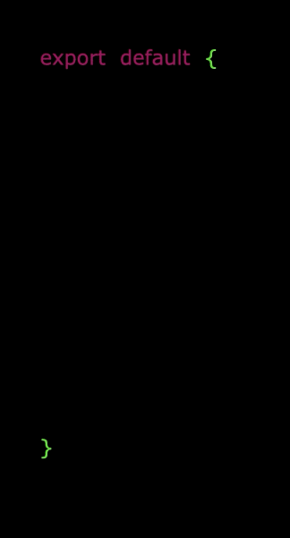
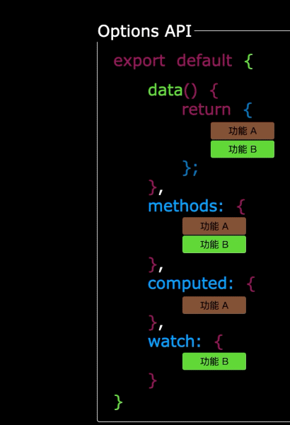
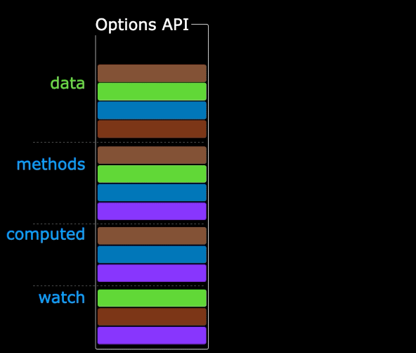
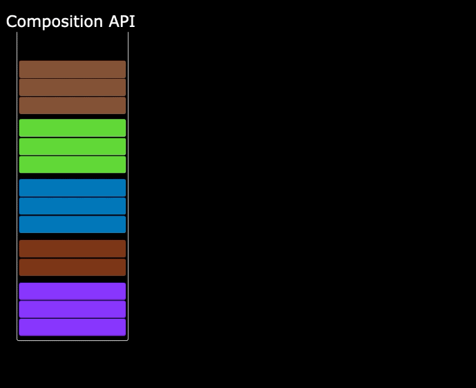
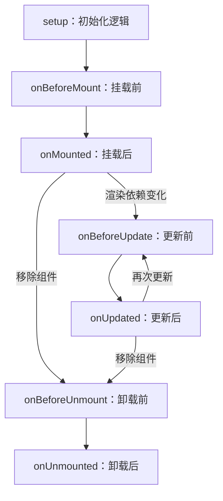

# Vue 3——简介

## 一、Vue 是什么

**Vue 是一个用于构建用户界面的 JavaScript 框架。**

它建立在 HTML、CSS 和 JavaScript 的基础上，提供声明式、响应式和组件化的开发方式，帮助我们组织页面和交互逻辑。[Vue.js](https://cn.vuejs.org/guide/introduction?utm_source=chatgpt.com)

可以先理解为：

> 使用 Vue 描述“页面应该如何根据数据展示”，由 Vue 负责协调数据变化后的界面更新。

例如，一个商品管理页面通常需要：

- 展示商品列表。
- 根据关键词筛选商品。
- 打开新增、编辑弹窗。
- 校验表单并提交数据。
- 根据接口结果更新页面。

使用 Vue 可以更方便地组织这些功能。

### 1. Vue 与前端三件套的关系

|技术|主要职责|在 Vue 中的体现|
|---|---|---|
|HTML|页面结构与内容|编写模板，例如表单、按钮、列表|
|CSS|页面样式与布局|编写颜色、间距、Flex、响应式样式|
|JavaScript|数据与行为|定义状态、处理事件、请求接口|
|Vue|组织界面与交互|连接数据和模板，组织组件及其更新|

**学习 Vue 后，HTML、CSS、JavaScript 仍然要继续使用。**

例如，Vue 中的点击事件最终仍然执行 JavaScript 函数，商品列表的筛选仍然可能使用数组的 `filter()`。

### 2. Vue 与 Java 后端的关系

在常见的前后端分离项目中：

|部分|主要职责|
|---|---|
|Vue 前端|页面展示、用户交互、表单校验、调用接口|
|Java 后端|登录认证、权限检查、业务处理、数据库访问|
|HTTP 接口|传递请求和响应数据|

以查询用户为例：

1. 用户在 Vue 页面点击“查询”。
2. 前端发送 HTTP 请求。
3. Java 后端查询数据库，返回 JSON。
4. 前端更新用户列表数据。
5. Vue 根据新的数据更新页面。

Vue 本身不直接代替后端查询数据库，也不会自动完成 HTTP 请求；请求逻辑通常由我们使用 `fetch` 或请求库编写。

---

## 二、为什么使用 Vue

### 1. 减少手动维护 DOM 的工作

先看一个原生 JavaScript 计数器：

```js
<p id="count-text">当前数量：0</p>
<button id="add-button" type="button">加一</button>

<script>
  let count = 0;

  const countText = document.querySelector('#count-text');
  const addButton = document.querySelector('#add-button');

  addButton.addEventListener('click', () => {
    count += 1;

    // 数据变化后，手动修改页面
    countText.textContent = `当前数量：${count}`;
  });
</script>
```

这里需要同时维护：

- 变量 `count`。
- 显示数量的 DOM 元素。
- 数据变化之后如何更新 DOM。

如果同一个数据影响列表、统计、按钮状态等多个位置，手动同步这些位置就会增加维护成本。

在 Vue 中，我们可以声明数据与页面的关系，更新响应式数据后，由框架安排相关界面更新。

### 2. 方便组织复杂页面

页面变大以后，可以拆分成多个组件，例如：

|组件|职责|
|---|---|
|`SearchBar`|输入搜索条件|
|`UserTable`|展示用户列表|
|`UserForm`|新增或编辑用户|
|`Pagination`|切换页码|

这样可以分别维护每个部分，并在其他页面复用合适的组件。

---

## 三、Vue 的三个核心概念

### 1. 声明式渲染

**声明式渲染：描述数据与界面的关系，而不是逐步编写所有 DOM 更新操作。**

例如：

```
<p>{{ username }}</p>
```

这段模板表达的是：

> 这个位置显示 `username` 的值。

其中，`{{ }}` 是文本插值语法，后续会详细学习。

对比两种思路：

|思路|关注点|
|---|---|
|命令式|找到哪个元素，执行哪些修改步骤|
|声明式|当前数据是什么，界面应该呈现什么|

声明式不代表业务逻辑不用写。搜索条件、计算规则、接口调用等仍然由开发者实现。

### 2. 响应式

**响应式：Vue 可以追踪相关响应式状态的访问和变化，并据此安排界面更新。**

例如：

```
const count = ref(0);

count.value += 1;
```

当模板使用了 `count`，修改它的值后，对应展示会更新。

需要先记住两个边界：

- 普通变量不会仅因为出现在 Vue 代码中，就自动变成响应式状态。
- Vue 通常会批量调度 DOM 更新，修改数据不意味着 DOM 在同一行代码之后立刻同步更新。

`ref()`、`reactive()` 和 DOM 更新时机，会在后面的章节展开。

### 3. 组件化

**组件：封装一部分界面及其相关逻辑的单元。**

一个组件可以包含：

- 页面结构。
- 自己使用的数据。
- 事件处理和其他逻辑。
- 相关样式。

例如，“商品卡片”组件可以接收不同商品的数据，展示图片、名称、价格和购买按钮。

组件化的价值主要是：

1. 拆分复杂页面。
2. 提高复用能力。
3. 明确不同部分的职责。
4. 让修改和维护更集中。

注意：组件并不是越小越好，应根据职责和复用需求拆分。

---

## 四、什么是“渐进式框架”

“渐进式”可以理解为：

> 可以根据项目需要，逐步使用 Vue 及其配套能力。

例如：

|使用程度|示例|
|---|---|
|增强现有页面的一部分|在已有 HTML 页面中加入交互表单|
|使用组件组织界面|将搜索栏、列表、弹窗拆成组件|
|构建完整应用|配合路由、状态管理和构建工具开发项目|

Vue 既可以通过独立脚本引入，也可以用于完整的单页应用，还支持其他使用方式。并不是使用 Vue，就必须立即安装和学习全部生态工具。[Vue.js](https://cn.vuejs.org/guide/extras/ways-of-using-vue?utm_source=chatgpt.com)

---

## 五、Vue 的两种 API 风格

Vue 3 支持两种主要的组件逻辑编写风格：

- **选项式 API：Options API**
- **组合式 API：Composition API**

### 1. 选项式 API

按 `data`、`methods` 等选项组织代码：

```
export default {
  data() {
    return {
      count: 0
    };
  },

  methods: {
    increment() {
      this.count += 1;
    }
  }
};
```

可以这样理解：

|选项|主要用途|
|---|---|
|`data`|定义组件状态|
|`methods`|定义方法|
|`computed`|定义计算属性|
|`watch`|侦听数据变化|

### 2. 组合式 API

通过函数和相关 API 组织逻辑，常与 `<script setup>` 一起使用：

```
<script setup>
import { ref } from 'vue';

const count = ref(0);

function increment() {
  count.value += 1;
}
</script>
```

组合式 API 便于按业务功能组织相关代码，也适合抽取可复用逻辑和配合 TypeScript 使用。选项式 API 仍然受到支持，不是“Vue 3 中已经不能用”的写法。[Vue.js](https://cn.vuejs.org/guide/extras/composition-api-faq?utm_source=chatgpt.com)

### 3. 当前怎么学

建议后续以：

**Vue 3 + 组合式 API + `<script setup>`**

作为主要学习路线，同时能够读懂选项式 API。

先用 JavaScript 理解 Vue 的行为，再逐步加入 TypeScript，避免同时被框架语法和复杂类型分散注意力。

---

## 六、单文件组件：`.vue` 文件

在工程化开发中，通常将一个 Vue 组件写在 `.vue` 文件里，称为**单文件组件**，简称 **SFC**。

下面是一个完整的计数器组件：

```vue
<script setup>
import { ref } from 'vue';

// 定义响应式状态
const count = ref(0);

// 定义事件处理函数
function increment() {
  count.value += 1;
}
</script>

<template>
  <section class="counter">
    <p>当前数量：{{ count }}</p>

    <button type="button" @click="increment">
      加一
    </button>
  </section>
</template>

<style scoped>
.counter {
  padding: 16px;
  border: 1px solid #ddd;
  border-radius: 8px;
}

button {
  padding: 8px 16px;
  cursor: pointer;
}
</style>
```

三个部分的职责：

|部分|职责|
|---|---|
|`<script setup>`|数据与逻辑|
|`<template>`|页面模板|
|`<style>`|样式|

这段代码需要放在已配置的 Vue 工程中运行。浏览器不能像打开普通 HTML 一样，直接理解整个 `.vue` 文件；工程工具会处理它。官方快速上手提供了相应的项目创建流程。[Vue.js](https://cn.vuejs.org/guide/quick-start?utm_source=chatgpt.com)

### 示例中的语法说明

|代码|含义|
|---|---|
|`import { ref } from 'vue'`|从 Vue 导入 `ref`|
|`ref(0)`|创建初始值为 0 的响应式状态|
|`count.value`|在 JavaScript 中访问或修改这个 ref 的值|
|`{{ count }}`|在模板中展示数量；此处顶层 ref 自动解包|
|`@click="increment"`|点击时执行 `increment`|
|`scoped`|让工具对样式进行作用域处理，具体规则后续学习|

点击按钮时的过程：

1. 执行 `increment()`。
2. 修改 `count.value`。
3. Vue 追踪到状态变化。
4. 安排更新使用该状态的界面。

---

## 七、Vue 与相关工具的区别

后续课程会出现不少名字，可以先分清职责：

|名称|主要职责|
|---|---|
|Vue|构建界面、组织组件与响应式更新|
|Vue Router|管理前端路由与页面视图切换|
|Pinia|管理跨组件共享的状态|
|Vite|提供开发服务器、构建等工程能力|
|TypeScript|提供静态类型检查与相关语言能力|
|fetch / 请求库|发送 HTTP 请求|

**Vue 不等于 Vue Router，Vite 也不是 Vue 的语法。**

这些工具可以协作，但解决的是不同问题。

### 补充：单页应用是什么意思

单页应用，简称 **SPA**，通常在同一个主文档中，根据路由和数据变化切换界面，无需每次导航都重新加载整个页面。

例如管理系统里的：

- 用户管理。
- 商品管理。
- 订单管理。

它们可以是同一个应用中的不同路由视图。

“单页”不等于只有一个功能页面；Vue 也不限于构建 SPA。[Vue.js](https://cn.vuejs.org/guide/extras/ways-of-using-vue?utm_source=chatgpt.com)

---

## 八、本章需要掌握的内容

这一章先理解以下几点：

1. **Vue 用于构建用户界面，建立在 HTML、CSS、JavaScript 之上。**
2. **声明式渲染**描述数据与界面的关系。
3. **响应式**让相关状态变化能够驱动界面更新。
4. **组件化**帮助拆分和复用界面与逻辑。
5. Vue 3 同时支持选项式和组合式 API。
6. `.vue` 文件通常包含逻辑、模板和样式，需要相应工具处理。

后续学习时，可以始终带着一个问题：**这段代码定义了什么状态，模板如何使用它，什么操作会改变它？**


---
---


# Vue 3——创建工程

创建一个 Vue 3 工程，可以使用官方脚手架 **create-vue**。它会生成基于 **Vite** 的项目。

主要操作是：

```
npm create vue@latest

# 按提示将项目命名为 vue-study
cd vue-study

npm install
npm run dev
```

下面先解释这些工具，再逐步完成创建。

---

## 一、先认识需要用到的工具

### 1. Node.js：JavaScript 运行环境

**Node.js 可以让 JavaScript 在浏览器之外运行。**[Node.js Learn](https://nodejs.org/en/learn/getting-started/introduction-to-nodejs?utm_source=chatgpt.com)

以前写网页时：

```
<script>
  console.log('你好');
</script>
```

JavaScript 由浏览器执行。

安装 Node.js 后，也可以在终端中执行 JavaScript 文件：

```
node demo.js
```

在 Vue 工程中，Node.js 主要用于运行：

- 项目创建工具。
- 开发服务器。
- 构建工具。
- 代码检查等工具。

**这里安装 Node.js，是为了运行前端开发工具。你的业务后端仍然可以使用 Java。**

### 2. npm：包管理工具

前端项目通常会使用很多别人已经编写好的代码，例如：

- Vue。
- 路由库。
- UI 组件库。
- 构建工具。

这些可以作为“包”安装到项目中，npm 负责管理它们。

npm 常见用途：

|用途|示例|
|---|---|
|安装项目依赖|`npm install`|
|添加某个依赖|`npm install 包名`|
|执行项目脚本|`npm run dev`|
|查看 npm 版本|`npm -v`|

官方 Node.js 安装包通常会同时安装 npm。

结合你的 Java 基础，可以作一个有限的类比：

> npm 的依赖管理功能，与 Maven 的依赖管理有相似之处，但两者的配置和工作机制不同。

### 3. create-vue：项目脚手架

**脚手架是自动生成项目初始结构和配置的工具。**

如果不用脚手架，需要自己准备：

- 项目目录。
- 依赖声明。
- Vue 相关配置。
- 构建工具配置。
- 入口文件和示例组件。

create-vue 会根据你选择的功能生成这些内容，作用有点像使用 Spring Initializr 创建 Spring Boot 项目。

执行：

```
npm create vue@latest
```

实际会获取并运行 `create-vue`。这里的 `latest` 指脚手架包的发布标签，并不是项目名称。npm 的 `create` 是 `init` 的别名，会按相应规则调用初始化工具。[npm Docs](https://docs.npmjs.com/cli/v11/commands/npm-init?utm_source=chatgpt.com)

### 4. Vite：开发与构建工具

Vite 在项目中主要负责两类工作：

|阶段|主要职责|
|---|---|
|开发阶段|提供本地开发服务器、处理源码、支持热更新|
|构建阶段|将源码处理为适合部署的静态资源|

**热更新**可以先理解为：修改组件代码后，浏览器中的相关内容通常会自动更新，不必每次手动刷新整个页面。[Vite 官方中文文档](https://cn.vite.dev/guide/?utm_source=chatgpt.com)

注意区分：

- **Vue**：组织组件、响应式状态和界面更新。
- **create-vue**：生成工程。
- **Vite**：支持工程开发和构建。
- **npm**：管理依赖、运行脚本。
- **Node.js**：运行这些开发工具。

---

## 二、安装并检查开发环境

### 1. 安装 Node.js

从 [Node.js 官网](https://nodejs.org/en/download) 安装满足要求的 **LTS 版本**。

LTS 是 Long-Term Support，表示长期支持版本。

**截至本文整理时，Vue 官方快速上手给出的 Node.js 要求是：**

```
^22.18.0 || >=24.12.0
```

可以理解为：

- Node.js 22 系列中，不低于 22.18.0 的版本。
- 或不低于 24.12.0 的版本。

后续工具升级可能调整要求，以实际项目提示为准。[Vue.js](https://cn.vuejs.org/guide/quick-start?utm_source=chatgpt.com)

### 2. 检查安装结果

安装后重新打开终端，执行：

```
node -v
npm -v
```

两条命令都能正常显示版本号，说明对应命令已经可以使用。

如果提示“找不到命令”或“不是内部或外部命令”，优先检查：

- 是否安装成功。
- 是否重新打开了终端。
- 安装程序是否正确配置了 `PATH`。

`PATH` 是系统查找可执行程序时使用的目录列表。

### 3. 准备编辑器

可以使用：

- **Visual Studio Code**
- **Vue - Official 扩展**

该扩展提供 Vue 文件的语法支持、补全和类型检查等编辑器能力。这也是 Vue 官方快速上手给出的编辑器组合。[Vue.js](https://cn.vuejs.org/guide/quick-start?utm_source=chatgpt.com)

---

## 三、创建 Vue 工程

### 1. 在项目存放位置打开终端

例如，你准备把前端项目统一放在某个文件夹中，就在该文件夹里打开终端。

此时所在的是**项目的父目录**，脚手架接下来会创建项目文件夹。

执行：

```
npm create vue@latest
```

如果 npm 询问是否下载并执行 `create-vue`，根据提示输入 `y` 并回车。

### 2. 设置项目名称

例如：

```
vue-study
```

建议初学时使用小写英文、数字和短横线，避免不必要的命名问题。

创建后，项目会位于：

```
vue-study
```

这个文件夹中。

### 3. 选择功能

不同版本的脚手架，选项名称和交互形式可能不同。有的逐项询问，有的使用多选菜单，按终端提示操作即可。

**为了先学习 Vue 基础，建议创建一个功能较少的 JavaScript 项目。**

|可选功能|概念|当前建议|
|---|---|---|
|TypeScript|为 JavaScript 增加静态类型检查|第一遍可暂不选，熟悉 Vue 后再加入|
|JSX|在 JavaScript 中表达界面的语法|暂不选，先学 Vue 模板|
|Vue Router|管理前端路由和视图切换|暂不选，学路由时再加入|
|Pinia|管理跨组件共享状态|暂不选，学状态管理时再加入|
|单元测试工具|测试函数、组件等较小单元|暂不选|
|端到端测试工具|模拟用户操作验证完整流程|暂不选|
|ESLint|检查代码中的问题和规则违背|可选|
|Prettier|自动统一代码格式|可选|

ESLint 和 Prettier 的区别：

- **ESLint 更关注代码规则与潜在问题。**
- **Prettier 更关注缩进、换行、引号等格式。**

后面需要路由或状态管理时，仍然可以添加相应依赖，不必现在一次全部选上。


```powershell

## 1.创建命令

npm create vue@latest

  
## 2.具体配置

## 配置项目名称

√ Project name: vue_study

## 是否添加TypeScript支持

√ Add TypeScript?  Yes

## 是否添加JSX支持

√ Add JSX Support?  No

## 是否添加路由环境

√ Add Vue Router for Single Page Application development?  No

## 是否添加pinia环境

√ Add Pinia for state management?  No

## 是否添加单元测试

√ Add Vitest for Unit Testing?  No

## 是否添加端到端测试方案

√ Add an End-to-End Testing Solution? » No

## 是否添加ESLint语法检查

√ Add ESLint for code quality?  Yes

## 是否添加Prettiert代码格式化

√ Add Prettier for code formatting?  No

```

![[Pasted image 20261107103151.png]]

---

## 四、安装依赖并启动项目

### 1. 进入项目目录

```
cd vue-study
```

`cd` 表示切换当前目录。

接下来的命令需要在项目根目录执行，也就是能看到 `package.json` 的位置。

### 2. 安装依赖

```
npm install
```

npm 会根据项目中的依赖声明和锁文件等信息安装依赖。

通常会出现：

|文件或目录|作用|
|---|---|
|`node_modules`|保存实际安装的依赖文件|
|`package-lock.json`|记录依赖解析结果，帮助复现安装|

**不要进入 `node_modules` 修改 Vue 或 Vite 的源码来完成普通业务开发。** 自己的页面和逻辑主要写在 `src` 中。

### 3. 启动开发服务器

```
npm run dev
```

终端会输出本地访问地址，通常类似：

```
http://localhost:5173/
```

在浏览器中打开终端实际显示的地址。

如果默认端口被占用，开发服务器可能使用其他端口，因此不要只记住 `5173`。

### 4. 停止与再次启动

停止服务：

```
Ctrl + C
```

之后再次开发时，在项目目录执行：

```
npm run dev
```

**不需要每次启动前都重新创建项目或重新安装全部依赖。**

如果只是关闭后重新打开已有工程，一般直接启动即可；新获取项目、依赖有变化等情况下，再安装依赖。

---

## 五、初识项目目录

下面列出常见文件。具体内容会随脚手架版本和功能选择变化。

|路径|作用|
|---|---|
|`index.html`|HTML 入口|
|`package.json`|项目信息、依赖声明、可执行脚本|
|`package-lock.json`|npm 依赖锁文件|
|`vite.config.js` 或 `.ts`|Vite 配置|
|`public/`|按约定直接提供的静态资源|
|`src/`|主要业务源码|
|`src/main.js` 或 `.ts`|JavaScript/TypeScript 入口|
|`src/App.vue`|根组件|
|`src/components/`|存放组件的常见目录|
|`src/assets/`|存放参与源码引用和构建处理的资源|
|`node_modules/`|安装的依赖|
|`dist/`|构建后通常生成的输出目录|

先重点认识三个文件：

### 1. `index.html`：提供挂载位置

核心内容通常类似：

```
<div id="app"></div>

<script type="module" src="/src/main.js"></script>
```

其中：

- `#app` 是 Vue 应用的挂载容器。
- `main.js` 是源码入口。
- `type="module"` 表示按 ES 模块方式加载。

如果选择了 TypeScript，入口路径通常对应 `main.ts`。

### 2. `src/main.js`：创建并挂载应用

不包含路由等扩展的最小逻辑如下：

```
import { createApp } from 'vue';
import App from './App.vue';

createApp(App).mount('#app');
```

逐句解释：

|代码|含义|
|---|---|
|`import { createApp } from 'vue'`|导入创建 Vue 应用的函数|
|`import App from './App.vue'`|导入根组件|
|`createApp(App)`|以 App 为根组件创建应用|
|`.mount('#app')`|将应用挂载到指定容器|

实际生成的入口还可能导入全局 CSS，或注册 Router、Pinia 等功能。

### 3. `src/App.vue`：根组件

可以理解为当前组件结构的起点。

之后通常由它直接或间接使用其他组件，例如：

- 顶部导航组件。
- 用户列表组件。
- 编辑表单组件。

---

## 六、修改工程，验证是否成功


**vue3**的单文件组件 SFC 结构

```vue
<template>
  <!-- HTML 模板，写页面结构 -->
</template>

<script setup>
  <!-- JS 逻辑：导入、变量、函数、响应式 -->
</script>

<style scoped>
  <!-- CSS 样式，scoped 代表样式只作用于当前组件，不污染其他组件 -->
</style>
```


将 `src/App.vue` 替换为下面的内容（vue3语法）：

```vue
<script setup>
import { ref } from 'vue';

const count = ref(0);

function increment() {
  count.value += 1;
}
</script>

<template>
  <main class="page">
    <h1>我的第一个 Vue 工程</h1>

    <p>当前计数：{{ count }}</p>

    <button type="button" @click="increment">
      加一
    </button>
  </main>
</template>

<style scoped>
.page {
  padding: 24px;
}

button {
  padding: 8px 16px;
  color: white;
  background: #2563eb;
  border: none;
  border-radius: 6px;
  cursor: pointer;
}
</style>
```

保存文件后，检查：

1. 页面出现“我的第一个 Vue 工程”。
2. 点击按钮，数字递增。
3. 修改标题并保存，浏览器中的内容相应更新。

原模板可能还导入了全局样式，因此页面整体的背景、居中方式等，可能继续受到全局 CSS 影响。


### 关于`import { ref } from 'vue'`

这里的`vue`是包名，就是 `package.json` 里依赖的 `vue` 这个 npm 包。

1. 当你写

```
import { ref } from 'vue'
```

不是去找名叫 `vue.js` 的本地文件，而是去**node_modules 里面找 vue 这个包**。 

2. 项目安装依赖的时候执行过 `npm install vue`，就把 vue 源码包下载到 `node_modules/vue` 文件夹里了。 
3. 打包工具（Vite / Webpack）识别到 `from 'vue'`，不带 `./`、`../`、`@/` → 判定是**第三方包**
4. 去 node_modules 里加载 vue 包的导出内容，看它的 `package.json` 的 `exports`
5. 它帮你转发到 `@vue/reactivity`
6. 来到 `node_modules/@vue/reactivity`，读取它的入口，加载 `dist` 里的打包代码
7. 拿到 `ref` 函数

---

## 七、`npm run dev` 为什么能启动项目

打开 `package.json`，通常可以找到 `scripts`。

下面是一个简化节选，**不是让你覆盖整个文件**：

```
{
  "scripts": {
    "dev": "vite",
    "build": "vite build",
    "preview": "vite preview"
  }
}
```

执行：

```
npm run dev
```

就是让 npm 找到 `scripts` 中的 `dev`，并执行其对应命令。

所以：

|npm 命令|上面示例中执行的命令|
|---|---|
|`npm run dev`|`vite`|
|`npm run build`|`vite build`|
|`npm run preview`|`vite preview`|

`dev`、`build`、`preview` 是项目脚本的名称，真正执行什么由配置决定。npm 的 `scripts` 就是用于定义这些命令的。[npm Docs](https://docs.npmjs.com/cli/v11/configuring-npm/package-json?utm_source=chatgpt.com)

### `dependencies` 与 `devDependencies`

`package.json` 中还常见这两个字段：

|字段|常见内容|
|---|---|
|`dependencies`|应用代码依赖，例如 Vue|
|`devDependencies`|开发、构建、检查工具，例如 Vite|

对于这里的客户端 Vue 项目，构建时会按引用关系处理需要的代码。部署时通常提供构建产物，而不是要求浏览器读取整个 `node_modules`。

---

## 八、项目是怎样显示到浏览器里的

开发阶段可以按下面的顺序理解：

1. 执行 `npm run dev`，启动 Vite 开发服务器。
2. 浏览器访问开发服务器，加载 `index.html`。
3. 入口模块 `main.js` 被加载。
4. Vite 及相应插件处理 `.vue` 等源码。
5. `main.js` 创建 Vue 应用，将根组件挂载到 `#app`。
6. Vue 管理组件的渲染和后续更新。

这里要区分两个运行位置：

|位置|运行的主要内容|
|---|---|
|本机 Node.js 环境|Vite 等开发工具|
|浏览器|处理后的前端代码与 Vue 界面逻辑|

Vite 的开发服务器也不是你的 Java 业务服务器。后续联调时，可能同时运行：

- 前端开发服务。
- Java 后端服务。

---

## 九、开发、构建与预览的区别

### 1. 开发

```
npm run dev
```

用于日常写代码，提供开发时的更新和调试能力。

### 2. 构建

```
npm run build
```

生成适合部署的资源，默认通常输出到：

```
dist
```

构建可能包括处理组件、转换代码、打包和优化资源等工作。

如果项目额外配置了类型检查等步骤，`build` 脚本也可能先执行那些步骤，具体看 `package.json`。

### 3. 预览构建结果

先构建，再预览：

```
npm run build
npm run preview
```

`preview` 用于在本地查看构建产物。Vite 官方明确将它定位为本地预览工具，不应直接当作正式生产服务器。[Vite 官方中文文档](https://cn.vite.dev/guide/static-deploy?utm_source=chatgpt.com)

以后部署常见客户端 Vue 项目时，可以由 Nginx 等服务器提供 `dist` 中的静态资源，Java 后端继续提供业务接口。

---

## 十、与旧教程里的 Vue CLI 有什么区别

你可能在课程中看到：

```
vue create 项目名
```

这是 **Vue CLI** 的使用路线。

|工具|常见创建方式|工程基础|
|---|---|---|
|create-vue|`npm create vue@latest`|Vite|
|Vue CLI|`vue create 项目名`|webpack|

create-vue 是 Vue 官方推荐的 Vite 工程创建方式。学习新项目时，可以先统一使用本文这条路线，避免把两套工具的配置文件和命令混在一起。[GitHub](https://github.com/vuejs/create-vue?utm_source=chatgpt.com)

![[Pasted image 20261107101805.png]]

![[Pasted image 20261107102026.png]]

### Webpack 流程

1. 启动时，**从入口 entry 开始，提前递归扫描所有路由、所有模块**
2. 把全部代码提前打包合并成一个 / 多个 bundle 包
3. 打包全部完成之后，开发服务器才准备好、启动成功

> 缺点：项目越大，启动越慢；改一个文件，往往要重新打包一整段依赖链，热更新慢 核心：**先全量打包，再给浏览器**

### Vite 流程

1. 服务器瞬间 ready，**不提前打包全部代码**
2. 浏览器请求入口 entry，浏览器原生支持 ESM
3. 浏览器解析 entry 里面的 import，**按需发起 HTTP 请求，用到哪个模块，再请求哪个**
4. 路由懒加载（dynamic import）也是浏览器运行时才去拉取对应模块

> 核心：**按需加载，浏览器原生 ESM，不提前打包所有代码**


- Webpack：**先打包，再运行**，启动要打包全部依赖，大项目启动慢
- Vite：**先启动服务，按需加载**，利用浏览器原生 ESM，开发服务器启动极快

---

## 十一、常见问题

|现象|优先检查或处理|
|---|---|
|`node`、`npm` 无法识别|安装结果、PATH，重新打开终端|
|提示 Node 版本不符合要求|对照脚手架和依赖要求升级 Node|
|找不到 `package.json`|是否已经进入 `vue-study` 项目目录|
|提示 `vite` 找不到|是否在项目中完成了 `npm install`|
|浏览器无法打开页面|开发服务器是否仍在运行、地址和端口是否正确|
|改代码后页面没变化|文件是否保存、是否改了正在运行的工程、终端或控制台是否报错|
|安装依赖失败|阅读具体错误，检查网络、依赖源地址和版本要求|
|Windows 提示无法运行 `npm.ps1`|可切换到命令提示符终端执行 npm 命令|
|关闭终端后页面无法访问|开发服务器已经停止，重新执行 `npm run dev`|

本章完成后，你应该能够独立创建工程、启动服务、修改 `App.vue`，并解释 **Node.js、npm、create-vue、Vite** 分别承担什么工作。


---
---


# 补充：Vue 3——官方示例工程结构


从截图来看，你创建的是一个 **Vue 3 + TypeScript + Vite** 工程，并保留了官方欢迎页示例。

当前先重点理解三个部分：

- **入口**：页面从哪里开始加载。
- **组件**：页面由哪些部分组成。
- **配置**：开发工具按什么规则工作。

## 一、先注意：截图里的“嵌套”不一定是目录

截图中，`.editorconfig`、`.oxlintrc.json` 等显示在 `package.json` 下面，`env.d.ts` 等显示在 `tsconfig.json` 下面。

**这是 VS Code 的文件嵌套分组显示，不代表它们真的存放在 JSON 文件里面。** `package.json`、`tsconfig.json` 本身都是文件。

---

## 二、项目入口：`index.html`、`main.ts`、`App.vue`

### 1. `index.html`：HTML 入口

其中通常包含：

```
<div id="app"></div>

<script type="module" src="/src/main.ts"></script>
```

含义：

- 提供一个 `id="app"` 的容器。
- 加载 `src/main.ts`。
- Vue 应用随后挂载到这个容器。

### 2. `src/main.ts`：程序入口

官方基础工程中的代码通常类似：

```
import './assets/main.css';

import { createApp } from 'vue';
import App from './App.vue';

createApp(App).mount('#app');
```

|代码|作用|
|---|---|
|`import './assets/main.css'`|加载全局样式|
|`import { createApp } from 'vue'`|导入创建应用的函数|
|`import App from './App.vue'`|导入根组件|
|`createApp(App)`|创建 Vue 应用|
|`.mount('#app')`|挂载到 HTML 中的容器|

这里使用 `.ts`，说明你创建工程时启用了 **TypeScript**。

### 3. `src/App.vue`：根组件

**根组件是整个组件结构的起点。**

官方欢迎页通常在这里组合 Logo、`HelloWorld`、`TheWelcome` 等内容。

可以将它理解为：`main.ts` 负责启动应用，`App.vue` 负责组织应用最外层的界面。

---

## 三、`components`：官方示例组件

你截图中的这些 `.vue` 文件，是用来演示组件组织方式的。

|文件或目录|大致作用|
|---|---|
|`HelloWorld.vue`|展示欢迎标题、说明文字等内容|
|`TheWelcome.vue`|组织欢迎页的文档、工具、生态等介绍内容|
|`WelcomeItem.vue`|封装一个介绍条目的公共结构|
|`icons/`|保存示例使用的图标组件|

重点理解 **`TheWelcome` 与 `WelcomeItem` 的分工**：

- `TheWelcome.vue` 决定展示哪些介绍内容。
- `WelcomeItem.vue` 提供可以重复使用的条目结构。
- 多个条目使用相同结构，但填入不同图标、标题和正文。

这就是组件复用的一种体现。后面学习**组件和插槽**时，会更容易看懂它们。

**这些示例组件不是 Vue 规定必须存在的文件。** 以后开发自己的页面，可以替换它们；删除组件时，也要同步移除相关导入和使用位置。

---

## 四、`assets` 与 `public`：资源文件

### 1. `src/assets`

|文件|作用|
|---|---|
|`base.css`|基础样式，例如颜色变量、基础排版、默认样式调整|
|`main.css`|全局样式入口，通常还会引入 `base.css`|
|`logo.svg`|Vue Logo 图片|

CSS 也可以导入其他 CSS：

```
@import './base.css';
```

所以即使 `main.ts` 只导入了 `main.css`，也可能间接加载 `base.css`。

### 2. `public`

截图中的：

```
public/favicon.ico
```

是浏览器标签页使用的网站图标。

两类资源目录可以先这样区分：

|目录|常见使用方式|
|---|---|
|`src/assets`|在源码中引用，由构建工具处理|
|`public`|按原文件名提供，通常通过站点路径访问|

例如，`public/favicon.ico` 通常对应：

```
<link rel="icon" href="/favicon.ico">
```

访问路径中不写 `public`。

---

## 五、工程与 TypeScript 配置

### 1. `package.json`

记录项目的：

- 依赖。
- 开发工具。
- 启动、构建、检查等脚本。

想知道项目支持哪些命令，优先查看它的 `scripts`：

```
npm run
```

这条命令也可以列出可用脚本。具体有哪些，以你项目的实际配置为准。

### 2. `vite.config.ts`

这是 **Vite 的配置文件**，可能涉及：

- Vue 插件。
- 路径别名。
- 开发服务器。
- 接口代理。
- 构建配置。

虽然它也是 TypeScript 文件，但它属于开发工具配置，不是普通页面组件。

### 3. TypeScript 相关文件

|文件|主要作用|
|---|---|
|`tsconfig.json`|TypeScript 项目的总配置入口，通常关联其他配置|
|`tsconfig.app.json`|面向浏览器端应用源码的类型检查配置|
|`tsconfig.node.json`|面向 Node 环境工具配置文件的类型检查配置|
|`env.d.ts`|补充环境相关类型声明，常见于 Vite 客户端类型支持|

为什么分应用与 Node 两套配置？

因为它们运行环境不同：

- 页面代码可能使用 `document`、`window`。
- 工具配置可能使用 Node.js API。

官方脚手架通过不同配置和项目引用，区分这些环境。**初学阶段先保留生成的配置即可。**[Vue.js](https://vuejs.org/guide/typescript/overview.html?utm_source=chatgpt.com)

---

## 六、编辑器、代码检查与 Git 文件

|文件|主要作用|
|---|---|
|`.vscode/extensions.json`|推荐安装的 VS Code 扩展|
|`.vscode/settings.json`|当前工程的编辑器设置|
|`.editorconfig`|约定缩进、换行符等基础编辑格式|
|`eslint.config.ts`|ESLint 代码检查配置|
|`.oxlintrc.json`|Oxlint 代码检查配置|
|`.gitignore`|指定 Git 忽略哪些文件|
|`.gitattributes`|设置 Git 对文件的处理规则，例如文本换行|
|`README.md`|项目说明，通常包含安装、启动和构建方法|

其中，**Oxlint 和 ESLint 都属于代码检查工具**，用于发现潜在问题或不符合规则的写法。两者可以配合使用，具体怎样运行，需要查看项目脚本和配置。[The JavaScript Oxidation Compiler](https://oxc.rs/docs/guide/usage/linter.html?utm_source=chatgpt.com)

它们不是页面组件，也不负责将欢迎页显示出来。

---

## 七、现在建议按什么顺序看

按下面的顺序阅读，比较容易理解：

1. **`main.ts`**：看应用怎样创建、挂载，全局样式从哪里引入。
2. **`App.vue`**：看根组件怎样导入并使用其他组件。
3. **`HelloWorld.vue`**：先认识一个较简单的组件。
4. **`TheWelcome.vue`**：看多个内容如何被组织起来。
5. **`WelcomeItem.vue`**：初步观察公共结构和插槽的用法。
6. **`main.css`、`base.css`**：理解欢迎页的样式来源。

先把入口与组件关系看清楚，配置文件在需要修改端口、代理、别名或检查规则时再深入。


## 八、后续如何启动已有工程

工程创建并安装过依赖后，后续开发一般只需要**打开项目、启动开发服务器**。

### 1. 打开项目

用 VS Code 打开 `vue-study` 文件夹，再通过菜单打开：

**终端 → 新建终端**

确认终端位于项目根目录，也就是能看到 `package.json` 的目录。

如果终端还在项目外面，先执行：

```
cd vue-study
```

### 2. 安装依赖（第一次新建项目必须执行！）

```
npm install
```

它会下载 vue、vite、ts、eslint 这些包，等待跑完。

日常启动不需要反复执行 `npm install`。

以下情况通常需要安装依赖：

- 第一次下载或克隆这个项目。
- `node_modules` 不存在。
- 项目新增、更新了依赖，需要同步安装。

判断是否有新增依赖，打开项目里的 `package.json`

- `dependencies`：业务依赖（上线也要用，比如 vue、axios）
- `devDependencies`：开发依赖（仅本地开发，打包后不需要，比如 vite、eslint、ts）

> 只要别人 / 你自己执行了 `npm install xxx`，包就会自动写进这里； 只要这里没有新增条目，就**没有新增依赖**。

### 3. 启动开发服务器

```
npm run dev
```

然后打开终端显示的地址，通常为：

[http://localhost:5173/](http://localhost:5173/)

**以终端实际输出的地址为准**，端口被占用时可能不同。

### 4. 如何停止

在运行开发服务器的终端中按：

```
Ctrl + C
```

停止后，想继续开发，再执行：

```
npm run dev
```

**修改源码后保存，页面通常会自动更新，不需要重新启动；部分配置文件修改后可能需要重启。**

### 5. 补充常用命令

```
# 开发启动（写代码、热更新，日常开发用）
npm run dev

# 打包，生成上线的静态文件，输出到dist文件夹
npm run build

# 打包后预览dist产物
npm run preview
```


---
---


# Vue 2 与 Vue 3——简单组件对比

### Vue3 单文件组件 SFC 结构标准写法

```vue
<template>
  <!-- HTML 模板，写页面结构 -->
</template>

<script setup>
  <!-- JS 逻辑：导入、变量、函数、响应式 -->
</script>

<style scoped>
  <!-- CSS 样式，scoped 代表样式只作用于当前组件，不污染其他组件 -->
</style>
```


### Vue2 单文件组件 SFC 结构标准写法

```vue
<template>
  <!-- 模板部分和Vue3大体一样，指令语法大部分兼容 -->
</template>

<script>
export default {
  data() {
    return {
      count: 0
    }
  },
  methods: {
    increment() {
      this.count++
    }
  }
}
</script>

<style scoped>
/* style scoped Vue2 是有的！这个是一样的 */
</style>
```

>[!attention] 
>`export default`属于 **ES Module（ES6 模块）** 的语法，不是 Vue2 专属。 作用：**导出当前文件的一个默认值，别的文件 import 的时候，可以随便起名字接收它**。
>Vue3 中的`<script setup>` 是语法糖，**你看不到写 export default 了**，它底层自动帮你完成导出，不用手动写。


下面用一个**点击按钮，计数加一**的组件来对比。

这里比较的是：**Vue 2 常见的选项式写法**与 **Vue 3 常用的组合式写法**。Vue 3 也支持选项式 API。[Vue.js](https://cn.vuejs.org/guide/introduction?utm_source=chatgpt.com)

## 一、Vue 2：选项式 API

```vue
<template>
  <div>
    <h2>当前计数：{{ count }}</h2>
    <button type="button" @click="increment">加一</button>
  </div>
</template>

<script>
export default {
  // 数据放在 data 中
  data() {
    return {
      count: 0
    };
  },

  // 方法放在 methods 中
  methods: {
    increment() {
      this.count += 1;
    }
  }
};
</script>
```

先记住：

- **数据**写在 `data()` 返回的对象中。
- **方法**写在 `methods` 中。
- 方法中通过 `this.count` 访问数据。

Vue 2 组件通常通过这些选项组织数据和行为。[Vue.js](https://v2.cn.vuejs.org/v2/guide/components.html?utm_source=chatgpt.com)

## 二、Vue 3：组合式 API


```vue
<script setup lang="ts">
import { ref } from 'vue';

// 定义响应式数据
const count = ref(0);

// 定义方法
function increment() {
  count.value += 1;
}
</script>

<template>
  <div>
    <h2>当前计数：{{ count }}</h2>
    <button type="button" @click="increment">加一</button>
  </div>
</template>
```

先记住：

- `ref(0)` 创建初始值为 `0` 的响应式数据。
- 方法直接写成普通函数。
- 在脚本中，通过 `count.value` 访问或修改值。
- 在这里的模板中，直接写 `count`，不需要 `.value`。
- `lang="ts"` 表示使用 TypeScript，`setup` 是这种组件写法的标记。

## 三、对照看区别

|对比点|Vue 2 示例|Vue 3 示例|
|---|---|---|
|定义数据|`data()` 返回对象|`const count = ref(0)`|
|定义方法|放在 `methods` 中|直接定义函数|
|在方法中修改数据|`this.count += 1`|`count.value += 1`|
|模板显示数据|`{{ count }}`|`{{ count }}`|
|绑定点击事件|`@click="increment"`|`@click="increment"`|

**两段代码实现的功能相同，主要区别在脚本如何组织数据和方法。**

目前先熟悉 Vue 3 这一套写法即可：**用 `ref` 定义数据，用函数处理操作，模板负责展示和绑定事件。**


---
---


# Vue 3 核心语法——Options API 与 Composition API

## 一、先认识两种 API

Vue 提供两种主要的组件编写风格：

|名称|中文名称|核心思路|
|---|---|---|
|Options API|选项式 API|按数据、方法、计算属性等选项组织代码|
|Composition API|组合式 API|使用函数式 API，可以按业务功能组织相关逻辑|

这里的 **API** 指 Vue 提供的编程接口，不是前后端交互的 HTTP 接口。

需要先明确：

**Vue 3 同时支持两种风格。选项式 API 并没有被淘汰，组合式 API 也不只是某一种组件写法。**[Vue.js](https://cn.vuejs.org/guide/extras/composition-api-faq?utm_source=chatgpt.com)

---

## 二、Options API：选项式 API

 


### 1. 核心特点

把不同类别的代码放到对应的配置项中。

|配置项|主要用途|
|---|---|
|`data`|定义组件数据|
|`methods`|定义方法|
|`computed`|定义计算属性|
|`watch`|侦听数据变化|
|`mounted` 等|在组件生命周期的特定阶段执行逻辑|

目前先掌握 `data` 和 `methods`，其他选项后续再学。

### 2. 示例：计数器


```vue
<script lang="ts">
import { defineComponent } from 'vue';

export default defineComponent({
  // 定义数据
  data() {
    return {
      count: 0
    };
  },

  // 定义方法
  methods: {
    increment() {
      this.count += 1;
    },

    reset() {
      this.count = 0;
    }
  }
});
</script>

<template>
  <div>
    <h2>当前计数：{{ count }}</h2>

    <button type="button" @click="increment">加一</button>
    <button type="button" @click="reset">重置</button>
  </div>
</template>
```

`defineComponent()` 帮助 TypeScript 更好地推断组件类型；这里仍然是选项式 API。

### 3. 代码理解

#### `data()` 返回数据对象

```
data() {
  return {
    count: 0
  };
}
```

Vue 会将这里的数据作为组件的响应式状态管理。

每个组件实例调用自己的 `data()`，得到各自的数据对象。

#### `methods` 中定义方法

```
methods: {
  increment() {
    this.count += 1;
  }
}
```

在这些方法中，通过组件实例上的 `this` 访问数据：

```
this.count
```

这里的方法应使用普通方法写法，不要改成依赖外层 `this` 的箭头函数：

```
// 不适合这里的写法
increment: () => {
  // this 不会按组件方法的方式绑定
}
```

### 4. 组织方式

选项式 API 的分类依据是：

> **这段代码属于数据、方法，还是其他类别？**

因此：

- 数据集中在 `data`。
- 方法集中在 `methods`。
- 计算属性集中在 `computed`。
- 侦听逻辑集中在 `watch`。

对于较简单的组件，这种分类很直观。

---

## 三、Composition API：组合式 API

 


### 1. 核心特点

通过 Vue 提供的函数定义响应式状态和相关行为。

例如：

|API|主要用途|
|---|---|
|`ref()`|创建响应式状态|
|`reactive()`|创建响应式对象|
|`computed()`|创建计算属性|
|`watch()`|侦听数据变化|
|`onMounted()`|注册挂载阶段的逻辑|

这些 API 可以配合普通 JavaScript 函数，把一个业务功能需要的代码组织在一起。

**组合式 API 不仅仅是把 `data` 换成 `ref`，更重要的是提供了灵活组织和复用逻辑的方式。**[Vue.js](https://cn.vuejs.org/guide/extras/composition-api-faq?utm_source=chatgpt.com)

### 2. 先认识普通 `setup()` 写法

`setup()` 是在组件中使用组合式 API 的一个入口。后续会介绍简写语法

同样实现前面的计数器：

```vue
<script lang="ts">
import { defineComponent, ref } from 'vue';

export default defineComponent({
  setup() {
    // 定义响应式数据
    const count = ref(0);

    // 定义方法
    function increment() {
      count.value += 1;
    }

    function reset() {
      count.value = 0;
    }

    // 将模板需要的数据和方法返回
    return {
      count,
      increment,
      reset
    };
  }
});
</script>

<template>
  <div>
    <h2>当前计数：{{ count }}</h2>

    <button type="button" @click="increment">加一</button>
    <button type="button" @click="reset">重置</button>
  </div>
</template>
```

### 3. 与选项式写法的区别

#### 数据通过 `ref()` 创建

```
const count = ref(0);
```

目前先把它理解为：创建一个保存了数字的响应式对象。

在 JavaScript / TypeScript 中，读写它的值需要使用：

```
count.value
```

例如：

```
count.value += 1;
```

#### 方法直接写成函数

```
function increment() {
  count.value += 1;
}
```

不再需要把函数放进 `methods`，也不依赖组件的 `this`。

#### 模板需要使用的内容，通过返回对象提供

```
return {
  count,
  increment,
  reset
};
```

这里返回的 `count` 是 ref，模板访问它时会自动解包，所以仍然写：

```
<h2>{{ count }}</h2>
```

而不是：

```
<h2>{{ count.value }}</h2>
```

**普通 `setup()` 中不能通过 `this` 访问组件实例；其中的 `this` 是 `undefined`。**[Vue.js](https://cn.vuejs.org/api/composition-api-setup?utm_source=chatgpt.com)

---


## 四、两种 API 真正的区别：代码如何组织

假设一个组件包含三个功能：

- 用户搜索。
- 分页。
- 编辑弹窗。

### 1. 选项式 API：按代码类别组织

|配置项|可能包含的内容|
|---|---|
|`data`|搜索关键词、当前页码、弹窗状态|
|`methods`|搜索方法、翻页方法、保存方法|
|`watch`|搜索或分页相关的侦听逻辑|

同一个业务功能的相关代码，可能分布在不同配置项中。

当组件变大时，阅读“搜索功能”可能需要在几个位置之间切换。

### 2. 组合式 API：可以按业务功能组织

可以将代码组织为：

|功能区域|放在一起的内容|
|---|---|
|搜索功能|搜索状态、搜索方法、相关侦听|
|分页功能|页码状态、翻页方法、相关计算|
|编辑功能|表单状态、打开弹窗、提交方法|

之后还可以将适合复用的逻辑抽成函数，例如：

```
useUserSearch()
usePagination()
```

这些通常称为**组合式函数**，后续再详细学习。

组合式 API 提供了这种组织能力，但仍需要开发者合理拆分；不是换成 `<script setup>`，代码就会自动变得清晰。

---

## 五、对比整理

|对比点|Options API|Composition API|
|---|---|---|
|主要组织依据|数据、方法等选项类别|可以按业务功能组织|
|定义状态|常用 `data()`|常用 `ref()`、`reactive()`|
|定义方法|写在 `methods` 中|直接定义函数|
|访问状态|常通过 `this.xxx`|直接使用变量，ref 在脚本中用 `.value`|
|模板语法|插值、指令等|插值、指令等，基本使用方式一致|
|逻辑复用|有对应的复用方式|便于抽取组合式函数|
|TypeScript|支持|通常更便于利用函数和变量推断|
|Vue 3 是否支持|支持|支持|

---

## 六、容易混淆的三个概念

|概念|是什么|
|---|---|
|Composition API|一组用于响应式状态、生命周期等能力的 API|
|`setup()`|在组件中使用组合式 API 的入口|
|`<script setup>`|在单文件组件中更简洁地使用组合式 API 的语法|

因此：

**Composition API 可以写在普通 `setup()` 中，也可以通过 `<script setup>` 使用。**

你当前学习时，以 `<script setup lang="ts">` 为主要写法，同时能够读懂普通 `setup()` 和选项式代码即可。


---
---


# Vue 3 核心语法——setup

## 一、setup 是什么

**`setup()` 是在组件中使用组合式 API 的入口。**

可以在其中：

- 定义响应式数据。
- 定义方法。
- 创建计算属性、侦听器。
- 注册生命周期逻辑。
- 组织和复用业务功能。

先理解为：

> Vue 创建组件时，会调用 `setup()`，执行组件的初始化逻辑。

本章先学习普通 `setup()`，再看它与 `<script setup>` 的关系。

---

## 二、基本写法

下面是一个完整的计数器，可以放进当前工程的 `App.vue`：

```vue
<script lang="ts">
import { defineComponent, ref } from 'vue';

export default defineComponent({
  setup() {
    console.log('setup 执行了');

    // 定义响应式数据
    const count = ref(0);

    // 定义方法
    function increment() {
      count.value += 1;
    }

    // 将模板需要的内容返回
    return {
      count,
      increment
    };
  }
});
</script>

<template>
  <div>
    <h2>当前计数：{{ count }}</h2>

    <button type="button" @click="increment">
      加一
    </button>
  </div>
</template>
```

其中，`defineComponent()` 用于帮助 TypeScript 推断组件类型，并不是调用 `setup()` 的函数；`setup()` 由 Vue 在创建组件时调用。

### 1. 数据直接定义在 setup 中

```
const count = ref(0);
```

暂时记住：

- `ref(0)` 创建响应式数据。
- 脚本中通过 `count.value` 读写。
- 这里的模板中直接使用 `count`。

`ref` 的详细用法后续单独学习。

### 2. 方法直接写成函数

```
function increment() {
  count.value += 1;
}
```

不需要放在 `methods` 中，也不需要通过 `this` 查找 `count`。

### 3. 返回模板需要的内容

```
return {
  count,
  increment
};
```

返回对象中的属性，可以被模板访问。这里返回的是 ref，模板会自动解包它。[Vue.js](https://cn.vuejs.org/api/composition-api-setup?utm_source=chatgpt.com)

---

## 三、setup 的返回值

### 1. 返回对象：提供数据和方法

这是初学阶段最常见的方式：

```
return {
  count,
  increment
};
```

这是 JavaScript 对象属性的简写，相当于：

```
return {
  count: count,
  increment: increment
};
```

注意，返回的是函数本身：

```
return {
  increment
};
```

不是立即调用函数：

```
// 这里会立即执行 increment，并把返回值作为属性值
return {
  increment: increment()
};
```

**setup 内部的局部变量，不会仅因为被声明了，就自动供模板使用。** 普通 `setup()` 返回对象时，要把模板需要的内容放进去。

### 2. 返回函数：作为渲染函数使用

另一种方式是直接返回渲染函数，返回结果将直接在html页面展示而不用先定义在template中：

```vue
<script lang="ts">
import { defineComponent, h } from 'vue';

export default defineComponent({
  setup() {
    return () => h('h2', '你好，Vue 3');
  }
});
</script>
```

这里：

- `h()` 用于创建描述界面的虚拟节点。
- 返回的函数负责生成界面。
- 此例直接由渲染函数提供内容，不需要再写 `<template>`。

**目前先知道有这种方式即可，日常入门练习优先使用“返回对象 + template”。**

---

## 四、setup 的执行时机

### 1. 在组件创建过程中执行

`setup()` 的执行时间很早，早于选项式 API 的 `beforeCreate()`，也早于 `created()`。[Vue.js](https://cn.vuejs.org/api/options-lifecycle?utm_source=chatgpt.com)

下面的代码可以用于观察顺序：

```vue
<script lang="ts">
import { defineComponent } from 'vue';

export default defineComponent({
  setup() {
    console.log('1. setup');
    return {};
  },

  beforeCreate() {
    console.log('2. beforeCreate');
  },

  created() {
    console.log('3. created');
  }
});
</script>

<template>
  <h2>查看控制台输出</h2>
</template>
```

正常初始化时，输出顺序为：

```
1. setup
2. beforeCreate
3. created
```

生命周期目前只需要知道是“组件在某个阶段执行的函数”，后面再详细展开。

### 2. 不是每次数据变化都重新执行

回到计数器示例：

```
setup() {
  console.log('setup 执行了');

  const count = ref(0);

  function increment() {
    count.value += 1;
  }

  return {
    count,
    increment
  };
}
```

点击按钮时：

- 执行 `increment()`。
- 修改 `count.value`。
- Vue 安排界面更新。
- **不会因为这次数据变化，就重新执行整个 `setup()`。**

通常，每个组件实例初始化时执行一次；组件被销毁后重新创建，则会再次执行。

### 3. 此时不能假定组件 DOM 已经存在

`setup()` 执行时，组件还没有完成挂载。

需要操作组件渲染出的 DOM 时，通常应配合模板引用、`onMounted()` 等能力，后续再学习。

---

## 五、setup 中的 this

**在普通 `setup()` 中，`this` 是 `undefined`，不能用它访问组件实例。**

因此不能照搬选项式 API 的习惯：

```
// setup 中不这样访问数据
this.count
```

应该直接使用当前作用域中的变量：

```
const count = ref(0);

function increment() {
  count.value += 1;
}
```

### 与选项式 API 混用时

- `Vue2` 的配置（`data`、`methos`......）中**可以访问到** `setup`中的属性、方法。
- 但在`setup`中**不能访问到**`Vue2`的配置（`data`、`methos`......）。
- 如果与`Vue2`冲突，则`setup`优先。

|访问方向|情况|
|---|---|
|选项式 API 通过组件实例访问 setup 返回的属性|可以|
|setup 通过 this 访问 data、methods 等|不可以|

例如，`setup()` 返回了 `count` 后，选项式 `mounted()` 中可以通过 `this.count` 访问它，ref 也会被解包。[Vue.js](https://cn.vuejs.org/api/composition-api-setup?utm_source=chatgpt.com)

新写的入门组件可以先统一使用组合式风格，不必刻意混用。

---

## 六、setup 的两个参数

基本形式：

```
setup(props, context) {
  // 初始化逻辑
}
```

这两个参数由 Vue 传入，不需要自己调用 `setup()` 传参。没有使用需求时，可以不写。

### 1. props：父组件传入的数据

例如，父组件向子组件传递标题，子组件可以通过：

```
props.title
```

读取。

目前先记住：

- `props` 用于接收父组件声明传入的数据。
- 子组件应把 props 当作只读输入。
- 普通 `setup()` 中，直接解构 props 的某个值，可能使它失去与原属性的响应式联系。

组件传参、`toRef()` 等内容后续再展开。

### 2. context：其他组件能力

|属性|大致用途|
|---|---|
|`context.attrs`|访问未被声明为 props 等的透传属性|
|`context.slots`|访问插槽|
|`context.emit`|触发组件自定义事件|
|`context.expose`|控制向外部组件引用公开哪些内容|

目前认识名称即可，不必立即掌握。

---

## 七、setup 与 `<script setup>` 的关系

### 1. 普通 setup

```vue
<script lang="ts">
import { defineComponent, ref } from 'vue';

export default defineComponent({
  setup() {
    const count = ref(0);

    function increment() {
      count.value += 1;
    }

    return {
      count,
      increment
    };
  }
});
</script>
```

### 2. `<script setup>`


前面的普通 `setup()` 中，存在一些固定结构：

```
export default defineComponent({
  setup() {
    // 数据和方法

    return {
      // 提供给模板的内容
    };
  }
});
```

使用 `<script setup>` 后，常见场景下可以省掉这些结构。

它是 **Vue 单文件组件中使用组合式 API 的编译时语法糖**：由 Vue 编译工具处理，减少重复代码。[Vue.js](https://cn.vuejs.org/api/sfc-script-setup?utm_source=chatgpt.com)


上面的相同逻辑可以简写为：

```vue
<script setup lang="ts">
import { ref } from 'vue';

const count = ref(0);

function increment() {
  count.value += 1;
}
</script>
```

`<script setup>` 是编译工具处理的语法糖，其中的实例初始化代码会编译到组件的 setup 逻辑中。顶层声明可以直接供模板使用，不需要手动返回对象。[Vue.js](https://cn.vuejs.org/api/sfc-script-setup?utm_source=chatgpt.com)

**`setup` 和 `lang="ts"` 是两件事：前者启用这种组件编写语法，后者表示脚本使用 TypeScript。**

| 对比               | 普通 `setup()` | `<script setup>` |
| ---------------- | ------------ | ---------------- |
| 手动写 `setup()` 函数 | 需要           | 不需要              |
| 手动写组件导出结构        | 通常需要         | 常见写法中不需要         |
| 提供内容给模板          | 通过返回对象       | 顶层声明可直接使用        |
| 脚本访问 ref         | `.value`     | `.value`         |
| 普通变量自动变响应式       | 不会           | 不会               |


注意：

**省略的是固定结构，不是响应式规则。**

普通变量不会因为写在 `<script setup>` 里，就自动变成响应式状态，例如下面：

```
let count = 0;
```

需要响应式更新时，仍应使用合适的 Vue API，例如：

```
const count = ref(0);
```

另外，`<script setup>` 中的实例初始化代码会在每个组件实例创建时执行，并不是每次数据变化都重新执行一遍。[Vue.js](https://cn.vuejs.org/api/sfc-script-setup?utm_source=chatgpt.com)


>[!tip]
>Vue 的**响应式**：数据变了，页面视图自动跟着更新；页面上修改数据，变量的值也自动同步。
>1. `<script setup>` 只是语法糖（简化写法），**不会自动把普通变量变成响应式**
>	- `let count = 0`：普通 JS 变量，如果改了 count，页面不会刷新
>	- `const count = ref(0)`：用 ref 包装之后，它变成响应式数据，修改它，页面自动更新
>2. 响应式是 Vue 提供的能力，不是`<script setup>`自带的魔法。
>
>> 响应式 = **数据和视图自动绑定，一改全同步**，普通 js 变量没有这个能力，需要 ref/reactive 来开启。

---

## 八、本章需要记住的内容

|重点|记忆方式|
|---|---|
|setup 的作用|组合式 API 的入口|
|返回对象|提供模板需要的数据和方法|
|返回函数|可以作为渲染函数|
|执行时机|组件初始化时，早于 beforeCreate|
|执行次数|数据变化不会使整个 setup 重新执行|
|this|setup 中不能依赖组件实例 this|
|两个参数|props 和 context|
|`<script setup>`|更简洁的单文件组件写法|

本章示例先保持 `setup()` **同步执行**。`async setup()` 涉及异步组件初始化和 `Suspense` 等额外规则，等学习异步场景时再展开。


---
---

# Vue 3 核心语法——ref、reactive、toRefs 与 toRef

这四个 API 可以先分成两组：

|API|主要作用|
|---|---|
|`ref()`|创建一个通过 `.value` 读写的响应式引用|
|`reactive()`|创建对象的响应式代理|
|`toRef()`|为对象的某个属性建立关联的 ref|
|`toRefs()`|批量为对象的属性建立关联的 ref|

**前两个主要用于创建响应式状态，后两个常用于取出属性，同时保留与源属性的联系。**

下面的代码以 `<script setup lang="ts">` 为主要写法，各片段相互独立。

---

## 一、先理解“响应式数据”

普通变量：

```
let count = 0;

function increment() {
  count += 1;
}
```

变量的值虽然发生了变化，但 Vue 不会仅凭普通变量赋值，就自动追踪变化并更新界面。

响应式变量：

```
import { ref } from 'vue';

const count = ref(0);

function increment() {
  count.value += 1;
}
```

Vue 可以追踪相关响应式数据的访问和变化，并据此安排界面更新。

注意，**数据变化与 DOM 更新不一定同步完成**，DOM 更新通常会被批量调度。

---

## 二、ref：创建响应式引用

- **作用：** 定义响应式变量。
- **语法：**`let xxx = ref(初始值)`。
- **返回值：** 一个`RefImpl`的实例对象，简称`ref对象`或`ref`，`ref`对象的`value`**属性是响应式的**。
- **注意点：**
    - `JS`中操作数据需要：`xxx.value`，但模板中不需要`.value`，直接使用即可。
    - 对于`let name = ref('张三')`来说，`name`不是响应式的，`name.value`是响应式的。

### 1. 基本语法

```
import { ref } from 'vue';

const count = ref(0);
```

`ref()` 返回一个 ref 对象，实际数据通过它的 `.value` 访问。[Vue.js](https://cn.vuejs.org/api/reactivity-core?utm_source=chatgpt.com)

```
console.log(count.value); // 0

count.value = 10;
count.value += 1;

console.log(count.value); // 11
```

可以暂时把它理解成一个“响应式容器”：

- `count` 是容器。
- `count.value` 是里面保存的值。

### 2. 脚本与模板中的区别

```vue
<script setup lang="ts">
import { ref } from 'vue';

const count = ref(0);

function increment() {
  // 脚本中需要 .value
  count.value += 1;
}
</script>

<template>
  <div>
    <!-- 此处顶层 ref 自动解包，不写 .value -->
    <p>当前计数：{{ count }}</p>

    <button type="button" @click="increment">加一</button>
  </div>
</template>
```

|位置|写法|
|---|---|
|JavaScript / TypeScript 中|`count.value`|
|上面这样的模板中|`count`|

这里说的是模板中的**顶层 ref**，不要理解成任意嵌套位置的 ref 都会自动解包。

### 3. 为什么使用 const 还能修改

```
const count = ref(0);

count.value += 1;
```

`const` 限制的是变量绑定不能重新赋值：

```
// 不允许重新给 count 绑定另一个对象
// count = ref(100);
```

修改对象的 `.value` 属性，并没有重新赋值给 `count`：

```
count.value = 100; // 可以
```

这与普通 JavaScript 对象使用 `const` 的规则一致。

### 4. ref 不只能保存基本类型

- 其实`ref`接收的数据可以是：**基本类型**、**对象类型**。
- 若`ref`接收的是对象类型，内部底层其实也是调用了`reactive`函数。

基本类型：

```
const username = ref('张三');
const age = ref(18);
const visible = ref(false);
```

对象：

```
const person = ref({
  name: '张三',
  age: 18
});

person.value.name = '李四';
person.value.age += 1;
```

数组：

```
const subjects = ref<string[]>(['HTML', 'CSS']);

subjects.value.push('Vue');
```

**普通 `ref()` 保存对象时，内部对象默认也会进行深层响应式转换。** 因此，不能记成“ref 只能处理基本类型”。[Vue.js](https://cn.vuejs.org/api/reactivity-core?utm_source=chatgpt.com)

---

## 三、reactive：创建响应式对象

- **作用：** 定义一个**响应式对象**（基本类型不要用它，要用`ref`，否则报错）
- **语法：**`let 响应式对象= reactive(源对象)`。
- **返回值：** 一个`Proxy`的实例对象，简称：响应式对象。

### 1. 基本语法

```
import { reactive } from 'vue';

const person = reactive({
  name: '张三',
  age: 18
});
```

直接访问、修改属性：

```
console.log(person.name);

person.name = '李四';
person.age += 1;
```

**不需要 `.value`。**

```
person.age += 1;       // 正确
// person.value.age++; // 这里没有这样的 value 层
```

`reactive()` 返回的是原对象的响应式代理，底层涉及 JavaScript 的 `Proxy`。目前先理解为“通过这个代理访问和修改对象，Vue 可以追踪相关操作”。[Vue.js](https://cn.vuejs.org/api/reactivity-core?utm_source=chatgpt.com)

### 2. 可以处理哪些数据

常见的对象、数组，以及 `Map`、`Set` 等集合都可以使用。

```
const person = reactive({
  name: '张三',
  age: 18
});

const subjects = reactive(['HTML', 'CSS']);
subjects.push('Vue');
```

不能用它直接包装数字、字符串等基本类型：

```
// 不这样写
// const count = reactive(0);
// const username = reactive('张三');
```

这些场景使用 `ref()`。

### 3. 默认支持深层响应式

```
const person = reactive({
  name: '张三',
  address: {
    city: '南京'
  }
});

person.address.city = '苏州';
```

嵌套属性的修改也可以被追踪，不需要手动把每一层都再调用一次 `reactive()`。

实际使用时，优先通过返回的响应式对象读写数据，而不是继续绕过它操作原始对象。

---

## 四、ref 与 reactive 怎么选

### 1. 基本对比

|对比点|`ref()`|`reactive()`|
|---|---|---|
|基本类型|支持|不适用|
|普通对象、数组|支持|支持|
|返回结果|ref 对象|响应式代理对象|
|脚本中访问|通过 `.value`|直接访问属性|
|默认深层响应式|对象值支持|支持|
|整体替换数据|给 `.value` 赋新值|通常保持代理引用，修改其内容|

### 2. 需要整体替换时，ref 很方便

例如从接口获取一份新的用户信息：

```
const person = ref({
  name: '张三',
  age: 18
});

function replacePerson() {
  person.value = {
    name: '李四',
    age: 20
  };
}
```

这里保持了 `person` 这个 ref，将其内部值整体替换。

### 3. reactive 通常保持同一个代理引用


```
const person = reactive({
  name: '张三',
  age: 18
});

function updatePerson() {
  person.name = '李四';
  person.age = 20;
}
```

`reactive`如果重新分配一个新对象，会**失去**响应式（可以使用`Object.assign`去整体替换）。

```
// ❌ 错误写法：重新赋值新对象，丢失响应式
function updatePerson() {
  // 直接给person变量指向全新普通对象，Proxy代理没了
  person = {
    name: '李四',
    age: 20
  }
}
```

对比：

```
// ✅ 正确写法：Object.assign，不改变person本身的Proxy引用
Object.assign(person, {
  name: '李四',
  age: 20
})
```


`Object.assign()` 将属性复制到现有代理上，保留对象引用。

注意：**它是合并，不是彻底替换。新数据没有提供的旧属性，不会被自动删除。**

不要依赖下面这种方式通知已有使用者：

```
let person = reactive({
  name: '张三',
  age: 18
});

function replacePerson() {
  person = reactive({
    name: '李四',
    age: 20
  });
}
```

新对象本身仍然可以是响应式代理，但普通变量 `person` 的重新绑定，不会让所有使用旧对象的地方自动切换到新对象。

### 4. 初学时的选择建议

- 单独的数字、字符串、布尔值：使用 `ref`。
- 经常整体替换的数据或数组：可以使用 `ref`。
- 一组经常按属性修改的相关状态，例如表单：可以使用 `reactive`。

两者都能处理很多对象场景，不必把规则记成绝对限制。

---

## 五、为什么需要 toRef、toRefs

解构就是**快速把对象里面的属性单独拿出来，变成独立变量**的语法。

```
const person = reactive({
  name: '张三',
  age: 18
})
// 对象解构
let { name, age } = person
```

等价于这两句：

```
let name = person.name
let age = person.age
```

先看直接解构的问题

这里取出的 `name`、`age` 是当时的字符串和数字值。

修改原对象：

```
person.age = 20;

console.log(person.age); // 20
console.log(age);        // 18
```

修改解构变量：

```
age = 30;

console.log(age);        // 30
console.log(person.age); // 20
```

**这个局部变量与原来的 `person.age` 没有建立持续关联。**

因此，如果希望：

- 将属性单独取出来使用。
- 仍然保持与原属性的联系。

就可以使用 `toRef()` 或 `toRefs()`。

### 补充：不是所有解构都会让内部对象失去响应式

```
const person = reactive({
  address: {
    city: '南京'
  }
});

const { address } = person;

address.city = '苏州';
```

这里的 `address` 仍然指向响应式的嵌套对象。

`address` 是**对象（引用类型）**，不是数字字符串这种基础值。解构拿到的 `address` 是**原嵌套响应式对象的引用**，它本身还是 Proxy 响应式。 所以 `address.city = '苏州'` 能生效，页面会更新。

但如果之后执行：

```
person.address = {
  city: '杭州'
};
```

这句不是修改 `address` 里面的 city，而是**直接给 person.address 赋一个全新普通对象**！之前的 `address` 变量仍指向旧对象，并不会自动改为新的 `person.address`。

>[!attention]
>所以应关注：**取出的是普通值，还是对象引用，以及是否需要持续跟随源属性变化。**
>- 解构出来的如果是**基础类型（数字 / 字符串）**：拿到的就是拷贝的值，直接失去响应；
>- 解构出来的如果是**对象 / 数组（引用类型）**：拿到的是原响应对象的引用，**改它内部属性还能响应**； 但是！一旦源属性被**整体替换成新对象**，这个解构出来的变量就和源头分家、不再同步。
>```
>const {age} = person // age是基础值，直接断响应
>const {address} = person // address是对象引用，改里面的属性没问题；但源属性被整体替换就跟不上
>```

---

## 六、toRef：关联一个属性

### 1. 基本语法

```
import { reactive, toRef } from 'vue';

const person = reactive({
  name: '张三',
  age: 18
});

const age = toRef(person, 'age');
```

可以理解为：

> 为 `person.age` 建立一个可通过 `.value` 访问的关联入口。

### 2. 修改 ref，会修改原属性

```
age.value = 20;

console.log(person.age); // 20
```

### 3. 修改原属性，也能通过 ref 读取最新值

```
person.age = 30;

console.log(age.value); // 30
```

两者访问的是相互关联的属性：

|访问方式|写法|
|---|---|
|从原对象访问|`person.age`|
|从关联 ref 访问|`age.value`|

这种双向联系适用于这里的可写响应式属性；转换只读数据不会绕过它原有的只读限制。[Vue.js](https://cn.vuejs.org/api/reactivity-utilities?utm_source=chatgpt.com)

### 4. 与 `ref(person.age)` 的区别

```
import { reactive, ref, toRef } from 'vue';

const person = reactive({
  age: 18
});

const independentAge = ref(person.age);
const linkedAge = toRef(person, 'age');

person.age = 20;

console.log(independentAge.value); // 18
console.log(linkedAge.value);      // 20
```


`ref(person.age)`：**拷贝当时的值，生成一个全新、独立的 ref，和原 person 断联** `toRef(person, 'age')`：**不拷贝值，建立一个 “链接”，永远跟着 person.age 走**

这里 `age` 是数字，因此独立 ref 保存的是当时的数值。**不要由此推断 ref 会对所有对象进行深拷贝，它不会。**


### 补充：

>[!question] 刚开始学的时候，说ref是为了解决页面同步更新的问题，因此做了个类似绑定的效果，但现在这个ref(person.age)这个例子，又说他是生成独立响应式变量
>


先记住一句核心

`ref` 的本职：**把交给它的那个【值】，包装成一个可以触发页面更新的响应式盒子**。 它只管**你传给它那一刻拿到的值**，它不会自动跟踪这个值的来源。


#### 场景1（最开始学的，ref本来的用法）

```
let count = ref(10)
count.value = 20
```

你传给ref的是字面量`10`。 ref造了一个盒子，盒子里面装10。以后你改盒子里的`.value` → 页面更新。 ✅ 这里ref就是用来实现页面同步更新的，没问题。

#### 场景2（上面这个例子：`ref(person.age)`）

```
const person = reactive({age:18})
const independentAge = ref(person.age)
```

执行顺序是这样：

1. 先算右边：`person.age` → 读到数字 `18`（这只是一个普通数字快照）
2. 把**这个快照数字18**丢给ref
3. ref拿到`18`，造一个全新独立的响应盒子，盒子里面放18

ref**根本不知道这个18来自person**！ref只拿到了一个数字。 ref的任务完成了：这个盒子本身是响应式的，你改`independentAge.value=99`，页面**照样会更新这个变量自己**。 只是：**它和person已经没关系了**。

- `person.age`变，不会影响这个盒子
- 这个盒子的值变，也不会影响`person.age`

> 重点：ref只管【它自己这个盒子】的响应更新，**不会自动建立和源对象的联动关系**。

#### 对比 toRef，反差就出来了

```
const linkedAge = toRef(person, 'age')
```

toRef做的不是：拿age的值、打包一个新盒子。 toRef是：记住「我要盯着person的age这个属性」。 它是一个**代理桥**，没有复制值，读的时候现场去读person.age，写的时候现场去改person.age。 所以两边同步。

#### 总结

> 疑问：ref不是用来页面同步更新的吗？怎么又独立了？ 
> 回答：ref确实是用来做页面更新的！ 只是：

- `ref(xxx)`：**新建一份独立响应数据**，它自己可以更新页面；但是它和原来的数据源断联。
- `toRef(对象, 属性名)`：**不新建数据，绑定原有数据源**，跟着源一起变。


ref = 制造一个**自带响应能力的新容器**（容器自己能更新页面） 至于这个容器里面的数据，是复制来的快照，还是本来就跟着别人走，要看你用什么API。 ref只管自己盒子的响应，不负责和源头联动；联动是toRef的活。


---

## 七、toRefs：批量关联属性

### 1. 基本用法

```
import { reactive, toRefs } from 'vue';

const person = reactive({
  name: '张三',
  age: 18,
  city: '南京'
});

const { name, age, city } = toRefs(person);
```

解构后：

- `name` 是关联 `person.name` 的 ref。
- `age` 是关联 `person.age` 的 ref。
- `city` 是关联 `person.city` 的 ref。

因此，脚本中需要 `.value`：

```
name.value = '李四';
age.value += 1;
city.value = '苏州';
```

原对象同步变化：

```
console.log(person.name); // 李四
console.log(person.age);  // 19
console.log(person.city); // 苏州
```

### 2. toRefs 返回的是什么

可以从下面的形式理解：

```
const personRefs = toRefs(person);
```

`personRefs` 是一个普通对象，其属性值是关联的 ref：

```
personRefs.name.value;
personRefs.age.value;
personRefs.city.value;
```

**不是给整个结果对象加 `.value`：**

```
// 错误理解
// personRefs.value.age
```

`toRefs()` 不会将原对象中的属性改成必须通过 `.value` 访问，原来的写法仍然成立：

```
person.age += 1;
```

>[!attention]
> **加 `{ }` 是【解构赋值】；不加花括号，是直接接收 toRefs 返回的整个对象。**
> 
> 不加花括号：原样接收 toRefs 返回的对象
> ```
>const personRefs = toRefs(person);
>```
>- `toRefs(person)` 返回一个**普通对象**，这个对象里面每一个 key，都是绑定好的 ref
>- `personRefs` 拿到的是这个完整对象
>- 访问：`personRefs.name.value`、`personRefs.age.value`
>
>加花括号 `{ name, age }`：解构！
>```
>const { name, age } = toRefs(person);
>```
>等价于：
>```
>const personRefs = toRefs(person);
>const name = personRefs.name;
>const age = personRefs.age;
>```
>直接把里面的 ref 单独拆成独立变量，后面写起来短一点：
>```
>name.value = "李四"
>age.value = 20
>```

### 3. 为什么解构后仍然保持联系

直接解构：

```
const { age } = person;
```

取到的是当前数字。

通过 `toRefs()` 解构：

```
const { age } = toRefs(person);
```

取到的是关联属性的 ref 对象。

**保留联系的关键是 ref，不是解构语法本身。**

### 4. 只处理调用时已有的可枚举属性

`toRefs()` 不会在未来自动给结果对象补齐所有新属性。

如果要关联一个当前可能不存在的属性，可以使用 `toRef()`。[Vue.js](https://cn.vuejs.org/api/reactivity-utilities?utm_source=chatgpt.com)

例如：

```
interface Person {
  name: string;
  age?: number;
}

const person = reactive<Person>({
  name: '张三'
});

const age = toRef(person, 'age');

age.value = 18;

console.log(person.age); // 18
```

---

## 八、完整示例：把四个 API 放在一起

可以将下面的代码放入 `App.vue`：

```vue
<script setup lang="ts">
import { reactive, ref, toRef, toRefs } from 'vue';

// ref：独立的计数状态
const count = ref(0);

// reactive：一组相关的用户信息
const person = reactive({
  name: '张三',
  age: 18,
  city: '南京'
});

// toRef：取出一个关联属性
const name = toRef(person, 'name');

// toRefs：批量转换后，取出需要的属性
const { age, city } = toRefs(person);

function increment() {
  count.value += 1;
}

function changeName() {
  name.value = name.value === '张三' ? '李四' : '张三';
}

function increaseAge() {
  age.value += 1;
}

function changeCity() {
  // 从原对象修改，也会反映到关联的 city ref
  person.city = person.city === '南京' ? '苏州' : '南京';
}
</script>

<template>
  <section>
    <h2>计数：{{ count }}</h2>
    <button type="button" @click="increment">计数加一</button>

    <h2>用户信息</h2>
    <p>姓名：{{ name }}</p>
    <p>年龄：{{ age }}</p>
    <p>城市：{{ city }}</p>

    <button type="button" @click="changeName">修改姓名</button>
    <button type="button" @click="increaseAge">年龄加一</button>
    <button type="button" @click="changeCity">切换城市</button>

    <h3>从原对象读取</h3>
    <p>{{ person.name }} / {{ person.age }} / {{ person.city }}</p>
  </section>
</template>
```

观察：

1. 修改 `name.value`，`person.name` 也会变化。
2. 修改 `age.value`，`person.age` 也会变化。
3. 修改 `person.city`，模板中的 `city` 也会更新。
4. 原对象与取出的属性展示保持一致。

---

## 九、几个容易混淆的地方

### 1. reactive 不需要 `.value`，取出的 ref 需要

```
person.age += 1;

const age = toRef(person, 'age');
age.value += 1;
```

要看**当前变量是什么类型的响应式对象**，不要只看数据最初来自哪里。

### 2. toRef、toRefs 不用于复制一份独立数据

它们主要建立属性关联，不是深拷贝工具。

如果需要一份独立的编辑草稿，应另外设计复制与提交逻辑。

### 3. toRefs 不负责递归拆开所有层级

```
const person = reactive({
  address: {
    city: '南京'
  }
});

const { address } = toRefs(person);

address.value.city = '苏州';
```

这里创建的是关联整个 `address` 属性的 ref，不会直接生成一个独立命名的 `city` 变量。

`toRefs` 只拆**第一层**：

- 只把顶层 `address` 变成一个 ref
- 这个 ref 的`.value` 还是原来那个嵌套的 reactive 对象（`{city:'南京'}`）
- 所以修改要写：`address.value.city = '苏州'`*（即ref接受对象类型访问属性的格式）*

> 重点：toRefs**不会递归、不会自动把深层的 city 也拆成单独 ref 变量**，它只处理第一层属性！

### 4. 不要把 toRef 当作普通对象的全面响应式转换工具

本章主要使用：

```
toRef(响应式对象, '属性名')
```

若源对象本身是普通对象，不应期待仅通过这个调用，就把整份普通数据升级为深层响应式对象。

### 5. `.value` 自动解包有边界

常见模板顶层 ref 可以自动解包，但响应式数组、`Map` 中保存的 ref 元素，不会按普通对象属性的方式自动解包。初学时先记住这个边界即可。[Vue.js](https://cn.vuejs.org/api/reactivity-core?utm_source=chatgpt.com)

### 6. toRef 还有其他形式

Vue 3.3+ 中，还支持将值、已有 ref 或 getter 规范化为 ref，例如：

```
const age = toRef(() => person.age);
```

这个 getter 形式得到的是只读 ref。当前先熟练掌握 `toRef(person, 'age')`，后续学习组合式函数时再展开其他形式。

---

## 十、使用场景速查

|需求|常见选择|
|---|---|
|一个计数、一个开关、一段文字|`ref()`|
|一组经常按属性修改的表单状态|`reactive()`|
|一份需要经常整体替换的对象或数组|`ref()`|
|单独取出响应式对象的某个属性，并保持关联|`toRef()`|
|解构多个属性，同时保持与源属性的关联|`toRefs()`|

本章最需要区分的两组写法是：

```
// 创建状态
const count = ref(0);
const person = reactive({ age: 18 });
```

```
// 从已有对象中建立属性关联
const age = toRef(person, 'age');
const { age: anotherAge } = toRefs(person); //冒号：表示重命名，是JS的语法
```


---
---


# Vue 3 核心语法——computed

## 一、computed 是什么

**`computed()` 用于创建计算属性：根据已有的响应式数据，计算出一个派生结果。**

例如：

|原始数据|计算结果|
|---|---|
|姓、名|完整姓名|
|商品价格、数量|商品总价|
|商品列表、搜索关键词|筛选后的列表|
|任务列表|已完成数量|

可以理解为：

> 原始数据负责保存状态，计算属性负责表达这些状态之间的计算关系。

当相关响应式数据变化时，使用计算结果的界面也会相应更新。

---

## 二、基本语法

```
import { computed } from 'vue';

const 计算属性 = computed(() => {
  return 计算结果;
});
```

传入的函数称为 **getter**，负责读取依赖并返回结果。

*这里的`getter`不是 JS 原生的 `get` 访问器！只是同名，是语义上的叫法。它就是一个普通无参函数，作用：调用它，就能拿到目标值。 因为它的任务是「get（获取）数据」，所以 Vue 文档给它起外号叫 getter。*


简单表达式可以省略大括号和 `return`：

```
const doubleCount = computed(() => count.value * 2);
```

注意，如果使用了大括号，就要返回结果：

```
const doubleCount = computed(() => {
  return count.value * 2;
});
```

不要漏掉 `return`：

```
// 错误示例：函数实际返回 undefined
const doubleCount = computed(() => {
  count.value * 2;
});
```

>[!tip]
>1. `() => count.value * 2` 没有大括号 `{}` → **隐式返回**，自动把后面表达式结果 return 出去，不用写 return。
>2. `() => { return count.value * 2; }` 带大括号 `{}` → 这是**函数体块**，块里面必须手动写`return`，不然返回`undefined`。

---

## 三、基本示例：计算完整姓名


```vue
<script setup lang="ts">
import { computed, ref } from 'vue';

// 原始数据
const surname = ref('张');
const givenName = ref('三');

// 根据原始数据计算完整姓名
const fullName = computed(() => {
  return surname.value + givenName.value;
});

function changeSurname() {
  surname.value = '李';
}

function changeGivenName() {
  givenName.value = '四';
}
</script>

<template>
  <div>
    <p>姓：{{ surname }}</p>
    <p>名：{{ givenName }}</p>
    <h2>完整姓名：{{ fullName }}</h2>

    <button type="button" @click="changeSurname">修改姓</button>
    <button type="button" @click="changeGivenName">修改名</button>
  </div>
</template>
```

### 1. 自动追踪依赖

计算过程中读取了：

```
surname.value
givenName.value
```

Vue 会追踪这些响应式依赖，不需要额外编写一份“依赖列表”。

修改姓或名后，完整姓名会随之更新。

### 2. 不需要手动同步结果

不用在每个修改方法中重复写：

```
// 不需要每次修改原始数据后，再手动拼接完整姓名
fullName.value = surname.value + givenName.value;
```

计算关系已经由 `computed()` 声明。

### 3. 返回的是计算属性 ref

`computed()` 返回一个计算属性 ref，因此：

|使用位置|写法|
|---|---|
|脚本中读取|`fullName.value`|
|此处模板中读取|`{{ fullName }}`|

例如：

```
console.log(fullName.value);
```

它不是普通方法，不需要这样调用：

```
// 不这样使用
// fullName()
```

Vue 官方将这种返回值称为计算属性 ref，模板中可以自动解包。[Vue.js](https://cn.vuejs.org/guide/essentials/computed?utm_source=chatgpt.com)

---

## 四、computed 与普通方法有什么区别

普通方法也可以计算姓名：

```
function getFullName() {
  return surname.value + givenName.value;
}
```

模板中调用：

```
<p>{{ getFullName() }}</p>
```

计算属性则是：

```
const fullName = computed(() => {
  return surname.value + givenName.value;
});
```

模板中读取：

```
<p>{{ fullName }}</p>
```

### 1. 核心区别：缓存

**计算属性会根据响应式依赖缓存结果。**

在依赖未变化时，多次读取可以复用已有结果；普通方法每次被调用，都会执行函数体。[Vue.js](https://cn.vuejs.org/guide/essentials/computed?utm_source=chatgpt.com)

看一个方便观察的例子：

```
import { computed, ref } from 'vue';

const count = ref(1);

const doubleCount = computed(() => {
  console.log('执行计算');
  return count.value * 2;
});

console.log(doubleCount.value); // 执行计算，得到 2
console.log(doubleCount.value); // 复用结果，得到 2
console.log(doubleCount.value); // 复用结果，得到 2

count.value = 2;

console.log(doubleCount.value); // 依赖变化，重新计算，得到 4
```

这里还体现出：**计算属性通常按需计算，不是每次依赖变化就必须立即执行一次 getter。**

### 2. 对比整理

|对比点|computed|普通方法|
|---|---|---|
|主要用途|根据状态派生结果|执行操作，或按调用计算结果|
|使用方式|读取属性值|调用函数|
|脚本中使用|`fullName.value`|`getFullName()`|
|模板中使用|`{{ fullName }}`|`{{ getFullName() }}`|
|自动缓存计算结果|有|没有|
|接收调用方的业务参数|通常不采用这种方式|很适合|

例如：

- “购物车总价”适合使用计算属性。
- “点击删除商品”适合使用方法。
- “传入一个金额并格式化”通常使用方法更直接。

### 3. computed 依赖的是响应式数据

```
const now = computed(() => Date.now());
```

这不会自动变成一个实时钟表。

因为 `Date.now()` 不是响应式依赖，时间流逝本身不会通知 Vue 重新计算。需要实时更新时，应由定时器等逻辑更新响应式状态，再由页面展示。[Vue.js](https://cn.vuejs.org/guide/essentials/computed?utm_source=chatgpt.com)

---

## 五、computed 默认是只读的

只传入 getter 时：

```
const fullName = computed(() => {
  return surname.value + givenName.value;
});
```

可以读取：

```
console.log(fullName.value);
```

不能直接给计算结果重新赋值：

```
// 不允许：这是只读计算属性
// fullName.value = '李四';
```

在 TypeScript 中通常会出现类型错误；运行时尝试写入也会受到限制。

**应该修改源数据，让结果重新计算：**

```
surname.value = '李';
givenName.value = '四';
```

注意，这里的“只读”主要指不能直接给计算属性的 `.value` 赋新值，并不等于它返回的任意对象都被深度冻结。

---

## 六、可写计算属性：get 与 set

某些场景希望：

- 读取计算属性时，组合多个源数据。
- 给计算属性赋值时，反过来更新源数据。

这时可以同时提供 `get` 和 `set`。[Vue.js](https://cn.vuejs.org/api/reactivity-core?utm_source=chatgpt.com)

*这里的 `get()`、`set()` 就是 JS 原生的访问器 getter /setter，不是 Vue 自己发明的语法！*
### 1. 示例

为了让拆分规则明确，这里约定姓名格式为：

```
姓-名
```

代码：

```
import { computed, ref } from 'vue';

const surname = ref('张');
const givenName = ref('三');

const fullName = computed({
  // 读取时，根据源数据计算
  get() {
    return `${surname.value}-${givenName.value}`;// JS 模板字符串的语法
    //或者 return surname.value + '-' + givenName.value
  },

  // 赋值时，根据约定更新源数据
  set(newValue: string) {
    const separatorIndex = newValue.indexOf('-');

    if (separatorIndex === -1) {
      return;
    }

    surname.value = newValue.slice(0, separatorIndex);
    givenName.value = newValue.slice(separatorIndex + 1);
  }
});
```

读取：

```
console.log(fullName.value); // 张-三
```

赋值：

```
fullName.value = '李-四';

console.log(surname.value);   // 李
console.log(givenName.value); // 四
console.log(fullName.value);  // 李-四
```

1. 给 `fullName.value` 赋值，触发 **set(newValue)**，此时 `newValue = '李-四'`
2. `newValue.indexOf('-')`：找到横杠 `-` 的下标，得到 `separatorIndex = 1`
3. 判断：`separatorIndex !== -1`（找到了横杠，跳过 return）
4. `surname.value = newValue.slice(0, 1)` → 截取从 0 到 1：`'李'`
5. `givenName.value = newValue.slice(2)` → 从下标 2 往后截取：`'四'`

> 这里是**直接修改底层原始 ref**，不是修改 fullName 自己

6. 现在 `surname`、`givenName` 这两个响应式变量变了
7. Vue 检测到依赖变化，标记 `fullName` 的缓存失效
8. 再次读取 `fullName.value`，触发 get ()，读取新的 `surname`、`givenName`，拼接得到 `李-四`


>[!attention] 关于computed函数的参数
>```
>// 情况1：直接传函数（getter简写）
>computed( ()=>{ return xxx } )
>// 参数：【一个函数】
>// 情况2：传对象（带get+set）
>computed( {
>  get(){...},
>  set(){...}
>} )
>// 参数：【一个普通JS对象】，对象里面有两个方法 get、set
>```
>
>重点：外面的 `()` 是 `computed` 的参数括号
>`computed( 【这里放它的参数】 )`
>- 第一种：参数是**箭头函数**，所以里面写 `()=>{...}`
>- 第二种：参数是**对象字面量**，JS 对象本来就用 `{}` 包裹，里面写 `get`、`set`
>```
>const doubleCount = computed({
>  get() {
>    return count.value * 2
>  },
>  set(val) {
>    count.value = val / 2
>  }
>})
>```
>
>这里大括号 `{ get, set }` 是**对象**，不是函数体！ 
>区分两个完全不一样的 `{}`：
>1. `() => { ... }`：箭头函数的函数体大括号
>2. `{ get(){}, set(){} }`：JS 对象的大括号，包裹对象属性


### 2. get 与 set 的分工

| 函数                      | 作用                  |
| ----------------------- | ------------------- |
| `get()`                 | 根据源数据返回计算结果         |
| `set(newValue)`*参数随便起名* | 接收赋入的新值，并按业务规则修改源数据 |

`set()` 不会自动知道怎样拆分数据，具体规则需要自己编写。

也不要在 setter 中继续给同一个计算属性赋值：

```
set(newValue: string) {
  // 不要这样写，会再次进入自己的 setter
  // fullName.value = newValue;
}
```

流程：

1. 外面执行 `fullName.value = "李-四"` → 进入 set，`newValue = "李-四"`
2. 如果在 set 里面又写一句：`fullName.value = newValue`
3. 这行代码又会再次触发这个 set，又传进去 `"李-四"`
4. 又执行到这一行 → 又触发 set…… **无限递归，死循环！浏览器直接报错栈溢出**

正确做法： set 里面**不去修改 fullName**，而是去修改它依赖的底层原始 ref 变量（surname、givenName）

---

## 七、实际示例：购物车总价

总价由每件商品的价格和数量共同决定，很适合使用计算属性。

下面的例子使用整数“分”保存价格：

```vue
<script setup lang="ts">
import { computed, ref } from 'vue';

interface CartItem {
  id: number;
  name: string;
  priceCent: number;
  quantity: number;
}

const cart = ref<CartItem[]>([
  {
    id: 1,
    name: '键盘',
    priceCent: 19900,
    quantity: 2
  },
  {
    id: 2,
    name: '鼠标',
    priceCent: 9900,
    quantity: 1
  }
]);

const totalCent = computed(() => {
  return cart.value.reduce((sum, item) => {
    return sum + item.priceCent * item.quantity;
  }, 0);
});

const totalQuantity = computed(() => {
  return cart.value.reduce((sum, item) => {
    return sum + item.quantity;
  }, 0);
});
</script>

<template>
  <div>
    <div v-for="item in cart" :key="item.id">
      <span>
        {{ item.name }}：
        ¥{{ (item.priceCent / 100).toFixed(2) }}
        × {{ item.quantity }}
      </span>

      <button type="button" @click="item.quantity += 1">
        数量加一
      </button>
    </div>

    <p>商品总数量：{{ totalQuantity }}</p>
    <h2>总价：¥{{ (totalCent / 100).toFixed(2) }}</h2>
  </div>
</template>
```

这里的：

```
v-for="item in cart"
```

用于遍历展示列表，`:key` 用于标识列表项，后续模板语法章节再展开。

点击“数量加一”后：

- 商品数量变化。
- 总数量更新。
- 总价更新。

不需要在点击事件中额外调用“重新计算总价”的方法。

---

## 八、使用 computed 时的注意事项

### 1. getter 应专注于计算并返回结果

推荐：

```
const doubleCount = computed(() => {
  return count.value * 2;
});
```

不要在 getter 中修改源数据：

```
// 不推荐
const doubleCount = computed(() => {
  count.value += 1;
  return count.value * 2;
});
```

读取一个计算结果，不应该顺带改变原始状态。

接口请求、修改 DOM、保存数据等操作，也不适合放在普通计算属性 getter 中。它们应放到事件方法、生命周期或后续学习的侦听逻辑中。

### 2. 排序时不要顺手修改源数组

`sort()` 会修改原数组：

```
// 不推荐：计算派生结果时修改了源数组
const sortedNumbers = computed(() => {
  return numbers.value.sort((a, b) => a - b);
});
```

可以先复制：

```
const sortedNumbers = computed(() => {
  return [...numbers.value].sort((a, b) => a - b);
});
```

### 3. ref 的初始值不会自动成为计算关系

```
const surname = ref('张');
const givenName = ref('三');

const fullName = ref(surname.value + givenName.value);
```

这里只在初始化时计算了一次字符串。

之后修改姓或名，`fullName` 不会自动重新拼接。

需要持续表达派生关系时：

```
const fullName = computed(() => {
  return surname.value + givenName.value;
});
```

### 4. TypeScript 通常可以自动推断结果类型

```
const count = ref(1);

// 推断为 ComputedRef<number>
const doubleCount = computed(() => count.value * 2);
```

也可以显式声明：

```
const doubleCount = computed<number>(() => {
  return count.value * 2;
});
```

简单场景通常不需要重复标注，利用推断即可。[Vue.js](https://cn.vuejs.org/guide/typescript/composition-api?utm_source=chatgpt.com)


---
---


# Vue 3 核心语法——watch 与 watchEffect

## 一、侦听器有什么作用

上一章的 `computed` 用于**根据已有状态计算新结果**。

有些时候，我们需要在状态变化后执行操作，例如：

- 搜索关键词变化后，重新请求数据。
- 用户信息变化后，保存到本地。
- 页码变化后，加载对应列表。
- 数据变化后，操作相关 DOM。

这类“状态变化后执行操作”的需求，可以使用 **`watch` 或 `watchEffect`**。

|API|主要职责|
|---|---|
|`computed`|计算派生结果|
|`watch`|明确指定监听来源，变化后执行回调|
|`watchEffect`|执行回调，并自动追踪其中读取的响应式依赖|

下面主要使用 `<script setup lang="ts">`，各代码片段相互独立。

---

## 二、watch 的基本语法

```
watch(
  监听来源,
  (newValue, oldValue) => {
    // 数据变化后执行
  },
  {
    // 可选配置
  }
);
```

三个参数分别是：

| 参数  | 作用             |
| --- | -------------- |
| 第一个 | 指定监听哪个响应式来源    |
| 第二个 | 变化后执行的回调       |
| 第三个 | 配置立即执行、深度监听等行为 |

### 示例：监听计数变化

```vue
<script setup lang="ts">
import { ref, watch } from 'vue';

const count = ref(0);

watch(count, (newValue, oldValue) => {
  console.log('旧值：', oldValue);
  console.log('新值：', newValue);
});

function increment() {
  count.value += 1;
}
</script>

<template>
  <div>
    <h2>当前计数：{{ count }}</h2>
    <button type="button" @click="increment">加一</button>
  </div>
</template>
```

第一次点击按钮后，控制台输出：

```
旧值：0
新值：1
```

**`watch` 默认不会在注册时立即执行回调，而是等待监听来源发生变化。**

---

## 三、watch 可以监听哪些来源

`watch` 支持 ref、计算属性 ref、响应式对象、getter 函数，以及由多个来源组成的数组。[Vue.js](https://cn.vuejs.org/guide/essentials/watchers?utm_source=chatgpt.com)

### 1. 监听 ref 基本类型

```
const count = ref(0);

watch(count, (newValue, oldValue) => {
  console.log(newValue, oldValue);
});
```

这里传入的是 **`count` 本身**，不是当前数字：

```
// 错误：传入的是一个普通数字
// watch(count.value, callback);
```

也可以写 getter：

```
watch(
  () => count.value,
  (newValue, oldValue) => {
    console.log(newValue, oldValue);
  }
);
```

- 直接传 `count`：是传入 ref 响应式对象本身（简单写法）
- 传 `() => count.value`：就是 getter 函数，watch 会反复调用这个函数拿到返回值，追踪里面用到的响应式依赖

### 2. 监听 ref 对象类型

```
const person = ref({
  name: '张三',
  age: 18
});

watch(person, (newValue, oldValue) => {
  console.log('对象被替换了', newValue, oldValue);
});
```

默认情况下：

```
person.value.age += 1;
```

只是修改内部属性，**不会触发上面这个浅层监听的回调**。

而：

```
person.value = {
  name: '李四',
  age: 20
};
```

替换了 `.value`，会触发回调。

如果希望内部属性变化也触发，添加：

```
watch(
  person,
  (newValue, oldValue) => {
    console.log('用户信息变化', newValue, oldValue);
  },
  { deep: true }
);
```

注意：直接写 `watch(person.value, ...)`，相当于监听**当时的那个响应式对象**，不能代替“跟随 person 的 `.value` 整体替换”的需求。

### 3. 监听 reactive 对象类型

```
const person = reactive({
  name: '张三',
  age: 18,
  address: {
    city: '南京'
  }
});

watch(person, () => {
  console.log('person 中的数据发生变化');
});
```

直接把响应式对象传给 `watch`，默认会进行**隐式深度监听**：

```
person.age += 1;               // 可以触发
person.address.city = '苏州';  // 可以触发
```

因此，不能简单记成“watch 默认不监听对象内部变化”，还要看传入的来源形式。

### 4. 监听 reactive 对象的普通属性

基本类型属性使用 getter：

```
const person = reactive({
  name: '张三',
  age: 18
});

watch(
  () => person.age,
  (newValue, oldValue) => {
    console.log('年龄变化：', oldValue, '→', newValue);
  }
);
```

不要直接传当前数字：

```
// 错误：person.age 当前是普通数字
// watch(person.age, callback);
```

也可以结合上一章的 `toRef`：

```
const age = toRef(person, 'age');

watch(age, (newValue, oldValue) => {
  console.log(newValue, oldValue);
});
```

### 5. 监听reactive 对象的对象属性

```
const person = reactive({
  address: {
    city: '南京'
  }
});

watch(
  () => person.address,
  () => {
    console.log('address 被替换');
  }
);
```

默认只在 getter 返回不同对象时触发：

```
person.address.city = '苏州';      // 默认不触发
person.address = { city: '杭州' }; // 触发
```

要同时监听内部变化：

```
watch(
  () => person.address,
  () => {
    console.log('地址整体或内部数据发生变化');
  },
  { deep: true }
);
```

如果只关心城市，直接精确监听更清楚：

```
watch(
  () => person.address.city,
  (newCity, oldCity) => {
    console.log(oldCity, '→', newCity);
  }
);
```

### 6. 监听多个来源

```
const keyword = ref('');
const page = ref(1);

watch(
  [keyword, page],
  ([newKeyword, newPage], [oldKeyword, oldPage]) => {
    console.log('新条件：', newKeyword, newPage);
    console.log('旧条件：', oldKeyword, oldPage);
  }
);
```

**任意一个来源变化，都可能触发回调；新旧值按来源顺序组成数组。**

混合来源也可以：

```
watch(
  [keyword, () => person.age],
  ([newKeyword, newAge]) => {
    console.log(newKeyword, newAge);
  }
);
```

---

## 四、deep：深度监听与新旧值

### 1. deep 不会自动保存旧对象快照

```
const person = reactive({
  name: '张三',
  age: 18
});

watch(person, (newValue, oldValue) => {
  console.log(newValue === oldValue); // 内部修改时通常为 true
  console.log(newValue.age);
  console.log(oldValue.age);
});
```

执行：

```
person.age = 20;
```

回调中的 `newValue`、`oldValue` 指向同一个对象，因此读到的年龄通常都是 `20`。

**深度监听负责发现变化，不负责自动深拷贝一份修改前的数据。**[Vue.js](https://cn.vuejs.org/guide/essentials/watchers?utm_source=chatgpt.com)

如果需要年龄的新旧值，优先监听该属性：

```
watch(
  () => person.age,
  (newAge, oldAge) => {
    console.log(newAge, oldAge);
  }
);
```

### 2. 不要所有监听都加 deep

深度监听需要遍历嵌套数据，大对象可能产生较多开销。

只关心一个字段时：

```
watch(() => person.age, callback);
```

通常比监听整个 `person` 更明确。

Vue 3.5+ 还支持用数字限制遍历深度，例如 `deep: 1`，初学阶段先理解 `deep: true` 即可。

### 3. ref 数组也要区分替换与内部修改

```
const items = ref<string[]>([]);
```

以 `items` 作为监听来源时：

- `items.value = [...]`：替换数组。
- `items.value.push(...)`：修改数组内部。

如果希望数组内部修改也触发，可以使用 `deep: true`。Vue 3.5+ 的 `deep: 1` 可用于关注数组替换及数组结构变化，而不深入监听元素对象的内部字段。[Vue 3 Migration Guide](https://v3-migration.vuejs.org/breaking-changes/watch.html?utm_source=chatgpt.com)

---

## 五、watch 的常见配置

### 1. immediate：注册后立即执行一次

```
const keyword = ref('Vue');

watch(
  keyword,
  (newValue, oldValue) => {
    console.log(newValue, oldValue);
  },
  { immediate: true }
);
```

这次注册就会立即执行回调，之后来源变化还会执行。

对于这里的单一来源，第一次立即执行时：

```
newValue：Vue
oldValue：undefined
```

常用于：

> 页面初始化先加载一次数据，条件改变后再重新加载。

### 2. once：只响应一次

Vue 3.4+ 支持：

```
watch(
  count,
  (newValue) => {
    console.log('第一次变化：', newValue);
  },
  { once: true }
);
```

这里没有配置 `immediate`，因此第一次来源变化后执行，随后自动停止。

### 3. flush：调整回调时机

|配置|主要含义|
|---|---|
|`'pre'`|默认，在所属组件 DOM 更新前执行|
|`'post'`|由状态变化触发的回调，在所属组件 DOM 更新后执行|
|`'sync'`|同步响应，不进行通常的批量调度|

需要读取更新后的 DOM 时：

```
watch(
  count,
  () => {
    // 此时读取所属组件更新后的 DOM
  },
  { flush: 'post' }
);
```

普通数据处理保留默认配置即可。

另外，默认回调会批量调度：

```
count.value = 1;
count.value = 2;
count.value = 3;
```

同一轮同步操作中的多次修改，可能合并为一次回调，而不是逐次执行三次。[Vue.js](https://cn.vuejs.org/guide/essentials/watchers?utm_source=chatgpt.com)

---

## 六、watchEffect：自动追踪依赖

### 1. 基本语法

```
watchEffect(() => {
  // 执行操作，同时追踪同步执行过程中读取的响应式依赖
});
```

与 `watch` 不同，**不需要单独传入监听来源**。

### 2. 示例

```
import { ref, watchEffect } from 'vue';

const keyword = ref('Vue');
const page = ref(1);

watchEffect(() => {
  console.log('关键词：', keyword.value);
  console.log('页码：', page.value);
});
```

这段代码会：

1. 默认在注册时立即执行一次。
2. 执行过程中读取 `keyword.value` 和 `page.value`。
3. 将它们作为依赖。
4. 依赖变化后重新执行。

不需要设置：

```
{ immediate: true }
```

### 3. 追踪的是实际读取的数据

```
const person = reactive({
  name: '张三',
  age: 18,
  city: '南京'
});

watchEffect(() => {
  console.log(person.name);
  console.log(person.age);
});
```

这里读取了 `name`、`age`，没有读取 `city`。

因此，单独修改：

```
person.city = '苏州';
```

不会仅因为这个字段属于同一个对象，就让上述 effect 重新执行。

**watchEffect 不等于自动对所有相关对象做全面深度监听。**

有条件分支时，依赖还会随实际执行路径调整。

---

## 七、watch 与 watchEffect 的区别

|对比点|watch|watchEffect|
|---|---|---|
|如何指定依赖|显式传入来源|自动追踪同步执行时读取的依赖|
|默认是否立即执行回调|否|是|
|是否直接提供新旧值|是|否|
|回调中额外读取的状态会不会自动成为来源|不会|会被追踪，需符合追踪时机|
|适合场景|明确监听对象、需要新旧值、精确控制|操作依赖多个状态，希望自动维护依赖|

### 同一个需求的两种写法

`watch`：

```
watch(
  [keyword, page],
  ([newKeyword, newPage]) => {
    console.log('处理查询条件：', newKeyword, newPage);
  },
  { immediate: true }
);
```

`watchEffect`：

```
watchEffect(() => {
  console.log('处理查询条件：', keyword.value, page.value);
});
```

这两段在此处能实现相似效果，但依赖的声明方式不同。

### 一个重要区别

```
watch(keyword, () => {
  console.log(keyword.value);
  console.log(page.value);
});
```

虽然回调读取了 `page.value`，但监听来源只有 `keyword`。

**单独修改 page，不会因此触发这个 watch。**[Vue.js](https://cn.vuejs.org/guide/essentials/watchers?utm_source=chatgpt.com)

---

## 八、停止监听

两种 API 都会返回可以用于停止监听的句柄。

### 1. 停止 watch

```
const stop = watch(count, (newValue) => {
  console.log(newValue);
});

// 不再需要监听时
stop();
```

### 2. 停止 watchEffect

```
const stop = watchEffect(() => {
  console.log(count.value);
});

stop();
```

停止的是侦听器，不是响应式状态本身：

- 数据仍然可以修改。
- 模板仍然可以响应更新。
- 被停止的回调不再继续响应变化。

在 `setup()` 或 `<script setup>` 中同步创建、归属于组件的侦听器，通常会在组件卸载时自动停止。

如果在定时器等异步回调中才创建侦听器，则需要特别管理其停止时机。

---

## 九、副作用清理：取消过期任务

假设关键词变化后，延迟一段时间再执行操作。如果关键词又变化，旧任务就可能已经没有必要。

可以通过回调提供的 `onCleanup` 注册清理函数：

```
const keyword = ref('');

watch(keyword, (newKeyword, _oldKeyword, onCleanup) => {
  const timer = setTimeout(() => {
    console.log('处理关键词：', newKeyword);
  }, 300);

  onCleanup(() => {
    clearTimeout(timer);
  });
});
```

执行过程：

1. 关键词变化，创建延迟任务。
2. 下次监听回调重新执行前，清理上次任务。
3. 再为最新关键词创建任务。
4. 停止监听时，也会执行相应清理。

`watchEffect` 中也支持：

```
watchEffect((onCleanup) => {
  const currentKeyword = keyword.value;

  const timer = setTimeout(() => {
    console.log(currentKeyword);
  }, 300);

  onCleanup(() => {
    clearTimeout(timer);
  });
});
```

这里提前读取 `keyword.value`，既保存本次任务使用的值，也让 effect 追踪这个依赖。

实际网络请求还可以结合 `AbortController` 取消过期请求。Vue 3.5+ 另有 `onWatcherCleanup()`，但它需要在同步执行阶段注册；当前先掌握参数形式的 `onCleanup`。[Vue.js](https://cn.vuejs.org/api/reactivity-core?utm_source=chatgpt.com)

---

## 十、watchEffect 与异步代码的注意事项

**watchEffect 只追踪同步执行期间读取的依赖。**

对于异步回调，通常只有第一次 `await` 之前读取到的响应式数据会被追踪。

```
watchEffect(async () => {
  const currentKeyword = keyword.value; // 会被追踪

  await Promise.resolve();

  console.log(currentKeyword);
  console.log(page.value); // 仅在 await 后读取，不会因此被追踪
});
```

如果希望两者都成为依赖，可以先读取：

```
watchEffect(async () => {
  const currentKeyword = keyword.value;
  const currentPage = page.value;

  await Promise.resolve();

  console.log(currentKeyword, currentPage);
});
```

或者直接使用明确来源的 `watch`：

```
watch([keyword, page], async ([currentKeyword, currentPage]) => {
  await Promise.resolve();

  console.log(currentKeyword, currentPage);
});
```

异步任务还要考虑过期结果和清理，不能只关注“是否能触发”。

---

## 十一、一个可以运行的对比组件

放入 `App.vue`，打开浏览器控制台观察：

```vue
<script setup lang="ts">
import { ref, watch, watchEffect } from 'vue';

const keyword = ref('Vue');
const page = ref(1);

// 默认注册时不执行
watch(keyword, (newValue, oldValue) => {
  console.log('[watch] 关键词：', oldValue, '→', newValue);
});

// 默认注册时立即执行，并追踪两项依赖
watchEffect(() => {
  console.log('[watchEffect] 查询条件：', keyword.value, page.value);
});

function nextPage() {
  page.value += 1;
}
</script>

<template>
  <div>
    <label>
      关键词：
      <input v-model="keyword">
    </label>

    <p>当前页码：{{ page }}</p>

    <button type="button" @click="nextPage">下一页</button>
  </div>
</template>
```


其中 `v-model` 用于同步输入框与状态，后面会详细学习。

观察结果：

|操作|watch|watchEffect|
|---|---|---|
|组件初始化|默认不执行回调|默认执行一次|
|修改关键词|执行|执行|
|点击下一页|不执行|执行|

---

## 十二、与 computed 如何选择

|需求|常见选择|
|---|---|
|根据价格、数量得到总价|`computed`|
|根据关键词得到筛选列表|`computed`|
|关键词变化后请求接口|`watch` 或 `watchEffect`|
|需要比较修改前后的值|`watch`|
|操作依赖多个状态，希望自动追踪|`watchEffect`|
|需要明确控制哪些状态触发操作|`watch`|

不要为了计算总价，额外维护一个需要手动同步的状态：

```
// 这类纯派生结果通常直接使用 computed
const total = computed(() => price.value * quantity.value);
```

也要避免在监听回调里无条件修改自己正在监听的来源，否则可能反复触发。

---
---


# Vue 3 核心语法——标签的 ref 属性

## 一、标签上的 ref 有什么作用

**标签上的 `ref` 用于获取 DOM 元素或子组件的引用，也称为“模板引用”。**

```
<input ref="inputRef">
```

获取引用后，可以执行一些必须直接访问元素的操作，例如：

- 让输入框获得焦点。
- 获取元素尺寸。
- 操作音视频元素。
- 初始化需要 DOM 的第三方图表。
- 调用子组件公开的方法。

放置位置不同，获取的内容也不同：

|使用位置|获取的内容|
|---|---|
|原生 HTML 标签，例如 `input`、`div`|对应 DOM 元素|
|组件标签，例如 `<ChildCounter />`|子组件的公开实例|

这也是 Vue 官方对模板引用的基本定位。[Vue.js](https://cn.vuejs.org/api/built-in-special-attributes?utm_source=chatgpt.com)

### 与之前的 ref() 有什么区别

|写法|作用|
|---|---|
|`ref(0)`|调用函数，创建响应式引用|
|`<input ref="inputRef">`|在模板中登记元素引用|

两者可以配合使用：**用 `ref()` 创建容器，由 Vue 将对应元素放进容器。**

---

## 二、获取原生 DOM 元素

### 1. 完整示例

下面使用前面已经学习过的 `ref()`：

```vue
<script setup lang="ts">
import { onMounted, ref } from 'vue';

// 用来接收 input 元素
const inputRef = ref<HTMLInputElement | null>(null);

function focusInput() {
  inputRef.value?.focus();
}

onMounted(() => {
  // 组件挂载后，输入框获得焦点
  focusInput();
});
</script>

<template>
  <div>
    <label>
      用户名：
      <input ref="inputRef" placeholder="请输入用户名">
    </label>

    <button type="button" @click="focusInput">
      聚焦输入框
    </button>
  </div>
</template>
```

### 2. 名称对应关系

脚本中：

```
const inputRef = ref<HTMLInputElement | null>(null);
```

模板中：

```
<input ref="inputRef">
```

**对于这种字符串 ref 与变量配合的写法，名称需要对应。**

元素挂载后，Vue 会让：

```
inputRef.value
```

指向对应的输入框 DOM。

因此可以调用 DOM 方法：

```
inputRef.value?.focus();
inputRef.value?.select();
```

- `?.` 是**可选链**：如果 `inputRef.value` 还没拿到 DOM（挂载前），不会报错，直接跳过。
- 必须等 DOM 挂载完成（`onMounted`里面）才能调用，挂载之前`inputRef.value`是`null`，拿不到 DOM。

### 3. TypeScript 类型是什么意思

```
ref<HTMLInputElement | null>(null)
```

表示容器里可能保存：

- `HTMLInputElement`：输入框 DOM。
- `null`：当前还没有可用元素。

常见元素类型：

|标签|常见 DOM 类型|
|---|---|
|`input`|`HTMLInputElement`|
|`textarea`|`HTMLTextAreaElement`|
|`div`|`HTMLDivElement`|
|`button`|`HTMLButtonElement`|


---

## 三、为什么初始值是 null

组件初始化、执行 `<script setup>` 时，对应 DOM 还没有完成创建和挂载。

因此：

```
const inputRef = ref<HTMLInputElement | null>(null);

console.log(inputRef.value); // 此时通常是 null
```

需要在挂载后访问：

```
onMounted(() => {
  console.log(inputRef.value);
});
```

`onMounted()` 可以先理解为：

> 注册一个函数，在组件完成挂载后执行。

另外，元素被移除时，例如被 `v-if` 控制而卸载，引用也可能重新变成 `null`。所以不能认为“获取过一次，以后就一定存在”。[Vue.js](https://cn.vuejs.org/guide/essentials/template-refs?utm_source=chatgpt.com)

### 普通 setup() 的补充

如果使用普通 `setup()`，要把模板引用返回：

```
setup() {
  const inputRef = ref<HTMLInputElement | null>(null);

  return {
    inputRef
  };
}
```

`<script setup>` 中的顶层变量则可以直接供模板使用。

---

## 四、Vue 3.5+：useTemplateRef

Vue 3.5 开始，提供了专门获取模板引用的 `useTemplateRef()`。

前面的例子也可以写成：

```vue
<script setup lang="ts">
import { onMounted, useTemplateRef } from 'vue';

const inputRef = useTemplateRef<HTMLInputElement>('username-input');

function focusInput() {
  inputRef.value?.focus();
}

onMounted(focusInput);
</script>

<template>
  <input ref="username-input" placeholder="请输入用户名">

  <button type="button" @click="focusInput">
    聚焦输入框
  </button>
</template>
```

注意，这里对应的是：

```
useTemplateRef('username-input')
```

与：

```
ref="username-input"
```

**变量名 `inputRef` 不必与模板中的字符串相同，函数参数才需要与它匹配。**

| 写法                            | 适用情况             |
| ----------------------------- | ---------------- |
| `ref<元素类型 \| null>(null)`     | 传统写法，当前仍然可以使用    |
| `useTemplateRef<元素类型>('引用名')` | Vue 3.5+ 提供的专用写法 |

两种方式任选一种，不需要为同一个元素重复声明两份引用。[Vue.js](https://cn.vuejs.org/guide/essentials/template-refs?utm_source=chatgpt.com)

---

## 五、ref 写在组件标签上

例如：

```
<ChildCounter ref="childRef" />
```

这里获取的是**子组件公开实例**，不是直接得到某个原生 DOM 元素。

*子组件公开实例：就是子组件通过 `defineExpose` 主动向外暴露出去的那一堆变量 / 方法，父组件通过 ref 拿到的就是这个 “暴露出来的对象”，而不是子组件完整内部、也不是 DOM。*

对于使用 `<script setup>` 的子组件：

**内部声明默认不会公开给父组件，需要通过 `defineExpose()` 明确公开。**[Vue.js](https://cn.vuejs.org/api/sfc-script-setup?utm_source=chatgpt.com)

### 1. 子组件：`src/components/ChildCounter.vue`

```vue
<script setup lang="ts">
import { ref } from 'vue';

const count = ref(0);

function increment() {
  count.value += 1;
}

// 明确允许外部访问这些内容
defineExpose({
  count,
  increment
});
</script>

<template>
  <p>子组件计数：{{ count }}</p>
</template>
```

`defineExpose()` 是编译器宏，不需要从 Vue 导入。

### 2. 父组件：`src/App.vue`

```vue
<script setup lang="ts">
import { ref } from 'vue';
import ChildCounter from './components/ChildCounter.vue';

// 接收子组件的公开实例
const childRef =
  ref<InstanceType<typeof ChildCounter> | null>(null);

function increaseChildCount() {
  childRef.value?.increment();

  console.log('子组件计数：', childRef.value?.count);
}
</script>

<template>
  <div>
    <ChildCounter ref="childRef" />

    <button type="button" @click="increaseChildCount">
      让子组件加一
    </button>
  </div>
</template>
```

这里的类型：

```
InstanceType<typeof ChildCounter>
```

用于取得这个组件的实例类型，目前先知道它能帮助 TypeScript 提供正确提示即可。

>[!attention]
>
>| 写法                | 对应导出方式                     | 特点             |
>| ----------------- | -------------------------- | -------------- |
>| `import { xxx }`  | `export const xxx`（具名导出）   | 多个，名字必须和导出一致   |
>| `import xxx` | `export default xxx`（默认导出） | 只有一个，导入名字可以自定义 |
>
>补充小坑（Vue3 经常见到）
>```
>import type { PersonInter } from '@/types'
>```
>这个也是**具名导入**，只是加了 `type`，代表只导入 TS 类型，运行时会被删掉。
>
>- `./`：当前目录
>- `../`：上一级目录
>- `@/`：直接定位到 src 文件夹
>
>注意：在SFC 单文件组件（`.vue`），`<script setup>` 是编译期语法糖，底层编译后自动帮你做导出，**源码看不到 export**，这是最常用的写法。但js/ts 里写组件（不是.vue 文件），**必须写 export**，不然别的文件导入不了


### 3. 注意两层引用的区别

父组件中的：

```
childRef.value
```

是子组件实例。

子组件公开的 ref 属性会在实例上自动解包，所以读取计数时：

```
childRef.value?.count
```

不需要再写：

```
// 不这样写
// childRef.value?.count.value
```

还有一个容易混淆的地方：

- `<script setup>` 顶层变量可以被**自己的模板**使用。
- 不代表这些变量会自动被**父组件**访问。
- 对父组件公开，需要 `defineExpose()`。

在实际组件设计中，通常优先公开必要的方法，避免让父组件随意修改子组件内部状态。

---

## 六、条件渲染后获取元素：nextTick

假设输入框一开始不显示，点击按钮后显示并聚焦：

```vue
<script setup lang="ts">
import { nextTick, ref } from 'vue';

const visible = ref(false);
const inputRef = ref<HTMLInputElement | null>(null);

async function showAndFocus() {
  visible.value = true;

  // 等待这次状态变化对应的 DOM 更新完成
  await nextTick();

  inputRef.value?.focus();
}
</script>

<template>
  <div>
    <input v-if="visible" ref="inputRef">

    <button type="button" @click="showAndFocus">
      显示并聚焦
    </button>
  </div>
</template>
```

这里的 `v-if` 根据条件创建或移除元素。

为什么需要 `nextTick()`？

```
visible.value = true;
```

修改的是状态，Vue 不一定已经立即完成 DOM 更新。

如果紧接着操作：

```
inputRef.value?.focus();
```

此时元素可能还不存在，聚焦就不会发生。

因此：

|场景|常见处理|
|---|---|
|初次挂载后操作元素|`onMounted()`|
|改变状态、等待 DOM 更新后操作元素|`await nextTick()`|

---

## 七、v-for 中的 ref：了解即可

当同名模板引用用于 `v-for` 列表时，获取到的通常是一组元素。

Vue 3.5+ 示例：

```vue
<script setup lang="ts">
import { onMounted, ref, useTemplateRef } from 'vue';

const subjects = ref(['HTML', 'CSS', 'Vue']);

const itemRefs = useTemplateRef<HTMLLIElement[]>('items');

onMounted(() => {
  console.log(itemRefs.value);
});
</script>

<template>
  <ul>
    <li
      v-for="subject in subjects"
      :key="subject"
      ref="items"
    >
      {{ subject }}
    </li>
  </ul>
</template>
```

需要注意：**引用数组的顺序不保证始终与源数据数组严格对应。** 如果业务需要按某个 ID 找到元素，应明确建立相应映射，而不是只依赖数组下标。

---

## 八、ref 与 id 的区别

|对比点|`id`|标签上的 `ref`|
|---|---|---|
|属于什么|HTML 属性|Vue 的特殊属性|
|常见作用|锚点、标签关联、CSS/DOM 选择|注册元素或组件引用|
|常见获取方式|`document.getElementById()`|模板引用容器的 `.value`|
|命名范围|同一文档中应保持唯一|通常在当前组件的引用管理范围内|
|能否获取组件公开实例|不能直接做到|可以|

组件被多次使用时，内部使用同样的模板引用名称，各组件实例可以管理自己的引用，不必通过全局 DOM 查询区分它们。

不过，Vue 中普通的文字展示、样式切换、显隐等需求，仍然优先通过响应式数据与模板绑定完成。

**标签 ref 更适合聚焦、测量尺寸、第三方库初始化，以及调用必要的子组件公开方法。**

---

## 九、本章重点

|重点|记忆方式|
|---|---|
|原生标签上的 ref|获取 DOM 元素|
|组件标签上的 ref|获取子组件公开实例|
|初始值|元素尚未挂载时可能为 `null`|
|脚本中访问|通过引用容器的 `.value`|
|`<script setup>` 子组件|用 `defineExpose()` 明确公开成员|
|Vue 3.5+|可以使用 `useTemplateRef()`|
|条件显示后立即操作|等待 `nextTick()`|

最常用的基本写法是：

```
const inputRef = ref<HTMLInputElement | null>(null);
```

```
<input ref="inputRef">
```

```
inputRef.value?.focus();
```


---
---


# Vue 3 核心语法——props

## 一、props 是什么

**props 用于接收父组件传给子组件的数据，是组件的输入。**

例如，父组件保存用户信息，子组件负责展示：

```
<UserCard name="张三" :age="18" />
```

这里传递了两个 prop：

- `name`：姓名。
- `age`：年龄。

子组件需要声明自己接收哪些 props，才能按组件契约使用这些数据。

可以先类比函数参数：同一个组件接收不同输入，就可以展示不同内容。

```
<UserCard name="张三" :age="18" />
<UserCard name="李四" :age="20" />
```

注意：**父子关系由组件在模板中的使用关系决定，不是由文件夹位置决定。**

---

## 二、完整示例：父组件传递用户信息

### 1. 子组件：`src/components/UserCard.vue`

```vue
<script setup lang="ts">
interface Props {
  name: string;
  age: number;
}

// 声明并接收父组件传入的数据
const props = defineProps<Props>();
</script>

<template>
  <section>
    <h2>用户信息</h2>
    <p>姓名：{{ props.name }}</p>
    <p>年龄：{{ props.age }}</p>
  </section>
</template>
```

- `interface Props`：TS 类型约束，规定父组件必须传 `name（字符串）`、`age（数字）`
- `defineProps<Props>()`：是 `<script setup>` 内置宏，用来**接收父组件传过来的数据**
- 模板里 `{{ props.name }}`、`{{ props.age }}` 直接渲染收到的数据

>重点：props 是单向数据流，子组件不能直接修改` props.name/props.age`


### 2. 父组件：`src/App.vue`

```vue
<script setup lang="ts">
import { ref } from 'vue';
import UserCard from './components/UserCard.vue';

const username = ref('张三');
const age = ref(18);

function increaseAge() {
  age.value += 1;
}
</script>

<template>
  <div>
    <UserCard :name="username" :age="age" />

    <button type="button" @click="increaseAge">
      在父组件中修改年龄
    </button>
  </div>
</template>
```

点击按钮后：

1. 点击按钮 → 父组件修改自己的 `age`（ref 响应式变量变了）
2. Vue 自动把新的值，通过 props 传给子组件 UserCard
3. 子组件拿到新 props，模板自动更新页面上的年龄

### 3. 看清左右两边的含义

```
<UserCard :name="username" />
```

| 部分         | 含义                                     |
| ---------- | -------------------------------------- |
| `name`     | 子组件声明的 prop 名称                         |
| `username` | 父组件中的变量或表达式。**父组件变量名不必与子组件 prop 名相同。** |
| `:`        | `v-bind` 的简写，表示传入表达式的值                 |
- 不加 `:`：`name="username"` → 传给子的是**字符串 "username"**
- 加 `:`：`:name="username"` → 传给子的是**变量 username 的值**


---

## 三、defineProps 的几种声明方式

`defineProps()` 是 `<script setup>` 中的编译器宏，不需要从 Vue 导入。

下面是几种**替代写法**，不要在同一个组件里全部重复声明。

### 1. 数组形式：只声明名称

```
const props = defineProps(['name', 'age']);
```

读取：

```
console.log(props.name);
console.log(props.age);
```

这种方式简单，但对类型的描述不够明确。

### 2. 对象形式：运行时声明

```
const props = defineProps({
  name: {
    type: String,
    required: true
  },

  age: {
    type: Number,
    default: 18
  }
});
```

|配置|作用|
|---|---|
|`type`|预期的数据类型|
|`required`|是否必须传入|
|`default`|默认值|
|`validator`|自定义校验规则|

这里使用的是构造函数：

```
String
Number
Boolean
Array
Object
```

例如，自定义年龄规则：

```
const props = defineProps({
  age: {
    type: Number,
    default: 18,

    validator(value: number) {
      return Number.isInteger(value) && value >= 0;
    }
  }
});
```

校验失败时，Vue 在开发模式下通常会输出控制台警告；它不会自动把错误数据修正为正确值。[Vue.js](https://cn.vuejs.org/guide/components/props?utm_source=chatgpt.com)

### 3. TypeScript 类型声明

你当前使用 TypeScript，可以主要采用：

```
interface Props {
  name: string;
  age: number;
}

const props = defineProps<Props>();
```

也可以直接写：

```
const props = defineProps<{
  name: string;
  age: number;
}>();
```

可选属性使用 `?`：

```
interface Props {
  name: string;
  age?: number;
}
```

这里表示：

- `name` 是必需的。
- `age` 可以不传，读取时需要考虑 `undefined`。

**类型声明与运行时对象声明，选择一种即可，不能在同一次调用中混用。**[Vue.js](https://cn.vuejs.org/guide/typescript/composition-api?utm_source=chatgpt.com)

---

## 四、静态传值与动态绑定

### 1. 不加冒号：通常传入字符串

```
<UserCard name="张三" />
```

传入字符串：

```
张三
```

但：

```
<UserCard age="18" />
```

这里传入的是字符串 `"18"`，不是数字。

### 2. 加冒号：按 JavaScript 表达式求值

```
<UserCard :age="18" />
```

传入数字 `18`。

```
<UserCard :name="username" />
```

传入父组件变量 `username` 当前的值。

常见写法：

|写法|传入内容|
|---|---|
|`title="你好"`|字符串|
|`:age="18"`|数字|
|`:disabled="false"`|布尔值|
|`:tags="['Vue', 'Java']"`|数组|
|`:user="{ name: '张三', age: 18 }"`|对象|
|`:user="person"`|变量保存的对象|

这些示例需要子组件声明相应的 props。

### 3. Boolean 类型的特别说明

假设子组件声明了 Boolean 类型的 `disabled`：

```
<MyButton disabled />
```

通常表示传入 `true`。

需要明确传入 `false`：

```
<MyButton :disabled="false" />
```

不要写成：

```
<MyButton disabled="false" />
```

这里是字符串，不是布尔值 `false`。

### 4. 多个 prop 可以通过对象绑定

假设父组件有：

```
const person = reactive({
  name: '张三',
  age: 18
});
```

可以写：

```
<UserCard v-bind="person" />
```

相当于：

```
<UserCard :name="person.name" :age="person.age" />
```

而：

```
<UserCard :user="person" />
```

是将整个对象传给一个叫 `user` 的 prop，两者含义不同。

---

## 五、默认值：withDefaults

使用类型声明时，可以通过 `withDefaults()` 设置默认值：

```
interface Props {
  name: string;
  age?: number;
  tags?: string[];
}

const props = withDefaults(defineProps<Props>(), {
  age: 18,
  tags: () => []
});
```

父组件只传姓名：

```
<UserCard name="张三" />
```

子组件中：

```
props.age;  // 18
props.tags; // []
```

`withDefaults()` 也是编译器宏，不需要导入。

### 1. 数组、对象默认值使用工厂函数

在 `withDefaults` 中：

```
tags: () => []
```

这样每个组件实例都能获得自己的数组，避免意外共享可变默认值。[Vue.js](https://cn.vuejs.org/guide/typescript/composition-api?utm_source=chatgpt.com)

对象默认值同理：

```
config: () => ({
  theme: 'light'
})
```

### 2. 默认值什么时候生效

对于配置了默认值的 prop：

- 未传入时，可以使用默认值。
- 显式传入 `undefined` 时，也会使用默认值。
- 传入 `null`，不会自动被默认值替换。

默认值不是“只要传错了，就替换成它”。

---

## 六、单向数据流：子组件不应直接修改 props

**数据由父组件向下传递，子组件将 props 当作只读输入。**

例如：

```
const props = defineProps<{
  age: number;
}>();

// 不允许直接修改 prop
// props.age += 1;
```

这里的只读限制不是因为使用了 `const props`，而是 Vue 对 props 的约定。

### 1. 想改变父组件数据怎么办

通常让子组件发出事件，由父组件修改自己拥有的数据。

在前面的子组件中添加：

```
const emit = defineEmits<{
  (event: 'increase-age'): void;
}>();
```

模板中：

```
<button type="button" @click="emit('increase-age')">
  年龄加一
</button>
```

父组件监听事件：

```
<UserCard
  :name="username"
  :age="age"
  @increase-age="increaseAge"
/>
```

其中 `increaseAge()` 仍然是父组件中修改 `age.value` 的方法。

流程是：

1. 父组件通过 props 传入年龄。
2. 子组件发出“增加年龄”的请求。
3. 父组件收到事件后修改年龄。
4. 新年龄再次通过 props 传下去。

自定义事件后面再详细学习。

### 2. 对象、数组的内部属性是个例外边界

如果传入：

```
interface User {
  name: string;
  age: number;
}

const props = defineProps<{
  user: User;
}>();
```

不能直接替换：

```
// props.user = anotherUser;
```

但技术上可能修改内部属性：

```
props.user.age += 1;
```

因为父子组件可能持有同一个对象，这会影响父组件持有的数据。

**props 的只读约束不是对任意对象执行深度冻结。** 日常组件设计中，仍建议通过事件通知父组件修改，保持数据流清楚。[Vue.js](https://cn.vuejs.org/guide/components/props?utm_source=chatgpt.com)

---

## 七、根据 props 创建本地状态或计算属性

### 1. 只把 prop 当作初始值

```
const props = defineProps<{
  initialAge: number;
}>();

const localAge = ref(props.initialAge);
```

之后可以修改本地状态：

```
localAge.value += 1;
```

但需要注意：

**这只是初始化赋值，不会让 localAge 自动持续跟随父组件更新。**

如果需要持续同步，要结合业务设计监听；编辑草稿场景还要考虑同步是否会覆盖用户正在进行的编辑。

### 2. 根据 prop 派生结果

例如计算明年的年龄：

```
const props = defineProps<{
  age: number;
}>();

const nextYearAge = computed(() => {
  return props.age + 1;
});
```

父组件传入的年龄变化后，计算结果也会更新。

**展示转换、格式化、派生计算，优先考虑 computed，不必额外维护一份手动同步的数据。**

---

## 八、监听 props

结合上一章，监听单个 prop 通常使用 getter：

```
const props = defineProps<{
  age: number;
}>();

watch(
  () => props.age,
  (newAge, oldAge) => {
    console.log(oldAge, '→', newAge);
  }
);
```

不要直接传当前数字：

```
// 错误：传入的是当前数值
// watch(props.age, callback);
```

注意，`props.age` 不是 ref，所以这里也不写：

```
// props.age.value
```

如果转换为关联 ref：

```
const age = toRef(props, 'age');

watch(age, (newAge, oldAge) => {
  console.log(newAge, oldAge);
});
```

这个 ref 仍然关联只读 prop，**toRef 不会赋予你修改父组件输入的权限。**

---

## 九、props 解构与版本差异

### 1. 跨版本容易理解的写法

```
const props = defineProps<{
  name: string;
  age: number;
}>();

console.log(props.age);
```

在计算和监听时，继续通过属性访问：

```
const nextYearAge = computed(() => props.age + 1);

watch(() => props.age, callback);
```

### 2. 普通解构不会自动建立属性关联

```
const props = defineProps<{
  age: number;
}>();

const { age } = props;
```

这里是普通 JavaScript 解构。对于数字 `age`，取出的是当时的值，不能期待它自动跟随源属性变化。

需要 ref 形式时，可以使用：

```
const { age } = toRefs(props);
```

此时脚本中通过：

```
age.value
```

访问。

### 3. Vue 3.5+ 的直接 defineProps 解构

Vue 3.5+ 支持：

```
const { name, age = 18 } = defineProps<{
  name: string;
  age?: number;
}>();
```

在同一个 `<script setup>` 中使用这些解构变量时，编译器会进行特殊处理，使读取仍能跟随 props 更新。

这与普通 `reactive` 对象解构不是同一回事；Vue 3.4 及以下版本也不能直接套用这个行为。[Vue.js](https://cn.vuejs.org/guide/components/props?utm_source=chatgpt.com)

这里的 `age` **不是 ref**：

```
console.log(age); // 直接读取
// 不写 age.value
```

监听时仍然使用 getter：

```
watch(
  () => age,
  (newAge, oldAge) => {
    console.log(newAge, oldAge);
  }
);
```

不能因为支持响应式解构，就直接写：

```
// 不这样监听数字值
// watch(age, callback);
```

---

## 十、命名与常见易错点

### 1. 声明用 camelCase，模板传递常用 kebab-case

子组件声明：

```
const props = defineProps<{
  userName: string;
}>();
```

父组件传入：

```
<UserCard user-name="张三" />
```

对应关系：

|子组件声明|父组件模板常见写法|
|---|---|
|`userName`|`user-name`|
|`pageSize`|`page-size`|
|`isLoading`|`is-loading`|

### 2. 使用 props，不需要 defineExpose

两者方向不同：

|能力|用途|
|---|---|
|`defineProps()`|子组件声明并接收父组件输入|
|`defineExpose()`|子组件向父组件的模板引用公开成员|

父组件通过 props 传数据，不要求子组件先 `defineExpose()`。

### 3. 没声明的属性不一定是 prop

组件应明确声明自己接收的 props。

未声明的属性可能进入透传 attributes，例如某些 `class`、`id` 等。它们有自己的规则，不应当成已声明的业务 prop 使用。

---

## 十一、本章重点

|需求|常见写法|
|---|---|
|父组件传入字符串|`name="张三"`|
|传入数字或表达式|`:age="age"`|
|TypeScript 声明输入|`defineProps<Props>()`|
|可选输入|`age?: number`|
|设置默认值|`withDefaults()`|
|根据输入计算结果|`computed(() => props.age + 1)`|
|监听输入变化|`watch(() => props.age, callback)`|
|请求修改父组件状态|发出事件，由父组件处理|

当前先熟练掌握：**父组件通过属性传值，子组件通过 defineProps 声明输入；父组件更新，子组件跟随显示，子组件不直接修改 prop。**


---
---


# Vue 3 核心语法——生命周期（补充 Vue 2）

## 一、什么是生命周期

**生命周期，是一个组件实例从创建、挂载、更新，到卸载的整个过程。**

Vue 会在这些阶段调用特定函数，让我们执行自己的逻辑。这些函数称为**生命周期钩子**。

例如：

- 组件挂载后，让输入框获得焦点。
- DOM 更新后，读取新的元素尺寸。
- 组件卸载时，清除定时器。

生命周期属于**每个组件实例**，不是整个项目只有一套。

### 四个主要阶段

|阶段|发生的事情|
|---|---|
|创建|初始化组件状态、方法等|
|挂载|创建组件 DOM，并插入父容器|
|更新|渲染依赖变化后，更新组件 DOM|
|卸载|移除组件，停止相关作用并清理资源|

可以先看这个简化的客户端流程：



更新阶段可以发生多次；创建、挂载和卸载通常各经历一次。如果组件被卸载后重新创建，那就是一个新的实例。

---

## 二、Vue 2 与 Vue 3 的钩子对照

Vue 3 同时支持选项式和组合式 API。

|阶段|Vue 2 选项式|Vue 3 选项式|Vue 3 组合式|
|---|---|---|---|
|创建前|`beforeCreate`|`beforeCreate`|没有同名对应钩子，初始化逻辑通常写在 `setup`|
|创建后|`created`|`created`|没有同名对应钩子，初始化逻辑通常写在 `setup`|
|挂载前|`beforeMount`|`beforeMount`|`onBeforeMount`|
|挂载后|`mounted`|`mounted`|`onMounted`|
|更新前|`beforeUpdate`|`beforeUpdate`|`onBeforeUpdate`|
|更新后|`updated`|`updated`|`onUpdated`|
|卸载前|`beforeDestroy`|`beforeUnmount`|`onBeforeUnmount`|
|卸载后|`destroyed`|`unmounted`|`onUnmounted`|

最明显的命名变化：

```
beforeDestroy → beforeUnmount
destroyed     → unmounted
```

Vue 3 将原来的“销毁”相关钩子改为“卸载”命名。[Vue 3 Migration Guide](https://v3-migration.vuejs.org/breaking-changes/?utm_source=chatgpt.com)

### 关于 setup，要避免一个误解

组合式 API 没有：

```
onBeforeCreate()
onCreated()
```

相关初始化逻辑通常直接写在 `setup()` 或 `<script setup>` 中。

但这不是说 `setup()` 分别执行了这两个阶段。**Vue 3 中，setup 的执行早于选项式的 beforeCreate 和 created。**[Vue.js](https://cn.vuejs.org/api/options-lifecycle?utm_source=chatgpt.com)

---

## 三、Vue 3 常用生命周期钩子

### 1. onBeforeMount：挂载前

```
onBeforeMount(() => {
  console.log('组件即将挂载');
});
```

此时状态等初始化工作已经完成，但组件自己的 DOM 尚未完成初次创建和挂载。

因此，不适合在这里通过模板引用操作尚未挂载的元素。

### 2. onMounted：挂载后

```
onMounted(() => {
  console.log('组件挂载完成');
});
```

常见用途：

- 获取模板引用。
- 输入框聚焦。
- 测量元素尺寸。
- 初始化依赖 DOM 的第三方库。

```
const inputRef = ref<HTMLInputElement | null>(null);

onMounted(() => {
  inputRef.value?.focus();
});
```

需要注意：

**挂载完成，不等于所有图片、接口请求和异步子组件都已经完成。** 对普通同步子组件，父组件的挂载完成发生在它们挂载完成之后。[Vue.js](https://cn.vuejs.org/api/composition-api-lifecycle?utm_source=chatgpt.com)

### 3. onBeforeUpdate：DOM 更新前

```
onBeforeUpdate(() => {
  console.log('组件 DOM 即将更新');
});
```

触发更新的响应式数据已经变化，但 DOM 还没有完成这次更新。

因此可能出现：

```
数据中的 count：1
DOM 显示的 count：0
```

### 4. onUpdated：DOM 更新后

```
onUpdated(() => {
  console.log('组件 DOM 更新完成');
});
```

此时可以读取更新后的 DOM。

但需要区分：

- 不是任意变量变化都会触发组件更新。
- 变化需要影响组件渲染。
- 多次同步状态修改可能合并为一次更新。

**不要在 onUpdated 中无条件修改影响自身渲染的状态，否则可能形成更新循环。**[Vue.js](https://cn.vuejs.org/api/composition-api-lifecycle?utm_source=chatgpt.com)

例如，不要这样写：

```
onUpdated(() => {
  // 每次更新后又修改状态，可能再次触发更新
  // count.value += 1;
});
```

### 5. onBeforeUnmount：卸载前

```
onBeforeUnmount(() => {
  console.log('组件即将卸载');
});
```

此时组件实例仍然可用，可以执行需要在组件拆除前完成的清理，例如销毁某些依赖现有 DOM 的第三方实例。

### 6. onUnmounted：卸载后

```
onUnmounted(() => {
  console.log('组件卸载完成');
});
```

此时组件子树已被卸载，相关渲染和侦听等作用也已经停止。

常见用途：

- 清除定时器。
- 移除手动注册的全局事件监听器。
- 关闭组件创建的连接。

**Vue 不会自动替你清理任意 setInterval 或 window.addEventListener。**

---

## 四、完整示例：观察挂载、更新和卸载

### 1. 子组件：`src/components/LifecycleDemo.vue`

```vue
<script setup lang="ts">
import {
  ref,
  onBeforeMount,
  onMounted,
  onBeforeUpdate,
  onUpdated,
  onBeforeUnmount,
  onUnmounted
} from 'vue';

console.log('1. setup：初始化');

const count = ref(0);
const countElement = ref<HTMLParagraphElement | null>(null);

function increment() {
  count.value += 1;
}

onBeforeMount(() => {
  console.log('2. onBeforeMount');
  console.log('模板引用：', countElement.value);
});

onMounted(() => {
  console.log('3. onMounted');
  console.log('DOM 内容：', countElement.value?.textContent);
});

onBeforeUpdate(() => {
  console.log('4. onBeforeUpdate');
  console.log('最新数据：', count.value);
  console.log('更新前 DOM：', countElement.value?.textContent);
});

onUpdated(() => {
  console.log('5. onUpdated');
  console.log('更新后 DOM：', countElement.value?.textContent);
});

onBeforeUnmount(() => {
  console.log('6. onBeforeUnmount');
});

onUnmounted(() => {
  console.log('7. onUnmounted');
});
</script>

<template>
  <section>
    <p ref="countElement">当前计数：{{ count }}</p>

    <button type="button" @click="increment">
      加一
    </button>
  </section>
</template>
```

### 2. 父组件：`src/App.vue`

```vue
<script setup lang="ts">
import { ref } from 'vue';
import LifecycleDemo from './components/LifecycleDemo.vue';

const visible = ref(true);

function toggleComponent() {
  visible.value = !visible.value;
}
</script>

<template>
  <div>
    <button type="button" @click="toggleComponent">
      {{ visible ? '卸载子组件' : '重新创建子组件' }}
    </button>

    <LifecycleDemo v-if="visible" />
  </div>
</template>
```

### 3. 观察结果

|操作|子组件中的主要输出|
|---|---|
|首次展示|`setup`、`onBeforeMount`、`onMounted`|
|点击“加一”|`onBeforeUpdate`、`onUpdated`|
|点击“卸载子组件”|`onBeforeUnmount`、`onUnmounted`|
|再次展示|重新执行创建与挂载流程，计数从 0 开始|

这里使用 `v-if` 控制组件是否存在。

**只是这个子组件被卸载，父组件 App 本身没有被卸载。**

### v-if 与 v-show 的区别

|写法|切换时的主要行为|
|---|---|
|`v-if`|条件不满足时移除组件，之后可能重新创建|
|`v-show`|通常通过 CSS 控制显示，组件仍然存在|

所以，用 `v-show` 隐藏组件，不会仅因为隐藏就触发它的卸载钩子。

---

## 五、Vue 2 生命周期补充

Vue 2 常见的八个钩子，可以按四组记忆：

|阶段|之前|之后|
|---|---|---|
|创建|`beforeCreate`|`created`|
|挂载|`beforeMount`|`mounted`|
|更新|`beforeUpdate`|`updated`|
|销毁|`beforeDestroy`|`destroyed`|

### 1. beforeCreate 与 created

#### beforeCreate

Vue 2 中，实例刚开始初始化，`data`、`methods` 等选项尚未完成初始化，不适合依赖它们执行逻辑。

#### created

状态、计算属性、方法和侦听等选项已经处理完成，可以使用：

```
this.count
this.someMethod()
```

但组件尚未挂载，不能认为模板 DOM 已经可用。[Vue.js](https://v2.cn.vuejs.org/v2/api/?utm_source=chatgpt.com)

### 2. Vue 2 示例

下面用于理解 Vue 2 写法：

```vue
<script>
export default {
  data() {
    return {
      count: 0
    };
  },

  beforeCreate() {
    console.log('beforeCreate');
  },

  created() {
    console.log('created，count：', this.count);
  },

  beforeMount() {
    console.log('beforeMount');
  },

  mounted() {
    console.log('mounted');
  },

  beforeUpdate() {
    console.log('beforeUpdate');
  },

  updated() {
    console.log('updated');
  },

  beforeDestroy() {
    console.log('beforeDestroy');
  },

  destroyed() {
    console.log('destroyed');
  }
};
</script>

<template>
  <div>
    <p>{{ count }}</p>
    <button type="button" @click="count += 1">加一</button>
  </div>
</template>
```

你当前的 Vue 3 工程应使用 `beforeUnmount`、`unmounted`，不要照搬 Vue 2 的销毁钩子名称。

### 3. 两种风格对 this 的使用不同

Vue 2、Vue 3 的选项式钩子：

```
mounted() {
  console.log(this.count);
}
```

Vue 3 组合式钩子：

```
onMounted(() => {
  console.log(count.value);
});
```

- 选项式钩子使用组件 `this`，不要用箭头函数定义依赖该 `this` 的钩子。
- 组合式写法直接访问作用域变量，使用箭头回调很常见。

---

## 六、父子组件的执行顺序

以下讨论**普通同步父子组件**；更新顺序还要求父、子都需要参与本轮更新。

|场景|常见顺序|
|---|---|
|挂载|父挂载前 → 子挂载前 → 子挂载后 → 父挂载后|
|父子共同更新|父更新前 → 子更新前 → 子更新后 → 父更新后|
|卸载整个父子树|父卸载前 → 子卸载前 → 子卸载后 → 父卸载后|

对应 Vue 3 组合式挂载过程，可以理解为：

1. 父组件执行 `setup`。
2. 父组件执行 `onBeforeMount`。
3. 创建子组件，执行子组件 `setup` 和 `onBeforeMount`。
4. 子组件执行 `onMounted`。
5. 父组件执行 `onMounted`。

注意两个边界：

- **只修改子组件自己的状态，不代表父组件也一定更新。**
- **父组件更新，也不代表每个子组件都一定需要更新。**

异步组件、`Suspense` 等情况需要另外分析，先不要把这张顺序表当成所有场景的固定日志顺序。

---

## 七、实际使用：创建与清理资源

下面是一个可以放在组件 `<script setup>` 中的独立示例：

```
import { onMounted, onUnmounted } from 'vue';

let timer: ReturnType<typeof setInterval> | undefined;

function handleResize() {
  console.log('窗口宽度：', window.innerWidth);
}

onMounted(() => {
  timer = setInterval(() => {
    console.log('定时任务执行');
  }, 1000);

  window.addEventListener('resize', handleResize);
});

onUnmounted(() => {
  if (timer !== undefined) {
    clearInterval(timer);
  }

  window.removeEventListener('resize', handleResize);
});
```

这里体现出一种常见关系：

|创建的资源|对应清理|
|---|---|
|`setInterval`|`clearInterval`|
|`addEventListener`|`removeEventListener`|
|第三方图表实例|调用其销毁方法|
|连接或订阅|关闭连接、取消订阅|

移除事件监听器时，要使用注册时的同一个函数引用，例如上面的 `handleResize`。

---

## 八、生命周期使用中的注意事项

### 1. 同步注册钩子

通常在 `<script setup>` 顶层，或者普通 `setup()` 的同步调用链中注册：

```
onMounted(() => {
  console.log('挂载完成');
});
```

不要延迟到定时器里才注册：

```
// 不推荐：此时可能已经失去当前组件上下文
setTimeout(() => {
  onMounted(() => {
    console.log('挂载完成');
  });
}, 1000);
```

“同步注册”不代表钩子回调内部不能使用异步逻辑，这两件事要分清。[Vue.js](https://cn.vuejs.org/guide/essentials/lifecycle?utm_source=chatgpt.com)

### 2. 请求接口不一定必须放在 mounted

选择位置要看需求：

|需求|常见位置|
|---|---|
|不依赖 DOM 的初始化逻辑|`setup` 中组织|
|根据条件首次加载，条件变化后重新加载|`watch` 配合 `immediate` 等|
|必须先有 DOM 才能初始化的图表|`onMounted`|
|卸载时释放资源|`onBeforeUnmount` 或 `onUnmounted`|

`mounted` 不是所有初始化工作的唯一入口。

### 3. 特定操作后的 DOM 访问，优先考虑 nextTick

```
async function incrementAndRead() {
  count.value += 1;

  await nextTick();

  console.log(countElement.value?.textContent);
}
```

与 `onUpdated` 的区别：

- `onUpdated` 关注这个组件的 DOM 更新。
- `nextTick()` 可以在一次具体操作后，等待本轮 DOM 更新完成。

### 4. 了解几个额外钩子

|Vue 3 组合式钩子|主要用途|
|---|---|
|`onActivated`|`KeepAlive` 缓存组件激活|
|`onDeactivated`|`KeepAlive` 缓存组件停用|
|`onErrorCaptured`|捕获后代组件传播过来的错误|

缓存组件的停用，不应直接等同于普通组件卸载。这部分等学习 `KeepAlive` 时再展开。

---

## 九、当前优先掌握的内容

|钩子或 API|重点用途|
|---|---|
|`setup`|组织初始化状态和逻辑|
|`onMounted`|挂载后访问 DOM、初始化相关功能|
|`onBeforeUpdate`|观察更新前状态与 DOM|
|`onUpdated`|观察更新后的 DOM|
|`onBeforeUnmount` / `onUnmounted`|清理组件创建的资源|
|`nextTick`|特定状态修改后，等待 DOM 更新|

Vue 2 的补充重点是：**认识八个常见钩子，并记住 Vue 3 将 beforeDestroy、destroyed 改为 beforeUnmount、unmounted。**


---
---


# Vue 3 核心语法——自定义 Hook

## 一、什么是自定义 Hook？

**自定义 Hook，就是把某项功能相关的响应式数据、方法、计算属性、监听器和生命周期等逻辑，封装到一个函数中。**

在 Vue 官方文档中，它通常称为 **组合式函数（Composable）**，用于封装和复用有状态的逻辑。[cn.vuejs.org](https://cn.vuejs.org/guide/reusability/composables?utm_source=chatgpt.com)

例如，一个计数功能可能涉及：

- `ref`：保存当前计数。
- `computed`：计算计数的两倍。
- 普通函数：增加、减少、重置计数。

这些代码都服务于同一个功能，就可以放进 `useCounter()` 中。

```
const { count, doubleCount, increment } = useCounter()
```

组件只需要调用它，就能使用它提供的数据和方法。

> 自定义 Hook 是普通的 JavaScript / TypeScript 函数，通过调用 Vue 的组合式 API 来组织功能，不需要额外安装依赖。

### 1. 与生命周期钩子的区别

上一节的 `onMounted()` 也叫“钩子”，但要区分：

|对比项|生命周期钩子|自定义 Hook|
|---|---|---|
|例子|`onMounted()`、`onUnmounted()`|`useCounter()`、`useTimer()`|
|谁提供|Vue 提供|开发者自己编写|
|作用|在特定生命周期阶段执行代码|封装某项功能的逻辑|
|两者关系|可以在自定义 Hook 中使用|可以包含多个生命周期钩子|

**自定义 Hook 不要求必须包含生命周期钩子。**

---

## 二、为什么需要自定义 Hook？

假设一个组件中同时包含：

- 计数功能。
- 搜索功能。
- 定时器功能。
- 用户信息加载功能。

如果全部写进 `<script setup>`，组件会越来越长。

可以按功能提取：

```
const { count, increment } = useCounter()
const { keyword, results } = useSearch()
const { seconds, start, stop } = useTimer()
```

这样既方便其他组件复用，也方便阅读和维护当前组件。

### 与组件封装、工具函数的区别

|方式|主要封装内容|例子|
|---|---|---|
|工具函数|一次输入、计算、返回结果|格式化日期、计算折扣|
|自定义 Hook|状态及围绕状态的逻辑|计数、分页、倒计时|
|Vue 组件|页面结构，以及相关逻辑和样式|用户卡片、搜索框|

例如：

```
// 普通工具函数
function getDouble(value: number) {
  return value * 2
}
```

它接收一个数字，立即计算并返回，没有保存持续变化的响应式状态。

而 `useCounter()` 会管理一个能够持续变化的 `count`。

---

## 三、基本写法与命名

### 1. 命名约定

通常使用 **`use + 功能名称`**：

```
useCounter()
useTimer()
useSearch()
usePagination()
```

这是命名约定。让函数具有响应式能力的是内部使用的 Vue API。

### 2. 文件位置

可以在 `src` 下创建：

```
src/hooks/useCounter.ts
src/hooks/useTimer.ts
```

也有项目使用：

```
src/composables/useCounter.ts
```

`hooks` 和 `composables` 都是普通文件夹，统一项目风格即可。

### 3. 基本结构

```
import { ref } from 'vue'

export function useCounter() {
  // 1. 定义状态
  const count = ref(0)

  // 2. 定义操作状态的方法
  function increment() {
    count.value += 1
  }

  // 3. 返回组件需要使用的内容
  return {
    count,
    increment,
  }
}
```

这里的 `return` 是普通函数的返回值。

它与前面学习的 `defineExpose()` 不同：

- Hook 的 `return`：把数据和方法交给调用函数的代码。
- 组件的 `defineExpose()`：向通过组件 `ref` 访问它的父组件公开成员。

---

## 四、案例一：封装计数功能

### 1. 编写 `useCounter.ts`

创建 `src/hooks/useCounter.ts`：

```
import { computed, ref } from 'vue'

export function useCounter(initialValue = 0) {
  const count = ref(initialValue)

  const doubleCount = computed(() => count.value * 2)

  function increment() {
    count.value += 1
  }

  function decrement() {
    count.value -= 1
  }

  function reset() {
    count.value = initialValue
  }

  return {
    count,
    doubleCount,
    increment,
    decrement,
    reset,
  }
}
```

其中：

|内容|作用|
|---|---|
|`initialValue`|指定初始值，默认是 `0`|
|`count`|当前计数|
|`doubleCount`|根据当前计数计算两倍值|
|`increment()`|加一|
|`decrement()`|减一|
|`reset()`|恢复初始值|

`doubleCount` 仍然遵循 `computed` 的规则：随着依赖的 `count` 变化而更新。

### 2. 在组件中使用

`App.vue`：

```vue
<script setup lang="ts">
import { useCounter } from './hooks/useCounter'

const {
  count,
  doubleCount,
  increment,
  decrement,
  reset,
} = useCounter(10)

function printCount() {
  // 在脚本中，ref 需要通过 .value 访问
  console.log(count.value)
}
</script>

<template>
  <section>
    <h2>计数器</h2>

    <p>当前计数：{{ count }}</p>
    <p>两倍计数：{{ doubleCount }}</p>

    <button @click="increment">加一</button>
    <button @click="decrement">减一</button>
    <button @click="reset">重置为 10</button>
    <button @click="printCount">打印计数</button>
  </section>
</template>
```

注意：

**函数被提取到其他文件，不会改变 `ref` 的访问规则。**

```
// 脚本中
console.log(count.value)
```

```
<!-- 模板中，顶层 ref 自动解包 -->
<p>{{ count }}</p>
```

### 3. 自定义 Hook 什么时候执行？

```
const { count } = useCounter(10)
```

这行代码执行时，`useCounter()` 就会执行，创建状态并返回结果。

放在 `<script setup>` 顶层时，每个组件实例初始化都会调用一次。

后续点击按钮更新页面，**不会因此重新执行整个 `useCounter()`**。事件方法、计算属性和监听器会按照各自的机制工作。

---

## 五、为什么解构后仍然具有响应性？

在前面的例子中：

```
return {
  count,
  doubleCount,
  increment,
}
```

返回的是一个普通对象，但对象中的 `count` 和 `doubleCount` 本身是 ref。

所以：

```
const { count, doubleCount } = useCounter()
```

解构得到的仍然是原来的 ref，没有丢失响应式连接。

### 1. 不要把 `.value` 当作状态返回

下面这种写法：

```
function useCounter() {
  const count = ref(0)

  function increment() {
    count.value += 1
  }

  return {
    count: count.value,
    increment,
  }
}
```

返回的 `count` 是当时的数字值：

```
{
  count: 0,
  increment: 某个函数,
}
```

之后内部的 `count.value` 改变，已经返回出去的数字不会跟着变化。

正确写法：

```
return {
  count,
  increment,
}
```

**需要向外提供持续变化的状态时，应返回 ref 本身。**

### 2. 使用 `reactive` 时如何返回？

可以保留整个响应式对象：

```
import { reactive } from 'vue'

function usePosition() {
  const position = reactive({
    x: 0,
    y: 0,
  })

  return { position }
}

const { position } = usePosition()

// 保留 position 对象，通过属性访问
console.log(position.x)
```

如果希望直接解构 `x`、`y`，可以使用 `toRefs()`：

```
import { reactive, toRefs } from 'vue'

function usePosition() {
  const position = reactive({
    x: 0,
    y: 0,
  })

  return {
    ...toRefs(position),
  }
}

const { x, y } = usePosition()

console.log(x.value)
console.log(y.value)
```

`toRefs()` 把属性转换成与原对象属性保持连接的 ref，适合这种返回后解构的场景。[cn.vuejs.org](https://cn.vuejs.org/api/reactivity-utilities?utm_source=chatgpt.com)

---

## 六、案例二：封装定时器，并自动清理

这个例子把上一节的生命周期知识结合起来。

需求：

- 组件挂载后自动开始计数。
- 每隔一秒加一。
- 可以暂停、继续和清零。
- 组件卸载后清理定时器。

### 1. 编写 `useTimer.ts`

创建 `src/hooks/useTimer.ts`：

```
import { onMounted, onUnmounted, ref } from 'vue'

export function useTimer() {
  const seconds = ref(0)
  const isRunning = ref(false)

  let timer: ReturnType<typeof setInterval> | undefined

  function start() {
    // 避免重复创建定时器
    if (timer !== undefined) return

    timer = setInterval(() => {
      seconds.value += 1
    }, 1000)

    isRunning.value = true
  }

  function stop() {
    if (timer !== undefined) {
      clearInterval(timer)
      timer = undefined
    }

    isRunning.value = false
  }

  function reset() {
    seconds.value = 0
  }

  onMounted(() => {
    start()
  })

  onUnmounted(() => {
    stop()
  })

  return {
    seconds,
    isRunning,
    start,
    stop,
    reset,
  }
}
```

其中：

```
let timer: ReturnType<typeof setInterval> | undefined
```

表示 `timer` 可以保存 `setInterval()` 的返回值，或者暂时没有定时器。

它不参与模板渲染，因此这里使用普通变量即可。

### 2. 在组件中使用

```
<script setup lang="ts">
import { useTimer } from './hooks/useTimer'

const {
  seconds,
  isRunning,
  start,
  stop,
  reset,
} = useTimer()
</script>

<template>
  <section>
    <h2>计时器</h2>

    <p>已计数：{{ seconds }} 秒</p>
    <p>状态：{{ isRunning ? '运行中' : '已暂停' }}</p>

    <button @click="start" :disabled="isRunning">开始</button>
    <button @click="stop" :disabled="!isRunning">暂停</button>
    <button @click="reset">清零</button>
  </section>
</template>
```

这里的 `reset()` 只负责清零，保持当前运行或暂停状态。

> 该例子用于演示定时器封装。浏览器可能延迟执行定时任务，因此累加次数不适合用来实现精确计时。

### 3. Hook 中的生命周期属于哪个组件？

组件同步执行：

```
useTimer()
```

时，内部注册的 `onMounted()` 和 `onUnmounted()` 会关联到当前组件实例。

因此：

- 当前组件挂载，启动它的定时器。
- 当前组件卸载，清理它的定时器。

Vue 生命周期 API 要在组件初始化期间同步注册；手动创建的定时器等资源需要自行清理。[cn.vuejs.org](https://cn.vuejs.org/api/composition-api-lifecycle?utm_source=chatgpt.com)

如果只是通过 `v-show` 隐藏组件，它并没有卸载，定时器会继续运行。

---

## 七、多次调用，状态会共享吗？

看之前的计数器：

```
export function useCounter(initialValue = 0) {
  const count = ref(initialValue)

  // ...
}
```

`count` 在函数内部创建，所以每次调用都会创建新的状态。

```
const counterA = useCounter(0)
const counterB = useCounter(100)

counterA.increment()

console.log(counterA.count.value) // 1
console.log(counterB.count.value) // 100
```

**这两次调用复用了同一套逻辑，但各自持有独立状态。**

不同组件分别调用它时，也是如此。

### 把状态移到函数外，情况就不同了

```
import { ref } from 'vue'

// 在模块作用域创建
const count = ref(0)

export function useSharedCounter() {
  function increment() {
    count.value += 1
  }

  return {
    count,
    increment,
  }
}
```

在同一应用运行环境中，导入这个模块的组件会访问同一个 `count`。

|状态创建位置|常见效果|
|---|---|
|函数内部|每次调用创建独立状态|
|模块顶层|多次调用访问同一个模块状态|

因此，自定义 Hook 是否共享状态，取决于状态如何创建和传入。应用中较复杂的共享状态，后续可以交给 Pinia 管理。[cn.vuejs.org](https://cn.vuejs.org/guide/scaling-up/state-management?utm_source=chatgpt.com)

---

## 八、使用时的几个注意点

### 1. 包含生命周期的 Hook，应在 setup 中同步调用

推荐：

```
<script setup lang="ts">
import { useTimer } from './hooks/useTimer'

const { seconds, start } = useTimer()

function handleClick() {
  start()
}
</script>
```

不要等点击按钮后，才创建这个包含挂载钩子的 Hook：

```
function handleClick() {
  // 此时已不处于组件 setup 的同步执行阶段
  useTimer()
}
```

应当在初始化时创建功能，然后在事件中调用它返回的方法。

如果一个函数只用到 `ref`、`computed` 等不依赖组件实例的 API，调用场景可以更灵活；但需要自己考虑状态、监听器和资源由谁管理。

### 2. 传入普通值，不会自动跟踪原变量

例如：

```
const initialCount = ref(10)

const { count } = useCounter(initialCount.value)

initialCount.value = 20
```

此时：

```
count.value // 仍然是 10
```

因为传进去的是调用时的数字 `10`，这个 Hook 将它作为初始值使用。

如果希望输入变化时持续联动，需要设计 Hook 接收 ref 或 getter，并在内部通过 `computed`、`watch` 等读取或监听它。

### 3. 可以重命名返回值，避免冲突

同一个组件使用两次计数功能：

```
const {
  count: pageCount,
  increment: nextPage,
} = useCounter(1)

const {
  count: quantity,
  increment: addQuantity,
} = useCounter(0)
```

这里的：

```
count: pageCount
```

是 JavaScript 的解构重命名，`pageCount` 仍然是原来的 ref。

### 4. 不必把每个小函数都提取成 Hook

适合提取的情况通常是：

- 多个组件需要相同功能。
- 一项功能涉及一组相关的状态和操作。
- 组件代码较长，需要按业务功能整理。

简单的点击处理函数，如果只在当前组件中使用，直接保留在组件里也很清楚。

---

## 九、本节重点

|关键点|说明|
|---|---|
|本质|封装功能逻辑的普通函数|
|官方名称|组合式函数，Composable|
|常见命名|`useCounter`、`useTimer`|
|可以包含|响应式状态、方法、计算属性、监听器、生命周期|
|返回方式|通过 `return` 提供数据和方法|
|响应式返回值|保留 ref，避免只返回 `.value` 快照|
|生命周期|关联调用时的当前组件实例|
|多次调用|函数内创建的状态通常各自独立|
|清理资源|定时器、事件监听器等需要安排清理|

目前先掌握这个写法：

```
// Hook 中：集中实现功能
export function useFeature() {
  // 状态、方法、监听器、生命周期……

  return {
    // 组件需要使用的状态和方法
  }
}
```

```
// 组件中：调用并使用功能
const { /* 状态和方法 */ } = useFeature()
```


---
---


# 路由——概念介绍及入门案例

## 一、什么是路由？

在前端开发中，可以先把路由理解为：

> **根据不同的 URL，显示不同的页面内容。**

例如，一个网站中有这些页面：

|URL 路径|页面内容|
|---|---|
|`/`|首页|
|`/about`|关于页面|
|`/login`|登录页面|
|`/users`|用户管理页面|

在 Vue 项目中，这些页面内容通常由不同的组件实现，因此可以建立这样的对应关系：

|路径|对应组件|
|---|---|
|`/`|`HomeView.vue`|
|`/about`|`AboutView.vue`|
|`/login`|`LoginView.vue`|

**路由配置的核心，就是建立“路径与组件”的映射。**

这里的路径是网站的访问路径，例如 `/about`，并不是源代码文件路径。

---

## 二、为什么需要前端路由？

### 1. 传统的多页面应用

传统多页面应用中，访问不同页面，通常会向服务器请求新的 HTML 文档。

例如：

```
访问首页：服务器返回首页 HTML
访问关于：服务器返回关于页面 HTML
```

切换页面时，浏览器会加载新的文档。

这种应用通常称为：

**MPA：Multi-Page Application，多页面应用。**

### 2. 单页面应用

Vue 项目经常采用：

**SPA：Single-Page Application，单页面应用。**

应用首先加载一个入口 HTML，之后在应用内部切换页面时，由 JavaScript 更新页面内容，通常不需要重新加载整个 HTML 文档。

例如：

- 页面顶部的导航栏保持显示。
- 点击“首页”，中间显示首页组件。
- 点击“关于”，中间改为显示关于组件。
- 地址栏随之变化。

Vue Router 就是 Vue 官方提供的客户端路由解决方案，负责协调 URL 和组件显示。[Vue Router](https://router.vuejs.org/zh/guide/?utm_source=chatgpt.com)

> “单页面”指通常使用一个入口 HTML 文档，并不是整个应用只能有一个页面组件。

另外，切换页面时仍然可以请求后端接口，或者加载所需的 JavaScript 资源。“不重新加载整个文档”不代表“不发网络请求”。

### 3. 为什么不直接用 `v-if` 切换组件？

当然可以：

```
<HomeView v-if="currentPage === 'home'" />
<AboutView v-else />
```

但只有这段逻辑时，还没有解决：

- 地址栏如何体现当前页面？
- 如何复制链接，让别人直接打开某一页？
- 浏览器的前进、后退按钮如何工作？
- 刷新后如何恢复对应页面？

前端路由可以统一管理这些事情。

---

## 三、前端路由与后端路由的区别

结合你之前学习的 Java 后端，可以这样区分：

|对比项|前端路由|后端路由|
|---|---|---|
|常见工具|Vue Router|Spring MVC|
|核心工作|根据地址显示对应组件|根据请求匹配处理方法|
|常见结果|显示用户管理页面|返回用户列表 JSON|
|示例|`/users`|`GET /api/users`|

例如，打开用户管理页面时：

1. Vue Router 根据 `/users` 显示用户管理组件。
2. 用户管理组件请求 `GET /api/users`。
3. 后端查询数据并返回 JSON。
4. 组件把用户数据渲染到页面。

**页面导航和接口请求是两个不同的动作。**

---

## 四、认识 Vue Router 中的几个核心概念

|名称|作用|
|---|---|
|`createRouter()`|创建路由器实例|
|`routes`|配置路径与组件的对应关系|
|`RouterLink`|创建应用内部的导航链接|
|`RouterView`|显示当前路由匹配的组件|
|`app.use(router)`|把路由器安装到 Vue 应用中|

先记住三个问题：

- **去哪里？**——由 `RouterLink` 的 `to` 指定。
- **显示什么？**——由路由配置中的 `component` 指定。
- **显示在哪里？**——由 `RouterView` 的位置决定。

---

## 五、入门案例：实现首页与关于页面

本案例使用 **Vue Router 4**，通过手动配置路由完成两个页面的切换。

### 1. 安装 Vue Router

在项目根目录，也就是 `package.json` 所在目录执行：

```
npm install vue-router@4
```

如果创建项目时已经选择了 Vue Router，通常已经有依赖和相关配置，可以直接调整现有代码。

官方脚手架 `create-vue` 支持在创建项目时添加 Vue Router。[Vue Router](https://router.vuejs.org/zh/installation.html?utm_source=chatgpt.com)

### 2. 准备文件

本次涉及这些文件：

|文件|作用|
|---|---|
|`src/views/HomeView.vue`|首页组件|
|`src/views/AboutView.vue`|关于页面组件|
|`src/router/index.ts`|路由配置|
|`src/main.ts`|注册路由器|
|`src/App.vue`|放置导航和路由显示区域|

其中：

- `views`：通常存放作为页面使用的组件，也有项目叫 `pages`。
- `components`：通常存放按钮、卡片等可复用组件。
- `router`：通常存放路由配置。

这些文件夹名称属于项目约定，Vue 不会仅凭文件夹名称自动识别它们的用途。

### 3. 编写首页组件

`src/views/HomeView.vue`：

```vue
<script setup lang="ts">
import { ref } from 'vue'

const count = ref(0)

function increment() {
  count.value += 1
}
</script>

<template>
  <section>
    <h2>首页</h2>

    <p>欢迎学习 Vue Router！</p>
    <p>当前计数：{{ count }}</p>

    <button @click="increment">加一</button>
  </section>
</template>
```

这里加入计数功能，方便后面观察路由切换时的组件状态。

### 4. 编写关于页面组件

`src/views/AboutView.vue`：

```
<template>
  <section>
    <h2>关于</h2>

    <p>这是一个使用 Vue 3、TypeScript 和 Vue Router 创建的练习项目。</p>
  </section>
</template>
```

没有脚本逻辑时，可以只写 `<template>`。

### 5. 创建路由器

`src/router/index.ts`：

```ts
import { createRouter, createWebHistory } from 'vue-router'

import HomeView from '../views/HomeView.vue'
import AboutView from '../views/AboutView.vue'

const router = createRouter({
  history: createWebHistory(import.meta.env.BASE_URL),

  routes: [
    {
      path: '/',
      component: HomeView,
    },
    {
      path: '/about',
      component: AboutView,
    },
  ],
})

export default router
```

逐部分理解：

#### ① 创建路由器实例

```
const router = createRouter({
  // 路由器配置
})
```

这个 `router` 对象负责管理整个应用的路由导航。

#### ② 配置路径与组件的映射

```
routes: [
  {
    path: '/',
    component: HomeView,
  },
  {
    path: '/about',
    component: AboutView,
  },
]
```

意思是：

|当前路径|显示的组件|
|---|---|
|`/`|`HomeView`|
|`/about`|`AboutView`|

注意：

```
component: HomeView
```

这里使用的是导入的组件对象，不是组件名称字符串。

#### ③ 选择地址管理模式

```
history: createWebHistory(import.meta.env.BASE_URL)
```

这里使用 HTML5 History 模式，地址类似：

```
http://localhost:5173/about
```

`import.meta.env.BASE_URL` 是 Vite 提供的应用基础路径，默认通常是 `/`。

目前先使用这个写法，稍后再对比另一种 Hash 模式。

### 6. 在 `main.ts` 中注册路由器

`src/main.ts`：

```ts
import './assets/main.css'

import { createApp } from 'vue'
import App from './App.vue'
import router from './router'

const app = createApp(App)

app.use(router)

app.mount('#app')
```

新增的关键代码：

```
import router from './router'

app.use(router)
```

`app.use()` 用于安装 Vue 插件，这里安装的就是路由器。

注意顺序：

```
app.use(router)
app.mount('#app')
```

应先安装路由器，再挂载应用。

也可以连写：

```
createApp(App).use(router).mount('#app')
```

### 7. 在 `App.vue` 中放置导航和显示区域

把 `App.vue` 调整为：

```vue
<script setup lang="ts">
import { RouterLink, RouterView } from 'vue-router'
</script>

<template>
  <div class="layout">
    <h1>Vue 路由入门</h1>

    <nav class="navigation">
      <RouterLink to="/">首页</RouterLink>
      <RouterLink to="/about">关于</RouterLink>
    </nav>

    <main class="page-content">
      <RouterView />
    </main>
  </div>
</template>

<style scoped>
.layout {
  max-width: 800px;
  margin: 40px auto;
  padding: 0 20px;
}

.navigation {
  display: flex;
  gap: 16px;
  margin: 20px 0;
}

.navigation a {
  padding: 8px 16px;
  color: #333;
  text-decoration: none;
  border: 1px solid #ddd;
  border-radius: 6px;
}

.navigation a.router-link-exact-active {
  color: white;
  background-color: #42b883;
  border-color: #42b883;
}

.page-content {
  padding: 20px;
  border: 1px solid #ddd;
  border-radius: 8px;
}
</style>
```

如果仍然保留官方示例的全局样式，布局和背景色可能与这里设想的不同；这不影响路由功能。

### 8. 启动项目

在项目根目录执行：

```
npm run dev
```

打开终端显示的地址，例如：

```
http://localhost:5173/
```

观察：

1. 默认显示首页。
2. 点击“关于”，地址变为 `/about`，内容切换为关于页面。
3. 顶部标题和导航仍然存在。
4. 点击浏览器“后退”，可以返回首页。

端口以终端实际输出为准。

---

## 六、重点理解 `RouterLink` 和 `RouterView`

### 1. `RouterLink`：导航入口

```
<RouterLink to="/about">关于</RouterLink>
```

其中：

- `to="/about"`：指定导航目标。
- `关于`：链接显示的文字。

应用内部普通点击这个链接时，Vue Router 会处理导航，通常不会重新加载整个文档。


#### 与普通链接对比：

```
<!-- 通过 Vue Router 进行内部导航 -->
<RouterLink to="/about">关于</RouterLink>

<!-- 默认由浏览器进行文档导航 -->
<a href="/about">关于</a>
```

1. **`<RouterLink to="/about">`（Vue 路由组件）**

- 是 vue-router 提供的组件，**不会触发页面刷新**，属于 SPA 单页应用内部跳转
- 底层最后也会渲染成 `<a>` 标签，但是阻止了浏览器默认跳转行为
- 切换路由，只替换页面里 `<router-view>` 对应的组件，JS、状态都保留
- 自带功能：自动加激活 class（`router-link-active`），方便做导航高亮

2. **`<a href="/about">`（原生 a 标签）**

- 浏览器原生链接，**默认会整页刷新**，重新请求这个地址，页面所有 JS、之前的状态全部丢失
- 走浏览器原生的页面跳转逻辑，不是 Vue 路由接管

单页应用里，**内部页面跳转用 RouterLink；跳外部网站、需要刷新页面才用 a 标签**。

### 2. `RouterView`：路由组件的显示位置

```
<RouterView />
```

它是一个路由显示出口。

在本案例中：

|当前路径|`RouterView` 显示内容|
|---|---|
|`/`|首页组件|
|`/about`|关于页面组件|

因此，导航栏外面的内容会保留：

```
<h1>Vue 路由入门</h1>

<nav>
  <!-- 导航 -->
</nav>

<RouterView />
```

切换的是路由出口中的页面内容。

**只配置 `routes`，却没有放置 `RouterView`，不会自动把页面组件显示出来。**

### 3. 导航为什么会高亮？

案例中使用：

```
.navigation a.router-link-exact-active {
  color: white;
  background-color: #42b883;
}
```

Vue Router 会为匹配当前路由的链接添加相应的 CSS 类。

`router-link-exact-active` 表示精确激活状态，因此可以用它给当前页面对应的导航添加样式。更复杂的匹配规则，学习嵌套路由时再展开。[Vue Router](https://router.vuejs.org/zh/guide/essentials/active-links.html?utm_source=chatgpt.com)

---

## 七、补充：用代码进行跳转

除了点击链接，还可以在业务代码中跳转。

例如：

- 登录成功后进入首页。
- 保存成功后返回列表。
- 点击按钮进入关于页面。

这称为 **编程式导航**。

可以把 `HomeView.vue` 改成：

```vue
<script setup lang="ts">
import { useRouter } from 'vue-router'

const router = useRouter()

function goToAbout() {
  router.push('/about')
}
</script>

<template>
  <section>
    <h2>首页</h2>

    <button @click="goToAbout">前往关于页面</button>
  </section>
</template>
```

核心是：

```
const router = useRouter()

router.push('/about')
```

两种导航方式对比：

|方式|写法|常见用途|
|---|---|---|
|声明式导航|`<RouterLink to="/about">`|菜单、导航链接|
|编程式导航|`router.push('/about')`|登录成功、提交完成后的跳转|

`router.push()` 会新增一条浏览历史记录，用户之后可以通过浏览器后退按钮返回。[Vue Router](https://router.vuejs.org/zh/guide/essentials/navigation.html?utm_source=chatgpt.com)

先区分两个名称：

|名称|含义|
|---|---|
|`router`|路由器，负责执行导航等操作|
|`route`|当前路由信息，例如当前路径、参数|

后面学习路由传参时，会进一步使用 `useRoute()`。

---

## 八、补充：History 模式与 Hash 模式

Vue Router 常见的两种浏览器路由模式：

|对比项|History 模式|Hash 模式|
|---|---|---|
|创建函数|`createWebHistory()`|`createWebHashHistory()`|
|地址示例|`/about`|`/#/about`|
|地址中是否包含 `#`|不包含|包含|
|部署要求|服务器需要处理前端路径的回退|通常不需要为 `#` 后的路由做回退配置|

### 1. History 模式

本案例使用：

```
history: createWebHistory(import.meta.env.BASE_URL)
```

地址类似：

```
http://localhost:5173/about
```

- 原理：使用 HTML5 的 `history.pushState / replaceState` API，修改浏览器地址栏，**同样不刷新页面**
- 优点：地址干净，没有`#`，更像正常网站路径
- 缺点：**刷新的时候，浏览器会直接向服务器请求这个路径 `/about`**，服务器没有这个文件，就会返回 404；所以**Nginx / 后端必须配置回退**，所有请求都返回 index.html，交给前端路由接管

部署后，直接打开或刷新 `/about`，浏览器会向服务器请求这个路径。

服务器需要在合适的前端页面路径上返回入口 `index.html`，再由 Vue Router 匹配页面。否则可能出现刷新后 404 的情况。

比如 Nginx History 模式关键配置

```nginx
location / {
  root   html;
  index  index.html index.htm;
  try_files $uri $uri/ /index.html; # 核心：找不到资源就返回index.html
}
```

### 2. Hash 模式

如果改用 Hash 模式：

```
import { createRouter, createWebHashHistory } from 'vue-router'
```

并修改配置：

```
history: createWebHashHistory(import.meta.env.BASE_URL)
```

地址会类似：

```
http://localhost:5173/#/about
```

- 原理：利用 URL 里`#`后面的哈希值，**哈希变化不会向服务器发请求**，浏览器不会刷新页面
- 优点：**部署简单，后端不用额外配置**，刷新页面不会 404
- 缺点：URL 带难看的`#`，部分场景不友好


`#` 及其后面的片段不会作为 HTTP 请求路径发送给服务器，所以通常不需要为这部分路由配置服务器回退。[Vue Router](https://router.vuejs.org/zh/guide/essentials/history-mode.html?utm_source=chatgpt.com)

注意，路由配置和链接仍然写：

```
path: '/about'
```

```
<RouterLink to="/about">关于</RouterLink>
```

**不需要手动把 `#` 写进 `path` 或 `to` 中。**

---

## 九、路由组件与普通组件有什么区别？

本质上，它们都是 Vue 组件，区别主要在于如何被使用。

|对比项|普通组件的常见用法|路由组件的常见用法|
|---|---|---|
|显示方式|在模板中直接写标签|路由匹配后在 `RouterView` 中显示|
|常见目录|`components`|`views` 或 `pages`|
|常见职责|页面中的局部功能|一个页面的主要内容|

普通组件：

```
<UserCard />
```

路由组件：

```
{
  path: '/about',
  component: AboutView,
}
```

同一个组件也可以根据需要采用不同方式使用。

### 路由切换时，组件状态会保留吗？

在本案例中：

1. 在首页把计数加到 `5`。
2. 切换到关于页面。
3. 再返回首页。

默认情况下，首页组件会重新创建，计数恢复为 `0`。

因为这里切换的是两个不同的页面组件，原首页组件被卸载了。

需要缓存页面时，后面可以学习 `KeepAlive`。如果只是同一个路由组件的参数变化，也可能复用原组件实例，因此不能把所有路由变化都理解成“卸载再创建”。

---

## 十、常见问题与本节重点

|问题|优先检查|
|---|---|
|提示找不到 `vue-router`|是否在当前项目中安装依赖|
|有导航，点击后没有页面内容|是否放置了 `RouterView`|
|路由器没有生效|是否在挂载前调用 `app.use(router)`|
|导航到错误位置|`to` 是否与配置的 `path` 对应|
|仍然显示官方欢迎页面|`App.vue` 是否还保留原来的示例组件|
|部署后刷新某个页面出现 404|History 模式的服务器回退配置|
|返回页面后数据重置|页面组件是否被卸载并重新创建|

这一节先掌握四步：

1. **安装 Vue Router。**
2. **配置路径与组件的映射。**
3. **在 `main.ts` 中注册路由器。**
4. **使用 `RouterLink` 导航，用 `RouterView` 显示页面。**


---
---


# 路由——命名路由

## 一、什么是命名路由？

上一节，我们通过路径跳转：

```
<RouterLink to="/about">关于</RouterLink>
```

除了使用路径，还可以先给路由起一个名字，再通过名字进行跳转。

```
{
  path: '/about',
  name: 'about',
  component: AboutView,
}
```

这里：

|配置项|含义|
|---|---|
|`path`|路由路径，影响访问地址|
|`name`|路由名称，作为这条路由的标识|
|`component`|该路由对应的组件|

然后这样导航：

```
<RouterLink :to="{ name: 'about' }">关于</RouterLink>
```

Vue Router 会根据名称找到对应路由，再生成目标地址。[Vue Router](https://router.vuejs.org/zh/guide/essentials/named-routes.html?utm_source=chatgpt.com)

**命名路由，就是为路由配置 `name`，让我们可以通过名称指定导航目标。**

---

## 二、为什么要给路由命名？

假设很多地方都需要跳转到关于页面：

```
<RouterLink to="/about">关于我们</RouterLink>
```

以后路径调整成：

```
path: '/about-us'
```

那么，代码中直接写死的 `/about` 就需要跟着修改。

如果统一使用名称：

```
<RouterLink :to="{ name: 'about' }">关于我们</RouterLink>
```

只需要调整路由配置中的路径：

```
{
  path: '/about-us',
  name: 'about',
  component: AboutView,
}
```

名称保持不变，使用这个名称导航的地方就仍然能够找到目标路由。

注意，这只解决了**应用代码中通过名称导航**的维护问题。用户收藏的旧地址、外部网站的旧链接，仍需要另行处理。

---

## 三、入门案例：给首页和关于页面命名

继续使用上一节的项目，已有：

- `src/views/HomeView.vue`
- `src/views/AboutView.vue`
- `src/router/index.ts`
- 在 `main.ts` 中注册好的路由器。

本节主要修改路由配置和导航链接。

### 1. 修改路由配置

`src/router/index.ts`：

```
import { createRouter, createWebHistory } from 'vue-router'

import HomeView from '../views/HomeView.vue'
import AboutView from '../views/AboutView.vue'

const router = createRouter({
  history: createWebHistory(import.meta.env.BASE_URL),

  routes: [
    {
      path: '/',
      name: 'home',
      component: HomeView,
    },
    {
      path: '/about',
      name: 'about',
      component: AboutView,
    },
  ],
})

export default router
```

与上一节相比，只增加了：

```
name: 'home'
```

```
name: 'about'
```

对应关系如下：

|路由名称|路由路径|页面组件|
|---|---|---|
|`home`|`/`|`HomeView`|
|`about`|`/about`|`AboutView`|

### 2. 修改导航链接

`App.vue`：

```
<script setup lang="ts">
import { RouterLink, RouterView } from 'vue-router'
</script>

<template>
  <div>
    <h1>命名路由练习</h1>

    <nav>
      <RouterLink :to="{ name: 'home' }">
        首页
      </RouterLink>

      <span> | </span>

      <RouterLink :to="{ name: 'about' }">
        关于
      </RouterLink>
    </nav>

    <hr />

    <RouterView />
  </div>
</template>
```

点击导航，仍然能够切换首页和关于页面。

### 3. 观察地址栏

虽然使用名称导航：

```
<RouterLink :to="{ name: 'about' }">关于</RouterLink>
```

地址栏显示的仍然是路由配置中的路径：

```
http://localhost:5173/about
```

**`name` 用来标识路由，不会自动成为 URL 的一部分。**

### 4. 做一个小实验

只修改关于页面的路径：

```
{
  path: '/about-us',
  name: 'about',
  component: AboutView,
}
```

导航链接保持：

```
<RouterLink :to="{ name: 'about' }">关于</RouterLink>
```

再次点击“关于”，就会导航到：

```
http://localhost:5173/about-us
```

这说明目标地址是根据路由名称和当前配置生成的。

---

## 四、`to` 属性的三种基础写法

### 1. 字符串路径

```
<RouterLink to="/about">关于</RouterLink>
```

表示直接前往 `/about`。

### 2. 包含 `path` 的对象

```
<RouterLink :to="{ path: '/about' }">关于</RouterLink>
```

仍然是根据路径导航，只是换成了对象形式。

### 3. 包含 `name` 的对象

```
<RouterLink :to="{ name: 'about' }">关于</RouterLink>
```

表示根据路由名称查找目标。

|写法|导航依据|
|---|---|
|`to="/about"`|路径|
|`:to="{ path: '/about' }"`|路径|
|`:to="{ name: 'about' }"`|名称|


1. 字符串写法（简单直接）

```
<!-- 直接写路径字符串 -->
<RouterLink to="/about">关于</RouterLink>
<RouterLink to="/user/100">用户</RouterLink>
```

特点：

- 适合简单跳转，**不方便动态传参**
- 不能搭配 `params`，只能手动拼地址

2. 对象写法（灵活）

```
<!-- 写法A：path + query （?参数） -->
<RouterLink :to="{ path: '/user', query: { id: 100 } }">用户</RouterLink>
<!-- 地址：/user?id=100 -->

<!-- 写法B：name + params（路由规则里配的动态段 /user/:id） -->
<RouterLink :to="{ name: 'User', params: { id: 100 } }">用户</RouterLink>
<!-- 地址：/user/100 -->
```

特点：

- 支持 `query`（问号参数，刷新还在）、`params`（路径参数）
- 推荐用 `name` 命名路由，路径改了不用到处改代码
- 坑：**path 和 params 不能一起用！params 只和 name 搭配生效**


### 为什么对象形式需要加 `:`？

下面的 `:` 是 `v-bind:` 的简写：

```
:to="{ name: 'about' }"
```

它表示把后面的内容作为 JavaScript 表达式执行，因此传入的是一个对象：

```
{ name: 'about' }
```

如果不加冒号：

```
<!-- 错误：传入的是一段字符串，不是对象 -->
<RouterLink to="{ name: 'about' }">关于</RouterLink>
```

Vue 不会把这段字符串自动转换成对象。

---

## 五、路由名称与组件名称没有绑定关系

例如：

```
{
  path: '/about',
  name: 'company-info',
  component: AboutView,
}
```

这段配置完全可以成立。

|内容|当前取值|
|---|---|
|路径|`/about`|
|路由名称|`company-info`|
|导入的组件|`AboutView`|
|组件文件|`AboutView.vue`|

导航时应该使用配置的名称：

```
<RouterLink :to="{ name: 'company-info' }">
  关于
</RouterLink>
```

不能仅因为组件叫 `AboutView`，就写：

```
<!-- 如果没有名为 AboutView 的路由，就无法按该名称导航 -->
<RouterLink :to="{ name: 'AboutView' }">
  关于
</RouterLink>
```

**导航对象中的 `name`，必须对应路由配置中的 `name`。**

---

## 六、使用时的注意事项

### 1. 路由名称必须唯一

不要给两条路由配置相同名称：

```
// 不要这样配置
routes: [
  {
    path: '/',
    name: 'page',
    component: HomeView,
  },
  {
    path: '/about',
    name: 'page',
    component: AboutView,
  },
]
```

Vue Router 要求路由名称在整个路由器中唯一；重复名称会造成前面的同名路由被替代。[Vue Router](https://router.vuejs.org/zh/guide/essentials/named-routes.html?utm_source=chatgpt.com)

可以使用能体现业务含义的名字：

```
name: 'home'
name: 'about'
name: 'user-list'
name: 'user-detail'
```

### 2. 名称是可选配置

下面的路由同样有效：

```
{
  path: '/about',
  component: AboutView,
}
```

只不过没有名称时，不能通过：

```
{ name: 'about' }
```

找到它，仍然可以通过路径导航。

### 3. `to="about"` 不表示按名称跳转

```
<RouterLink to="about">关于</RouterLink>
```

这里的 `"about"` 仍然会被作为路径字符串处理，而且是相对路径。

如果想按名称导航，应明确写：

```
<RouterLink :to="{ name: 'about' }">关于</RouterLink>
```

### 4. 不需要同时填写 `path` 和 `name`

本节直接选择一种方式即可：

```
<RouterLink :to="{ path: '/about' }">关于</RouterLink>
```

或者：

```
<RouterLink :to="{ name: 'about' }">关于</RouterLink>
```

使用命名路由时，目标路径交给路由器根据名称解析。

---

## 七、本节速记

配置名称：

```
{
  path: '/about',
  name: 'about',
  component: AboutView,
}
```

根据名称导航：

```
<RouterLink :to="{ name: 'about' }">
  关于
</RouterLink>
```

记住三点：

- **`path` 决定地址，`name` 标识路由。**
- **按名称导航使用对象形式：`:to="{ name: 'xxx' }"`。**
- **路由名称必须唯一，与组件文件名不必相同。**


---
---


# 路由——嵌套路由

## 一、什么是嵌套路由？

**嵌套路由，就是在一个路由页面内部，再显示它的子路由页面。**

例如，“关于”页面包含两部分内容：

- 项目介绍。
- 联系方式。

切换这两部分内容时，希望“关于”页面的标题、说明、导航始终保留，只切换其中的内容区域。

可以设计如下路由：

|地址|显示内容|
|---|---|
|`/`|首页|
|`/about/intro`|关于页面内部显示“项目介绍”|
|`/about/contact`|关于页面内部显示“联系方式”|

这里存在两层显示区域：

|显示位置|负责显示|
|---|---|
|`App.vue` 中的 `RouterView`|首页组件或关于组件|
|关于组件中的 `RouterView`|项目介绍组件或联系方式组件|

Vue Router 使用 `children` 配置子路由，并把子路由组件显示到父路由组件内部的 `RouterView` 中。[Vue Router](https://router.vuejs.org/zh/guide/essentials/nested-routes.html?utm_source=chatgpt.com)

---

## 二、先理解核心写法

```
{
  path: '/about',
  component: AboutView,

  children: [
    {
      path: 'intro',
      component: IntroView,
    },
    {
      path: 'contact',
      component: ContactView,
    },
  ],
}
```

这段配置表示：

- `/about` 对应 `AboutView`。
- `/about/intro` 在 `AboutView` 内部显示 `IntroView`。
- `/about/contact` 在 `AboutView` 内部显示 `ContactView`。

注意：

```
path: 'intro'
```

这里没有以 `/` 开头，表示相对于父路由路径进行拼接：

```
/about + intro → /about/intro
```

**子路由配置和父组件内部的 `RouterView` 需要配合使用。**

---

## 三、入门案例

继续使用前面已经安装、注册好 Vue Router 的项目。

### 1. 准备文件

|文件|用途|
|---|---|
|`src/views/HomeView.vue`|首页，沿用之前的代码|
|`src/views/AboutView.vue`|关于页面，作为父路由组件|
|`src/views/about/IntroView.vue`|项目介绍子页面|
|`src/views/about/ContactView.vue`|联系方式子页面|
|`src/router/index.ts`|路由配置|
|`src/App.vue`|应用的顶层导航和显示区域|

`src/main.ts` 中原来的：

```
app.use(router)
```

继续保留即可。

> 把子页面放到 `views/about` 中是为了整理文件。真正决定路由嵌套关系的是 `children` 配置，而不是文件夹位置。

### 2. 编写项目介绍组件

`src/views/about/IntroView.vue`：

```
<template>
  <section>
    <h3>项目介绍</h3>

    <p>这是一个用于学习 Vue 3 的练习项目。</p>
    <p>本节学习如何使用嵌套路由组织页面。</p>
  </section>
</template>
```

### 3. 编写联系方式组件

`src/views/about/ContactView.vue`：

```
<template>
  <section>
    <h3>联系方式</h3>

    <p>邮箱：student@example.com</p>
    <p>地址：南京</p>
  </section>
</template>
```

### 4. 修改关于页面

`src/views/AboutView.vue`：

```vue
<script setup lang="ts">
import { RouterLink, RouterView } from 'vue-router'
</script>

<template>
  <section class="about">
    <h2>关于页面</h2>

    <p>这里的标题、说明和导航会在切换子页面时保留。</p>

    <nav class="sub-navigation">
      <RouterLink :to="{ name: 'about-intro' }">
        项目介绍
      </RouterLink>

      <RouterLink :to="{ name: 'about-contact' }">
        联系方式
      </RouterLink>
    </nav>

    <div class="sub-content">
      <!-- 子路由组件显示在这里 -->
      <RouterView />
    </div>
  </section>
</template>

<style scoped>
.sub-navigation {
  display: flex;
  gap: 16px;
  margin: 16px 0;
}

.sub-content {
  padding: 16px;
  border: 1px solid #ddd;
  border-radius: 8px;
}
</style>
```

这里最关键的是：

```
<RouterView />
```

它决定子页面在关于页面中的显示位置。

### 5. 配置嵌套路由

`src/router/index.ts`：

```ts
import { createRouter, createWebHistory } from 'vue-router'

import HomeView from '../views/HomeView.vue'
import AboutView from '../views/AboutView.vue'
import IntroView from '../views/about/IntroView.vue'
import ContactView from '../views/about/ContactView.vue'

const router = createRouter({
  history: createWebHistory(import.meta.env.BASE_URL),

  routes: [
    {
      path: '/',
      name: 'home',
      component: HomeView,
    },
    {
      path: '/about',
      component: AboutView,

      children: [
        {
          path: 'intro',
          name: 'about-intro',
          component: IntroView,
        },
        {
          path: 'contact',
          name: 'about-contact',
          component: ContactView,
        },
      ],
    },
  ],
})

export default router
```

这里直接给两个子路由命名，顶层导航也会通过子路由名称进入具体页面，所以父路由暂时不配置 `name`。

对应关系：

|配置位置|`path`|完整路径|`name`|
|---|---|---|---|
|父路由|`/about`|`/about`|未配置|
|子路由|`intro`|`/about/intro`|`about-intro`|
|子路由|`contact`|`/about/contact`|`about-contact`|

子路由名称里的 `about-` 是我们自己起的命名前缀，方便识别，Vue Router 不会自动添加它。

### 6. 修改顶层组件

`src/App.vue`：

```vue
<script setup lang="ts">
import { RouterLink, RouterView } from 'vue-router'
</script>

<template>
  <div class="layout">
    <h1>嵌套路由练习</h1>

    <nav class="main-navigation">
      <RouterLink :to="{ name: 'home' }">
        首页
      </RouterLink>

      <RouterLink :to="{ name: 'about-intro' }">
        关于
      </RouterLink>
    </nav>

    <hr />

    <!-- 顶层路由组件显示在这里 -->
    <RouterView />
  </div>
</template>

<style scoped>
.layout {
  max-width: 800px;
  margin: 40px auto;
  padding: 0 20px;
}

.main-navigation {
  display: flex;
  gap: 16px;
  margin-bottom: 20px;
}
</style>
```

注意顶层“关于”链接：

```
<RouterLink :to="{ name: 'about-intro' }">
  关于
</RouterLink>
```

它会直接进入 `/about/intro`，因此能够同时显示关于页面和项目介绍。

### 7. 启动并观察

```
npm run dev
```

操作顺序：

1. 点击顶层“关于”，进入 `/about/intro`。
2. 页面显示“关于页面”，内部显示“项目介绍”。
3. 点击“联系方式”，地址变为 `/about/contact`。
4. 关于页面的标题、说明和导航保留，内部内容切换为联系方式。
5. 点击顶层“首页”，整个关于页面被首页替换。

---

## 四、为什么需要两个 `RouterView`？

访问：

```
/about/contact
```

时，会匹配到父、子两层路由：

```
/about           → AboutView
/about/contact   → ContactView
```

显示关系如下：

|层级|路由出口所在组件|实际显示|
|---|---|---|
|第一层|`App.vue`|`AboutView`|
|第二层|`AboutView.vue`|`ContactView`|

### 1. 顶层出口

`App.vue`：

```
<RouterView />
```

负责显示 `AboutView`。

### 2. 子级出口

`AboutView.vue`：

```
<RouterView />
```

负责显示 `ContactView`。

**访问子路由时，父组件与子组件会一起参与显示。**

如果忘记在 `AboutView` 内部写 `RouterView`，可能出现：

- 地址已经变为 `/about/contact`。
- 关于页面正常显示。
- 联系方式内容没有出现。

原因就是子路由缺少显示出口。

---

## 五、子路由的路径为什么通常不加 `/`？

### 1. 不加 `/`：相对父路径

```
{
  path: '/about',
  component: AboutView,

  children: [
    {
      path: 'contact',
      component: ContactView,
    },
  ],
}
```

完整路径是：

```
/about/contact
```

### 2. 加 `/`：从根路径开始

如果改成：

```
children: [
  {
    path: '/contact',
    component: ContactView,
  },
]
```

完整路径会变成：

```
/contact
```

但它依然位于 `children` 中，组件显示关系仍然是嵌套的：`ContactView` 显示在 `AboutView` 内部。

**以 `/` 开头会改变路径的解析方式，不会自动取消组件嵌套关系。**[Vue Router](https://router.vuejs.org/zh/guide/essentials/nested-routes.html?utm_source=chatgpt.com)

本阶段通常使用相对子路径：

```
path: 'contact'
```

另外，注意区分两个地方的写法：

```
// 路由配置中的相对子路径
path: 'contact'
```

```
<!-- 导航时可以使用完整路径 -->
<RouterLink to="/about/contact">联系方式</RouterLink>
```

也可以像本案例一样，直接通过名称导航：

```
<RouterLink :to="{ name: 'about-contact' }">
  联系方式
</RouterLink>
```

---

## 六、默认子路由：进入父路径时显示什么？

按照当前配置，直接访问：

```
/about
```

只会显示关于页面的外层内容，内部的 `RouterView` 没有内容。

因为我们只配置了：

```
/about/intro
/about/contact
```

还没有配置 `/about` 对应的默认子页面。

### 1. 使用空路径配置默认子路由

如果希望进入 `/about` 就显示项目介绍，可以把介绍子路由的：

```
path: 'intro'
```

改成：

```
path: ''
```

修改后的父路由：

```
{
  path: '/about',
  component: AboutView,

  children: [
    {
      path: '',
      name: 'about-intro',
      component: IntroView,
    },
    {
      path: 'contact',
      name: 'about-contact',
      component: ContactView,
    },
  ],
}
```

此时对应关系变为：

|地址|关于页面内部显示|
|---|---|
|`/about`|`IntroView`|
|`/about/contact`|`ContactView`|

空的子路径表示：父路径匹配时，在它内部显示这个默认子组件。[Vue Router](https://router.vuejs.org/zh/guide/essentials/nested-routes.html?utm_source=chatgpt.com)

### 2. 使用名称的链接可以保持不变

原来的导航：

```
<RouterLink :to="{ name: 'about-intro' }">
  项目介绍
</RouterLink>
```

不需要修改。

因为名称仍然是 `about-intro`，只是对应路径由：

```
/about/intro
```

变成了：

```
/about
```

这也体现了上一节命名路由的作用。

注意：修改之后，原来的 `/about/intro` 不会自动保留；如果仍然需要这个地址，要另行配置。

---

## 七、子页面切换时，父组件会重新创建吗？

在本案例中，从：

```
/about/intro
```

切换到：

```
/about/contact
```

两个地址匹配的是同一个父路由组件 `AboutView`。

默认情况下：

- `AboutView` 实例会保留。
- `IntroView` 被卸载。
- `ContactView` 被创建、挂载。

可以在 `AboutView.vue` 的 `<script setup>` 中增加：

```
import { onMounted, onUnmounted } from 'vue'

onMounted(() => {
  console.log('关于页面挂载')
})

onUnmounted(() => {
  console.log('关于页面卸载')
})
```

观察结果：

|操作|父组件 `AboutView` 的表现|
|---|---|
|首页进入项目介绍|挂载|
|项目介绍切换到联系方式|保留，不重新挂载|
|联系方式切换回项目介绍|保留，不重新挂载|
|关于页面返回首页|卸载|

这里讨论的是本案例的默认行为。后续如果加入缓存、特殊的 `key` 等配置，组件生命周期表现可能变化。

---

## 八、常见问题与本节速记

|问题|原因或检查方向|
|---|---|
|地址切换了，子页面没有显示|父组件中是否存在 `RouterView`|
|想访问 `/about/contact`，实际却是 `/contact`|子路由的 `path` 是否以 `/` 开头|
|进入 `/about`，内部显示区域为空|是否需要配置 `path: ''` 的默认子路由|
|文件放进子文件夹，却没有嵌套效果|文件夹不决定路由关系，需要配置 `children`|
|不同父路由下的子路由使用了相同名称|路由名称仍然需要在整个路由器中唯一|

核心配置：

```
{
  path: '/about',
  component: AboutView,

  children: [
    {
      path: 'contact',
      name: 'about-contact',
      component: ContactView,
    },
  ],
}
```

父组件中提供子路由出口：

```
<RouterView />
```

导航到子页面：

```
<RouterLink :to="{ name: 'about-contact' }">
  联系方式
</RouterLink>
```


---
---

# 路由——query 参数

## 一、什么是 query 参数？

前面的路由解决了“跳转到哪个页面”的问题。

但很多时候，我们还需要告诉目标页面：

- 查看哪篇文章？
- 搜索什么关键词？
- 当前是第几页？
- 从哪个页面跳转过来？

这些信息可以通过 **query 参数，也叫查询参数**，放进 URL 中传递。

例如：

```
/article?id=101&from=home
```

可以拆成：

|部分|含义|
|---|---|
|`/article`|路由路径|
|`?`|查询参数的开始|
|`id=101`|参数名为 `id`，值为 `101`|
|`&`|分隔多个参数|
|`from=home`|参数名为 `from`，值为 `home`|

**query 参数的基本形式：**

```
路径?参数名=参数值&参数名=参数值
```

同一个页面可以通过不同参数展示不同内容：

```
/article?id=101
/article?id=102
```

它们的路径都是 `/article`，区别在于查询参数。

---

## 二、如何传递 query 参数？

### 1. 直接使用字符串

```
<RouterLink to="/article?id=101&from=home">
  查看文章
</RouterLink>
```

适合参数固定、内容简单的情况。

如果参数来自变量，虽然也能拼接字符串，但要注意特殊字符编码。通常使用下面的对象形式更方便。

### 2. 使用 `path` 配合 `query`

```
<RouterLink
  :to="{
    path: '/article',
    query: {
      id: 101,
      from: 'home',
    },
  }"
>
  查看文章
</RouterLink>
```

导航目标相当于：

```
/article?id=101&from=home
```

### 3. 使用 `name` 配合 `query`

如果目标路由配置了名称：

```
{
  path: '/article',
  name: 'article-detail',
  component: ArticleDetailView,
}
```

就可以写：

```
<RouterLink
  :to="{
    name: 'article-detail',
    query: {
      id: 101,
      from: 'home',
    },
  }"
>
  查看文章
</RouterLink>
```

**query 参数既可以搭配 `path`，也可以搭配 `name`。** 导航对象中的 `query` 会被转换成 URL 查询字符串。[Vue Router](https://router.vuejs.org/zh/guide/essentials/navigation.html?utm_source=chatgpt.com)

---

## 三、如何读取 query 参数？

在目标组件中，使用 `useRoute()` 获取当前路由信息：

```
<script setup lang="ts">
import { useRoute } from 'vue-router'

const route = useRoute()

console.log(route.query.id)
console.log(route.query.from)
</script>

<template>
  <p>文章编号：{{ route.query.id }}</p>
  <p>来源页面：{{ route.query.from }}</p>
</template>
```

访问：

```
/article?id=101&from=home
```

在默认解析规则下，可以读取到：

```
route.query.id   // '101'
route.query.from // 'home'
```

注意，读取到的 `id` 是字符串 `'101'`。

### 区分 `useRoute()` 和 `useRouter()`

|函数|得到的对象|常见用途|
|---|---|---|
|`useRoute()`|当前路由信息|读取路径、query、params|
|`useRouter()`|路由器实例|执行跳转、前进、后退|

本节主要使用：

```
const route = useRoute()
```

`route` 可以直接访问属性，不需要写 `.value`。

---

## 四、入门案例：文章列表跳转到详情页

继续使用现有工程，保留上一节的嵌套路由。

本节新增一个文章详情页面，并把首页改成简单的文章列表。

### 1. 新增详情页路由

在 `src/router/index.ts` 中增加组件导入：

```
import ArticleDetailView from '../views/ArticleDetailView.vue'
```

然后在顶层 `routes` 数组中，新增：

```
{
  path: '/article',
  name: 'article-detail',
  component: ArticleDetailView,
}
```

它与首页、关于页面的父路由平级，**不放进关于页面的 `children` 中**。

注意路由路径：

```
path: '/article'
```

不要写成：

```
// 不要把查询字符串写进路由匹配路径
path: '/article?id=101'
```

query 参数在导航时提供，不需要预先写进路由的 `path`。

### 2. 编写首页文章列表

修改 `src/views/HomeView.vue`：

```vue
<script setup lang="ts">
import { RouterLink } from 'vue-router'

const articles = [
  {
    id: 101,
    title: 'Vue 3 简介',
  },
  {
    id: 102,
    title: 'Vue Router 入门',
  },
]
</script>

<template>
  <section>
    <h2>文章列表</h2>

    <ul>
      <li v-for="article in articles" :key="article.id">
        <RouterLink
          :to="{
            name: 'article-detail',
            query: {
              id: article.id,
              from: 'home',
            },
          }"
        >
          {{ article.title }}
        </RouterLink>
      </li>
    </ul>
  </section>
</template>
```

点击第一篇文章，会前往：

```
/article?id=101&from=home
```

点击第二篇文章，会前往：

```
/article?id=102&from=home
```

### 3. 编写详情组件

创建 `src/views/ArticleDetailView.vue`：

```vue
<script setup lang="ts">
import { computed } from 'vue'
import { RouterLink, useRoute } from 'vue-router'

const route = useRoute()

// 本例只接受单个字符串，其他情况按未提供处理
const articleId = computed(() => {
  const value = route.query.id

  return typeof value === 'string' ? value : ''
})

const source = computed(() => {
  const value = route.query.from

  return typeof value === 'string' ? value : '未知来源'
})
</script>

<template>
  <section>
    <h2>文章详情</h2>

    <p v-if="articleId">当前文章编号：{{ articleId }}</p>
    <p v-else>没有提供有效的文章编号。</p>

    <p>来源页面：{{ source }}</p>

    <hr />

    <p>尝试在详情页内切换文章：</p>

    <nav>
      <RouterLink
        :to="{
          name: 'article-detail',
          query: {
            id: 101,
            from: 'detail',
          },
        }"
      >
        查看文章 101
      </RouterLink>

      <span> | </span>

      <RouterLink
        :to="{
          name: 'article-detail',
          query: {
            id: 102,
            from: 'detail',
          },
        }"
      >
        查看文章 102
      </RouterLink>
    </nav>

    <p>
      <RouterLink :to="{ name: 'home' }">
        返回首页
      </RouterLink>
    </p>
  </section>
</template>
```

这里使用 `computed`，是为了让显示内容持续跟随当前 query 参数变化。

本例先展示参数。实际项目通常根据文章编号请求后端接口，再展示文章内容。

### 4. 运行并观察

```
npm run dev
```

观察以下操作：

1. 在首页点击一篇文章。
2. 查看地址栏中的 `id` 和 `from`。
3. 在详情页点击另一篇文章。
4. 地址中的参数发生变化，页面显示的编号也随之更新。
5. 直接访问 `/article`，页面提示未提供有效编号。

---

## 五、query 参数的数据类型

### 1. 数字不会自动恢复成 number

导航时可以传数字：

```
query: {
  id: 101,
}
```

但经过默认的 URL 序列化与解析后，读取到的是：

```
route.query.id // '101'
```

因此：

```
'101' === 101 // false
```

需要进行数值运算时，应当先检查并转换。

例如，处理分页参数：

```
const page = computed(() => {
  const value = route.query.page

  if (typeof value !== 'string') {
    return 1
  }

  const number = Number(value)

  return Number.isSafeInteger(number) && number >= 1
    ? number
    : 1
})
```

这个写法会把缺失、空值、非数字和不合法的页码统一处理为第 `1` 页。

### 2. 参数也可能缺失、为空或重复

在默认查询参数解析规则下：

|URL 查询部分|读取结果|
|---|---|
|`?id=101`|`route.query.id` 为 `'101'`|
|没有 `id` 参数|`route.query.id` 为 `undefined`|
|`?id=`|`route.query.id` 为 `''`|
|`?id`|`route.query.id` 为 `null`|
|`?id=101&id=102`|`route.query.id` 为 `['101', '102']`|

Vue Router 的查询参数值可以是字符串、`null`，也可以因同名参数重复而成为数组。[router.vuejs.org](https://router.vuejs.org/api/type-aliases/locationqueryvalue?utm_source=chatgpt.com)

所以，在 TypeScript 项目中，不应直接假设：

```
route.query.id
```

一定是一个字符串。

案例使用：

```
typeof value === 'string'
```

就是在明确本页面接受哪种输入。

---

## 六、参数变化时，页面如何更新？

### 1. 同一个详情组件通常会被复用

从：

```
/article?id=101
```

切换到：

```
/article?id=102
```

匹配的仍然是同一个路由和组件：

```
{
  path: '/article',
  component: ArticleDetailView,
}
```

默认情况下，Vue Router 会复用组件实例。

因此：

- query 会变化。
- 组件的 `<script setup>` 不会因此重新执行。
- `onMounted()` 不会因为这次 query 变化而再次执行。

### 2. 只取一次值，不会自动更新

下面的写法只保存了执行时的参数值：

```
const id = route.query.id
```

之后路由参数变化，普通变量 `id` 不会重新赋值。

下面也只是初始化：

```
const id = ref(route.query.id)
```

它不会自动与后续的 query 变化同步。

如果只是展示或派生数据，可以使用：

```
const id = computed(() => route.query.id)
```

### 3. 根据参数执行操作，使用 `watch`

如果希望文章编号变化时加载对应文章，可以监听具体参数。

在详情组件中补充：

```
import { watch } from 'vue'

watch(
  articleId,
  (id) => {
    if (!id) return

    console.log('需要加载的文章编号：', id)

    // 实际项目中，可在这里根据 id 请求文章接口
  },
  {
    immediate: true,
  },
)
```

这里的 `articleId` 就是案例中定义的计算属性。

执行时机：

|情况|是否执行回调|
|---|---|
|首次进入详情页面|执行，因为设置了 `immediate: true`|
|编号从 `101` 变成 `102`|执行|
|只修改 `from`，编号不变|不会仅因为 `from` 改变而执行|

`route` 是响应式对象；通常监听实际关心的参数即可，不必监听整个路由对象。[Vue Router](https://router.vuejs.org/zh/guide/advanced/composition-api.html?utm_source=chatgpt.com)

---

## 七、关于编码与刷新

### 1. 动态参数推荐使用对象形式

例如搜索关键词包含 `&`：

```
<RouterLink
  :to="{
    path: '/search',
    query: {
      keyword: 'Vue & TypeScript',
    },
  }"
>
  搜索
</RouterLink>
```

前提是项目中已经配置 `/search` 路由。

使用对象形式时，Vue Router 会处理查询参数的序列化与编码。传入原始文本即可，不要先编码再交给 `query`，以免重复编码。

### 2. 刷新后参数还在吗？

如果地址是：

```
/article?id=101&from=home
```

刷新后，参数仍然在 URL 中，可以重新读取。

但是要区分：

|内容|刷新后的情况|
|---|---|
|URL 中的 query 参数|仍可从地址解析|
|组件内临时保存的数据|通常需要重新初始化或加载|
|History 模式下页面能否正常打开|仍取决于服务器回退配置|

query 参数本身不会因为刷新而凭空消失。

---

## 八、常见问题与本节速记

|问题|检查方向|
|---|---|
|参数读取不到|使用的是 `useRoute()` 还是 `useRouter()`|
|`id` 与数字比较失败|URL 解析后通常得到字符串|
|切换文章后显示旧编号|是否只用普通变量保存了初始值|
|参数变化却没有重新请求|是否只在 `onMounted()` 中请求|
|TypeScript 提示类型不匹配|参数可能为空、缺失或为数组|
|参数被错误拆分|是否手动拼接了包含特殊字符的查询字符串|

**传参：**

```
<RouterLink
  :to="{
    name: 'article-detail',
    query: {
      id: 101,
    },
  }"
>
  查看文章
</RouterLink>
```

**读取：**

```
const route = useRoute()

route.query.id
```

**持续跟随参数变化：**

```
const id = computed(() => route.query.id)
```

**根据变化执行操作：**

```
watch(
  () => route.query.id,
  (id) => {
    console.log('当前编号：', id)
  },
  { immediate: true },
)
```


---
---

# 路由——params 参数

## 一、什么是 params 参数？

上一节的 query 参数放在 `?` 后面：

```
/article?id=101
```

这一节的 **params 参数，也叫路径参数**，直接成为路径的一部分：

```
/article/101
```

例如：

|地址|含义|
|---|---|
|`/article/101`|查看编号为 `101` 的文章|
|`/article/102`|查看编号为 `102` 的文章|
|`/users/8`|查看编号为 `8` 的用户|

为了让不同编号的地址匹配同一个组件，需要配置动态路径：

```
{
  path: '/article/:id',
  component: ArticleDetailView,
}
```

其中：

```
:id
```

表示这个位置是一个动态参数，参数名叫 `id`。

访问 `/article/101` 时：

```
route.params.id // '101'
```

Vue Router 会从匹配到的路径中提取参数，放进 `route.params`。[Vue Router](https://router.vuejs.org/zh/guide/essentials/dynamic-matching.html?utm_source=chatgpt.com)

> 冒号写在路由配置中，实际访问的 URL 不需要带冒号。

---

## 二、params 与 query 的基本区别

|对比项|query 参数|params 参数|
|---|---|---|
|地址示例|`/article?id=101`|`/article/101`|
|参数位置|查询字符串中|路径中|
|路由配置|`path: '/article'`|`path: '/article/:id'`|
|导航对象中的字段|`query`|`params`|
|读取方式|`route.query.id`|`route.params.id`|
|常见用途|搜索条件、分页、筛选|文章编号、用户编号等资源标识|

比如，一个文章列表页面：

```
/articles?page=2&keyword=vue
```

某一篇文章的详情页面：

```
/articles/101
```

这是一种常见的地址设计方式，并非强制规定。

---

## 三、如何传递 params 参数？

先配置一条命名路由：

```
{
  path: '/article/:id',
  name: 'article-detail',
  component: ArticleDetailView,
}
```

### 1. 直接提供完整路径

```
<RouterLink to="/article/101">
  查看文章
</RouterLink>
```

也可以使用对象：

```
<RouterLink :to="{ path: '/article/101' }">
  查看文章
</RouterLink>
```

这里已经在路径中写好了编号。

### 2. 使用 `name` 配合 `params`

```
<RouterLink
  :to="{
    name: 'article-detail',
    params: {
      id: 101,
    },
  }"
>
  查看文章
</RouterLink>
```

Vue Router 会找到：

```
path: '/article/:id'
```

再把 `id` 填入对应位置，生成：

```
/article/101
```

对于动态参数，通常优先使用这种形式，路径生成和参数编码可以交给路由器处理。

### 3. 不要使用 `path + params` 填充路径

下面的写法不能达到预期：

```
<!-- 错误：params 不会被用来补全 path -->
<RouterLink
  :to="{
    path: '/article',
    params: {
      id: 101,
    },
  }"
>
  查看文章
</RouterLink>
```

提供 `path` 时，Vue Router 会忽略这里的 `params`，不会自动拼成 `/article/101`。[Vue Router](https://router.vuejs.org/zh/guide/essentials/navigation.html?utm_source=chatgpt.com)

因此，记住：

|需求|写法|
|---|---|
|让路由器根据参数生成路径|`name + params`|
|自己提供目标路径|`path: '/article/101'` 或字符串路径|

**这不代表 params 只能通过名称传递，而是说：使用 `params` 对象填充动态路径时，应配合 `name`。**

---

## 四、入门案例：把文章详情改为 params 传参

继续使用上一节的文章列表和详情页。

### 1. 修改详情页路由

在 `src/router/index.ts` 中，把原来的详情路由：

```
{
  path: '/article',
  name: 'article-detail',
  component: ArticleDetailView,
}
```

替换为：

```
{
  path: '/article/:id',
  name: 'article-detail',
  component: ArticleDetailView,
}
```

其他路由保留。

注意是**替换原来的配置**，避免重复声明同一个路由名称。

现在详情页需要通过下面的地址访问：

```
/article/101
```

原来的：

```
/article?id=101
```

不能匹配这条新的必填参数路由。

### 2. 修改首页文章列表

`src/views/HomeView.vue`：

```vue
<script setup lang="ts">
import { RouterLink } from 'vue-router'

const articles = [
  {
    id: 101,
    title: 'Vue 3 简介',
  },
  {
    id: 102,
    title: 'Vue Router 入门',
  },
]
</script>

<template>
  <section>
    <h2>文章列表</h2>

    <ul>
      <li v-for="article in articles" :key="article.id">
        <RouterLink
          :to="{
            name: 'article-detail',
            params: {
              id: article.id,
            },
          }"
        >
          {{ article.title }}
        </RouterLink>
      </li>
    </ul>
  </section>
</template>
```

与上一节相比，核心变化是：

```
query: {
  id: article.id,
}
```

改成：

```
params: {
  id: article.id,
}
```

### 3. 修改详情组件

`src/views/ArticleDetailView.vue`：

```vue
<script setup lang="ts">
import { computed, watch } from 'vue'
import { RouterLink, useRoute } from 'vue-router'

const route = useRoute()

const articleId = computed(() => {
  const value = route.params.id

  return typeof value === 'string' ? value : ''
})

watch(
  articleId,
  (id) => {
    if (!id) return

    console.log('当前需要加载的文章编号：', id)

    // 实际项目中，可以在这里根据编号请求文章接口
  },
  {
    immediate: true,
  },
)
</script>

<template>
  <section>
    <h2>文章详情</h2>

    <p>文章编号：{{ articleId }}</p>

    <nav>
      <RouterLink
        :to="{
          name: 'article-detail',
          params: { id: 101 },
        }"
      >
        文章 101
      </RouterLink>

      <span> | </span>

      <RouterLink
        :to="{
          name: 'article-detail',
          params: { id: 102 },
        }"
      >
        文章 102
      </RouterLink>
    </nav>

    <p>
      <RouterLink :to="{ name: 'home' }">
        返回首页
      </RouterLink>
    </p>
  </section>
</template>
```

### 4. 运行并观察

```
npm run dev
```

观察以下行为：

1. 首页点击第一篇文章，地址变为 `/article/101`。
2. 详情页面显示编号 `101`。
3. 在详情页点击“文章 102”，地址变为 `/article/102`。
4. 页面编号更新，控制台输出新的编号。

---

## 五、参数变化与组件复用

从：

```
/article/101
```

切换到：

```
/article/102
```

匹配的仍然是同一条路由：

```
path: '/article/:id'
```

默认情况下，同一个详情组件实例会被复用，因此不会仅因为编号变化，就重新执行整个 `<script setup>` 或再次触发 `onMounted()`。[Vue Router](https://router.vuejs.org/zh/guide/essentials/dynamic-matching.html?utm_source=chatgpt.com)

所以，需要区分两种需求。

### 1. 跟随参数显示内容

使用 `computed`：

```
const articleId = computed(() => route.params.id)
```

不要只取一次：

```
// 只保存执行时的参数值
const articleId = route.params.id
```

### 2. 参数变化后执行操作

使用 `watch`：

```
watch(
  () => route.params.id,
  (id) => {
    console.log('根据新编号加载文章：', id)
  },
  {
    immediate: true,
  },
)
```

`immediate: true` 可以让首次进入页面时也执行一次。

这与上一节 query 参数的处理思路一致。

---

## 六、必填参数、可选参数与多个参数

### 1. 默认是必填参数

```
path: '/article/:id'
```

匹配情况：

|地址|是否匹配|
|---|---|
|`/article/101`|是|
|`/article/102`|是|
|`/article`|否|

通过名称导航时，如果没有可用的必填参数，也无法生成正确的目标路径。

例如，从首页导航时不要遗漏 `id`：

```
<RouterLink
  :to="{
    name: 'article-detail',
    params: { id: 101 },
  }"
>
  查看文章
</RouterLink>
```

### 2. 使用 `?` 声明可选参数

如果参数可以省略：

```
path: '/article/:id?'
```

此时：

|地址|是否匹配|
|---|---|
|`/article/101`|是|
|`/article`|是|

这里的 `?` 是**路由匹配规则中的可选标记**，不是 query 查询字符串的开始符号。

是否允许省略，应根据业务决定。文章详情通常需要一个明确编号，不必为了避免报错就把它改成可选。

### 3. 一个路径可以有多个参数

例如：

```
{
  path: '/users/:userId/articles/:articleId',
  name: 'user-article',
  component: ArticleDetailView,
}
```

导航时：

```
<RouterLink
  :to="{
    name: 'user-article',
    params: {
      userId: 8,
      articleId: 101,
    },
  }"
>
  查看用户文章
</RouterLink>
```

生成：

```
/users/8/articles/101
```

读取：

```
route.params.userId    // '8'
route.params.articleId // '101'
```

注意：**路径包含多段，不代表已经配置了嵌套路由。** 是否存在父子路由关系，仍然要看 `children` 等配置。

### 4. 了解可重复参数即可

Vue Router 还支持：

|写法|含义|
|---|---|
|`:parts+`|一个或多个路径片段|
|`:parts*`|零个或多个路径片段|

这类参数可以对应数组；普通的 `:id` 则用于单个路径片段。当前先掌握普通参数和可选参数即可。[Vue Router](https://router.vuejs.org/zh/guide/essentials/route-matching-syntax.html?utm_source=chatgpt.com)

---

## 七、params 与 query 可以同时使用

例如：

```
/article/101?from=home
```

其中：

|参数|类型|读取方式|
|---|---|---|
|`101`|params|`route.params.id`|
|`home`|query|`route.query.from`|

导航时：

```
<RouterLink
  :to="{
    name: 'article-detail',
    params: {
      id: 101,
    },
    query: {
      from: 'home',
    },
  }"
>
  查看文章
</RouterLink>
```

路由配置仍然是：

```
{
  path: '/article/:id',
  name: 'article-detail',
  component: ArticleDetailView,
}
```

不需要把 query 参数也声明进 `path`。

一种常见分工是：

- params 标识“查看哪一个资源”。
- query 补充来源、筛选、分页等信息。

---

## 八、几个容易踩的坑

### 1. 参数名必须与占位符对应

配置：

```
path: '/article/:id'
```

传参时应写：

```
params: {
  id: 101,
}
```

不能改成：

```
params: {
  articleId: 101,
}
```

除非同时把路径改为：

```
path: '/article/:articleId'
```

### 2. 不要把 params 当成任意数据容器

例如，路径只声明了：

```
path: '/article/:id'
```

却传入：

```
params: {
  id: 101,
  title: 'Vue 3 简介',
}
```

其中 `title` 并没有对应的路径参数。

在本教程安装的 Vue Router 4 版本范围中，较新版本会丢弃这类未声明的参数；官方在 4.1.4 中已移除了保留未使用 params 的行为。[GitHub](https://github.com/vuejs/router/blob/main/packages/router/CHANGELOG.md?utm_source=chatgpt.com)

因此，应当：

- 使用已声明的 params 传递路径参数。
- 使用 query 传递适合放在查询字符串中的信息。
- 文章标题、正文等数据，通常根据文章编号加载。

### 3. 数字传入，读取时仍然通常是字符串

传入：

```
params: {
  id: 101,
}
```

读取：

```
route.params.id // '101'
```

只有需要数值运算时才进行检查和转换。作为资源编号使用时，保持字符串也很常见。

### 4. params 刷新后不会必然丢失

通过正确配置得到：

```
/article/101
```

刷新后仍然可以从路径中解析出：

```
route.params.id // '101'
```

如果 History 模式下刷新出现服务器 404，那是部署时的路径回退问题，与 params 本身是否保留是两回事。

---

## 九、本节速记

**声明动态路径：**

```
{
  path: '/article/:id',
  name: 'article-detail',
  component: ArticleDetailView,
}
```

**通过名称填入参数：**

```
<RouterLink
  :to="{
    name: 'article-detail',
    params: { id: 101 },
  }"
>
  查看文章
</RouterLink>
```

**读取参数：**

```
const route = useRoute()

route.params.id
```

|重点|记法|
|---|---|
|配置路径参数|`:id`|
|使用对象填充参数|`name + params`|
|读取路径参数|`route.params.id`|
|参数变化后执行操作|`watch`|
|与 query 的区别|params 在路径中，query 在 `?` 后|


----
---


# 路由——props 配置

## 一、路由的 props 配置有什么作用？

前面，我们在详情组件内部读取路由参数：

```
const route = useRoute()

const articleId = computed(() => route.params.id)
```

这样可以实现功能，但组件需要知道：

- 参数来自路由。
- 参数保存在 `params` 中。
- 参数名称叫 `id`。

如果想把这个组件放进其他页面，直接通过下面的方式使用：

```
<ArticleDetailView id="101" />
```

原来的组件仍然读取 `route.params.id`，不会自动改为读取传入的 `id`。

**路由的 `props` 配置，可以把路由参数转成组件的 props，让组件通过 `defineProps()` 接收数据。**

例如，访问：

```
/article/101
```

路由器可以把路径参数作为 prop 传给详情组件。就接收数据而言，可以理解为：

```
<ArticleDetailView id="101" />
```

这样组件只需要关心传入的 `id`，不用直接读取路由信息，更方便复用和测试。[Vue Router](https://router.vuejs.org/zh/guide/essentials/passing-props.html?utm_source=chatgpt.com)

---

## 二、先区分两个地方的 props

|所在位置|写法|职责|
|---|---|---|
|路由配置|`props: true` 等|决定给路由组件传递什么数据|
|组件内部|`defineProps<...>()`|声明组件接收什么数据|

例如：

**路由配置负责传：**

```
{
  path: '/article/:id',
  component: ArticleDetailView,
  props: true,
}
```

**组件负责接：**

```
const props = defineProps<{
  id: string
}>()
```

两者需要配合使用。

另外，这并没有引入一种新的 URL 参数。

之前的参数仍然是：

- `params`：路径参数。
- `query`：查询参数。

`props` 配置负责把这些数据交给组件。

---

## 三、三种配置方式

|配置形式|作用|
|---|---|
|布尔形式：`props: true`|把 `route.params` 作为组件 props 传入|
|对象形式：`props: { ... }`|传入配置好的固定数据|
|函数形式：`props: route => ({ ... })`|根据当前路由计算要传入的数据|

下面分别介绍。

---

## 四、布尔形式：自动传递 params

这是最简单的写法。

### 1. 修改路由配置

沿用上一节的文章详情路由，在 `src/router/index.ts` 中增加：

```
props: true
```

完整路由项：

```
{
  path: '/article/:id',
  name: 'article-detail',
  component: ArticleDetailView,
  props: true,
}
```

访问：

```
/article/101
```

时，路由中的：

```
route.params.id // '101'
```

就会作为组件的 `id` prop 传入。

### 2. 修改详情组件

`src/views/ArticleDetailView.vue`：

```
<script setup lang="ts">
import { watch } from 'vue'

const props = defineProps<{
  id: string
}>()

watch(
  () => props.id,
  (id) => {
    console.log('当前需要加载的文章编号：', id)

    // 实际项目中，可以在这里根据 id 请求文章接口
  },
  {
    immediate: true,
  },
)
</script>

<template>
  <section>
    <h2>文章详情</h2>

    <p>文章编号：{{ props.id }}</p>
  </section>
</template>
```

与上一节相比：

- 删除了 `useRoute()`。
- 删除了从 `route.params` 提取编号的代码。
- 改为通过 `defineProps()` 接收 `id`。
- 监听 `props.id`，处理编号变化。

### 3. 导航代码不需要改变

首页原来的导航继续使用：

```
<RouterLink
  :to="{
    name: 'article-detail',
    params: {
      id: article.id,
    },
  }"
>
  {{ article.title }}
</RouterLink>
```

数据传递过程可以这样理解：

|阶段|数据|
|---|---|
|导航时提供参数|`params: { id: 101 }`|
|生成目标地址|`/article/101`|
|路由参数|`route.params.id` 为 `'101'`|
|路由配置启用 props|`props: true`|
|组件接收|`props.id` 为 `'101'`|

### 4. `props: true` 只自动传递 params

假设地址是：

```
/article/101?from=home
```

对应：

```
route.params.id  // '101'
route.query.from // 'home'
```

使用：

```
props: true
```

会把 params 传入组件，**不会自动把 query 一起传进去**。

如果需要把 `from` 也作为 prop，使用后面的函数形式。

### 5. 不会自动转换成数字

因为路径参数通常是字符串，所以这里声明：

```
id: string
```

不要以为写成：

```
id: number
```

Vue 就会自动把 `'101'` 转成 `101`。

**类型声明不是数据转换。**

---

## 五、对象形式：传递固定数据

如果要给某条路由固定传入一些数据，可以配置对象。

例如，在 `routes` 中新增：

```
{
  path: '/featured-article',
  name: 'featured-article',
  component: ArticleDetailView,

  props: {
    id: '101',
  },
}
```

访问：

```
/featured-article
```

时，详情组件接收到：

```
props.id // '101'
```

这次地址中没有文章编号，编号来自路由配置中的固定对象。

导航写法：

```
<RouterLink :to="{ name: 'featured-article' }">
  推荐文章
</RouterLink>
```

### 对象形式不会自动读取路由参数

比如：

```
{
  path: '/article/:id',
  component: ArticleDetailView,

  props: {
    id: '999',
  },
}
```

即使访问：

```
/article/101
```

组件接收到的仍然是：

```
props.id // '999'
```

因为你明确配置了固定值。

因此：

|写法|数据来源|
|---|---|
|`props: true`|当前路由的 params|
|`props: { id: '999' }`|配置对象中的固定值|

这里的“固定”是指本例直接写入的值，不是把 props 变成可以随意修改的数据。

---

## 六、函数形式：自定义参数映射

函数形式最灵活，可以：

- 同时读取 params 和 query。
- 修改传给组件的属性名。
- 设置默认值。
- 转换、检查数据。
- 混合固定值与路由参数。

### 1. 同时传递 params 和 query

目标地址：

```
/article/101?from=home
```

把详情路由的 `props: true` 替换为函数：

```
{
  path: '/article/:id',
  name: 'article-detail',
  component: ArticleDetailView,

  props: (route) => {
    const id = route.params.id
    const from = route.query.from

    return {
      id: typeof id === 'string' ? id : '',
      from: typeof from === 'string' ? from : '未知来源',
    }
  },
}
```

这里的 `route`：

```
props: (route) => {
  // ...
}
```

是 Vue Router 调用函数时提供的当前路由信息，不需要在配置文件中调用 `useRoute()`。

返回对象的属性，就是要交给组件的 props。

### 2. 修改组件接收声明

`ArticleDetailView.vue`：

```
<script setup lang="ts">
import { watch } from 'vue'

const props = defineProps<{
  id: string
  from: string
}>()

watch(
  () => props.id,
  (id) => {
    if (!id) return

    console.log('加载文章：', id)
  },
  {
    immediate: true,
  },
)
</script>

<template>
  <section>
    <h2>文章详情</h2>

    <p>文章编号：{{ props.id }}</p>
    <p>来源页面：{{ props.from }}</p>
  </section>
</template>
```

### 3. 导航时同时提供两种参数

首页的链接可以改成：

```
<RouterLink
  :to="{
    name: 'article-detail',
    params: {
      id: article.id,
    },
    query: {
      from: 'home',
    },
  }"
>
  {{ article.title }}
</RouterLink>
```

访问后，组件接收到：

```
{
  id: '101',
  from: 'home',
}
```

如果 URL 中没有合法的单个 `from` 字符串，本例会使用：

```
from: '未知来源'
```

### 4. 函数形式也适用于纯 query 路由

例如，路由使用：

```
/article?id=101&from=home
```

可以配置：

```
{
  path: '/article',
  component: ArticleDetailView,

  props: (route) => ({
    id: typeof route.query.id === 'string'
      ? route.query.id
      : '',

    from: typeof route.query.from === 'string'
      ? route.query.from
      : '未知来源',
  }),
}
```

组件仍然通过：

```
props.id
props.from
```

接收，不必知道这些值是来自 query 还是 params。

函数形式就是用来完成这类参数提取和转换的。应尽量让它只根据路由返回数据，不在里面请求接口或修改其他状态。[Vue Router](https://router.vuejs.org/zh/guide/essentials/passing-props.html?utm_source=chatgpt.com)

---

## 七、路由参数变化，props 也会更新吗？

会。

例如，从：

```
/article/101
```

切换到：

```
/article/102
```

在启用对应的路由 props 配置后，即使详情组件实例被复用，传入的 `props.id` 也会更新。

因此：

```
<p>{{ props.id }}</p>
```

会显示新编号。

如果要执行数据加载等操作，监听它：

```
watch(
  () => props.id,
  (id) => {
    console.log('根据新编号加载文章：', id)
  },
  { immediate: true },
)
```

### 不要只保存初始值

```
const id = props.id
```

这里只保存了执行时的值。

下面也只是初始化本地状态：

```
const id = ref(props.id)
```

它不会自动与后续的 prop 更新同步。

需要派生数据时使用：

```
const displayId = computed(() => `文章编号：${props.id}`)
```

另外，props 仍然遵循单向数据流，不能直接给 `props.id` 重新赋值。[cn.vuejs.org](https://cn.vuejs.org/guide/components/props?utm_source=chatgpt.com)

---

## 八、常见问题与本节速记

|问题|检查方向|
|---|---|
|配置了 `props: true`，组件却读不到 `id`|路径是否声明 `:id`，组件是否声明 `id` prop|
|query 没有自动传入|`props: true` 只自动传递 params|
|`id` 仍然是字符串|props 类型声明不会自动转换数据|
|地址中的编号变化，页面仍使用旧编号|是否只保存了 prop 的初始值|
|函数返回了 `articleId`，组件却接收 `id`|返回对象属性名与组件 prop 名称需要对应|

三种写法：

```
// 1. 自动传递 params
props: true
```

```
// 2. 传递固定数据
props: {
  id: '101',
}
```

```
// 3. 根据路由返回数据
props: (route) => ({
  id: route.params.id,
})
```

组件接收：

```
const props = defineProps<{
  id: string
}>()
```

**路由配置负责提取和传递数据，组件通过普通 props 接收和使用数据。**

---
---


# 路由——replace 属性

## 一、什么是 replace？

前面我们使用：

```
<RouterLink to="/about">关于</RouterLink>
```

默认情况下，导航成功后会**新增一条浏览历史记录**，用户可以通过浏览器的后退按钮返回之前的页面。

如果加上 `replace`：

```
<RouterLink to="/about" replace>关于</RouterLink>
```

导航成功后，会**使用目标页面替换当前这条历史记录**，而不是新增记录。

|导航方式|对历史记录的操作|
|---|---|
|默认导航，即 push|新增一条记录|
|replace 导航|替换当前记录|

Vue Router 的 `RouterLink` 接收布尔类型的 `replace` 属性，启用后会调用 `router.replace()` 进行导航。[router.vuejs.org](https://router.vuejs.org/api/interfaces/routerlinkprops?utm_source=chatgpt.com)

---

## 二、用一个例子理解区别

假设依次访问：

1. 首页。
2. 关于页面。
3. 文章详情。

区别取决于：**从关于页面进入文章详情时，采用哪种导航方式。**

### 1. 默认导航：新增记录

```
<RouterLink
  :to="{
    name: 'article-detail',
    params: { id: 101 },
  }"
>
  查看文章
</RouterLink>
```

导航完成后，历史记录可以理解为：

|记录位置|页面|当前所在|
|---|---|---|
|1|首页||
|2|关于页面||
|3|文章详情|是|

点击一次浏览器后退：

**返回关于页面。**

再后退一次：

**返回首页。**

### 2. replace 导航：替换当前记录

```
<RouterLink
  :to="{
    name: 'article-detail',
    params: { id: 101 },
  }"
  replace
>
  查看文章
</RouterLink>
```

从关于页面点击这个链接后，关于页面对应的当前记录被文章详情替换：

|记录位置|页面|当前所在|
|---|---|---|
|1|首页||
|2|文章详情|是|

点击一次浏览器后退：

**直接返回首页。**

因为刚才那条关于页面的记录已经被替换。

> `replace` 改变的是本次导航对历史记录的处理方式。目标页面仍然会正常显示，地址栏也会正常变化。

---

## 三、基本写法

### 1. 直接写 `replace`

```
<RouterLink to="/about" replace>
  关于
</RouterLink>
```

相当于：

```
<RouterLink to="/about" :replace="true">
  关于
</RouterLink>
```

### 2. 根据变量决定是否替换

```
<script setup lang="ts">
import { ref } from 'vue'
import { RouterLink } from 'vue-router'

const useReplace = ref(true)
</script>

<template>
  <label>
    <input type="checkbox" v-model="useReplace" />
    替换当前历史记录
  </label>

  <RouterLink to="/about" :replace="useReplace">
    前往关于页面
  </RouterLink>
</template>
```

当值为：

- `true`：替换当前记录。
- `false`：使用默认的新增记录方式。

### 3. 可以与名称、参数一起使用

```
<RouterLink
  :to="{
    name: 'article-detail',
    params: {
      id: 101,
    },
    query: {
      from: 'about',
    },
  }"
  replace
>
  查看文章
</RouterLink>
```

目标地址仍然是：

```
/article/101?from=about
```

**`name`、`params`、`query` 决定去哪里及携带什么参数，`replace` 决定如何处理当前历史记录。**

---

## 四、入门案例：亲自观察后退的区别

沿用前面的路由配置：

|路由名称|对应页面|
|---|---|
|`home`|首页|
|`about-intro`|关于页面中的项目介绍|
|`article-detail`|文章详情，需要 `id` 参数|

这次只调整 `App.vue`，其他组件和路由配置可以保留。

### 1. 编写测试导航

`src/App.vue`：

```
<script setup lang="ts">
import { RouterLink, RouterView, useRoute } from 'vue-router'

const route = useRoute()
</script>

<template>
  <div>
    <h1>replace 属性练习</h1>

    <p>当前地址：{{ route.fullPath }}</p>

    <nav class="navigation">
      <RouterLink :to="{ name: 'home' }">
        首页
      </RouterLink>

      <RouterLink :to="{ name: 'about-intro' }">
        关于
      </RouterLink>

      <RouterLink
        :to="{
          name: 'article-detail',
          params: { id: 101 },
        }"
      >
        普通进入文章
      </RouterLink>

      <RouterLink
        :to="{
          name: 'article-detail',
          params: { id: 101 },
        }"
        replace
      >
        替换进入文章
      </RouterLink>
    </nav>

    <hr />

    <RouterView />
  </div>
</template>

<style scoped>
.navigation {
  display: flex;
  flex-wrap: wrap;
  gap: 16px;
}
</style>
```

### 2. 测试默认导航

按顺序操作：

1. 点击“首页”。
2. 点击“关于”。
3. 点击“普通进入文章”。
4. 点击浏览器后退按钮。

预期：

**返回关于页面。**

### 3. 测试 replace 导航

重新按顺序操作：

1. 点击“首页”。
2. 点击“关于”。
3. 点击“替换进入文章”。
4. 点击浏览器后退按钮。

预期：

**返回首页。**

这里观察的是刚才几次导航形成的记录。浏览器中更早的访问记录仍然可能存在。

测试时，要先进入关于页面，再点击文章链接。如果已经在同一个文章地址上反复点击，通常不会产生新的导航效果。

---

## 五、使用代码实现 replace

除了在 `RouterLink` 上添加属性，也可以使用：

```
router.replace()
```

例如：

```
<script setup lang="ts">
import { useRouter } from 'vue-router'

const router = useRouter()

function goHome() {
  router.replace({
    name: 'home',
  })
}
</script>

<template>
  <button @click="goHome">
    替换当前记录并进入首页
  </button>
</template>
```

两种方式对应如下：

|导航方式|新增记录|替换当前记录|
|---|---|---|
|声明式|`<RouterLink :to="目标">`|`<RouterLink :to="目标" replace>`|
|编程式|`router.push(目标)`|`router.replace(目标)`|

也可以在 `router.push()` 的导航对象中设置：

```
router.push({
  name: 'home',
  replace: true,
})
```

这与下面的历史记录处理效果相同：

```
router.replace({
  name: 'home',
})
```

这些都是 Vue Router 支持的替换导航写法。[Vue Router](https://router.vuejs.org/zh/guide/essentials/navigation.html?utm_source=chatgpt.com)

本节先认识它们，下一篇再集中学习编程式导航。

---

## 六、什么时候适合使用 replace？

### 1. 登录成功后的跳转

用户从其他页面进入登录页，登录成功后进入首页。

如果希望点击后退时不再回到**刚才那条登录页记录**，可以使用：

```
router.replace({
  name: 'home',
})
```

### 2. 修正当前页面的地址参数

例如，把无效的页码调整成第一页：

```
router.replace({
  path: '/articles',
  query: {
    page: 1,
  },
})
```

这样可以修正当前地址，而不额外增加一条“参数修正”的历史记录。

前提是项目中配置了 `/articles` 路由。

### 3. 不希望后退逐个经过的筛选变化

例如，用户连续调整搜索条件时，可以根据产品需要使用 replace 更新 URL，避免每次调整都新增历史记录。

但如果希望用户通过后退恢复上一次筛选条件，使用默认导航也很合理。

**选择依据是：这次变化是否值得成为一次独立、可后退返回的访问记录。**

---

## 七、容易产生的误解

### 1. replace 不会清空所有历史记录

假设之前已经有：

|位置|页面|
|---|---|
|1|首页|
|2|用户列表|
|3|关于页面，当前所在|

从关于页面 replace 到文章详情后：

|位置|页面|
|---|---|
|1|首页|
|2|用户列表|
|3|文章详情，当前所在|

前面的首页和用户列表仍然存在。

**替换的是当前条目，不是整份浏览历史。**

### 2. replace 不代表“禁止后退”

它只是改变历史记录。

如果当前条目前面还有记录，仍然可以后退。

### 3. replace 不负责缓存组件

|功能|解决的问题|
|---|---|
|`replace`|如何修改浏览历史|
|`KeepAlive`|是否缓存组件实例|

组件是否重新创建，要看路由匹配、组件复用和缓存等情况，不能仅根据是否使用 replace 判断。

### 4. 它是导航选项，不是路由固定属性

不要这样配置：

```
// 不要把 replace 当成路由记录的固定配置
{
  path: '/about',
  component: AboutView,
  replace: true,
}
```

应当配置在具体的导航操作上：

```
<RouterLink to="/about" replace>关于</RouterLink>
```

或者：

```
router.replace('/about')
```

---

## 八、本节速记

```
<!-- 默认：新增一条历史记录 -->
<RouterLink to="/about">关于</RouterLink>
```

```
<!-- replace：替换当前历史记录 -->
<RouterLink to="/about" replace>关于</RouterLink>
```

```
// 编程式替换导航
router.replace('/about')
```

**push 新增记录，replace 替换当前记录；两者都会进行页面导航。**


---
---


# 路由——编程式路由导航

## 一、什么是编程式导航？

前面主要使用 `RouterLink` 创建导航链接：

```
<RouterLink :to="{ name: 'home' }">
  首页
</RouterLink>
```

这种方式称为 **声明式导航**。

如果通过 JavaScript 代码执行跳转：

```
router.push({
  name: 'home',
})
```

就称为 **编程式导航**。

|方式|常见写法|适合场景|
|---|---|---|
|声明式导航|`RouterLink`|导航栏、菜单、普通页面链接|
|编程式导航|`router.push()` 等|登录成功、提交完成、条件判断后跳转|

例如，点击按钮后需要：

1. 检查用户输入。
2. 如果输入合法，再跳转。
3. 把输入内容作为参数传给目标页面。

这时通过函数组织逻辑会比较方便。

---

## 二、获取路由器实例

在 `<script setup>` 中使用：

```
import { useRouter } from 'vue-router'

const router = useRouter()
```

然后调用：

```
router.push(...)
router.replace(...)
router.back()
```

再区分一次：

|对象|获取方式|职责|
|---|---|---|
|`router`|`useRouter()`|执行导航等操作|
|`route`|`useRoute()`|读取当前路径、参数等信息|

在组合式 API 中，应通过这些函数访问路由相关对象，不使用 `this.$router` 或 `this.$route`。[Vue Router](https://router.vuejs.org/zh/guide/advanced/composition-api.html?utm_source=chatgpt.com)

建议在 `<script setup>` 顶层获取一次：

```
const router = useRouter()

function goHome() {
  router.push('/')
}
```

事件触发时调用导航方法即可。

---

## 三、`router.push()`：导航并新增记录

### 1. 字符串形式

```
router.push('/about/intro')
```

也可以直接提供带查询参数的地址：

```
router.push('/article/101?from=home')
```

如果地址包含动态文本和特殊字符，使用对象形式通常更方便。

### 2. 使用路径对象

```
router.push({
  path: '/about/intro',
})
```

### 3. 使用路由名称

```
router.push({
  name: 'about-intro',
})
```

如果后续调整路径，而名称保持不变，通过名称导航的代码可以继续使用。

### 4. 携带 query 参数

```
router.push({
  name: 'home',
  query: {
    keyword: 'Vue',
    page: 2,
  },
})
```

假设首页路径是 `/`，目标地址类似：

```
/?keyword=Vue&page=2
```

是否根据这些参数执行搜索或分页，需要首页组件自己实现。

### 5. 携带 params 参数

假设详情路由为：

```
{
  path: '/article/:id',
  name: 'article-detail',
  component: ArticleDetailView,
  props: true,
}
```

导航时：

```
router.push({
  name: 'article-detail',
  params: {
    id: 101,
  },
})
```

生成：

```
/article/101
```

也可以同时携带 query：

```
router.push({
  name: 'article-detail',
  params: {
    id: 101,
  },
  query: {
    from: 'home',
  },
})
```

生成：

```
/article/101?from=home
```

`router.push()` 接收的目标地址写法，与 `RouterLink` 的 `to` 基本一致。使用 `params` 对象填充动态路径时，要搭配路由名称，不能使用 `path + params` 自动补全路径。[Vue Router](https://router.vuejs.org/zh/guide/essentials/navigation.html?utm_source=chatgpt.com)

---

## 四、入门案例：输入文章编号后跳转

继续沿用之前的路由：

|路由名称|作用|
|---|---|
|`home`|首页|
|`about-intro`|项目介绍|
|`article-detail`|文章详情，路径为 `/article/:id`|

这次把导航按钮和输入框放进 `App.vue`，便于在不同页面测试。

### 1. 修改 `App.vue`

```
<script setup lang="ts">
import { ref } from 'vue'
import {
  RouterView,
  useRoute,
  useRouter,
} from 'vue-router'

const router = useRouter()
const route = useRoute()

const articleId = ref('101')
const errorMessage = ref('')

function goHome() {
  router.push({
    name: 'home',
  })
}

function goAbout() {
  router.push({
    name: 'about-intro',
  })
}

function goArticle() {
  const id = articleId.value.trim()

  if (!id) {
    errorMessage.value = '请输入文章编号'
    return
  }

  errorMessage.value = ''

  router.push({
    name: 'article-detail',
    params: {
      id,
    },
    query: {
      from: 'navigation-demo',
    },
  })
}

function replaceWithHome() {
  router.replace({
    name: 'home',
  })
}
</script>

<template>
  <div class="layout">
    <h1>编程式导航练习</h1>

    <p>当前地址：{{ route.fullPath }}</p>

    <nav class="navigation">
      <button type="button" @click="goHome">
        前往首页
      </button>

      <button type="button" @click="goAbout">
        前往关于
      </button>

      <button type="button" @click="replaceWithHome">
        替换当前记录并进入首页
      </button>
    </nav>

    <form @submit.prevent="goArticle">
      <label>
        文章编号：
        <input
          v-model="articleId"
          placeholder="例如 101"
        />
      </label>

      <button type="submit">查看文章</button>
    </form>

    <p v-if="errorMessage" class="error">
      {{ errorMessage }}
    </p>

    <div class="history-actions">
      <button type="button" @click="router.back()">
        后退
      </button>

      <button type="button" @click="router.forward()">
        前进
      </button>
    </div>

    <hr />

    <RouterView />
  </div>
</template>

<style scoped>
.layout {
  max-width: 800px;
  margin: 40px auto;
  padding: 0 20px;
}

.navigation,
.history-actions {
  display: flex;
  flex-wrap: wrap;
  gap: 12px;
  margin: 16px 0;
}

.error {
  color: #d93025;
}
</style>
```

### 2. 理解输入校验

```
const id = articleId.value.trim()

if (!id) {
  errorMessage.value = '请输入文章编号'
  return
}
```

先去掉首尾空白，再检查内容是否为空。

如果为空：

- 显示提示。
- 提前结束函数。
- 不执行导航。

本例只检查非空。实际项目可以根据编号格式增加检查。

### 3. 理解表单事件

```
<form @submit.prevent="goArticle">
```

其中：

- `submit`：监听表单提交。
- `.prevent`：阻止浏览器默认的表单提交行为。
- `goArticle`：执行校验和路由跳转。

因此，点击提交按钮或在输入框中按回车，都可以触发这段逻辑。

### 4. 测试效果

```
npm run dev
```

依次观察：

1. 点击“前往关于”，显示项目介绍。
2. 输入 `101` 并提交，进入 `/article/101?from=navigation-demo`。
3. 改成 `102` 再提交，文章编号更新。
4. 清空输入框提交，显示错误提示，不跳转。
5. 点击后退、前进，观察地址和页面变化。

前面配置好的路由 props 仍然有效：导航负责改变地址，路由配置再把参数交给详情组件。

---

## 五、`replace()` 与前进后退

### 1. `router.replace()`：替换当前记录

上一节已经介绍：

```
router.replace({
  name: 'home',
})
```

导航目标的写法与 `push()` 类似，主要区别是历史记录处理方式：

|方法|作用|
|---|---|
|`router.push(目标)`|导航成功后新增历史记录|
|`router.replace(目标)`|导航成功后替换当前历史记录|

### 2. `router.back()`：后退一条记录

```
router.back()
```

相当于：

```
router.go(-1)
```

注意：**后退不等于返回父路由。**

例如，用户从首页进入：

```
/about/contact
```

点击后退，通常返回之前的首页，而不是自动进入 `/about`。

如果业务要求“返回首页”，应该明确写：

```
router.push({
  name: 'home',
})
```

### 3. `router.forward()`：前进一条记录

```
router.forward()
```

相当于：

```
router.go(1)
```

需要存在可前进的历史记录才有效。

### 4. `router.go()`：按步数移动

```
router.go(-2) // 后退两条记录

router.go(2) // 前进两条记录
```

这些方法操作的是浏览历史，不是路由配置数组的顺序。步数超出可用记录范围时，不会自动跳到某个指定页面。[Vue Router](https://router.vuejs.org/zh/guide/essentials/navigation.html?utm_source=chatgpt.com)

---

## 六、补充：等待导航结果

### 1. 导航是异步的

下面的代码：

```
router.push({
  name: 'home',
})

console.log('后续代码')
```

不会等待导航完成，后续代码就会继续执行。

如果确实需要等待这次导航，可以使用：

```
async function goHome() {
  await router.push({
    name: 'home',
  })

  console.log('本次导航处理完成')
}
```

普通的按钮跳转，如果没有后续操作，不必为了导航而全部改成 `async`。

### 2. 等待结束，不一定表示到达新页面

例如：

- 已经在目标地址。
- 导航被守卫阻止。
- 当前导航被另一次导航取代。

可以检查返回结果：

```
async function goHome() {
  const failure = await router.push({
    name: 'home',
  })

  if (failure) {
    console.log('本次导航未成功离开当前位置')
    return
  }

  console.log('导航成功')
}
```

Vue Router 会将这类导航故障作为结果返回；意外抛出的错误则还需要通过 `try...catch` 等方式处理。导航成功也可能包含重定向，并不保证最终位置一定就是最初请求的地址。[Vue Router](https://router.vuejs.org/zh/guide/advanced/navigation-failures.html?utm_source=chatgpt.com)

目前先知道导航返回 Promise 即可，导航守卫和故障分类以后再深入。

---

## 七、常见问题

|问题|原因或处理方式|
|---|---|
|在 `<script setup>` 中写 `this.$router`|改为通过 `useRouter()` 获取实例|
|使用 `route.push()`|`route` 是当前路由信息，导航应调用 `router.push()`|
|`path + params` 没有生成目标地址|使用 `name + params`，或自己提供完整路径|
|后退没有回到预想的父页面|后退依赖访问历史，不依赖路由父子关系|
|编号变化却没有重新加载数据|在组件中监听 params 或对应的 props|
|点击同一个地址，组件没有重新挂载|重复导航通常不会重新创建组件|
|写成 `@click="goHome()"` 是否可以|可以，表达式会在点击时执行|

最后一个例子：

```
<button @click="goHome">首页</button>
```

和：

```
<button @click="goHome()">首页</button>
```

都可以。

需要传入业务参数时，常用：

```
<button @click="goArticleById(101)">
  查看文章
</button>
```

```
function goArticleById(id: number) {
  router.push({
    name: 'article-detail',
    params: { id },
  })
}
```

---

## 八、本节速记

```
const router = useRouter()
```

|操作|方法|
|---|---|
|跳转并新增记录|`router.push(目标)`|
|跳转并替换当前记录|`router.replace(目标)`|
|后退|`router.back()`|
|前进|`router.forward()`|
|按步数前进或后退|`router.go(n)`|

携带参数的常见写法：

```
router.push({
  name: 'article-detail',
  params: {
    id: 101,
  },
  query: {
    from: 'home',
  },
})
```


---
---


# 路由——重定向

## 一、什么是重定向？

**重定向，就是访问某个路由时，自动转到另一个目标路由。**

例如：

|原本访问的地址|最终到达的地址|
|---|---|
|`/home`|`/`|
|`/about`|`/about/intro`|
|`/old-article/101`|`/article/101`|

常见用途：

- 兼容旧地址。
- 设置默认访问页面。
- 进入父路由时，自动打开某个子页面。

在 Vue Router 中，通过路由配置中的 **`redirect`** 实现。

最简单的写法：

```
{
  path: '/home',
  redirect: '/',
}
```

当用户访问 `/home` 时，路由器会转到 `/`，地址栏也随之变化。[Vue Router](https://router.vuejs.org/zh/guide/essentials/redirect-and-alias.html?utm_source=chatgpt.com)

---

## 二、三种基本写法

### 1. 字符串形式：指定目标路径

```
{
  path: '/home',
  redirect: '/',
}
```

表示：

```
访问 /home，自动进入 /
```

目标路径需要有对应的路由配置：

```
{
  path: '/',
  name: 'home',
  component: HomeView,
}
```

### 2. 对象形式：指定目标路由名称

```
{
  path: '/home',
  redirect: {
    name: 'home',
  },
}
```

这里：

|内容|含义|
|---|---|
|`path: '/home'`|被访问的来源路径|
|`name: 'home'`|最终目标路由的名称|

目标路由是：

```
{
  path: '/',
  name: 'home',
  component: HomeView,
}
```

**不要把来源路径和目标名称混淆。**

`'/home'` 是路径，而 `'home'` 是我们配置的路由名称。

### 3. 函数形式：动态返回目标

```
{
  path: '/old-article/:id',

  redirect: (to) => {
    return {
      name: 'article-detail',
      params: {
        id: to.params.id,
      },
    }
  },
}
```

访问：

```
/old-article/101
```

最终进入：

```
/article/101
```

其中，`to` 是本次准备进入的来源路由信息。

在这个函数执行时：

```
to.path      // '/old-article/101'
to.params.id // '101'
```

函数负责根据这些信息，**返回目标地址**，不需要在里面再调用 `router.push()`。

---

## 三、案例一：兼容首页的另一个地址

沿用前面的项目。

现有首页路由：

```
{
  path: '/',
  name: 'home',
  component: HomeView,
}
```

希望用户访问 `/home` 时，也能进入首页。

### 1. 增加重定向路由

在 `src/router/index.ts` 的顶层 `routes` 数组中新增：

```
{
  path: '/home',
  redirect: {
    name: 'home',
  },
}
```

与原来的首页配置放在一起，可以理解为：

```
routes: [
  {
    path: '/',
    name: 'home',
    component: HomeView,
  },
  {
    path: '/home',
    redirect: {
      name: 'home',
    },
  },

  // 其他路由……
]
```

### 2. 创建测试链接

在已有组件中使用：

```
<RouterLink to="/home">
  通过旧地址进入首页
</RouterLink>
```

如果当前文件没有导入 `RouterLink`，补充：

```
import { RouterLink } from 'vue-router'
```

点击后观察：

- 最终显示首页组件。
- 地址栏显示 `/`。
- `/home` 只是重定向入口。

### 3. 为什么没有配置 component？

这条配置：

```
{
  path: '/home',
  redirect: {
    name: 'home',
  },
}
```

只负责决定导航目标，不负责显示自己的页面，因此不需要另外创建一个 `/home` 页面组件。

最终显示哪个组件，由目标路由决定。

---

## 四、案例二：进入父路由时打开默认子页面

前面嵌套路由的结构是：

```
{
  path: '/about',
  component: AboutView,

  children: [
    {
      path: 'intro',
      name: 'about-intro',
      component: IntroView,
    },
    {
      path: 'contact',
      name: 'about-contact',
      component: ContactView,
    },
  ],
}
```

直接访问：

```
/about
```

时，只能看到父页面，子路由出口没有内容。

现在希望：

**访问 `/about`，自动进入 `/about/intro`。**

### 1. 在父路由上配置 redirect

把关于页面对应的路由项调整为：

```
{
  path: '/about',
  component: AboutView,

  redirect: {
    name: 'about-intro',
  },

  children: [
    {
      path: 'intro',
      name: 'about-intro',
      component: IntroView,
    },
    {
      path: 'contact',
      name: 'about-contact',
      component: ContactView,
    },
  ],
}
```

本例使用显式子路径 `intro`。如果之前把介绍子路由改成了空路径 `''`，这里先按上面的配置调整。

### 2. 观察访问结果

|访问地址|最终地址|关于页面内部显示|
|---|---|---|
|`/about`|`/about/intro`|项目介绍|
|`/about/intro`|`/about/intro`|项目介绍|
|`/about/contact`|`/about/contact`|联系方式|

访问联系方式时，会正常显示联系方式，不会因为父路由配置了这个重定向，就强制跳回介绍页面。

### 3. 父组件仍然需要 RouterView

`AboutView.vue` 中保留：

```
<RouterView />
```

重定向只决定最终到达哪个路由，子页面仍然需要通过父组件中的路由出口显示。

### 4. 与空路径子路由有什么区别？

前面学过另一种默认页面写法：

```
{
  path: '/about',
  component: AboutView,

  children: [
    {
      path: '',
      name: 'about-intro',
      component: IntroView,
    },
  ],
}
```

对比：

|实现方式|访问 `/about` 后的地址栏|显示内容|
|---|---|---|
|空路径子路由 `path: ''`|保持 `/about`|默认子组件|
|重定向到 `intro` 子路由|变成 `/about/intro`|目标子组件|

**希望地址保留在父路径，可以使用空路径子路由；希望地址明确指向某个子页面，可以使用重定向。**

---

## 五、案例三：旧文章地址转到新地址

假设旧地址是：

```
/old-article/101
```

新地址是：

```
/article/101
```

现有目标路由：

```
{
  path: '/article/:id',
  name: 'article-detail',
  component: ArticleDetailView,
  props: true,
}
```

新增旧地址的重定向配置：

```
{
  path: '/old-article/:id',

  redirect: (to) => {
    return {
      name: 'article-detail',

      params: {
        id: to.params.id,
      },

      query: {
        ...to.query,
        from: 'legacy',
      },
    }
  },
}
```

例如访问：

```
/old-article/101?mode=preview
```

最终地址类似：

```
/article/101?mode=preview&from=legacy
```

这段配置做了三件事：

|代码|作用|
|---|---|
|`id: to.params.id`|把旧路径中的文章编号交给目标路由|
|`...to.query`|保留原查询参数|
|`from: 'legacy'`|添加来源标记，覆盖原来同名的 `from`|

这里明确写出了参数如何传递，方便按业务需要调整。

注意，`props: true` 仍然只自动传递 params。如果详情组件还需要通过 props 接收 `from`，继续使用上一节学过的函数式 props 配置。

---

## 六、重定向与 replace 的区别

这两个概念容易混淆：

|对比项|`redirect`|`replace`|
|---|---|---|
|主要决定|实际导航到哪里|如何处理当前历史记录|
|常见位置|路由配置|`RouterLink` 属性或导航方法|
|示例|`/home` 自动转到 `/`|用首页替换当前历史条目|

假设当前在文章详情页。

### 1. 普通导航到重定向入口

```
router.push('/home')
```

如果 `/home` 重定向到 `/`，最终会进入首页。

本次成功导航通常会新增最终首页的记录，点击后退可以回到文章详情页。

重定向入口 `/home` 不会先作为一个独立页面显示，再额外多走一步。

### 2. 替换导航到重定向入口

```
router.replace('/home')
```

同样最终进入首页，但这次替换的是当前文章详情的历史记录。

**遇到 redirect，不代表本次导航就自动变成 replace。**

---

## 七、补充：重定向与别名的区别

Vue Router 还提供 `alias`，称为**别名**。

### 1. 重定向：地址改变

```
{
  path: '/',
  component: HomeView,
},
{
  path: '/home',
  redirect: '/',
}
```

访问 `/home`：

- 显示首页。
- 地址变成 `/`。

### 2. 别名：保留访问地址

```
{
  path: '/',
  component: HomeView,
  alias: '/home',
}
```

访问 `/home`：

- 同样显示首页。
- 地址仍然是 `/home`。

|配置|访问 `/home` 后的地址|
|---|---|
|重定向到 `/`|`/`|
|为 `/` 配置别名 `/home`|`/home`|

别名相当于为同一条路由提供另一个可访问地址；重定向会把导航转到目标地址。[Vue Router](https://router.vuejs.org/zh/guide/essentials/redirect-and-alias.html?utm_source=chatgpt.com)

这两段是不同方案，不要同时给同一个 `/home` 配置重定向和别名。

---

## 八、使用时的注意事项

### 1. 避免循环重定向

不要这样配置：

```
{
  path: '/a',
  redirect: '/b',
},
{
  path: '/b',
  redirect: '/a',
}
```

两个地址互相重定向，无法到达正常页面。

也要避免重定向到自身：

```
{
  path: '/about',
  redirect: '/about',
}
```

### 2. 目标路由需要存在

```
redirect: {
  name: 'home',
}
```

需要有对应的：

```
name: 'home'
```

目标路由如果存在必填 params，也要确保能够提供所需参数。

### 3. 纯重定向入口通常不需要 component

```
{
  path: '/home',
  redirect: '/',
}
```

但本节的父路由案例同时承担页面布局与子页面显示职责，所以保留：

```
{
  path: '/about',
  component: AboutView,
  redirect: {
    name: 'about-intro',
  },
  children: [
    // 子路由……
  ],
}
```

### 4. 前端重定向不同于 HTTP 重定向

这里的：

```
redirect: '/'
```

是 Vue Router 在客户端处理的路由规则，不会因此让服务器返回 HTTP `301` 或 `302`。

使用 History 模式时，直接打开旧地址，仍然需要服务器先正确返回应用入口，Vue Router 才能继续处理它。

---

## 九、本节速记

**按路径重定向：**

```
{
  path: '/home',
  redirect: '/',
}
```

**按名称重定向：**

```
{
  path: '/home',
  redirect: {
    name: 'home',
  },
}
```

**根据来源路由动态决定目标：**

```
{
  path: '/old-article/:id',

  redirect: (to) => ({
    name: 'article-detail',
    params: {
      id: to.params.id,
    },
  }),
}
```

|关键词|作用|
|---|---|
|`redirect`|转到另一个路由|
|`replace`|替换当前历史记录|
|`alias`|提供另一个地址，保留访问时的 URL|


---
---


# Pinia——概念、环境搭建与入门案例

## 一、为什么需要 Pinia？

**Pinia 是 Vue3 官方的状态管理库（Vuex 的替代品），专门用来放全局共享的响应式数据**

组件传参麻烦：跨页面、没关系的组件（比如导航栏、购物车、登录用户信息）要共用同一份数据，不用一层层 props 传递。 数据放在统一的仓库（store），**任何组件都能读、改，一改全部地方自动更新**

先回顾组件中的响应式数据：

```
const count = ref(0)
```

如果它定义在某个组件的 `<script setup>` 中，通常由这个组件实例管理。

但有些数据需要多个组件共同使用，例如：

| 数据      | 使用位置              |
| ------- | ----------------- |
| 用户信息    | 顶部导航、个人中心、评论区     |
| 购物车数据   | 商品页面、购物车页面、顶部数量提示 |
| 主题设置    | 页面布局、设置面板         |
| 多步骤表单数据 | 不同步骤的页面           |

这些数据如果分别放在多个组件里，就需要额外处理同步问题。

以购物车为例：

- 商品区域点击“加入购物车”。
- 顶部导航栏的购物车数量同步增加。
- 进入购物车页面后，还能看到之前添加的商品。

**Pinia 就是用于管理这类共享状态的 Vue 状态管理库。** 它还提供开发者工具集成、TypeScript 支持、插件等能力。[Pinia](https://pinia.vuejs.org/zh/introduction.html?utm_source=chatgpt.com)

### “状态”是什么意思？

可以先理解为：**应用当前保存、并且可能发生变化的数据。**

例如：

```
quantity = 3
username = '小轩'
isLoggedIn = true
```

响应式状态变化后，使用它的页面内容会相应更新。

---

## 二、Pinia、props 和自定义 Hook 有什么区别？

### 1. props：适合明确的父子数据传递

例如：

```
<UserCard :username="username" />
```

父组件拥有数据，通过 props 交给子组件。

如果只是简单的父子组件通信，继续使用 props 和组件事件就很清楚。

### 2. 自定义 Hook：组织和复用逻辑

之前的：

```
const { count, increment } = useCounter()
```

主要用于提取一组相关逻辑。

如果 `count` 在函数内部创建，那么多个组件分别调用时，通常会获得各自独立的计数状态。

### 3. Pinia：管理共享状态和相关操作

不同组件使用同一个 Store，可以访问同一份状态，并通过响应式系统同步显示变化。

|方式|主要用途|
|---|---|
|组件中的 `ref`、`reactive`|管理组件自身的数据|
|props 与组件事件|父子组件之间传递数据和通知|
|自定义 Hook|封装、复用功能逻辑|
|Pinia Store|管理跨组件、跨页面共享的状态和操作|

### 4. Pinia 对比 自定义 Hook

自定义 Hook 也可以通过模块级变量共享状态，但 Pinia 为共享状态提供了统一的组织和工具支持

✅ **自定义 Hook（useXxx）：共享【逻辑】，不共享【数据】**

```
// hooks/useUser.js
export function useUser() {
  const user = ref(null) // ⚠️ 每次调用这个hook，都会新建一份独立的ref！
  const login = ()=>{}
  return { user, login }
}
```

你在 A 组件 `const {user} = useUser()` 你在 B 组件 `const {user} = useUser()` 👉 **两个 user 是完全分开的两份数据！改 A 的 user，B 不会变**

> 除非你把 ref 提到 hook 函数外面（模块顶层），那它就变成**模块单例**，这时数据就共享了，但这个写法有短板：
> 
> - 没有 devtools 调试
> - 没有统一的 actions、getters 规范
> - 没有持久化、插件、时间旅行这些配套能力
> - 代码散乱，大型项目不好维护

✅ **Pinia：共享【状态数据】** store 是单例，任何组件导入同一个 store，拿到的都是**同一份响应式数据**，一处修改，所有引用地方同步更新。

|      | **自定义 Hook**                  | **Pinia**             |
| ---- | ----------------------------- | --------------------- |
| 核心作用 | 复用逻辑（请求、表单、监听）                | 管理全局共享状态              |
| 数据实例 | 函数内声明：每次调用生成新数据               | 同一个 store 永远是同一份数据    |
| 全局共享 | 默认不共享，要手动放到模块顶层才共享            | 天然单例，开箱全局共享           |
| 配套能力 | 啥都没有，自己手写                     | devtools、插件、持久化、TS 友好 |
| 适用场景 | 组件复用逻辑（比如 useLoading、useForm） | 登录信息、购物车、主题这类全局数据     |

## 3. 一句话总结

### 不必把所有数据都放进 Pinia

例如：

- 当前输入框是否获得焦点。
- 某个组件自己的弹窗是否打开。
- 只在当前组件中使用的临时输入内容。

这些通常可以保留在组件内部。

判断依据是：**谁需要这份数据，以及它需要保留多久。**

---

## 三、什么是 Store？

**Store 是保存某一类状态和相关逻辑的地方。**

可以按业务划分：

|Store|管理内容|
|---|---|
|用户 Store|用户信息、登录状态|
|购物车 Store|商品、数量、购物车操作|
|设置 Store|主题、语言偏好|

不需要把整个项目的数据都塞进一个 Store。

Pinia 中有三个核心概念：

|概念|作用|对应之前学过的内容|
|---|---|---|
|state|保存数据|`ref`、`reactive`|
|getters|根据状态计算结果|`computed`|
|actions|执行业务操作|普通函数、异步函数|

本系列采用 **组合式 Store，也叫 Setup Store**。

基本结构：

```
export const useXxxStore = defineStore('唯一标识', () => {
  // 状态
  // 计算属性
  // 方法

  return {
    // 向外提供的状态和方法
  }
})
```

Pinia 也支持包含 `state`、`getters`、`actions` 的选项式写法，后续会集中对比。[Pinia](https://pinia.vuejs.org/zh/core-concepts/?utm_source=chatgpt.com)

---

## 四、安装与注册 Pinia


### 1. 安装依赖

在项目根目录执行：

```
npm install pinia @vue/devtools-api
```

其中：

- `pinia`：状态管理库。
- `@vue/devtools-api`：用于 Vue 开发者工具集成。

当前官方安装说明列出了这两个包。[Pinia](https://pinia.vuejs.org/zh/getting-started.html?utm_source=chatgpt.com)

如果创建项目时已经选择了 Pinia，可以先查看现有依赖和代码，避免重复创建配置。

### 2. 在 `main.ts` 中注册

沿用已经安装 Vue Router 的项目：

```ts
import './assets/main.css'

import { createApp } from 'vue'
import { createPinia } from 'pinia'

import App from './App.vue'
import router from './router'

const app = createApp(App)

const pinia = createPinia()

app.use(pinia)
app.use(router)

app.mount('#app')
```

关键代码：

```
const pinia = createPinia()

app.use(pinia)
```

可以这样理解：

|API|作用|
|---|---|
|`createPinia()`|创建管理 Store 的 Pinia 实例|
|`app.use(pinia)`|将 Pinia 安装到当前 Vue 应用|
|`defineStore()`|定义一个具体的业务 Store|

**Pinia 实例和购物车 Store 不是同一个东西。**

一个 Pinia 实例可以管理用户、购物车、设置等多个 Store。

---

## 五、入门案例：两个组件共享购物车数量

本节先做一个**单商品的最小购物车**：

- 商品组件负责增加、减少数量。
- 顶部组件显示数量，并提供清空按钮。
- 两个组件都访问同一个购物车 Store。

后续再逐步扩展商品列表、总价等功能。

### 1. 文件安排

|文件|作用|
|---|---|
|`src/stores/cart.ts`|定义购物车 Store|
|`src/components/CartHeader.vue`|显示购物车数量|
|`src/components/ProductCard.vue`|展示商品并修改数量|
|`src/App.vue`|展示两个组件|

`stores` 是常见目录命名，用于集中存放 Store 文件。

### 2. 定义购物车 Store

创建 `src/stores/cart.ts`：

```ts
import { ref } from 'vue'
import { defineStore } from 'pinia'

export const useCartStore = defineStore('cart', () => {
  // state：购物车中的商品数量
  const quantity = ref(0)

  // action：增加一件
  function addOne() {
    quantity.value += 1
  }

  // action：减少一件，最低为 0
  function removeOne() {
    if (quantity.value > 0) {
      quantity.value -= 1
    }
  }

  // action：清空
  function clear() {
    quantity.value = 0
  }

  return {
    quantity,
    addOne,
    removeOne,
    clear,
  }
})
```

#### ① `defineStore()` 定义 Store

```
defineStore('cart', () => {
  // ...
})
```

第一个参数：

```
'cart'
```

是 Store 的唯一 ID。

不要给不同业务的 Store 使用同一个 ID。

第二个参数是 Setup 函数，可以在里面使用熟悉的 `ref`、`computed` 等 API。

#### ② `useCartStore` 是获取 Store 的函数

```
export const useCartStore = defineStore(...)
```

`defineStore()` 返回一个函数。

组件调用：

```
const cartStore = useCartStore()
```

才能获得 Store 实例。

命名通常采用：

```
use + 业务名称 + Store
```

例如：

```
useCartStore
useUserStore
useSettingsStore
```

#### ③ 返回需要由 Pinia 管理的状态和操作

```
return {
  quantity,
  addOne,
  removeOne,
  clear,
}
```

在 Setup Store 中，状态需要返回，才能让 Pinia 正确识别和管理。这里返回的是 `quantity` 这个 ref 本身，而不是 `quantity.value`。

### 3. 顶部组件读取数量

创建 `src/components/CartHeader.vue`：

```vue
<script setup lang="ts">
import { useCartStore } from '../stores/cart'

const cartStore = useCartStore()
</script>

<template>
  <header class="cart-header">
    <h2>学习用品商店</h2>

    <p>购物车：{{ cartStore.quantity }} 件</p>

    <button
      type="button"
      :disabled="cartStore.quantity === 0"
      @click="cartStore.clear()"
    >
      清空购物车
    </button>
  </header>
</template>

<style scoped>
.cart-header {
  padding: 16px;
  border: 1px solid #ddd;
  border-radius: 8px;
}
</style>
```

这里：

```
const cartStore = useCartStore()
```

获得购物车 Store。

通过：

```
cartStore.quantity
```

读取数量。

通过：

```
cartStore.clear()
```

调用清空操作。

### 4. 商品组件修改数量

创建 `src/components/ProductCard.vue`：

```vue
<script setup lang="ts">
import { useCartStore } from '../stores/cart'

const cartStore = useCartStore()

const productName = 'Vue 学习笔记本'
</script>

<template>
  <section class="product-card">
    <h3>{{ productName }}</h3>

    <p>已加入购物车：{{ cartStore.quantity }} 件</p>

    <div class="actions">
      <button
        type="button"
        :disabled="cartStore.quantity === 0"
        @click="cartStore.removeOne()"
      >
        减少一件
      </button>

      <button
        type="button"
        @click="cartStore.addOne()"
      >
        加入购物车
      </button>
    </div>
  </section>
</template>

<style scoped>
.product-card {
  margin-top: 20px;
  padding: 20px;
  border: 1px solid #ddd;
  border-radius: 8px;
}

.actions {
  display: flex;
  gap: 12px;
}
</style>
```

注意，商品名称只用于当前组件展示，所以本例把它留在组件内部。

共享的数量则放在 Store 中。

### 5. 在根组件中展示

本节先让 `App.vue` 直接展示两个组件：

```vue
<script setup lang="ts">
import CartHeader from './components/CartHeader.vue'
import ProductCard from './components/ProductCard.vue'
</script>

<template>
  <main class="container">
    <CartHeader />

    <ProductCard />
  </main>
</template>

<style scoped>
.container {
  max-width: 800px;
  margin: 40px auto;
  padding: 0 20px;
}
</style>
```

这里不需要由 `App.vue` 定义数量，也不需要向两个子组件传递数量 props。

之前的路由配置可以保留；后续也可以把商品组件放进路由页面中使用。

### 6. 启动并观察

```
npm run dev
```

测试：

1. 初始数量为 `0`。
2. 点击商品区域的“加入购物车”。
3. 商品区域和顶部数量同时增加。
4. 点击“减少一件”，两个位置同时减少。
5. 点击顶部“清空购物车”，商品区域数量也恢复为 `0`。

这说明两个组件读取的不是各自独立的数量，而是同一份共享状态。

---

## 六、为什么两次调用会得到同一份状态？

两个组件都写了：

```
const cartStore = useCartStore()
```

但在**同一个 Pinia 实例中**，通过同一个 Store 定义获取的，是同一个 Store 实例。

可以先理解为：

|调用情况|结果|
|---|---|
|首次调用 `useCartStore()`|创建并登记购物车 Store|
|后续再次调用|获取已经存在的购物车 Store|

因此：

- `CartHeader` 修改数量。
- `ProductCard` 读取到同一份数量。
- Vue 的响应式系统更新两个组件的显示。

### 与普通自定义 Hook 对比

假设普通 Hook 是：

```
function useCart() {
  const quantity = ref(0)

  return {
    quantity,
  }
}
```

这里每次调用都会执行：

```
ref(0)
```

所以：

```
const cartA = useCart()
const cartB = useCart()
```

通常各自持有独立的 `quantity`。

而 Pinia 会按 Store ID，在对应的 Pinia 实例中管理和复用 Store。

**共享状态来自 Pinia 的管理机制，不是因为函数名以 `use` 开头。**

---

## 七、为什么 Store 外面不写 `.value`？

在 Store 内部：

```
const quantity = ref(0)

function addOne() {
  quantity.value += 1
}
```

操作的是局部 ref，所以需要 `.value`。

在组件中：

```
const cartStore = useCartStore()

console.log(cartStore.quantity)
```

Pinia 提供的 Store 是响应式对象，会对这些 ref 属性进行解包，因此直接访问属性即可。

|使用位置|写法|
|---|---|
|Store 内部操作局部 ref|`quantity.value`|
|组件脚本访问 Store 属性|`cartStore.quantity`|
|组件模板访问 Store 属性|`cartStore.quantity`|

不要写：

```
cartStore.quantity.value
```

另外，先保持：

```
cartStore.quantity
```

这种访问方式。直接解构状态涉及响应式连接问题，下一篇会结合 `storeToRefs()` 讲清楚。

---

## 八、共享状态会保存多久？

在当前这种浏览器单页应用中：

|操作|默认情况下的表现|
|---|---|
|多个组件使用同一个 Store|共享状态|
|普通组件卸载、重新挂载|Store 状态通常仍然保留|
|应用内部切换路由|Store 状态通常仍然保留|
|刷新整个页面|重新初始化|
|另开一个浏览器标签页|通常拥有独立的运行状态|

因此：

**跨组件共享，不等于刷新后自动保存。**

本例点击“加入购物车”后刷新，数量会重新变成 `0`。

第四篇会介绍如何保存和恢复这些数据。

---

## 九、本节速记

**注册 Pinia：**

```
const pinia = createPinia()

app.use(pinia)
```

**定义 Store：**

```
export const useCartStore = defineStore('cart', () => {
  const quantity = ref(0)

  function addOne() {
    quantity.value += 1
  }

  return {
    quantity,
    addOne,
  }
})
```

**组件中使用：**

```
const cartStore = useCartStore()

console.log(cartStore.quantity)

cartStore.addOne()
```

|关键点|说明|
|---|---|
|Pinia|管理共享状态的库|
|Store|保存某项业务的状态和逻辑|
|`defineStore()`|定义 Store|
|`useCartStore()`|获取购物车 Store|
|Store 内部的局部 ref|通过 `.value` 操作|
|Store 对外的状态属性|直接通过 `store.xxx` 访问|
|多组件调用|同一 Pinia 实例中共享对应 Store|


---
---


# Pinia——状态读写与 storeToRefs

## 一、本节要解决什么问题？

上一节，我们通过购物车 Store 实现了两个组件共享数量。

这一节继续解决：

- 如何读取、修改 Store 中的数据？
- `$patch()` 有什么作用？
- 为什么直接解构状态，可能导致页面不再同步？
- `storeToRefs()` 如何解决这个问题？
- 状态和方法应该分别如何解构？

本节继续使用 **组合式 Store + TypeScript**。

---

## 二、先给购物车增加一个备注状态

为了演示同时修改多个状态，在原来的购物车中增加 `note`。

修改 `src/stores/cart.ts`：

```ts
import { ref } from 'vue'
import { defineStore } from 'pinia'

export const useCartStore = defineStore('cart', () => {
  const quantity = ref(0)
  const note = ref('')

  function addOne() {
    quantity.value += 1
  }

  function removeOne() {
    if (quantity.value > 0) {
      quantity.value -= 1
    }
  }

  function clear() {
    quantity.value = 0
    note.value = ''
  }

  return {
    quantity,
    note,
    addOne,
    removeOne,
    clear,
  }
})
```

现在有两个状态：

|状态|类型|作用|
|---|---|---|
|`quantity`|number|商品数量|
|`note`|string|购物车备注|

原来顶部组件中的：

```
cartStore.quantity
cartStore.clear()
```

仍然可以使用。清空操作现在会同时清除数量和备注。

---

## 三、读取状态

### 1. 通过 Store 直接访问

```
const cartStore = useCartStore()

console.log(cartStore.quantity)
console.log(cartStore.note)
```

模板中：

```
<p>商品数量：{{ cartStore.quantity }}</p>
<p>备注：{{ cartStore.note }}</p>
```

不需要写：

```
cartStore.quantity.value
```

因为 Store 对象会对这些 ref 属性进行解包。

### 2. 可以直接绑定表单

```
<input
  v-model="cartStore.note"
  placeholder="请输入购物车备注"
/>
```

输入时，会直接更新 Store 中的 `note`。

Pinia 允许直接读写状态，也允许将状态绑定到 `v-model`。它不同于组件中只读的 props。[Pinia](https://pinia.vuejs.org/zh/core-concepts/state.html?utm_source=chatgpt.com)

不过，这意味着：

**输入过程中的每一次变化，都已经写入共享状态。**

如果业务要求“点击保存后才提交修改”，通常应该先用组件本地变量编辑，保存时再更新 Store。

---

## 四、修改状态的三种基础方式

### 方式一：直接修改

```
cartStore.quantity += 1

cartStore.note = '请尽快发货'
```

一次修改多个属性也可以：

```
cartStore.quantity = 3
cartStore.note = '统一包装'
```

这种方式直观，适合简单操作。

### 方式二：对象形式的 `$patch()`

```
cartStore.$patch({
  quantity: 3,
  note: '统一包装',
})
```

可以理解为：

**把对象中指定的状态，更新为给定的值。**

这里只修改数量：

```
cartStore.$patch({
  quantity: 5,
})
```

没有出现在补丁对象中的 `note` 会保留，不会因为被省略就清空。

注意，这里更新的是状态，不是方法：

```
cartStore.$patch({
  quantity: 5,
  note: '需要礼品包装',
})
```

### 方式三：函数形式的 `$patch()`

```
cartStore.$patch((state) => {
  state.quantity += 2
  state.note = '本次增加两件'
})
```

回调中的 `state` 是当前 Store 的状态对象。

因此直接写：

```
state.quantity += 2
```

不需要 `.value`。

函数形式适合组织：

- 基于当前值进行的计算。
- 条件判断。
- 数组的添加、删除等操作。
- 多个相关状态的联动修改。

例如：

```
cartStore.$patch((state) => {
  if (state.quantity === 0) {
    state.quantity = 1
  }

  state.note = '已检查商品数量'
})
```

两种 `$patch()` 都可以将一组状态修改组织起来，方便在开发者工具中查看。不要简单理解为“直接修改不响应，使用 `$patch()` 才响应”。[Pinia](https://pinia.vuejs.org/zh/core-concepts/state.html?utm_source=chatgpt.com)

### 三种方式对比

|方式|示例|适合情况|
|---|---|---|
|直接修改|`store.quantity++`|简单赋值或调整|
|对象式 $patch|`store.$patch({ quantity: 3 })`|明确设置一个或多个状态|
|函数式 $patch|`store.$patch(state => { ... })`|条件处理、集合操作、关联修改|

---

## 五、调用 action，与这三种方式是什么关系？

上一节已经使用过：

```
cartStore.addOne()
cartStore.removeOne()
cartStore.clear()
```

这些是 **调用 action**。

三种基础修改方式，关注的是：

> 状态具体怎么更新？

action 关注的是：

> 一项业务操作应该做哪些事情？

例如：

```
function removeOne() {
  if (quantity.value > 0) {
    quantity.value -= 1
  }
}
```

这里既有修改，也有“不能减成负数”的业务规则。

如果组件直接写：

```
cartStore.quantity -= 1
```

就没有执行这个检查。

因此：

- 简单的状态赋值可以直接修改。
- 需要统一规则、多个步骤或异步操作时，可以封装成 action。
- action 内部仍然可以执行直接修改等操作。

下一篇会集中介绍 actions，目前先理解它与状态修改方式的关系。

---

## 六、为什么直接解构可能失去响应式连接？

### 1. 看一个例子

假设初始数量是 `0`：

```
const cartStore = useCartStore()

const { quantity } = cartStore

cartStore.addOne()

console.log(cartStore.quantity) // 1
console.log(quantity)           // 0
```

原因是：

```
const { quantity } = cartStore
```

读取的是 Store 当时的 `quantity` 属性值。

这个属性已经被解包成数字，所以相当于：

```
const quantity = 0
```

之后 Store 中的数量变化，普通变量不会重新赋值。

### 2. 为什么自定义 Hook 返回 ref 时可以解构？

之前的 Hook：

```
function useCounter() {
  const count = ref(0)

  return {
    count,
  }
}
```

返回对象中的 `count` 本身是 ref：

```
const { count } = useCounter()
```

解构得到的仍然是 ref。

而访问 Pinia Store 属性时：

```
cartStore.quantity
```

得到的是经过解包的状态值。

**关键不是“解构这个语法有问题”，而是解构时取到的是什么。**


### 3. 对比解析


**Pinia 的 store 是一个 proxy 代理对象，访问它的属性会自动自动解包 ref；而普通 hook 返回的是一个原生对象，里面装着 ref，访问不会自动解包。**


1. 先看自定义 hook（useCounter）

```
function useCounter() {
  const count = ref(0)
  return { count } // 返回【原生对象】，对象里存的是ref实例本身
}
const { count } = useCounter()
```

- `useCounter()` 返回的是普通 JS 对象 `{count: RefImpl}`
- 解构拿到的 `count` = **ref 对象本身**
- 你修改 `count.value`，是操作同一个 ref，响应式保留

> 原生对象不会自动解包 ref，里面是什么，拿出来就是什么。

2. 再看 Pinia 的 store

```
const cartStore = useCartStore()
const { quantity } = cartStore
```

`useCartStore()` 返回的**不是普通对象，是 Vue 的 Proxy 代理对象** 
Pinia 做了处理：**当你访问 `cartStore.quantity` 的时候，自动帮你把 ref 的`.value`取出来（解包）**

等价于：

```
const quantity = cartStore.quantity.value
```

解构拿到的 `quantity` 是**普通原始值（数字 0）**，不是 ref！ 后面 store 里 quantity 变了，这个普通变量不会跟着变 

> 重点：不是解构语法错了，是**store 代理在你读取属性时自动解包 ref**


### 4. 不要把规则理解得过于绝对

如果 Store 属性是对象或数组，直接解构得到的引用仍然可能是响应式代理，内部修改也可能继续响应。

但之后如果替换整个属性，之前解构的变量可能仍然指向旧对象。

为了让状态变量持续关联 Store 对应的属性，统一使用 `storeToRefs()` 会更清楚。

---

## 七、使用 `storeToRefs()` 提取状态

### 1. 基本写法

```
import { storeToRefs } from 'pinia'
import { useCartStore } from '../stores/cart'

const cartStore = useCartStore()

const { quantity, note } = storeToRefs(cartStore)
```

现在：

- `quantity` 是关联 Store 数量的 ref。
- `note` 是关联 Store 备注的 ref。

它们不是状态副本，仍然连接着同一个 Store。

### 2. 脚本中需要 `.value`

```
console.log(quantity.value)
console.log(note.value)
```

也可以修改：

```
quantity.value += 1
note.value = '需要礼品包装'
```

修改会同步到：

```
cartStore.quantity
cartStore.note
```

反过来，通过 Store 或其他组件修改状态，这些 ref 也会反映新值。

### 3. 模板中自动解包

```
<p>数量：{{ quantity }}</p>

<input v-model="note" />
```

不需要：

```
<p>{{ quantity.value }}</p>
```

### 4. 它不会复制一份购物车

```
const { quantity } = storeToRefs(cartStore)
```

不是另外创建一个独立计数器，而是建立对 Store 状态的引用。

对比：

```
// 独立的 ref，只使用当前值初始化
const localQuantity = ref(cartStore.quantity)
```

这里的 `localQuantity` 才是独立状态，不会自动跟随后续 Store 更新。


---

## 八、状态与方法如何分别解构？

推荐写法：

```
const cartStore = useCartStore()

// 状态、getter：通过 storeToRefs 提取
const { quantity, note } = storeToRefs(cartStore)

// action：直接从 Store 解构
const { addOne, removeOne, clear } = cartStore
```

Pinia 的 action 已经绑定到 Store，可以直接解构使用。[Pinia](https://pinia.vuejs.org/zh/core-concepts/?utm_source=chatgpt.com)

### 不要从 `storeToRefs()` 中取 action

```
// 不要这样写
const { addOne } = storeToRefs(cartStore)
```

因为 `storeToRefs()` 会跳过方法和非响应式属性。

它主要用于提取：

- state。
- getters。
- 插件添加的响应式状态。

getter 对应的 ref 会保留其只读等特性，并不会因为调用 `storeToRefs()` 就自动变成可写。[Pinia](https://pinia.vuejs.org/api/pinia/functions/storeToRefs.html?utm_source=chatgpt.com)


### toRef / toRefs / storeToRefs 三者对比

先总览：

- `toRef`：Vue原生，**单个属性**转ref
- `toRefs`：Vue原生，**全部属性批量**转ref，不区分数据/方法
- `storeToRefs`：Pinia专属，**只把state、getter批量转ref，自动剔除action方法**

#### 1. toRef（Vue原生）

```
const store = useUserStore()
const name = toRef(store, 'name')
const age = toRef(store, 'age')
```

✅ 特点

1. 一次只转换**一个属性**
2. 来源可以是任意响应式对象（reactive、pinia store都行）
3. 你写哪个key，就拿哪个；你传action名字，它也会把方法包成ref ❌ 缺点：属性多的时候要写很多行，麻烦

#### 2. toRefs（Vue原生）

```
const store = useUserStore()
const { name, age, login } = toRefs(store)
```

✅ 特点

1. 批量把对象**所有成员**转为ref（state、getter、action全部打包）
2. 响应式是正常生效的 ❌ 大坑：action方法也变成 `Ref` 调用必须写 `login.value()`，很容易忘记 `.value`，造成报错；类型提示也怪异。
    
    > 适合普通 `reactive` 对象，**不推荐给Pinia store用**
    

#### 3. storeToRefs（Pinia提供）

```
const store = useUserStore()
const { name, age } = storeToRefs(store)
const login = store.login
```

✅ 特点

1. 专门为Pinia store设计
2. 遍历store，**只把state和getter转成ref，自动跳过所有action函数**
3. 解构出来的方法不在里面，action直接从原store拿，正常 `login()` 调用 ❌ 限制：**只能用于Pinia store实例，普通reactive对象不能用**


#### 对比表格

|API|归属|转换范围|是否过滤action|适用对象|
|---|---|---|---|---|
|toRef|Vue原生|单个指定属性|不过滤（你指定方法就转方法）|reactive、store通用|
|toRefs|Vue原生|对象全部属性|不过滤，数据+方法全部转ref|reactive、store通用|
|storeToRefs|Pinia|state + getter|✅ 自动过滤action|**仅限Pinia store**|


普通 `reactive` 对象没有 `storeToRefs`，批量提取只能用 `toRefs`； Pinia里优先 `storeToRefs`，少量一两个属性才考虑 `toRef`。


---

## 九、完整组件案例

使用前面更新后的 `cart.ts`，把 `src/components/ProductCard.vue` 改成：

```vue
<script setup lang="ts">
import { storeToRefs } from 'pinia'
import { useCartStore } from '../stores/cart'

const cartStore = useCartStore()

const { quantity, note } = storeToRefs(cartStore)

const { addOne, removeOne, clear } = cartStore

function increaseDirectly() {
  // 方式一：直接修改
  cartStore.quantity += 1
}

function applyObjectPatch() {
  // 方式二：对象补丁
  cartStore.$patch({
    quantity: 3,
    note: '统一包装',
  })
}

function applyFunctionPatch() {
  // 方式三：函数补丁
  cartStore.$patch((state) => {
    state.quantity += 2
    state.note = '本次增加两件'
  })
}

function printQuantity() {
  // 解构得到的是 ref，脚本中需要 .value
  console.log(quantity.value)
}
</script>

<template>
  <section class="product-card">
    <h3>Vue 学习笔记本</h3>

    <p>已加入购物车：{{ quantity }} 件</p>

    <label>
      购物车备注：
      <input
        v-model="note"
        placeholder="例如：统一包装"
      />
    </label>

    <p>当前备注：{{ note || '暂无备注' }}</p>

    <div class="actions">
      <button type="button" @click="increaseDirectly">
        直接修改：加一
      </button>

      <button type="button" @click="applyObjectPatch">
        对象补丁：设为三件并填写备注
      </button>

      <button type="button" @click="applyFunctionPatch">
        函数补丁：增加两件并修改备注
      </button>
    </div>

    <div class="actions">
      <button type="button" @click="addOne">
        调用 action：加一
      </button>

      <button
        type="button"
        :disabled="quantity === 0"
        @click="removeOne"
      >
        调用 action：减一
      </button>

      <button type="button" @click="clear">
        清空
      </button>

      <button type="button" @click="printQuantity">
        打印数量
      </button>
    </div>
  </section>
</template>

<style scoped>
.product-card {
  margin-top: 20px;
  padding: 20px;
  border: 1px solid #ddd;
  border-radius: 8px;
}

.actions {
  display: flex;
  flex-wrap: wrap;
  gap: 12px;
  margin-top: 16px;
}
</style>
```

顶部 `CartHeader.vue` 可以继续使用：

```
<p>购物车：{{ cartStore.quantity }} 件</p>
```

不要求所有组件都改成 `storeToRefs()`。

运行后观察：

1. 三种修改方式都能更新商品区域和顶部数量。
2. 输入备注会直接更新共享状态。
3. 点击顶部“清空购物车”，商品区域的数量、备注一起清空。
4. 商品组件使用解构后的 ref，仍然可以保持同步。

---

## 十、补充：重置状态要区分 Store 写法

查看教程时，你可能看到：

```
store.$reset()
```

需要注意：

|Store 写法|重置方式|
|---|---|
|选项式 Store|Pinia 提供内置 `$reset()`|
|组合式 Store|需要自行实现重置方法|

本系列使用组合式 Store。

我们写的：

```
function clear() {
  quantity.value = 0
  note.value = ''
}
```

已经能够把本例状态恢复到初始值。

它是我们自己的 action，并不是 Pinia 自动生成的 `$reset()`。[Pinia](https://pinia.vuejs.org/zh/core-concepts/state.html?utm_source=chatgpt.com)

---

## 十一、本节速记

**修改状态：**

```
cartStore.quantity += 1
```

```
cartStore.$patch({
  quantity: 3,
  note: '统一包装',
})
```

```
cartStore.$patch((state) => {
  state.quantity += 2
  state.note = '本次增加两件'
})
```

**提取状态和方法：**

```
const cartStore = useCartStore()

const { quantity, note } = storeToRefs(cartStore)

const { addOne, clear } = cartStore
```

|使用方式|正确访问|
|---|---|
|通过 Store 访问状态|`cartStore.quantity`|
|通过 `storeToRefs()` 提取后，在脚本访问|`quantity.value`|
|提取后，在模板访问|`quantity`|
|调用 action|`cartStore.addOne()` 或解构后的 `addOne()`|

---
---


# Pinia——getters、actions 与 Store 的组织方式

## 一、先分清 state、getters 和 actions

上一节主要解决了“如何读写状态”。

这一节进一步讨论：

- 哪些数据应该直接保存？
- 哪些结果应该计算出来？
- 哪些操作应该封装成方法？
- 代码多了以后，如何组织 Store？

先看购物车：

|内容|对应概念|原因|
|---|---|---|
|商品列表、备注|state|需要保存的原始数据|
|商品总数量、总金额|getters|可以根据商品列表计算|
|加入商品、移除商品、清空|actions|一组有业务含义的操作|
|加载购物车|异步 action|涉及等待、状态更新和错误处理|

在组合式 Store 中：

```
const items = ref([]) // state

const total = computed(() => {
  // 根据状态计算
}) // getter

function addItem() {
  // 执行操作
} // action
```

Pinia 中的 getter 对应计算属性，action 对应方法。[Pinia](https://pinia.vuejs.org/zh/core-concepts/getters.html?utm_source=chatgpt.com)

---

## 二、getters：根据状态计算结果

### 1. 基本写法

假设 Store 中有：

```
const quantity = ref(0)
const price = ref(20)
```

可以定义：

```
const totalPrice = computed(() => {
  return quantity.value * price.value
})
```

将它返回：

```
return {
  quantity,
  price,
  totalPrice,
}
```

组件中直接读取：

```
cartStore.totalPrice
```

模板中：

```
<p>总金额：{{ cartStore.totalPrice }}</p>
```

**普通 getter 按属性读取，不需要加括号调用。**

不要写：

```
cartStore.totalPrice()
```

### 2. 为什么不把总金额也保存成 state？

如果写成：

```
const totalPrice = ref(quantity.value * price.value)
```

这只计算了初始值。

之后数量变化，必须另外维护总金额，很容易出现：

- 商品数量已经更新。
- 总金额却还是旧值。

使用 `computed()`，派生结果会跟随依赖变化，避免保存重复数据。

### 3. getter 可以依赖其他 getter

```
const totalPrice = computed(() => {
  return quantity.value * price.value
})

const canFreeShipping = computed(() => {
  return totalPrice.value >= 99
})
```

在 Store 内部，`totalPrice` 是 computed ref，所以使用：

```
totalPrice.value
```

组件通过 Store 访问时，仍然直接写：

```
cartStore.canFreeShipping
```

### 4. getter 保持纯计算

适合：

- 汇总数量。
- 计算金额。
- 筛选列表。
- 根据状态生成展示文本。

不适合：

- 请求接口。
- 修改其他状态。
- 启动定时器。
- 在读取时执行保存操作。

另外，普通只读 getter 不能直接赋值。要改变总金额，应修改它依赖的商品、数量等原始状态。

---

## 三、actions：组织业务操作

### 1. action 可以接收参数

```
function increase(amount: number) {
  quantity.value += amount
}
```

组件调用：

```
cartStore.increase(2)
```

### 2. action 可以包含判断

```
function decrease() {
  if (quantity.value > 0) {
    quantity.value -= 1
  }
}
```

把规则写在 Store 中，不同组件调用时就能复用同一套逻辑。

### 3. action 可以返回结果

```
function decrease(): boolean {
  if (quantity.value === 0) {
    return false
  }

  quantity.value -= 1
  return true
}
```

组件可以根据结果继续处理：

```
const success = cartStore.decrease()

if (!success) {
  console.log('数量已经为 0')
}
```

### 4. action 可以调用其他 action

```
function clear() {
  quantity.value = 0
}

function resetCart() {
  clear()
  note.value = ''
}
```

在组合式 Store 内部，这些就是普通函数，可以直接调用。

### 5. action 可以是异步函数

```
async function loadCart() {
  // 等待数据
  // 更新状态
  // 处理错误
}
```

Pinia 支持异步 action，也允许 action 自由接收参数、返回结果。[Pinia](https://pinia.vuejs.org/zh/core-concepts/actions.html?utm_source=chatgpt.com)

action 不一定必须修改状态，但涉及状态变化、异步流程等业务操作时，把它封装成 action 通常比较自然。

---

## 四、升级案例：多商品购物车

这一节把之前的单商品数量升级为商品列表。

数据结构调整为：

|字段|作用|
|---|---|
|`items`|购物车商品列表|
|`note`|购物车备注|
|`isLoading`|是否正在加载|
|`errorMessage`|加载失败提示|
|`totalQuantity`|商品总件数，getter|
|`totalPriceCents`|商品总金额，getter|
|`isEmpty`|是否为空，getter|

本例金额统一用整数“分”保存：

```
1990 // 表示 19.90 元
```

展示时再除以 `100`。

### 1. 修改购物车 Store

替换 `src/stores/cart.ts`：

```
import { computed, ref } from 'vue'
import { defineStore } from 'pinia'

export interface Product {
  id: number
  name: string
  priceCents: number
}

export interface CartItem extends Product {
  quantity: number
}

export const useCartStore = defineStore('cart', () => {
  // ---------- state ----------
  const items = ref<CartItem[]>([])
  const note = ref('')
  const isLoading = ref(false)
  const errorMessage = ref('')

  // ---------- getters ----------
  const totalQuantity = computed(() => {
    return items.value.reduce((sum, item) => {
      return sum + item.quantity
    }, 0)
  })

  const totalPriceCents = computed(() => {
    return items.value.reduce((sum, item) => {
      return sum + item.priceCents * item.quantity
    }, 0)
  })

  const isEmpty = computed(() => {
    return totalQuantity.value === 0
  })

  // ---------- actions ----------
  function addItem(product: Product) {
    const existingItem = items.value.find((item) => {
      return item.id === product.id
    })

    if (existingItem) {
      existingItem.quantity += 1
    } else {
      items.value.push({
        ...product,
        quantity: 1,
      })
    }
  }

  function removeItem(id: number) {
    items.value = items.value.filter((item) => {
      return item.id !== id
    })
  }

  function clear() {
    items.value = []
    note.value = ''
  }

  async function loadDemoCart(shouldFail = false): Promise<boolean> {
    if (isLoading.value) return false

    isLoading.value = true
    errorMessage.value = ''

    try {
      // 模拟等待接口，不需要真实后端
      await new Promise<void>((resolve) => {
        setTimeout(resolve, 500)
      })

      if (shouldFail) {
        throw new Error('模拟加载失败，请重试')
      }

      // 模拟接口返回的数据，覆盖当前商品列表
      items.value = [
        {
          id: 1,
          name: 'Vue 学习笔记本',
          priceCents: 1990,
          quantity: 2,
        },
        {
          id: 2,
          name: '签字笔',
          priceCents: 350,
          quantity: 1,
        },
      ]

      note.value = '这是加载得到的示例购物车'

      return true
    } catch (error) {
      errorMessage.value = error instanceof Error
        ? error.message
        : '加载失败'

      return false
    } finally {
      isLoading.value = false
    }
  }

  return {
    items,
    note,
    isLoading,
    errorMessage,
    totalQuantity,
    totalPriceCents,
    isEmpty,
    addItem,
    removeItem,
    clear,
    loadDemoCart,
  }
})
```

### 2. 理解商品类型

```
interface Product {
  id: number
  name: string
  priceCents: number
}
```

表示商品基础信息。

```
interface CartItem extends Product {
  quantity: number
}
```

表示购物车中的商品：在基础信息之上，多保存一个购买数量。

```
const items = ref<CartItem[]>([])
```

明确告诉 TypeScript：这个空数组以后保存的是购物车商品。

### 3. 理解“加入商品”的逻辑

```
const existingItem = items.value.find(...)
```

先检查购物车中是否已有同一个商品：

- 已有：数量加一。
- 没有：新增一条商品记录，数量为一。

这就是适合封装进 action 的业务规则。

### 4. 区分商品种类数与总件数

假设：

|商品|数量|
|---|---|
|笔记本|2|
|签字笔|1|

那么：

```
items.value.length // 2 种商品
```

而：

```
totalQuantity.value // 3 件商品
```

两者不是同一个概念。

---

## 五、修改展示组件

这次 Store 不再保存原来的顶层 `quantity`，因此两个组件也要对应更新。

`App.vue` 可以继续展示原来的 `CartHeader` 和 `ProductCard`。

### 1. 修改顶部组件

`src/components/CartHeader.vue`：

```vue
<script setup lang="ts">
import { storeToRefs } from 'pinia'
import { useCartStore } from '../stores/cart'

const cartStore = useCartStore()

const {
  totalQuantity,
  totalPriceCents,
  isEmpty,
  isLoading,
} = storeToRefs(cartStore)

const { clear } = cartStore
</script>

<template>
  <header>
    <h2>学习用品商店</h2>

    <p>购物车：{{ totalQuantity }} 件</p>
    <p>总金额：¥{{ (totalPriceCents / 100).toFixed(2) }}</p>

    <button
      type="button"
      :disabled="isEmpty || isLoading"
      @click="clear"
    >
      清空购物车
    </button>
  </header>
</template>
```

这里也体现了上一节的规则：

```
// getter、state 通过 storeToRefs 提取
const { totalQuantity, isLoading } = storeToRefs(cartStore)

// action 直接解构
const { clear } = cartStore
```

### 2. 修改商品与购物车组件

`src/components/ProductCard.vue`：

```vue
<script setup lang="ts">
import { storeToRefs } from 'pinia'
import {
  useCartStore,
  type Product,
} from '../stores/cart'

const cartStore = useCartStore()

const {
  items,
  note,
  isEmpty,
  isLoading,
  errorMessage,
} = storeToRefs(cartStore)

const {
  addItem,
  removeItem,
  loadDemoCart,
} = cartStore

const products: Product[] = [
  {
    id: 1,
    name: 'Vue 学习笔记本',
    priceCents: 1990,
  },
  {
    id: 2,
    name: '签字笔',
    priceCents: 350,
  },
]
</script>

<template>
  <section>
    <h3>商品列表</h3>

    <ul>
      <li v-for="product in products" :key="product.id">
        {{ product.name }}
        —— ¥{{ (product.priceCents / 100).toFixed(2) }}

        <button
          type="button"
          :disabled="isLoading"
          @click="addItem(product)"
        >
          加入购物车
        </button>
      </li>
    </ul>

    <h3>购物车</h3>

    <p v-if="isEmpty">购物车为空。</p>

    <ul v-else>
      <li v-for="item in items" :key="item.id">
        {{ item.name }} × {{ item.quantity }}

        <button
          type="button"
          :disabled="isLoading"
          @click="removeItem(item.id)"
        >
          移除该商品
        </button>
      </li>
    </ul>

    <label>
      备注：
      <input
        v-model="note"
        :disabled="isLoading"
      />
    </label>

    <hr />

    <button
      type="button"
      :disabled="isLoading"
      @click="loadDemoCart()"
    >
      加载示例购物车（覆盖当前内容）
    </button>

    <button
      type="button"
      :disabled="isLoading"
      @click="loadDemoCart(true)"
    >
      模拟加载失败
    </button>

    <p v-if="isLoading">正在加载……</p>
    <p v-if="errorMessage">{{ errorMessage }}</p>
  </section>
</template>
```

### 3. 运行后观察

```
npm run dev
```

可以依次测试：

1. 加入两次笔记本、一次签字笔。
2. 顶部显示 `3` 件，总金额为 `43.30` 元。
3. 移除笔记本，剩余 `1` 件签字笔。
4. 清空购物车，数量和金额都恢复为零。
5. 点击加载示例购物车，观察加载提示和最终数据。
6. 点击模拟失败，观察错误提示，已有购物车内容保留。

“移除该商品”会删除整条商品记录，不是把数量减一。

---

## 六、异步 action 的几个关键点

### 1. `isLoading` 表示当前操作是否正在进行

```
isLoading.value = true
```

在操作结束后恢复：

```
finally {
  isLoading.value = false
}
```

无论成功还是失败，`finally` 都会执行，避免界面一直停留在加载状态。

### 2. 错误处理策略需要明确

本例选择：

- 将错误信息保存到 `errorMessage`。
- 成功返回 `true`。
- 失败返回 `false`。

因此，调用方可以：

```
const success = await cartStore.loadDemoCart()

if (success) {
  console.log('可以继续执行后续操作')
}
```

因为本例在 action 内部处理了异常，所以不能指望组件的 `catch` 自动收到它。

另一种设计是处理完状态后继续 `throw error`，让组件接收异常。两种方式都可以，但调用方需要清楚约定。

### 3. action 不会自动执行

定义了：

```
async function loadDemoCart() {
  // ...
}
```

并不意味着页面打开时就会加载。

需要主动调用：

```
cartStore.loadDemoCart()
```

或者在组件初始化、生命周期、事件中按需要调用。

### 4. 不是所有接口请求都必须放 Store

|情况|可以考虑的位置|
|---|---|
|数据只服务于当前组件|组件或自定义 Hook|
|数据需要跨组件共享|Store action|
|请求地址、请求参数等基础封装|独立的 API 模块|

例如，实际项目中可以由 API 模块负责请求，action 负责协调加载状态、错误和共享数据。

---

## 七、两种 Store 写法对比

下面使用一个小计数器对照语法，不需要再加入购物车项目。

### 1. 组合式 Store：本系列的主要写法

```
import { computed, ref } from 'vue'
import { defineStore } from 'pinia'

export const useCounterStore = defineStore('counter', () => {
  const count = ref(0)

  const doubleCount = computed(() => count.value * 2)

  function increment() {
    count.value += 1
  }

  return {
    count,
    doubleCount,
    increment,
  }
})
```

### 2. 选项式 Store

```
import { defineStore } from 'pinia'

export const useCounterStore = defineStore('counter', {
  state: () => ({
    count: 0,
  }),

  getters: {
    doubleCount: (state) => state.count * 2,
  },

  actions: {
    increment() {
      this.count += 1
    },
  },
})
```

两段代码是替代关系，选择一种定义即可。

### 3. 对应关系

|功能|组合式 Store|选项式 Store|
|---|---|---|
|定义状态|`ref()` 等|`state()`|
|派生数据|`computed()`|`getters`|
|业务操作|函数|`actions`|
|内部访问状态|`count.value`|`this.count` 或 getter 参数 `state.count`|
|向外提供内容|通过 `return`|由配置项声明|

两种形式定义出来的 Store，在组件中的基本使用方式一致。[Pinia](https://pinia.vuejs.org/zh/core-concepts/?utm_source=chatgpt.com)

```
const counterStore = useCounterStore()

console.log(counterStore.count)
console.log(counterStore.doubleCount)

counterStore.increment()
```

### 4. 选项式 action 使用 `this` 时，不要写箭头函数

正确：

```
actions: {
  increment() {
    this.count += 1
  },
}
```

不要写成：

```
actions: {
  increment: () => {
    // 这里的 this 不会指向当前 Store
  },
}
```

选项式 getter 如果通过 `this` 访问其他 getter，在 TypeScript 中通常还需要显式声明返回类型：

```
getters: {
  doubleCount: (state) => state.count * 2,

  doublePlusOne(): number {
    return this.doubleCount + 1
  },
}
```

---

## 八、项目中如何组织多个 Store？

### 1. 按业务领域拆分

例如：

|文件|管理内容|
|---|---|
|`stores/user.ts`|用户信息和登录相关状态|
|`stores/cart.ts`|购物车商品和购物车操作|
|`stores/settings.ts`|主题、语言等设置|

不必按组件机械拆分：

```
每个组件对应一个 Store
```

也不必把所有数据集中到一个巨大的 Store。

### 2. Store 可以使用另一个 Store

例如，订单相关操作可能需要读取用户信息，同时读取购物车。

在相应操作中，可以获取其他 Store：

```
const userStore = useUserStore()
const cartStore = useCartStore()
```

然后协调所需数据和方法。

当前先掌握这个能力即可，不必为了示例立即加入用户、订单和登录模块。

### 3. 避免循环依赖和循环调用

如果两个 Store 在初始化时互相读取对方尚未准备好的状态，或者 action 相互调用形成无限循环，会让逻辑难以运行和维护。

尽量让职责和依赖方向清楚；确实需要协调多个 Store 时，可以把协调流程放进合适的业务操作中。[Pinia](https://pinia.vuejs.org/zh/cookbook/composing-stores.html?utm_source=chatgpt.com)

---

## 九、组件与 Store 的职责怎么分？

|内容|通常放在哪里|
|---|---|
|弹窗打开、局部输入焦点|组件|
|点击后展示提示、控制界面交互|组件|
|共享的购物车商品|Store state|
|总数量、总金额|Store getters|
|加入、移除、清空购物车|Store actions|
|多组件共同使用的数据加载流程|Store actions|
|基础 HTTP 请求封装|API 模块|

一个实用判断：

**组件负责用户如何操作和看到什么；Store 集中管理需要共享的数据及其相关业务操作。**

例如：

```
const success = await cartStore.loadDemoCart()

if (success) {
  // 组件决定是否关闭弹窗、显示提示等
}
```

---

## 十、本节速记

```
export const useCartStore = defineStore('cart', () => {
  // state
  const items = ref<CartItem[]>([])

  // getter
  const totalQuantity = computed(() => {
    return items.value.reduce((sum, item) => {
      return sum + item.quantity
    }, 0)
  })

  // action
  function clear() {
    items.value = []
  }

  return {
    items,
    totalQuantity,
    clear,
  }
})
```

|关键点|记法|
|---|---|
|保存原始数据|state|
|根据状态计算结果|getters|
|执行操作、组织流程|actions|
|getter 的普通使用方式|按属性读取|
|action 的使用方式|调用函数|
|异步 action|可以接收参数、返回 Promise|
|组件提取状态与 getter|`storeToRefs()`|
|组件提取 action|直接解构 Store|

---
---


# Pinia——状态订阅与数据持久化

## 一、共享状态与持久化不是一回事

前面已经实现：

- 不同组件共享购物车。
- 切换页面后，购物车通常仍然存在。
- 数量、金额随着商品变化自动更新。

但刷新整个页面后，购物车又变成空的。

这是因为：

**Pinia 默认管理的是应用运行时的内存状态，不会自动把数据长期保存下来。**

|能力|解决的问题|
|---|---|
|状态共享|多个组件使用同一份数据|
|数据持久化|刷新或重新打开应用后恢复数据|

本节分成两个部分：

1. 使用 `$subscribe()` 订阅状态变化。
2. 结合浏览器存储，保存并恢复购物车。

---

## 二、`$subscribe()`：订阅状态变化

### 1. 基本写法

可以在组件的 `<script setup>` 中使用：

```
import { useCartStore } from '../stores/cart'

const cartStore = useCartStore()

cartStore.$subscribe((mutation, state) => {
  console.log('购物车状态发生变化')

  console.log('变化信息：', mutation)
  console.log('当前状态：', state)
})
```

其中：

|参数|含义|
|---|---|
|`mutation`|本次状态变更的相关信息|
|`state`|变化后的 Store 状态|

例如：

```
cartStore.note = '统一包装'
```

订阅回调就可以观察到这次状态变化。

它不负责修改数据，而是在状态变化后执行你安排的操作。

### 2. `mutation` 中的常见信息

```
cartStore.$subscribe((mutation, state) => {
  console.log(mutation.storeId)
  console.log(mutation.type)

  if (mutation.type === 'patch object') {
    console.log('补丁内容：', mutation.payload)
  }

  console.log(state.note)
})
```

常见字段：

|字段|作用|
|---|---|
|`storeId`|当前 Store 的 ID，本例是 `'cart'`|
|`type`|状态修改方式|
|`payload`|对象式 `$patch()` 传入的补丁，仅对应类型中存在|

`type` 有三种常见值：

|修改方式|`mutation.type`|
|---|---|
|直接修改状态|`'direct'`|
|`$patch({ ... })`|`'patch object'`|
|`$patch(state => { ... })`|`'patch function'`|

这些类型是 Pinia 为订阅回调提供的状态变更信息。[Pinia](https://pinia.vuejs.org/api/pinia/type-aliases/SubscriptionCallbackMutation.html?utm_source=chatgpt.com)

### 3. 调用 action，不会出现一种叫 action 的 mutation 类型

例如：

```
cartStore.addItem(product)
```

如果 action 内部是直接修改状态：

```
items.value.push(...)
```

订阅观察到的仍然是状态修改，而不是“调用了一次 action”这个事件。

需要监听 action 的调用过程时，Pinia 另有 `$onAction()`。当前先掌握状态订阅即可。

---

## 三、`$subscribe()` 与 `watch()` 怎么选？

两者都能处理状态变化，但关注点不同。

### 1. 只关心某个状态，可以使用 watch

```
import { watch } from 'vue'

watch(
  () => cartStore.note,
  (newNote, oldNote) => {
    console.log('旧备注：', oldNote)
    console.log('新备注：', newNote)
  },
)
```

或者监听上一节的 getter：

```
watch(
  () => cartStore.totalQuantity,
  (quantity) => {
    console.log('总件数变化：', quantity)
  },
)
```

### 2. 关心整个 Store 的状态变更，可以使用 $subscribe

```
cartStore.$subscribe((mutation, state) => {
  console.log(mutation.type)
  console.log(state.items)
})
```

对比：

|对比项|`watch()`|`$subscribe()`|
|---|---|---|
|来源|Vue|Pinia Store|
|观察对象|自己指定的数据源|对应 Store 的状态|
|回调信息|新值、旧值等|mutation、当前 state|
|适合场景|监听具体字段、派生结果|Store 状态订阅、持久化|
|是否能观察 getter 的结果|可以指定 getter 作为数据源|主要订阅 state 变化|

`$subscribe()` 底层也使用 Vue 的监听机制，并会结合 `$patch()` 处理通知。因此，不要把它理解为“每条赋值语句必定对应一次回调”。[Pinia](https://pinia.vuejs.org/zh/core-concepts/state.html?utm_source=chatgpt.com)

另外，回调中的 `state` 不是自动生成的历史快照，也没有直接提供一份修改前的完整状态。

---

## 四、订阅的生命周期与取消订阅

### 1. 组件内注册的订阅，默认跟随组件

在组件 `<script setup>` 中同步注册：

```
cartStore.$subscribe((mutation, state) => {
  console.log(state.note)
})
```

默认情况下，组件卸载后，该订阅也会被移除。

**Store 仍然存在，不代表这个组件注册的订阅也一直存在。**

### 2. 使用 `detached` 脱离组件

```
cartStore.$subscribe(
  (mutation, state) => {
    console.log(state.note)
  },
  {
    detached: true,
  },
)
```

这表示订阅不再因为当前组件卸载而自动移除。

适合需要跨页面持续工作的订阅，例如应用级持久化。

### 3. 手动取消订阅

`$subscribe()` 会返回取消函数：

```
const unsubscribe = cartStore.$subscribe((mutation, state) => {
  console.log(state.note)
})
```

需要停止时：

```
unsubscribe()
```

`detached: true` 只是解除组件生命周期绑定，并不是让订阅无法取消。

### 4. `flush` 控制通知时机

例如：

```
cartStore.$subscribe(
  (mutation, state) => {
    console.log(state.note)
  },
  {
    flush: 'sync',
  },
)
```

`flush: 'sync'` 可以让直接状态修改的通知同步执行。

它适合本节这种小规模、需要及时写入的示例，但频繁修改大量数据时，需要注意回调执行次数和存储开销。

---

## 五、认识 localStorage

`localStorage` 是浏览器提供的本地存储 API。

### 1. 保存、读取和删除

```
localStorage.setItem('theme', 'dark')
```

```
const theme = localStorage.getItem('theme')
```

```
localStorage.removeItem('theme')
```

没有对应数据时，`getItem()` 返回：

```
null
```

### 2. 保存对象需要序列化

`localStorage` 保存的是字符串。

保存对象：

```
localStorage.setItem(
  'cart',
  JSON.stringify({
    items: [],
    note: '统一包装',
  }),
)
```

读取并解析：

```
const raw = localStorage.getItem('cart')

if (raw !== null) {
  const data = JSON.parse(raw)
}
```

`JSON.parse()` 可能失败，所以完整案例中会处理异常。

### 3. localStorage 与 sessionStorage

|存储方式|常见生命周期|
|---|---|
|`localStorage`|通常可跨浏览器会话保留|
|`sessionStorage`|按页面会话保存，通常关闭对应标签页后清除|

两者都按源隔离，协议、主机或端口不同，就可能访问不同的存储空间。[MDN](https://developer.mozilla.org/zh-CN/docs/Web/API/Window/localStorage?utm_source=chatgpt.com)

例如：

```
http://localhost:5173
http://127.0.0.1:5173
http://localhost:5174
```

它们的 `localStorage` 不能直接当成同一份。

---

## 六、购物车应该保存哪些数据？

沿用上一节的 Store：

|内容|是否保存|原因|
|---|---|---|
|`items`|保存|用户加入的商品|
|`note`|保存|用户填写的备注|
|`isLoading`|不保存|本次运行的临时状态|
|`errorMessage`|不保存|当前操作的临时提示|
|`totalQuantity`|不保存|可以根据商品重新计算|
|`totalPriceCents`|不保存|可以根据商品重新计算|
|actions|不保存|方法由代码定义|

因此，持久化数据结构是：

```
{
  items: [...],
  note: '...',
}
```

**保存需要恢复的原始数据，派生结果交给 getter 重新计算。**

---

## 七、完整案例：恢复数据，再注册订阅

本次保留上一节的 `cart.ts` 和组件代码，新增一个专门负责持久化的文件。

整个过程：

1. 应用启动，安装 Pinia。
2. 获取购物车 Store。
3. 读取并检查缓存。
4. 把有效缓存恢复到 Store。
5. 注册订阅，后续变化时保存。
6. 挂载应用。

顺序很重要：**先恢复，再开始保存，避免用初始空数据覆盖已有缓存。**

### 1. 创建持久化文件

新增 `src/stores/cartPersistence.ts`：

```ts
import { useCartStore, type CartItem } from './cart'

const STORAGE_KEY = 'vue-study:cart:v1'

interface CartSnapshot {
  items: CartItem[]
  note: string
}

// 检查单个商品的基础结构
function isCartItem(value: unknown): value is CartItem {
  if (typeof value !== 'object' || value === null) {
    return false
  }

  const item = value as Record<string, unknown>

  return (
    typeof item.id === 'number'
    && Number.isSafeInteger(item.id)
    && item.id > 0
    && typeof item.name === 'string'
    && typeof item.priceCents === 'number'
    && Number.isSafeInteger(item.priceCents)
    && item.priceCents >= 0
    && typeof item.quantity === 'number'
    && Number.isSafeInteger(item.quantity)
    && item.quantity > 0
  )
}

// 检查整个缓存的基础结构
function isCartSnapshot(value: unknown): value is CartSnapshot {
  if (typeof value !== 'object' || value === null) {
    return false
  }

  const data = value as Record<string, unknown>

  return (
    Array.isArray(data.items)
    && data.items.every(isCartItem)
    && typeof data.note === 'string'
  )
}

export function startCartPersistence() {
  const cartStore = useCartStore()

  // 1. 先尝试恢复已有数据
  try {
    const raw = localStorage.getItem(STORAGE_KEY)

    if (raw !== null) {
      const cached: unknown = JSON.parse(raw)

      if (isCartSnapshot(cached)) {
        cartStore.$patch({
          items: cached.items,
          note: cached.note,
        })
      } else {
        console.warn('已忽略格式不符合要求的购物车缓存')
      }
    }
  } catch (error) {
    console.warn('购物车缓存恢复失败，使用初始状态', error)
  }

  // 2. 再订阅后续变化
  const unsubscribe = cartStore.$subscribe(
    (_mutation, state) => {
      const snapshot: CartSnapshot = {
        items: state.items,
        note: state.note,
      }

      try {
        localStorage.setItem(
          STORAGE_KEY,
          JSON.stringify(snapshot),
        )
      } catch (error) {
        console.warn('购物车缓存保存失败', error)
      }
    },
    {
      detached: true,
      flush: 'sync',
    },
  )

  return unsubscribe
}
```

### 2. 为什么解析结果先声明为 unknown？

```
const cached: unknown = JSON.parse(raw)
```

因为读取到的 JSON，不一定就是我们需要的购物车结构。

即使写：

```
JSON.parse(raw) as CartSnapshot
```

也只是告诉 TypeScript“把它当成这个类型”，不会在运行时检查内容。

所以本例先检查：

- 是否存在商品数组。
- 数组中的商品字段是否符合基础要求。
- 备注是否为字符串。

这一部分是恢复缓存时的数据检查，不是 Pinia 特有的语法。

### 3. 在 main.ts 中启动持久化

修改 `src/main.ts`：

```
import './assets/main.css'

import { createApp } from 'vue'
import { createPinia } from 'pinia'

import App from './App.vue'
import router from './router'
import { startCartPersistence } from './stores/cartPersistence'

const app = createApp(App)
const pinia = createPinia()

app.use(pinia)

// 安装 Pinia 后，恢复购物车并注册持久化订阅
startCartPersistence()

app.use(router)

app.mount('#app')
```

这里先执行：

```
app.use(pinia)
```

再调用：

```
startCartPersistence()
```

确保组件外获取 Store 时，Pinia 已经准备好。

持久化只需要在应用初始化时启动一次，不要在每个购物车相关组件中重复注册。

### 4. 组件和 Store 为什么不用继续改？

持久化订阅观察的是 Store 状态。

所以之前这些操作都可以触发保存：

```
cartStore.addItem(product)
cartStore.removeItem(id)
cartStore.clear()
```

备注的表单绑定也一样：

```
<input v-model="note" />
```

组件继续负责交互，Store 继续负责购物车逻辑，新增文件负责保存和恢复。

---

## 八、运行与验证

```
npm run dev
```

依次操作：

1. 加入两件笔记本、一支签字笔。
2. 输入一段备注。
3. 刷新页面。
4. 检查商品、数量和备注是否恢复。
5. 检查顶部总数量和总金额是否重新计算正确。
6. 清空购物车，再刷新，应该仍然为空。

可以打开浏览器开发者工具，在应用或存储面板中查看：

```
vue-study:cart:v1
```

保存的内容类似：

```
{
  "items": [
    {
      "id": 1,
      "name": "Vue 学习笔记本",
      "priceCents": 1990,
      "quantity": 2
    }
  ],
  "note": "统一包装"
}
```

没有保存总金额，但恢复商品后，getter 会重新得出总金额。

---

## 九、持久化中的几个常见问题

### 1. 清空 Store，与删除缓存不是同一个操作

只执行：

```
localStorage.removeItem('vue-study:cart:v1')
```

会删除缓存，但不会自动清空当前内存中的购物车。

反过来，本例调用：

```
cartStore.clear()
```

会清空当前状态，订阅再把空购物车写入缓存。

因此，不一定要删除存储键，才能实现“清空后刷新仍然为空”。

### 2. 选择保存字段，不代表只监听这些字段

本例只保存：

```
items
note
```

但 `$subscribe()` 仍然订阅整个 Store 的状态。

因此，`isLoading`、`errorMessage` 变化时，也可能执行回调，只是它们不会进入保存结果。

如果以后需要精确观察某几个字段，可以考虑使用 `watch()` 指定数据源。

### 3. 本地存储不会自动同步所有标签页中的 Store

两个标签页可能使用同一个源的 `localStorage`，但各自拥有独立的应用内存。

本例只在启动时恢复缓存，没有实现标签页之间的实时同步。

需要这个能力时，可以继续学习浏览器的 `storage` 事件。

### 4. 数据结构变化后，旧缓存可能需要处理

本例使用：

```
const STORAGE_KEY = 'vue-study:cart:v1'
```

其中 `v1` 是我们自己约定的数据版本。

后续如果购物车结构发生较大变化，可以：

- 调整版本，使用新的存储键。
- 或编写旧数据到新数据的转换逻辑。

### 5. 同步存储不适合放入大量、频繁变化的数据

本例数据小，直接写入便于理解。

如果商品很多，或备注输入频繁，可以根据需要增加延迟合并、防抖等处理，减少序列化和写入次数。

---

## 十、补充：持久化插件的作用

当多个 Store 都要持久化时，重复编写恢复、订阅、保存逻辑会比较繁琐。

可以通过 Pinia 插件统一处理。

插件通常帮助管理：

- 保存到哪里。
- 保存哪些字段。
- 使用什么存储键。
- 如何序列化。
- 如何恢复状态。

Pinia 支持通过插件扩展 Store 的选项、属性、方法及副作用，本地存储就是一种应用场景。[Pinia](https://pinia.vuejs.org/zh/core-concepts/plugins.html?utm_source=chatgpt.com)

你在其他教程中可能看到：

```
persist: true
```

**这通常是额外插件提供的配置，不是只写这一行，Pinia 就会自动持久化。**

先理解本节的保存与恢复过程，再学习某个插件的具体配置，会更容易判断它在做什么。

---

## 十一、本节速记

**订阅状态：**

```
const unsubscribe = cartStore.$subscribe(
  (mutation, state) => {
    console.log(mutation.type)
    console.log(state.items)
  },
)
```

**取消订阅：**

```
unsubscribe()
```

**持久化需要两个方向：**

|方向|操作|
|---|---|
|保存|Store 状态变化后，序列化并写入存储|
|恢复|应用启动时，读取、检查并写回 Store|

**购物车案例的关键安排：**

- 保存 `items` 和 `note`。
- 不保存加载状态、错误提示和 getters。
- 先恢复缓存，再注册订阅。
- 在应用初始化时统一启动持久化。

---
---


# 组件通信——props 与自定义事件

## 一、先明确：数据由谁管理？

父子组件通信中，一个常见安排是：

- **父组件保存状态。**
- **父组件通过 props 把数据交给子组件。**
- **子组件通过事件通知父组件。**
- **父组件决定是否修改状态。**

例如数量选择器：

|角色|职责|
|---|---|
|父组件|保存购买数量|
|子组件|显示数量、提供加减按钮|
|props|把当前数量传给子组件|
|自定义事件|把子组件的修改请求交给父组件|

这里要抓住一个关键点：

> **子组件发出事件，不等于直接修改了父组件的数据。**

是否修改、如何修改，由监听事件的父组件决定。

---

## 二、props：父组件向子组件传递数据

这部分已经学过，简要回顾。

父组件：

```
<QuantitySelector :quantity="quantity" />
```

子组件：

```
const props = defineProps<{
  quantity: number
}>()
```

读取：

```
console.log(props.quantity)
```

模板中：

```
<span>{{ props.quantity }}</span>
```

### props 保持单向数据流

子组件不要直接写：

```
props.quantity += 1
```

因为这个 prop 是父组件提供的输入，不能在子组件中重新赋值。

对于对象、数组类型的 props，内部属性可能因引用共享而被修改，但通常仍建议由拥有数据的一方集中修改，保持数据流清楚。[cn.vuejs.org](https://cn.vuejs.org/guide/components/props?utm_source=chatgpt.com)

那子组件点击“加一”后，如何通知父组件？

这就需要自定义事件。

---

## 三、认识自定义事件

### 1. 子组件声明能够触发的事件

在 `<script setup>` 中使用：

```
const emit = defineEmits(['change-quantity'])
```

含义：

- 这个组件会触发名为 `change-quantity` 的事件。
- 返回的 `emit` 函数用于触发事件。

`defineEmits()` 是编译宏，不需要从 Vue 导入。

和 `defineProps()` 一样，它应直接写在 `<script setup>` 的顶层。

### 2. 子组件触发事件

```
emit('change-quantity', 3)
```

可以理解为：

> 子组件发出“修改数量”的通知，并携带数字 `3`。

其中：

|参数|含义|
|---|---|
|`'change-quantity'`|事件名称|
|`3`|交给监听方的数据|

事件名由我们自己约定，并不是 Vue 内置的特殊指令。

### 3. 父组件监听事件

```
<QuantitySelector
  :quantity="quantity"
  @change-quantity="handleQuantityChange"
/>
```

处理函数：

```
function handleQuantityChange(value: number) {
  quantity.value = value
}
```

子组件执行：

```
emit('change-quantity', 3)
```

父组件就会收到：

```
handleQuantityChange(3)
```

**事件名必须对应，处理函数名称则可以自行命名。**

---

## 四、完整案例：数量选择器

本例使用父组件本地状态，练习完整的父子数据流。

### 1. 创建子组件

`src/components/QuantitySelector.vue`：

```
<script setup lang="ts">
const props = defineProps<{
  quantity: number
}>()

const emit = defineEmits<{
  (event: 'change-quantity', value: number): void
}>()

function requestChange(amount: number) {
  const nextQuantity = props.quantity + amount

  if (nextQuantity < 0) return

  // 只发出请求，由父组件决定是否更新
  emit('change-quantity', nextQuantity)
}
</script>

<template>
  <section class="quantity-selector">
    <h3>子组件：数量选择器</h3>

    <div class="controls">
      <button
        type="button"
        :disabled="props.quantity === 0"
        @click="requestChange(-1)"
      >
        减一
      </button>

      <span>{{ props.quantity }}</span>

      <button
        type="button"
        @click="requestChange(1)"
      >
        加一
      </button>
    </div>
  </section>
</template>

<style scoped>
.quantity-selector {
  padding: 16px;
  border: 1px solid #ddd;
  border-radius: 8px;
}

.controls {
  display: flex;
  align-items: center;
  gap: 16px;
}
</style>
```

### 2. 编写父组件

`src/App.vue`：

```
<script setup lang="ts">
import { ref } from 'vue'
import QuantitySelector from './components/QuantitySelector.vue'

const quantity = ref(1)

function handleQuantityChange(value: number) {
  // 数据拥有方检查并更新状态
  if (!Number.isSafeInteger(value) || value < 0) {
    return
  }

  quantity.value = value
}

function resetQuantity() {
  quantity.value = 0
}
</script>

<template>
  <main class="container">
    <h1>父子组件通信</h1>

    <p>父组件保存的数量：{{ quantity }}</p>

    <QuantitySelector
      :quantity="quantity"
      @change-quantity="handleQuantityChange"
    />

    <button
      type="button"
      class="reset-button"
      @click="resetQuantity"
    >
      父组件重置数量
    </button>
  </main>
</template>

<style scoped>
.container {
  max-width: 700px;
  margin: 40px auto;
  padding: 0 20px;
}

.reset-button {
  margin-top: 16px;
}
</style>
```

### 3. 运行并观察

```
npm run dev
```

测试：

1. 初始时父、子组件都显示 `1`。
2. 在子组件点击“加一”，两个位置都变成 `2`。
3. 点击“减一”，两个位置都减少。
4. 父组件点击“重置数量”，子组件也显示 `0`。

### 4. 一次点击发生了什么？

假设当前数量为 `1`，点击子组件“加一”：

|步骤|执行内容|
|---|---|
|1|子组件计算下一次数量为 `2`|
|2|子组件执行 `emit('change-quantity', 2)`|
|3|父组件的处理函数收到 `2`|
|4|父组件检查后修改自己的 `quantity`|
|5|新的数量通过 props 更新到子组件|

子组件只依赖：

- 输入的数量。
- 输出的事件。

它不需要知道父组件内部变量叫什么。

---

## 五、TypeScript 中如何声明事件类型？

案例采用：

```
const emit = defineEmits<{
  (event: 'change-quantity', value: number): void
}>()
```

可以理解为给 `emit` 规定一种调用格式：

```
emit('change-quantity', 一个数字)
```

正确：

```
emit('change-quantity', 3)
```

类型检查会提示下面的问题：

```
// 参数类型不符
emit('change-quantity', '3')

// 事件名不符
emit('quantity-change', 3)
```

### 多个事件可以分别声明

```
const emit = defineEmits<{
  (event: 'change-quantity', value: number): void
  (event: 'reset'): void
}>()
```

调用：

```
emit('change-quantity', 3)

emit('reset')
```

### Vue 3.3+ 也支持命名元组写法

上面的类型声明可以写成：

```
const emit = defineEmits<{
  'change-quantity': [value: number]
  reset: []
}>()
```

两种都可以，选择项目中统一的风格即可。[cn.vuejs.org](https://cn.vuejs.org/guide/typescript/composition-api?utm_source=chatgpt.com)

这些类型声明帮助开发时检查调用，并不会自动替你执行业务校验。因此，案例中的父组件仍然根据自身规则检查数量。

---

## 六、事件参数如何接收？

### 1. 直接传入处理函数

子组件：

```
emit('change-quantity', 3)
```

父组件：

```
<QuantitySelector
  :quantity="quantity"
  @change-quantity="handleQuantityChange"
/>
```

事件携带的数据会作为参数交给处理函数。

### 2. 使用 $event

也可以写：

```
<QuantitySelector
  :quantity="quantity"
  @change-quantity="handleQuantityChange($event)"
/>
```

这里的 $event 就是子组件传出的第一个参数：

```
3
```

### 3. 不要误把无参调用当成自动转发参数

下面的写法：

```
@change-quantity="handleQuantityChange()"
```

没有显式传入事件数据，不会自动把那个数字补进函数调用。

因此，根据需要选择：

```
@change-quantity="handleQuantityChange"
```

或：

```
@change-quantity="handleQuantityChange($event)"
```

### 4. 可以传递对象

如果一次事件需要携带多项业务信息，可以传对象。

例如，下面是另一个事件设计示例：

```
interface QuantityChange {
  value: number
  source: 'increase' | 'decrease'
}

const emit = defineEmits<{
  (event: 'change', payload: QuantityChange): void
}>()

emit('change', {
  value: 3,
  source: 'increase',
})
```

父组件接收到的就是这个对象。

Vue 也支持多个位置参数：

```
emit('change', 3, 'increase')
```

信息较多时，对象形式通常更方便表达字段含义。

---

## 七、原生 DOM 事件与组件事件

### 1. 原生事件

```
<button @click="handleClick">
  点击
</button>
```

这里监听浏览器的 DOM 点击事件，处理函数通常收到 `MouseEvent`。

例如：

```
function handleClick(event: MouseEvent) {
  console.log(event.clientX)
}
```

### 2. 组件自定义事件

```
<QuantitySelector @change-quantity="handleQuantityChange" />
```

这里收到什么，取决于子组件 `emit()` 时传了什么。

本例收到：

```
number
```

对比：

|事件|谁触发|参数来源|
|---|---|---|
|DOM `click`|浏览器|浏览器提供的事件对象|
|组件 `change-quantity`|子组件调用 `emit()`|子组件主动传出的数据|

**组件事件里的 $event，不一定是 DOM 事件对象。**

### 3. 按钮被点击，不会自动触发任意组件事件

子组件内部写了：

```
<button @click="requestChange(1)">加一</button>
```

只有 `requestChange()` 中执行：

```
emit('change-quantity', nextQuantity)
```

父组件的：

```
@change-quantity="handleQuantityChange"
```

才会收到这个通知。

### 4. 自定义组件事件不会自动冒泡

如果结构是：

- 爷爷组件。
- 父组件。
- 孙组件。

孙组件 `emit()` 的事件，不会自动越过父组件，被爷爷组件收到。

需要由父组件监听后再转发，或者根据场景使用依赖注入、共享状态等方式。[cn.vuejs.org](https://cn.vuejs.org/guide/components/events?utm_source=chatgpt.com)

不要把 DOM 冒泡机制直接套到组件自定义事件上。

---

## 八、兄弟组件如何通过共同父组件通信？

假设页面中有：

- `QuantitySelector`：修改数量。
- `QuantitySummary`：展示数量。

它们是兄弟组件，都由 `App.vue` 使用。

可以把数量放在共同父组件 `App.vue` 中。

### 1. 创建展示组件

`src/components/QuantitySummary.vue`：

```
<script setup lang="ts">
const props = defineProps<{
  quantity: number
}>()
</script>

<template>
  <aside>
    <h3>兄弟组件：数量汇总</h3>

    <p>当前共选择 {{ props.quantity }} 件商品。</p>
  </aside>
</template>
```

### 2. 父组件导入它

在 `App.vue` 的 `<script setup>` 中增加：

```
import QuantitySummary from './components/QuantitySummary.vue'
```

### 3. 给两个组件传递同一份状态

父组件模板中：

```
<QuantitySelector
  :quantity="quantity"
  @change-quantity="handleQuantityChange"
/>

<QuantitySummary :quantity="quantity" />
```

工作过程：

|动作|数据流|
|---|---|
|数量选择器发出事件|通知父组件|
|父组件更新数量|更新自己保存的状态|
|两个子组件接收新 props|同时显示新数量|

这通常称为 **状态提升**：把多个组件共同需要的数据，放到合适的共同祖先中管理。

简单的兄弟组件协作，不一定要引入 Pinia。

---

## 九、几个容易混淆的问题

### 1. 发出事件，父组件会自动修改状态吗？

不会。

如果父组件只打印：

```
function handleQuantityChange(value: number) {
  console.log(value)
}
```

而没有更新：

```
quantity.value = value
```

那么子组件发出的只是通知，当前数量仍然不变。

### 2. 为什么不在子组件复制一份数量？

例如：

```
const localQuantity = ref(props.quantity)
```

这表示用 prop 的初始值创建本地状态，并不会自动与后续 prop 更新同步。

如果父、子组件分别维护数量，就需要额外处理同步。

本例让父组件保存唯一状态，子组件根据 props 展示，结构更清楚。

### 3. props 也可以传函数吗？

可以。

父组件可以把回调函数作为 prop 传入，子组件再调用它。

不过，表达“子组件发生了某件事、希望父组件响应”时，使用明确的组件事件通常更容易阅读。

函数 prop 并不是错误，只是与事件表达的接口形式不同。

### 4. 一定要用 ref 获取子组件才能监听事件吗？

不需要。

```
<QuantitySelector @change-quantity="handleQuantityChange" />
```

已经可以建立监听关系。

组件 ref、`defineExpose()` 更适合主动调用聚焦、校验等公开方法，后续补充篇再结合案例对比。

---

## 十、本节速记

**父组件传数据：**

```
<QuantitySelector :quantity="quantity" />
```

**子组件接收：**

```
const props = defineProps<{
  quantity: number
}>()
```

**子组件声明并触发事件：**

```
const emit = defineEmits<{
  (event: 'change-quantity', value: number): void
}>()

emit('change-quantity', 3)
```

**父组件监听并处理：**

```
<QuantitySelector
  :quantity="quantity"
  @change-quantity="handleQuantityChange"
/>
```

```
function handleQuantityChange(value: number) {
  quantity.value = value
}
```

|关键点|作用|
|---|---|
|props|父组件向子组件提供输入|
|`defineEmits()`|声明组件事件|
|`emit()`|触发事件并携带数据|
|`@事件名`|父组件监听事件|
|状态提升|共同父组件管理多个子组件需要的数据|


---
---


# 组件通信——组件 v-model 与 defineModel

## 一、为什么要学习组件 v-model？

上一节，我们通过 props 和自定义事件实现数量选择器：

```
<QuantitySelector
  :quantity="quantity"
  @change-quantity="handleQuantityChange"
/>
```

父组件提供数量，子组件发出修改请求，父组件再更新状态。

对于输入框、开关、数量选择器等组件，这种“传入一个值，再接收更新”的模式非常常见。

Vue 提供了更简洁的使用方式：

```
<QuantitySelector v-model="quantity" />
```

**组件 `v-model`，就是为这类“值的传入与更新”约定的一套接口。**

但有一点需要注意：

> 不能只把父组件改成 `v-model`，子组件也必须遵循对应的 prop 和事件约定。

---

## 二、原生表单与组件上的 v-model

### 1. 原生输入框

```
<input v-model="keyword" />
```

对于普通文本输入框，可以理解为：

- 把 `keyword` 绑定到输入框的 `value`。
- 输入时，根据 `input` 事件更新 `keyword`。

不同表单元素使用的属性和事件可能不同，例如复选框通常涉及 `checked` 和 `change`。[cn.vuejs.org](https://cn.vuejs.org/guide/essentials/forms?utm_source=chatgpt.com)

### 2. 自定义组件

```
<BaseInput v-model="keyword" />
```

默认情况下，对应的是：

```
<BaseInput
  :model-value="keyword"
  @update:model-value="keyword = $event"
/>
```

也就是说，组件需要支持：

|部分|默认名称|
|---|---|
|接收值的 prop|`modelValue`|
|通知更新的事件|`update:modelValue`|

**组件 `v-model` 默认监听的是更新事件，不是自动监听子组件内部的 DOM `input`。**

子组件需要负责连接内部交互与这个更新事件。

---

## 三、先用 props 和事件实现组件 v-model

先理解展开后的写法，再学习 `defineModel()`，更容易看懂不同教程的代码。

### 1. 修改数量选择器

`src/components/QuantitySelector.vue`：

```
<script setup lang="ts">
const props = defineProps<{
  modelValue: number
}>()

const emit = defineEmits<{
  (event: 'update:modelValue', value: number): void
}>()

function changeQuantity(amount: number) {
  const nextQuantity = props.modelValue + amount

  if (nextQuantity < 0) return

  emit('update:modelValue', nextQuantity)
}
</script>

<template>
  <section>
    <h3>数量选择器</h3>

    <button
      type="button"
      :disabled="props.modelValue === 0"
      @click="changeQuantity(-1)"
    >
      减一
    </button>

    <span>{{ props.modelValue }}</span>

    <button
      type="button"
      @click="changeQuantity(1)"
    >
      加一
    </button>
  </section>
</template>
```

与上一节相比，主要调整了接口名称：

|上一节|本节默认 v-model|
|---|---|
|`quantity` prop|`modelValue` prop|
|`change-quantity` 事件|`update:modelValue` 事件|

### 2. 父组件使用 v-model

`src/App.vue`：

```
<script setup lang="ts">
import { ref } from 'vue'
import QuantitySelector from './components/QuantitySelector.vue'

const quantity = ref(1)

function resetQuantity() {
  quantity.value = 0
}
</script>

<template>
  <main>
    <h1>组件 v-model</h1>

    <p>父组件数量：{{ quantity }}</p>

    <QuantitySelector v-model="quantity" />

    <button
      type="button"
      @click="resetQuantity"
    >
      父组件重置数量
    </button>
  </main>
</template>
```

父组件不再需要为了简单赋值而单独编写：

```
function handleQuantityChange(value: number) {
  quantity.value = value
}
```

因为：

```
<QuantitySelector v-model="quantity" />
```

已经表达了“收到更新事件后，把新值赋给 `quantity`”。

### 3. 完整的数据流没有改变

|步骤|内容|
|---|---|
|1|父组件把数量传给子组件|
|2|子组件点击按钮，计算新数量|
|3|子组件触发 `update:modelValue`|
|4|父组件更新绑定的 `quantity`|
|5|新值重新传给子组件|

**`v-model` 简化了写法，底层仍然是 prop 与更新事件。**

---

## 四、使用 defineModel 简化子组件

### 1. defineModel 是什么？

从 **Vue 3.4** 开始，可以使用 `defineModel()` 宏声明组件的双向绑定接口。

默认情况下，它会声明：

- `modelValue` prop。
- `update:modelValue` 更新事件。

返回的 model ref 用于读取和更新这个绑定值。[cn.vuejs.org](https://cn.vuejs.org/api/sfc-script-setup?utm_source=chatgpt.com)

它与 `defineProps()`、`defineEmits()` 一样：

- 用于 `<script setup>`。
- 不需要从 Vue 导入。
- 不需要额外安装一个库。

### 2. 改写数量选择器

用下面代码替换 `QuantitySelector.vue`：

```
<script setup lang="ts">
const quantityModel = defineModel<number>({
  required: true,
})

function changeQuantity(amount: number) {
  const nextQuantity = quantityModel.value + amount

  if (nextQuantity < 0) return

  quantityModel.value = nextQuantity
}
</script>

<template>
  <section>
    <h3>数量选择器</h3>

    <button
      type="button"
      :disabled="quantityModel === 0"
      @click="changeQuantity(-1)"
    >
      减一
    </button>

    <span>{{ quantityModel }}</span>

    <button
      type="button"
      @click="changeQuantity(1)"
    >
      加一
    </button>
  </section>
</template>
```

父组件保持：

```
<QuantitySelector v-model="quantity" />
```

不需要修改。

### 3. 为什么这里可以赋值？

```
quantityModel.value = nextQuantity
```

操作的是 `defineModel()` 返回的 model ref。

它会通过对应的更新事件，把新值交给父组件的绑定。

这与直接修改普通 prop：

```
props.modelValue = nextQuantity
```

不是同一种操作。

### 4. 脚本与模板的访问规则

|使用位置|写法|
|---|---|
|脚本读取|`quantityModel.value`|
|脚本赋值|`quantityModel.value = 3`|
|模板显示|`{{ quantityModel }}`|

规则与你已经学过的 ref 一致。

### 5. 本地变量名不决定绑定名称

这里的：

```
const quantityModel = defineModel<number>({
  required: true,
})
```

虽然变量名叫 `quantityModel`，对外的默认 prop 名仍然是：

```
modelValue
```

父组件仍然使用：

```
<QuantitySelector v-model="quantity" />
```

本地变量也可以叫 `model`、`countModel` 等，不影响默认接口。

---

## 五、具名绑定：v-model:quantity

如果希望接口名称更明确，可以给 `v-model` 增加参数。

父组件：

```
<QuantitySelector v-model:quantity="quantity" />
```

这时对应：

|部分|名称|
|---|---|
|prop|`quantity`|
|更新事件|`update:quantity`|

### 1. 子组件指定 model 名称

把声明改成：

```
const quantityModel = defineModel<number>('quantity', {
  required: true,
})
```

其余操作可以保持不变：

```
quantityModel.value += 1
```

这里第一个参数：

```
'quantity'
```

才决定对外的绑定名称。

### 2. 与手动实现的对应关系

不用 `defineModel()` 时，需要：

```
const props = defineProps<{
  quantity: number
}>()

const emit = defineEmits<{
  (event: 'update:quantity', value: number): void
}>()
```

更新时：

```
emit('update:quantity', 3)
```

### 3. 默认与具名绑定对比

|父组件用法|子组件声明|对应更新事件|
|---|---|---|
|`v-model="value"`|`defineModel()`|`update:modelValue`|
|`v-model:quantity="value"`|`defineModel('quantity')`|`update:quantity`|
|`v-model:title="value"`|`defineModel('title')`|`update:title`|

父组件与子组件的接口名称需要匹配。

---

## 六、一个组件可以使用多个 v-model

例如，编辑联系人姓名和电话。

### 1. 子组件声明两个 model

`src/components/ContactEditor.vue`：

```
<script setup lang="ts">
const nameModel = defineModel<string>('name', {
  required: true,
})

const phoneModel = defineModel<string>('phone', {
  required: true,
})
</script>

<template>
  <section>
    <label>
      姓名：
      <input v-model="nameModel" />
    </label>

    <label>
      电话：
      <input v-model="phoneModel" />
    </label>
  </section>
</template>
```

### 2. 父组件分别绑定

这个独立示例的父组件可以写成：

```
<script setup lang="ts">
import { ref } from 'vue'
import ContactEditor from './components/ContactEditor.vue'

const name = ref('小轩')
const phone = ref('')
</script>

<template>
  <ContactEditor
    v-model:name="name"
    v-model:phone="phone"
  />

  <p>姓名：{{ name }}</p>
  <p>电话：{{ phone }}</p>
</template>
```

两组绑定各自对应：

|绑定|prop|更新事件|
|---|---|---|
|`v-model:name`|`name`|`update:name`|
|`v-model:phone`|`phone`|`update:phone`|

一个组件可以通过多个具名 model，分别同步不同的值。[cn.vuejs.org](https://cn.vuejs.org/guide/components/v-model?utm_source=chatgpt.com)

---

## 七、封装一个最简单的输入框

这一部分会衔接下一篇的属性透传。

### 1. 子组件

`src/components/BaseInput.vue`：

```
<script setup lang="ts">
const model = defineModel<string>({
  required: true,
})
</script>

<template>
  <input v-model="model" />
</template>
```

### 2. 父组件

```
<script setup lang="ts">
import { ref } from 'vue'
import BaseInput from './components/BaseInput.vue'

const keyword = ref('')
</script>

<template>
  <BaseInput v-model="keyword" />

  <p>当前输入：{{ keyword }}</p>
</template>
```

这里有两层绑定：

|位置|绑定关系|
|---|---|
|父组件中的 `BaseInput`|父组件变量与组件 model 之间|
|子组件内部的 `input`|model ref 与原生输入框之间|

用户输入后：

1. 内部输入框更新 model。
2. model 触发组件更新事件。
3. 父组件的 `keyword` 更新。

下一篇会继续讨论：父组件传给 `BaseInput` 的 `placeholder`、`class`、事件监听器，应该如何作用于内部输入框。

---

## 八、类型、必填与默认值

### 1. 指定类型

```
const model = defineModel<string>()
```

没有要求必填，也没有默认值时，需要考虑 `undefined`：

```
// 可以理解为 Ref<string | undefined>
```

### 2. 声明必填

```
const model = defineModel<string>({
  required: true,
})
```

TypeScript 中可以按字符串值使用：

```
model.value.trim()
```

但 `required: true` 不会自动为父组件创建绑定，也不会替你检查所有业务规则。

### 3. 默认值可能造成初始不同步

子组件：

```
const model = defineModel<number>({
  default: 1,
})
```

父组件：

```
const quantity = ref<number>()
```

父组件绑定：

```
<QuantitySelector v-model="quantity" />
```

此时可能出现：

|位置|初始值|
|---|---|
|父组件 `quantity`|`undefined`|
|子组件 `model`|`1`|

子组件使用默认值，并不意味着父组件立即被赋值为 `1`。官方文档也特别说明了这种初始不同步情况。[cn.vuejs.org](https://cn.vuejs.org/guide/components/v-model?utm_source=chatgpt.com)

本系列的受控组件示例，优先让父组件明确初始化：

```
const quantity = ref(1)
```

子组件要求绑定：

```
const model = defineModel<number>({
  required: true,
})
```

---

## 九、常见问题与使用边界

### 1. 为什么父组件加了 v-model，子组件却没反应？

检查是否仍在使用上一节的事件：

```
emit('change-quantity', 3)
```

默认 `v-model` 监听的是：

```
update:modelValue
```

两者不是同一个事件。

### 2. defineModel 后还要重复声明同名 prop 和事件吗？

通常不需要。

```
const model = defineModel<number>({
  required: true,
})
```

已经声明了对应接口，不要再为同一个 model 重复声明一套 `modelValue` 和更新事件。

组件的其他普通 props、其他业务事件，仍然可以通过 `defineProps()`、`defineEmits()` 声明。

### 3. 可以直接给只读 prop 绑定 v-model 吗？

不要这样写：

```
<!-- props.quantity 是只读输入，不能把它当作赋值目标 -->
<QuantitySelector v-model="props.quantity" />
```

如果当前组件是中间包装层，需要把收到的值和更新事件继续向上连接，或者在当前层也使用对应的 `defineModel()`。

### 4. 所有自定义事件都应该改成 v-model 吗？

不需要。

|需求|合适接口|
|---|---|
|更新输入值|`v-model`|
|更新开关状态|`v-model`|
|同步数量|`v-model`|
|通知提交|`@submit` 等事件|
|通知删除某项|`@remove` 等事件|
|通知用户选择了某项|根据语义使用事件或绑定|

`v-model` 主要表达“这个值可以由组件交互更新”。

提交、删除等业务动作，通常继续使用语义明确的事件。

### 5. 父组件需要复杂校验怎么办？

普通 `v-model` 对应的是收到新值后赋值。

如果父组件需要：

- 判断是否接受修改。
- 等待确认。
- 记录修改原因。
- 执行较复杂的业务流程。

可以保留显式 prop 和事件处理，或者通过可写计算属性等方式集中处理更新规则。

不必为了代码更短，把所有业务处理都省掉。

---

## 十、本节速记

### 默认绑定

父组件：

```
<QuantitySelector v-model="quantity" />
```

子组件：

```
const model = defineModel<number>({
  required: true,
})
```

### 具名绑定

父组件：

```
<QuantitySelector v-model:quantity="quantity" />
```

子组件：

```
const model = defineModel<number>('quantity', {
  required: true,
})
```

### 底层对应关系

|写法|接收值|通知更新|
|---|---|---|
|默认 `v-model`|`modelValue`|`update:modelValue`|
|`v-model:quantity`|`quantity`|`update:quantity`|

**组件 `v-model` 仍然建立在 props 和事件之上，`defineModel()` 帮助声明并连接这套接口。**

本篇先到这里。你确认后，再继续第三篇：**组件封装——attrs 与属性透传**。


---
---


# 组件封装——attrs 与属性透传

## 一、先看一个问题

上一节封装了一个最简单的输入组件：

```
<script setup lang="ts">
const model = defineModel<string>({
  required: true,
})
</script>

<template>
  <input v-model="model" />
</template>
```

父组件可能希望继续使用输入框的各种能力：

```
<BaseInput
  v-model="keyword"
  placeholder="请输入关键词"
  maxlength="20"
  class="search-input"
  @focus="handleFocus"
/>
```

但子组件并没有声明：

- `placeholder`。
- `maxlength`。
- `class`。
- `focus` 事件。

这些内容会怎样处理？

这就是本节要介绍的 **透传 Attributes**。

---

## 二、什么是属性透传？

传给组件、但没有被组件声明为 props 或 emits 的普通属性和事件监听器，会成为它的**透传 attributes**。

常见例子：

```
<BaseInput
  id="keyword"
  class="search-input"
  placeholder="请输入关键词"
  @focus="handleFocus"
/>
```

这些透传内容可以通过 $attrs 访问。

Vue 默认会在满足条件时，把它们自动应用到组件的根节点上。[cn.vuejs.org](https://cn.vuejs.org/guide/components/attrs?utm_source=chatgpt.com)

先区分：

|内容|主要作用|
|---|---|
|props|组件明确声明、接收和使用的输入|
|emits|组件明确声明的事件接口|
|attrs|未被上述声明接收的透传内容|

**某项内容是否属于 attrs，取决于当前组件如何声明接口。**

例如，`placeholder` 如果没有声明为 prop，它就是透传属性；如果声明了，则需要由组件自行使用或继续传递。

---

## 三、默认行为：透传给单个根元素

### 1. 根元素就是 input

子组件：

```
<template>
  <input v-model="model" />
</template>
```

父组件：

```
<BaseInput
  v-model="keyword"
  placeholder="请输入关键词"
  class="search-input"
/>
```

因为根元素就是 `<input>`，透传属性会自动落到它上面。

最终 DOM 可以理解为：

```
<input
  placeholder="请输入关键词"
  class="search-input"
>
```

### 2. class 和 style 会合并

如果子组件已有：

```
<input class="base-input" v-model="model" />
```

父组件再传：

```
<BaseInput class="search-input" v-model="keyword" />
```

最终输入框会同时拥有：

```
base-input
search-input
```

`style` 也会参与合并；同一个样式属性发生冲突时，仍然需要考虑最终合并结果及 CSS 优先级。

### 3. 未声明的事件监听器也可以透传

父组件：

```
<BaseInput
  v-model="keyword"
  @focus="handleFocus"
/>
```

如果 `BaseInput` 没有声明 `focus` 为组件事件，监听器可以透传给根输入框。

输入框获得焦点时，父组件的处理函数就会执行。

这与子组件主动执行：

```
emit('focus')
```

是不同的连接方式。

---

## 四、根节点变了，透传位置也会变

实际封装时，输入框外面经常还需要：

- 标签。
- 图标。
- 提示文字。
- 外层布局。

例如：

```
<template>
  <div class="input-wrapper">
    <input v-model="model" />
  </div>
</template>
```

这时，根元素变成了：

```
<div>
```

父组件传入：

```
<BaseInput
  v-model="keyword"
  placeholder="请输入关键词"
  disabled
  class="search-input"
/>
```

默认情况下，这些透传属性会落到外层 `div` 上。

|属性|默认位置|可能出现的结果|
|---|---|---|
|`class`|外层 div|样式作用于外层|
|`placeholder`|外层 div|内部 input 没有占位提示|
|`disabled`|外层 div|内部 input 没有被禁用|

**Vue 根据根节点进行自动继承，不会猜测你希望它们作用于哪个内部元素。**

这时就需要手动控制。

---

## 五、关闭自动继承，指定透传位置

核心写法分成两步。

### 1. 关闭默认继承

```
defineOptions({
  inheritAttrs: false,
})
```

`defineOptions()` 从 Vue 3.3 开始可用于 `<script setup>`，不需要导入。[cn.vuejs.org](https://cn.vuejs.org/api/sfc-script-setup?utm_source=chatgpt.com)

它表示：

> 不要自动把透传属性加到根节点。

这不会删除 $attrs，只是关闭自动应用。

### 2. 手动绑定到目标元素

```
<input v-bind="$attrs" />
```

没有参数的：

```
v-bind="某个对象"
```

会将对象中的属性绑定到目标元素。

因此：

```
<input v-bind="$attrs" />
```

可以把透传属性、监听器等交给内部输入框。

组合起来：

```
<script setup lang="ts">
defineOptions({
  inheritAttrs: false,
})

const model = defineModel<string>({
  required: true,
})
</script>

<template>
  <div class="input-wrapper">
    <input
      v-model="model"
      v-bind="$attrs"
    />
  </div>
</template>
```

现在，外层负责布局，内部输入框接收透传内容。

---

## 六、完整案例：带标签的 BaseInput

继续沿用上一节的输入框。

需求：

- `v-model` 同步输入内容。
- `label` 作为组件自己的 prop。
- `placeholder`、`maxlength`、`disabled` 等传给内部 input。
- 外部的 `class` 应用于 input。
- 外部能够监听输入框的获得焦点、失去焦点。

### 1. 修改 BaseInput.vue

`src/components/BaseInput.vue`：

```
<script setup lang="ts">
defineOptions({
  inheritAttrs: false,
})

const props = defineProps<{
  label?: string
}>()

const model = defineModel<string>({
  required: true,
})
</script>

<template>
  <label class="base-field">
    <span
      v-if="props.label"
      class="base-field__label"
    >
      {{ props.label }}
    </span>

    <input
      v-model="model"
      v-bind="$attrs"
      class="base-input"
    />
  </label>
</template>

<style scoped>
.base-field {
  display: flex;
  flex-direction: column;
  gap: 8px;
}

.base-field__label {
  font-weight: bold;
}

.base-input {
  padding: 10px 12px;
  border: 1px solid #bbb;
  border-radius: 6px;
}

.base-input:focus {
  outline: 2px solid #42b883;
  outline-offset: 2px;
}
</style>
```

这里用 `<label>` 包住输入框，标签文字与内部输入框自然关联。

### 2. 父组件使用

`src/App.vue`：

```
<script setup lang="ts">
import { ref } from 'vue'
import BaseInput from './components/BaseInput.vue'

const keyword = ref('')
const disabled = ref(false)
const focused = ref(false)

function handleFocus() {
  focused.value = true
}

function handleBlur() {
  focused.value = false
}
</script>

<template>
  <main class="page">
    <h1>属性透传练习</h1>

    <BaseInput
      v-model="keyword"
      label="搜索关键词"
      id="keyword-input"
      name="keyword"
      placeholder="请输入 Vue 相关关键词"
      maxlength="20"
      :disabled="disabled"
      class="search-input"
      @focus="handleFocus"
      @blur="handleBlur"
    />

    <p>当前输入：{{ keyword }}</p>
    <p>输入框状态：{{ focused ? '已获得焦点' : '未获得焦点' }}</p>

    <label>
      <input type="checkbox" v-model="disabled" />
      禁用输入框
    </label>
  </main>
</template>

<style>
.page {
  max-width: 600px;
  margin: 40px auto;
  padding: 0 20px;
}

.search-input {
  background-color: #f3f8ff;
}
</style>
```

这里父组件的样式使用普通 `<style>`，便于观察传入类名在内部 input 上的效果。

### 3. 各项内容去了哪里？

|父组件传入内容|在 BaseInput 中的处理|
|---|---|
|`v-model`|由 `defineModel()` 处理|
|`label`|由 `defineProps()` 接收|
|`id`|通过 $attrs 传给 input|
|`name`|通过 $attrs 传给 input|
|`placeholder`|通过 $attrs 传给 input|
|`maxlength`|通过 $attrs 传给 input|
|`disabled`|通过 $attrs 传给 input|
|`class`|与 input 原有 class 合并|
|`@focus`、`@blur`|通过 $attrs 绑定到 input|

### 4. 运行并观察

```
npm run dev
```

测试：

1. 输入框显示占位提示。
2. 输入内容，父组件文本同步更新。
3. 点击输入框，焦点状态改变。
4. 点击页面其他位置，焦点状态恢复。
5. 勾选禁用，内部输入框被禁用。
6. 打开开发者工具，检查属性实际位于 input 上。

---

## 七、props、emits 声明会影响 attrs

### 1. 声明为 prop 后，不再属于 attrs

当前：

```
const props = defineProps<{
  label?: string
}>()
```

因此：

```
<BaseInput label="关键词" />
```

传入的 `label` 由组件接收，不会自动通过：

```
v-bind="$attrs"
```

继续传给 input。

如果又把 `placeholder` 声明为 prop：

```
const props = defineProps<{
  label?: string
  placeholder?: string
}>()
```

那么内部需要自己使用：

```
<input
  v-model="model"
  v-bind="$attrs"
  :placeholder="props.placeholder"
/>
```

**声明接口意味着组件接管了这项输入的处理。**

### 2. 声明为组件事件后，监听器不再自动透传

假设给 `BaseInput` 增加：

```
const emit = defineEmits<{
  (event: 'focus', originalEvent: FocusEvent): void
}>()
```

这时，父组件的：

```
@focus="handleFocus"
```

会作为组件事件监听器处理，不再作为未声明监听器放进 $attrs。

如果仍然希望输入框聚焦时通知父组件，就需要明确转发：

```
function handleInputFocus(event: FocusEvent) {
  emit('focus', event)
}
```

模板：

```
<input
  v-model="model"
  v-bind="$attrs"
  @focus="handleInputFocus"
/>
```

### 3. 什么时候选择哪一种？

|需求|可以采用的方式|
|---|---|
|简单保留原生输入框能力|监听器透传|
|需要加工事件参数|声明组件事件，再自行触发|
|需要统一校验、转换或业务逻辑|明确声明 props、emits|

原生事件名称一旦在 emits 中声明，父组件就监听组件主动触发的同名事件，而不再依赖自动的原生监听器继承。[cn.vuejs.org](https://cn.vuejs.org/guide/components/events?utm_source=chatgpt.com)

因此，最好完整声明组件实际会触发的事件，避免手动触发与自动透传混在一起，导致父处理函数被意外调用多次。

---

## 八、在脚本中使用 useAttrs()

模板中可以直接使用：

```
<input v-bind="$attrs" />
```

不需要声明 $attrs。

如果脚本中需要访问，则使用：

```
import { useAttrs } from 'vue'

const attrs = useAttrs()
```

例如：

```
console.log(attrs.id)
console.log(attrs.class)
console.log(attrs['data-test-id'])
console.log(attrs.onFocus)
```

注意名称：

|父组件写法|脚本访问|
|---|---|
|`id="keyword"`|`attrs.id`|
|`data-test-id="search"`|`attrs['data-test-id']`|
|`@focus="handleFocus"`|`attrs.onFocus`|
|`@click="handleClick"`|`attrs.onClick`|

有连字符的属性，使用方括号访问更合适。

### attrs 不是普通响应式对象

`useAttrs()` 返回的对象会反映最新透传内容，但不能把它当成普通响应式状态，指望通过 `watch()` 跟踪变化。

例如，不要依赖：

```
watch(
  () => attrs.placeholder,
  () => {
    // 不应指望它像响应式 prop 一样触发
  },
)
```

如果某个值需要作为业务逻辑的响应式依赖，应把它声明为 prop。

这不影响模板中的：

```
<input v-bind="$attrs" />
```

随组件更新应用最新属性。[cn.vuejs.org](https://cn.vuejs.org/guide/components/attrs?utm_source=chatgpt.com)

---

## 九、多根节点与多层组件

### 1. 多根节点时，需要指定位置

Vue 3 允许组件有多个根节点：

```
<template>
  <header>标题</header>
  <main>正文</main>
  <footer>底部</footer>
</template>
```

父组件传入：

```
<PageLayout id="content" />
```

Vue 无法替你决定 `id` 应该放在哪里。

可以显式指定：

```
<template>
  <header>标题</header>

  <main v-bind="$attrs">
    正文
  </main>

  <footer>底部</footer>
</template>
```

需要完全手动管理透传时，也可以明确配置：

```
defineOptions({
  inheritAttrs: false,
})
```

### 2. 根节点是另一个组件时，可以继续传递

例如包装组件：

```
<template>
  <BaseInput />
</template>
```

包装组件接收到的透传内容，可以继续传给根组件 `BaseInput`。

但已经被当前包装层声明为 props 或 emits 的内容，不会自动继续留在 $attrs 中。

因此，包装层若声明了：

```
defineProps<{
  label: string
}>()
```

就需要自己把 `label` 传下去：

```
<BaseInput :label="label" />
```

这里的自动透传也不代表组件自定义事件发生了冒泡，两者需要区分。

---

## 十、常见问题与本节速记

|问题|检查方向|
|---|---|
|placeholder 没有显示|是否透传到了外层容器，而不是 input|
|disabled 没有效果|实际绑定到了哪个元素|
|传入 class 后样式位置不对|class 默认继承到了哪个根节点|
|声明 prop 后，内部元素收不到|该属性已被组件接收，需要显式使用|
|声明 emits 后，原生监听不再生效|是否需要手动触发或转发组件事件|
|多根节点出现透传警告|是否明确指定 $attrs 的绑定位置|
|`watch(attrs.xxx)` 没有按预期触发|attrs 不是普通响应式数据源|

最常用的组合：

```
<script setup lang="ts">
defineOptions({
  inheritAttrs: false,
})

const model = defineModel<string>({
  required: true,
})
</script>

<template>
  <div class="wrapper">
    <input
      v-model="model"
      v-bind="$attrs"
    />
  </div>
</template>
```

|关键写法|作用|
|---|---|
|$attrs|模板中访问透传内容|
|`useAttrs()`|脚本中访问透传内容|
|`inheritAttrs: false`|关闭默认根节点继承|
|`v-bind="$attrs"`|手动指定透传位置|
|props、emits 声明|明确组件接管哪些输入和事件|


---
---


# 跨层通信——provide、inject 与共享状态选型

## 一、为什么需要跨层通信？

假设有这样的组件结构：

|层级|组件|职责|
|---|---|---|
|第一层|`FormPanel`|管理表单数据和禁用状态|
|第二层|`FormGroup`|负责分组布局|
|第三层|`UserNameInput`|显示、修改用户名|

如果使用 props，需要：

1. `FormPanel` 把数据传给 `FormGroup`。
2. `FormGroup` 再传给 `UserNameInput`。

但中间的 `FormGroup` 可能并不使用这些数据，只负责继续传递。

当层级较深时，这种逐层传递会增加中间组件的负担。

**`provide` 与 `inject` 可以让祖先提供数据，由需要的后代组件直接注入使用。** 中间组件不必逐层接收和转交。[cn.vuejs.org](https://cn.vuejs.org/guide/components/provide-inject?utm_source=chatgpt.com)

---

## 二、基本用法

### 1. 祖先组件提供数据

```
<script setup lang="ts">
import { provide } from 'vue'

provide('formTitle', '用户信息表单')
</script>
```

`provide()` 接收两个参数：

```
provide(注入的键, 提供的值)
```

例如：

|参数|本例|
|---|---|
|键，key|`'formTitle'`|
|值，value|`'用户信息表单'`|

### 2. 后代组件注入数据

```
<script setup lang="ts">
import { inject } from 'vue'

const title = inject<string>('formTitle')
</script>

<template>
  <h3>{{ title }}</h3>
</template>
```

双方通过同一个 key 建立联系。

不要求必须是直接父子关系，较深层的后代也可以注入。

### 3. `inject()` 可能找不到数据

```
const title = inject<string>('formTitle')
```

类型需要考虑：

```
string | undefined
```

因为无法保证当前组件一定处于正确的提供者下面。

对于可选依赖，可以提供默认值：

```
const title = inject<string>('formTitle', '默认表单')
```

对于必须存在的依赖，可以明确检查：

```
const title = inject<string>('formTitle')

if (title === undefined) {
  throw new Error('缺少 formTitle 提供者')
}
```

默认值在找不到对应提供项时使用，并不会自动向祖先补充一条 `provide()`。

---

## 三、响应式来自提供的数据

### 1. 提供普通值

```
provide('title', '用户信息')
```

这就是提供一个字符串，不会因此产生新的响应式状态。

### 2. 提供 ref

祖先组件：

```
import { provide, ref } from 'vue'

const username = ref('小轩')

provide('username', username)
```

后代组件：

```
import { inject, type Ref } from 'vue'

const username = inject<Ref<string>>('username')

if (username === undefined) {
  throw new Error('缺少 username 提供者')
}

console.log(username.value)
```

注入得到的是 ref 本身，响应式连接得以保留。

### 3. 不要误把当前值当成响应式来源

```
provide('username', username.value)
```

这里传入的是执行时的字符串值。

之后：

```
username.value = '新的名字'
```

不会自动更新之前已经提供出去的那个字符串。

对比：

|写法|提供的内容|
|---|---|
|`provide('username', username)`|ref，可以持续反映变化|
|`provide('username', username.value)`|当时的字符串值|
|`provide('settings', reactive对象)`|响应式对象|

**`provide()` 不会自动把普通值变成响应式数据。**

注入 ref 后，在脚本中仍通过 `.value` 访问；作为模板顶层绑定使用时，可以自动解包。

---

## 四、修改数据：在提供方集中处理

如果直接提供一个可写 ref，后代拿到它后，也可能直接修改：

```
username.value = '新名字'
```

但这样容易让修改逻辑分散到各个组件。

更清楚的组织方式是：

- 提供只读状态。
- 同时提供修改方法。
- 后代需要修改时，调用这个方法。

例如：

```
const username = ref('小轩')

function updateUsername(value: string) {
  username.value = value
}

provide('userContext', {
  username: readonly(username),
  updateUsername,
})
```

这里的 `readonly()`：

- 限制通过这份只读引用修改数据。
- 不会复制出另一份状态。
- 提供者修改原始 ref 后，后代仍然可以观察到变化。

Vue 官方也建议把状态声明与修改操作尽量集中在提供方，需要时通过提供方法让后代发起修改。[cn.vuejs.org](https://cn.vuejs.org/guide/components/provide-inject?utm_source=chatgpt.com)

下面将这个思路用于完整案例。

---

## 五、完整案例：跨层共享表单数据

案例效果：

- 表单面板保存用户名。
- 分组组件只负责布局。
- 深层输入组件直接获取用户名和禁用状态。
- 输入组件通过提供的方法更新用户名。
- 表单面板可以统一禁用输入。

### 1. 文件安排

|文件|作用|
|---|---|
|`src/keys/form.ts`|定义注入 key 和数据类型|
|`src/components/FormPanel.vue`|提供状态与修改方法|
|`src/components/FormGroup.vue`|中间布局组件|
|`src/components/UserNameInput.vue`|深层注入组件|
|`src/App.vue`|展示表单面板|

### 2. 定义注入 key 和类型

创建 `src/keys/form.ts`：

```
import type { InjectionKey, Ref } from 'vue'

export interface FormContext {
  username: Readonly<Ref<string>>
  disabled: Readonly<Ref<boolean>>
  updateUsername: (value: string) => void
}

export const formContextKey: InjectionKey<FormContext> =
  Symbol('formContext')
```

先理解两点即可：

- `Symbol` 用来创建唯一的注入 key。
- `InjectionKey<FormContext>` 让提供方和注入方共享类型信息。

这里的：

```
Readonly<Ref<string>>
```

表示组件拿到的这个 ref，其 `.value` 在类型层面是只读的。

实际运行时的只读限制，由后面的 Vue `readonly()` 提供。

### 3. 提供方：FormPanel.vue

```
<script setup lang="ts">
import { provide, readonly, ref } from 'vue'
import { formContextKey } from '../keys/form'
import FormGroup from './FormGroup.vue'

const username = ref('小轩')
const disabled = ref(false)

function updateUsername(value: string) {
  if (disabled.value) return

  username.value = value
}

provide(formContextKey, {
  username: readonly(username),
  disabled: readonly(disabled),
  updateUsername,
})
</script>

<template>
  <section class="form-panel">
    <h2>用户信息表单</h2>

    <p>提供方保存的用户名：{{ username }}</p>

    <label>
      <input type="checkbox" v-model="disabled" />
      禁用用户名输入
    </label>

    <FormGroup />
  </section>
</template>

<style scoped>
.form-panel {
  padding: 20px;
  border: 1px solid #aaa;
  border-radius: 8px;
}
</style>
```

这里集中管理：

```
username
disabled
updateUsername()
```

### 4. 中间组件：FormGroup.vue

```
<script setup lang="ts">
import UserNameInput from './UserNameInput.vue'
</script>

<template>
  <section class="form-group">
    <h3>基本信息分组</h3>

    <UserNameInput />
  </section>
</template>

<style scoped>
.form-group {
  margin-top: 20px;
  padding: 16px;
  background-color: #f5f5f5;
  border-radius: 6px;
}
</style>
```

注意：

**这个组件没有接收用户名，也没有继续传递用户名。**

它只负责布局和展示下一级组件。

### 5. 注入方：UserNameInput.vue

```
<script setup lang="ts">
import { inject } from 'vue'
import { formContextKey } from '../keys/form'

const context = inject(formContextKey)

if (context === undefined) {
  throw new Error('UserNameInput 必须放在 FormPanel 内使用')
}

const {
  username,
  disabled,
  updateUsername,
} = context

function handleInput(event: Event) {
  const target = event.target

  if (target instanceof HTMLInputElement) {
    updateUsername(target.value)
  }
}
</script>

<template>
  <label>
    用户名：

    <input
      :value="username"
      :disabled="disabled"
      @input="handleInput"
    />
  </label>
</template>
```

这里没有直接使用：

```
<input v-model="username" />
```

因为我们提供的是只读 ref。

输入后的处理过程是：

```
updateUsername(target.value)
```

由提供者的方法完成修改。

### 6. 根组件：App.vue

```
<script setup lang="ts">
import FormPanel from './components/FormPanel.vue'
</script>

<template>
  <main class="page">
    <h1>provide / inject 练习</h1>

    <FormPanel />
  </main>
</template>

<style scoped>
.page {
  max-width: 700px;
  margin: 40px auto;
  padding: 0 20px;
}
</style>
```

### 7. 运行并观察

```
npm run dev
```

测试：

1. 深层输入框初始显示“小轩”。
2. 修改输入内容，表单面板中的用户名同步变化。
3. 勾选禁用，深层输入框被禁用。
4. 取消禁用，继续输入。
5. 中间分组组件始终不需要处理这些数据。

---

## 六、为什么这里可以直接解构 context？

案例中：

```
const {
  username,
  disabled,
  updateUsername,
} = context
```

不会像之前解构数字状态那样丢失连接。

因为提供的普通对象中：

```
{
  username: readonly(username),
  disabled: readonly(disabled),
  updateUsername,
}
```

前两个属性本身就是 ref。

解构后：

- `username` 仍然是只读 ref。
- `disabled` 仍然是只读 ref。
- `updateUsername` 仍然是函数。

所以在脚本中读取：

```
console.log(username.value)
```

模板中：

```
<p>{{ username }}</p>
```

这里仍然遵循之前的判断原则：

**解构是否影响响应式连接，要看解构得到的具体是什么。**

---

## 七、为什么使用 Symbol 和 InjectionKey？

### 1. 字符串 key 方便入门

```
provide('username', username)

inject('username')
```

但项目大了以后，不同功能可能使用相同字符串，增加冲突和维护成本。

### 2. Symbol 提供唯一身份

```
const keyA = Symbol('form')
const keyB = Symbol('form')

console.log(keyA === keyB) // false
```

即使描述文字相同，它们也不是同一个 key。

因此，提供方和注入方应该导入同一个 key：

```
import { formContextKey } from '../keys/form'
```

不要在两个组件中分别创建：

```
Symbol('formContext')
```

然后期待它们能够匹配。

### 3. InjectionKey 同步类型

```
const formContextKey: InjectionKey<FormContext> =
  Symbol('formContext')
```

使用：

```
provide(formContextKey, 某个值)
```

TypeScript 会检查这个值是否符合 `FormContext`。

使用：

```
const context = inject(formContextKey)
```

可以推导为：

```
FormContext | undefined
```

不需要每次重新填写注入类型。官方建议把这样的 key 放到独立文件，方便双方导入。[cn.vuejs.org](https://cn.vuejs.org/guide/typescript/composition-api?utm_source=chatgpt.com)

---

## 八、查找范围、就近原则与调用时机

### 1. 沿祖先链查找

组件级 `provide()` 提供给它的后代。

它不会因为两个组件导入了同一个文件，就自动建立共享关系。

例如，两个互为兄弟的组件：

- A 组件提供数据。
- B 组件不能直接注入 A 提供的数据。

需要由它们的共同祖先提供，或者选择其他共享方案。

### 2. 同一个 key，优先使用最近的提供者

假设：

- 外层页面提供主题。
- 内层区域使用同一个 key 再提供主题。
- 更深层组件注入主题。

深层组件会使用距离最近的祖先提供项。

这适合局部覆盖设置。

### 3. 同一个组件创建多次，可以各自拥有状态

如果 `App.vue` 中放两个：

```
<FormPanel />
<FormPanel />
```

每个 `FormPanel` 都会创建自己的：

```
const username = ref('小轩')
```

各自的后代注入各自祖先提供的数据，不会自动变成同一份全局表单。

**key 可以相同，但提供者实例和数据可以不同。**

### 4. 在初始化阶段建立依赖

本系列统一在 `<script setup>` 顶层同步调用：

```
provide(...)
inject(...)
```

事件中直接使用之前注入的值或方法即可。

不要等点击按钮后，才随意调用 `inject()` 查找依赖。Vue 的依赖注入 API 需要对应的初始化上下文。[cn.vuejs.org](https://cn.vuejs.org/api/composition-api-dependency-injection?utm_source=chatgpt.com)

---

## 九、应用级 provide

除了组件级提供，还可以在应用上提供：

```
const app = createApp(App)

app.provide('appName', 'Vue 学习项目')

app.mount('#app')
```

应用内组件可以注入：

```
const appName = inject<string>('appName')
```

适合应用配置、插件提供的服务等场景。

因此，不能简单记成：

```
provide / inject 只能局部，Pinia 才能全局
```

它们的区别需要结合职责、查找方式和管理能力理解。

---

## 十、props、provide / inject 与 Pinia 怎么选？

|场景|优先考虑|
|---|---|
|直接父子传递少量数据|props、组件事件|
|封装可编辑的值|组件 `v-model`|
|多个兄弟组件共享简单状态|共同父组件管理，props 与事件协作|
|一个表单、表格、组件组合内部跨层共享上下文|provide / inject|
|跨页面共享购物车、用户信息等业务状态|Pinia|
|应用配置、插件服务|应用级 provide 等|

进一步对比：

|对比项|provide / inject|Pinia|
|---|---|---|
|获取方式|按 key 沿祖先链或应用级提供项查找|从对应 Pinia 实例获取 Store|
|常见组织范围|某个组件区域，也可以是应用级|按业务领域组织|
|状态和方法结构|由开发者自行约定|有 state、getters、actions 等约定|
|开发工具、插件支持|主要依赖 Vue 能力及自身设计|提供专门的状态管理支持|
|刷新后自动持久化|不会|默认也不会|

对于本节这种表单区域内部的依赖，`provide / inject` 很合适。

对于之前跨页面使用的购物车，继续使用 Pinia 会更方便。

---

## 十一、本节速记

**提供：**

```
provide(formContextKey, {
  username: readonly(username),
  updateUsername,
})
```

**注入：**

```
const context = inject(formContextKey)

if (context === undefined) {
  throw new Error('缺少提供者')
}
```

**调用提供的方法：**

```
context.updateUsername('新的名字')
```

|关键点|说明|
|---|---|
|`provide()`|向后代提供依赖|
|`inject()`|获取祖先或应用提供的依赖|
|响应式|取决于提供的是不是响应式数据|
|修改方式|可以提供只读状态与修改方法|
|key|字符串或 Symbol|
|`InjectionKey<T>`|帮助提供方和注入方同步类型|
|查找规则|优先使用最近祖先提供的同一个 key|

---
---


# 组件封装——默认插槽、具名插槽与作用域插槽

## 一、为什么需要插槽？

前面使用 props，可以给组件传递数据：

```
<UserCard name="小轩" />
```

但有时，我们希望传进去的内容包含：

- 一段带格式的文字。
- 一个按钮。
- 一组列表。
- 其他组件。
- 自定义的标题、正文和底部操作。

例如，希望同一个卡片组件能够这样使用：

```
<BaseCard>
  <h2>学习计划</h2>
  <p>今天学习 Vue 插槽。</p>
  <button>开始学习</button>
</BaseCard>
```

卡片负责统一外观，内部内容由使用者决定。

**插槽，就是让组件预留内容位置，由使用它的父组件提供模板内容。**

---

## 二、默认插槽：最基本的内容定制

### 1. 子组件设置插槽出口

`BaseCard.vue`：

```
<template>
  <section class="card">
    <slot />
  </section>
</template>

<style scoped>
.card {
  padding: 20px;
  border: 1px solid #ddd;
  border-radius: 8px;
}
</style>
```

这里：

```
<slot />
```

表示插槽内容的显示位置，也叫**插槽出口**。

### 2. 父组件提供内容

```
<BaseCard>
  <h2>学习计划</h2>
  <p>今天学习 Vue 插槽。</p>
</BaseCard>
```

最终效果可以理解为：

```
<section class="card">
  <h2>学习计划</h2>
  <p>今天学习 Vue 插槽。</p>
</section>
```

注意：

- `<BaseCard>` 标签之间的是**插槽内容**。
- 子组件中的 `<slot>` 是**插槽出口**。
- 没有指定名称时，就是默认插槽。

`<slot>` 是 Vue 模板中的特殊元素，最终会由匹配的插槽内容替换，不会作为普通的 `<slot>` 标签保留在最终 DOM 中。[cn.vuejs.org](https://cn.vuejs.org/api/built-in-special-elements?utm_source=chatgpt.com)

---

## 三、插槽可以提供默认内容

子组件：

```
<template>
  <section class="card">
    <slot>
      <p>暂无内容</p>
    </slot>
  </section>
</template>
```

### 1. 父组件没有提供内容

```
<BaseCard />
```

显示：

```
暂无内容
```

### 2. 父组件提供了内容

```
<BaseCard>
  <p>这是自定义内容。</p>
</BaseCard>
```

显示父组件提供的内容，替代默认内容。

这里注意区分：

|名称|含义|
|---|---|
|默认插槽|没有指定名称的插槽|
|插槽的默认内容|外部没有提供有效内容时使用的后备内容|

具名插槽也可以拥有默认内容。

---

## 四、具名插槽：分别定制多个区域

一个卡片可能有：

- 标题区域。
- 正文区域。
- 底部操作区域。

可以为不同出口命名：

```
<template>
  <section>
    <header>
      <slot name="header" />
    </header>

    <div>
      <slot />
    </div>

    <footer>
      <slot name="footer" />
    </footer>
  </section>
</template>
```

父组件分别提供：

```
<BaseCard>
  <template #header>
    <h2>学习计划</h2>
  </template>

  <template #default>
    <p>今天学习 Vue 插槽。</p>
  </template>

  <template #footer>
    <button>开始学习</button>
  </template>
</BaseCard>
```

### 1. `#` 是 v-slot 的简写

```
<template #header>
```

等价于：

```
<template v-slot:header>
```

含义是：把这段内容交给名为 `header` 的插槽。

### 2. 默认插槽的名字是 default

```
<slot />
```

对应：

```
<template #default>
  正文内容
</template>
```

没有作用域参数时，正文也可以直接写：

```
<BaseCard>
  <template #header>
    <h2>学习计划</h2>
  </template>

  <p>这是默认插槽中的正文。</p>

  <template #footer>
    <button>开始学习</button>
  </template>
</BaseCard>
```

初学时，多个区域统一使用显式 `<template #名称>`，更容易看清结构。

---

## 五、完整案例一：可定制卡片

### 1. 编写 BaseCard.vue

`src/components/BaseCard.vue`：

```
<template>
  <section class="card">
    <header class="card-header">
      <slot name="header">
        <h2>默认标题</h2>
      </slot>
    </header>

    <div class="card-body">
      <slot>
        <p>暂无内容</p>
      </slot>
    </div>

    <footer
      v-if="$slots.footer"
      class="card-footer"
    >
      <slot name="footer" />
    </footer>
  </section>
</template>

<style scoped>
.card {
  margin-bottom: 20px;
  border: 1px solid #ddd;
  border-radius: 8px;
}

.card-header,
.card-body,
.card-footer {
  padding: 16px;
}

.card-header {
  border-bottom: 1px solid #ddd;
}

.card-footer {
  border-top: 1px solid #ddd;
}
</style>
```

### 2. 父组件使用卡片

`src/App.vue`：

```
<script setup lang="ts">
import { ref } from 'vue'
import BaseCard from './components/BaseCard.vue'

const title = ref('Vue 学习计划')
const completed = ref(false)

function finishLearning() {
  completed.value = true
}
</script>

<template>
  <main>
    <BaseCard>
      <template #header>
        <h2>{{ title }}</h2>
      </template>

      <template #default>
        <p>今天的任务：学习默认插槽和具名插槽。</p>
        <p>状态：{{ completed ? '已完成' : '未完成' }}</p>
      </template>

      <template #footer>
        <button
          type="button"
          :disabled="completed"
          @click="finishLearning"
        >
          标记完成
        </button>
      </template>
    </BaseCard>

    <!-- 没有提供内容，展示默认标题和默认正文 -->
    <BaseCard />
  </main>
</template>
```

### 3. `$slots.footer` 是什么？

```
<footer v-if="$slots.footer">
```

用于判断是否提供了名为 `footer` 的插槽。

本例希望：

- 提供底部插槽时，显示底部区域。
- 没有提供时，连底部容器也不显示。

$slots 用来访问组件接收到的插槽，与上一节接收透传属性的 $attrs 不同。

---

## 六、插槽内容属于谁的作用域？

看刚才父组件中的：

```
<template #header>
  <h2>{{ title }}</h2>
</template>
```

虽然它最终显示在 `BaseCard` 内部，但 `title` 来自父组件。

底部按钮：

```
<button @click="finishLearning">
  标记完成
</button>
```

调用的也是父组件的方法。

原因是：

**模板内容可以访问哪些变量，取决于它写在哪个作用域，而不是最后显示在哪里。**

|内容|默认可以访问|
|---|---|
|父组件写的插槽内容|父组件中的变量和方法|
|子组件自己的模板|子组件中的变量和方法|

父组件写的插槽内容，不会因为显示在子组件里，就自动获得子组件内部变量。[cn.vuejs.org](https://cn.vuejs.org/guide/components/slots?utm_source=chatgpt.com)

那么，如果父组件提供的模板确实需要使用子组件渲染时的数据，怎么办？

这就需要作用域插槽。

---

## 七、作用域插槽：子组件给插槽提供数据

### 1. 子组件在插槽出口上传数据

例如：

```
<slot
  :message="message"
  :count="count"
/>
```

这里传给插槽的值，叫 **插槽 props**。

### 2. 父组件接收这些数据

```
<ChildComponent>
  <template #default="slotProps">
    <p>{{ slotProps.message }}</p>
    <p>{{ slotProps.count }}</p>
  </template>
</ChildComponent>
```

`slotProps` 是父组件自己命名的变量，用来接收这一组参数。

也可以解构：

```
<ChildComponent>
  <template #default="{ message, count }">
    <p>{{ message }}</p>
    <p>{{ count }}</p>
  </template>
</ChildComponent>
```

### 3. 分清两个位置

```
<template #default="{ message, count }">
```

其中：

|部分|作用|
|---|---|
|`#default`|选择默认插槽|
|`{ message, count }`|接收并解构插槽参数|

所以：

- 默认插槽、具名插槽，回答的是“哪个插槽”。
- 作用域插槽，回答的是“这个插槽是否接收了子组件提供的数据”。

**具名插槽也可以是作用域插槽。**

---

## 八、完整案例二：自定义列表项的显示方式

需求：

- 列表组件负责循环、列表结构和空状态。
- 父组件决定每个学生如何显示。
- 列表组件向每项插槽提供当前学生和索引。

这个案例可以与前面的卡片分别练习。

### 1. 编写 StudentList.vue

`src/components/StudentList.vue`：

```
<script setup lang="ts">
interface Student {
  id: number
  name: string
  score: number
}

const props = defineProps<{
  students: Student[]
}>()
</script>

<template>
  <section>
    <ul v-if="props.students.length > 0">
      <li
        v-for="(student, index) in props.students"
        :key="student.id"
      >
        <slot
          name="item"
          :student="student"
          :index="index"
        >
          {{ student.name }}：{{ student.score }} 分
        </slot>
      </li>
    </ul>

    <div v-else>
      <slot name="empty">
        暂无学生数据
      </slot>
    </div>
  </section>
</template>
```

重点是：

```
<slot
  name="item"
  :student="student"
  :index="index"
/>
```

表示：渲染每一项时，把当前学生和索引提供给 `item` 插槽。

### 2. 父组件提供列表项内容

用于测试列表的 `App.vue`：

```
<script setup lang="ts">
import { ref } from 'vue'
import StudentList from './components/StudentList.vue'

const passingScore = ref(60)

const students = ref([
  {
    id: 1,
    name: '小轩',
    score: 90,
  },
  {
    id: 2,
    name: '小李',
    score: 58,
  },
])

function clearStudents() {
  students.value = []
}
</script>

<template>
  <main>
    <h1>作用域插槽练习</h1>

    <StudentList :students="students">
      <template #item="{ student, index }">
        <strong>{{ index + 1 }}. {{ student.name }}</strong>

        <span> —— {{ student.score }} 分 </span>

        <em>
          {{
            student.score >= passingScore
              ? '已达标'
              : '继续努力'
          }}
        </em>
      </template>

      <template #empty>
        <p>当前没有学生，请先添加数据。</p>
      </template>
    </StudentList>

    <button type="button" @click="clearStudents">
      清空学生列表
    </button>
  </main>
</template>
```

### 3. 分析数据来源

在父组件提供的插槽内容中：

```
student.score >= passingScore
```

涉及两类数据：

|变量|来源|
|---|---|
|`student`|子组件渲染当前项时提供的插槽参数|
|`index`|子组件循环时提供的插槽参数|
|`passingScore`|父组件自己的变量|

因此，作用域插槽允许模板同时使用：

- 父组件作用域中的数据。
- 子组件明确提供的插槽参数。

本例的学生数组最初通过 props 传给列表；列表再通过插槽参数，把当前循环项交给父组件提供的渲染模板。两次传递承担不同职责。

### 4. 测试效果

```
npm run dev
```

观察：

1. 学生按自定义格式显示。
2. 不同成绩显示不同提示。
3. 清空列表后，显示父组件定制的空状态。
4. 删除 `#item` 模板后，会使用子组件提供的默认列表项格式。

---

## 九、作用域插槽不是组件事件

这部分容易与前面的 `emit()` 混淆。

### 1. 自定义事件

```
emit('select', student)
```

表达：

> 发生了选择操作，把这条信息通知监听方。

父组件通过：

```
@select="handleSelect"
```

处理。

### 2. 作用域插槽

```
<slot name="item" :student="student" />
```

表达：

> 渲染这一项时，把学生数据提供给使用者定义的模板。

父组件通过：

```
<template #item="{ student }">
```

接收。

|机制|主要用途|
|---|---|
|props|给组件提供输入数据|
|emits|通知发生了某项操作|
|slot|给组件提供模板内容|
|作用域插槽|子组件提供渲染参数，使用者定制内容|

作用域插槽不会自动把参数存进父组件的某个 ref，也不是一次业务事件通知。

如果需要修改共享数据，仍然要设计明确的修改流程。

---

## 十、TypeScript 补充：defineSlots

Vue 3.3+ 可以使用 `defineSlots()`，为插槽名称和参数提供类型提示。

在上面的 `StudentList.vue` 中，可以补充：

```
defineSlots<{
  item?: (props: {
    student: Student
    index: number
  }) => unknown

  empty?: () => unknown
}>()
```

这里：

- `item`、`empty` 是插槽名称。
- `item` 的参数包含 `student`、`index`。
- `?` 表示使用者可以不提供对应插槽，本例有默认内容。
- 返回类型暂时不是本节重点。

`defineSlots()` 是编译宏，不需要导入。它主要帮助编辑器和类型工具理解接口，不会替你创建 `<slot>` 出口，也不会自动生成插槽内容。[cn.vuejs.org](https://cn.vuejs.org/api/sfc-script-setup?utm_source=chatgpt.com)

初学时先掌握模板写法，再根据组件复杂度补充类型即可。

---

## 十一、常见问题

|问题|原因或检查方向|
|---|---|
|组件标签内写了内容，却没有显示|子组件是否提供了对应 `<slot>` 出口|
|具名插槽没有显示|`#名称` 与出口的 `name` 是否一致|
|插槽中找不到子组件变量|是否通过插槽 props 明确提供|
|`#item` 中的变量在外面不能使用|插槽参数只在对应模板范围内有效|
|想用 `@item` 接收插槽参数|应使用 `#item`，它不是组件事件|
|没有传内容时出现空白区域|是否需要默认内容或条件容器|

另外：

```
<template #header>
```

用来组织模板片段，不会额外生成一个普通的 `<template>` DOM 容器。

如果默认作用域插槽与其他具名插槽同时使用，推荐分别写清楚：

```
<MyComponent>
  <template #default="slotProps">
    {{ slotProps.message }}
  </template>

  <template #footer>
    底部内容
  </template>
</MyComponent>
```

避免把默认插槽作用域直接挂在组件标签上，再混用其他具名插槽。

---

## 十二、本节速记

### 默认插槽

子组件：

```
<slot />
```

父组件：

```
<BaseCard>
  <p>正文内容</p>
</BaseCard>
```

### 具名插槽

子组件：

```
<slot name="header" />
```

父组件：

```
<template #header>
  <h2>标题</h2>
</template>
```

### 作用域插槽

子组件：

```
<slot name="item" :student="student" />
```

父组件：

```
<template #item="{ student }">
  {{ student.name }}
</template>
```

**组件决定内容在哪里显示，以及渲染时提供哪些数据；使用者决定这些内容具体怎么写。**

---
---


# 补充通信方式——mitt、组件实例访问与选型

这一篇补充两种不同的交互方式：

- **mitt**：通过共享的事件工具发送通知。
- **组件实例访问**：获取组件公开接口，主动调用方法。

最后再把前面学过的通信方式放在一起比较。

---

## 一、mitt 是什么？

mitt 是一个轻量的第三方事件工具，可以用来实现事件总线。

基本过程：

1. 接收方注册某个事件的处理函数。
2. 发送方触发同名事件。
3. 已注册的处理函数收到通知和数据。

发送方和接收方不必是直接父子组件，但需要使用**同一个 mitt 实例**。

它主要提供三个方法：

|方法|作用|
|---|---|
|`on()`|注册事件监听|
|`emit()`|触发事件|
|`off()`|移除事件监听|

例如：

```
bus.on('notice', handleNotice)

bus.emit('notice', {
  message: '任务已完成',
})

bus.off('notice', handleNotice)
```

mitt 支持通过 TypeScript 定义事件名与参数类型。[GitHub](https://github.com/developit/mitt?utm_source=chatgpt.com)

### 与 defineEmits 的区别

|对比项|组件自定义事件|mitt|
|---|---|---|
|来源|Vue|第三方库|
|触发方式|`emit('事件名', 数据)`|`bus.emit('事件名', 数据)`|
|监听方式|父组件通过 `@事件名` 监听|在同一实例上调用 `bus.on()`|
|常见关系|直接父子组件|不限定直接父子关系|
|生命周期|Vue 管理组件事件绑定|外部监听需要安排清理|

虽然都叫 `emit`，但它们不是同一套事件系统。

---

## 二、mitt 入门案例：兄弟组件发送通知

本例包含：

- 发送组件：输入文字并发送。
- 接收组件：显示收到的通知。
- 父组件：可以卸载、重新挂载接收组件。

通过这个案例观察事件监听的生命周期。

### 1. 安装 mitt

在项目根目录执行：

```
npm install mitt
```

不需要在 `main.ts` 中通过 `app.use()` 注册。

### 2. 创建共享事件实例

新增 `src/utils/eventBus.ts`：

```
import mitt from 'mitt'

export type NoticePayload = {
  message: string
}

type Events = {
  notice: NoticePayload
}

export const eventBus = mitt<Events>()
```

这里定义：

|内容|含义|
|---|---|
|`notice`|事件名称|
|`NoticePayload`|这个事件携带的数据类型|
|`eventBus`|发送方和接收方共同使用的实例|

两个组件都导入这个实例，而不是各自执行一次 `mitt()`。

### 3. 编写发送组件

`src/components/NoticeSender.vue`：

```
<script setup lang="ts">
import { ref } from 'vue'
import { eventBus } from '../utils/eventBus'

const message = ref('学习任务已完成')

function sendNotice() {
  const text = message.value.trim()

  if (!text) return

  eventBus.emit('notice', {
    message: text,
  })
}
</script>

<template>
  <section>
    <h3>发送组件</h3>

    <input
      v-model="message"
      placeholder="请输入通知内容"
    />

    <button
      type="button"
      @click="sendNotice"
    >
      发送通知
    </button>
  </section>
</template>
```

### 4. 编写接收组件

`src/components/NoticeReceiver.vue`：

```
<script setup lang="ts">
import { onMounted, onUnmounted, ref } from 'vue'
import {
  eventBus,
  type NoticePayload,
} from '../utils/eventBus'

const lastMessage = ref('尚未收到通知')
const receivedCount = ref(0)

function handleNotice(payload: NoticePayload) {
  lastMessage.value = payload.message
  receivedCount.value += 1
}

onMounted(() => {
  eventBus.on('notice', handleNotice)
})

onUnmounted(() => {
  eventBus.off('notice', handleNotice)
})
</script>

<template>
  <section>
    <h3>接收组件</h3>

    <p>最近通知：{{ lastMessage }}</p>
    <p>本次挂载后收到 {{ receivedCount }} 次通知</p>
  </section>
</template>
```

### 5. 父组件同时展示

`src/App.vue`：

```
<script setup lang="ts">
import { ref } from 'vue'
import NoticeSender from './components/NoticeSender.vue'
import NoticeReceiver from './components/NoticeReceiver.vue'

const showReceiver = ref(true)
</script>

<template>
  <main>
    <h1>mitt 事件通知练习</h1>

    <NoticeSender />

    <hr />

    <button
      type="button"
      @click="showReceiver = !showReceiver"
    >
      {{ showReceiver ? '卸载接收组件' : '挂载接收组件' }}
    </button>

    <NoticeReceiver v-if="showReceiver" />
  </main>
</template>
```

### 6. 运行并观察

```
npm run dev
```

依次测试：

1. 发送通知，接收组件显示内容，次数增加。
2. 卸载接收组件。
3. 再发送一条通知。
4. 重新挂载接收组件。
5. 观察它不会自动收到刚才错过的通知。
6. 再次发送，接收组件正常接收。

---

## 三、mitt 的几个重要边界

### 1. 事件通知不等于状态保存

mitt 默认不会保存一份“最新通知”，供以后挂载的组件读取。

在本例中：

```
const lastMessage = ref('尚未收到通知')
```

是接收组件自己保存的状态，不是 mitt 保存的。

接收组件卸载后重新创建，这份本地状态也会重新初始化。

|需求|更贴近的机制|
|---|---|
|通知“刚才发生了某件事”|事件|
|保存“当前购物车里有什么”|状态|
|刷新后恢复购物车|持久化|

因此，购物车、用户资料等需要持续读取的业务数据，通常继续放在 Pinia 中管理。

### 2. 必须使用同一个事件实例

下面两次调用：

```
const busA = mitt()
const busB = mitt()
```

得到的是两个独立实例。

在 `busA` 上注册的监听，不会收到 `busB` 触发的事件。

本例通过独立模块导出一个实例，让两个组件共同导入。

这个实例也不是跨浏览器、跨设备的网络消息服务。

### 3. 取消监听时，函数引用必须对应

正确：

```
function handleNotice(payload: NoticePayload) {
  console.log(payload.message)
}

eventBus.on('notice', handleNotice)

eventBus.off('notice', handleNotice)
```

下面两个箭头函数是不同对象，不能这样取消原监听：

```
eventBus.on('notice', (payload) => {
  console.log(payload.message)
})

eventBus.off('notice', (payload) => {
  console.log(payload.message)
})
```

### 4. 避免误删其他组件的监听

```
eventBus.off('notice')
```

会移除这个事件的全部处理函数。

组件清理自己的监听时，优先传入自己的处理函数：

```
eventBus.off('notice', handleNotice)
```

### 5. Vue 不会自动清理 mitt 的外部监听

组件卸载时，应安排：

```
onUnmounted(() => {
  eventBus.off('notice', handleNotice)
})
```

否则，重复挂载可能造成重复注册，也可能让已经不显示的组件逻辑继续响应。

---

## 四、为什么 Vue 3 教程会介绍 mitt？

以前的 Vue 2 代码中，可能使用 Vue 实例充当事件总线：

```
const bus = new Vue()
```

再使用：

```
bus.$on(...)
bus.$emit(...)
bus.$off(...)
```

Vue 3 移除了实例上的 $on、`$off`、`$once`。需要事件总线时，可以使用 mitt 等外部工具。

但组件自定义事件使用的 $emit 仍然保留。[Vue 3 Migration Guide](https://v3-migration.vuejs.org/breaking-changes/events-api.html?utm_source=chatgpt.com)

所以要区分：

- Vue 2 风格的实例事件总线。
- Vue 组件面向父组件的自定义事件。
- mitt 自己管理的事件。

---

## 五、组件实例访问：主动调用公开方法

前面已经学过：

```
<ChildComponent ref="childRef" />
```

可以通过模板引用获取子组件实例。

这种方式适合一些明确的操作：

- 让输入框获得焦点。
- 调用表单校验。
- 打开某个弹窗。
- 调用编辑器公开的方法。

本节只做一个小案例，回顾如何设计公开接口。

### 1. 子组件公开 focus 方法

创建 `src/components/FocusInput.vue`：

```
<script setup lang="ts">
import { ref } from 'vue'

const model = defineModel<string>({
  required: true,
})

const inputRef = ref<HTMLInputElement | null>(null)

function focus() {
  inputRef.value?.focus()
}

defineExpose({
  focus,
})
</script>

<template>
  <input
    ref="inputRef"
    v-model="model"
    placeholder="等待父组件调用 focus"
  />
</template>
```

这里：

```
defineExpose({
  focus,
})
```

表示把 `focus()` 作为组件的公开方法。

### 2. 父组件获取实例并调用

这个独立案例的 `App.vue`：

```
<script setup lang="ts">
import { ref } from 'vue'
import FocusInput from './components/FocusInput.vue'

const keyword = ref('')

const inputComponent =
  ref<InstanceType<typeof FocusInput> | null>(null)

function focusChild() {
  inputComponent.value?.focus()
}
</script>

<template>
  <main>
    <FocusInput
      ref="inputComponent"
      v-model="keyword"
    />

    <button
      type="button"
      @click="focusChild"
    >
      聚焦输入框
    </button>

    <p>当前输入：{{ keyword }}</p>
  </main>
</template>
```

这个组件同时使用了两种接口：

|接口|职责|
|---|---|
|`v-model`|同步输入值|
|公开的 `focus()`|执行聚焦操作|

数据同步与主动操作，各自使用清楚的接口。

### 3. 仍然需要考虑空引用

组件未挂载，或通过 `v-if` 被卸载后，引用可能是：

```
null
```

所以使用：

```
inputComponent.value?.focus()
```

如果先通过 `v-if` 创建组件，再立即访问引用，通常需要结合前面学过的 `nextTick()` 等待本次渲染。

使用 `<script setup>` 的组件默认不会公开其中所有变量，需要通过 `defineExpose()` 明确提供接口。[cn.vuejs.org](https://cn.vuejs.org/guide/essentials/template-refs?utm_source=chatgpt.com)

---

## 六、认识 $refs 与 $parent

### 1. $refs 是什么？

它是组件公开实例上，保存模板引用的对象。

选项式 API 中可能看到：

```
this.$refs.input
this.$refs.editor
```

这些引用通过模板中的 `ref` 注册，可能对应：

- DOM 元素。
- 子组件公开实例。

在本系列的 `<script setup>` 中，继续使用：

```
const inputComponent = ref<组件实例类型 | null>(null)
```

或者已经介绍过的 `useTemplateRef()`，即可管理对应引用。

### 2. $parent 是什么？

$parent 指向当前组件的父组件公开实例。顶层组件没有父实例时，它为 `null`。

它指的是**组件关系**，不是 DOM 元素的父节点。[cn.vuejs.org](https://cn.vuejs.org/api/component-instance?utm_source=chatgpt.com)

选项式代码中可能看到：

```
this.$parent
```

但在 `<script setup>` 中，没有可用于这种访问的组件 `this`。

另外，使用 `<script setup>` 的父组件，也不会因为被 $parent 获取，就自动公开全部内部变量。

### 3. 为什么不把 $parent 当作主要通信方式？

因为它依赖具体组件结构。

例如，原本子组件的直接父组件是业务页面，后来中间增加一个包装组件，`$parent` 指向就发生了变化。

相较之下：

|需求|通常更清楚的接口|
|---|---|
|子组件通知父组件|emits|
|祖先给后代提供依赖|provide / inject|
|跨页面共享业务状态|Pinia|
|父组件调用子组件公开操作|组件 ref 与 `defineExpose`|

知道 $parent 的含义，能够阅读相关代码即可；日常组件设计优先建立明确接口。

---

## 七、事件总线与组件引用，各自有什么维护成本？

### 1. mitt：发送方和接收方的关系比较间接

看到：

```
eventBus.emit('notice', payload)
```

不一定能立即知道：

- 哪些组件正在监听。
- 当前有几个监听器。
- 接收组件是否已经挂载。
- 谁负责清理监听。

因此，事件名称、参数类型和生命周期需要统一管理。

### 2. 组件 ref：调用方需要知道公开接口

看到：

```
inputComponent.value?.focus()
```

调用关系比较直接，但父组件开始依赖子组件提供的 `focus()`。

应让公开方法表达稳定的操作意图，例如：

```
focus()
validate()
open()
```

而不是让调用方依赖大量内部变量和 DOM 细节。

### 3. 不必为了“通信”统一使用同一种方式

“输入值是多少”和“现在聚焦输入框”是不同需求。

同一个组件同时使用 props、事件、插槽和公开方法，是正常的接口组合。

---

## 八、组件通信方式选型表

|场景|优先考虑|说明|
|---|---|---|
|父组件给子组件传数据|props|输入关系明确|
|子组件通知父组件|emits|表达操作、变化或请求|
|封装可编辑的值|组件 `v-model`|prop 与更新事件的约定|
|简单兄弟组件共享数据|状态提升|共同父组件保存状态|
|组件区域内部跨层提供上下文|provide / inject|例如表单、表格、主题区域|
|跨页面共享业务状态|Pinia|例如购物车、用户信息|
|包装组件保留属性和监听能力|attrs|控制透传到哪里|
|定制组件内部内容|slot|使用者提供模板|
|渲染模板需要子组件提供的数据|作用域插槽|使用插槽参数|
|执行聚焦、校验等公开操作|组件 ref、`defineExpose`|主动调用组件接口|
|不直接关联组件之间的即时通知|mitt 等事件工具|管理监听、清理和通知时机|

选择之前，可以先判断自己需要的是哪一种：

|问题|对应方向|
|---|---|
|需要传入数据？|props|
|需要通知发生了某件事？|emits，必要时事件总线|
|需要持续保存共享数据？|状态提升、provide / inject、Pinia|
|需要定制页面片段？|slot|
|需要主动执行组件操作？|公开方法与组件 ref|

---

## 九、本篇速记

**mitt 的三个核心方法：**

```
eventBus.on('notice', handleNotice)

eventBus.emit('notice', {
  message: '任务完成',
})

eventBus.off('notice', handleNotice)
```

**子组件公开方法：**

```
defineExpose({
  focus,
})
```

**父组件调用：**

```
inputComponent.value?.focus()
```

重点记住：

- mitt 传递事件通知，默认不会保存、重放历史消息。
- 外部事件监听需要安排清理。
- 组件 ref 适合调用明确的公开操作。
- $parent 依赖具体组件结构。
- 数据、事件、模板内容和主动操作，应按各自用途选择接口。

---
---


