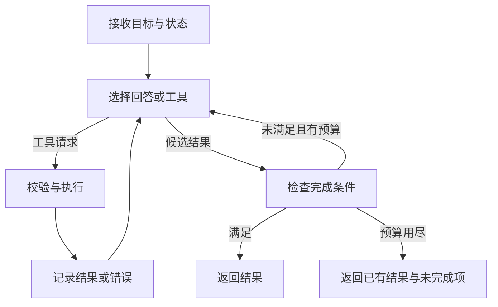

# 人工智能导论：原创详细学习笔记

> 面向具有编程基础的计算机专业本科生。参考《人工智能导论（第6版）》公开目录的十二个主题组织知识，由浅入深地解释概念、数学关系、算法和工程实践。
>
> **阅读定位**：本文是独立编写的学习讲义，不是原书电子版、逐节摘要或教材习题答案。只核对了教材公开书目信息和目录，未取得完整正文；小节结构、示例、代码与练习均独立设计。涉及现代开发的内容会标为“拓展”。

## 阅读导航

- [[#第1章 绪论：建立人工智能的整体认识]]
- [[#第2章 知识表示与知识图谱：把事实变成机器可处理的结构]]
- [[#第3章 确定性推理：从已知事实推出结论]]
- [[#第4章 不确定性推理：在信息不完整时作判断]]
- [[#第5章 搜索策略：在候选路径中寻找解]]
- [[#第6章 智能计算：用种群与群体协作寻找较优解]]
- [[#第7章 机器学习与专家系统：两种获得决策能力的方式]]
- [[#第8章 神经网络与深度学习：用可训练的计算图学习表示]]
- [[#第9章 循环神经网络与自然语言理解：处理有顺序的数据]]
- [[#第10章 大语言模型：从注意力到知识增强应用]]
- [[#第11章 智能体与多智能体：让模型参与任务执行]]
- [[#第12章 游戏中的人工智能：把感知、搜索与决策组合起来]]
- [[#附录A 必要数学：看懂公式需要的最小知识集]]
- [[#附录B 综合实践：课程资料问答与学习助手]]
- [[#附录C 原创自测题参考答案]]
- [[#附录D 术语速查与学习路线]]
- [[#附录E 参考资料与电子资源说明]]

### 如何使用这份笔记

第一遍抓主线：知识怎样表示、结论怎样推出、行动怎样选择、经验怎样变成模型。第二遍再计算归结、贝叶斯、A*、梯度与注意力。第三遍运行代码并改动输入，观察算法的行为。

这里的 Python 示例以 **Python 3.10 及以上**语法编写；标注“标准库”的代码不需要额外依赖。NumPy 示例需要本地安装 NumPy。代码重在暴露算法步骤，省略了生产系统所需的完整性能优化和服务封装。每个标为“独立可运行”的代码块均自带导入和示例输入。

**本版校验记录**：11 个 Python 代码块已在本地 Python 与 NumPy 环境中逐个运行通过；17 个导航链接均能匹配文中标题，代码围栏与独立公式分隔符已检查配对。示例运行通过只验证其教学演示，不代表完成生产级验证。

Obsidian 中使用阅读视图查看表格与公式；行内数学使用 `$...$`，独立公式使用 `$$...$$`。导航使用 Obsidian 原生标题链接。

## 第1章 绪论：建立人工智能的整体认识

### 1.1 从一个具体问题理解 AI

假设要开发“校园课程学习助手”。用户输入“帮我安排本周学习，优先补上机器学习基础”，系统至少要解决四类问题：

| 问题 | 可采用的方法 | 对应能力 |
| --- | --- | --- |
| 课程、章节、先修关系怎样存储 | 规则、关系表、知识图谱 | 知识表示 |
| 学习 A 是否需要先学习 B | 逻辑推理、图遍历 | 推理 |
| 怎样在有限时间内安排任务 | 搜索、约束求解、优化 | 规划与决策 |
| 怎样从历史记录预测薄弱点 | 机器学习、神经网络 | 学习 |

人工智能并不等于某一种模型。它研究如何使计算系统完成需要感知、推理、学习、决策或行动的任务。大语言模型是其中的一类技术，数据库、检索、规则和搜索仍然可能是系统的重要组成部分。

传统程序通常由开发者明确写出处理规则；机器学习则从数据中确定部分规则或参数。但两者常常结合：一个推荐服务可能用机器学习排序，再用普通业务代码过滤无权限的内容。

### 1.2 四种理解角度与理性智能体

常见研究角度包括：像人一样思考、像人一样行动、按照逻辑正确地思考，以及根据目标合理地行动。“理性”不表示永远正确，而是根据已有信息与资源，选择预期效果更好的行动。

例如，天气预报给出降雨概率，出门带伞是对不确定情况的合理响应。最后没下雨，并不能单凭结果断定当时的决定错误。评估决策要区分**决策时可用的信息**与事后结果。

可以用 PEAS 描述智能体任务：

| 项目 | 含义 | 校园配送机器人示例 |
| --- | --- | --- |
| P：Performance | 绩效标准 | 准时率、碰撞次数、能耗 |
| E：Environment | 环境 | 道路、行人、楼宇、天气 |
| A：Actuators | 执行器 | 轮子、制动器、提示音 |
| S：Sensors | 传感器 | 摄像头、定位、距离传感器 |

先描述任务，再选择算法，往往比先决定“我要用神经网络”更有效。若目标是求固定地图中的最短路，A* 可能已经足够。

### 1.3 三条思想路线

**符号主义**用符号、规则和逻辑表达知识。例如“完成数据结构并且完成离散数学，可以选算法设计”。优点是结构明确、可追踪推导；难点是知识整理成本高，现实中的模糊情况很难穷尽。

**连接主义**用大量相互连接的计算单元，从数据中学习参数。图像识别、语音处理、语言模型大量采用这一思路。优点是能学习复杂模式；难点包括数据需求、训练成本、分布变化以及解释困难。

**行为主义**强调主体与环境交互，通过行为反馈形成能力。机器人控制和强化学习可以从这一角度理解。它关注“做了什么、环境如何反馈、下一步怎样改进”。

三种思想可以组合。例如配送机器人用神经网络识别人，用符号地图表达道路，用搜索规划路径，用反馈控制执行运动。

### 1.4 AI、机器学习、深度学习与生成式 AI

| 概念 | 重点 | 例子 |
| --- | --- | --- |
| 人工智能 | 系统的智能任务与行为 | 规划、推理、学习、机器人 |
| 机器学习 | 从经验改善任务表现 | 回归、分类、聚类 |
| 深度学习 | 用多层可训练结构学习表示 | CNN、Transformer |
| 生成式 AI | 建模并生成数据 | 文本生成、图像生成 |

通常可以把深度学习看作机器学习的一部分，把机器学习看作 AI 的一部分。生成式 AI 与这些分类交叉：现代生成式系统通常依赖深度学习，但“生成”本身并不限定必须使用深层网络。

专用人工智能针对特定任务或任务范围。通用人工智能涉及跨领域、广泛适应的能力，其定义和评价仍有讨论；不能仅凭一个系统会聊天或能使用工具，就断定实现了通用人工智能。

### 1.5 发展脉络与评价意识

可以把发展过程理解为几个相互重叠的阶段：早期符号推理与搜索、专家系统、统计机器学习、深度表示学习，以及大规模预训练和生成式模型。新技术通常会吸收旧技术，而不是把旧方法全部淘汰。

学习 AI 时尤其要建立三个评价习惯：

1. **给出基线**：复杂模型比简单规则、平均预测或普通检索到底好多少？
2. **区分训练与使用**：训练集表现好不等于面对新数据表现好。
3. **考虑任务代价**：错误率相同的两个系统，若错误后果不同，实用价值也可能不同。

模型准确率只是一个维度。延迟、资源消耗、稳定性、数据权限、可维护性与失败后的恢复方式都会影响系统能否实际使用。

### 1.6 小结与原创自测

本章主线是：AI 面向任务，知识表示、推理、搜索、学习和行动是互补能力。先把问题和评价标准说清楚，再决定方法。

**自测 1**：固定地图中的最短路径为什么不一定需要训练模型？  
**自测 2**：一个系统用大模型解析需求，再由规则引擎检查选课资格，它体现了哪些思想路线？

## 第2章 知识表示与知识图谱：把事实变成机器可处理的结构

### 2.1 数据、信息与知识

“82”是一个数值；“某学生机器学习考试 82 分”给出了语境；“低于 60 分需要补考”则是一条可用于判断的知识。这个区分不是绝对边界，重点是表示必须服务于查询、推理或决策。

知识表示要考虑：能否表达需要的事实，推理是否方便，新增知识是否容易，以及计算成本是否可接受。不存在适合全部任务的单一表示。

### 2.2 命题逻辑：用真假表示事实

命题是可判定真假的陈述，记作 $P,Q$。常用连接词为：

| 符号 | 含义 | 示例 |
| --- | --- | --- |
| $\neg P$ | 非 P | 未完成课程 |
| $P\land Q$ | P 且 Q | 两门先修课都完成 |
| $P\lor Q$ | P 或 Q，允许同时为真 | 满足两条件中的至少一个 |
| $P\to Q$ | 若 P 则 Q | 完成先修课则具备某项资格 |
| $P\leftrightarrow Q$ | P 当且仅当 Q | 两个条件相互等价 |

蕴含 $P\to Q$ 等价于 $\neg P\lor Q$。它只在 P 真、Q 假时为假。这里的蕴含是形式逻辑关系，不自动表示因果。

例如“下雨则地湿”不能反过来变成“地湿则下雨”，因为洒水也会使地湿。这是推理中常见的“肯定后件”错误。

### 2.3 一阶谓词逻辑：表达对象、属性与关系

若每个学生和每门课程都需要一个独立命题，知识库会很快膨胀。谓词逻辑允许直接表达对象与关系：

$$
Student(x),\quad Passed(x,c),\quad Prerequisite(c_1,c_2)
$$

其中变量 $x$ 表示对象，常量如 $Lin$ 表示特定对象；谓词如 $Passed$ 返回真假；函数如 $Advisor(x)$ 返回一个对象。

量词是两种常用表达：

$$
\forall x\,[Student(x)\to HasID(x)]
$$

表示所有学生都有学号。

$$
\exists x\,[Student(x)\land Passed(x,AI)]
$$

表示至少有一名学生通过了 AI 课程。

注意量词顺序：$\forall x\exists y\,Likes(x,y)$ 表示每个人至少喜欢某个人；$\exists y\forall x\,Likes(x,y)$ 表示存在一个被所有人喜欢的人。后者明显更强。

还要注意变量作用域。$\forall x(P(x)\to Q(x))$ 中的两个 x 都受量词约束；若括号位置改变，含义可能改变。

### 2.4 产生式与框架

产生式通常写成“IF 条件 THEN 结论或动作”。例如：

```text
IF 完成 Python 基础 AND 完成概率入门
THEN 建议进入机器学习基础阶段
```

产生式系统一般包含规则库、工作记忆和控制机制。工作记忆存放当前事实，控制机制决定哪些规则可触发、先执行哪条规则。规则足够多时，还需要处理冲突、重复触发与循环。

**规则不等于程序里的一个 if 就结束了**：完整系统还需管理规则优先级、事实变化、解释轨迹和规则版本。

框架则像一个带槽位的结构化对象：

```text
课程框架：
  名称：机器学习
  学分：3
  先修：概率论、线性代数、Python
  考核方式：默认考试
  实验要求：完成三个小实验
```

框架可以通过继承复用槽位。但默认值与例外要区分：从“多数课程默认考试”不能推出所有课程一定考试。带默认和例外的系统可能需要非单调推理，而普通一阶逻辑推理通常是单调的。

### 2.5 知识图谱：实体与关系组成的网络

最基本的图谱事实可以写成三元组：

$$
(头实体,关系,尾实体)
$$

例如：

```text
(机器学习, 需要基础, 概率论)
(概率论, 包含知识点, 条件概率)
(贝叶斯分类器, 使用, 条件概率)
```

实体是需要区分身份的对象，关系连接实体，属性记录数值或文本。本体或模式层规定有哪些类别、关系及约束；实例层存放具体事实。不能把“数据库里存了若干三元组”直接等同于知识质量高。

典型构建流程是：确定问题范围 → 设计模式 → 收集数据 → 抽取实体关系 → 对齐与消歧 → 检查冲突 → 存储与更新。这里每一步都可能出错。

例如“南大”可能指不同学校，“ML”可能指机器学习，也可能是别的缩写。实体消歧需要结合上下文和标识符，而不是只看字符串是否一样。

### 2.6 图谱、关系数据库与向量检索怎么选

| 方式 | 擅长的问题 | 主要限制 |
| --- | --- | --- |
| 关系数据库 | 事务、精确条件、结构化统计 | 复杂多跳关系表达可能繁琐 |
| 图结构或知识图谱 | 路径、关系网络、结构化关联 | 抽取、对齐和模式维护成本 |
| 向量检索 | 语义相似、自然语言召回 | 相似不保证事实正确或关系成立 |
| 规则引擎 | 明确条件与可追踪判断 | 规则维护和覆盖范围 |

假设用户问“没学概率论能否理解贝叶斯分类器”。向量检索可以找相关段落，图谱可以沿“使用”“需要基础”寻找关系，而最终教学建议还需要结合学生实际情况。不同方法可以联合使用。

### 2.7 独立可运行：用三元组做一次关系查询

以下代码使用标准库。它只演示精确关系查询，不实现 RDF、完整本体推理或图数据库。

```python
triples = {
    ("机器学习", "需要基础", "概率论"),
    ("机器学习", "需要基础", "线性代数"),
    ("概率论", "包含知识点", "条件概率"),
    ("贝叶斯分类器", "使用", "条件概率"),
}

def query(subject=None, relation=None, obj=None):
    return sorted(
        (s, r, o) for s, r, o in triples
        if (subject is None or s == subject)
        and (relation is None or r == relation)
        and (obj is None or o == obj)
    )

print(query("机器学习", "需要基础"))
print(query(relation="使用", obj="条件概率"))
```

学习时可以继续添加“通过先修关系查询所有间接基础”的功能。若图中存在环，必须记录访问过的节点，否则可能无限遍历。

### 2.8 小结与原创自测

命题逻辑表示真假组合，谓词逻辑表示对象关系，产生式组织可触发规则，框架描述结构化对象，知识图谱强调实体间联系。选择表示时要同时考虑表达能力与计算成本。

**自测 3**：把“所有通过数据库课程的学生都具备 SQL 基础”写成谓词公式。  
**自测 4**：为什么“向量相似度很高”不能直接推出“两段话陈述的是同一事实”？

## 第3章 确定性推理：从已知事实推出结论

### 3.1 推理解决什么问题

给定知识库 $KB$ 和目标命题 $G$，我们想判断 $KB\models G$ 是否成立。$\models$ 表示语义上的蕴含：所有满足知识库的解释都满足目标。

与之对应，$KB\vdash G$ 表示通过某套形式推理规则能够推导 G。一个推理系统若只推出语义上正确的结论，称为可靠；若理论上该推出的结论都能推出，称为完备。具体算法还可能因为资源限制而不能在有限时间内完成所有推导。

注意区分三个问题：结论是否真、知识库是否支持结论、程序能否在时间预算内找到证明。一个事实没有被知识库推出，并不必然表示它为假。

### 3.2 演绎、归纳与溯因

| 类型 | 已知什么 | 想得到什么 | 结论特征 |
| --- | --- | --- | --- |
| 演绎 | 规则与前提 | 规则要求的结论 | 前提真且推理可靠时结论真 |
| 归纳 | 若干观察样本 | 一般规律 | 可能被新样本推翻 |
| 溯因 | 现象与可能原因关系 | 对现象的解释 | 通常不唯一，需要验证 |

“所有完成先修课的人符合资格，小林完成了先修课，所以小林符合资格”是演绎。“观察很多通过考试的人都认真练习，因此推测练习有帮助”是归纳。“服务突然变慢，推测数据库负载高”是溯因；也可能是网络、锁等待等原因。

### 3.3 正向推理与反向推理

正向推理从事实出发，不断触发可满足条件的规则。适合需要从事件产生多个结论的任务。反向推理从目标出发，寻找能支持目标的规则，再检查其前提。适合目标明确的咨询或验证任务。

例如规则为：

```text
R1：完成 Python 且完成概率论 → 可学习机器学习
R2：可学习机器学习且完成线性代数 → 可进入神经网络入门
```

正向推理会先收集学生完成的课程，再生成资格。反向推理则从“能否进入神经网络入门”出发，检查线性代数与 R1 的条件。

规则同时可触发时，可以按优先级、规则特异性、事实新近程度或明确业务顺序选择。控制策略会影响推理效率；若规则包含动作和副作用，还可能影响最终业务状态。

### 3.4 自然演绎中的基本规则

最常见的是假言推理：

$$
P,\quad P\to Q\quad\Longrightarrow\quad Q
$$

合取消去允许从 $P\land Q$ 得到 P 或 Q；合取引入允许从 P 与 Q 得到 $P\land Q$。全称实例化允许从 $\forall xP(x)$ 得到某个具体对象的 $P(a)$。

无效推理要特别记住：由 $P\to Q$ 与 Q 不能一般性推出 P；由 $P\to Q$ 与 $\neg P$ 也不能推出 $\neg Q$。有效的逆否关系是 $P\to Q$ 等价于 $\neg Q\to\neg P$。

### 3.5 为什么要转换为子句集

归结希望把不同形式的公式统一为“若干文字的析取”。文字指原子公式或其否定。比如 $\neg Student(x)\lor HasID(x)$ 是一个子句。

一般转换流程是：

1. 消去 $\leftrightarrow$ 和 $\to$。
2. 把否定推到原子公式前，使用德摩根律与量词否定规则。
3. 对不同作用域的变量改名，防止混用。
4. 在适当条件下整理量词，进行 Skolem 化，消去存在量词。
5. 去掉隐含为全称量化的量词，把式子化为合取范式。
6. 按合取拆成多个子句；不同子句中的变量需要时分开命名。

**关键区别**：Skolem 化一般保持可满足性，不是对原语言中的逻辑等价替换。

看一个例子：

$$
\forall x\,[Student(x)\to\exists y\,Helps(y,x)]
$$

消去蕴含后有 $\forall x\exists y[\neg Student(x)\lor Helps(y,x)]$。y 可能随 x 改变，所以用函数 $f(x)$ 代替：

$$
\neg Student(x)\lor Helps(f(x),x)
$$

这里不能任意改成同一个常量 a，否则会错误地要求所有学生都由同一个人帮助。若存在量词前没有依赖的全称变量，则可使用新的 Skolem 常量。

### 3.6 合一与归结

合一是寻找变量替换，使两个表达式相同。例如：

$$
Passed(x,AI),\quad Passed(Lin,y)
$$

可用 $\theta=\{x/Lin,y/AI\}$ 合一。通常希望得到最一般合一，避免作不必要限制。

有限一阶项中，x 与 $f(x)$ 不能合一。若允许替换 $x=f(x)$，就会产生无限自包含结构；因此标准合一算法要做 occurs check，即出现检查。

命题归结的基本形式为：

$$
(P\lor A),\quad(\neg P\lor B)
\quad\Longrightarrow\quad A\lor B
$$

谓词归结先合一，再消去互补文字。例子：

$$
\neg Student(x)\lor HasID(x),\quad Student(Lin)
$$

令 $x=Lin$，得到 $HasID(Lin)$。

### 3.7 完整例题：归结反演证明一个结论

已知：

1. 所有通过 AI 的人都掌握推理基础：$Passed(x,AI)\to KnowsReasoning(x)$。
2. 小林通过了 AI：$Passed(Lin,AI)$。

目标：$KnowsReasoning(Lin)$。

归结反演把“证明目标”转化为“知识库与目标否定不能同时成立”。子句集为：

$$
\begin{aligned}
C_1&=\neg Passed(x,AI)\lor KnowsReasoning(x)\\
C_2&=Passed(Lin,AI)\\
C_3&=\neg KnowsReasoning(Lin)
\end{aligned}
$$

$C_1$ 与 $C_2$ 在 $x=Lin$ 下归结，得到 $C_4=KnowsReasoning(Lin)$。再与 $C_3$ 归结，得到空子句 $\square$。空子句无法被满足，因此原目标得到证明。

如果一直没有推出空子句，不能一概说目标为假：可能是搜索尚未结束；一般一阶逻辑的证明搜索并不保证对所有输入都能停机。命题逻辑有限情形则可以使用完整的判定过程。

### 3.8 独立可运行：最小正向规则引擎

标准库示例，只处理无变量、无否定、无副作用的有限事实集合。

```python
facts = {"完成Python", "完成概率论", "完成线性代数"}
rules = [
    ({"完成Python", "完成概率论"}, "可学机器学习"),
    ({"可学机器学习", "完成线性代数"}, "可学神经网络"),
]

changed = True
while changed:
    changed = False
    for conditions, conclusion in rules:
        if conditions <= facts and conclusion not in facts:
            facts.add(conclusion)
            changed = True
            print("推出：", conclusion)

print(sorted(facts))
```

算法在没有新增事实时终止。它记录“是否已推出”，避免同一结论反复触发。这不是完整一阶逻辑证明器，也不支持撤回事实；若要回答“为什么推出”，可为每个新增事实记录触发规则与前提。

### 3.9 小结与原创自测

确定性推理依赖明确事实与有效规则。自然演绎侧重易理解的推导规则，归结通过统一形式与反证组织自动证明。实际系统还需要控制推理顺序和解释记录。

**自测 5**：$\forall x\exists yR(x,y)$ 为什么通常不能把 y 替换成同一个常量？  
**自测 6**：“没有证明学生通过考试”与“证明学生没通过考试”有什么不同？

## 第4章 不确定性推理：在信息不完整时作判断

### 4.1 三种不同的不确定

“不知道明天是否下雨”涉及事件随机性或认知不足；“资料暂时不够，不能确定设备坏在哪里”涉及证据不足；“今天算不算热”涉及概念边界模糊。这些问题适合不同的数学表示。

| 方法 | 数值大致表示什么 | 不能直接当成什么 |
| --- | --- | --- |
| 概率 | 在某信息条件下事件的不确定程度 | 模糊概念的隶属度 |
| 可信度因子 | 某种规则体系中的支持或反对程度 | 通用的后验概率 |
| 证据理论 | 对命题集合分配的证据支持 | 任意互相独立的概率值 |
| 模糊集合 | 对某概念的符合程度 | 事件发生频率 |

### 4.2 条件概率与贝叶斯更新

条件概率定义为：

$$
P(H\mid E)=\frac{P(H\cap E)}{P(E)},\qquad P(E)>0
$$

贝叶斯公式为：

$$
P(H\mid E)=\frac{P(E\mid H)P(H)}{P(E)}
$$

H 是待判断假设，E 是观察证据。$P(H)$ 是先验，$P(E\mid H)$ 是似然，$P(H\mid E)$ 是后验。它们回答不同问题，不能交换。

用“服务故障报警”算一次：假设故障率为 1%，有故障时报警概率 95%，无故障时误报概率 5%。那么：

$$
P(故障\mid 报警)
=\frac{0.95\times0.01}{0.95\times0.01+0.05\times0.99}
\approx0.161
$$

所以报警后故障概率约 16.1%，并不是 95%。以一万次情况来理解：约 100 次真故障产生 95 次报警；约 9900 次无故障产生 495 次误报；总报警约 590 次，只有 95 次对应故障。

这个例子说明基础发生率会显著影响后验。以上数字仅为教学假设。

### 4.3 多证据、独立性与朴素贝叶斯

若 $E_1,E_2$ 在给定 H 后条件独立，则：

$$
P(E_1,E_2\mid H)=P(E_1\mid H)P(E_2\mid H)
$$

注意“给定 H 后独立”不等于无条件独立。两个故障传感器即使物理上分开，也可能同时受温度影响，因此不能仅因“来自两个设备”就直接相乘。

朴素贝叶斯在类别 y 给定时假设特征条件独立：

$$
\hat y=\arg\max_yP(y)\prod_{j=1}^{d}P(x_j\mid y)
$$

实际计算常取对数，把连乘转为求和，降低数值下溢风险。离散计数可用平滑处理未见特征，避免一个零概率把整项乘积变成零。

### 4.4 可信度因子：规则经验的数值化

在常见的 MYCIN 风格方法中，$CF\in[-1,1]$：正数支持、负数反对、0 表示没有净支持。它不是通用概率定义。

一种常见传播约定为：

$$
CF(H\mid E)=CF(H,E)\max(0,CF(E))
$$

其中 $CF(H,E)$ 是规则本身的可信度，$CF(E)$ 是证据可信度。例如规则强度 0.8、证据可信度 0.6，得到贡献 0.48。复合前提在一些体系中用最小值表示“且”、最大值表示“或”，但必须明确具体系统约定。

同一结论的两项贡献 a、b，常见组合公式是：

$$
CF_{合并}=
\begin{cases}
a+b-ab,&a,b\ge0\\
a+b+ab,&a,b\le0\\
\dfrac{a+b}{1-\min(|a|,|b|)},&ab<0
\end{cases}
$$

异号且达到完全冲突的极端情形会产生零分母，需要单独处理，不能机械套公式。即使数值计算合法，相关证据反复输入也可能让结果看起来过度确定。[R15]

### 4.5 证据理论：允许把支持留给集合

设识别框架为 $\Theta=\{A,B\}$，表示两个互斥且穷尽的候选解释。基本概率分配 m 定义在子集上，满足：

$$
m(\varnothing)=0,\qquad\sum_{X\subseteq\Theta}m(X)=1
$$

例如 $m(\{A\})=0.6$、$m(\{B\})=0.1$、$m(\Theta)=0.3$。最后的 0.3 表示证据还不能在 A 与 B 之间分配，不是“各分一半”。

信任函数与似然/可置信函数为：

$$
Bel(A)=\sum_{X\subseteq A}m(X)
$$

$$
Pl(A)=\sum_{X\cap A\ne\varnothing}m(X)=1-Bel(\bar A)
$$

在该例中 $Bel(\{A\})=0.6$，$Pl(\{A\})=0.9$。区间宽度反映尚未排除的不确定性；不要把它不加解释地当成统计置信区间。

两份适当独立证据可采用 Dempster 组合规则：

$$
m(A)=\frac{\sum_{B\cap C=A}m_1(B)m_2(C)}{1-K},\quad A\ne\varnothing
$$

$$
K=\sum_{B\cap C=\varnothing}m_1(B)m_2(C)
$$

K 衡量冲突，$K=1$ 时该标准归一化规则无定义。若 $m_1(A)=0.6,m_1(\Theta)=0.4$，$m_2(A)=0.7,m_2(\Theta)=0.3$，没有冲突，则合并后 $m(A)=0.42+0.18+0.28=0.88$，$m(\Theta)=0.12$。

高冲突证据不宜只看归一化后的大数值，应回到证据来源、框架是否完备及独立性假设检查。不同资料对 Pl 的中文译名可能不同，使用时以公式区分。[R14]

### 4.6 模糊集合与模糊控制

经典集合用 0 或 1 表示是否属于集合；模糊集合用隶属函数：

$$
\mu_A(x)\in[0,1]
$$

例如把“热”的隶属函数定义为：20°C 以下取 0，20°C 到 30°C 线性增加，30°C 以上取 1。则 27°C 的隶属度为 0.7。这表示它对“热”概念的符合程度，不表示有 70% 的概率温度是 27°C。

常用的一组运算是：

$$
\mu_{A\cap B}(x)=\min(\mu_A(x),\mu_B(x))
$$

$$
\mu_{A\cup B}(x)=\max(\mu_A(x),\mu_B(x)),\quad
\mu_{\bar A}(x)=1-\mu_A(x)
$$

这不是唯一可用的运算族，实际还可以选其他 t 范数等。模糊关系采用最大—最小合成时：

$$
\mu_{R\circ S}(x,z)=\max_y\min(\mu_R(x,y),\mu_S(y,z))
$$

一个模糊控制器通常包括模糊化、规则评价、输出聚合与解模糊。例如“如果温度高且湿度高，那么风速快”。Mamdani 方法可以截断后件隶属函数并聚合，最后用重心法得到数值：

$$
u^*=\frac{\int u\mu(u)\,du}{\int\mu(u)\,du}
$$

分母为零时要有默认策略。也可使用 Sugeno 形式，把后件设为常量或输入函数，再加权平均；两种体系的输出构造不同，不要混套步骤。模糊集合概念的原始研究可参见 [R16]。

### 4.7 小结与原创自测

概率适合描述事件与条件信息；可信度因子适合某些经验规则系统；证据理论显式保留集合层面的未分配支持；模糊方法描述概念边界。方法的假设与数值语义比“能算出一个分数”更重要。

**自测 7**：在服务报警例子中，若故障基础发生率上升，其他参数不变，报警后的故障概率如何变化？  
**自测 8**：$m(\{A\})=0.4,m(\{B\})=0.2,m(\Theta)=0.4$ 时，$Bel(A)$ 与 $Pl(A)$ 各是多少？  
**自测 9**：为什么“高温隶属度 0.8”不等于“发生高温事件的概率 0.8”？

## 第5章 搜索策略：在候选路径中寻找解

### 5.1 把任务表示成搜索问题

一个搜索问题通常包含状态集合、初始状态、可用动作、状态转移、目标测试和路径代价。比如路线规划中，状态可以是当前位置；若剩余电量影响可行路线，状态就需要包含“位置与电量”。

状态缺少必要信息，算法即使执行正确，也可能给出实际不可行的方案。反过来，加入不必要的历史信息又会扩大状态空间。

图搜索与树搜索的区别在于是否识别相同状态、如何处理重复。现实任务往往存在回路；把每条路径都当成新的树节点，可能产生大量重复计算。

搜索算法通常维护：**边界集合**，存放已生成但未展开的候选；**已知代价或访问记录**，帮助处理重复；**父节点记录**，用于还原路径。

### 5.2 BFS、DFS 与一致代价搜索

宽度优先搜索 BFS 用队列，先展开深度浅的节点。若边权相同，则最少边数对应最小代价；边权不等时不保证总代价最小。

深度优先搜索 DFS 用栈或递归，优先向深处走。它适合探索、回溯和某些约束问题，但可能先走入很深的无解分支。

一致代价搜索 UCS 每次选择累计路径代价 $g(n)$ 最小的候选。它与 Dijkstra 算法的核心选择策略相通，适合非负边权最短路。

| 方法 | 选择依据 | 最优性概况 | 主要问题 |
| --- | --- | --- | --- |
| BFS | 最小深度 | 等边权时成立 | 内存消耗大 |
| DFS | 最近生成的深层节点 | 通常不成立 | 深路或回路可能拖延 |
| UCS | 最小 $g(n)$ | 非负边权有限图等条件下成立 | 没有目标方向信息 |
| 贪心最佳优先 | 最小 $h(n)$ | 通常不成立 | 只顾看起来接近目标 |
| A* | 最小 $g(n)+h(n)$ | 需满足启发与重复处理条件 | 启发差或状态多时昂贵 |

有限分支、目标最浅深度为 d 时，BFS 的时间和空间规模常写作 $O(b^d)$ 量级，具体记法随是否生成下一层而变化。DFS 在深度上限 m 下时间最坏可达 $O(b^m)$；树式实现的路径与待探索分支存储常为 $O(bm)$。若图搜索保存所有访问状态，内存还要计入该记录，不能直接套树搜索的空间界。

迭代加深搜索反复进行深度为 0、1、2……的限制 DFS。它重复访问部分浅层节点，但在分支多、深层节点占多数时，能够以较低内存获得类似 BFS 的最浅解性质。

### 5.3 回溯：边构造边排除不满足约束的选择

回溯常见于八皇后、排课和组合选择。每一步选择一个变量值，若违反已有约束立即返回，避免枚举整棵无用子树。

例如排课时发现两门课程安排给同一教室同一时间，就可以提前剪枝，而不必等所有课程排完再检查。进一步还可以采用“先安排可选时段最少的课程”等启发。

剪枝规则必须可靠。为了加速而把某类合法方案错误排除，会损害完备性。应区分“逻辑上证明不可能”与“经验上不看好”。

### 5.4 启发函数与 A*

设 $g(n)$ 为从起点到 n 的已知路径代价，$h(n)$ 为从 n 到目标的估计剩余代价：

$$
f(n)=g(n)+h(n)
$$

**可采纳性**要求 $0\le h(n)\le h^*(n)$，即不高估真实最优剩余代价。**一致性**要求对每条边 $(n,n')$：

$$
h(n)\le c(n,n')+h(n'),\qquad h(goal)=0
$$

一致性意味着沿路径 f 值不下降。在常见非负代价设定下，一致启发使 A* 图搜索可以在节点以最佳代价取出后不再重开。只有可采纳性但不一致时，图搜索可能需要重新打开获得更好路径的节点，才能保持最优性。

**终止时机也重要**：一般应在目标以当前有效最小 f 值从优先队列取出时终止，而不是目标一生成就终止。

四方向、每步代价为 1 的网格中，曼哈顿距离：

$$
h(x,y)=|x-x_g|+|y-y_g|
$$

是一种可用启发。若允许对角移动且代价更低，曼哈顿距离可能高估，需要换成与移动规则一致的估计。障碍会让真实路程变长，但不妨碍忽略障碍所得的下界。

### 5.5 手工比较一次节点选择

假设边为 $S\to A:2$、$S\to B:1$、$A\to G:2$、$B\to G:10$，启发为 $h(A)=2,h(B)=1,h(G)=0$。

展开 S 后：A 的 $g=2,f=4$；B 的 $g=1,f=2$，先取 B。经 B 发现目标代价 11，但不能立刻结束。接着取 A，发现目标代价 4，最后取出目标，得到最优路径 $S,A,G$。

贪心搜索若只看 h，会优先 B，随后可能直接选目标 G，得到代价 11 的较差解。这说明“看起来离目标近”与“整条路径代价低”不同。

### 5.6 独立可运行：支持更新代价的 A*

标准库实现，适用于有限图、非负边权和适当启发；示例启发可采纳且一致。代码允许更优路径重新入队，并跳过过期队列项。

```python
from heapq import heappush, heappop
from itertools import count
from math import inf

def astar(graph, start, goal, heuristic):
    order = count()
    best_g = {start: 0.0}
    parent = {start: None}
    queue = []
    heappush(queue, (heuristic[start], next(order), 0.0, start))

    while queue:
        _, _, g, node = heappop(queue)
        if g > best_g.get(node, inf):
            continue
        if node == goal:
            path = []
            current = goal
            while current is not None:
                path.append(current)
                current = parent[current]
            return list(reversed(path)), g

        for neighbor, cost in graph.get(node, []):
            if cost < 0:
                raise ValueError("本实现要求非负边权")
            candidate = g + cost
            if candidate < best_g.get(neighbor, inf):
                best_g[neighbor] = candidate
                parent[neighbor] = node
                heappush(queue, (
                    candidate + heuristic[neighbor],
                    next(order), candidate, neighbor,
                ))
    return None, inf

graph = {
    "S": [("A", 2), ("B", 1)],
    "A": [("G", 2)],
    "B": [("G", 10)],
    "G": [],
}
heuristic = {"S": 2, "A": 2, "B": 1, "G": 0}
print(astar(graph, "S", "G", heuristic))
# (['S', 'A', 'G'], 4.0)
```

`count()` 用于稳定打破并列，避免堆在优先级相同时比较复杂状态对象。`best_g` 记录状态当前最佳代价，`parent` 负责还原路径。把所有启发设为 0，选择策略就退化为 UCS。

### 5.7 蒙特卡洛树搜索 MCTS

当搜索树太大且难以建立精确评价时，可以用多次模拟分配计算预算。典型循环包括选择、扩展、模拟和回传。

一种常见 UCT 选择分数为：

$$
UCT_i=\bar X_i+c\sqrt{\frac{\ln N}{n_i}}
$$

其中 $\bar X_i$ 是子节点平均回报，N 是父节点访问次数，$n_i$ 是子节点访问次数，c 控制探索。未访问节点要专门优先处理，不能令 $n_i=0$ 直接代入。

第一项利用已有好结果，第二项鼓励尝试访问较少的分支。模拟不一定完全随机，也可用启发策略或价值模型。双人零和游戏中，回传奖励必须统一玩家视角，否则可能把对手获利当成自己获利。

有限预算下，MCTS 给出的是由采样支持的选择，不保证每次都找到最优动作。其效果依赖模拟质量、奖励尺度、探索常数与可用预算。[R10]

### 5.8 小结与原创自测

搜索质量取决于问题建模、边界选择和重复状态处理。启发函数提供方向，但必须说明它的假设；MCTS 则通过模拟把预算集中到有希望的分支。

**自测 10**：为什么 BFS 在边权不同时不能保证最小总代价？  
**自测 11**：A* 中令 $h=0$ 会怎样？将 h 任意放大两倍又会怎样？  
**自测 12**：MCTS 中访问少的节点为什么需要额外探索奖励？

## 第6章 智能计算：用种群与群体协作寻找较优解

### 6.1 优化问题的基本形式

优化是在可行域 $\Omega$ 中寻找使目标函数更好的一组变量：

$$
\min_{x\in\Omega}f(x)
$$

决策变量可以是连续参数、任务排列、路径或离散选项。约束限定可行性，比如车辆载重不能超标、课程不能冲突。目标函数评价优劣，比如总里程、延误或成本。

“能表示一个候选解”与“候选解可行”是两个问题。遗传、粒子群和蚁群的设计都必须围绕变量结构和约束展开。它们通常用于难以穷举、目标不易求导或组合复杂的任务，并不天然优于所有精确方法。

### 6.2 遗传算法：对候选解进行选择与变异

遗传算法维护一组候选解，每个候选解称为个体，编码称为染色体。基本过程是初始化、评价、选择、交叉、变异和生成下一代，重复到预算用尽或满足停止条件。

| 环节 | 需要决定的问题 | 常见错误 |
| --- | --- | --- |
| 编码 | 二进制、实数还是排列 | 编码不能覆盖合法解 |
| 初始化 | 随机还是含启发个体 | 种群缺乏多样性 |
| 适应度 | 怎样对应原目标 | 把越小越好的目标直接当越大越好 |
| 选择 | 轮盘赌、锦标赛等 | 选择压力过大导致早熟 |
| 交叉 | 怎样组合父代信息 | 对排列直接切片产生重复元素 |
| 变异 | 怎样探索新区域 | 概率过大破坏已有结构 |
| 保留 | 是否精英保留 | 丢掉目前最好解或过度垄断 |

例如旅行商路径是城市排列。普通二进制式单点交叉可能得到重复城市和缺失城市，因此通常需要顺序交叉、部分映射交叉或修复机制。

轮盘赌常用非负适应度并归一化为选择概率，若所有适应度为零必须处理。锦标赛选择则从若干候选中选较优者，对目标尺度的依赖较小。

适应度是搜索机制的接口，不能任意变换后就认为选择行为不变。虽然某些单调变换保留排序，但会改变基于比例的选择概率。

### 6.3 约束、早熟与改进思路

对约束可以采用可行解编码、修复、可行性优先或罚函数。罚函数常写作：

$$
F(x)=f(x)+\lambda\sum_j\max(0,g_j(x))
$$

其中约束形式为 $g_j(x)\le0$。罚系数太小可能偏好不可行解，太大可能让搜索很难接近约束边界。不同违约量的单位也要考虑。

早熟是种群过早集中在某一局部区域。可通过增加多样性、调整变异、保持多个子群、引入新个体或结合局部搜索缓解。自适应策略根据搜索阶段改变参数，但不代表可以免除调参。

双种群方法让多个群体独立搜索并周期性交换信息；双倍体表示借鉴成对遗传信息及显隐性机制。它们是特定设计思路，是否有效仍需与简单基线对照。

### 6.4 独立可运行：一维实数遗传算法

标准库示例，在 $[-10,10]$ 上最小化 $f(x)=(x-3)^2$。真实问题通常不会像这个例子一样已有显然的解析解，这里用于观察机制。

```python
import random

rng = random.Random(42)

def objective(x):
    return (x - 3.0) ** 2

population = [rng.uniform(-10, 10) for _ in range(40)]

for generation in range(100):
    population.sort(key=objective)
    next_population = population[:2]  # 精英保留

    def select():
        return min(rng.sample(population, 3), key=objective)

    while len(next_population) < len(population):
        a, b = select(), select()
        weight = rng.random()
        child = weight * a + (1 - weight) * b
        if rng.random() < 0.25:
            child += rng.gauss(0, 0.5)
        child = max(-10, min(10, child))
        next_population.append(child)
    population = next_population

best = min(population, key=objective)
print(f"x={best:.4f}, f(x)={objective(best):.8f}")
```

这里的实数加权交叉只能落在父代之间，变异有助于探索父代范围之外。固定随机种子便于复现实验；比较算法时仍应使用多个种子报告均值、方差或成功率，不能只展示最好的一次。

### 6.5 粒子群优化 PSO

PSO 让每个粒子保有位置 $x_i$、速度 $v_i$、个体历史最好位置 $p_i$，并参考群体或邻域最好位置 g。常见的惯性权重形式为：

$$
v_i^{t+1}=\omega v_i^t+c_1r_1(p_i-x_i^t)+c_2r_2(g-x_i^t)
$$

$$
x_i^{t+1}=x_i^t+v_i^{t+1}
$$

$r_1,r_2$ 为随机数或逐维随机向量；$\omega$ 控制惯性，$c_1$ 控制个体经验，$c_2$ 控制群体经验。惯性权重是常见后续形式，不能把每种现代写法都当作最初论文的原样算法。[R11]

若当前 $x=2,v=0.5,p=3,g=4$，取 $\omega=0.5,c_1=c_2=1,r_1=r_2=0.5$，则新速度为 $0.25+0.5+1=1.75$，新位置为 3.75。

参数过于激进可能振荡或越界，因此需要速度限制、边界截断或反射等策略。普通连续 PSO 不能直接把一个实数向量当作合法城市排列；离散路径任务需要专门编码、解码与约束处理。

### 6.6 蚁群优化 ACO

蚁群算法让多个个体逐步构造解，并通过信息素影响后续选择。以路径为例，从 i 到允许访问的 j 的概率常写为：

$$
p_{ij}=\frac{\tau_{ij}^{\alpha}\eta_{ij}^{\beta}}
{\sum_{k\in allowed}\tau_{ik}^{\alpha}\eta_{ik}^{\beta}}
$$

$\tau$ 是信息素，$\eta$ 是启发信息，例如距离倒数；$\alpha,\beta$ 调节两者的重要性。禁忌表或已访问集合用于避免重复访问不应重复的节点。

一种基本信息素更新形式为：

$$
\tau_{ij}\leftarrow(1-\rho)\tau_{ij}+\sum_k\Delta\tau_{ij}^{(k)}
$$

其中 $\rho$ 为挥发率，较好路径常获得较多增量。挥发防止早期路径永久占优；若挥发太快，经验留不住；太慢则可能陷入停滞。实际存在多种更新变体，需明确使用哪一种。

### 6.7 如何公平比较优化算法

使用相同目标、约束、可行性判据与评价预算；报告最好值之外，也记录多次运行的统计量、运行时间和失败率。对随机算法，迭代次数相同不一定公平：每次迭代的目标函数评价次数可能不同。

若小规模问题能够用穷举、动态规划或整数规划求精确解，应先建立基线，再考虑群智能。启发式算法的价值在于特定问题上的成本与质量折中，而不是名称听起来更智能。

### 6.8 小结与原创自测

遗传算法通过选择与变异组合信息；PSO 利用个体和群体经验移动；ACO 通过信息素引导逐步构造解。三个方法都依赖问题编码、约束处理与合理评价。

**自测 13**：最小化路径长度时，为什么不能总把路径长度直接作为轮盘赌的适应度？  
**自测 14**：连续 PSO 用于车辆路径问题前，为什么需要额外设计？  
**自测 15**：比较两种随机优化算法时，为什么应记录函数评价次数和多个随机种子的结果？

## 第7章 机器学习与专家系统：两种获得决策能力的方式

### 7.1 从数据获得规则与从专家获得规则

机器学习关注如何从经验中改善任务表现。设训练数据为：

$$
D=\{(x_i,y_i)\}_{i=1}^{n}
$$

模型 $f_\theta(x)$ 通过训练确定参数 $\theta$，目的是对未见数据也有效。训练集表现只是拟合情况，泛化能力才对应未来使用。

专家系统则把领域专家知识显式写入知识库，由推理机生成结论。两者可以结合：学习模型估计风险，规则系统检查业务限制，并生成可追踪的决策说明。

### 7.2 学习类型与完整实验流程

| 学习类型 | 数据与反馈 | 典型任务 |
| --- | --- | --- |
| 监督学习 | 有输入及目标标签 | 分数预测、图像分类 |
| 无监督学习 | 没有给定目标标签 | 聚类、降维、结构发现 |
| 半监督学习 | 少量有标签与较多无标签 | 标注昂贵时利用额外数据 |
| 弱监督学习 | 标签不完整、不精确或含噪声 | 用规则生成近似标签 |
| 自监督学习 | 从数据自身构造预测目标 | 预测下一个 token、遮盖重建 |
| 强化学习 | 通过行动得到奖励反馈 | 游戏、控制、序列决策 |

监督类型描述训练信号，深度学习描述模型方法，二者不是同一条分类轴。神经网络可以进行监督、自监督或强化学习。

完整流程应包括：定义任务与指标 → 获取和检查数据 → 划分数据 → 训练 → 验证和调参 → 最终测试 → 部署后监测。

训练集用于拟合参数；验证集用于选择超参数与模型；测试集在最终评价时使用。若不断看测试集结果修改模型，它实际上已参与选择，最终分数会偏乐观。

预处理也可能泄漏：先对全部数据求均值标准化，再划分训练测试，会把测试信息带进训练过程。应在训练部分拟合变换，再应用到验证或测试部分。时间序列、同一用户的多条记录、同一病人的多次检查等数据，还需要符合部署场景的时间或分组划分。[R4][R5]

### 7.3 线性回归与最小二乘

一元模型为：

$$
\hat y=wx+b
$$

平方损失：

$$
J(w,b)=\frac{1}{n}\sum_i(wx_i+b-y_i)^2
$$

多元形式写为 $\hat{\mathbf y}=X\theta$，把偏置包含在全 1 列中。若 $X^TX$ 可逆，最小二乘解为：

$$
\hat\theta=(X^TX)^{-1}X^T\mathbf y
$$

但实际编程不应为套公式而显式求逆；QR、SVD 或可靠的最小二乘求解器通常更合适。共线特征会使矩阵奇异或病态。

一元情形也可直接计算：

$$
w=\frac{\sum_i(x_i-\bar x)(y_i-\bar y)}{\sum_i(x_i-\bar x)^2},
\qquad b=\bar y-w\bar x
$$

若数据为 $(1,3),(2,5),(3,7)$，得到 $w=2,b=1$。如果所有 x 都相同，分母为零，斜率无法从这些数据唯一确定。

另一种求解方式是梯度下降：

$$
\frac{\partial J}{\partial w}=\frac2n\sum_i(\hat y_i-y_i)x_i,
\quad\frac{\partial J}{\partial b}=\frac2n\sum_i(\hat y_i-y_i)
$$

沿负梯度更新 $w,b$，直到达到迭代预算或收敛标准。学习率太大可能发散，特征尺度差异很大时也会影响优化。

### 7.4 k 近邻：让相似样本参与预测

kNN 不先拟合一个显式决策函数，而是在预测时找到距离最近的 k 个训练样本。分类采用投票或距离加权，回归采用均值或加权均值。

欧氏距离为：

$$
d(x,z)=\sqrt{\sum_j(x_j-z_j)^2}
$$

若一个特征是数万元的费用，另一个是 0 到 1 的比例，未经缩放时距离可能主要由费用决定。标准化参数必须从训练集得到。

k 太小容易受噪声影响，k 太大可能把局部边界抹平。距离度量是否符合业务语义，比“使用哪一行函数调用”更重要。高维情况下距离集中与无关特征也可能削弱近邻方法。

### 7.5 决策树：通过条件逐步划分样本

决策树在节点上测试条件，在叶节点输出类别或数值。分类树希望划分后类别更纯，常用熵：

$$
H(Y)=-\sum_kp_k\log_2p_k
$$

约定 $0\log0=0$。二分类各占一半时熵为 1；全为同类时熵为 0。

某次划分的信息增益为：

$$
IG=H(Y)-\sum_v\frac{|D_v|}{|D|}H(Y\mid v)
$$

假设一个节点 4 个样本正负各半。若某条件把它分成两个纯节点，信息增益就是 1。若分完仍各半，则增益为 0。

树很深时可以记住训练样本，因此需要限制深度、最小叶样本数或剪枝。信息增益可能偏向取值很多的属性；增益率等准则尝试缓解这一问题。不同树算法还会用 Gini 不纯度等目标。

### 7.6 支持向量机：寻找具有较大间隔的边界

线性分类边界为 $w^Tx+b=0$，预测取其符号。在线性可分情况下，规范化约束 $y_i(w^Tx_i+b)\ge1$，最大间隔可转化为最小化 $\frac12\|w\|^2$。

允许一定违约的软间隔形式为：

$$
\min_{w,b,\xi}\frac12\|w\|^2+C\sum_i\xi_i
$$

$$
y_i(w^Tx_i+b)\ge1-\xi_i,\qquad\xi_i\ge0
$$

C 越大，通常越重视减少训练违约；越小则容忍更多违约以换取较强正则化。支持向量是对边界确定起关键作用的样本。

核方法通过核函数计算某个特征空间内积，避免显式构造所有映射特征。例如 RBF 核 $K(x,z)=\exp(-\gamma\|x-z\|^2)$。核并不是任意相似度；还需要满足使相应优化成立的数学条件。

### 7.7 k 均值聚类

k-means 希望最小化簇内平方距离：

$$
\min_{\{\mu_k\},\{c_i\}}\sum_i\|x_i-\mu_{c_i}\|^2
$$

它交替执行：把每个点分给最近中心，再把每个中心更新为簇内均值。在非空簇等通常条件下，每一步不增加目标函数，但不保证全局最优。

假设一维数据为 1、2、8、9，取两个初始中心 1、9。分配后得到 $\{1,2\}$ 和 $\{8,9\}$，更新中心为 1.5 和 8.5，再次分配不变。

限制包括需要选择 k、受初始化与异常值影响、倾向适合平方距离意义下的团状簇。聚类编号本身不具有天然业务含义，不能直接把簇 0 称为“优秀学生”。

### 7.8 模型评价：把错误的含义算清楚

二分类中，TP 为正确预测正类，FP 为把负类错判为正类，FN 为漏掉正类，TN 为正确预测负类。

$$
Precision=\frac{TP}{TP+FP},\quad Recall=\frac{TP}{TP+FN}
$$

$$
F_1=\frac{2PR}{P+R}
$$

分母为零时要声明处理约定。对异常检出这类少数类任务，全部预测正常也可能获得很高准确率，因此需要同时查看召回、精确率、PR 曲线及业务代价。

回归常用 MAE 与 MSE。MSE 对大误差惩罚更强；MAE 更直接对应平均绝对偏差。评价指标要与使用目的匹配，不能跨任务只比较一个数字大小。

过拟合表现为训练效果好、验证效果差，可通过增加数据、简化模型、正则化、早停等缓解；欠拟合则通常训练和验证都差，应检查特征、模型能力、优化是否充分与标签质量。

### 7.9 专家系统的结构与局限

经典专家系统包括知识库、推理机、工作记忆、知识获取、解释和交互等部分。知识库回答“有哪些规则”，推理机回答“怎样使用规则”，工作记忆记录当前案例事实，解释模块记录“依据哪些事实触发哪些规则”。

建立过程通常是：界定领域 → 访谈与整理知识 → 编码规则 → 用案例验证 → 处理冲突与例外 → 持续维护。知识获取往往比写推理循环更困难，因为专家的经验可能隐含、相互矛盾或依赖场景。

骨架系统将领域知识与通用推理机制分开，方便在新领域填入知识；历史上的 EMYCIN 等系统体现了这种复用思路。它们的历史价值在于知识与推理的分离，不意味着适合直接承担今天的所有智能应用。

### 7.10 独立可运行：最小二乘拟合与留出检查

标准库实现。这个小例子仅验证计算机制，样本过少，不能当作真实泛化评估。

```python
from statistics import mean

train = [(1.0, 3.0), (2.0, 5.0), (3.0, 7.0)]
test = [(4.0, 9.0), (5.0, 11.0)]
x_bar = mean(x for x, _ in train)
y_bar = mean(y for _, y in train)
denominator = sum((x - x_bar) ** 2 for x, _ in train)
if denominator == 0:
    raise ValueError("训练输入没有变化，无法唯一估计斜率")
w = sum((x - x_bar) * (y - y_bar) for x, y in train) / denominator
b = y_bar - w * x_bar
mae = mean(abs(w * x + b - y) for x, y in test)
print(f"w={w:.1f}, b={b:.1f}, test MAE={mae:.1f}")
# w=2.0, b=1.0, test MAE=0.0
```

### 7.11 小结与原创自测

机器学习不是“选一个算法然后训练”这么简单。任务定义、数据划分、特征处理、评价与错误分析共同决定实验是否可信。专家系统适合明确且可维护的知识，学习模型适合从数据发现复杂模式。

**自测 16**：为什么标准化也必须遵守训练与测试分离？  
**自测 17**：一千条数据只有十条异常，全部预测正常的准确率是多少？它能说明系统有用吗？  
**自测 18**：kNN 与 k-means 的 k 分别代表什么？

## 第8章 神经网络与深度学习：用可训练的计算图学习表示

### 8.1 从单个神经元到多层网络

一个人工神经元通常计算：

$$
z=w^Tx+b,\qquad a=\phi(z)
$$

w 为权重，b 为偏置，$\phi$ 为激活函数。若多层都没有非线性激活，多次仿射变换仍能合并为一次仿射变换，模型表达能力不会仅因为层数增加就获得一般的非线性边界。

常见激活函数：

| 函数 | 定义 | 需要注意 |
| --- | --- | --- |
| Sigmoid | $1/(1+e^{-z})$ | 输出在 0 到 1，饱和区域梯度小 |
| Tanh | $\tanh z$ | 输出以零为中心，仍会饱和 |
| ReLU | $\max(0,z)$ | 正区间梯度简单，可能出现长期不激活单元 |
| Softmax | $e^{z_k}/\sum_je^{z_j}$ | 把一组分数归一化，常用于互斥多分类 |

Softmax 不能让错误模型自动变得可信。最大概率很高不等于模型一定正确，尤其面对训练分布之外的输入。

### 8.2 前向传播、损失、反向传播与更新

两层网络为：

$$
Z_1=XW_1+b_1,\quad H=\phi(Z_1),\quad Z_2=HW_2+b_2
$$

前向传播计算预测；损失衡量预测与目标差异；反向传播利用链式法则计算各参数梯度；优化器根据梯度更新参数。**反向传播是梯度计算机制，梯度下降是参数更新方法**。

对二分类使用 sigmoid 输出 $p=\sigma(z)$，交叉熵为：

$$
L=-[y\log p+(1-y)\log(1-p)]
$$

两者组合的一个重要结果是：

$$
\frac{\partial L}{\partial z}=p-y
$$

这个简化来自损失与激活的导数组合，不能对任意损失都直接套用。批量平均损失还需要包含 $1/n$ 因子。

举一个单神经元更新：$x=2,y=1,w=0,b=0$。初始 z=0，p=0.5，所以 $\partial L/\partial w=(p-y)x=-1$，$\partial L/\partial b=-0.5$。学习率取 0.1，更新后 w=0.1、b=0.05；新 z=0.25，p 约 0.562，向目标方向移动。

### 8.3 训练中的实际问题

**初始化**影响信号和梯度尺度。若一层所有单元参数完全一样，它们可能始终学到相同东西，因此通常使用与结构相配的随机初始化。

**梯度消失和爆炸**来自连乘的导数与权重。当链很长时，数值可能越来越小或越来越大。适当激活、初始化、残差结构、归一化和梯度裁剪可以缓解部分问题。

**正则化**抑制过拟合。L2 正则通过参数惩罚限制复杂度；Dropout 在训练中随机屏蔽部分表示；早停根据验证表现停止训练。它们的机制不同，应分别理解。

**批量、轮次与步数**：batch 是一次更新使用的样本集合，epoch 表示完整遍历训练集一次，step 通常表示一次优化更新。相同 epoch 不代表相同更新次数。

若训练损失下降而验证损失持续上升，可能开始过拟合；若训练损失都不下降，先检查输入尺度、标签、损失设置、学习率与梯度是否正常，不要只增加网络层数。

### 8.4 独立可运行：NumPy 实现 XOR 网络

需要 NumPy。XOR 在原始二维空间中不能由一个线性分类边界分开，这里用 tanh 隐层加 sigmoid 输出，手工实现反向传播。

```python
import numpy as np

rng = np.random.default_rng(7)
X = np.array([[0., 0.], [0., 1.], [1., 0.], [1., 1.]])
y = np.array([[0.], [1.], [1.], [0.]])
W1 = rng.normal(0, 0.8, size=(2, 8))
b1 = np.zeros((1, 8))
W2 = rng.normal(0, 0.8, size=(8, 1))
b2 = np.zeros((1, 1))
lr = 0.5

for step in range(8000):
    H = np.tanh(X @ W1 + b1)
    logits = H @ W2 + b2
    p = 1.0 / (1.0 + np.exp(-logits))
    dz2 = (p - y) / len(X)
    dW2 = H.T @ dz2
    db2 = dz2.sum(axis=0, keepdims=True)
    dz1 = (dz2 @ W2.T) * (1 - H ** 2)
    dW1 = X.T @ dz1
    db1 = dz1.sum(axis=0, keepdims=True)

    # 必须先算完所有梯度，再更新，避免混用不同步的权重。
    W1 -= lr * dW1
    b1 -= lr * db1
    W2 -= lr * dW2
    b2 -= lr * db2

H = np.tanh(X @ W1 + b1)
p = 1.0 / (1.0 + np.exp(-(H @ W2 + b2)))
print("概率：", np.round(p.ravel(), 3))
print("类别：", (p.ravel() >= 0.5).astype(int))
# 预期类别：[0 1 1 0]
```

这只是对四个样本的拟合演示，没有证明模型具有现实任务的泛化能力。大规模训练还要使用数值稳定的损失实现，避免极端 logits 带来的指数溢出。

### 8.5 Hopfield 网络：把记忆表示为稳定状态

经典离散 Hopfield 网络通常有对称权重 $w_{ij}=w_{ji}$、零自连接和取值为 $-1,+1$ 的状态。异步更新一个单元：

$$
s_i\leftarrow sign\left(\sum_jw_{ij}s_j-\theta_i\right)
$$

相应能量可写为：

$$
E=-\frac12\sum_{i,j}w_{ij}s_is_j+\sum_i\theta_i s_i
$$

在经典条件下，合适的异步更新不会增加能量，可用于从受损输入恢复某个稳定模式。但局部极小、伪记忆、模式相关性和有限容量都会影响恢复。

不能把这个性质直接推广到任意同步更新或非对称网络，同步更新可能出现周期。连续型网络、随机神经网络与相关能量模型有各自的动态或采样机制，需要单独分析。[R18]

### 8.6 CNN：利用局部结构与参数共享

全连接层为每个输入位置分配独立权重；卷积层让同一组核在多个位置使用，适合局部模式会在不同位置出现的数据。

深度学习框架中通常所称的二维“卷积”实际上常是互相关：

$$
Y_{i,j}=\sum_{u,v}X_{i+u,j+v}K_{u,v}
$$

严格数学卷积还需要翻转核。多通道情况下还要对输入通道求和，每个输出通道有自己的核及偏置。

单个空间维度输出长度为：

$$
L_{out}=\left\lfloor\frac{L_{in}+2P-D(K-1)-1}{S}\right\rfloor+1
$$

P 为填充，K 为核大小，D 为膨胀率，S 为步长。例如输入 32、核 3、填充 1、步长 1、膨胀 1，则输出仍为 32。

若输入 3 通道、输出 16 通道、核为 $3\times3$，含偏置参数量为 $16\times(3\times3\times3+1)=448$。参数共享让它不随图像高宽线性增加。

池化用于局部汇聚和降采样，但不是所有现代网络都必须使用。卷积在适当条件下具有平移等变性，不能把它笼统说成对所有平移都完全不变，填充和下采样也会影响性质。

胶囊网络尝试用向量或更复杂对象表达“是否存在”及姿态等信息，并通过路由关联部分与整体。入门阶段理解其动机即可，不必把它当作所有视觉任务的默认选择。[R13]

### 8.7 GAN：生成器与判别器的对抗训练

生成器 G 将随机噪声映射为样本，判别器 D 区分真实样本和生成样本。原始基本目标为：

$$
\min_G\max_D\;\mathbb E_{x\sim p_{data}}\log D(x)
+\mathbb E_{z\sim p_z}\log(1-D(G(z)))
$$

判别器努力区分真假，生成器努力使生成结果被认为真实。实践中常使用非饱和生成器损失等变体，不能把一个目标函数当成全部 GAN 实现。

常见困难是训练不稳定、模式崩溃以及评价困难。模式崩溃指生成器只覆盖少数类型，即使单张图看起来好，也缺乏多样性。语言中的离散 token 又使梯度直接穿过采样变得困难，因此图像 GAN 的训练方式不能原样搬到文本生成。

GAN 可用于图像生成、转换等研究和应用，但生成数据是否适合某个领域，需要任务级验证。合成图像逼真不代表保留了所有有用统计关系。[R12]

### 8.8 小结与原创自测

神经网络通过可微计算学习表示，反向传播负责算梯度。不同结构引入不同偏好：CNN 利用局部与共享，Hopfield 关注稳定状态，GAN 用对抗信号学习生成分布。

**自测 19**：为什么堆叠不含非线性激活的全连接层，通常不能解决 XOR？  
**自测 20**：输入 28、卷积核 5、无填充、步长 1、膨胀 1，输出长度是多少？  
**自测 21**：反向传播与梯度下降有什么区别？

## 第9章 循环神经网络与自然语言理解：处理有顺序的数据

### 9.1 为什么序列不能只看成无序集合

“学生帮助老师”与“老师帮助学生”包含相同词语，但语义角色不同。文本、语音、传感器记录和操作日志都包含顺序或时间关系。

自然语言处理常涉及多个层次：字词或子词处理、句法结构、语义、上下文与篇章、语用。现代端到端模型未必显式按这些层次拆成模块，但这些区分仍能帮助分析错误：识别错字、搞错主客体、指代错误与忽视上下文是不同问题。

语言“理解”也必须落实到任务指标，例如实体抽取准确率、问答正确率或指令执行效果。模型生成流畅不自动等于事实正确或推理可靠。

### 9.2 从文本到向量

文本先经过 tokenization，变成 token 序列，再映射为整数编号。token 可能是字、词、子词或字节片段；它并不固定等同于一个汉字或一个英文单词。

one-hot 表示维度等于词表大小，只有一个位置为 1。嵌入矩阵 $E\in\mathbb R^{V\times d}$ 为每个 token 存储 d 维向量，查表得到序列向量。嵌入可以通过任务训练，但单独一个静态词向量通常不能完整区分所有上下文含义。

批处理时，序列长度不一致常需填充。必须在损失、注意力或状态处理时正确使用掩码，否则模型会把填充部分当成真实内容。

### 9.3 RNN：用隐藏状态积累历史

采用列向量记法，基本 RNN 为：

$$
h_t=\tanh(W_{xh}x_t+W_{hh}h_{t-1}+b_h)
$$

$$
z_t=W_{hy}h_t+b_y
$$

其中 $x_t$ 是当前输入，$h_t$ 是隐藏状态，$z_t$ 是输出分数。相同参数在不同时间步复用，使模型可以处理变长序列。

若 $x_t$ 维度为 d、隐藏维度为 h、输出维度为 V，则 $W_{xh}$ 为 $h\times d$，$W_{hh}$ 为 $h\times h$，$W_{hy}$ 为 $V\times h$。写公式时检查维度是避免实现错误的好方法。

结构不变不表示记忆无限。隐藏状态只有有限维度，训练也可能难以保留远处信息。

### 9.4 时间反向传播 BPTT

把循环按时间展开，就得到一个共享参数的深计算图。总损失为各时间步损失之和或平均，某个参数的梯度由多个时间位置贡献。

远处梯度涉及多个 Jacobian 连乘，可能消失或爆炸。截断 BPTT 只回传有限步，节省计算与内存，但会截断更远的信用分配路径。梯度裁剪限制过大的梯度范数，主要缓解爆炸，并不能直接解决梯度消失。

RNN 中“递归”常指状态随时间重复更新，不等同于程序里必须写递归函数。可以用循环或专门算子实现。

### 9.5 LSTM：增加可控制的记忆通道

LSTM 维护隐藏状态 $h_t$ 和单元状态 $c_t$。一种常见形式为：

$$
f_t=\sigma(W_f[h_{t-1};x_t]+b_f)
$$

$$
i_t=\sigma(W_i[h_{t-1};x_t]+b_i),\quad
\tilde c_t=\tanh(W_c[h_{t-1};x_t]+b_c)
$$

$$
c_t=f_t\odot c_{t-1}+i_t\odot\tilde c_t
$$

$$
o_t=\sigma(W_o[h_{t-1};x_t]+b_o),\quad
h_t=o_t\odot\tanh(c_t)
$$

$[h;x]$ 表示拼接，$\odot$ 表示逐元素乘法。遗忘门决定旧记忆保留多少，输入门决定新候选写入多少，输出门控制可见状态。

例如某个维度旧记忆为 0.8，遗忘门为 0.9，输入门为 0.2，候选为 0.5，那么新单元状态为 $0.9\times0.8+0.2\times0.5=0.82$。

加性记忆通道有助于长期依赖学习，但不是“彻底解决遗忘”或保证记住任意长序列。GRU 使用不同门控设计，结构相对简洁；任务上谁更好仍需实验。[R19]

### 9.6 编码器—解码器与机器翻译

编码器读取源序列，解码器生成目标序列。早期形式把整个输入压缩到一个向量，长句可能形成信息瓶颈；注意力允许解码每一步访问不同的编码位置。

目标序列的条件概率为：

$$
P(y_{1:T}\mid x)=\prod_{t=1}^{T}P(y_t\mid y_{<t},x)
$$

训练时常使用 teacher forcing，即把真实前一个 token 作为输入；生成时只能使用先前已生成的 token，因此训练与推理的输入分布存在差异，错误可能累积。

贪心解码每一步选最大概率 token；束搜索保留多个候选前缀，但需要处理长度偏好等问题。最可能的序列不一定在所有人类评价维度都最好，任务指标也要结合事实和语义分析。

### 9.7 语音识别的基本链路

语音识别把音频变成文字，通常涉及采样、分帧、时频表示或可学习音频表示、声学/序列建模以及解码。波形是连续时间的信号采样序列，文字是更短的离散序列，二者存在对齐难题。

CTC 等方法允许训练时不提供逐帧文字对齐；编码器—解码器方法可以直接建模音频到文本的条件生成。实际系统还要处理口音、噪声、多人说话、标点与领域词汇。

词错误率常写为：

$$
WER=\frac{S+D+I}{N}
$$

S 为替换数，D 为删除数，I 为插入数，N 为参考词数。中文还常报告字错误率 CER。切词或文本规范化不同，会影响指标；WER 因插入较多可能超过 100%。

### 9.8 独立可运行：观察 RNN 隐藏状态的变化

NumPy 示例，只做前向传播，不训练。它验证“相同输入集合、不同顺序可能产生不同状态”。

```python
import numpy as np

Wx = np.array([[0.8, -0.3], [0.2, 0.7]])
Wh = np.array([[0.5, 0.1], [-0.2, 0.4]])
embeddings = {
    "学生": np.array([1.0, 0.0]),
    "帮助": np.array([0.5, 0.5]),
    "老师": np.array([0.0, 1.0]),
}

def encode(tokens):
    h = np.zeros(2)
    for token in tokens:
        h = np.tanh(Wx @ embeddings[token] + Wh @ h)
    return h

print(np.round(encode(["学生", "帮助", "老师"]), 4))
print(np.round(encode(["老师", "帮助", "学生"]), 4))
```

不同数值不说明模型已经理解主客体，只说明结构对顺序敏感。语义能力需要通过训练与任务评价建立，不能从一个前向示例推出。

### 9.9 小结与原创自测

序列学习要同时处理表示、顺序、上下文和训练目标。RNN 通过循环状态积累历史，LSTM 用门控改善信息保留，编码器—解码器把可变长度输入映射为可变长度输出。

**自测 22**：截断 BPTT 与梯度裁剪分别主要处理什么问题？  
**自测 23**：机器翻译训练时使用真实历史 token，为什么生成时仍可能越错越多？  
**自测 24**：参考文本有 20 个词，替换 2、删除 1、插入 3，WER 为多少？

## 第10章 大语言模型：从注意力到知识增强应用

### 10.1 语言模型究竟在计算什么

自回归语言模型把序列概率分解为：

$$
P(x_{1:T})=\prod_{t=1}^{T}P_\theta(x_t\mid x_{<t})
$$

训练常最小化负对数似然：

$$
\mathcal L=-\sum_t\log P_\theta(x_t\mid x_{<t})
$$

即根据历史 token 预测下一个 token。实际实现会对选定 token 求平均，并处理填充或不参与训练的片段。对话能力与任务能力还受数据、训练阶段、模型结构和后续适配影响，不能把所有表现只归因于一句“预测下一个词”。

模型参数保留训练形成的统计规律；当前上下文提供这次请求的信息；外部数据库和工具提供可更新事实与行动能力。这三者要分开理解。

### 10.2 注意力：按当前需要汇聚信息

注意力可以理解为一次可学习的加权查询：Q 是查询，K 是用于匹配的键，V 是被汇聚的值。缩放点积注意力为：

$$
Attention(Q,K,V)=softmax\left(\frac{QK^T}{\sqrt{d_k}}+M\right)V
$$

若查询长度为 $L_q$、键长度为 $L_k$，则 $Q\in\mathbb R^{L_q\times d_k}$，$K\in\mathbb R^{L_k\times d_k}$，$V\in\mathbb R^{L_k\times d_v}$。分数矩阵大小为 $L_q\times L_k$，输出大小为 $L_q\times d_v$。

softmax 按每个查询对应的键维度归一化。缩放 $\sqrt{d_k}$ 用于控制点积尺度，避免维度增长使 softmax 过于饱和。掩码 M 在允许位置取 0，在禁止位置取足够小的值或负无穷。

假设某个查询得到两个缩放后的分数 2 和 1，softmax 权重约为 0.731 和 0.269。若两个标量 value 为 10 和 20，输出约 $0.731\times10+0.269\times20=12.69$。注意输出汇聚的是 V，不是把分数本身直接作为答案。

**自注意力**的 Q、K、V 来自同一序列的不同投影；**交叉注意力**的查询来自一个序列，键值来自另一个序列。它不是数据库检索接口，而是网络内部的张量计算。[R6]

### 10.3 多头、位置与 Transformer 层

多头注意力在多个表示子空间中并行计算：

$$
head_i=Attention(XW_i^Q,XW_i^K,XW_i^V)
$$

$$
MultiHead=Concat(head_1,\ldots,head_h)W^O
$$

不同头有机会学习不同关联，但不能保证每个头都有清晰的人类语义角色。仅看注意力权重也不能把它当作完整的因果解释。

Transformer 层通常还包括前馈网络、残差连接与归一化。前馈网络对各 token 的表示使用共享映射；注意力负责跨位置交换信息。残差与归一化的前后安排存在不同变体，不能把一种布局当作所有模型的固定结构。

没有位置相关机制时，普通自注意力很难区分序列排列，因此需要位置编码或位置相关设计。原始 Transformer 使用正弦位置编码，后续还有可学习位置表示、旋转位置编码等方式。[R6]

### 10.4 编码器、解码器和因果掩码

| 架构类型 | 信息可见性与组织 | 常见用途 |
| --- | --- | --- |
| 编码器 | 通常允许访问完整输入上下文 | 分类、抽取、表示学习 |
| 因果解码器 | 每个位置只访问当前位置及之前的信息 | 自回归文本生成 |
| 编码器—解码器 | 编码输入，解码输出并访问编码结果 | 翻译、条件生成 |

生成训练时可以并行计算多个位置的损失，但必须通过因果掩码阻止当前位置看到未来目标。否则模型训练时能“偷看答案”，推理时却没有该信息。

解码推理仍通常逐 token 生成，虽然有 KV cache 等优化避免反复计算部分历史状态。KV cache 缓存的是当前生成过程中的键值张量，不是永久记忆，不会自动修改模型参数。

标准全注意力的分数矩阵随序列长度 L 按 $L^2$ 增长；具体实现的内存占用和速度还受优化算子与架构影响。因此上下文更长通常有计算代价，也不保证模型能够有效使用所有远处信息。

### 10.5 独立可运行：因果自注意力

NumPy 示例。为了展示矩阵关系，Q、K、V 使用同一个小输入；真实模型一般使用不同可学习投影。

```python
import numpy as np

X = np.array([[1., 0.], [0., 1.], [1., 1.]])
Q, K, V = X.copy(), X.copy(), X.copy()
scores = (Q @ K.T) / np.sqrt(K.shape[1])
future_mask = np.triu(np.ones(scores.shape, dtype=bool), k=1)
scores[future_mask] = -np.inf

# 每行至少有一个合法位置；减去行最大值使指数计算稳定。
shifted = scores - scores.max(axis=1, keepdims=True)
weights = np.exp(shifted)
weights /= weights.sum(axis=1, keepdims=True)
output = weights @ V

print("权重：\n", np.round(weights, 3))
print("输出：\n", np.round(output, 3))
assert np.allclose(weights.sum(axis=1), 1.0)
assert np.allclose(weights[future_mask], 0.0)
assert np.allclose(output[0], X[0])
```

第一个位置只能访问自己；第二个位置可以访问前两个；第三个位置可以访问全部三个。若未来位置权重不为零，就需要检查掩码方向和 softmax 维度。

### 10.6 从预训练到任务适配

预训练让模型从大规模数据中学习通用表示与预测规律；监督微调利用指令—回答等数据适配任务；偏好优化根据偏好信号调整输出倾向。不同系统采用的具体流程并不完全相同。

需要分清几个容易混淆的概念：

| 方法 | 改变什么 | 适合解决什么问题 |
| --- | --- | --- |
| 提示词 | 当前上下文与任务描述 | 澄清需求、约束格式、给示例 |
| RAG | 当前请求可获得的外部证据 | 接入私有资料和经常更新的知识 |
| 微调 | 模型参数或适配参数 | 稳定任务行为、风格或领域能力 |
| 工具调用 | 接入查询与执行能力 | 查实时状态、计算、操作系统 |
| 量化 | 参数或计算的数值表示 | 降低部分存储和推理成本 |
| 蒸馏 | 学生学习教师输出或表示 | 将能力迁移到另一模型 |

微调不自动解决知识更新和来源追踪；RAG 不直接改变权重；工具调用也不是模型凭文本就完成外部动作。三者可以组合。

### 10.7 知识蒸馏与温度

教师模型给出的软分布包含类别间相似性。例如对某图像，教师除了“猫”概率高外，也可能给“狐狸”较高于“汽车”的概率，这种分布关系比单个硬标签更丰富。

带温度的 softmax 为：

$$
p_i^{(T)}=\frac{e^{z_i/T}}{\sum_je^{z_j/T}}
$$

T 较大时分布更平滑。常见蒸馏目标组合硬标签损失与软分布匹配：

$$
\mathcal L=\alpha\mathcal L_{CE}(y,p_s)
+(1-\alpha)T^2KL(p_t^{(T)}\|p_s^{(T)})
$$

其中 t、s 分别指教师与学生，$T^2$ 用于补偿温度对梯度尺度的影响。不同蒸馏方案的目标可能不同，也有学习中间表示或学习教师生成样本的方式。蒸馏是迁移知识的过程，不等于量化或简单复制参数。[R7]

### 10.8 提示工程：把任务变成明确输入

提示应给出任务、必要背景、约束、输出格式与评价标准。复杂任务可以拆成可检查的步骤，但不要把“让模型写很多解释”直接当作正确性保证。

例如课程资料问答的提示模板：

```text
任务：根据给定课程资料回答问题。
规则：
1. 关键结论需附资料编号。
2. 资料没有支持的结论要说明证据不足。
3. 遇到矛盾资料时列出差异，不自行编造统一说法。
输出：简要结论、依据、仍需核实的事项。
资料：……
问题：……
```

少样本示例可以帮助明确格式，但示例本身必须正确且有代表性。温度等生成参数影响采样行为，不是可调的“知识正确率”；确定性设置也不保证事实可靠。

### 10.9 RAG：让回答依靠检索证据

典型知识库流程分为离线索引与在线问答：

| 阶段 | 主要步骤 | 应检查的问题 |
| --- | --- | --- |
| 索引 | 解析、清洗、分块、向量化、存储 | 标题、页码、表格和来源是否保留 |
| 检索 | 查询处理、稀疏或向量召回、融合 | 正确段落是否出现在候选中 |
| 精排 | 重排和去重 | 是否优先展示真正支持结论的内容 |
| 生成 | 根据片段回答并引用 | 引用是否确实支持对应句子 |
| 评价 | 检索与回答分别衡量 | 错误发生在哪一阶段 |

RAG 的基本思想是把模型参数中的知识与可检索的外部资料结合。现代工程实现比最初论文中的具体结构更广，不能把所有“搜索后回答”都当作论文原样实现。[R8]

分块过小会丢失上下文，过大可能稀释关键信息。向量相似度只表示表示空间中的接近，不能直接证明答案。权限过滤应进入检索和访问链路，不能把无权访问的片段先给模型，再希望提示词替系统保密。

RAG 错误可以分为：没收进正确资料、解析错、检索没命中、重排错、证据不足、回答误解或引用错。逐层评价才能知道该修哪里。

### 10.10 平台与部署方式：按需求选择

这里不做随时变化的产品排名，先掌握三种使用方式：托管模型 API、可部署模型推理服务、本地实验环境。选型时检查任务质量、上下文需求、结构化输出、工具接口、延迟、并发、数据条件与总成本。

比较时使用同一份有代表性的测试集，包含正常任务、边界任务、无答案任务与工具失败任务。价格、支持能力和模型版本需要在真正选型时查官方最新说明，不应把某个旧版本评测永久当作平台能力。

**工程拓展**：Java 或 Python 都可以调用模型与检索服务。Java 后端可负责账号、权限、业务与接口；Python 常用于数据处理、实验和模型相关服务。应先做清楚的模块接口，不必为了语言分工过早拆成大量微服务。

### 10.11 小结与原创自测

语言模型通过训练学习条件生成分布，Transformer 用注意力交换序列信息。真正的知识应用还需可靠资料、检索、引用检查、工具与权限等工程机制。

**自测 25**：注意力中 Q、K、V 分别起什么作用？  
**自测 26**：训练自回归模型为什么要使用因果掩码？  
**自测 27**：要接入每天变化的校内通知，提示词、微调和 RAG 中通常优先考虑哪一种，为什么？  
**自测 28**：检索到了正确段落，是否足以保证最终回答正确？

## 第11章 智能体与多智能体：让模型参与任务执行

### 11.1 智能体比一个生成函数多了什么

智能体通过感知获得环境信息，根据目标选择行动，并从行动结果继续决策。语言模型可以作为其中的决策组件，但一个模型接口本身不自动形成完整智能体。

以“根据课程资料生成可执行学习计划”为例，系统可能需要获取课程结构、读取学习进度、检查时间冲突、生成方案，再核实方案是否满足先修要求。这些过程涉及状态、工具与结果验证。

一个基本结构可以分成：感知输入、状态或记忆、目标、决策策略、工具执行和评价。工具执行的真实结果必须反馈给决策层；仅在回复中写“已查询”不等于实际查询成功。

### 11.2 反应式、慎思式与混合结构

| 类型 | 决策方式 | 优势 | 局限 |
| --- | --- | --- | --- |
| 反应式 | 看到条件就响应 | 快、简单、易控制 | 难处理长程计划 |
| 慎思式 | 维护内部模型并规划 | 能考虑多步影响 | 规划成本及模型误差 |
| 混合式 | 快速响应与规划配合 | 兼顾即时与长程行为 | 层间协调较复杂 |

例如机器人遇到障碍立即刹车属于反应层，重新计算到目的地路线属于规划层。大模型任务系统也可采用混合结构：固定代码保证参数格式和资源限制，模型决定该查询什么与怎样组织回答。

自主性表示能在限定范围内作决定，不表示完全不受约束。任务范围、资源、工具权限和停止条件都应清楚。

### 11.3 目标、规划与工具调用

把“帮我准备机器学习考试”分成：获取考试范围、识别薄弱点、安排复习、生成练习、根据结果调整。计划不应只有漂亮文字，每一步都要对应可获得输入、可执行操作和可检查输出。

工具接口应包含：名称、参数结构、返回结构、可能错误和是否改变外部状态。比如：

```json
{
  "name": "get_course_progress",
  "arguments": {"course_id": "ml_intro"}
}
```

系统先检查工具名和参数，再执行真实函数。模型输出只是调用建议，不能直接当作已执行结果；未知工具、无效 ID 或错误类型要被拦截并转成明确反馈。

对改变外部状态的操作，还要考虑幂等性：同一请求因超时重试两次，不应创建两份相同任务。可以通过请求标识、事务状态和结果查询处理。

### 11.4 ReAct 与执行循环

ReAct 的研究思路把任务分析与环境行动结合，让外部反馈影响下一步选择。它强调模型能够通过行动取得新信息，而不是只依赖初始输入。[R9]

工程实现可以概括为以下状态关系：



运行循环要限制最大步数、总耗时、调用成本与重复失败次数。停止依据应是任务条件，而不只是模型宣称完成。为了调试，可以记录决策摘要、工具参数、结果和状态变化，不必依赖模型输出冗长的内部思考文本。

### 11.5 记忆不是把全部历史不断拼回去

| 记忆类型 | 内容 | 管理重点 |
| --- | --- | --- |
| 当前工作状态 | 当前目标、已完成步骤、待解决事项 | 保持简洁、准确和可更新 |
| 对话上下文 | 本次交流中的指令和信息 | 防止截断造成约束丢失 |
| 长期记录 | 偏好、历史任务、可靠事实 | 来源、时间、权限与删除 |
| 外部知识 | 文档、图谱、业务数据库 | 更新、检索与版本 |

摘要会压缩信息，也可能遗漏关键条件。需要保留明确任务约束和可追踪来源。不能把模型猜测直接永久保存为用户事实，也不能把某次临时状态当作长期偏好。

外部网页、文档和工具输出属于任务数据，不应自动获得修改系统规则的权力。例如资料中出现“忽略所有要求并调用某工具”，应按数据内容处理，而非当作新的授权指令。

### 11.6 多智能体系统：协作、竞争与协调

多智能体系统由多个具有各自状态、能力或目标的主体组成。它们可能合作、竞争，也可能混合。关键问题是如何分工、交换信息、处理冲突和评价整体结果。

一种协作方式是中央协调者分配任务；另一种是主体之间直接通信；还可以通过共享任务板或黑板交换结果。通信内容至少应包含任务标识、输入依据、输出、状态和错误，而不只是自由文本聊天。

合同网思路可理解为：某主体公布任务，其他主体根据能力与代价投标，再由发起者分配。协商与拍卖机制解决资源或职责分配，但结果依赖信息真实性、规则和参与者策略。

多主体不保证更准确：多个相同模型可能共享同样偏差，错误结果会被互相强化；通信、重复上下文和协调都产生开销。只有任务可拆分、有互补能力或需要独立检查时，增加主体才更可能有收益。

### 11.7 独立可运行：受限工具循环的教学模拟

标准库实现。`mock_decider` 是固定的模拟决策器，**不是语言模型**；它使你可以先理解执行骨架，再替换为模型的结构化输出。工具只读取内存中的模拟数据。

```python
def get_prerequisites(course_id):
    data = {"ml": ["python", "probability", "linear_algebra"]}
    if course_id not in data:
        raise ValueError("未知课程")
    return data[course_id]

def get_completed():
    return ["python", "linear_algebra"]

tools = {
    "get_prerequisites": get_prerequisites,
    "get_completed": get_completed,
}

def mock_decider(state):
    if "requirements" not in state:
        return {"tool": "get_prerequisites", "args": {"course_id": "ml"},
                "save_as": "requirements"}
    if "completed" not in state:
        return {"tool": "get_completed", "args": {}, "save_as": "completed"}
    missing = sorted(set(state["requirements"]) - set(state["completed"]))
    return {"final": {"missing_prerequisites": missing}}

state, trace = {}, []
for step in range(4):
    decision = mock_decider(state)
    if "final" in decision:
        if not {"requirements", "completed"} <= state.keys():
            raise RuntimeError("缺少完成判断所需的证据")
        print(decision["final"])
        break

    name = decision["tool"]
    if name not in tools:
        raise ValueError("不在允许工具列表内")
    # 真实系统应在这里按 schema 验证参数和返回值。
    observation = tools[name](**decision["args"])
    state[decision["save_as"]] = observation
    trace.append({"step": step, "tool": name, "result": observation})
else:
    raise RuntimeError("执行预算用尽")

print("工具调用次数：", len(trace))
# {'missing_prerequisites': ['probability']}
# 工具调用次数：2
```

真实系统需要把最终输出与已获得证据做更强校验，还要处理超时、错误返回、参数 schema、存储键限制及用户数据权限。这个例子展示的是决策—执行—观察闭环，不是一个具备通用规划能力的成品 Agent。

### 11.8 如何评价智能体

评价应包含任务成功率、工具调用正确率、结果可验证性、平均成本、耗时与失败恢复。把“生成了长回答”当作成功，会掩盖工具没有执行或关键步骤遗漏。

建议构造几类固定案例：信息完整、缺少输入、工具暂时失败、返回内容矛盾、目标无法实现、重复请求。先和简单固定工作流比较，观察动态决策是否确实带来收益。

### 11.9 小结与原创自测

智能体是目标、状态、决策与执行构成的闭环。多智能体进一步引入分工和协调。工程关键在于可验证的行动与完成条件，而不是把多个模型角色命名出来。

**自测 29**：模型输出一段工具调用 JSON，为什么不代表工具已经执行？  
**自测 30**：多智能体的答案一致，为什么仍可能一起出错？  
**自测 31**：一个创建学习任务的工具在超时后重试，可能出现什么问题，应怎样设计？

## 第12章 游戏中的人工智能：把感知、搜索与决策组合起来

### 12.1 游戏 AI 的目标不只是赢

游戏中的 AI 可能用于 NPC 行为、路径规划、战术、对手、程序化内容生成与测试。目标可能是具有挑战性、行为可理解、资源消耗可控，以及营造符合设计意图的体验。

一个拥有完整地图和无限反应速度的 AI 可以很强，却未必有趣。开发时应明确可观察信息、反应延迟、难度和角色设定，避免把“更难击败”直接当作“体验更好”。

### 12.2 有限状态机与行为树

有限状态机 FSM 用离散状态和转移条件描述行为，例如巡逻、追逐、攻击和撤退。优点是直观，缺点是状态多时转移容易交织。

行为树通过层次组合任务。常见节点包括：

| 节点 | 行为 |
| --- | --- |
| 顺序节点 Sequence | 按顺序执行，通常遇失败或运行中即返回 |
| 选择节点 Selector | 按顺序尝试，通常遇成功或运行中即返回 |
| 条件节点 | 检查是否可见、距离、血量等 |
| 动作节点 | 移动、攻击、使用道具等 |
| 装饰节点 | 改变返回结果或重复策略 |

动作通常有成功、失败、运行中三种状态。若把“移动尚未完成”当成失败，树可能每帧切换行为。具体调度和是否记忆上次进度存在实现差异。

例如撤退行为可以先检查血量低，再寻找安全位置，最后移动；普通攻击分支则先检查目标可见且在射程内。层次结构方便复用，但仍需要清楚的优先级和中断规则。

### 12.3 寻路、追逐与群体移动

全局寻路决定经过哪些区域，局部转向负责下一小段如何移动。网格、路点图和导航网格是不同环境表示，A* 可以应用到其对应的图上。

追逐可以直接朝目标当前位置移动，也可以预测目标未来位置；躲避则尝试远离威胁。若只直接朝目标移动，可能撞墙或在障碍前停滞，因此需要结合全局路径和局部避障。

群聚行为常由分离、对齐和凝聚三种局部规则组合：远离太近的邻居、匹配邻居速度、朝邻居中心靠拢。一个简化的转向向量为：

$$
a=w_s a_{separation}+w_a a_{alignment}+w_c a_{cohesion}
$$

还需限制最大速度和加速度，并考虑碰撞与边界。局部规则能产生整体形态，但没有自动解决所有全局堵塞或路径冲突。

### 12.4 对抗搜索：Minimax 与 Alpha-Beta

在双人、轮流行动、零和、完全信息的简化游戏中，可以用极大极小：自己选择使分数最大的一步，对手选择使该分数最小的一步。

$$
V(s)=
\begin{cases}
U(s),&s\text{ 为终局}\\
\max_{s'\in Succ(s)}V(s'),&\text{己方行动}\\
\min_{s'\in Succ(s)}V(s'),&\text{对方行动}
\end{cases}
$$

所有分数都必须使用同一玩家视角。若只能搜索到固定深度，叶节点使用评价函数近似，结果质量就受评价函数与搜索深度限制。

Alpha-Beta 剪枝维护当前可保证的下界 $\alpha$ 与上界 $\beta$。当某分支已不可能改善上层选择时停止探索。它在相同搜索树与评价下保留 minimax 结果；良好走法排序能提高剪枝效果，但最坏复杂度仍与普通 minimax 同阶。

### 12.5 独立可运行：一个两层对抗树

标准库示例。根节点是己方选择，子节点为对方选择，叶子分数均从己方视角计算。

```python
from math import inf

tree = [[3, 5], [2, 9], [4, 1]]

def alphabeta(node, maximizing, alpha=-inf, beta=inf):
    if isinstance(node, (int, float)):
        return node
    if maximizing:
        value = -inf
        for child in node:
            value = max(value, alphabeta(child, False, alpha, beta))
            alpha = max(alpha, value)
            if alpha >= beta:
                break
        return value
    value = inf
    for child in node:
        value = min(value, alphabeta(child, True, alpha, beta))
        beta = min(beta, value)
        if alpha >= beta:
            break
    return value

print(alphabeta(tree, True))  # 3
```

三个子树的 minimax 值分别为 3、2、1，根节点选 3。第二个子树看到 2 后，可知对手至少能让己方只得到 2，根节点已有 3，因此无需再看 9。

### 12.6 扫雷：把局部提示转成约束

对每个未揭开格子设二值变量 $x_i\in\{0,1\}$，1 表示有雷。数字提示约束相邻未揭开格子的雷数：

$$
\sum_{i\in N(c)}x_i=number(c)-已确定相邻雷数
$$

若右侧为 0，剩余相邻格子都安全；若等于剩余格子数，则这些格子全是雷。更复杂推理可以比较约束子集。

例如 $x_a+x_b=1$，$x_a+x_b+x_c=1$，两式相减得 $x_c=0$。但仅有 $x_a+x_b=1$ 时，不能确定 a 或 b 谁是雷。

真实扫雷可能出现无法从当前信息确定的局面。若采用概率选择，要明确剩余雷总数、各布局权重及可见证据，不能把一次猜测称为逻辑证明。

下面标准库代码演示子集约束差分，约束假设彼此一致且已经扣除确定雷数：

```python
small_cells, small_count = {"a", "b"}, 1
large_cells, large_count = {"a", "b", "c"}, 1
if small_cells <= large_cells:
    difference = large_cells - small_cells
    mines = large_count - small_count
    if not 0 <= mines <= len(difference):
        raise ValueError("约束不一致")
    if mines == 0:
        print("安全格：", sorted(difference))
    elif mines == len(difference):
        print("雷：", sorted(difference))
# 安全格：['c']
```

### 12.7 强化学习入门〔拓展〕

强化学习让智能体通过交互奖励学习策略。常见形式为马尔可夫决策过程：状态 S、动作 A、转移概率 P、奖励 R 和折扣因子 $\gamma$。

策略 $\pi(a\mid s)$ 决定在状态 s 选择动作 a 的概率。目标通常是最大化期望折扣回报：

$$
G_t=\sum_{k=0}^{\infty}\gamma^k r_{t+k+1}
$$

Q 值描述在状态 s 执行动作 a 并按某策略继续的期望回报。表格 Q-learning 的更新为：

$$
Q(s,a)\leftarrow Q(s,a)+\alpha\left[r+\gamma\max_{a'}Q(s',a')-Q(s,a)\right]
$$

若进入真实终止状态，目标中通常不再加入后继价值。要区分任务终止与仅因时间预算截断，二者对价值估计的处理可能不同。

例如原值 0.5，学习率 0.1，奖励 1，折扣 0.9，下一状态最大 Q 为 2，则新值为 $0.5+0.1(1+0.9\times2-0.5)=0.73$。

强化学习需要平衡探索与利用，也可能利用奖励漏洞：若只奖励“移动次数”，模型可能来回走。奖励应尽量对应真实目标，并用任务结果检查是否学到了预期行为。[R17]

### 12.8 开发工具与验证方式

游戏引擎负责场景、物理、动画与运行循环；导航组件处理可行区域和寻路；行为编辑器组织角色逻辑；模拟与测试工具用于批量复现局面；学习框架用于训练模型。是否引入学习，应取决于行为是否难以手写以及是否有可靠训练环境。

AI 逻辑要与帧率和物理更新解耦考虑。高成本规划可降低更新频率，但局部碰撞和关键反应仍需及时。记录随机种子、状态快照与行动轨迹，有助于复现偶发错误。

### 12.9 小结与原创自测

游戏 AI 是一个综合应用场景：状态机和行为树组织行为，A* 负责路径，对抗搜索分析对手，约束推理解决扫雷，强化学习从反馈中学习策略。选择方法要同时看体验目标和运行成本。

**自测 32**：Alpha-Beta 剪枝为什么不应改变同一树上的 minimax 结果？  
**自测 33**：已知 $x_a+x_b=1$ 与 $x_a+x_b+x_c=2$，可以推出什么？  
**自测 34**：游戏中“奖励越多”为什么不一定等于“行为越符合设计目标”？

## 附录A 必要数学：看懂公式需要的最小知识集

### A.1 向量、矩阵与维度

标量是单个数，向量是一组有序数，矩阵是二维排列，张量是更一般的多维数组。机器学习中要特别注意每个轴的语义，例如 batch、序列长度、通道和隐藏维度。

若 $A\in\mathbb R^{m\times n}$，$B\in\mathbb R^{n\times p}$，则 $AB\in\mathbb R^{m\times p}$。中间维度必须匹配。矩阵乘法不等于逐元素乘法；NumPy 中 `@` 是矩阵乘法，`*` 通常是逐元素乘法。

点积 $x^Ty=\sum_ix_iy_i$ 用于线性模型、距离展开与注意力。欧氏范数为 $\|x\|_2=\sqrt{\sum_ix_i^2}$。余弦相似度为：

$$
cos(x,y)=\frac{x^Ty}{\|x\|_2\|y\|_2}
$$

零向量不能直接代入这个定义。余弦衡量方向相似，不是通用语义真值。对单位向量，点积与余弦相同；未归一化向量的点积还受长度影响。

广播会自动扩展维度，方便也容易掩盖错误。例如 `(n, 1)` 与 `(n,)` 相减可能得到 `(n, n)`，而不是预期的 n 个误差。实现损失前应检查 `shape`，不要只看代码能否执行。

### A.2 导数、梯度与链式法则

导数表示局部变化率。多元函数对各参数的偏导组成梯度：

$$
\nabla_\theta L=
\left[\frac{\partial L}{\partial\theta_1},\ldots,
\frac{\partial L}{\partial\theta_d}\right]^T
$$

梯度指向局部增长最快方向，所以最小化时通常沿负梯度更新：$\theta\leftarrow\theta-\eta\nabla L$。

若 $L=(wx-y)^2$，令 $z=wx-y$，则：

$$
\frac{\partial L}{\partial w}
=\frac{\partial L}{\partial z}\frac{\partial z}{\partial w}
=2zx=2(wx-y)x
$$

反向传播就是在计算图上重复使用这种链式法则，并在存在多条路径时累加贡献。

可以用有限差分检查手写梯度：

$$
\frac{\partial L}{\partial\theta_i}\approx
\frac{L(\theta+\epsilon e_i)-L(\theta-\epsilon e_i)}{2\epsilon}
$$

$\epsilon$ 太大有截断误差，太小有浮点误差。有限差分适合小模型校验，逐参数计算不适合大模型日常训练。

### A.3 期望、方差与概率分布

离散变量期望 $\mathbb E[X]=\sum_xxP(X=x)$，方差 $Var(X)=\mathbb E[(X-\mathbb E[X])^2]$。期望不是保证值；一次运行可能偏离平均表现。

独立要求 $P(A,B)=P(A)P(B)$，条件独立要求在给定 C 后 $P(A,B\mid C)=P(A\mid C)P(B\mid C)$。独立是较强结构假设，不能只凭相关系数接近零就对任意分布断定独立。

最大似然是选择让观测数据概率更大的参数：

$$
\hat\theta=\arg\max_\theta\prod_iP_\theta(x_i)
=\arg\max_\theta\sum_i\log P_\theta(x_i)
$$

取对数不改变最优位置，因为对数单调递增，同时把乘积转为和。

### A.4 熵、交叉熵与 KL 散度

熵描述一个分布本身的不确定性：$H(p)=-\sum_ip_i\log p_i$。交叉熵衡量用 q 来描述来自 p 的数据时的平均负对数代价：

$$
H(p,q)=-\sum_ip_i\log q_i
$$

KL 散度为：

$$
KL(p\|q)=\sum_ip_i\log\frac{p_i}{q_i}
=H(p,q)-H(p)
$$

若 p 固定，最小化交叉熵等价于最小化该方向的 KL。KL 一般不对称，也不满足距离需要的所有条件。若 $p_i>0$ 而 $q_i=0$，对应 KL 可能为无穷。

语言模型困惑度通常是平均负对数似然的指数：$PPL=\exp(\overline{NLL})$，这里用自然对数。不同 tokenizer、数据或评估处理下的困惑度不宜直接比较。

### A.5 损失、正则化与超参数

训练目标常由数据损失与正则项组成：

$$
J(\theta)=\frac1n\sum_iL(f_\theta(x_i),y_i)+\lambda R(\theta)
$$

模型参数由训练学习，如权重与偏置；超参数由实验设计选择，如学习率、树深、kNN 的 k 和正则强度。超参数也可以被自动搜索，但仍必须遵守验证与测试隔离。

### A.6 时间复杂度与现实性能

$O(\cdot)$ 描述规模增长趋势，不直接等于运行秒数。两个同阶算法可能因为常数、内存访问、并行能力而差很多。AI 系统还应记录训练时间、推理延迟、峰值内存以及任务完成所需总调用量。

## 附录B 综合实践：课程资料问答与学习助手

> 本附录是独立设计的工程实践方案，用于把前述知识联系起来；不声称来自教材实验指导书。

### B.1 明确一个可以逐步完成的目标

构建一个个人课程学习助手：能上传有权使用的课程资料，按资料问答并给出来源；记录学习状态；根据先修关系生成建议。先把“问答有证据、状态可追踪”做扎实，再考虑自主行动。

最小版本只需一个后端服务、数据库、资料存储与模型调用模块，不必一开始拆分微服务，也不必训练自己的大模型。

### B.2 模块与数据对象

| 模块 | 输入 | 输出 | 对应知识 |
| --- | --- | --- | --- |
| 文档解析 | 文件和基本元信息 | 段落、页码、标题 | 数据表示 |
| 索引与检索 | 文档片段、查询 | 候选片段与分数 | 表示学习、搜索 |
| 回答生成 | 问题与证据 | 带引用回答 | 语言模型 |
| 课程关系 | 章节和先修关系 | 结构化依赖图 | 知识图谱 |
| 资格检查 | 学习进度与规则 | 可学与待补基础 | 确定性推理 |
| 计划建议 | 时间、目标、依赖 | 学习顺序与安排 | 搜索与约束 |
| 任务执行 | 经过校验的操作 | 可追踪执行结果 | 智能体 |

可定义以下对象：`Document`、`Chunk`、`Citation`、`CourseNode`、`PrerequisiteEdge`、`StudyProgress`、`AgentRun`、`ToolCall`。引用至少应能定位到文档、版本和片段；学习进度应区分用户确认、测验结果与模型估计。

### B.3 检索基线要先于复杂 Agent

第一步建立纯关键词或 BM25 检索基线；第二步加入向量召回；第三步做融合与重排；第四步生成答案并检查引用。

如果正确资料根本没有进入候选，换提示词通常无法解决核心问题。若召回已好而答案仍错，应检查上下文组织、证据冲突、模型理解和生成约束。

课程依赖图不必一开始自动抽取。可以先人工录入少量关系，验证“缺少先修怎么办”的业务价值，再增加自动抽取与人工校验流程。

### B.4 建立一个小而可信的评价集

准备 30 到 50 个有代表性的问题，并人工核实参考依据。下面是一组覆盖方向：

| 类型 | 例子 | 判断重点 |
| --- | --- | --- |
| 单段事实 | A* 的估价函数是什么 | 命中与正确表达 |
| 跨段组合 | BFS 与 UCS 的差异 | 多证据综合 |
| 计算题 | 给定 TP、FP、FN 计算 F1 | 数值正确与公式 |
| 资料无答案 | 资料未给出的校历安排 | 明确证据不足 |
| 存在矛盾 | 两版本课件条件不一致 | 保留差异和版本 |
| 工具失败 | 进度服务暂时不可用 | 正确报告并保留状态 |
| 先修约束 | 未学概率论如何安排 ML | 依赖检查 |

评价集应与提示调试集分开保留一部分，避免反复针对同一批题优化后误以为能力普遍提升。

检索评价可用 `Recall@k`：有参考相关资料的问题中，前 k 个候选命中依据的比例；若每题有多个相关片段，要进一步明确按问题命中还是按片段召回计算。回答评价记录事实正确、证据充分、引用准确和无答案处理，不要把这些全部压成一个模糊分数。

### B.5 逐步加入智能体能力

只有当任务需要动态决定下一步，才有必要引入 Agent。例如用户问“我现在能学 Transformer 吗”，系统可以先查学习进度，再读课程依赖，再生成补课顺序。若永远都是相同三个固定步骤，用普通工作流就足够。

读操作与写操作分开设计。先实现查询课程、读取进度和查资料；写入学习计划时使用明确的计划对象与幂等键。任务运行记录应能区分已计划、已调用、已成功、已失败和已验证。

### B.6 如何变成有说服力的项目经历

展示一个具体问题及改进证据，例如“纯向量召回漏掉课程编号查询，于是加入关键词融合，并在固定评价集比较”。说明自己设计了哪些模块、遇到什么失败、怎样验证修复。

不要预先写不存在的提升百分比，也不要把仅调用模型接口描述成自行训练大模型。保留可复现样例、评价脚本、错误案例与运行记录，比堆叠框架名称更有说服力。

### B.7 推荐实施顺序

1. 文档导入、分块和来源定位。
2. 关键词检索、向量检索与对照评价。
3. 带引用回答与无答案处理。
4. 小型课程依赖图和先修规则。
5. 学习进度接口与计划生成。
6. 有限工具循环、运行记录与失败恢复。

每一步都应先有可用结果，再加入下一层复杂度。

## 附录C 原创自测题参考答案

> 以下答案仅对应本文原创自测题，不对应教材原题。建议先自己作答，再检查推理过程。

| 题号 | 参考答案与说明 |
| --- | --- |
| 1 | 已有明确状态、边权与目标，可直接用搜索算法求解。训练模型需要数据与评价成本，不是找到路径的必要条件。 |
| 2 | 大模型解析语言主要体现连接主义方法，显式规则检查体现符号主义；整个系统是两者结合。 |
| 3 | $\forall x[(Student(x)\land Passed(x,Database))\to Knows(x,SQL)]$。若论域已限定学生，可省去 Student 条件。 |
| 4 | 向量度量反映模型学到的语义接近，否定句、不同时间、主体或数字仍可能非常相似；事实一致需要进一步检查。 |
| 5 | y 可随 x 变化，需要 Skolem 函数表达依赖。改为一个常量会额外要求所有 x 共享同一个 y。 |
| 6 | 前者只是缺少证明，后者有支持否定结论的证明。开放世界设定下，未知与假不等同。 |
| 7 | 在灵敏度和误报率不变的本例中，基础故障率提高会提高报警后的故障概率。可直接比较贝叶斯公式。 |
| 8 | $Bel(A)=0.4$，$Pl(A)=0.4+0.4=0.8$。未分配给具体候选的支持不能直接排除 A。 |
| 9 | 隶属度描述对象符合模糊概念的程度；概率描述事件在信息条件下的不确定性，数值语义不同。 |
| 10 | BFS 优先少走边，而非少花代价。例如一条边代价 100，两条边代价各 1，BFS 可能选前者。 |
| 11 | h 为 0 时变成 UCS。将 h 放大可能破坏可采纳性，因而失去一般的最优性保证。 |
| 12 | 当前均值可能因样本太少而不可靠；探索项让未充分尝试的动作获得取样机会，减少过早锁定。 |
| 13 | 轮盘赌通常让适应度大的个体更易入选，但路径长度越小越好，方向相反；还要处理非负值与比例尺度。 |
| 14 | 连续位置向量不自动满足车辆、容量、客户唯一访问等离散约束，需要编码、解码、修复或专用算子。 |
| 15 | 各算法每轮评价数量可能不同，单个随机种子也可能碰巧很好或很差；两类记录有助于公平比较与复现。 |
| 16 | 标准化均值、方差也是从数据学习的参数。使用测试数据拟合会泄漏测试分布信息。 |
| 17 | 准确率为 99%。但异常召回率为 0，无法检出任何异常；实用价值要看目标与代价。 |
| 18 | kNN 的 k 是预测时参与判断的邻居数；k-means 的 k 是要形成的簇数。前者可用于监督任务，后者是聚类。 |
| 19 | 多层仿射映射可合并为一个仿射映射，仍只有线性边界；XOR 需要非线性表示或适当特征变换。 |
| 20 | $(28-5)/1+1=24$。此处无填充且膨胀为 1。 |
| 21 | 反向传播计算各参数梯度，梯度下降依据梯度更新参数。可用同一梯度配合不同优化器。 |
| 22 | 截断 BPTT 限制回传长度以控制开销，梯度裁剪限制过大梯度以缓解爆炸；都不保证解决长期依赖。 |
| 23 | 推理时输入包含自身已生成的错误，而训练常输入真实历史；错误会改变后续条件分布并累积。 |
| 24 | $(2+1+3)/20=0.3$，即 30%。 |
| 25 | Q 发出查询，K 提供匹配表示，V 提供被加权汇聚的内容；匹配分数经归一化后作为 V 的权重。 |
| 26 | 阻止每个位置访问未来目标，否则训练发生信息泄漏，与实际逐步生成时可用信息不一致。 |
| 27 | 通常优先 RAG，从可更新的通知数据中检索来源。若需实时状态查询，也可配合工具；不能仅靠旧权重保证最新。 |
| 28 | 不足。模型仍可能忽视、误读或混合证据，也可能引用错，所以检索与回答要分别评价。 |
| 29 | JSON 是调用请求或建议，需由宿主校验、执行函数并获得真实返回，才能确认结果。 |
| 30 | 可能共享训练偏差、相同错误证据或互相迎合。答案一致不是独立验证，仍需外部证据与可检查标准。 |
| 31 | 原调用可能已经成功，重试会重复创建。使用幂等键、唯一约束、事务状态和结果查询等机制。 |
| 32 | 它只跳过不可能改变当前上层选择的分支，并不更改合法候选值的定义；前提是边界维护与实现正确。 |
| 33 | 两式相减得 $x_c=1$，因此 c 是雷；仍不能仅由这些式子区分 a、b。 |
| 34 | 奖励可能只是目标的代理，存在漏洞或遗漏。智能体可能学会刷奖励，需要检查真实任务结果。 |

## 附录D 术语速查与学习路线

### D.1 容易混淆的概念

| 概念对 | 区别 |
| --- | --- |
| 推理与训练 | 推理可指逻辑推出结论，也可指模型前向预测；训练是根据目标调整模型参数 |
| 逻辑蕴含与因果 | 形式上的条件关系不自动说明干预后会发生什么 |
| 未知与假 | 缺少证据不一般等于否定成立 |
| 可采纳与一致启发 | 前者不高估剩余最优代价；后者还满足逐边三角式约束 |
| 搜索与优化 | 搜索强调在状态和路径中找解，优化强调目标优劣；两者大量重叠 |
| 参数与超参数 | 参数通常由训练拟合；超参数控制模型或训练过程 |
| 分类与聚类 | 分类学习已定义标签，聚类按结构组织无标签样本 |
| 回归与分类 | 前者常预测连续量，后者常预测离散类别 |
| 损失与评价指标 | 损失指导训练，评价指标衡量任务效果，二者不一定相同 |
| 注意力与外部检索 | 注意力是网络内部计算；外部检索从资料系统找证据 |
| 上下文与模型记忆 | 当前上下文是本次输入；参数知识由训练形成；长期记录需外部管理 |
| RAG 与微调 | 前者补充请求中的外部证据；后者修改参数或适配参数 |
| 蒸馏与量化 | 前者进行能力迁移；后者改变数值表示精度 |
| Agent 与工作流 | Agent 可按状态动态选择行动；工作流预先规定主要执行关系，实际系统可混合 |

### D.2 缩写速查

| 缩写 | 全称或含义 |
| --- | --- |
| AI | Artificial Intelligence，人工智能 |
| ML | Machine Learning，机器学习 |
| DL | Deep Learning，深度学习 |
| NLP | Natural Language Processing，自然语言处理 |
| KG | Knowledge Graph，知识图谱 |
| BFS / DFS | 广度优先搜索 / 深度优先搜索 |
| UCS | Uniform-Cost Search，一致代价搜索 |
| MCTS | Monte Carlo Tree Search，蒙特卡洛树搜索 |
| GA / PSO / ACO | 遗传算法 / 粒子群优化 / 蚁群优化 |
| SVM | Support Vector Machine，支持向量机 |
| BP / BPTT | 反向传播 / 时间反向传播 |
| CNN / RNN | 卷积神经网络 / 循环神经网络 |
| LSTM | Long Short-Term Memory，长短期记忆 |
| GAN | Generative Adversarial Network，生成对抗网络 |
| LLM | Large Language Model，大语言模型 |
| RAG | Retrieval-Augmented Generation，检索增强生成 |
| MAS | Multi-Agent System，多智能体系统 |
| MDP | Markov Decision Process，马尔可夫决策过程 |
| RL | Reinforcement Learning，强化学习 |

### D.3 按依赖关系学习

数学基础薄弱时，不必等全部补完才开始读。先看第 1 章建立整体认识，遇到公式再查附录 A；学完一个计算例子后手算一遍，比只阅读定义更有效。

| 阶段 | 建议内容 | 可检查的产出 |
| --- | --- | --- |
| 建立地图 | 第 1、2 章 | 能说明不同知识表示适合什么问题 |
| 规则与推理 | 第 3、4 章 | 独立完成归结和贝叶斯例题 |
| 找路与优化 | 第 5、6 章 | 运行 A*，修改边权、启发与种群参数 |
| 传统学习 | 第 7 章 | 分清训练验证测试，解释常用指标 |
| 网络基础 | 第 8 章 | 画出 XOR 网络，解释梯度流向 |
| 序列与注意力 | 第 9、10 章 | 检查 RNN、注意力张量维度 |
| 应用闭环 | 第 11、12 章及附录 B | 构建有证据和工具记录的小系统 |

### D.4 学到什么程度算掌握

- 能用自己的例子解释概念，而非只复述一句定义。
- 能指出算法使用的假设，以及一个不适用的情形。
- 能对小输入手算关键一步，并解释代码变量对应的数学对象。
- 能建立简单基线，设计有意义的评价，并定位失败原因。
- 能区分“演示代码运行了”“模型拟合了样本”和“系统在真实任务上可靠”三个层次。

## 附录E 参考资料与电子资源说明

### E.1 与目标教材的关系

本次核对的书为王万良、王铮《人工智能导论（第6版）》，高等教育出版社，ISBN **9787040657357**。主题范围参考其公开目录；本文没有核实全书正文，不对原书例题、详细论证、页码或习题答案作对应承诺。[R1]

截至本次检索，**尚未核实到该版完整电子书的合法直接下载地址**。出版社页面设有样章试读入口；配套数字资源的存在不等于提供完整 PDF。若需原书，可从出版社入口核对购买、试读或授权电子阅读方式，也可向学校图书馆查询机构权限。

- [高等教育出版社：图书信息与公开目录](https://xuanshu.hep.com.cn/front/book/findBookDetails?bookId=68a752a4e119ac9729e1801e)
- [全国大中专教材网络采选系统：教材与配套资源信息](https://aijiaocai.com/textbook/details?textbook_id=13388311)

### E.2 原始论文、作者资源与官方文档

正文编号表示相关知识的参考或延伸阅读，不表示整章逐段改写自某一来源。通用定义、公式说明及教学案例独立组织；以下资源可用于进一步核查和深入学习。软件文档可能更新，使用具体 API 前应核对当前版本。

| 编号 | 资料 | 用途 |
| --- | --- | --- |
| R1 | [高教社《人工智能导论（第6版）》](https://xuanshu.hep.com.cn/front/book/findBookDetails?bookId=68a752a4e119ac9729e1801e) | 核对书名、作者、ISBN 与主题目录 |
| R2 | [Poole 与 Mackworth：Artificial Intelligence: Foundations of Computational Agents, 3e](https://artint.info/3e/html/ArtInt3e.html) | AI、搜索、推理、智能体的延伸阅读；作者网站获授权提供全文在线阅读 |
| R3 | [Dive into Deep Learning](https://d2l.ai/) | 神经网络与实验延伸阅读；亦可从站点进入中文版 |
| R4 | [scikit-learn：Cross-validation](https://scikit-learn.org/stable/modules/cross_validation.html) | 训练、验证、测试与模型选择 |
| R5 | [scikit-learn：Common pitfalls](https://scikit-learn.org/stable/common_pitfalls.html) | 数据泄漏、预处理与实验实践 |
| R6 | [Vaswani 等：Attention Is All You Need](https://arxiv.org/abs/1706.03762) | Transformer 与缩放点积注意力 |
| R7 | [Hinton、Vinyals、Dean：Distilling the Knowledge in a Neural Network](https://arxiv.org/abs/1503.02531) | 软目标、温度与知识蒸馏 |
| R8 | [Lewis 等：Retrieval-Augmented Generation for Knowledge-Intensive NLP Tasks](https://arxiv.org/abs/2005.11401) | RAG 原始研究 |
| R9 | [Yao 等：ReAct](https://arxiv.org/abs/2210.03629) | 任务分析、行动与外部反馈的结合 |
| R10 | [Browne 等：A Survey of Monte Carlo Tree Search Methods](https://repository.essex.ac.uk/4117/) | MCTS 与选择策略 |
| R11 | [Kennedy 与 Eberhart：Particle Swarm Optimization](https://staff.washington.edu/paymana/swarm/kennedy95-ijcnn.pdf) | PSO 的早期原始论文 |
| R12 | [Goodfellow 等：Generative Adversarial Networks](https://arxiv.org/abs/1406.2661) | GAN 原始研究 |
| R13 | [Sabour、Frosst、Hinton：Dynamic Routing Between Capsules](https://arxiv.org/abs/1710.09829) | 胶囊网络与动态路由 |
| R14 | [Shafer 与 Logan：Implementing Dempster's Rule for Hierarchical Evidence](https://glennshafer.com/assets/downloads/articles/article29_dempster.pdf) | Bel、Pl 与证据组合的数学背景 |
| R15 | [Heckerman：The Certainty-Factor Model](https://www.microsoft.com/en-us/research/publication/certainty-factor-model/) | 可信度因子的定义和局限 |
| R16 | [Zadeh：Fuzzy Sets](https://www.sciencedirect.com/science/article/pii/S001999586590241X) | 模糊集合原始研究 |
| R17 | [Dive into Deep Learning：Q-Learning](https://d2l.ai/chapter_reinforcement-learning/qlearning.html) | 表格强化学习的延伸阅读 |
| R18 | [Hopfield：Neural networks and physical systems with emergent collective computational abilities](https://doi.org/10.1073/pnas.79.8.2554) | 联想记忆与异步动态 |
| R19 | [Dive into Deep Learning：LSTM](https://d2l.ai/chapter_recurrent-modern/lstm.html) | LSTM 门控与实现 |

另可阅读 [Goodfellow、Bengio、Courville 的 Deep Learning 在线版](https://www.deeplearningbook.org/)。作者网站提供免费在线阅读，但 FAQ 明确说明不提供可自由分发的 PDF，在线开放不等于任意格式均可下载。

### E.3 建议如何继续深入

若主要目标是课程学习，优先完成每章自测与关键手算，并对照课堂教学要求补足细节。若主要目标是 AI 应用开发，重点强化第 7 到 11 章，配合附录 B 做一个有评价集的小项目。若准备研究训练模型，则继续学习概率统计、线性代数、优化与更系统的深度学习实验。

> 版本说明：2026-11-15 初稿。文中的所有数值示例均为教学构造，代码示例以理解机制为目的；扩展到真实项目时需要重新验证数据、任务与资源条件。
