# 《人工智能导论（第6版）》逐节深度扩写版

> 对应教材：王万良、王铮，高等教育出版社，ISBN 9787040657357。
>
> **编排依据**：按出版社公开目录的第1—12章、节与知识点编号组织，核对日期为2026年11月18日。新增推导、例题、代码和工程说明放在对应主题下，不把它们另编成与教材冲突的数字目录。
>
> **内容性质**：这是按目录配套的原创学习讲义，未获得教材完整正文，因此不能核对原书的逐段表述、例题数值、页码与习题答案。标题所指的知识点用独立解释展开；所有案例、计算和代码均为教学自编。附加练习与实验不冒充原书附录。

## 使用方法与目录

本版按高教社公开目录对齐12章、86节与177个下级小节，并逐一补写解释。学习时可先看每章整体脉络，再用对应例题跟算，最后用反例检查适用条件。流程与结构关系以 Mermaid 表示，紧邻插图的正文保留推导和解释。Python 示例可以独立运行，其中部分神经网络例子需要 NumPy。

每节优先读“问题—概念—方法—计算—限制”的联系。遇到公式时先识别对象与维度，再跟着例题计算；遇到算法时检查输入、状态、更新、终止和正确性条件。代码用于核对机制，不能代替推导。

- [[#第1章 绪论]]
- [[#第2章 知识表示与知识图谱]]
- [[#第3章 确定性推理方法]]
- [[#第4章 不确定性推理方法]]
- [[#第5章 搜索策略]]
- [[#第6章 智能计算及其应用]]
- [[#第7章 机器学习与专家系统]]
- [[#第8章 人工神经网络与深度学习]]
- [[#第9章 循环神经网络与自然语言理解]]
- [[#第10章 大语言模型及其应用]]
- [[#第11章 AI智能体与多智能体系统]]
- [[#第12章 人工智能在游戏设计中的应用]]
- [[#补充A 数学基础与符号约定]]
- [[#补充B 原创综合练习与解答]]
- [[#补充C 原创实验指导]]
- [[#补充D 参考资料与目录核对说明]]
- [[#补充E 跨章训练：从任务定义到验证结果]]

独立公式采用 Obsidian 支持的 LaTeX 写法。向量通常用列向量，批量神经网络计算改用“每行一个样本”时会明确说明。概率、隶属度、可信度和优化适应度具有不同语义，即使数值都落在0到1之间也不能混用。

代码要求 Python 3.10+；使用 NumPy 的示例会注明。标为伪代码或流程描述的片段不直接执行。教材目录中的历史名称保留，涉及现代技术的比较会说明适用范围。

## 第1章 绪论

### 1.1 人工智能的基本概念

这一节先区分研究对象、实现方式与评价标准。“程序完成了复杂计算”不必然说明它具有人类式思考；“系统能通过语言交流”也不足以说明它拥有所有智能能力。分析AI应落到具体任务和可观察行为。

把同一任务拆成输入、可用知识、可选动作和评价，能把“智能”转化成可讨论的问题。以课程排程为例，输入包括空闲时段、考试日期、先修关系；动作是安排、交换或删减任务；约束是不撞课、不先学后修；评价既包括临近考试的准备度，也包括计划实际可坚持程度。若目标没有定义好，哪怕找到数学上的最优解，也可能安排出当事人不会执行的计划。

| 情境 | 信息从哪里来 | 方法的职责 | 结果如何验证 |
| --- | --- | --- | --- |
| 判断能否选课 | 培养方案与成绩 | 匹配规则与缺失条件 | 能指出选用了哪一版方案 |
| 从错题估计薄弱知识 | 题目与学习记录 | 学习关联模式 | 能预测未来题目表现 |
| 调整本周复习任务 | 时间、进度、依赖 | 规划与重排 | 新计划满足约束且可执行 |

#### 1.1.1 智能的概念

可以把智能理解为主体在环境中获取信息、形成表示、运用知识、学习经验并作出有助于目标的行为的能力。它通常不是一个单独数字，而是一组任务相关能力。

例如规划复习需要理解课程依赖、估计时间、处理遗忘和根据测验调整方案。背出一份现成计划，与根据新课程、新约束重新安排，是不同层次的能力。评价时要问：任务是否变化，信息是否不完整，资源是否有限，是否需要从经验改进。

不要把“知识多”直接等同于智能高。查到很多资料不等于能够辨别矛盾；推理严密也不等于拥有足够事实。知识、推理、学习和行动相互配合才可能形成可靠系统。

从认知角度，智能涉及感知、概括、推理和学习。从工程角度，常用功能性定义，即系统能否在任务环境中完成指定目标。两个角度会给出不同评价。例如查表程序能把训练中所有题目的答案背出来，在只重复已见题的测试里效果很好。把同样公式放入新数据后若不能求解，它的迁移表现就很有限。反过来，算法用图搜索求出人也会求的路，不需要模拟人脑的每一步也能完成这项任务。

**判断练习**。如果两个助手都通过了十道固定测试，怎样分辨一个是在记答案、另一个在使用可迁移规律？可以构造结构相同、表面不同的输入，再固定评价标准比较，例如改变变量名、交换图节点编号、随机生成原题未见过的规模。若分数大幅下降，需要定位是规则不适用、输入解析错误，还是记忆训练样本。

#### 1.1.2 智能的特征

常见特征包括感知、记忆、抽象概括、推理、学习、适应和目标导向。每个词都需要操作化：学习可以用在新样本上的误差变化测量，适应用环境变化后的恢复情况测量。

**例**：一个垃圾邮件系统只记住训练邮件，训练正确率100%，但新邮件识别很差，说明记忆强不代表泛化好。一个路径规划系统在道路封闭后重新规划，体现的是根据新环境调整行为，而不必依赖训练。

智能行为通常受资源限制。穷举所有可能方案在理论上也许能找最优解，但时间超过任务期限就没有实用价值，因此“合理地使用有限计算”本身是AI问题的一部分。

可以把能力表现分开观察。感知看观测是否正确，记忆看信息是否能被保存与准确取回，推理看结论是否由前提支持，学习看新样本表现，适应看环境改变后的恢复速度。自主性还反映系统对人工逐步指导的依赖。一个系统在某项上得分高，并不推出它在其他能力上也高。

例如校园配送遇到新路障时，传感器漏检是感知问题，检测到却还采用旧路线是状态更新问题，路线重算后在窄道不停左右摇摆是局部控制问题。三者都表现为“没送到”，但更改学习模型未必能修复后两种错误。

#### 1.1.3 人工智能

人工智能研究构造能够完成感知、知识处理、推理、学习、规划和行动任务的计算系统。理解它可从“像人一样思考”“像人一样行动”“遵循有效逻辑”“实现合理行动”四个角度切入。

理性行动是在给定信息和资源下提高预期任务效果，不是事后每次都获胜。带伞后没下雨，不足以推翻根据当时降雨风险作出的决定。

用PEAS描述任务有助于选技术：绩效标准P、环境E、执行器A、传感器S。配送机器人以准时、安全、能耗作为绩效；环境包含行人与道路；轮子是执行器；摄像头与定位是传感器。算法选择必须对应这些条件。

用期望效用可说明“理性”的操作含义。假设带伞固定代价1，下雨不带伞代价6，不下雨不带伞代价0。降雨概率为 $p$ 时，不带伞的期望代价为 $6p$。在这组假设下 $p>1/6$ 就倾向带伞。若只是走几步路，淋雨代价可能降低，阈值随之改变。这个算例依赖概率估计、目标和资源，它讨论行动质量，而非用事后一次结果给决策打分。

区分 AI、机器学习、深度学习和生成式 AI 时，可沿两个方向看。机器学习描述怎样获得行为，主要从经验估计规则或参数。深度学习强调多层可训练表示。生成式描述任务在生成文本、图像等内容。搜索和符号推理可以是 AI 方法，即使没有训练过程。

#### 1.1.4 专用人工智能和通用人工智能

专用AI在某个任务或限定任务族内工作，例如识别缺陷、下棋、识别语音。通用AI所讨论的是跨领域、广泛学习和迁移的能力，定义与可检验标准仍有讨论。

一个模型会回答许多领域问题，并不自动证明它能在任意新环境中可靠学习和行动。还要考察持续学习、长期目标、现实反馈、资源适应等条件。不要把“模型参数规模”“工具数量”和“通用性”画等号。

“专用”中的任务范围可以很大，例如一个模型在多个文字任务上表现良好，仍可能依赖稳定接口、外部工具和人工定义的目标。研究“通用”时，更值得问的是：能否处理新任务，能否在只有少量反馈时变化策略，失败后能否识别证据不足，跨模态或跨环境后表现掉多少。评估这些能力需要防止基准题泄漏和只展示成功样例。

对比一个高胜率棋类系统与语言助手，前者的行动、终局评分很清楚，后者支持的输入广但许多任务没有唯一答案。不能仅拿棋类胜率或文字流畅度跨任务构造一个统一的“通用性分数”。

### 1.2 人工智能的发展简史

把历史当成“问题、假设、资源和失败原因的变化”来理解，比只背年代有用。不同阶段长期重叠，新方法并未消除搜索、规则和概率的价值。

学习历史时可把每个阶段归纳为“代表问题、计算条件、评价方式”。在棋盘里，动作和输赢清楚，但搜索树会很大。在现实语言中，动作空间和正确答案往往都不明确。技术看似都在回答问题，困难却来自不同地方。可将各阶段理解为不断把原来靠人处理的知识、特征或反馈交给程序表示与学习。

#### 1.2.1 孕育

形式逻辑为机械推理提供语言与规则；可计算性研究说明机器能够表达哪些过程；概率统计支持从样本学习与不确定推断；控制论强调反馈。早期人工神经元模型表明简单单元组合也能表示逻辑计算。

这里的重要关系是：没有形式化表示，机器无法稳定操作知识；没有计算模型，无法讨论算法；没有反馈与统计，难以应对真实环境。AI并非只由计算机硬件突然产生。

形式逻辑贡献了可以公开检验的符号推导，可计算性提出哪些过程原则上能由机器执行，概率统计给出了从有限数据估计与决策的工具。控制论特别强调观察结果再修正控制。把这些基础放在恒温器上看，设定温度是目标，传感器是观测，开关是动作，测量下一时刻温度是反馈。恒温器很简单，但已能说明闭环为什么不同于一次性输出动作。

#### 1.2.2 形成

1950年代，机器智能的讨论、符号程序与学习模型逐渐聚合为研究方向。1956年达特茅斯研讨项目通常被作为该领域命名和形成的重要标志。

早期程序展示了定理证明、游戏搜索等能力，但“在小型形式环境成功”与“处理开放世界”之间存在巨大距离。问题空间增长、知识不足和感知困难逐渐暴露出来。

达特茅斯项目的提案写于1955年，讨论活动举行于1956年。提案把学习、语言、抽象与求解纳入共同研究问题。早期用小型符号任务检查机器能否完成形式推导，比直接要求机器解决开放世界的所有问题更容易复核。定理证明的真值和棋局的输赢都有相对清楚的验证标准。策划提案原文可参见 [达特茅斯项目提案](https://www-formal.stanford.edu/jmc/history/dartmouth/dartmouth.html)。

#### 1.2.3 发展

符号搜索强调一般求解机制，专家系统强调具体领域知识，统计学习强调从数据估计模型。它们分别回答“怎样找解”“需要知道什么”“怎样从经验改进”。

专家系统的局限包括知识获取瓶颈、规则维护和领域边界。统计方法依赖数据质量与分布假设。历史中的低谷提醒我们：样例成功不等于广泛可用，演示与部署之间还隔着评价、规模和现实约束。

通用搜索在小题里能显示算法能力，规模增大后就会遇到组合爆炸。专家系统通过领域知识减少无关候选，维护代价转移到知识获取、规则冲突和知识过时。统计学习依靠实例估计规律，主要风险又转到数据偏差、标注与泛化。理解这些代价怎样转移，比用一个阶段覆盖另一个阶段更接近工程选择。

#### 1.2.4 大数据驱动人工智能发展期

数据增长、并行计算和训练方法改进共同推动深度学习。表示学习减少了部分人工特征设计，大规模预训练进一步支持迁移与条件生成。

但数据多不一定有效：重复、偏差、错误标注和数据泄漏会放大问题。计算能力也不消除任务定义的重要性。一个高成本模型若没有清楚评价，可能只是把错误以更高速度输出。

数据和并行计算增长使得人工设计的特征可以部分由模型学习。预训练把大量任务共用的表示先建立，再用后续适配或提示完成不同目标。效果仍取决于样本多样性和干净划分。例如把同一教材的扫描版和 PDF 文字版分别放进训练、测试，模型可能见过几乎相同内容，规模再大也消除不了评价泄漏。

### 1.3 人工智能的三大学派

可用一个机器人辨认路标、查询地图并按反馈调速的场景比较三种路线。路标识别从示例学习，地图路线由显式表示和搜索得到，控制层通过环境反馈调整。同一系统的不同部位可以使用不同假设，学派的概念帮助定位能力从哪里产生。

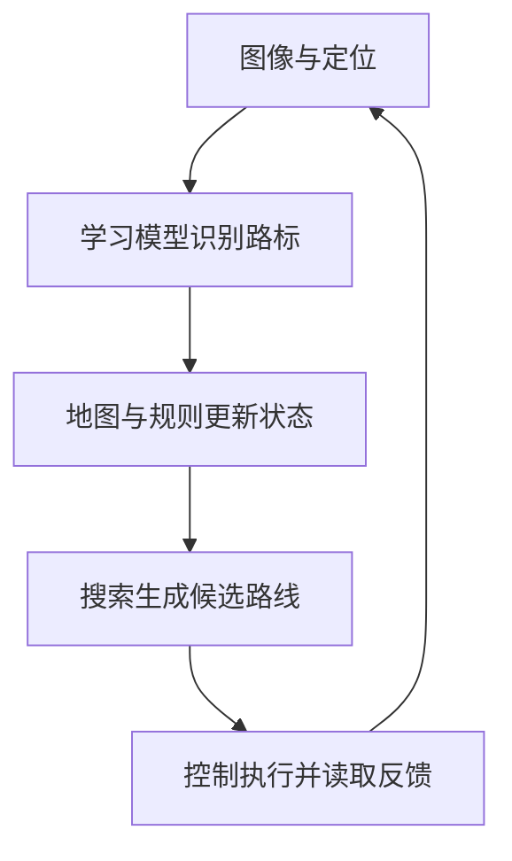

#### 1.3.1 符号主义

把知识表示为符号、关系和规则，以显式推理处理问题。例如“通过课程A且通过课程B，才有资格选课程C”。优势是语义明确、推导可追踪、适合硬约束。

困难在于知识并不总能写成完备规则。图像中的物体、日常常识和模糊语言很难全部人工枚举。符号系统还会遇到组合爆炸，因此表达清楚不等于计算容易。

符号主义所用符号需要具有可解释的语义。例如把“需补概率”表达成一条可追踪规则，系统可以指出来自哪个规则及哪些前提。若不同信息源给出冲突事实，可直接检查符号和规则。难度在于人要事先选择表达语言，众多随情境变化的例外可能很难完整枚举。推理在理论上有定义，也可能在有限时间内找不到解。

#### 1.3.2 连接主义

通过相互连接的可训练单元学习分布式表示。一个概念可能由多个单元共同表达，一个单元也可能参与多个概念，因此通常不宜把某个权重直接解释成一条人工规则。

优势是从复杂数据学习表示；限制包括训练成本、数据依赖、分布变化及可解释性。神经网络的数学模型受生物神经系统启发，但不是对大脑结构与机制的完整复制。

连接主义把知识部分编码在参数与激活分布中。识别图像里的同一数字时，笔画位置和粗细变化很难完全写成规则，学习模型能从实例学到共享规律。也可能误学背景颜色。可以换一个背景数据测试其是否真正使用笔画。分布式表示能组合多项信息，其证据检查方法与手写规则不同。

#### 1.3.3 行为主义

强调主体与环境交互、感知和行动的闭环。从行为反馈中学习或调节，常见于机器人与强化学习。

例如机器人控制不是只输出“我应该向左”，还要执行、获得位置变化和碰撞反馈，再修正控制。与连接主义并不冲突：强化学习策略可以由神经网络表示，环境状态也可以部分用符号地图表示。

面向环境闭环的设计必须同时规定感知、动作与反馈。强化学习是一种通过奖励来调整策略的机制，反应式控制也可用人工编写的规则实现。假如巡检机器人每走一步都奖励，可能在同一区域重复行走。将奖励改为覆盖新地点和安全完成，用任务指标约束动作，才能判断是否学到了想要的行为。

### 1.4 人工智能研究的基本内容

| 内容 | 核心问题 | 本书对应学习方向 |
| --- | --- | --- |
| 知识表示 | 事实、规则和关系怎样编码 | 第2章 |
| 推理 | 已知信息支持什么结论 | 第3、4章 |
| 搜索与优化 | 在候选状态中怎样找解 | 第5、6章 |
| 学习 | 如何从数据和反馈改进 | 第7—10章 |
| 规划与行动 | 如何按目标执行并调整 | 第11、12章 |

这些能力可以出现在同一系统里。课程助手可以用图谱表示先修关系，用规则检验资格，用搜索安排顺序，用模型理解问题，再由工具读取真实进度。不要先决定技术名词，再反过来为它寻找需求。

把“知识、推理、搜索和学习”映射到工程模块时，分别写出输入输出。例如知识表示向查询返回带版本的关系，推理模块输出结论和证据，搜索模块输出路径以及代价，学习模块输出估计与置信信息。一个模块输出“未知”应被下游显式处理。缺事实就随意取一个猜测，会把当前信息不足变成业务错误。

### 1.5 人工智能的主要研究领域

自然语言处理涉及表示、理解与生成；计算机视觉涉及识别、定位、分割和场景表示；语音处理连接音频与语言；机器人连接感知、规划、控制与物理世界；知识工程组织可复用知识；多智能体研究多个决策主体间的交互。

研究领域之间共享方法。例如Transformer不只用于文本，图搜索不只用于游戏，概率推理也不只用于分类。掌握“问题形式”有助于迁移知识，而不局限于某个行业名称。

评价至少包括任务质量、泛化、计算成本与错误代价。不同任务不能只凭准确率比较：漏掉严重故障与把正常项误报为故障，后果可能完全不同。

视觉任务可按问题拆为分类、检测、分割；语音还可区分内容识别、说话人识别和合成；NLP可分理解、检索、抽取和生成；机器人把感知、规划与控制组成闭环。面对具体需求，先选择能衡量任务的单位。分类看标签是否正确，检测还要看位置，语言问答的引用要检查能否支持每项结论。

### 1.6 小结

本章应能回答：AI的目标是什么，智能能力包含哪些方面，三种思想如何互补，以及为什么需要先定义任务再选算法。把一次成功演示当作通用能力、把高训练分数当作未来效果，是两类应持续避免的误解。

**本章原创检查题**：设计一个选课助手的PEAS描述，并分别指出一项适合规则、一项适合学习、一项适合搜索的任务。参考思路：资格约束用规则；从错题估计薄弱知识用学习；在学期时间与先修条件下安排课程用搜索或约束求解。

**回忆检查**。试说明“模型会写出可行的计划”与“智能体能把计划执行完成”的差别。前者评价产出文本与约束，后者还需要动作接口、权限、真实结果和失败处理。再问路线及时更新属于哪个模块。若只是重算路径，是搜索与规划；若观察中发现训练模型总漏检某类障碍，则涉及感知学习。

## 第2章 知识表示与知识图谱


### 2.1 知识与知识表示的概念
课程资料里出现“概率论”只说明有这个词。要回答“谁可以选机器学习”，还要知道这门课是不是适用于该学生的先修要求、成绩记录是否完整，以及如何把缺失记录解释为未知或不合格。

设同一份课表中有一个字段写成“空”。它可能表示该课程本来没有先修、先修资料暂缺、字段不适用于这类课程，或者同步失败。四种情况分别需要不同动作。知识表示除了记录值，还要记录这个值处于什么状态、由谁证实以及适用于哪个时间和对象。

#### 2.1.1 知识的概念
知识是可用于理解、判断或行动的事实、关系、规则和过程。例如「3」是数据，「机器学习课有3学分」是带语境的事实，「通过两门先修课才能修读机器学习」是约束，「缺少记录时先查教务系统」则是过程性知识。知道事实和知道怎么查证是两种能力。

可按用途区分陈述性、过程性与控制知识。陈述性知识说“是什么”，如课程 A 的学分。过程性知识说“怎样做”，如按课程号查档案。控制知识说“什么时候用哪种过程”，如缺少新版信息时先查教务目录。用静态三元组可表达第一类，用规则或工作流通常更容易表达后两类。一个系统如果只掌握事实而没有查询和选择流程，面对不完整资料时可能无从推进。

#### 2.1.2 知识的特性
知识往往有适用条件、来源、时效和例外。同一门课程在不同培养方案下可能有不同先修要求。应给事实记录版本、生效区间和证据，先判断冲突是否源自对象或时间不同，再处理真正矛盾。把所有事实混在一个无版本集合里，容易对毕业班套用新生的规则。

确定性要与可靠性分开。规则一旦采用可以是确定的，但数据来源可能过时。比如图谱导入“所有转专业学生按2025方案”，后来确认某个学生按2026方案。正确处理是更正适用规则或登记例外，并重算受影响的推导。直接删除整个知识节点会丢掉其他学生可用的有效事实。每项知识附来源有助于复核，但来源关联本身也需要验证。

#### 2.1.3 知识的表示
表示把知识变为机器可处理的结构。四个评估问题是能否表达要说的内容、能否推出想要的结论、能否负担计算代价、能否持续维护。关系表便于精确更新，规则便于触发和解释，图谱便于多跳查询。选表示时先写两个问题和预期结果，再决定结构。

同一句话用不同表示会支持不同操作。关系数据库可按学生号查通过记录。谓词逻辑允许表达所有学生都受规则约束。产生式能在条件齐备时更新结论。框架能组织选课对象的必填槽和默认值。图谱便于查询依赖传播路径。选型时至少试写一个精确查询、一条跨对象规则和一种更新操作。若某表示要把简单查询改写成大量特例，说明它可能不是合适的主存储。

### 2.2 一阶谓词逻辑表示法

逻辑建模有语法和语义两层。语法决定哪些字符串是合法公式，语义决定公式在一个解释中何时为真。以后做推理时，要问的是“前提在每个解释中为真时，结论是否也为真”，而不是公式看起来相似程度。

#### 2.2.1 命题
命题是给定解释下可判真假的陈述。令 $P$ 为「小林已修概率」，$Q$ 为「小林具备选课资格」。$P\to Q$ 只在 $P$ 真且 $Q$ 假时为假，等价于 $\neg P\lor Q$。$P\lor Q$ 允许两者都真。若已知 $P\to Q$，$Q$ 真不能推出 $P$ 真，例如还有免修渠道。

给定 $P$、$Q$，在 $P$ 为假时，不论 $Q$ 如何，$P\to Q$ 都为真。这称为材料蕴含的空真。例：「凡通过先修者都可选」不会对未通过者说任何事。原命题 $P\to Q$ 与逆否 $\neg Q\to\neg P$ 等价，逆命题 $Q\to P$ 与否命题 $\neg P\to\neg Q$ 一般不等价。验证方法是逐行比较真值表。

**手算**。$P=\text{真},Q=\text{假},R=\text{真}$ 时，$(P\to Q)\lor(\neg Q\land R)$ 是真，因两部分分别为假、真。复杂表达式先按括号拆，再计算否定和连接词，可避免把 $P\land(Q\lor R)$ 误读为 $(P\land Q)\lor R$。

#### 2.2.2 谓词
项可以是常量、变量、函数作用于项。谓词作用于项得到原子公式。$TeacherOf(c)$ 如果是函数，为每门课给出一个教师对象。$Teaches(t,c)$ 是谓词，允许多人教同一门课。两种表示对应不同的实际约束。

一阶里的“项”指称一个对象，含常量 $a$、变量 $x$ 和函数项 $f(x)$。$Teaches(f(x),c)$ 才是用谓词作用于项形成的公式。函数符号有固定元数。使用 $Prereq(c,p)$ 前应约定先写课程、后写先修。若同一项目两个模块用了不同方向，即便每条记录字段都非空，多跳查询仍会沿反方向查错。

#### 2.2.3 谓词公式
量词作用于所在子式。$\forall x(Student(x)\to HasID(x))$ 表示所有学生有学号。$\exists x(Student(x)\land Passed(x,AI))$ 表示至少有一名学生通过 AI。第二个例子若把合取误写成蕴含，只要论域里有一个非学生对象，蕴含就可被满足。

量词作用域界定哪些变量由量词约束。$\forall x[P(x)\to Q(x,y)]$ 中 x 受约束、y 自由。要使 y 也变成约束变量，可在外层加相应量词，但选择 $\exists y\forall x$ 与 $\forall x\exists y$ 会改变含义。画一张范围树：根是 $\forall x$，子节点是蕴含，左右分别是 $P(x)$、$Q(x,y)$。逐叶确认变量在哪个祖先节点被绑定。

#### 2.2.4 谓词公式的性质
自由变量未受量词约束，无自由变量的公式称为闭式。有一个解释为真叫可满足，所有解释均真叫有效，没有解释为真叫不可满足。否定全称得到存在反例，否定存在得到全称否定。
$$
\neg\forall x P(x)\equiv\exists x\neg P(x),\qquad
\neg\exists x P(x)\equiv\forall x\neg P(x)
$$
量词次序会改变依赖关系。「每个人都有一位导师」允许导师随人变化，「有一位导师指导所有人」需要同一个人。代换变量时先标准化命名。例如给 $\forall y R(x,y)$ 的自由 $x$ 代入自由 $y$，要先将绑定的 $y$ 改名为 $z$，结果 $\forall z R(y,z)$。

解释包含论域、各常量指向的对象、各函数的具体映射以及各谓词的真值关系。论域 $D=\{a,b\}$，若 $P(a)$ 真、$P(b)$ 假，$\exists xP(x)$ 为真而 $\forall xP(x)$ 为假。验证有效性时要考虑所有解释；否定有效性只需给一个反例。$\forall xP(x)\to\exists xP(x)$ 在标准非空论域中有效，若采用允许空域的其他逻辑约定则需重新检查。

#### 2.2.5 一阶谓词逻辑知识表示方法
建模时先给论域和谓词的参数顺序，再写事实和规则。「只有通过概率论才能选机器学习」写成 $CanSelect(s,ML)\to Passed(s,Prob)$，通过概率论是必要条件。「通过概率论并且有剩余学分就可选」则另写一条充分条件。用「通过但没有剩余学分」「通过但课程停开」两例检查前提是否足够。

完整建模例：「有且只有一位老师负责 A，且他也负责 B。」设 $Teach(x,c)$ 是负责。可以写为
$$
\exists x[Teacher(x)\land Teach(x,A)\land Teach(x,B)\land
\forall y((Teacher(y)\land Teach(y,A))\to y=x)].
$$
唯一性只约束 A 的负责教师，不能让 B 也必然唯一。检验时画两个候选世界：A、B 同由甲负责且 B 另有乙时应为真；A 同时有甲、乙负责时应为假。若写成「恰有一人同时负责 A 和 B」，只约束同时负责者，就不能排除 A 有额外负责人。

#### 2.2.6 一阶谓词逻辑表示法的特点
一阶逻辑可以表达一般关系与量化规则，方便精确定义和形式证明。默认例外、时间、置信程度要另行建模。一般一阶逻辑的证明搜索可能无法终止。开放世界下，没录入成绩只代表知识库未证明通过。只有确认数据完整且采用闭世界政策后，才能按缺记录判未通过。

表达能力还受一阶的限制。普通一阶量词遍历对象，而不遍历谓词和所有关系。若想写“对所有可能关系 R”这类话，需要额外形式机制。领域中出现不确定事实时可加来源谓词、版本参数，也可接专门概率模块。这样做能表示“何处、何时相信某事实”，直接把数值插在谓词上不会自动赋予概率计算语义。

### 2.3 产生式表示法

产生式系统常包含可执行后件，因此需要把逻辑结论和动作交付分开。前件匹配会生成候选，控制机制根据状态选择。若后件只添加事实，可以达到闭包；若后件会发送、删除或调整状态，需要规定重试、重复、副作用和解释。

#### 2.3.1 产生式
产生式由前提和后件组成。后件可以添加事实，也可以触发动作。由规则得出「应该提醒」和真的写入一条提醒具有不同语义，后者应经权限、状态和去重规则控制。

用 Horn 形式写规则 $(A\land B)\to C$ 等价于 $\neg A\lor\neg B\lor C$，一个事实可视为无前件的规则。生产规则还可能包括“没有匹配到事实”这样的工作记忆测试。它依赖当前数据快照，不能直接当作经典逻辑已经证明了否定。例如系统暂没有订单记录，也许是接口未返回。

#### 2.3.2 产生式系统
工作记忆保留当前事实，规则库存领域规则，控制器反复匹配、挑选、执行。匹配出多条规则时得到冲突集。可以按优先级、特异性或事实新鲜度消解冲突。若规则允许撤回结论，应记录各条支持链，避免删去一个依据就误删还有其他依据的结论。

下面图示一轮控制。事实更新后，旧冲突集可能失效，应重新核验本轮触发条件。所有候选都认为可以发提醒时，需要筛掉重复动作。有运行预算的系统还应返回停止原因和最后状态。

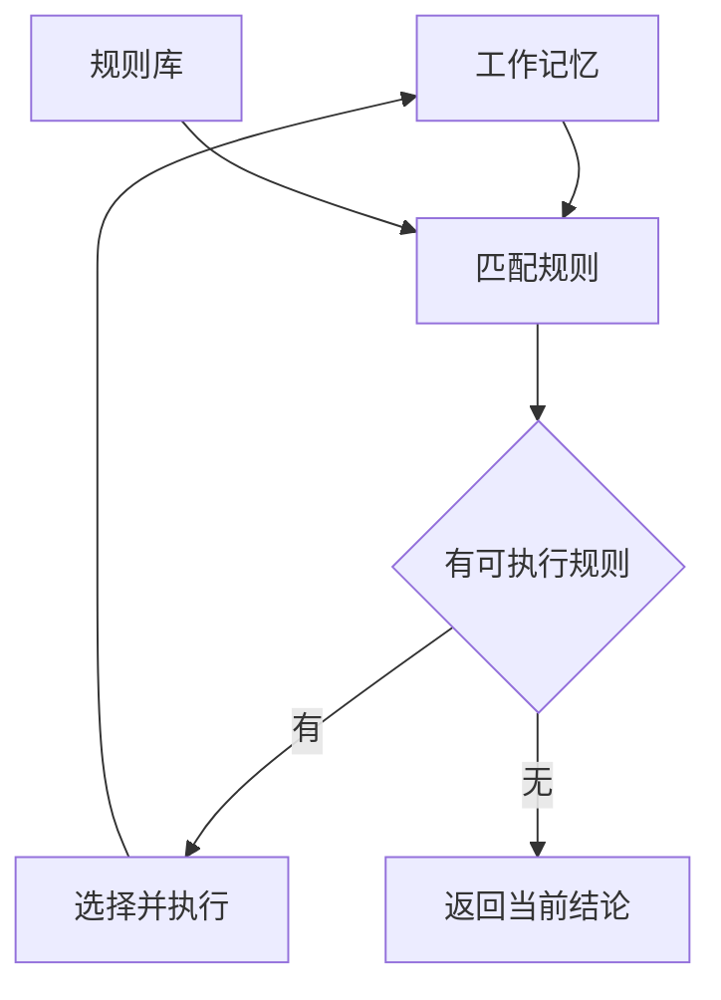

#### 2.3.3 产生式系统的例子——动物识别系统
自编动物识别例。规则 R1「有毛发 → 哺乳类候选」，R2「哺乳类候选且有蹄 → 有蹄类候选」，R3「有蹄类候选、长腿、长颈 → 长颈鹿候选」。四个观察事实进入工作记忆后，前三轮依次增加 R1、R2、R3 的结论。反向询问长颈鹿候选时，从 R3 的三个前提逆查，腿和颈可直接查询，剩下一个前提沿 R2、R1 回溯。

若仅删掉毛发观察且没有其他证据，依赖链均不再有充分支持。真实识别还需考虑测量错误、反例和规则覆盖率，所以这里的输出命名为候选。

可以把小型动物识别具体写成工作记忆状态。初始集合 $F_0=\{\text{毛发,蹄,长腿,长颈}\}$。第1轮增加 mammal，第2轮增加 ungulate，第3轮增加 giraffe，第4轮无新增停止。如果规则“留下长足印→有蹄”也成立，ungulate 可以有间接来源。撤回“观测到蹄”后，系统需要重新计算这条结论是否还有第二条独立支持。真实应用中应记录事实是观察、用户录入还是规则推出。

#### 2.3.4 产生式表示法的特点
规则可局部修改，也容易保存解释。但规则多了会产生交互，两条规则可能同时希望写不同状态。规则还可能反复生成同一事实。有限正事实且只增加新事实时，可在达到不动点时终止。若可写、删或调用服务，就需要防循环和明确执行语义。

用“规则易维护”描述单条规则没问题，但整体维护成本取决于规则交互。设 R1 检测旧版，R2 开启新版，若各规则都可无条件重写同一状态，系统在两值之间振荡。解决办法可以是增设版本和优先级、明确状态只向更晚版本推进，或给动作加验证。简单正向规则传递可通过增量匹配来节约重新扫描，前提是事实更新语义清楚。

### 2.4 框架表示法

框架体现对象的槽值及继承。可以用同一课程在“默认规则”和“具体事实”之间做追踪。查询时看到具体值优先，若值没有给定查父类型。没有任何值时返回未知。用默认值填充之后，也应标记来源，便于出现更具体事实时更新。

#### 2.4.1 框架的一般结构
框架用槽表达实体或情境，槽可包含值、值域、默认值、来源及需要时执行的计算。实例提供确定值，类型可提供默认。多继承时要说明两个父框架默认冲突如何处理。

槽的不止是存值。槽可以规定允许范围、单位、缺省值、触发过程和依赖。例如课程容量必须为非负整数，剩余名额按容量减有效报名数计算。如果已经超额，单纯把剩余名额夹为0会隐去异常，应保留计算状态。过程求值也会产生循环依赖，框架设计应防止 A 的槽依赖 B，而 B 又依赖 A。

#### 2.4.2 用框架表示知识的例子
例如「课程」框架默认3学分且考试，「机器学习课程」继承它并明确为4学分，先修为概率论、线性代数、Python。学生完成记录只有后两项，做集合差得到待补概率论。默认值3被明确值4覆盖，结果应该保留字段来源以便解释。

设计课程框架的小表。

| 槽 | 类型默认 | 具体课程值 | 查询解释 |
| --- | --- | --- | --- |
| 考核 | 统一笔试 | 实验加笔试 | 取具体课程值 |
| 学分 | 3 | 未填写 | 返回带来源的默认3 |
| 先修 | 缺省为空但未核验 | 概率论，Python | 以实际先修清单核验 |
| 剩余名额 | 由过程计算 | 容量30，已确认24 | 计算结果6 |

若“实验课”与“公共课”都给了不同考核默认，具体课的显式值仍优先。若没有显式值，需要声明继承先后或要求补录。默认值无法提供确定证据时，别用于严格约束。

#### 2.4.3 框架表示法的特点
框架适合有对象属性和层次的知识，可以重用公共槽。但跨对象的复杂量化规则仍需独立逻辑或规则系统。默认值具有可撤回性。例如原假设鸟通常会飞，后来确定是企鹅，可撤回默认结论，而经典逻辑有效演绎通常具单调性。

比较框架继承与类继承时，关注推断。框架值可能依新事实撤回，例如从“晚上默认锁门”修正为“考试日晚上开放”。传统类继承本身只规定属性和行为，不自动给默认异常设计正式语义。框架也不擅长表达跨多个对象的集合约束，常要联合规则系统、逻辑或数据库查询。

### 2.5 知识图谱

从条目库到知识图谱，需要解决“对象标识—模式定义—事实存储—更新和查询”全部问题。实体识别是起点。若两个课程都简称 AI，依据院系和正式编号对齐后，才能决定哪些课程边可合并。图谱查询容易展示路径，因此路径中每条边都应该有可追溯依据。

#### 2.5.1 知识图谱的提出
知识图谱结合语义网络、数据库、知识工程等思想。自然语言里的名称不是稳定身份，同名课程和学校需要实体 ID。目标是按实体语义和关系查找信息，并能追踪结论基于哪条陈述。

搜索引擎从处理关键词进一步处理实体关系，是图谱广为关注的应用背景。知识图谱还继承语义网络与语义网。关系比单词共现更强。两课程总在课程安排相邻出现，不能仅凭共现推为先修，应该依据方案明确表述或人工审查。

#### 2.5.2 知识图谱的定义
图谱可以视为实体、类型、关系、属性构成的知识结构。模式层约定允许哪些对象及边，数据层存具体实例。仅把几个词做成节点，若没有关系语义和身份定义，难以进行可靠查询。

考虑本体的类型、关系域、关系值域和约束。可规定 Prerequisite 的两端都是课程。把教师实体填在尾端就违背模式。如果同一门课按不同专业有不同规则，加入语境节点或把关系带版本存储。图谱成品的关键是既能查到结构，也能解释结构何时有效。

#### 2.5.3 知识图谱的表示
简单三元组形如「机器学习，先修课程，概率论」。当关系只在2026版培养方案有效时，可以在属性图的边增加年份，也可以把整条陈述作为一个对象附加来源。关系有方向，不能把「A的先修是B」反向理解为「B的先修是A」。

以下代码使用标准库。它只演示精确关系查询，不实现 RDF、完整本体推理或图数据库。

```python
triples = {
    ("机器学习", "需要基础", "概率论"),
    ("机器学习", "需要基础", "线性代数"),
    ("概率论", "包含知识点", "条件概率"),
    ("贝叶斯分类器", "使用", "条件概率"),
}

def query(subject=None, relation=None, obj=None):
    return sorted(
        (s, r, o) for s, r, o in triples
        if (subject is None or s == subject)
        and (relation is None or r == relation)
        and (obj is None or o == obj)
    )

print(query("机器学习", "需要基础"))
print(query(relation="使用", obj="条件概率"))
```

学习时可以继续添加“通过先修关系查询所有间接基础”的功能。若图中存在环，必须记录访问过的节点，否则可能无限遍历。

RDF 的典型语句是主语、谓语、宾语的三元组。主语常用稳定标识，宾语可以是资源或字面值。属性图允许边带属性，例如 `ML -[先修{year:2026}]-> Prob`。两类模式均可表达版本，但组织方式不同。固定一个查询标准：“只查本专业且 2026 年生效的直接边”。再写第二个查询找间接路径，避免误把多跳结果当直接先修。

#### 2.5.4 知识图谱的架构
逻辑架构关心模式、实例和约束，工程架构包括输入、抽取、对齐、存储、查询和服务。图遍历只沿边查找，规则推理还要求明确关系性质。A认识B且B认识C并不能推出A认识C，虽然图上存在长度2的路径。

可把架构画成多层。抽取生成候选事实，融合负责身份和冲突，写入经过模式和质量校验。查询从模式和实体图出发，也可能调用规则层。若用户对答案提出异议，反向沿索引定位版本、片段及抽取记录。

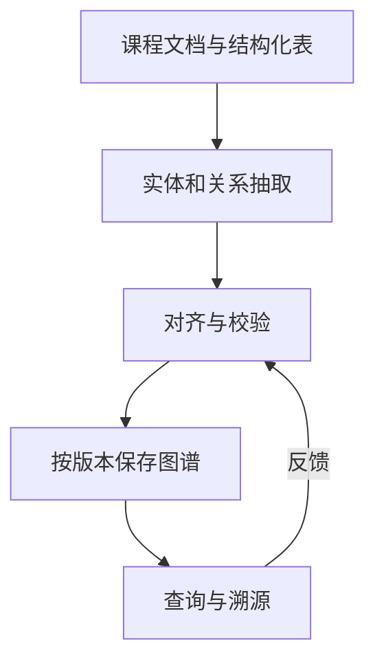

#### 2.5.5 知识图谱的构建
先定义要回答的问题，再确定实体与关系。抽取「机器学习先修概率」后，查课程代码确认「概率」和「概率统计」是否同一门课，记录培养方案版本，检查关系是否形成非预期环，抽样验证错误率。自动对齐应能保留不确定项供人工复核。

构造评估集时，分别评估实体链接、关系抽取、数值单位和出处。50个抽取候选里确认40为真，候选精确率0.8。如果人工标定一共60条真实关系，则召回为 $40/60=2/3$。出现错合并时，要先修实体对齐。若主要漏掉表格中关系，则调整解析，而非只改模型提示。

#### 2.5.6 知识图谱的典型应用
图谱适合多跳问答与关联解释，向量检索适合自然语言召回。课程问答可先定位相关章节，再查询结构化先修，并在回复附培养方案依据。不能因为文本高度相似就判定实体身份、数字或事实一致。

**图谱推理与路径验证例**。假设规则写成 $DirectPrereq(x,y)\to Requires(x,y)$，并额外声明 $Requires(x,y)\land Requires(y,z)\to Requires(x,z)$。存入 $DirectPrereq(Transformer,NeuralNet)$、$DirectPrereq(NeuralNet,LinearAlgebra)$，即可推出 $Requires(Transformer,LinearAlgebra)$。但是直接先修仍只有 NeuralNet，不应把派生事实写回 DirectPrereq。若两条边适用于不同培养方案，需要给规则加相同方案参数，不能跨版本拼接。

维护时可以为派生事实存两条边的 ID。删除其中一个依据后，要检查是否有其他路径仍能得到同样结论。对于版本内的先修图，还可在写入时检测回路。若已有 A→B→C，再添加 C→A，就让三门课互为先修，无法作拓扑排序。可向维护者返回冲突环，而非只报无法导入。

推荐可以先用图谱寻找可解释的依赖链，例如“已通过概率，接下来可补线性代数”。个性化排序还要加入兴趣、难度与时间。多跳问答链条越长，每条边的错误会传播；不要用一段流畅语言掩盖中间边没有出处。若资料允许的范围跨两级课程，则明确链的起点、终点、方向、版本。

### 2.6 小结
比较五种表示时，检查对象身份、推理语义、缺失值语义、更新成本。**自测**：把「有且只有一位老师指导小林」写成逻辑式。答案为 $\exists t(Advises(t,Lin)\land\forall u(Advises(u,Lin)\to u=t))$，前半句确保存在，后半句确保唯一。

**复习任务**。同一个问题“某生能否选下学期的机器学习”至少拆成：查找适用培养方案、确定对象、核验先修成绩、运行资格规则并说明缺失条件。框架可维护条件的缺省值，图谱可查依赖关系，逻辑可表述规则。若没有正式成绩记录，答复应区分规则上缺一项和系统未查到数据。

## 第3章 确定性推理方法


### 3.1 推理的基本概念
推理有三个层面：什么结论被知识蕴含，什么结论能按规则证明，以及在时间限制内找不找得到证明。把三者区分开，才能正确解释程序返回的「未知」。

确定性推理的目标可以分为查询、证明、寻找反例、验证规则一致性。查询“是否已通过”可能只查一条事实；证明“是否有资格”通常需要匹配多条规则；寻找反例则试图让前提真而目标假。一套推理系统的输出应区分已证真、已证假、缺信息、资源耗尽。只返回布尔值会丢失判断依据。

#### 3.1.1 推理的定义
$KB\models G$ 表示每个满足知识库的解释都满足目标，$KB\vdash G$ 表示给定证明系统能导出目标。可靠性要求可证推出蕴含，完备性要求蕴含最终可证。完备性不承诺每个不可证目标都有有限失败证明。

令 $KB=\{P\to Q,\ Q\to R,\ P\}$。满足 KB 的任何解释都必须让 P、Q、R 为真，所以 $KB\models R$。若用两次假言推理得到 R，还可以写 $KB\vdash R$。若系统只实现了合取消去，它可能知道三条前提，却不能执行上述证明。语义层与所选演算的表达有差别。对真正不可满足的 KB，经典逻辑中任何目标都被蕴含，因为没有一个反例解释。这提醒工程系统应先报告规则冲突，避免把爆炸原理产生的结论用于业务。

#### 3.1.2 推理方式及其分类
演绎从一般规则与前提出发，归纳从样本概括规律，溯因寻找能解释现象的假设。例如服务慢可由数据库排队解释，也可由网络或客户端引起。观测到服务慢不能把某一个可能原因判成事实。

请区分“规则可以保证”与“样本支持”。已知只要账号注册成功就有一条用户记录，查到某人注册成功，可以演绎记录存在。观察十次查询慢时 CPU 高，可归纳 CPU 高与查询慢有关，但未来可能反例。从查询慢倒推 CPU 高，是溯因候选，需要用监控再验证。三个过程可以连续工作：先产生候选，再用规则排除，最后通过新数据更新对模式的认识。

#### 3.1.3 推理的方向
正向推理适合事件驱动、多结论，反向推理适合查询指定目标。用规则「P且Q推出R，R且S推出T」，正向从 P、Q、S 推到 R、T。反向从 T 需要 R、S，再从 R 需要 P、Q。若 P 缺失，应记录哪个子目标无法证明。结合时可先正向缓存常见派生事实，查询时反向补专门证据。

正向推理的工作表从事实向结论扩张，反向推理构造当前目标的 AND/OR 子目标树。同一结论可由任一规则给出（OR），单条规则的所有前提通常要满足（AND）。

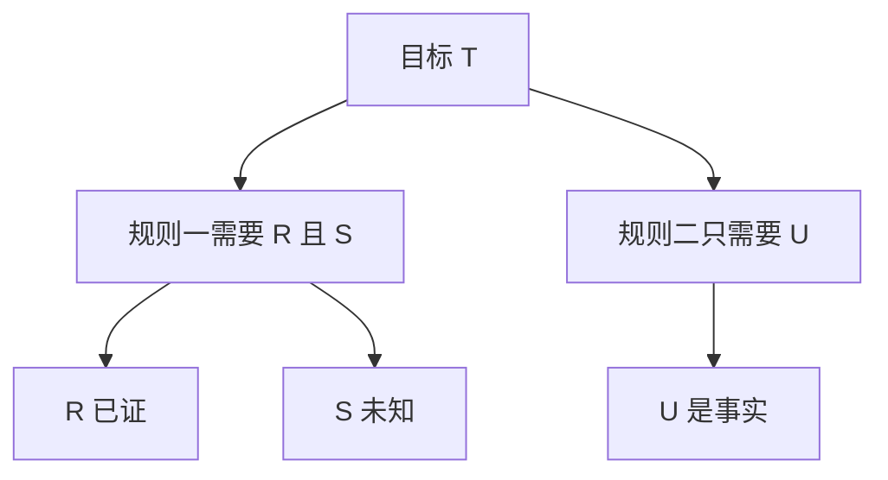

图中规则一分支结果未知，但规则二可独立证明 T。反向系统若遇到递归规则，应对当前调用链做环检测，并按任务与数据模型决定何时记忆结果。正向系统则可以维护待处理的新事实列表，避免每轮重新扫描所有已知事实。

#### 3.1.4 冲突消解策略
多个规则可触发时，可按业务优先级、条件特异性、事实新近程度排序，也可规定相同规则和同一事实组合只触发一次。示例：常规提醒与免打扰规则都命中时，明确免打扰优先。若知识库只有有限正向事实、无副作用，完备地推到不动点时，调度通常影响效率和解释轨迹。允许删改则可能影响最终结果。

标准库示例，只处理无变量、无否定、无副作用的有限事实集合。

```python
facts = {"完成Python", "完成概率论", "完成线性代数"}
rules = [
    ({"完成Python", "完成概率论"}, "可学机器学习"),
    ({"可学机器学习", "完成线性代数"}, "可学神经网络"),
]

changed = True
while changed:
    changed = False
    for conditions, conclusion in rules:
        if conditions <= facts and conclusion not in facts:
            facts.add(conclusion)
            changed = True
            print("推出：", conclusion)

print(sorted(facts))
```

算法在没有新增事实时终止。它记录“是否已推出”，避免同一结论反复触发。这不是完整一阶逻辑证明器，也不支持撤回事实；若要回答“为什么推出”，可为每个新增事实记录触发规则与前提。

假设三条规则都拟修改工单。R1 给一般优先级，R2 对紧急请求设高优先级，R3 根据人工处理状态禁止自动改写。可设 R3 优先于 R2，R2 优先于 R1。同优先级下可选最具体规则，或在不兼容时升级处理。仅按规则文件顺序会让插入一行改变行为。测试需有同时满足三条、只满足任意两条和缺少关键字段的案例。输出记录触发规则及被压制原因。

### 3.2 自然演绎推理
最常见的是假言推理：

$$
P,\quad P\to Q\quad\Longrightarrow\quad Q
$$

合取消去允许从 $P\land Q$ 得到 P 或 Q；合取引入允许从 P 与 Q 得到 $P\land Q$。全称实例化允许从 $\forall xP(x)$ 得到某个具体对象的 $P(a)$。

无效推理要特别记住：由 $P\to Q$ 与 Q 不能一般性推出 P；由 $P\to Q$ 与 $\neg P$ 也不能推出 $\neg Q$。有效的逆否关系是 $P\to Q$ 等价于 $\neg Q\to\neg P$。

**完整例**。已知 $P\to(Q\land R)$ 与 $R\to S$，证明 $P\to S$。先临时假设 P，由假言推理得 $Q\land R$，合取消去得 R，再用 $R\to S$ 得 S，最后解除 P 的临时假设得到 $P\to S$。临时假设只在这段子证明里使用，不能据此宣布 P 本身已被证明。

**合取、析取与反证的组合**。给定 $P\lor Q$、$P\to R$、$Q\to R$。先在 P 分支由蕴含得 R，再在 Q 分支由蕴含得 R。两个可能分支均导出同一 R，从析取消去得到 R。反过来，从 $P\lor Q$ 和 P 真推 Q 假无效，因为 P 与 Q 都为真也是允许的解释。

形式证明可以把每行标为前提、临时假设或某步推导。临时假设被解除时，不能把证明块内的中间结论直接搬到块外。例如在 $P$ 假设下得到 R 可以用于推出 $P\to R$，尚不能独立推出 R。量词推导也要防止把任意实例与某个指定对象混用。由 $\exists xP(x)$ 不能直接推出 $P(a)$ 对当前公开命名的 a 成立。

### 3.3 谓词公式化为子句集的方法
归结希望把不同形式的公式统一为“若干文字的析取”。文字指原子公式或其否定。比如 $\neg Student(x)\lor HasID(x)$ 是一个子句。

一般转换流程是：

1. 消去 $\leftrightarrow$ 和 $\to$。
2. 把否定推到原子公式前，使用德摩根律与量词否定规则。
3. 对不同作用域的变量改名，防止混用。
4. 在适当条件下整理量词，进行 Skolem 化，消去存在量词。
5. 去掉隐含为全称量化的量词，把式子化为合取范式。
6. 按合取拆成多个子句；不同子句中的变量需要时分开命名。

**关键区别**：Skolem 化一般保持可满足性，不是对原语言中的逻辑等价替换。

看一个例子：

$$
\forall x\,[Student(x)\to\exists y\,Helps(y,x)]
$$

消去蕴含后有 $\forall x\exists y[\neg Student(x)\lor Helps(y,x)]$。y 可能随 x 改变，所以用函数 $f(x)$ 代替：

$$
\neg Student(x)\lor Helps(f(x),x)
$$

这里不能任意改成同一个常量 a，否则会错误地要求所有学生都由同一个人帮助。若存在量词前没有依赖的全称变量，则可使用新的 Skolem 常量。

**更完整的转换**。把 $\forall x(Student(x)\to\exists y(Advisor(y)\land Guides(y,x)))$ 化为子句集。

1. 消蕴含，得到 $\forall x[\neg Student(x)\lor\exists y(Advisor(y)\land Guides(y,x))]$。
2. y 不在左式自由出现，移到该式前部，得到 $\forall x\exists y[\neg Student(x)\lor(Advisor(y)\land Guides(y,x))]$。
3. y 依赖先出现的全称变量 x，以新函数 $f(x)$ 替换。
4. 析取对合取分配，拆成 $\neg Student(x)\lor Advisor(f(x))$ 和 $\neg Student(x)\lor Guides(f(x),x)$。

同一个 Skolem 项必须在两处保持一致，否则会把「同一个指导者兼具两属性」弱化为「各有一个对象满足属性」。

**两层量词依赖例**。给 $\exists u\forall x\exists y\forall z\,R(u,x,y,z)$。不存在先行全称变量的 u 换成新常量 c；y 依赖先行全称 x，换成新函数 $f(x)$；虽然还有全称 z，但它出现在 y 之后，不能让 y 依赖 z。结果可写成子句 $R(c,x,f(x),z)$，x、z 隐含全称。若把 y 换成常量，可能使原本可满足的系统失去模型。

从含存在量词的公式到 Skolem 子句通常保持可满足性，而不是在原语言中逐解释等价。新常量和函数的解释需要额外指定。做归结反证只依赖能否找到模型，因此这种变换足够。题目中还要将每条独立子句的同名变量理解为各自局部全称，选择跨子句合一前可先重命名。

### 3.4 鲁宾逊归结原理

归结的基本动作是把“必须由某个分支满足”的两个约束合并。它不需要逐条手写各种证明规则，但候选子句可能爆炸。记录每一步使用的父子句、被消去文字和代换，既能检查推导，也能分析程序为何在无关候选上耗时。

#### 3.4.1 命题逻辑中的归结原理
归结消去两条子句中的一对互补文字。从 $P\lor Q$ 与 $\neg P\lor R$ 得 $Q\lor R$。证明很直接：如果 Q 与 R 都假，第一条要求 P 真，第二条要求 P 假，矛盾。

每一步只消一对互补文字。从 $P\lor Q$ 与 $\neg P\lor\neg Q$ 双双划掉得到空子句是错误的，令 P 真、Q 假就能同时满足两原子句。归结子句如果含既正又负的同一文字，它是永真式，通常可跳过。

取四条子句 $P\lor Q,\ \neg P\lor R,\ \neg Q,\ \neg R$。先归结前二得到 $Q\lor R$，再与 $\neg Q$ 得 R，最后与 $\neg R$ 得空子句。也可以先对后两条分别使用单位传播，得到 P 和 $\neg P$。两条推导轨迹结论一致，长度相近，机器可以按最短子句先选。

空子句代表始终假。空子句集代表没有待满足约束，通常可满足。两者外观都带“空”，含义相反。另要区别子句 $P\lor\neg P$ 始终真，加入或移除都不改变可满足性。

**可运行：有限命题归结反证**。每次只消除一对互补文字。记录父子句以便检查。若已穷尽新子句但未得空子句，有限命题集可满足。带函数项的一阶问题不能直接使用这个停止承诺。

```python
from itertools import combinations

def complement(literal):
    return literal[1:] if literal.startswith("~") else "~" + literal

def refutation(initial):
    clauses = dict.fromkeys(frozenset(row) for row in initial)
    empty = frozenset()
    while empty not in clauses:
        additions = {}
        for left, right in combinations(list(clauses), 2):
            for pivot in sorted(left):
                other = complement(pivot)
                if other not in right:
                    continue
                child = (left - {pivot}) | (right - {other})
                if any(complement(part) in child for part in child):
                    continue
                if child not in clauses:
                    additions.setdefault(child, (left, right, pivot))
        if not additions:
            return None
        clauses.update(additions)
    return clauses

assert refutation([{"P", "Q"}, {"~P", "~Q"}]) is None
proof = refutation([{"P", "Q"}, {"~P", "R"}, {"~Q"}, {"~R"}])
assert proof is not None
left, right, pivot = proof[frozenset()]
assert not (left - {pivot}) | (right - {complement(pivot)})
print("导出空子句", sorted(left), sorted(right))
```

第一条测试专查“同一步误消两个互补对”。第二条验证应得到矛盾。程序逐轮枚举新子句，适于教学小例，实际证明器还要考虑索引与规模。

#### 3.4.2 谓词逻辑中的归结原理
谓词归结先将两条子句的变量标准化为不同名字，再找最一般合一代换。$P(x,f(y))$ 与 $P(a,f(b))$ 的代换是 $\{x/a,y/b\}$。把代换应用到两条**完整子句**，然后删除已合一的互补文字。若同一变量需要同时代为两个不同常量，或者要用 $f(x)$ 替换 x，合一失败。

例：$\neg Takes(x,c)\lor Student(x)$ 与 $Takes(Lin,y)\lor Waitlisted(y)$ 合一后得到 $Student(Lin)\lor Waitlisted(c)$。代换 $y/c$ 也必须作用于剩余的 Waitlisted 项。

**较复杂的合一**。合一 $P(f(x),x,y)$ 与 $P(z,a,g(z))$。第二个参数要求 $x=a$，更新其余方程后得到 $z=f(a)$，最后得到 $y=g(f(a))$。所以最一般合一代换在三处作用后得到 $P(f(a),a,g(f(a)))$。仅记录 $z=f(x)$ 而不继续传播 $x=a$，会让结果表面上仍带残余变量。若改为合一 $P(x,x)$ 与 $P(f(z),z)$，方程归并后要求 $z=f(z)$，出现检查失败。

一阶归结还常涉及因子化。子句 $P(x)\lor P(y)\lor Q(x,y)$ 中两个 P 可以用 $y=x$ 合一，得到因子 $P(x)\lor Q(x,x)$。它与「把不同文字直接删除」不同，合一要施加到其他文字上。归结反演一般使用一阶归结加因子化等规则来实现反驳完备性。

合一算法可维护等式工作表。相同项消去，函数头相同则拆对应参数，变量可替换时先做出现检查，再将代换传播到其他方程。不同常量或函数头冲突就失败。例：$P(f(x),y)$ 对 $P(f(a),g(x))$，先拆成 $x=a,y=g(x)$，传播后为 $x=a,y=g(a)$。若原子式来自不同子句，应先将两个 x 重命名再计算，这可防止同名造成意外约束。

### 3.5 归结反演
已知：

1. 所有通过 AI 的人都掌握推理基础：$Passed(x,AI)\to KnowsReasoning(x)$。
2. 小林通过了 AI：$Passed(Lin,AI)$。

目标：$KnowsReasoning(Lin)$。

归结反演把“证明目标”转化为“知识库与目标否定不能同时成立”。子句集为：

$$
\begin{aligned}
C_1&=\neg Passed(x,AI)\lor KnowsReasoning(x)\\
C_2&=Passed(Lin,AI)\\
C_3&=\neg KnowsReasoning(Lin)
\end{aligned}
$$

$C_1$ 与 $C_2$ 在 $x=Lin$ 下归结，得到 $C_4=KnowsReasoning(Lin)$。再与 $C_3$ 归结，得到空子句 $\square$。空子句无法被满足，因此原目标得到证明。

如果一直没有推出空子句，不能一概说目标为假：可能是搜索尚未结束；一般一阶逻辑的证明搜索并不保证对所有输入都能停机。命题逻辑有限情形则可以使用完整的判定过程。

一般方案为从 $KB\cup\{\neg G\}$ 出发，把所有公式化为子句集，再寻找空子句。为什么反证有效？如果存在一个模型同时满足 KB 与 $\neg G$，那就是“前提真且目标假”的反例；不存在这样的模型正是 $KB\models G$。若 KB 自身已矛盾，则无论加入什么目标都不可满足，应先检查 KB 一致性，避免把不依赖目标的矛盾错当正常证明。

**可证假也需另证**。请求证明 A 时找不到空子句，并不表示 $\neg A$ 已证明。在有限命题逻辑可用完备决策过程做双向查询，一般一阶问题还需保留运行状态。区分理论完备与限时系统的行为。

### 3.6 应用归结原理求解问题
**用归结寻找答案**。知识库有 $Takes(Lin,ML)$、$Prerequisite(ML,Prob)$、$\neg Takes(s,c)\lor\neg Prerequisite(c,p)\lor Needs(s,p)$。要问「小林需要什么」，可引入答案谓词，通过 $\neg Needs(Lin,p)\lor Ans(p)$ 携带答案变量。先用两事实归结得到 $Needs(Lin,Prob)$，再与查询子句归结，得 $Ans(Prob)$。

实用证明器常先挑短子句或使用与目标有关的支持集，减少组合。输出最好保留每步父子句、消去文字和代换，便于复核。限制搜索深度导致的失败只能归为「当前预算未找到解」。

设有学生事实 $Student(Lin)$、$Passed(Lin,Prob)$，规定 $\forall s((Student(s)\land Passed(s,Prob))\to Eligible(s))$。先得到规则子句 $\neg Student(s)\lor\neg Passed(s,Prob)\lor Eligible(s)$。用 Student 事实归结，得 $\neg Passed(Lin,Prob)\lor Eligible(Lin)$；再用成绩事实得到 Eligible。若查询“谁有资格”，每个匹配到的实体可以作为答案代换。仅得到某人有资格时，不应输出名单已完整。

**工程拓展**。长证明可用单元优先、目标支持集、去重、包摄删除等方法缩小范围。如果只允许将查询相关子句与其他子句配对，是否保持完备取决于其前提。不要用跳过所有尚未看出相关的分支来宣称全局不可证。

### 3.7 小结
自然演绎侧重人可读的证明，归结侧重统一的子句处理。检查顺序是先表达知识，再做变换和合一，最后说明究竟推出了结论、找到答案代换，还是缺少证据。

**自测**：只有 $Passed(Lin,AI)\to Eligible(Lin)$ 及 $Eligible(Lin)$。能证明 Lin 已通过 AI 吗？不能。把 Passed 设假、Eligible 设真，两个前提均真而目标假，这个解释就是反例。

**考查路径**。读一个证明时依次问：事实是否真的属于当前知识库？量词作用域是否正确？子句变换在哪一步只要求可满足性？所用归结是否只消了一对互补文字？证明有没有用到目标否定？若某步错，应指出第一处错步和一组能展示错误的解释。

## 第4章 不确定性推理方法


### 4.1 不确定性推理的概念
“不知道明天是否下雨”涉及事件随机性或认知不足；“资料暂时不够，不能确定设备坏在哪里”涉及证据不足；“今天算不算热”涉及概念边界模糊。这些问题适合不同的数学表示。

| 方法 | 数值大致表示什么 | 不能直接当成什么 |
| --- | --- | --- |
| 概率 | 在某信息条件下事件的不确定程度 | 模糊概念的隶属度 |
| 可信度因子 | 某种规则体系中的支持或反对程度 | 通用的后验概率 |
| 证据理论 | 对命题集合分配的证据支持 | 任意互相独立的概率值 |
| 模糊集合 | 对某概念的符合程度 | 事件发生频率 |

**补充对照**。同一报警系统可用概率估计硬件真的故障的可能性，用隶属度描述当前负载有多「高」，用可信度记录规则给出多强支持。三者输入可以来自同一次观测，输出也都可能是0.7，但含义不同。

条件概率定义为：

$$
P(H\mid E)=\frac{P(H\cap E)}{P(E)},\qquad P(E)>0
$$

贝叶斯公式为：

$$
P(H\mid E)=\frac{P(E\mid H)P(H)}{P(E)}
$$

H 是待判断假设，E 是观察证据。$P(H)$ 是先验，$P(E\mid H)$ 是似然，$P(H\mid E)$ 是后验。它们回答不同问题，不能交换。

用“服务故障报警”算一次：假设故障率为 1%，有故障时报警概率 95%，无故障时误报概率 5%。那么：

$$
P(故障\mid 报警)
=\frac{0.95\times0.01}{0.95\times0.01+0.05\times0.99}
\approx0.161
$$

所以报警后故障概率约 16.1%，并不是 95%。以一万次情况来理解：约 100 次真故障产生 95 次报警；约 9900 次无故障产生 495 次误报；总报警约 590 次，只有 95 次对应故障。

这个例子说明基础发生率会显著影响后验。以上数字仅为教学假设。

不确定来自观测噪声、资料缺失、随机性和词义边界。温度未知时，可用概率表示在不同区间的可能性。已经精确知道28°C时，「有多热」仍可用模糊隶属度。遇到报警与人工观察意见相反时，可用证据支持区间保留冲突。把所有指标换成统一的“准确率百分比”会失去这些语义差别。

**基础率手算**。1000次检测中真实故障率1%，故障时报警概率90%，无故障时误报率5%。预期正确报警9次，误报49.5次。报警时故障概率约 $9/(9+49.5)=0.154$。报警器检出率90%不等于报警后有90%概率真的故障，因为后者还受基础率与误报率影响。

### 4.2 可信度方法
在常见的 MYCIN 风格方法中，$CF\in[-1,1]$：正数支持、负数反对、0 表示没有净支持。它不是通用概率定义。

一种常见传播约定为：

$$
CF(H\mid E)=CF(H,E)\max(0,CF(E))
$$

其中 $CF(H,E)$ 是规则本身的可信度，$CF(E)$ 是证据可信度。例如规则强度 0.8、证据可信度 0.6，得到贡献 0.48。复合前提在一些体系中用最小值表示“且”、最大值表示“或”，但必须明确具体系统约定。

同一结论的两项贡献 a、b，常见组合公式是：

$$
CF_{合并}=
\begin{cases}
a+b-ab,&a,b\ge0\\
a+b+ab,&a,b\le0\\
\dfrac{a+b}{1-\min(|a|,|b|)},&ab<0
\end{cases}
$$

异号且达到完全冲突的极端情形会产生零分母，需要单独处理，不能机械套公式。即使数值计算合法，相关证据反复输入也可能让结果看起来过度确定。[R15]

**完整传播例**。有规则 $E_1\land E_2\to H$，规则 CF 为0.8。两前提支持值0.9与0.6，选用最小值合取，得到证据0.6，规则贡献0.48。另有独立规则贡献0.5，正向合并为 $0.48+0.5-0.48(0.5)=0.74$。再加一项反对贡献 $-0.4$，按异号公式得 $(0.74-0.4)/(1-0.4)\approx0.567$。如果第二条规则只是复述同一传感器信号，重复合并会虚高，应先判断证据是否重复。

MYCIN 风格可信度用有正负的标量表示对结论的支持变化。并行规则给同一结论时组合，不同符号表示证据支持方向相反。以常见教学公式为例，设两个正贡献 $a,b$，合并 $a+b-ab=1-(1-a)(1-b)$，因此增加独立正贡献不会降低分数，但接近1时边际增量变小。若两个负贡献，对其绝对值以类似方式合并后恢复负号。相反符号用 $(a+b)/(1-\min(|a|,|b|))$，在 $a=1,b=-1$ 时分母为0，体系需另外报告极端冲突。

**两层规则**。证据 E 的可信度0.8，规则 E→H 权重0.7，得 H 贡献0.56。若 H→G 的规则权重0.5，再传播为0.28。若 H 本身已有直接反对贡献−0.2，先合并 H 再向下传播，H为 $(0.56-0.2)/0.8=0.45$，G贡献0.225。不要既用新的合并分数，又再次把其中的旧分数送入下游。

### 4.3 证据理论
设识别框架 $\Theta=\{A,B,C\}$，表示三个互斥且穷尽的故障原因。证据可以支持一组原因而无法区分组内对象，因此定义在幂集上。

证据理论把“证据支持一个集合，但不能区分其中对象”作为一等信息。三种状态要分开：观测支持 A，观测否定 A，观测对 A 无信息。把无信息质量全给全集允许保留未知，直接强制均分能产生一个概率分布，但会增加原证据没有提供的假设。

#### 4.3.1 概率分配函数
基本概率分配 $m:2^\Theta\to[0,1]$ 满足 $m(\varnothing)=0$ 且各项和为1。若 $m(\{A\})=0.35,m(\{A,B\})=0.45,m(\Theta)=0.20$，中间项的0.45不能直接平分给 A 与 B。它只说明这份证据支持二者之一。

若框架有 n 个候选，就有 $2^n$ 个子集。实际质量分配通常只保存质量非零的焦元。例如 $(A,B,C)$ 框架可有 $m(A\cup C)=0.55$、$m(B)=0.15$、$m(\Theta)=0.30$。如果集合本身有重叠，不代表它们的质量可重复支付。要求所有焦元质量总和1，空集在闭世界标准形式下为0。组合前也要确认两份证据针对同一框架。

#### 4.3.2 信任函数
信任函数 $Bel(X)=\sum_{Y\subseteq X}m(Y)$，累加完全落在 X 内的证据。对前例 $Bel(A)=0.35$，$Bel(A\cup B)=0.80$。这里用 A 简写单元素集合。全集的信任值为1，空集为0。

信任度只累计完全支持命题集合的质量。从上例看，$Bel(A)=0$，因为 $A\cup C$ 中的质量不能证明一定为 A。$Bel(A\cup C)=0.55$。如果扩大查询集合，原有满足条件的焦元不会消失，所以 Bel 单调不减。但 Bel 不一定可加。例如 A、C 单独 Bel 都为0，而并集 Bel 为0.55。

#### 4.3.3 似然函数
$Pl(X)=1-Bel(\Theta\setminus X)=\sum_{Y\cap X\ne\varnothing}m(Y)$，包括所有未排除 X 的支持。前例 $Pl(A)=1$，$Pl(B)=0.65$，$Pl(C)=0.20$。$[Bel(B),Pl(B)]=[0,0.65]$ 表示没有完全指向 B 的证据，但仍有证据与 B 相容。它与统计置信区间不同。

似然或似真度 Pl 累计与查询集合有交集的焦元。对应上例 $Pl(A)=0.85,Pl(B)=0.45$。$Bel(A)$ 与 $Pl(A)$ 差距0.85，说明来自 A 的下界虽弱，却不能排除 A。若证据只支持单元素，Bel 和 Pl 对各集合相等，此时退化为通常的可加概率测度。这里的 Pl 与统计参数估计中的 likelihood 并非同一个对象。

#### 4.3.4 概率分配函数的正交和(证据的组合)
Dempster 规则先计算各证据集交集的乘积质量，再将非空交集除以 $1-K$，其中 K 是空集质量。令 $m_1(A)=0.6,m_1(\Theta)=0.4$，$m_2(B)=0.5,m_2(\Theta)=0.5$。

| 交集 | 质量 |
| --- | --- |
| $A\cap B=\varnothing$ | $0.6(0.5)=0.30$ |
| $A\cap\Theta=A$ | $0.30$ |
| $\Theta\cap B=B$ | $0.20$ |
| $\Theta\cap\Theta=\Theta$ | $0.20$ |

$K=0.30$，归一化得到 A 为 $3/7$、B 为 $2/7$、全集为 $2/7$。应先检查证据来源的独立性与框架是否适当。若 $K=1$，标准组合无定义。

(1) 确定每对焦元交集。(2) 将质量乘积加到交集。(3) 记空集质量 K。(4) 其余质量都除以 $1-K$。合并 $m$ 与全给 $\Theta$ 的无信息证据，所有焦元与 $\Theta$ 相交后不变，因此无信息证据是单位元。若两个来源其实共享原始信息，则独立组合可把同一事实重复放大。

**高冲突例**。两个来源分别把0.99给 A、B，各把0.01给 C。交集非空只出现在 C 与 C，未归一化质量0.0001。归一化后 C 变成1，尽管每份证据原来只给它0.01。这说明标准归一化在高冲突下虽可计算，业务上仍需审查框架及冲突原因。

#### 4.3.5 基于证据理论的不确定性推理
依合并结果 $Bel(A)=3/7$、$Pl(A)=5/7$，$Bel(B)=2/7$、$Pl(B)=4/7$。区间明显重叠。仅选 $Bel$ 最大会给出 A，但若决策代价高，可以按「证据不足需再观测」处理。可把推理与决策分层，前者报告支持范围，后者按阈值、损失与任务规则行动。

在决策层可先设最低信任度、最高允许冲突或最大区间宽度，再规定何时要求补充证据。若候选A的区间[.55,.80]、B的区间[.20,.70]，A下界更高但仍有重叠。A适合作为优先检查，不等于已经能排除 B。若两个候选后果差异大，可先测一个能有效区分两候选的观测项。把字段同时保存为分布、置信范围与决策状态，便于后续复核。

### 4.4 模糊推理方法

模糊系统常含输入模糊化、规则激活、规则后件聚合、去模糊和执行反馈。离线测试应画出输入与输出曲线，查看规则覆盖、连续性和交叉位置。控制任务还要检查动作延迟与稳定性，静态算出一个好看的数不能说明动态过程可靠。

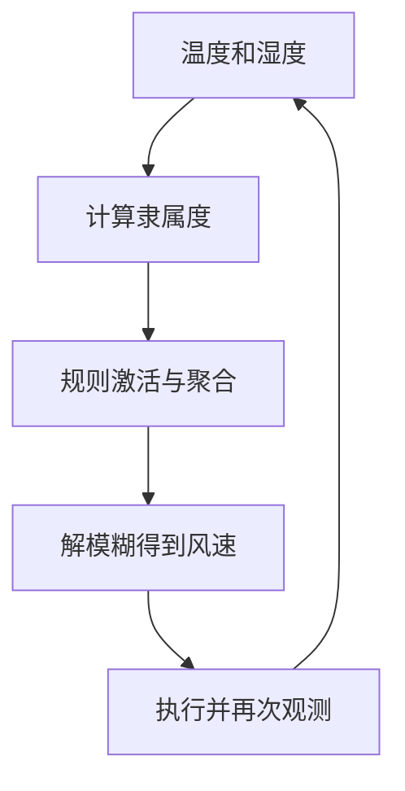

#### 4.4.1 模糊逻辑的提出与发展
模糊逻辑处理「热」「远」「快」这类边界渐变的概念。概率中的不确定常是温度值还不知道，模糊集合即使已知温度精确为27°C，仍可以给「热」一个0到1之间的符合程度。

模糊集中的元素对集合以程度隶属，而经典集合用0和1表示是否属于。把“成绩较高”设成硬阈值85，84.9与85之间会突变。若从80开始线性上升，到90全隶属，两个数的程度分别为0.49、0.50。是否选择柔和过渡依任务而定：官方及格线通常是明确规则，冷暖程度更适合模糊表示。

#### 4.4.2 模糊集合
三角隶属度给定左端 a、峰值 b、右端 c。当 $a<x\le b$ 时取 $(x-a)/(b-a)$，当 $b<x<c$ 时取 $(c-x)/(c-b)$，其余为0。例如 $(20,25,30)$ 的「适中」在27°C取0.6。隶属度曲线需依据任务或数据设计，不要求同一输入对不同集合的隶属度之和等于1。

隶属函数可以用三角形、梯形、钟形或分段函数。梯形集合 $(a,b,c,d)$ 在 $[b,c]$ 的隶属度为1，两侧线性渐变。对于“舒适” $(18,22,25,30)$，20°C取0.5，24°C取1，28°C取0.4。$\alpha$ 截集选 $\mu(x)\ge\alpha$ 的元素，本例的0.5截集是 $[20,27.5]$。截集把程度条件还原成可查询的普通范围。

#### 4.4.3 模糊集合的运算
一组常用运算为交取 min、并取 max、补取 $1-u$。若「热」为0.7、「潮」为0.4，则又热又潮为0.4，热或潮为0.7，不热为0.3。选择积作为交时结果为0.28，后续规则计算也必须使用一致约定。

min 和 max 具有交换、结合性，便于成组计算。积作为“且”同样常用，但结合含义变为两个支持程度相乘。a=0.7、b=0.8 时 min=0.7、积=0.56。标准补与 max/min 的德摩根律仍成立，但模糊 A 与其补的并不一定处处为1。比如 $\mu_A=0.6$，并得到0.6，交得到0.4。这比简单记忆三条运算更能区分模糊和经典集合。

#### 4.4.4 模糊关系与模糊关系的合成
关系矩阵的行列是不同对象集合，不可直接做普通矩阵乘法。当最大—最小合成时，$T_{ik}=\max_j\min(R_{ij},S_{jk})$。若 R 第一行是 $(0.7,0.2)$，S 第一列是 $(0.4,0.9)$，则 $T_{11}=\max(0.4,0.2)=0.4$。

取关系 $R$ 的两行为 $(0.2,0.9),(0.6,0.4)$，$S$ 的两行为 $(0.8,0.3),(0.5,0.7)$。合成第一行第一列为 $\max(\min(.2,.8),\min(.9,.5))=.5$。第一行第二列为0.7，第二行两列为0.6和0.4。结果是 $(.5,.7),(.6,.4)$。直觉是每条经中间对象的路径强度由较弱一段决定，再选证据最强的路径。

#### 4.4.5 模糊推理
Mamdani 控制常先给前件求激活度，再用该值截断后件隶属度，最后对多条规则取 max 聚合。例：热且潮激活0.4，截断「风速快」曲线。若「风速中」另有0.6激活，每个风速点都对两个已截断输出取最大。在目标域积分求重心。

**把模糊控制拆到每个输出点**。输入温度 28°C 时，设「适中」在 20、25、30 的三角函数上取0.4，「热」从25线性增至35，取0.3。规则 R1 为「适中 → 中速」，R2 为「热 → 快速」。只在20、50、80三个输出点采样，原中速隶属度为 $(0.3,1,0.2)$，快速为 $(0,0.3,1)$。

| 风速点 | R1 截断后 | R2 截断后 | max 聚合 |
| --- | --- | --- | --- |
| 20 | 0.3 | 0 | 0.3 |
| 50 | 0.4 | 0.3 | 0.4 |
| 80 | 0.2 | 0.3 | 0.3 |

归一化离散重心为 $(20\cdot0.3+50\cdot0.4+80\cdot0.3)/(0.3+0.4+0.3)=50$。输出聚合是对同一个位置取最大，不能把两条规则的后件数组逐点相加后声称使用了 max。若输出点间隔不相同，应考虑数值积分权重或重新规则化采样。

Mamdani 的一种写法为规则激活 $\alpha_k=\min(\mu_{A_k}(x),\mu_{B_k}(y))$，其后件 $\mu_k'(z)=\min(\alpha_k,\mu_{C_k}(z))$，总后件为 $\max_k\mu_k'(z)$。例如 a、b 分别0.2和0.8时，前件“且”用0.2；若前件改“或”，则用0.8。应先选运算语义，后按规则投影。不能把 $x,y$ 的隶属度直接当风速概率做期望。

#### 4.4.6 模糊决策
若三个离散风速点为20、50、80，聚合后隶属度分别为0.2、0.6、0.4，则离散重心为 $(4+30+32)/1.2=55$。无规则触发时分母为0，控制器应定义默认行为。Sugeno 模型通常用规则权重对常数或函数值求平均，其计算对象与 Mamdani 输出曲线不同。

重心法利用整个输出区域，多个峰会把结果拉向中间。最大隶属度方法取最高输出点，多个并列还需约定左端、右端或平均。举例：点20、50、80的等级为0.8、0、0.8，重心为50，最大等级点却是20和80。如果50在业务里表示完全不可用档位，则不能把连续重心直接发给执行器，可以根据可选档位和代价明确选择。

#### 4.4.7 模糊推理的应用
应用于环境调节时，输入温度、湿度等连续量，规则输出控制指令，再用执行结果验证实际响应。需要测试阈值附近连续性、测量噪声、极端输入和控制振荡。只给隶属度例题，并不能证明闭环稳定。

设计湿度与温度联动空调时，先列规则覆盖表，确认高温低湿、高温高湿等组合都有输出。再模拟输入从低到高渐变，看风速是否有反直觉跳变。最后在反馈环中加入低噪声、延迟和环境突然变化，检查是否出现来回切换。模糊方法可把专家经验写成可理解曲线，但参数仍需用真实任务指标校准。

### 4.5 小结
先确定数值究竟表示发生概率、规则支持、证据范围还是概念符合度，再做运算。**自测**：报告「高负载隶属度0.9」能否当成机器故障率90%？不能。若需要故障率，应建立事件模型并用实际数据校准。

**诊断练习**。如果 0.9 表示报警后异常概率，它可以进入期望损失。若 0.9 表示“高温”的隶属度，它应进入模糊规则。若 $Pl(A)=0.9$，还应看下界以及是否与其他候选冲突。把这三种值写进同一个加权平均之前，先说明为什么新分数有可解释的含义。

## 第5章 搜索策略


### 5.1 搜索的概念
搜索把问题变成一组候选状态及其扩展规则。先明确目标是任何可行解、最少步数、最小费用，还是限时内最好的候选。这四个要求会带来不同的算法。

搜索是在可操作的状态表示上寻找满足条件的路径或赋值。开始前写清初态、合法动作、终态判据与代价目标。找任一合法排课、找最多能上的课、找最少跨楼的安排是三个问题。同一搜索树可以采用不同优先级，目标定义决定什么解值得接受。

#### 5.1.1 搜索的基本问题与主要过程
输入通常包括初始状态、动作、转移、目标判定与成本。算法把未展开的候选放入边界，选择一个取出，检查目标，再产生后继并处理重复。要保留父指针还原路径。**生成节点**和**展开节点**有区别，前者只进入候选，后者会枚举后继。

搜索节点描述到状态的一个候选前缀，可保存状态、父指针、所用动作、深度和累计代价。状态本身描述环境，节点描述一次到达它的方式。两条路径到同一位置，若以后行为与历史无关，可比较累计代价；若携带货物不同，未来动作不同，不能合并。

搜索循环先从边界选择、再判断或展开、最后登记后继。生成节点只是加入候选，展开节点才产生后继。算法的完备性或最优性依赖何时判目标、何时登记重复。实现时将目标测试、后继函数和候选排序拆开，便于给相同问题换算法。

#### 5.1.2 搜索策略分类
无启发搜索只依靠深度或已发生的路径成本，启发搜索加入剩余代价估计。评价关注完备性、最优性、时间和空间。树搜索用路径区分节点，图搜索要判断同状态是否可安全合并；加权图中不能把「入队过」等同于「已找到最佳路径」。

比较策略至少检查完备性、最优性、展开数量与边界峰值。有限图中的可达搜索易终止；无限树中 DFS 可能一直沿一支走而忽略浅解。UCS 在有限非负权图适用，无限图还需足够条件保证有限代价下不会生成无穷候选。评价“找到最短解”前先说明步数还是总代价。

### 5.2 状态空间的搜索策略

状态空间图由状态与动作建立，搜索树是算法实际展开的路径结构。原图一个点可在树中出现多次。是否应重新展开，取决于两次到达的状态是否等价，以及第二次前缀是否更好。应从下一个动作的前提反推状态字段，尽量避免漏字段或保存无关历史。

#### 5.2.1 状态空间表示法
以校园配送为例，若每步消耗电量且可充电，状态应含位置和剩余电量，同一地点电量1与电量5对应的可行动作可能不同。若任务还有取货与送达顺序，应增加货物状态。一个判断标准是：给定状态和动作，未来是否还依赖没记录的历史？

**配送例**。当前位置为 L、已取集合为 P、已送集合 D、剩余电量 e，可用 $(L,P,D,e)$。到达相同 L 但 e 分别为1、5，后续可行路线不同。若 $P=D$，没有在途货物。加入开门时间后，状态还需记录时刻或能够推导时刻的代价。无时间窗且时钟不影响未来时，则可不加绝对时钟。状态表示越简单越易搜索，但不能丢失决定未来的量。

#### 5.2.2 状态空间的图描述
状态图的点表示状态，边表示动作与代价。八数码中状态是棋盘排列，动作是把空格与相邻方格交换。图中可能有环，树展开却可重复出现相同棋盘。显式图便于预存，隐式图用生成函数按需展开，更适合庞大状态空间。

点可显式保存在邻接表，也可按需调用算子产生。邻接矩阵查询特定边方便，稀疏图占 $O(V^2)$ 空间。八数码不必预存整图，只需找到空格，枚举上下左右合法交换，再把棋盘保存为不可变元组。反向动作会返回父状态，重复检测能压缩这类循环。单向边的反向搜索则要构造前驱，不能简单沿出边从目标跑。

### 5.3 盲目的图搜索策略

盲目搜索按已知结构或已花代价决策。回溯需要恢复本次选择，BFS 按深度展开，DFS 先深入一支。约束搜索常将去重限定在当前赋值路径；图遍历对同一状态只访问一次通常足够。加权最短路必须允许同一状态成本改进，不能沿用 BFS 入队即定型。

#### 5.3.1 回溯策略
回溯一边构造部分解一边排除违反约束的分支。排课例：A、B、C 各取上午或下午，A 与 B 冲突，B 与 C 冲突。选 A 上午后，尝试 B 上午立即失败，改 B 下午，再选 C 上午成功。每次失败须恢复变量赋值和临时约束，避免污染兄弟分支。回溯树若剪枝正确且完整枚举，仍保持完备。

**四皇后示例**。从第0行开始，放在列 c 后要占三组编号 $c,r-c,r+c$。若第0行选0，第1行只可选2、3。先选2，则第2行列0、2被占，列1冲突于第1行，列3冲突于第1行，四个候选均失败。撤回第1行列2的三个占用编号，再试列3。改选第0行列1，可走 $(1,3,0,2)$，列与两类对角均唯一。若只找任一解，完整赋值后可返回；若计数，则要恢复状态继续探索其他分支。

#### 5.3.2 宽度优先搜索策略
BFS 从队首取元素，把后继加到队尾，按深度推进。有限分支、存在有限深度解时可找到解，等边权时得到最少步数的最优路径。固定有限图的邻接表实现时间 $O(V+E)$、空间 $O(V)$。隐式树则节点数随深度指数增长。非等权图应按累计成本扩展。

给 $S\to A,B$、$A\to C$、$B\to D$、$C,D\to G$，按书写顺序生成。队列依次为 S、A B、B C、C D、D G、G。D 再生成 G 时去重，父链保持 $S,A,C,G$。这是深度3的解。若 $A\to C$ 花100而其他边花1，仍返回这条路时便不是费用最优。用这个反例可检查实现是否错误宣称 BFS 解决任意加权最短路。

#### 5.3.3 深度优先搜索策略
DFS 用栈或递归优先深入。有限图配访问记录能完成遍历，通常不保证第一次到达目标是最短路径。无深度界的无限树可能困在单条分支。迭代加深按0、1、2等依次限制深度，重复浅层工作来换取低内存与最浅解性质。

用栈实现 DFS 时，想先扩展 A 后扩展 B，必须先压 B 后压 A。给上例加 $A\to S$，无访问记录会在 S 与 A 回路。全局去重用于普通可达性，深度受限搜索中若同一点先通过深路径到达，它剩余预算更小，不能阻止稍后更浅路径再展开。可记录当前搜索路径，或为同状态记录更大的剩余搜索深度。

### 5.4 启发式图搜索策略

启发式估计帮助优先计算更有希望的节点。比较两种启发不能只看展开数，还应看估价开销。如果一个估价比原问题几乎一样贵，减少展开未必省时间。可以报告同一地图下的路径成本、估价次数、扩展数、耗时和内存峰值。

#### 5.4.1 启发式策略
启发利用领域信息给节点排优先级，例如棋盘错位数或目标直线距离。贪心最佳优先只看 $h$，容易忽略已花代价。束搜索保留有限个候选节省资源，但可能丢掉唯一正确分支。应说明这些选择改变的是拓展顺序还是直接删掉候选。

贪心最佳优先只看 $h(n)$，容易忽略已花代价。束搜索固定保留少量候选，可节省内存，却可能丢失唯一解。比较它们时给同样预算，分别报告多少任务找到解、找到的解平均多贵。无解与预算耗尽是不同终止状态。

#### 5.4.2 启发信息和估价函数
$g(n)$ 是当前到 n 的累计成本，$h(n)$ 估计最优剩余成本，$f(n)=g(n)+h(n)$ 估计总成本。常用设计是解一个去掉部分约束的松弛问题。例如四方向等代价网格忽略墙壁的曼哈顿距离为下界。允许廉价对角线后，应重新检查这个下界。

四方向、单位代价网格去掉障碍后，曼哈顿距离是放宽问题的最优值，因而是原问题下界。节点启发应匹配真实动作。若可一步斜走，曼哈顿可能高估。$h_1,h_2$ 均为下界时取最大仍为下界，二者相加可能重复计入同一步的成本。只有能证明子问题消耗相互独立时才考虑相加。

#### 5.4.3 A及A*搜索算法
设 $g(n)$ 为从起点到 n 的已知路径代价，$h(n)$ 为从 n 到目标的估计剩余代价：

$$
f(n)=g(n)+h(n)
$$

**可采纳性**要求 $0\le h(n)\le h^*(n)$，即不高估真实最优剩余代价。**一致性**要求对每条边 $(n,n')$：

$$
h(n)\le c(n,n')+h(n'),\qquad h(goal)=0
$$

一致性意味着沿路径 f 值不下降。在常见非负代价设定下，一致启发使 A* 图搜索可以在节点以最佳代价取出后不再重开。只有可采纳性但不一致时，图搜索可能需要重新打开获得更好路径的节点，才能保持最优性。

**终止时机也重要**：一般应在目标以当前有效最小 f 值从优先队列取出时终止，而不是目标一生成就终止。

四方向、每步代价为 1 的网格中，曼哈顿距离：

$$
h(x,y)=|x-x_g|+|y-y_g|
$$

是一种可用启发。若允许对角移动且代价更低，曼哈顿距离可能高估，需要换成与移动规则一致的估计。障碍会让真实路程变长，但不妨碍忽略障碍所得的下界。

假设边为 $S\to A:2$、$S\to B:1$、$A\to G:2$、$B\to G:10$，启发为 $h(A)=2,h(B)=1,h(G)=0$。

展开 S 后：A 的 $g=2,f=4$；B 的 $g=1,f=2$，先取 B。经 B 发现目标代价 11，但不能立刻结束。接着取 A，发现目标代价 4，最后取出目标，得到最优路径 $S,A,G$。

贪心搜索若只看 h，会优先 B，随后可能直接选目标 G，得到代价 11 的较差解。这说明“看起来离目标近”与“整条路径代价低”不同。

**OPEN 表完整追踪**。沿用例中的点，用「节点: g/f」记队列。初始 S:0/2。弹出 S 后 B:1/2、A:2/4。弹出 B 后 A:2/4、G:11/11。弹出 A 后 G:4/4，旧 G:11/11 成为过期项。弹出有效的 G:4/4 才返回。这里 $h(A)=2$，虽然 B 的启发更小，第二次选目标仍必须等到它的有效项优先级最小。

**最优性论证**。在有更优解的情况下，其路径上会有尚未完全扩展的边界节点，且如果最优前缀没有被丢弃，该节点 $g+h$ 不超过更优解的总成本。若此时弹出的目标更贵，就与最小 f 弹出矛盾。图搜索中一致启发或正确重开机制，帮助确保前缀不会因错误关闭而丢失。同一启发函数为零时，A* 的选择退化为一致代价搜索。

标准库实现，适用于有限图、非负边权和适当启发；示例启发可采纳且一致。代码允许更优路径重新入队，并跳过过期队列项。

```python
from heapq import heappush, heappop
from itertools import count
from math import inf

def astar(graph, start, goal, heuristic):
    order = count()
    best_g = {start: 0.0}
    parent = {start: None}
    queue = []
    heappush(queue, (heuristic[start], next(order), 0.0, start))

    while queue:
        _, _, g, node = heappop(queue)
        if g > best_g.get(node, inf):
            continue
        if node == goal:
            path = []
            current = goal
            while current is not None:
                path.append(current)
                current = parent[current]
            return list(reversed(path)), g

        for neighbor, cost in graph.get(node, []):
            if cost < 0:
                raise ValueError("本实现要求非负边权")
            candidate = g + cost
            if candidate < best_g.get(neighbor, inf):
                best_g[neighbor] = candidate
                parent[neighbor] = node
                heappush(queue, (
                    candidate + heuristic[neighbor],
                    next(order), candidate, neighbor,
                ))
    return None, inf

graph = {
    "S": [("A", 2), ("B", 1)],
    "A": [("G", 2)],
    "B": [("G", 10)],
    "G": [],
}
heuristic = {"S": 2, "A": 2, "B": 1, "G": 0}
print(astar(graph, "S", "G", heuristic))
# (['S', 'A', 'G'], 4.0)
```

`count()` 用于稳定打破并列，避免堆在优先级相同时比较复杂状态对象。`best_g` 记录状态当前最佳代价，`parent` 负责还原路径。把所有启发设为 0，选择策略就退化为 UCS。

**八数码启发怎么构造**。目标棋盘三行为 $(1,2,3),(4,5,6),(7,8,0)$，当前是 $(1,2,3),(4,0,6),(7,5,8)$。0 为空格。错位块数为2，曼哈顿和也为2，因为5和8分别离目标一格。执行下、右两步即可复原，所以两者此时正好等于最优剩余步数。

再看 $(1,2,3),(4,0,6),(7,8,5)$，5 只能先移至少两格去目标中心，错位数下界是1，曼哈顿下界是2。这个布局甚至可能无法从目标到达，因此还要做可达性检查。在标准3×3八数码中忽略空格，逆序数奇偶性在合法移动中保持。把以前两示例的 5、8 等位置沿行展开计算逆序数，前一个为2，后一个为3，故第二个与目标的偶奇性不同，不能求出解。

曼哈顿和不计空格，因为一步只移动一个数字块一格。每步对该和最多改变1，所以是下界并满足一致性。两种下界可取最大以保持可采纳，直接相加则可能把同一必做步重复计算。

**一致性的另一种证明视角**。将每条边的费用改写为 $c'(u,v)=c(u,v)+h(v)-h(u)$。一致性保证 $c'\ge0$。路径累计时各个中间 h 相互抵消，得到 $g(n)+h(n)-h(s)$。从同一起点出发，按这个新费用排序与按 f 排序完全相同。这解释了一致启发下为何可以借用 Dijkstra 的弹出定型原则。只有可采纳而不一致时，应允许重新发现更优前缀。

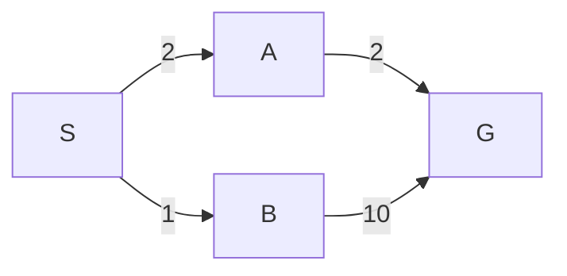

图中 B 分支可先生成总代价11的 G；A 再生成代价4的 G。生成目标即停会错，弹出当前有效最小 f 的目标才满足证明条件。优先队列可容纳旧项，弹出时依据当前最佳 g 判断过期。原始路径启发论证见 [Hart、Nilsson 与 Raphael](https://ieeexplore.ieee.org/document/4082128)。

#### 5.4.4 蒙特卡洛树搜索算法
当搜索树太大且难以建立精确评价时，可以用多次模拟分配计算预算。典型循环包括选择、扩展、模拟和回传。

一种常见 UCT 选择分数为：

$$
UCT_i=\bar X_i+c\sqrt{\frac{\ln N}{n_i}}
$$

其中 $\bar X_i$ 是子节点平均回报，N 是父节点访问次数，$n_i$ 是子节点访问次数，c 控制探索。未访问节点要专门优先处理，不能令 $n_i=0$ 直接代入。

第一项利用已有好结果，第二项鼓励尝试访问较少的分支。模拟不一定完全随机，也可用启发策略或价值模型。双人零和游戏中，回传奖励必须统一玩家视角，否则可能把对手获利当成自己获利。

有限预算下，MCTS 给出的是由采样支持的选择，不保证每次都找到最优动作。其效果依赖模拟质量、奖励尺度、探索常数与可用预算。[R10]

**一次 UCT 选择**。假设父节点已访问20次，A均值0.65、访问16次，B均值0.40、访问4次。取 $c=1$，A约为 $0.65+\sqrt{\ln(20)/16}=1.083$，B约为 $0.40+\sqrt{\ln(20)/4}=1.265$，这轮先探索 B。模拟回报若为1，B的均值更新为 $(4\cdot0.4+1)/5=0.52$。UCT 是树内选择策略，实际最终走法常按访问数等另选。务必规定每层奖励视角。

一次 MCTS 从根开始用 UCT 在已建树里选择，遇未试动作扩展，然后由模拟策略走到终局或截断，按奖励回传访问数和结果和。最后的动作通常按访问数选，不能直接用带探索奖励的 UCT 排名。对于零和对抗，可以统一从根玩家记录奖励，再在对手节点最大化负根收益加探索项。若每一层都最大化根玩家的获胜比例，就把对手误当成合作方。

**取棋子算例**。双方可交替取1或2颗，取最后一颗赢。剩0时轮到者已输，剩1或2时直接赢，剩3怎么走都给对手1或2，因此输。剩4或5时能把3留给对手。若从5开始，根的正确动作是取2。该例可用穷举核对 MCTS。有限模拟的误差还取决于种子、探索系数与截断评价。

**可运行：MCTS 对抗取棋子**。根玩家记为1，对手为−1。回传统一记录根收益。选择时当前玩家乘根收益，兼顾自己的效用方向与探索。首次生成子节点后先模拟和回传，所以进入 UCT 的子节点有非零访问数。

```python
from dataclasses import dataclass, field
from math import log, sqrt
from random import Random

@dataclass
class Node:
    remaining: int
    player: int
    action: int = 0
    visits: int = 0
    total: int = 0
    children: list = field(default_factory=list)

def search(stones, simulations, seed):
    root = Node(stones, 1)
    rng = Random(seed)
    for _ in range(simulations):
        path = [root]
        node = root
        while node.remaining > 0:
            explored = {child.action for child in node.children}
            choices = [n for n in range(1, min(2, node.remaining) + 1)
                       if n not in explored]
            if choices:
                action = rng.choice(choices)
                child = Node(node.remaining - action, -node.player, action)
                node.children.append(child)
                path.append(child)
                node = child
                break

            def uct(child):
                mean = node.player * child.total / child.visits
                exploration = sqrt(2 * log(node.visits) / child.visits)
                return mean + exploration

            node = max(node.children, key=uct)
            path.append(node)

        remaining, player = node.remaining, node.player
        while remaining:
            remaining -= rng.randint(1, min(2, remaining))
            player = -player
        winner = -player
        for visited in path:
            visited.visits += 1
            visited.total += winner

    return max(root.children, key=lambda child: child.visits).action

assert search(5, 1200, seed=11) == 2
print("5 颗棋子时先取 2 颗")
```

边界可用穷举验证。空局面输，1或2颗可取完，3颗必然留给对方可赢状态，5颗应取2为对手留下3。有限随机试验成功不能代替所有局面正确性的保证。

### 5.5 小结
先建状态再选算法，然后确认边权、重复处理和终止条件。**自测**：某节点第一次入队成本9、后来另一条路发现成本4，Dijkstra 是否能直接忽略？不能。应把成本4更新到边界，并在弹出时跳过旧项。

**复习题**。一个节点先以费用9入队，之后发现费用4，图搜索能直接丢掉第二次吗？BFS 的已发现规则不能原样用于非等权图，应更新 g 并允许有效候选继续处理。测试时还要覆盖不可达、回路、等价最短路以及启发不一致四种情形。

## 第6章 智能计算及其应用


### 6.1 进化算法的产生与发展
优化是在可行域 $\Omega$ 中寻找使目标函数更好的一组变量：

$$
\min_{x\in\Omega}f(x)
$$

决策变量可以是连续参数、任务排列、路径或离散选项。约束限定可行性，比如车辆载重不能超标、课程不能冲突。目标函数评价优劣，比如总里程、延误或成本。

“能表示一个候选解”与“候选解可行”是两个问题。遗传、粒子群和蚁群的设计都必须围绕变量结构和约束展开。它们通常用于难以穷举、目标不易求导或组合复杂的任务，并不天然优于所有精确方法。

优化先定义变量、可行域和目标。进化方法适合只有评价函数、无方便导数或有离散组合的场景。它不是所有问题的默认解答：小规模可穷举，凸问题有专业优化器，结构明确的排程可以用精确约束搜索。评估随机算法时把函数评价次数作为预算，而非只比迭代次数。

#### 6.1.1 进化算法的概念
进化算法维护多个候选，用竞争、重组与随机变化更新种群。它一般只需能评估候选优劣，不要求可微。目标函数评估昂贵时，评价次数比迭代轮数更能反映搜索预算。

种群式搜索一轮包含生成候选、评估、择优和替换。繁殖选择决定谁有机会生成后代，生存选择决定哪些方案进入后一代，二者共同影响选择压力。若每次只保留当前最好且变异很弱，种群即使很大也可能变为一个窄区域。

#### 6.1.2 进化算法的生物学背景
它借用遗传、变异和选择的思想，具体机制由工程人员设计。染色体是数据结构，表现型是解码后的可评价方案。算法内的选择压力也由规则与参数决定，不能把生物术语直接当作算法有效性的证明。

遗传、变异和竞争提供类比。基因型是直接操作的数据结构，表现型是解码后可执行方案。例如城市优先级向量是基因型，仓库分段路线是表现型。一些基因差异会解码成同一方案，导致目标在相应区域无变化。要区分搜索轨迹变化和实际解质量变化。

#### 6.1.3 进化算法的设计原则
设计时依次明确可行域、编码与解码、约束处理、变异可达性、保留策略和停止条件。比较方案用同一评估预算、多次随机种子、可行率与最优值统计。已知可做精确计算的小案例应作为基线。

先验证编码可覆盖所需解，再验证算子可达性和约束检查。若排程只允许基因写上午、下午，真实合法的晚间方案就永远无法搜索到。若变异不改变上课时段，只交换老师，就无法解除某些时间冲突。用可穷举实例对照搜索结果，能及时暴露表示缺口。

### 6.2 基本遗传算法

基本 GA 让候选在继承基础上继续探索。调试时保存父代、交叉后、变异后、修复后和实际评价状态。只看最终曲线很难分辨目标没涨是优解真的难找，还是编码被修复总是变成同一种方案。

#### 6.2.1 遗传算法的基本思想
遗传算法让较好的候选有更大概率繁殖，交叉组合父代片段，变异恢复探索。探索增加候选多样性，选择增强当前较优方向。过强选择使种群集中，过大变异则接近随机搜索。

适应度高增加被选择机会，不保证每次都被抽中，也不保证后代保持好特征。精英保留可以保护历史解，但精英比例过高，种群很快只剩重复方案。在固定目标下历史最佳可单独保存；当前代最优可能上下波动。两种曲线应分开报告。

#### 6.2.2 遗传算法的发展历史
遗传算法是进化计算的一支，常用二进制编码展示早期基本形式，工程实践还发展了实数、排列与约束专用编码。其他进化计算方法与 GA 共享种群和随机搜索思想，具体更新机制不同。

经典位串模式便于展示编码到搜索的机制。实际连续变量常直接用实数，避免量化误差；排列问题使用专用算子保证成员不重复。历史脉络帮助理解为什么“固定长度二进制”只是基本实现的一种。

#### 6.2.3 编码
以5位串编码区间 $[0,10]$。将二进制解释为整数 b，再解码为 $10b/31$。例如 01101 对应13，解得约4.194；分辨率 $10/31$。排列编码用于路线，一般要用保持每个客户恰好出现一次的算子。

k 位编码区间 $[L,U]$，解码为 $L+(U-L)b/(2^k-1)$。若长度10、分辨率至多0.1，则要求 $2^k-1\ge100$，最小 k=7。普通二进制相邻值可能要改变多个位，例如0111到1000；格雷码可用相邻值单一位的性质，但它的交叉仍要按特定问题评价。

#### 6.2.4 群体设定
初始群体可随机生成、注入可行启发解或混合使用。群体过小容易失去覆盖，过大消耗预算。可记录唯一基因型比例、适应度变化、可行解比例。固定种子用于复现，多个种子用于比较。

可混合启发式好解和随机解，兼顾可行起点与覆盖。记录重复率和可行率。例如50个个体只有5个不同染色体，名义上的50可能没有50的探索能力。修复规则把所有冲突个体改成同一个合法布局，也是多样性降低的常见原因。

#### 6.2.5 适应度函数
适应度是选择接口。目标最小化且非负时，可用 $F=1/(1+f)$ 让小目标对应大适应度。约束可通过硬筛、修复或罚函数处理。若 $f_A=8$ 但违反约束量3，$f_B=10$ 可行，用 $\lambda=2$ 则罚后 A 为14，B 为10。量纲不同的违约项不应不加检验地相加。

目标最小化与适应度最大化是两层。成本8、10转为 $1/(1+f)$，归一化选择概率约0.55、0.45。若成本8方案违反硬约束，应先排除或明确惩罚，不能只奖励低原始成本。多目标可比较 Pareto 支配：若 A 在每个目标都不差于 B 且至少一项更好，则 A 支配 B。不同量纲的加权应有解释。

#### 6.2.6 选择
轮盘赌对非负适应度按比例采样。例如2、3、5对应概率0.2、0.3、0.5，累积区间为0.2、0.5、1，随机数0.41选第二个。锦标赛从一小组里选优，依赖排序，组越大通常选择压力越强。全为零的轮盘赌需要预设回退策略。

轮盘赌受数值尺度影响。适应度2、3、5进行比例抽样，概率0.2、0.3、0.5。全部加100后概率接近均匀，排名却不变。锦标赛只看排名，改变抽取人数可调压力。需要定义是否放回，及平分时的选择策略。

#### 6.2.7 交叉
单点交叉把 101|01 与 011|10 组合出10110和01101。若父代是城市排列，直接交换后缀可导致重复和缺失。顺序交叉保留一个片段，再按另一父代的相对顺序填入尚未出现的元素。例如保留 A B C D E 中的 B C 于原位置，另一父代 E C B A D 按线性顺序提供 E、A、D，即可填成 E B C A D。

二进制单点交叉可交换后缀，排列直接这么做会产生重复。假设父序列 1,2,3,4,5 与 5,4,3,2,1，简单拼接前三位与后缀会出现1、2重复，缺4、5。顺序型交叉先保留一个片段，再从另一父代按相对顺序填未出现的元素。实数插值交叉只产生父代之间的值，向外探索要靠另一算子。

#### 6.2.8 变异
二进制可随机翻位，实数可加扰动，排列可交换两位置。逐位变异率0.01与「每个个体有0.01概率只变一位」不同。若长度100，逐位变异期望改1位，至少改一位的概率约0.634。

逐位变异与逐个体变异的实际概率不同。长度20、每位变异率0.05时，变异数期望1，完全不变概率 $0.95^{20}\approx0.358$。排列交换维持元素集合，片段逆序维持排列但改变更多局部邻接。变异概率过小使算法缺少新区域，过大则破坏继承结构。

#### 6.2.9 遗传算法的一般步骤
初始化并评估 → 选择 → 交叉 → 变异 → 修复和评价 → 形成新一代 → 更新历史最佳。停止可以按最大评价次数、达到阈值、长期无改进；最后一代可能丢失过去好解，因此应保留精英或独立最佳记录。

标准库示例，在 $[-10,10]$ 上最小化 $f(x)=(x-3)^2$。真实问题通常不会像这个例子一样已有显然的解析解，这里用于观察机制。

```python
import random

rng = random.Random(42)

def objective(x):
    return (x - 3.0) ** 2

population = [rng.uniform(-10, 10) for _ in range(40)]

for generation in range(100):
    population.sort(key=objective)
    next_population = population[:2]  # 精英保留

    def select():
        return min(rng.sample(population, 3), key=objective)

    while len(next_population) < len(population):
        a, b = select(), select()
        weight = rng.random()
        child = weight * a + (1 - weight) * b
        if rng.random() < 0.25:
            child += rng.gauss(0, 0.5)
        child = max(-10, min(10, child))
        next_population.append(child)
    population = next_population

best = min(population, key=objective)
print(f"x={best:.4f}, f(x)={objective(best):.8f}")
```

这里的实数加权交叉只能落在父代之间，变异有助于探索父代范围之外。固定随机种子便于复现实验；比较算法时仍应使用多个种子报告均值、方差或成功率，不能只展示最好的一次。

**走完一代**。优化4位串中1的数量。初始1010、1100、0111、0001，得分2、2、3、1。选择0111和1100，第二位后交换得0100、1111。若对1111第三位翻转，得到1101。若只评价变异后的个体，本轮最佳不是之前短暂出现的1111。保留0111精英可让下一代至少有一个3分解。

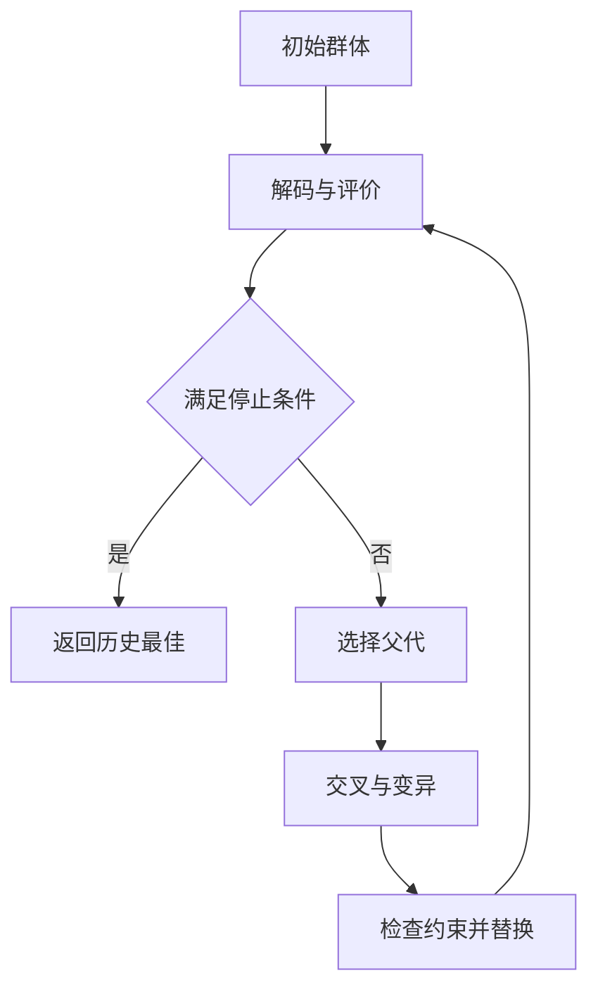

#### 6.2.10 遗传算法的特点
遗传算法易容纳多种候选表示，适合并行评价，但通常不提供有限预算内的全局最优保证。对光滑问题，梯度方法可能更省；对小型精确约束，穷举、动态规划或整数规划可作对照。改进是否有效必须对同一评价预算比较。

十次种子里一次成本10、九次成本20的算法，未必优于十次都为14的算法。报告中位、最好、波动范围、可行率、评价次数与耗时。若已有下界12而最好方案为14，可给相对差距 $2/12$，但不能把下界宣称为已找到的全局最优。

### 6.3 遗传算法的改进算法

双倍体、双种群和自适应参数侧重不同问题。前者在表示中保留未表达信息，双种群隔离搜索并偶尔交换，自适应根据运行状态改更新强度。每次只换一个机制与同预算基线对照，才能判断收益来自哪里。

#### 6.3.1 双倍体遗传算法
双倍体方案给每个基因位保留成对等位信息，由显性/解码规则形成表型。例中 $(1,0)$ 若规定1显性，则表型为1，隐性0仍可遗传。与单倍体相比，未表达的信息可保留以供未来环境变化；代价是定义显隐性、基因传递和评价更复杂。

每位记录两个等位值。若显性规则取1，则 $(1,0)$ 映射成1，隐性的0仍可跨代存在。当任务环境变动、0更有利时，保留信息比强行从当前全1种群重新随机找到它更方便。但需要定义如何配对繁殖、如何决定显隐、环境变化后如何重算评价。

#### 6.3.2 双种群遗传算法
分两个种群并行搜索，可为一组设置高突变负责探索，另一组设置低突变负责细化。设20代交换1个个体，需定义选择谁迁移、替换谁。迁移太密会让两个群体迅速同质化，太少则难共享改进。实验应比较无迁移与多个间隔。

群A搜索较保守，群B提高扰动以探索。每十代让B迁移一个高质量且与A不同的方案，可能比每代互传同一个精英更能阻止同质化。要控制迁移拓扑、频率、比例和替换对象。评估多个种群时把总评价成本相加。

#### 6.3.3 自适应遗传算法
可依据群体多样性或停滞次数调交叉和变异。教学例为连续10代最佳值未改善时把突变率由0.05升到0.20，恢复改进后降低。调整范围与条件应固定可复现，同时用多次试验检查是否真比固定参数好。

可以用近期停滞代数结合重复率决定变异强度。例：历史最佳15轮不动且重复率超过0.8，提高变异；当重复率下降后恢复。即时噪声容易误导调节，宜采用窗口统计、上限与下限。判断是否改进应用多随机种子复核，而非只展示参数调节曲线。

### 6.4 遗传算法的应用
排课应用把每门课时段作为基因，冲突作硬约束，教师偏好作软目标。例：A、B 共用教师，A=周一、B=周一必须修复。两候选都无冲突时，再比较分散程度和偏好损失。把硬约束变为有限罚项时，调参失当会选出不可用解。

排课基因可表示（时段、教室），硬约束含教师冲突、教室容量和班级重课，软目标含跨楼距离、空档等。先最小化硬违规再比较软分，比胡乱叠加不懂量纲的分值可解释。若用局部修复挪走一堂课，要重新检查被影响的教师和教室。结果必须给出硬约束已满足的列表。

### 6.5 群智能算法产生的背景
群智能研究多个局部行为怎样形成整体搜索。PSO 用粒子的历史和邻域经验形成运动，ACO 通过信息素间接影响采样。集中控制并非不可用，区别在于算法主要通过局部规则与群体共享信号组织搜索。

群智能通过个体的局部行为与共享信号出现集体搜索能力。粒子记忆通过向量指引后续运动，蚁群信息素沿边改变下一步采样分布。二者共同具备探索与利用，但位置更新和逐项构造有不同约束适配方式。

### 6.6 粒子群优化算法及其应用

PSO 的位置是候选解，速度是下一次调整方向。每个粒子有自己的历史最好，群体或邻域提供共识位置。应规定同步还是异步更新：同步各粒子用同一代记忆，异步成功的粒子会立刻影响尚未更新的粒子，两者轨迹不一定一样。

#### 6.6.1 粒子群优化算法的基本原理
蚁群算法让多个个体逐步构造解，并通过信息素影响后续选择。以路径为例，从 i 到允许访问的 j 的概率常写为：

$$
p_{ij}=\frac{\tau_{ij}^{\alpha}\eta_{ij}^{\beta}}
{\sum_{k\in allowed}\tau_{ik}^{\alpha}\eta_{ik}^{\beta}}
$$

$\tau$ 是信息素，$\eta$ 是启发信息，例如距离倒数；$\alpha,\beta$ 调节两者的重要性。禁忌表或已访问集合用于避免重复访问不应重复的节点。

一种基本信息素更新形式为：

$$
\tau_{ij}\leftarrow(1-\rho)\tau_{ij}+\sum_k\Delta\tau_{ij}^{(k)}
$$

其中 $\rho$ 为挥发率，较好路径常获得较多增量。挥发防止早期路径永久占优；若挥发太快，经验留不住；太慢则可能陷入停滞。实际存在多种更新变体，需明确使用哪一种。

设最小化 $(x-4)^2$，当前 $x=1,v=1$，个体最好1、粒子群最好3，惯性0.5，两加速项的乘积各为0.5。更新 $v'=0.5+0+1=1.5$，$x'=2.5$，目标从9降至2.25，更新个体最好，但不超过已有群最好3（代价1）。下一轮用新位置与记忆，速度不必归零。

#### 6.6.2 粒子群优化算法的参数分析
惯性大时历史速度影响强，个体项系数大时粒子易回各自优点，群体项大时容易迅速聚拢。边界可以投影、反射或重采样，三者改变运动行为。维护历史最好值时应复制数组，避免位置原地修改把旧记录一起改掉。

惯性影响历史方向，加速项分别趋向个体和群体经验。速度上限减少过冲却可能跨不过局部障碍。位置投影到边界后继续保留向外速度可能贴边反复，应根据问题考虑速度清零或反射。修改方案后重算适应度，不能用原非法位置的分数。

#### 6.6.3 粒子群优化算法的应用领域
标准连续 PSO 可用于黑箱参数调优、控制参数与布局搜索。每个粒子对应一组参数，用验证集评价其目标。对离散变量和混合约束需编码解码或改用离散版本。重复调参不能反复把最终测试集当作优化目标。

连续黑箱调参可把学习率取对数再当搜索轴。批大小和选项变量需解码成离散值，还要校验显存与数据范围。随机训练差异大时，用固定种子配对评价或多次估计平均，避免把一次幸运运行当稳定最优。最终测试集不能作为优化目标。

#### 6.6.4 粒子群优化算法求解车辆路径问题
**车辆路径建模例**。车辆容量为4，三个客户需求2、2、3。粒子用三个实数优先键 $(0.6,0.1,0.9)$，升序解码为客户2、1、3。依此分割成「仓库—2—1—仓库」和「仓库—3—仓库」。再累加各边费用并检查车辆数与时间窗。更新发生在连续坐标，评价发生在合法线路，两层职责不同。多个连续点会映到同一排列，这是解码搜索的平坦区。

**算完整配送代价**。仓库在位置0，各客户沿同一直线坐标为2、5、6，需求2、2、3，车容量4，边成本为坐标距离。解码顺序2、1、3时，第一趟成本 $5+(5-2)+2=10$，第二趟成本12，总22。顺序3、2、1仍能组成同两条线路，但顺序1、3、2在朴素首次超容量时分割成三趟，成本 $4+12+10=26$。若只有两台车且每车只能发一趟，则后者还违反车辆数限制。

更强的解码器可对固定访问顺序用动态规划选切割点，或者给粒子变异加入交换两客户的局部算子。比较算法时应报告是搜索改进了访问顺序，还是解码器更擅长切分。两者都会影响成本，只有控制变量才能公平比较。

客户应各访问一次，每趟起终点是仓库，容量和时间窗必须满足。随机键只决定访问顺序，还需按容量切分。若客户需求大于容量，任何简单分割都无法解决，应报不可行。检查输出应打印实际路线、车载量、费用与违反约束，不能只报告原始实数向量。

### 6.7 蚁群算法及其应用

ACO 先让多只蚂蚁分别完成路径，再按质量沉积经验。合法候选从当前部分解产生，可排除已访问客户或不合容量的后继。若无可行边，可返仓或撤销某步，取决于题意；不能用零分母算不可行候选的概率。

#### 6.7.1 基本蚁群算法模型
使用相同目标、约束、可行性判据与评价预算；报告最好值之外，也记录多次运行的统计量、运行时间和失败率。对随机算法，迭代次数相同不一定公平：每次迭代的目标函数评价次数可能不同。

若小规模问题能够用穷举、动态规划或整数规划求精确解，应先建立基线，再考虑群智能。启发式算法的价值在于特定问题上的成本与质量折中，而不是名称听起来更智能。

若两个可走节点 j、k 信息素为2和1，启发值为0.25和0.5，$\alpha=1,\beta=2$，权重为0.125和0.25，选择概率分别为1/3、2/3。一条边信息素0.8，挥发率0.25且新沉积0.3，则更新为0.9。

边 e 初始1.2，蒸发0.25，经过它的两条可行路线长度10、20，沉积量用 $Q/L$ 且 $Q=2$。先蒸发至0.9，再加0.2、0.1，结果1.2。未经过该边的路线贡献0。是全部蚂蚁、当前最佳还是历史最佳参加沉积，必须说明变体。

#### 6.7.2 蚁群算法的参数选择
$\alpha$ 控制经验影响，$\beta$ 控制局部启发，$\rho$ 控制遗忘速度。通常要保持非零初始信息素，让首轮候选可被采样。在乘积过小或过大时可在对数域归一化，且要处理没有合法后继的情况。避免盲目按某篇论文参数套用到不同规模。

$\alpha=0$ 忽略信息素，$\beta=0$ 忽略启发，两者皆零且所有合法权重正常时是均匀采样。蒸发小可能过早集中，蒸发大可能遗忘过快。可设信息素上下限，避免因极小值或极大值出现数值问题。调参时固定实例和评价总数。

#### 6.7.3 蚁群算法的应用
旅行商、配送和离散调度都可把可行解拆成连续选择。例：每次只从未访问且容量允许的客户中采样；若没有可用边，可以返仓分段或判解无效。用于路况不断变化的任务时，历史信息素可能过时，需要设更新和重启策略。

距离倒数鼓励短边，但局部短边并不保证完整线路短。候选采样必须遵守硬约束：封路要直接删除路段，不能靠减小信息素让其“基本走不到”。道路变化还应重算距离启发，决定旧经验是否保留。

### 6.8 小结
三类方法的共同关键是候选怎么表示、如何评估和保留、如何探索未见区域。**自测**：两算法各跑100轮，但每轮分别评估10与100个候选，比较公平吗？不能只按轮数，应配相同的评价预算，并报告耗时与多随机种子结果。

**选法练习**。连续、离散和混合变量先按表示选择合适算子，再看是否有梯度和是否可精确搜索。用同预算测试候选方法，比较有效解数量、解质量和随机波动。若报告只给一轮预期最优值，应补可复现种子与基线。

## 第7章 机器学习与专家系统


### 7.1 机器学习概述
从数据获得决策函数与显式写入专家知识是两条不同路径。本章先讨论数据和模型，再讨论知识库与推理机。

学习任务可拆成数据、假设空间、目标、优化和评价。模型类限制可表达的规律，目标给训练误差的计算方式，优化负责找参数，评价要求数据独立且接近未来部署。换算法前先确认错误不是来自标签错误或数据泄漏。

#### 7.1.1 机器学习的基本概念
训练用经验 $D=\{(x_i,y_i)\}_{i=1}^n$ 选择模型参数，验证用新样本估计是否能泛化。训练误差为零可能只是记忆。以「根据历史周数估计课程成绩」为例，要先定义预测日期，期末生成的字段不能用于学期中预测。

经验风险是训练样本损失的均值，真实风险是未来分布中的期望。有限样本只能近似未来分布。例：根据开学两周记录评估风险，不应把期末成绩这种届时才知道的字段作为特征。划分时还要考虑同一学生的多条记录是否让训练和测试信息重叠。

#### 7.1.2 机器学习的分类
可按反馈类型分监督、无监督、半监督、自监督、强化学习，也可按学习机制分参数模型、实例方法等。深度学习是模型和表示方法，能与各类训练信号结合。类别应按同一分类轴比较。

除监督信号，还可按批量/在线、参数/实例、生成/判别分。实例型 kNN 训练阶段几乎只保存数据，预测开销随数据量变化。在线更新适合流式信息，但要监测漂移。生成式分类可利用 $P(x|y)P(y)$，判别模型从数据直接得到边界或 $P(y|x)$。这些分类轴可交叉使用。

#### 7.1.3 监督学习与无监督学习
监督学习知道目标标签，回归输出数值，分类输出类别或分数。无监督学习以数据结构为目标，例如聚类和降维。聚类簇编号可任意交换，若要赋予业务含义，需要引入外部证据。

二分类中，TP 为正确预测正类，FP 为把负类错判为正类，FN 为漏掉正类，TN 为正确预测负类。

$$
Precision=\frac{TP}{TP+FP},\quad Recall=\frac{TP}{TP+FN}
$$

$$
F_1=\frac{2PR}{P+R}
$$

分母为零时要声明处理约定。对异常检出这类少数类任务，全部预测正常也可能获得很高准确率，因此需要同时查看召回、精确率、PR 曲线及业务代价。

回归常用 MAE 与 MSE。MSE 对大误差惩罚更强；MAE 更直接对应平均绝对偏差。评价指标要与使用目的匹配，不能跨任务只比较一个数字大小。

过拟合表现为训练效果好、验证效果差，可通过增加数据、简化模型、正则化、早停等缓解；欠拟合则通常训练和验证都差，应检查特征、模型能力、优化是否充分与标签质量。

分类目标为离散标签，回归为连续量，聚类在没有目标标签时发现某种划分。如果一批学生按学习时长分成三簇，簇名可交换，不能说“第2簇”的编号自身代表中等成绩。验证可用轮廓、稳定性或外部业务结果，不能使用并不存在的真标签准确率。

#### 7.1.4 弱监督学习
弱监督来自不准确、不完整或粒度较粗的监督信号。例如以「包含某词」给句子打近似标签，会漏同义表达，也会误标否定句。可用小规模人工标注集估计噪声，按规则来源记录置信信息并单独评估。半监督强调少量标签配合大量无标签，两个概念可能交叉。

关键词命中可能给样本一个廉价标签，但否定句和行业多义词会误触。标注规则应允许弃权，冲突时保留来源和证据，用独立人工核验集估计噪声。多条规则若只改写同一关键词，不能简单视为独立投票。半监督强调有少量可靠标签以及大量无标签数据，与噪声标记可共存。

#### 7.1.5 深度学习
深层网络把数据变成逐层组合的特征。线性层加非线性激活使多层模型能表达复杂函数。输入规模、标签成本、时间预算和样本量不足时，应先与线性模型或树模型比较，再决定是否加深结构。

深层模型通过多层非线性运算学习表示，任务依赖层怎么连接以及损失监督哪些输出。输入高维或局部结构明显时，卷积等结构能利用先验。表格少数据时，树和线性模型应作对照。同样资源预算下可重复的测试提升，才支持选择更复杂模型。

### 7.2 线性回归机器学习算法

线性回归在输入上构造线性或仿射预测。最小二乘对大误差惩罚更重，适合某些误差假设。应在拟合后画残差或检查它们与输入是否有系统关系。系数相关性不等同于因果关系，也不能无条件外推到未见区域。

#### 7.2.1 线性回归问题
一元回归假设 $\hat y=wx+b$。残差可以定义为 $\hat y_i-y_i$，平方误差对两种方向惩罚相同。模型预测关联不能直接推为因果。超出训练范围外推时，还需检查线性关系是否仍成立。

有偏置时 $y_i=\beta_0+\beta_1x_i+\epsilon_i$，预测是条件下期望的估计。若理论上 x=0 时结果必须0，可以固定截距，但要说明依据。固定0后，普通有截距回归的残差和为零不再必然成立。异常大点会强烈改变平方损失斜率，可以对比绝对误差或鲁棒方法。

#### 7.2.2 最小二乘法及其应用
一元模型为：

$$
\hat y=wx+b
$$

平方损失：

$$
J(w,b)=\frac{1}{n}\sum_i(wx_i+b-y_i)^2
$$

多元形式写为 $\hat{\mathbf y}=X\theta$，把偏置包含在全 1 列中。若 $X^TX$ 可逆，最小二乘解为：

$$
\hat\theta=(X^TX)^{-1}X^T\mathbf y
$$

但实际编程不应为套公式而显式求逆；QR、SVD 或可靠的最小二乘求解器通常更合适。共线特征会使矩阵奇异或病态。

一元情形也可直接计算：

$$
w=\frac{\sum_i(x_i-\bar x)(y_i-\bar y)}{\sum_i(x_i-\bar x)^2},
\qquad b=\bar y-w\bar x
$$

若数据为 $(1,3),(2,5),(3,7)$，得到 $w=2,b=1$。如果所有 x 都相同，分母为零，斜率无法从这些数据唯一确定。

另一种求解方式是梯度下降：

$$
\frac{\partial J}{\partial w}=\frac2n\sum_i(\hat y_i-y_i)x_i,
\quad\frac{\partial J}{\partial b}=\frac2n\sum_i(\hat y_i-y_i)
$$

沿负梯度更新 $w,b$，直到达到迭代预算或收敛标准。学习率太大可能发散，特征尺度差异很大时也会影响优化。

**推导**。设残差 $e_i=wx_i+b-y_i$。最小二乘在极值点满足 $\sum_i e_i=0$ 和 $\sum_i x_ie_i=0$。第一式给 $b=\bar y-w\bar x$。代入第二式并把 x 中心化，得到 $\sum_i(x_i-\bar x)(w(x_i-\bar x)-(y_i-\bar y))=0$，解得斜率公式。当所有 $x_i$ 相同时只能确定预测常数。多变量情形同理得到正规方程 $X^TX\theta=X^Ty$。

标准库实现。这个小例子仅验证计算机制，样本过少，不能当作真实泛化评估。

```python
from statistics import mean

train = [(1.0, 3.0), (2.0, 5.0), (3.0, 7.0)]
test = [(4.0, 9.0), (5.0, 11.0)]
x_bar = mean(x for x, _ in train)
y_bar = mean(y for _, y in train)
denominator = sum((x - x_bar) ** 2 for x, _ in train)
if denominator == 0:
    raise ValueError("训练输入没有变化，无法唯一估计斜率")
w = sum((x - x_bar) * (y - y_bar) for x, y in train) / denominator
b = y_bar - w * x_bar
mae = mean(abs(w * x + b - y) for x, y in test)
print(f"w={w:.1f}, b={b:.1f}, test MAE={mae:.1f}")
# w=2.0, b=1.0, test MAE=0.0
```

**带噪数据完整手算**。取 $(1,2),(2,3),(4,7)$，$\bar x=7/3,\bar y=4$。中心化乘积和 $(-4/3)(-2)+(-1/3)(-1)+(5/3)3=8$，x 的中心平方和为 $14/3$，于是斜率 $12/7$、截距0。预测为12/7、24/7、48/7，预测减实际的残差为 $(-2/7,3/7,-1/7)$，残差和及与 x 的内积均为0，平方和为 $2/7$。可利用两条正规方程独立复核答案。

多元问题列之间共线时，正规矩阵可能不可逆。大规模或病态问题应优先使用稳定求解器或正则化，别直接把显式求逆当必需步骤。

### 7.3 k近邻机器学习算法

kNN 的前提是有意义的距离能反映标签近似。k 越小越受近邻噪声，k 大则可能把不同局部混在一起。选 k 与距离度量应在训练、验证拆分内完成。

#### 7.3.1 k近邻算法原理
kNN 以最近的若干训练样本为局部参考。基本假设是所选距离下相邻样本具有相近标签。距离本身依赖尺度、类别编码和特征的业务意义。

欧氏距离受平方差影响，曼哈顿累计绝对差。若长度按公里、面积按平方米，未缩放输入会让某个维度支配。类别编号通常没有自然间距，不能直接将类别3理解成离类别1远2单位。标准化只在训练集拟合，再用于验证和测试。

#### 7.3.2 k近邻基本算法
kNN 不先拟合一个显式决策函数，而是在预测时找到距离最近的 k 个训练样本。分类采用投票或距离加权，回归采用均值或加权均值。

欧氏距离为：

$$
d(x,z)=\sqrt{\sum_j(x_j-z_j)^2}
$$

若一个特征是数万元的费用，另一个是 0 到 1 的比例，未经缩放时距离可能主要由费用决定。标准化参数必须从训练集得到。

k 太小容易受噪声影响，k 太大可能把局部边界抹平。距离度量是否符合业务语义，比“使用哪一行函数调用”更重要。高维情况下距离集中与无关特征也可能削弱近邻方法。

流程是用训练集估计特征缩放，计算查询到训练点的距离，选前 k 个，按多数或加权投票，约定并列决策。朴素预测每个查询需约 $O(nd)$ 距离计算，训练主要保存数据。若采用 $1/(d+\epsilon)$ 权重，应解释 $\epsilon$ 和精确重复点如何处理。

给一次预测维护前k个较小距离。全排序约 $O(n\log n)$，小堆只存k个候选。分类可以多数票或按距离加权，回归可用邻居平均。并列时声明决策规则。精确重合时可优先用所有零距离样本，避免反距离除零。完全相同特征却标签相反，通常需检查数据和任务是否可区分。

#### 7.3.3 k近邻算法的应用举例
查询点 $(1,1)$，训练 A 类 $(1,0),(2,1)$，B 类 $(1,1.1),(4,4)$，距离依次为1、1、0.1、$\sqrt{18}$。k=1 预测 B，k=3 普通投票预测 A。若使用反距离加权，B 约权重10，A总权重2，仍预测 B。选择方式用验证集，别凭一个示例定 k。

查询 $(0,0)$，A点 $(2,.1)$、B点 $(1,.9)$。欧氏平方距离4.01、1.81，取B；若第一轴按训练尺度除10，两项变0.05、0.82，取A。尺度是模型决定的一部分。实务中应保存预处理参数，与模型一同部署。

### 7.4 决策树机器学习算法

分类树用特征把样本分为更纯的子集。每层贪心地选局部最优分裂，不承诺整棵树全局最好。树深、最小叶子样本、剪枝和缺失值处理，影响准确率与稳定性。

#### 7.4.1 决策树
决策树递归选择条件，把样本切成较纯或数值更接近的子集。数值特征可尝试阈值，分类特征可按值拆分。叶节点用于多数类、类频率或回归均值。训练时要定义停止条件与未知值处理。

数值特征排序为20、25、40、42、55，可选相邻中点22.5、32.5、41、48.5作阈值。对每个阈值分别统计两侧标签，以损失降低决定。叶子两三个样本时，直接使用类别比例可能不稳定；可限定最小叶大小，或用平滑处理输出概率。回归树通常以叶均值预测。

#### 7.4.2 决策树的熵
决策树在节点上测试条件，在叶节点输出类别或数值。分类树希望划分后类别更纯，常用熵：

$$
H(Y)=-\sum_kp_k\log_2p_k
$$

约定 $0\log0=0$。二分类各占一半时熵为 1；全为同类时熵为 0。

某次划分的信息增益为：

$$
IG=H(Y)-\sum_v\frac{|D_v|}{|D|}H(Y\mid v)
$$

假设一个节点 4 个样本正负各半。若某条件把它分成两个纯节点，信息增益就是 1。若分完仍各半，则增益为 0。

树很深时可以记住训练样本，因此需要限制深度、最小叶样本数或剪枝。信息增益可能偏向取值很多的属性；增益率等准则尝试缓解这一问题。不同树算法还会用 Gini 不纯度等目标。

**不完全纯的例子**。父节点6个正类、4个负类，熵约0.971。子节点一有4正1负，熵约0.722。子节点二有2正3负，熵约0.971。两节点各占一半，加权熵约0.846，信息增益约0.125。要乘样本比例，不能把两个熵直接相加。若树的节点总样本数少，偶然纯分裂未必稳定。

8个样本4正4负，父节点熵1。分出一边2正0负、另一边2正4负，熵分别为0、0.918。按样本权重1/4、3/4得到条件熵0.689、增益0.311。若按唯一 ID 分出每样本一叶，训练熵归零但未来没有规律。可用增益率、最小叶大小或禁用 ID 防止这种虚假高分。

#### 7.4.3 决策树的优点
树便于解释单个样本经过哪些判断，也能捕捉非线性和特征交互。单棵树容易对小数据扰动敏感，深树会过拟合。预剪枝限制深度或最小叶样本，后剪枝用验证或复杂度惩罚删除收益小的子树。解释路径与业务因果仍需分别验证。

树路径可解释某样本怎样分类，但许多相近特征会因数据轻微变化而交换分裂先后。可在不同折训练后观察路径稳定性。剪枝以部分训练精度换泛化，需验证集确认。数据不平衡时还要观察少数类召回和误报代价。

### 7.5 支持向量机

SVM 的核心是决策平面、间隔和对代价的折中。先区分决策分数、几何距离与概率。SVM 原始分数高表示在模型边界的某侧更远，若要当概率需要额外校准。

#### 7.5.1 支持向量机的基本思想
SVM 用超平面 $w^Tx+b=0$ 分类，点到边界的距离为 $|w^Tx+b|/\|w\|$。将可分样本规范化为最小函数间隔1后，两条支持平面距为 $2/\|w\|$。最大化间隔等价于最小化 $\frac12\|w\|^2$。

沿单位法向 $w/\|w\|$ 移动距离 d，$w^Tx+b$ 改变 $d\|w\|$。令其走向零，距离即 $|w^Tx+b|/\|w\|$。w、b 同乘2不会改变同一个平面，因此规范化最接近的函数间隔为1，才可通过 $\|w\|$ 比较实际几何间隔。

#### 7.5.2 线性支持向量机
软间隔允许 $\xi_i\ge0$，约束 $y_i(w^Tx_i+b)\ge1-\xi_i$，优化 $\frac12\|w\|^2+C\sum_i\xi_i$。固定 w 与 b 时最小可行 $\xi_i=\max(0,1-y_i(w^Tx_i+b))$，即 hinge loss。若函数间隔为0.6，松弛为0.4，仍分对但落进间隔。若函数间隔为 -0.2，松弛为1.2，属于误分类。

一维正类点2、4，负类点0、-1，在硬间隔下最近两类为0和2，边界取1，令 $w=1,b=-1$，支持平面在0、2，间隔宽度2。更远的点没有决定这个边界。

软间隔的 hinge 损失取 $\max(0,1-yf(x))$。若函数间隔依次1.5、0.8和−0.3，损失0、0.2、1.3。第二项虽分对但落在间隔内；第三项误分且损失大于1。C 大更重视减少训练违规，但可能过拟合；C 小更偏低范数。应与缩放和验证一起选择。

#### 7.5.3 非线性支持向量机
非线性 SVM 把数据映到隐含特征空间，在其中建立线性边界。核函数用 $K(x,z)=\langle\phi(x),\phi(z)\rangle$ 代替显式向量计算。RBF 核为 $\exp(-\gamma\|x-z\|^2)$。$\gamma$ 大使影响范围窄，配大 C 可能过拟合，应联合调参并做缩放。

**从线性模型看核函数出现的位置**。硬间隔 SVM 将约束乘子 $\alpha_i\ge0$ 放进拉格朗日函数
$$
\mathcal L(w,b,\alpha)=\frac12\|w\|^2-\sum_i\alpha_i[y_i(w^Tx_i+b)-1].
$$
分别对 w 和 b 求驻点，得 $w=\sum_i\alpha_i y_ix_i$ 与 $\sum_i\alpha_i y_i=0$。代回后，目标只依赖 $\alpha$ 和训练样本两两内积：
$$
\max_{\alpha}\sum_i\alpha_i-\frac12\sum_{i,j}\alpha_i\alpha_j y_i y_j x_i^Tx_j.
$$
测试时 $w^Tx+b=\sum_i\alpha_i y_i K(x_i,x)+b$。软间隔时进一步有 $0\le\alpha_i\le C$。因此只在乘子非零的训练点上计算贡献可以得到同样决策值，这些点就是支持向量。注意核的选择需要满足适当的半正定要求，不能任取一种「相似度」替换内积。

RBF 核在平方距离4时，$\gamma=0.25$ 得 $e^{-1}$，$\gamma=1$ 得 $e^{-4}$。增加 gamma 让单点影响更局部，但可能对噪声敏感。对偶优化涉及各点间核矩阵，标准凸问题要求核相应为半正定，不是任取一项相似度就能安全代替内积。

### 7.6 k均值聚类算法
k-means 希望最小化簇内平方距离：

$$
\min_{\{\mu_k\},\{c_i\}}\sum_i\|x_i-\mu_{c_i}\|^2
$$

它交替执行：把每个点分给最近中心，再把每个中心更新为簇内均值。在非空簇等通常条件下，每一步不增加目标函数，但不保证全局最优。

假设一维数据为 1、2、8、9，取两个初始中心 1、9。分配后得到 $\{1,2\}$ 和 $\{8,9\}$，更新中心为 1.5 和 8.5，再次分配不变。

限制包括需要选择 k、受初始化与异常值影响、倾向适合平方距离意义下的团状簇。聚类编号本身不具有天然业务含义，不能直接把簇 0 称为“优秀学生”。

**两轮手算**。样本1、3、4、9，初始中心1、4。第1轮分配为 $\{1\}$ 与 $\{3,4,9\}$，新中心1与 $16/3$。第2轮以中点 $19/6\approx3.167$ 分界，得到 $\{1,3\}$ 与 $\{4,9\}$，中心变为2、6.5。第3轮中点4.25，4再移到左簇，得到中心 $8/3$、9。先前两中心间的中点是随迭代变化的，不能只分组一次。空簇可重启或重置中心，但必须声明策略。

固定中心分配样本，固定分组后以均值更新中心。对 $\sum_{x\in C}\|x-\mu\|^2$ 求导得到 $2|C|\mu-2\sum x=0$，所以用均值。两步都不增目标，但并不保证全局最小。点0、1、8、9、20用 k=2，可稳定在 $\{0,1,8,9\},\{20\}$（平方和65），也可稳定在 $\{0,1\},\{8,9,20\}$（平方和约89.167）。初始中心(0,20)及(0,8)分别得到二者。空簇应重置或重新初始化，不能计算空均值。

### 7.7 专家系统概述

专家系统把可表达的领域知识交给推理机。机器学习则从数据学习参数。二者可组合：模型先给风险候选，规则做约束检查与人工转交。若高模型分数违反明确硬约束，程序应按业务规则处理，并给出解释。

#### 7.7.1 专家系统的产生和发展
早期专家系统表明专门领域知识可比通用求解规则更有效。DENDRAL 展示了专业知识辅助解释结构的思路，MYCIN 是规则咨询系统的重要研究案例，PROSPECTOR 展示了领域知识网络。它们说明问题常在提取和维护知识，而非只在编写循环。

DENDRAL 代表用专业知识约束结构候选，MYCIN 强调基于规则的咨询，PROSPECTOR 使用知识网络。比较它们时着眼领域知识以何种形式进入程序，以及哪部分可以移到新领域继续用。历史原型的成功范围不能直接推广到任意任务。

#### 7.7.2 专家系统的定义与特点
专家系统在限定领域内用知识和推理辅助求解。特点包括领域性、知识与控制分离、能解释依据。其可靠性受规则覆盖、输入质量和更新成本制约，不能只用专家水平演示推断泛用能力。

领域性、可解释和知识控制分离是典型属性。解释能力只表明可追踪采用了哪条规则，不说明规则本身正确。验证还需要来源、适用范围、边界案例、版本与误判代价。

#### 7.7.3 专家系统的类型
按任务可分解释、诊断、预测、规划、控制和咨询。按手段可有产生式、框架、案例推理或混合形式。同一系统允许兼具任务，例如设备系统先诊断再建议检查，不需要硬分成单类。

诊断由症状找原因，预测由当前推未来，规划由目标设计动作，控制按反馈改动作。一个系统可先诊断再给计划，功能分类与规则、案例或框架等技术分类不是同一层。

### 7.8 专家系统的工作原理

一次咨询应把案例事实、规则版本、中间目标与最后结论关联。否则规则变动后无法解释为何相同请求过去给过不同答复。实验可以固定同一版本和快照重放，以检验控制与解释是否一致。

#### 7.8.1 专家系统的一般结构
典型链路为用户提供事实，存入本次案例工作记忆，推理机用知识库匹配规则，解释器输出结论及支持链。知识获取和验证工具负责建设、维护，而不是每轮咨询都重构规则库。

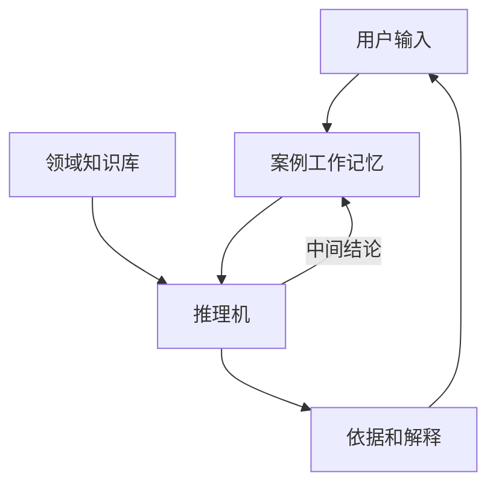

图中规则库保存跨案例可复用知识，工作记忆只存本次事实与推导。推理机交叉读取并回填中间结果。解释引用真实轨迹，保证能回头核对。

#### 7.8.2 知识库
知识库保存相对稳定的领域事实、规则、模型与规则元信息。含版本、来源、适用范围和优先级时，更易解释为何同一类别用户在不同年份得到不同决定。

以选课规则为例，2025版只要求概率论，2026版还需实验。不能更新规则后丢掉旧记录，历史咨询应能按原策略重放。若有两个都可匹配的规则，先设计适用年份与优先级，再写代码。

#### 7.8.3 推理机
推理机决定用正向、反向或混合控制。它还需定义规则选取、重复识别、冲突处理和终止。针对单目标的反向咨询可以只问缺失且会改变结论的信息，降低交互成本。

正向推理利用事实队列和规则索引增量触发候选。针对单一资格问题，反向查规则头，再按前提获取事实。混合策略可能缓存子结论，应定义何时失效。撤回某个事实时，检查还有没有其他支持链。

#### 7.8.4 综合数据库
综合数据库或工作记忆存案例事实、中间结论、候选工作项。换案例时应清理临时事实，避免上一名用户的记录影响下一名。实际记录可区分观察、推导、手动录入和外部证据。

工作记忆需按案例隔离，并区分观察、用户输入、规则推导、人工审核。修改一个观测会影响已缓存的中间结果，应记录依赖后重算。拿过往用户临时事实填补当前空字段会产生跨案例错误。

#### 7.8.5 知识获取机构
从访谈、手册和历史案例收集知识，转成清楚的条件及例外，由专家审核，再用边界案例验证。不要只问专家「一般怎么做」，还要问会推翻默认规则的反例。可通过维护接口将新增规则和生效时间一起入库。

访谈时先问具体案例的决策依据，再追问会推翻规则的条件。将“通常如此”转成条件、默认和例外，交专家复核。维护需要责任人、来源和重复测试。模型发现的相关性可供复核，不能自动写成确定专家规则。

#### 7.8.6 人机接口
交互接口负责接收输入、补问、展示结论和不确定性。对必填事实的「未知」「否」「未回答」应分别编码。直接把所有空值当 false 可能产生错误结论。

接口应区分缺失、明确否定与实际故障。补问只问会改变判定的字段，必要时说明为何。输出可用符合、不符合、待核验三态，并公开来源和适用版本。别把填表界面能接受空值等同于信息齐全。

#### 7.8.7 解释机构
解释回答「为什么得到」「为什么询问」「为什么没选其他结论」。例：推出不可选应列出采用的培养方案版本、先修课程和未完成记录。解释来自真实推理轨迹，不能事后生成一个没有参与决策的故事。

解释至少回答“怎么得到”和“为什么询问”。例：使用R3，因为已核验F1、F2，R5因过期没有启用。是否能答“若补一个前提会怎样”，取决于是否按真实规则重算，而非让解释程序自由编故事。

### 7.9 专家系统的建立

建设可从十个有代表性的案例起步，形成输入、推理、解释与验收的闭环，再逐步补域内例外。规模增大后重点包括版本、权限、更新、回放，以及错误可归因。

#### 7.9.1 专家系统的一般建立过程
先圈定领域、明确输出和评价标准，再获取知识、表达、选择推理策略、验证、部署与维护。验证包括正常、例外、矛盾、缺失输入、规则循环和跨版本案例。长期维护需责任人和审查记录。

先界定任务范围、输出类型、使用者权限和何时升级人工。知识工程师组织规则，领域专家复核，开发者写规则重放。测试覆盖重叠冲突、边界和无答案案例。运行后记录人工纠正，为下一轮更新提供数据。

#### 7.9.2 专家系统开发环境
开发可用通用编程语言、逻辑语言、规则引擎、可视化知识工具或专用骨架。选型考虑表示能力、运行性能、追踪能力与部署限制。大型成熟业务一般要有版本控制、回归测试和日志，而不仅有规则编辑页面。

通用语言灵活但维护需开发能力；专用规则引擎提供匹配、优先级和轨迹；咨询骨架往往附知识维护和提问角色。若运营人员需要更新规则，应配权限和预览，不将编辑规则等同于允许执行任意代码。

#### 7.9.3 骨架系统的概念
骨架系统把通用的知识表示、推理、咨询、解释与开发支持从领域规则中抽离。把某个领域的规则清空后，还应能装入另一领域知识并复用控制。能复用不等于任何任务都适配同一种规则语义。

骨架应分离通用表示、推理、获取和解释，与具体知识库组合使用。检验可迁移性可以换两份领域数据跑同一套推理接口。如果新任务需要实时连续控制，咨询骨架未必适配。

#### 7.9.4 EMYCIN骨架系统
EMYCIN 提取了 MYCIN 的领域无关产生式咨询机制，可填入其他领域知识，同时提供知识获取和解释组件。实践关注规则怎么和目标驱动咨询配合，以及领域信息保存在哪里。参见 [van Melle 的原始论文](https://ijcai.org/proceedings/1979/204)。

EMYCIN 的学习重点是通用规则控制和目标驱动咨询。向新知识库添加领域规则不必重写匹配与解释。例：换成课程规则后，仍可从资格目标反向提问缺少的先修，而病理领域规则完全不参与。规则置信组合也需以部署约定为准。

#### 7.9.5 KAS骨架系统
KAS 来自 PROSPECTOR 环境，特别强调网络式知识库的获取、编辑、调试和维护，与 EMYCIN 的产生式咨询切入点不同。编辑器可理解宿主系统的节点、关系、表示约束，帮助发现结构问题，但领域知识仍需专家形成和验证。参见 [SRI 原始报告](https://www.sri.com/publication/knowledge-engineering-techniques-and-tools-in-the-prospector-environment/)。

KAS 更强调编辑、获取与维护网络式知识。结构检查可以发现边两端类型不符、孤立节点或关系格式错误，但领域断言是否真实仍须来源和专家复核。分别评价结构正确与语义正确，才能看到维护工具实际解决了什么。

### 7.10 小结
学习模型关注泛化，专家系统关注领域知识、控制与解释。**自测**：先用所有样本拟合标准差再做验证，有何问题？验证分布已经间接进入预处理。应在每个训练分折上重新拟合缩放，并仅对该折的验证子集应用。

**综合练习**。学情预警先定义过半学期时可观测特征，按未来时间划分评估分类。将辅导资格与课程开放写入规则，写解释列来源，区分模型风险候选与业务决策。报告召回、误报、规则冲突和案例回放能力。

## 第8章 人工神经网络与深度学习


### 8.1 神经元与神经网络
神经网络可视为由参数化运算拼接的计算图。一层产生的表示是下一层输入，训练时输出误差通过链式法则影响前面的权重。

神经网络可看成参数化的计算图。不同网络共享加权和、激活、目标和更新四个部件，结构决定信息沿什么路径传播。读网络先写清输入、各层形状、输出和损失，然后检查哪些参数共享、哪些状态跨步保存。

#### 8.1.1 生物神经元结构
生物神经元通常通过树突接收输入、胞体整合、轴突传递信号，突触参与连接和调节。人工模型抽象为加权聚合与激活，没有完整复现脉冲、神经递质或可塑性机制。

生物神经元由树突等结构接收输入，胞体整合信号，轴突传播放电，突触调节连接。人工模型用权重、加权和与激活抽象这些概念，省略脉冲时序和大量生化细节。类比帮助理解为什么连接强度重要，不能据此把反向传播等同于真实生理机制。

#### 8.1.2 神经元数学模型
一个人工神经元通常计算：

$$
z=w^Tx+b,\qquad a=\phi(z)
$$

w 为权重，b 为偏置，$\phi$ 为激活函数。若多层都没有非线性激活，多次仿射变换仍能合并为一次仿射变换，模型表达能力不会仅因为层数增加就获得一般的非线性边界。

常见激活函数：

| 函数 | 定义 | 需要注意 |
| --- | --- | --- |
| Sigmoid | $1/(1+e^{-z})$ | 输出在 0 到 1，饱和区域梯度小 |
| Tanh | $\tanh z$ | 输出以零为中心，仍会饱和 |
| ReLU | $\max(0,z)$ | 正区间梯度简单，可能出现长期不激活单元 |
| Softmax | $e^{z_k}/\sum_je^{z_j}$ | 把一组分数归一化，常用于互斥多分类 |

Softmax 不能让错误模型自动变得可信。最大概率很高不等于模型一定正确，尤其面对训练分布之外的输入。

令 $z=x_1+x_2-1.5$，阈值 $z\ge0$ 输出1，用于两个布尔输入时实现 AND。把偏置换为−0.5实现 OR。XOR 两组点不能用一条直线分离。若隐藏单元分别识别 OR 和 AND，输出判断前者真且后者假，就能构造 XOR。多层仿射若不穿插非线性，矩阵与偏置仍可合并成一个仿射层。

#### 8.1.3 神经网络的结构与工作方式
前馈网络中信号从输入到输出，一般无反馈环，循环网络利用前一状态，Hopfield 使用反馈和异步状态更新。架构决定信息能否跨位置或时间传播。并行计算与拓扑有关，不能仅看层数判断延迟。

前馈结构按有向无环图做一次预测；循环结构读取上步状态，参数跨时间共享；反馈网络如 Hopfield 从初态演化到稳定状态。不能只用“层数”和“参数量”比较可用性，任务还受记忆长度、实时性、并行和状态边界约束。

#### 8.1.4 神经网络的学习
有监督学习根据目标误差调参，自监督从数据自身构造目标，强化学习根据奖励估计长期效用。学习的参数和更新算法是两件事。同一网络可用全批量、小批量或不同优化器训练。训练与验证差距需要结合数据量、泄漏和模型容量解释。

训练可用全批、随机或小批梯度。学习率决定走多远，方向来自当前误差。小批太小可能让类别严重不平衡，太大增加显存与单次开销。梯度范数、训练损失、验证损失要一起看，才能区分优化问题和过拟合。

### 8.2 BP神经网络及其学习算法

反向传播计算损失对参数的导数，梯度下降或 Adam 等优化规则使用导数更新参数。两个概念应分开。如果损失定义错了，反向计算即使数学正确也在优化错误目标。先手算一个样本，再扩大到矩阵与批量。

#### 8.2.1 BP神经网络的结构
考虑每行一个样本的两层分类器。若 $X$ 为 $n\times d$、隐藏维度为 h、输出为 k，$W_1$ 为 $d\times h$、$W_2$ 为 $h\times k$，偏置分别按行广播。前向得到 $Z_1=XW_1+b_1$、$H=\phi(Z_1)$、$Z_2=HW_2+b_2$。最后一层原始分数称 logits，二分类常用 sigmoid，多分类可用 softmax。


输入32样本、每样本4特征，隐藏8、3类，权重形状 $4\times8$、$8\times3$，最后输出 $32\times3$。每行做类别 softmax。若训练接口本身接收 logits 算交叉熵，使用前不要再手动 softmax，避免把概率当 logits 后再次归一化。

#### 8.2.2 BP学习算法
两层网络为：

$$
Z_1=XW_1+b_1,\quad H=\phi(Z_1),\quad Z_2=HW_2+b_2
$$

前向传播计算预测；损失衡量预测与目标差异；反向传播利用链式法则计算各参数梯度；优化器根据梯度更新参数。**反向传播是梯度计算机制，梯度下降是参数更新方法**。

对二分类使用 sigmoid 输出 $p=\sigma(z)$，交叉熵为：

$$
L=-[y\log p+(1-y)\log(1-p)]
$$

两者组合的一个重要结果是：

$$
\frac{\partial L}{\partial z}=p-y
$$

这个简化来自损失与激活的导数组合，不能对任意损失都直接套用。批量平均损失还需要包含 $1/n$ 因子。

举一个单神经元更新：$x=2,y=1,w=0,b=0$。初始 z=0，p=0.5，所以 $\partial L/\partial w=(p-y)x=-1$，$\partial L/\partial b=-0.5$。学习率取 0.1，更新后 w=0.1、b=0.05；新 z=0.25，p 约 0.562，向目标方向移动。

**矩阵推导**。令 $D_2=\partial L/\partial Z_2$。由于 $Z_2=HW_2+b_2$，每个输出都会沿权重回到 H。于是
$$
\nabla W_2=H^TD_2,\quad D_1=(D_2W_2^T)\odot\phi'(Z_1),
\quad \nabla W_1=X^TD_1.
$$
偏置梯度对各行求和。损失若为批均值，平均因子应计入一次，放入 $D_2$ 后不能再除一次。反向需用同一前向计算的参数和缓存值，先更新 $W_2$ 再用它回传会使梯度不对应原损失。

**两层单样本手算**。设 $x=2,w_1=0.5,b_1=0$，隐藏用 ReLU，则 $z_1=1,h=1$。设 $w_2=0.8,b_2=0$，线性输出0.8，真实值1，损失 $L=(\hat y-y)^2/2=0.02$。输出 delta 为−0.2，$dw_2=-0.2$，$db_2=-0.2$，隐藏 delta 为 $-0.2(0.8)(1)=-0.16$，$dw_1=-0.32$，$db_1=-0.16$。学习率0.1时新 $w_1=0.532,b_1=0.016,w_2=0.82,b_2=0.02$。注意这里的平方损失 delta 与 sigmoid 交叉熵 delta 含义不同。

**推导 softmax 交叉熵**。$p_i=e^{z_i}/\sum_j e^{z_j}$，真实类别分布为 y 且 $\sum y_i=1$。损失
$$
L=-\sum_i y_i\log p_i=-\sum_i y_i z_i+\log\sum_j e^{z_j}
$$
对 $z_k$ 求导为 $p_k-y_k$。例如 logits $(2,0,-1)$ 正确类为第二项，概率约 $(.844,.114,.042)$，梯度约 $(.844,-.886,.042)$，相加近零。负梯度更新会提高正确类 logit、降低另两类。若出现相反符号，先检查类别索引和损失符号。

反传过程中同一变量通过多路影响损失时要将梯度相加。某层参数若由多个样本或位置共享，每个样本贡献都应按损失缩放规约后累积。

#### 8.2.3 BP学习算法的实现
**初始化**影响信号和梯度尺度。若一层所有单元参数完全一样，它们可能始终学到相同东西，因此通常使用与结构相配的随机初始化。

**梯度消失和爆炸**来自连乘的导数与权重。当链很长时，数值可能越来越小或越来越大。适当激活、初始化、残差结构、归一化和梯度裁剪可以缓解部分问题。

**正则化**抑制过拟合。L2 正则通过参数惩罚限制复杂度；Dropout 在训练中随机屏蔽部分表示；早停根据验证表现停止训练。它们的机制不同，应分别理解。

**批量、轮次与步数**：batch 是一次更新使用的样本集合，epoch 表示完整遍历训练集一次，step 通常表示一次优化更新。相同 epoch 不代表相同更新次数。

若训练损失下降而验证损失持续上升，可能开始过拟合；若训练损失都不下降，先检查输入尺度、标签、损失设置、学习率与梯度是否正常，不要只增加网络层数。

需要 NumPy。XOR 在原始二维空间中不能由一个线性分类边界分开，这里用 tanh 隐层加 sigmoid 输出，手工实现反向传播。

```python
import numpy as np

rng = np.random.default_rng(7)
X = np.array([[0., 0.], [0., 1.], [1., 0.], [1., 1.]])
y = np.array([[0.], [1.], [1.], [0.]])
W1 = rng.normal(0, 0.8, size=(2, 8))
b1 = np.zeros((1, 8))
W2 = rng.normal(0, 0.8, size=(8, 1))
b2 = np.zeros((1, 1))
lr = 0.5

for step in range(8000):
    H = np.tanh(X @ W1 + b1)
    logits = H @ W2 + b2
    p = 1.0 / (1.0 + np.exp(-logits))
    dz2 = (p - y) / len(X)
    dW2 = H.T @ dz2
    db2 = dz2.sum(axis=0, keepdims=True)
    dz1 = (dz2 @ W2.T) * (1 - H ** 2)
    dW1 = X.T @ dz1
    db1 = dz1.sum(axis=0, keepdims=True)

    # 必须先算完所有梯度，再更新，避免混用不同步的权重。
    W1 -= lr * dW1
    b1 -= lr * db1
    W2 -= lr * dW2
    b2 -= lr * db2

H = np.tanh(X @ W1 + b1)
p = 1.0 / (1.0 + np.exp(-(H @ W2 + b2)))
print("概率：", np.round(p.ravel(), 3))
print("类别：", (p.ravel() >= 0.5).astype(int))
# 预期类别：[0 1 1 0]
```

这只是对四个样本的拟合演示，没有证明模型具有现实任务的泛化能力。大规模训练还要使用数值稳定的损失实现，避免极端 logits 带来的指数溢出。

调试可在小批上做中心差分，将解析梯度与 $[L(w+\epsilon)-L(w-\epsilon)]/(2\epsilon)$ 比较。检查顺序通常是输出形状和标签、梯度为零或非有限、学习率与优化器、数据划分。激活不可导点附近的有限差分要另解释。

数值梯度用中心差分 $(L(\theta+\epsilon)-L(\theta-\epsilon))/(2\epsilon)$ 作对照。测试固定输入和随机性，暂时关闭改变扰动间结果的 dropout。若偏差大，从输出层向前定位。临近 ReLU 不可导点时差分不一定与约定子梯度一致。所有梯度应使用同一次前向权重，不能先更新输出层再用新权重回传旧隐藏层。

### 8.3 BP神经网络在模式识别中的应用
例如手写数字分类，输入是像素或特征，输出是各类别 logits。训练只使用训练数据拟合，验证选择网络大小，测试报告整体准确率及类别混淆。发现「3」常错成「8」时，可看是否笔画闭合导致，检查类别分布和预处理。只报告总体精度会掩盖少数类别失败。

**诊断对照**。若训练集也辨认不好，先检查特征尺度、标签、模型能力和训练是否收敛；若训练好但测试差，检查过拟合、分布变化或评估泄漏。输入平移常见的图像任务可比较全连接与卷积，再在同一测试划分判断效果。

手写数字识别从规范化像素、特征、分类头到误差评价。用混淆矩阵定位具体误分。真实8有20张、18张判8、2张判3，8类别召回0.9；想求8类别精确率还需知道预测8总数。让同一个书写人的高度相似样本分别进入训练与测试，会高估对新人的泛化。

### 8.4 Hopfield神经网络及其改进

能量模型描述反馈状态如何移动。吸引点往往不是唯一，初始值会改变最终稳定态。联想记忆要看是否回到预期模式，优化要看代价与约束。能量目标下降只保证沿当前更新不变坏，未必保证全局最优。

#### 8.4.1 离散型Hopfield神经网络
经典离散 Hopfield 网络通常有对称权重 $w_{ij}=w_{ji}$、零自连接和取值为 $-1,+1$ 的状态。异步更新一个单元：

$$
s_i\leftarrow sign\left(\sum_jw_{ij}s_j-\theta_i\right)
$$

相应能量可写为：

$$
E=-\frac12\sum_{i,j}w_{ij}s_is_j+\sum_i\theta_i s_i
$$

在经典条件下，合适的异步更新不会增加能量，可用于从受损输入恢复某个稳定模式。但局部极小、伪记忆、模式相关性和有限容量都会影响恢复。

不能把这个性质直接推广到任意同步更新或非对称网络，同步更新可能出现周期。连续型网络、随机神经网络与相关能量模型有各自的动态或采样机制，需要单独分析。[R18]

若只改第 i 个状态，且权重对称、自连接为零，能量差为
$$
\Delta E=-(s_i'-s_i)\left(\sum_jw_{ij}s_j-\theta_i\right).
$$
设净输入为正，更新使 $s_i'=1$，差值非负，于是能量不增，负净输入同理。净输入为零时可选择保留状态，避免等能量反复翻转。这个推导只处理一次改单元。

**异步与同步反例**。两个单元相互权重1、无自连、阈值0。初态 $(1,-1)$。同步各自复制对方，变成 $(-1,1)$，下次又回原状。异步先改第一单元则到 $(-1,-1)$，稳定。经典离散能量证明写的是单点更新，应确认题目或程序是否用了同一条件。

**可运行：对称权重下的异步能量**。每个更新只改一位。局部场为0时保留。全矩阵求和每条无向边计两次，因此 E 要除2。

```python
from itertools import product

weights = [[0, -1, 1], [-1, 0, -1], [1, -1, 0]]

def energy(state):
    size = len(state)
    return -sum(weights[i][j] * state[i] * state[j]
                for i in range(size) for j in range(size)) / 2

def recall(initial):
    state = list(initial)
    trace = [energy(state)]
    for _ in range(8):
        before = state.copy()
        for i, row in enumerate(weights):
            local_field = sum(w * v for w, v in zip(row, state))
            if local_field:
                state[i] = 1 if local_field > 0 else -1
            trace.append(energy(state))
        if before == state:
            return tuple(state), trace
    raise RuntimeError("本例预算内没有停止")

assert recall((-1, -1, 1))[0] == (1, -1, 1)
for initial in product((-1, 1), repeat=3):
    _, trace = recall(initial)
    assert all(b <= a for a, b in zip(trace, trace[1:]))
print("三单元异步网络逐步能量通过核对")
```

同时检查全部8个初态可以发现反号模式稳定。能量不增与恢复唯一记忆是不同命题。

#### 8.4.2 连续型Hopfield神经网络及其VLSI实现
连续 Hopfield 可令内部状态 $u_i$ 按微分方程变化，输出 $v_i=g_i(u_i)$。
$$
C_i\dot u_i=-u_i/R_i+\sum_jw_{ij}v_j+I_i .
$$
右侧三项可理解为泄漏、耦合和外部输入。电容积分状态、电阻提供泄漏、电路用放大或非线性单元产生输出，这给 VLSI 实现提供物理对应。具有对称耦合与合适的单调激活时，可构造含 $\int g_i^{-1}(v)\,dv$ 的能量。不能仅凭模拟电路并行就认为省电或准确，应纳入器件误差和转换代价。

**连续能量导数**。对称权重下可令
$$
E(v)=-\frac12\sum_{i,j}w_{ij}v_iv_j+\sum_i\frac{1}{R_i}\int_0^{v_i}g_i^{-1}(s)\,ds-\sum_i I_i v_i.
$$
假设输出函数严格单调、可微且在范围内可逆，则 $\partial E/\partial v_i= -\sum_j w_{ij}v_j+u_i/R_i-I_i=-C_i\dot u_i$。再乘 $\dot v_i=g_i'(u_i)\dot u_i$ 并求和，得到 $\dot E=-\sum_i C_i g_i'(u_i)(\dot u_i)^2\le0$。对称条件使二次项求导简单。能量不增帮助研究稳定，但稳态可能对应局部解。

连续模型可用电容积累输入、电阻供应泄漏、非线性电路产生输出。实际器件饱和、温漂和噪声使动态偏离理想式。在软件用离散步近似时，步长过大也可产生连续模型没有的震荡。观察 $E(t)$ 不增的结论时需注明权重对称、激活单调和更新条件。

#### 8.4.3 随机神经网络
随机更新允许暂时进入较高能量状态，降低确定性局部搜索对初始化的依赖。若二值状态为 $\pm1$，示意的条件概率为 $P(s_i=1)=\sigma(2h_i/T)$，其中 $h_i$ 为局部场，T 为温度。温度高更接近随机，低温更像取符号。通过随机更新得到的稳态分布依赖更新方式和参数，退火随意过快也没有最优保证。

用 $P(s_i=1)=\sigma(2h_i/T)$ 的单点随机更新示意。$h=1$ 时取 $T=2$ 得0.731，$T=0.5$ 得0.982。低温接近确定符号，高温有更大概率接受不利变动。在逐步降温的做法中要给探索时间；快速降温仍可能陷入差解。

### 8.5 Hopfield神经网络的应用

联想记忆给带噪或残缺模式，将其迭代到已知稳定结构。组合优化把代价写成能量，在稳定点读候选解。前者检查恢复率与串扰，后者检查可行率与成本差。两者可能驻留在不希望的吸引点。

#### 8.5.1 Hopfield神经网络在联想记忆中的应用
**联想记忆手算**。存一个模式 $p=(1,-1,1)$，取 $w_{ij}=p_ip_j$（$i\ne j$），对角线为0。给受损输入 $(-1,-1,1)$，先更新第一个单元，净输入 $(-1)(-1)+(1)(1)=2$，于是恢复为1。此时更新第二个得到负场，第三个得正场，模式稳定。多个模式可能互相干扰，能量下降不等于必回到期望模式。

多个模式的外积相加再清掉自连接，可编码不同模式的成对关系，也会叠加干扰项。对每个存储模式分别翻转1、2、3个比特，统计恢复原模式、其他已存模式和伪模式的比例。单个成功示例不能支持“所有初值都可恢复”。单模式外积还往往存下反号模式的稳定性。

#### 8.5.2 Hopfield神经网络优化方法
优化应用把目标及约束违约一起编码成能量，网络演化到局部稳定态。以二值排程为例，用 $(\sum_t x_{it}-1)^2$ 惩罚任务 i 分配不恰好一次，另用冲突乘积惩罚同资源同时段。惩罚小可能出现非法解，惩罚太大可能阻碍有效搜索。最终还要显式检查约束与任务代价。

排程例里 $x_{it}\in\{0,1\}$ 表示任务 i 是否放在时段 t。$\sum_i(\sum_t x_{it}-1)^2$ 惩罚未安排或重复安排，$\sum_t x_{1t}x_{2t}$ 惩罚两个任务冲突。利用 $x^2=x$ 展开，得到线性与二次项，可映射给阈值和成对权重。映射后要用原问题核对约束，不应仅凭能量数值低就接受。

### 8.6 卷积神经网络及其应用

CNN 在滑动窗口里复用权重，参数数量由核大小、输入输出通道决定。计算输出尺寸还需填充、步长和膨胀率。将尺寸、通道、参数量三个问题分别算，避免用一条公式处理所有维度。

#### 8.6.1 动物视觉机理与深度学习的提出
局部感受野的启发在于局部输入组合成较复杂结构。CNN 将这一想法转为局部连接与跨位置共享。生物视觉启发与现代具体架构之间没有逐项一一对应关系。

局部感受野只观察附近，叠层后依赖范围扩大。平移等变表示输入移动时特征相应移动；平移不变表示最终预测不随一定范围移动。共享卷积支持前者，池化和全局汇聚可增强后者，但边界、填充及大步长都可能破坏理想性质。

#### 8.6.2 卷积神经网络的结构
卷积块常含卷积、激活、可选归一化和下采样。较浅层可表示局部滤波，深层通过叠加看到更大有效区域。分类器通常在空间聚合后输出类别分数。分类、检测、分割所需输出形状不同。

输入 $32\times32\times3$，16个 $3\times3$ 核，步长1、填充1，输出 $32\times32\times16$，参数 $16(3\cdot3\cdot3+1)=448$。接 $2\times2$ 步长2池化，输出 $16\times16\times16$，池化无可训练参数。空间缩小减少后层计算，通道增加可能抵消部分收益。

#### 8.6.3 卷积神经网络的卷积运算
全连接层为每个输入位置分配独立权重；卷积层让同一组核在多个位置使用，适合局部模式会在不同位置出现的数据。

深度学习框架中通常所称的二维“卷积”实际上常是互相关：

$$
Y_{i,j}=\sum_{u,v}X_{i+u,j+v}K_{u,v}
$$

严格数学卷积还需要翻转核。多通道情况下还要对输入通道求和，每个输出通道有自己的核及偏置。

单个空间维度输出长度为：

$$
L_{out}=\left\lfloor\frac{L_{in}+2P-D(K-1)-1}{S}\right\rfloor+1
$$

P 为填充，K 为核大小，D 为膨胀率，S 为步长。例如输入 32、核 3、填充 1、步长 1、膨胀 1，则输出仍为 32。

若输入 3 通道、输出 16 通道、核为 $3\times3$，含偏置参数量为 $16\times(3\times3\times3+1)=448$。参数共享让它不随图像高宽线性增加。

池化用于局部汇聚和降采样，但不是所有现代网络都必须使用。卷积在适当条件下具有平移等变性，不能把它笼统说成对所有平移都完全不变，填充和下采样也会影响性质。

胶囊网络尝试用向量或更复杂对象表达“是否存在”及姿态等信息，并通过路由关联部分与整体。入门阶段理解其动机即可，不必把它当作所有视觉任务的默认选择。[R13]

**手算互相关**。输入为三行 $(1,2,0),(0,1,3),(2,1,1)$，核为两行 $(1,0),(0,-1)$，步长1、无填充。每个窗口取左上减右下，四项为0、−1、−1、0，组成 $2\times2$ 输出。若多输入通道，每个输出通道先逐通道卷积求和，再加该输出通道偏置。

框架常用互相关，滑动时不翻转核。做手算先核对题目使用卷积还是互相关，确定左上角位置；逐通道、逐像素乘加，再加输出通道偏置。步长2意味着窗口位置每次移两格，膨胀2意味着相邻权重采样间隔两格，二者不是同一个操作。

#### 8.6.4 卷积神经网络中的关键技术
步长影响采样密度，填充影响边界及尺寸，膨胀扩大采样跨度，池化做局部汇聚。对 $3\times3$ 卷积连续两层无扩张、步长1，理论感受野为 $5\times5$。若第一层步长2，第二层一步对应输入跳两格，感受野为7。区域很大并不保证它的各处对预测贡献相同。

令感受野 $r_0=1$、跳步 $j_0=1$。每层更新
$$
r_\ell=r_{\ell-1}+(k_\ell-1)d_\ell j_{\ell-1},\quad j_\ell=s_\ell j_{\ell-1}.
$$
三层 $(k,d,s)=(3,1,1),(3,1,2),(3,2,1)$ 给 $(r,j)=(3,1),(5,2),(13,2)$。最后一层的膨胀作用于第二层的格点，每隔一个格点对应输入跨4格。理论感受野只表示连接，具体影响由训练权重决定。

#### 8.6.5 卷积神经网络的应用
图像分类输出类别，检测输出位置和类别，分割为每像素或区域给标签。时频图、时间序列也能用卷积，前提是局部模式与共享具有意义。图像增强要保留标签语义，例如水平翻转数字不一定合法。

分类给整图类别，检测给对象位置与类别，分割给像素标签。预测框与真框面积60、80，交集40，并集100，IoU为0.4。检测通常还用置信阈值、匹配规则和类型评价，不能直接以整图分类准确率代替。

#### 8.6.6 胶囊网络
胶囊用向量或更复杂表示同时携带存在证据与姿态信息，下层通过投票向上层提出部分/整体候选。路由按投票一致程度更新耦合。它尝试处理对部件排列敏感的问题，代价可能是计算复杂，实际效果仍需在同预算下比较。

胶囊以向量等结构表达部件存在及姿态，下层向上层投票，通过一致程度调整耦合。两笔同时支持同一空间结构时，路由可以提高对应整体候选的权重。若几个强激活的方向互不一致，不必归到同一实体。多次迭代和投票张量增加计算，应用应与卷积基线在同条件比较。

### 8.7 生成对抗网络及其应用

GAN 训练两个相互影响的模型，目标并非逐样本预测唯一标签。评估不仅看生成图是否逼真，还应看多样性、训练数据复现和不同条件下的可控性。D 分数0.5可能代表两分布相近，也可能 D 没学好。

#### 8.7.1 生成对抗网络的基本原理
生成器 G 将随机噪声映射为样本，判别器 D 区分真实样本和生成样本。原始基本目标为：

$$
\min_G\max_D\;\mathbb E_{x\sim p_{data}}\log D(x)
+\mathbb E_{z\sim p_z}\log(1-D(G(z)))
$$

判别器努力区分真假，生成器努力使生成结果被认为真实。实践中常使用非饱和生成器损失等变体，不能把一个目标函数当成全部 GAN 实现。

常见困难是训练不稳定、模式崩溃以及评价困难。模式崩溃指生成器只覆盖少数类型，即使单张图看起来好，也缺乏多样性。语言中的离散 token 又使梯度直接穿过采样变得困难，因此图像 GAN 的训练方式不能原样搬到文本生成。

GAN 可用于图像生成、转换等研究和应用，但生成数据是否适合某个领域，需要任务级验证。合成图像逼真不代表保留了所有有用统计关系。[R12]

生成器接收随机变量或条件输入，判别器区分真实和生成候选。G 向能让 D 更难区分的方向更新。单看样例的视觉质量可能掩盖只生成极少数模式。应分开检查条件符合度、整体质量和真实数据覆盖。

#### 8.7.2 生成对抗网络的结构与训练
通常交替更新 D 与 G。更新 D 时真实样本标为真、生成样本标为假，生成数据应切断对 G 的这次梯度。更新 G 时保持 D 参数不变，但允许梯度穿过 D 回到 G。过强 D 可能使原始饱和目标梯度弱，常用 $-\log D(G(z))$ 替代生成器部分目标。两个网络的损失曲线难直接解释样本质量，应观察多样性与保留样本上的评价。

D 步更新判别器，假样本来自 G 但该次不应回传到 G。G 步冻结 D 参数，梯度仍需穿过 D 回到 G。冻结参数与整段关闭梯度不同。若 G 梯度为0，先检查是否误断路径，再检查损失饱和和数值范围。

#### 8.7.3 生成对抗网络在博弈中的应用
原始构造是生成器最小化、判别器最大化的对抗博弈。固定 G 时，若真实与生成密度为 $p_d,p_g$，每个 x 最大化 $p_d\log D+p_g\log(1-D)$，令导数为零得 $D^*=p_d/(p_d+p_g)$。当两分布一致，判别器最优输出0.5。在游戏或模拟应用中可用对抗信号学习生成分布或行为，但 GAN 的双网络博弈不等价于第12章的棋局 minimax，后者搜索给定走法树。

真实两类分布 $(.5,.5)$，生成分布 $(.9,.1)$，最优判别分别给 $0.5/1.4\approx.357$ 与 $0.5/.6\approx.833$。第一类被生成得过多，D 更容易识别；生成器可以通过覆盖第二类改善匹配。这里的对抗是分布上的最小最大优化，游戏树则比较给定状态和终局收益。

#### 8.7.4 生成对抗网络在图像处理中的应用
图像应用包括生成、修复、域转换与超分辨率。条件 GAN 把类别或待转换图输入生成器和判别器，以约束输出。例如修复要同时关注整体逼真、缺失区域忠实和未遮挡区域保持。只靠对抗目标可能添加不存在的细节。

图像修复可把重建损失与对抗项结合，前者约束对象一致，后者提高视觉真实性。应检查已知部分有没有被改、细节是否引入假内容，以及多个合理候选怎样评价。单个参考图不一定涵盖所有有效修复。

#### 8.7.5 生成对抗网络在语言处理中的应用
文本由离散 token 组成，从概率分布采样后，常规梯度不能直接穿过采样。可能使用连续近似、策略梯度或在连续表示上训练。评估要区分语言流畅、语义忠实和多样性。

采样出的 token 是离散选择，常规可微梯度不能通过采样索引。策略梯度可用序列奖励估计，方差较大；连续松弛提供近似梯度，也改变训练目标。比较方法需同时看流畅、语义与事实保持、多样性及约束，而不是只看判别器分数。

#### 8.7.6 生成对抗网络在视频生成中的应用
视频要求单帧质量和跨帧一致性。逐帧独立生成容易闪烁和出现物体漂移。可对短片段或运动特征设判别器，还应按动作连贯性、时间稳定性和内容保持评价。

逐帧训练可能令每帧都清晰却在视频里产生闪烁。片段判别、运动一致约束和共享时序状态都可减少跳变。检验可追踪对象的位置、类别和纹理随时间变化，并拆短期连贯与长期一致两种指标。

#### 8.7.7 生成对抗网络在医疗中的应用
医学研究可探索合成训练数据、图像重建辅助或跨模态映射。生成图像看起来真实，并不保证病理征象保持，也不代表能进入临床。验证应区分不同患者与来源，检查细节错误和群体偏差，避免训练资料或合成样本泄漏到评估。

医学图像研究可以用生成方法探索增强或域转换，但视觉自然不能证明保存病理征象。患者级或机构级独立划分、真实外部数据评估和专家复核，才适合分析模型影响。生成细节存在失真的可能，不应直接用来作未经验证的临床决策依据。

### 8.8 小结
神经网络章节应能从结构写出维度，从损失算出梯度，并区分网络的任务和假设。**自测**：输入32、卷积核5、填充2、步长2、膨胀1时输出长度为 $\lfloor(32+4-5)/2\rfloor+1=16$。若两层仿射之间没有激活，则它们可合并为一个仿射层。

复习时应能写前向形状、计算一次梯度、区分激活和损失。Hopfield 重点是能量与异步条件；CNN 检查尺寸、参数与感受野；GAN 检查两套更新不会串扰。每种系统的目标与验证都不同。

## 第9章 循环神经网络与自然语言理解


### 9.1 自然语言理解的概念与发展历史
自然语言理解研究如何把文字或语音转成对任务有用的结构与判断。例如「把周五的机器学习复习改到周六」需要识别修改意图、目标任务、旧日期、新日期，并在有多条候选时确认对象。词法判断、语义识别与真实状态查询分别由不同环节解决。

从手工词法句法、规则和知识库，到统计语料方法，再到神经序列模型与预训练模型，方法变化主要体现在特征来源、监督形式与跨任务迁移能力。当前有效性仍要用具体任务和错误类型评价，不能把总体语言流畅直接当成理解证据。

自然语言理解要把用户表达转成可以行动的含义。句子“把上次复习挪到下周”需要识别修改意图，按历史状态解析“上次”，按日期解释“下周”，再检查目标有无多个候选。规则适合确定的日期边界，模型适合语言变体，真实任务状态需要外部查询。统计、规则、神经和预训练方法能在这条链路上组合。

### 9.2 语言处理过程的层次
| 层次 | 问题 | 示例 |
| --- | --- | --- |
| 字词与子词 | 切分与词形 | 「机器学习」切成哪些单位 |
| 句法 | 成分结构和依存 | 谁帮助谁 |
| 语义 | 意图、角色、否定、量化 | 「不能改到周六」中的否定 |
| 篇章 | 同一对象不同提法 | 「这门课」指上一句的课程 |
| 语用 | 语境、暗含目的 | 「能把时间改一下吗」通常是请求 |

文本先经过 tokenization，变成 token 序列，再映射为整数编号。token 可能是字、词、子词或字节片段；它并不固定等同于一个汉字或一个英文单词。

one-hot 表示维度等于词表大小，只有一个位置为 1。嵌入矩阵 $E\in\mathbb R^{V\times d}$ 为每个 token 存储 d 维向量，查表得到序列向量。嵌入可以通过任务训练，但单独一个静态词向量通常不能完整区分所有上下文含义。

批处理时，序列长度不一致常需填充。必须在损失、注意力或状态处理时正确使用掩码，否则模型会把填充部分当成真实内容。

“老师用望远镜观察学生”的望远镜是工具，“带望远镜的学生被看见”中它是学生属性。仅靠关键词共现无法区分角色。句法分析、语义角色、篇章指代、语用意图是不同层次。子词处理可减少未登录词，补齐批量时需要掩盖 padding。字符数、词数和 token 数不必相等。

### 9.3 循环神经网络

RNN 共享每个时间位置的更新参数。隐藏状态是可学习的历史摘要。逐帧任务读每个时刻状态，序列整体分类可以只读最后或做汇聚。评价时应结合任务是否能看未来、信息需要保留多长时间、输入怎样分段。

#### 9.3.1 循环神经网络的概念
采用列向量记法，基本 RNN 为：

$$
h_t=\tanh(W_{xh}x_t+W_{hh}h_{t-1}+b_h)
$$

$$
z_t=W_{hy}h_t+b_y
$$

其中 $x_t$ 是当前输入，$h_t$ 是隐藏状态，$z_t$ 是输出分数。相同参数在不同时间步复用，使模型可以处理变长序列。

若 $x_t$ 维度为 d、隐藏维度为 h、输出维度为 V，则 $W_{xh}$ 为 $h\times d$，$W_{hh}$ 为 $h\times h$，$W_{hy}$ 为 $V\times h$。写公式时检查维度是避免实现错误的好方法。

结构不变不表示记忆无限。隐藏状态只有有限维度，训练也可能难以保留远处信息。

$h_t=\tanh(W_xx_t+W_hh_{t-1}+b)$。输入宽 d、隐藏宽 m，则 $W_x$ 为 $m\times d$，$W_h$ 为 $m\times m$。初始状态可置零或学习。跨独立样本要重新初始化；连续流分段时需定义是否携带上一块状态，并避免混用不同来源。

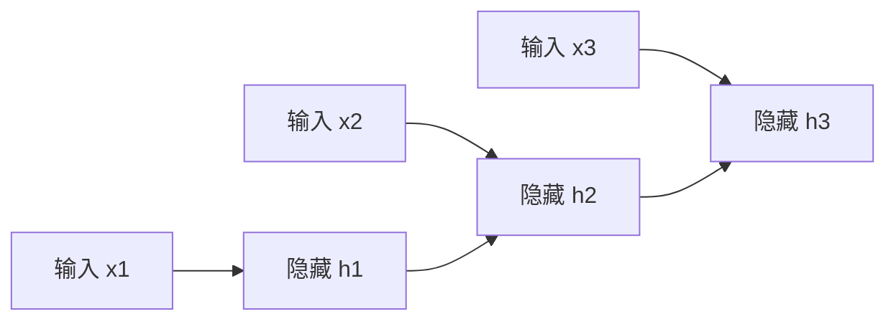

#### 9.3.2 循环神经网络的训练
把循环按时间展开，就得到一个共享参数的深计算图。总损失为各时间步损失之和或平均，某个参数的梯度由多个时间位置贡献。

远处梯度涉及多个 Jacobian 连乘，可能消失或爆炸。截断 BPTT 只回传有限步，节省计算与内存，但会截断更远的信用分配路径。梯度裁剪限制过大的梯度范数，主要缓解爆炸，并不能直接解决梯度消失。

RNN 中“递归”常指状态随时间重复更新，不等同于程序里必须写递归函数。可以用循环或专门算子实现。

**两步反传推导**。取标量 $h_t=\tanh(a x_t+b h_{t-1})$，损失仅在第二步。记 $d_2=(\partial L/\partial h_2)(1-h_2^2)$，则 $d_1=d_2b(1-h_1^2)$。共享参数 $a$ 得到总梯度 $d_1x_1+d_2x_2$，$b$ 得到 $d_1h_0+d_2h_1$。远处的损失贡献要逐步乘权重与导数，连乘可变小或变大。截断后更远依赖失去这部分直接梯度路径。

令 $z_t=ax_t+bh_{t-1}$，两时刻损失为 $\ell_1(h_1)+\ell_2(h_2)$。$d_2=\ell_2'(h_2)(1-h_2^2)$，$d_1=(\ell_1'(h_1)+bd_2)(1-h_1^2)$。共享输入权重的总梯度是 $d_1x_1+d_2x_2$。跨十步乘子若始终0.5，信号只余约0.001。裁剪可限制爆炸梯度，不会恢复消失信号。截断 BPTT 可继续传状态，但跨截断点的梯度被切掉。

#### 9.3.3 循环神经网络的递归过程
设 $h_0=0$，取 $h_t=\tanh(x_t+0.5h_{t-1})$。顺序 $(1,0)$ 给 $h_1=0.762,h_2\approx0.363$。反向 $(0,1)$ 给 $h_1=0,h_2\approx0.762$。同一组输入顺序不同，最终状态改变。模型的实际语义能力要通过学习和评价确认。

NumPy 示例，只做前向传播，不训练。它验证“相同输入集合、不同顺序可能产生不同状态”。

```python
import numpy as np

Wx = np.array([[0.8, -0.3], [0.2, 0.7]])
Wh = np.array([[0.5, 0.1], [-0.2, 0.4]])
embeddings = {
    "学生": np.array([1.0, 0.0]),
    "帮助": np.array([0.5, 0.5]),
    "老师": np.array([0.0, 1.0]),
}

def encode(tokens):
    h = np.zeros(2)
    for token in tokens:
        h = np.tanh(Wx @ embeddings[token] + Wh @ h)
    return h

print(np.round(encode(["学生", "帮助", "老师"]), 4))
print(np.round(encode(["老师", "帮助", "学生"]), 4))
```

不同数值不说明模型已经理解主客体，只说明结构对顺序敏感。语义能力需要通过训练与任务评价建立，不能从一个前向示例推出。

单向 RNN 只看当前位置及前缀，双向可用已知序列的前后文。实时语音不可偷偷依赖未来帧；可以等短帧块，或明确迟延换准确度。逆向从每个样本的实际末尾开始，padding 不应改变真实位置表示。状态在同一序列内应连续，不跨样本泄漏。

### 9.4 长短期记忆神经网络
LSTM 维护隐藏状态 $h_t$ 和单元状态 $c_t$。一种常见形式为：

$$
f_t=\sigma(W_f[h_{t-1};x_t]+b_f)
$$

$$
i_t=\sigma(W_i[h_{t-1};x_t]+b_i),\quad
\tilde c_t=\tanh(W_c[h_{t-1};x_t]+b_c)
$$

$$
c_t=f_t\odot c_{t-1}+i_t\odot\tilde c_t
$$

$$
o_t=\sigma(W_o[h_{t-1};x_t]+b_o),\quad
h_t=o_t\odot\tanh(c_t)
$$

$[h;x]$ 表示拼接，$\odot$ 表示逐元素乘法。遗忘门决定旧记忆保留多少，输入门决定新候选写入多少，输出门控制可见状态。

例如某个维度旧记忆为 0.8，遗忘门为 0.9，输入门为 0.2，候选为 0.5，那么新单元状态为 $0.9\times0.8+0.2\times0.5=0.82$。

加性记忆通道有助于长期依赖学习，但不是“彻底解决遗忘”或保证记住任意长序列。GRU 使用不同门控设计，结构相对简洁；任务上谁更好仍需实验。[R19]

再看一个极端。若遗忘门为0.99、没有新写入，初值1在相同设定的50步后仍有 $0.99^{50}\approx0.605$。若遗忘门为0.5，50步后仅约 $8.9\times10^{-16}$。门值是按样本和时间变化的，LSTM 可以学到保留，但不保证长期依赖必定被发现或充分使用。

取旧 cell 0.8，遗忘门0.75，输入门0.4，候选−0.5，输出门0.5。新 cell $0.75(0.8)+0.4(-0.5)=0.4$，新 hidden $0.5\tanh(.4)\approx.190$。三个 sigmoid 门独立，遗忘和写入不要求和为1。一条直接跨步梯度路径乘遗忘门，但隐藏状态回到门也有间接路径，因此不能把全导数只写为遗忘门。

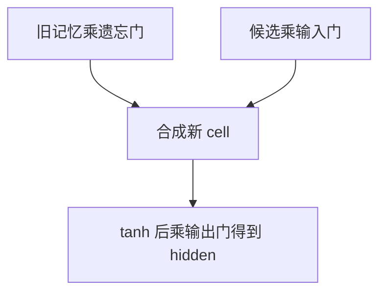

### 9.5 机器翻译

翻译评价不仅要匹配参考，还要检查数字、专名、否定、长依赖和领域术语。不同词序可表达同一正确意思。错误诊断可分源句解析、源目标对齐、目标生成或解码选择，再设相应测试。

#### 9.5.1 机器翻译方法概述
规则翻译依赖词典与语法规则，统计翻译从双语语料估计片段匹配及序列概率，神经翻译用端到端表示建模条件序列。评价可结合参考译文指标与句级误差分析。多个语法正确的译文可能同样有效，单一参考未必覆盖全部。

规则翻译使用词典和句法规则，结果易追踪但跨领域维护昂贵。统计方法从双语语料估计短语、对齐和语言模型。神经方法端到端学习条件分布。比较时覆盖低频词、长句、否定与数字。指标与人工证据可互相补充。

#### 9.5.2 基于循环神经网络的机器翻译
编码器读取源序列，解码器生成目标序列。早期形式把整个输入压缩到一个向量，长句可能形成信息瓶颈；注意力允许解码每一步访问不同的编码位置。

目标序列的条件概率为：

$$
P(y_{1:T}\mid x)=\prod_{t=1}^{T}P(y_t\mid y_{<t},x)
$$

训练时常使用 teacher forcing，即把真实前一个 token 作为输入；生成时只能使用先前已生成的 token，因此训练与推理的输入分布存在差异，错误可能累积。

贪心解码每一步选最大概率 token；束搜索保留多个候选前缀，但需要处理长度偏好等问题。最可能的序列不一定在所有人类评价维度都最好，任务指标也要结合事实和语义分析。

**束搜索示意**。两种首 token 的概率分别为0.6与0.4，各最佳下一 token 条件概率分别为0.45与0.9。贪心先选0.6，得到两步乘积0.27。宽度2保留两前缀，可发现另一序列得0.36。长序列常用对数累加和明确长度惩罚，束宽大也不保证翻译更合语义。

Teacher forcing 训练时给真实上个词，推理只能喂模型自己生成的词，早期错误会改后续条件。解码用概率乘积或对数累加。两个前缀分数−0.51、−0.92，下一增量−0.80、−0.11时，组合−1.31、−1.03，第二条反超。束搜索能留住第二条，贪心可能错过。EOS 是合法终止候选，长度调整与束宽应注明。

### 9.6 语音识别

语音帧远多于字符，存在静音、停顿、变速和重复标签。训练资料可能没有逐帧对齐，因此要用模型或动态规划表示映射。检查时按噪声、说话人、长度和专名等切分样本，避免总体平均掩盖典型失败。

#### 9.6.1 语音识别的概念
自动语音识别的任务是把语音转换为文本。说话人识别判断谁在说，语音合成让文本变成语音，目标也不同。举例，「同样一句内容换人说」对识别文本是相同标签，对说话人识别则可能是不同标签。

识别输出语言内容，说话人识别输出身份，合成从文本生成音频。给同一内容不同声音，转录标签可以相同，说话人标签却不同。转录完成后解析意图和执行属于下一任务，转录准确也不保证动作选择正确。

#### 9.6.2 语音识别的主要过程
常见过程为录音采样、分帧、特征或神经编码、序列识别、解码与规范化。采样率16kHz时，25毫秒包含400个采样点，10毫秒帧移为160点。帧有重叠帮助表示连续变化。特征可由频谱、Mel滤波器或网络得到，输出文本还可能需标点和数字格式整理。

16kHz 音频，25ms窗长给400点，10ms帧移给160点，不补齐的一秒音频有 $1+\lfloor(16000-400)/160\rfloor=98$ 帧。加窗再算频域特征可减轻边缘影响，Mel 特征或端到端表示供识别器使用。最终规范标点和数字时要保持评估口径一致。

#### 9.6.3 语言识别的主要方法
传统系统常结合声学模型、发音词典与语言模型。端到端方案可以用 CTC、注意力编码解码或转导结构。CTC 对可折叠为目标文本的对齐求和。例如逐帧标签 A、A、空、A 折叠成 AA，空白帮助区分重复输出。普通贪心逐帧取最大不保证得到所有对齐累计概率最大的文本。

语音识别把音频变成文字，通常涉及采样、分帧、时频表示或可学习音频表示、声学/序列建模以及解码。波形是连续时间的信号采样序列，文字是更短的离散序列，二者存在对齐难题。

CTC 等方法允许训练时不提供逐帧文字对齐；编码器—解码器方法可以直接建模音频到文本的条件生成。实际系统还要处理口音、噪声、多人说话、标点与领域词汇。

词错误率常写为：

$$
WER=\frac{S+D+I}{N}
$$

S 为替换数，D 为删除数，I 为插入数，N 为参考词数。中文还常报告字错误率 CER。切词或文本规范化不同，会影响指标；WER 因插入较多可能超过 100%。

**CTC 的一个可枚举例子**。构造两个音频帧，每帧只可能为 A 或空白。第一帧 A 的概率0.6、空白0.4，第二帧 A 的概率0.3、空白0.7。折叠到 A 的路径有 $(A,A),(A,\text{空}),(\text{空},A)$，质量分别0.18、0.42、0.12，和为0.72。双空路径为0.28。没有路径能在两帧中得到 AA，因为两个 A 若相邻先被折叠，重复字符中间需要空白。长序列无法枚举指数多路径，应沿「时间位置 × 扩展标签位置」做动态规划，并在对数域计算。

CTC 把标签串加上前、后及标签间空白。定义时刻 t、扩展串位置 s 的路径总质量，前驱可停留、前进1位，或在当前位置非空白且与隔两位符号不同的条件下前进2位。乘以当前发射概率。终点累加最后标签和最后空白。这限制相同标签必须经空白保持分隔。两帧 A 概率0.6、0.3，各空白概率0.4、0.7，输出A的路径 AA、A空、空A质量和0.72，空串0.28，输出AA为0。原始推导见 [Graves 等 CTC 论文](https://www.cs.toronto.edu/~graves/icml_2006.pdf)。

**可运行：CTC 前向递推**。初始化表示还没有处理帧且处于首个空白。每次将合法前驱加起来再乘当前发射。非空标签的结束质量是倒数两项之和。

```python
from math import isclose

def ctc_probability(frames, labels, blank="_"):
    expanded = [blank]
    for label in labels:
        expanded.extend([label, blank])
    previous = [1.0] + [0.0] * (len(expanded) - 1)
    for frame in frames:
        current = []
        for i, symbol in enumerate(expanded):
            incoming = previous[i]
            if i >= 1:
                incoming += previous[i - 1]
            if i >= 2 and symbol != blank and symbol != expanded[i - 2]:
                incoming += previous[i - 2]
            current.append(incoming * frame.get(symbol, 0.0))
        previous = current
    return sum(previous[-2:]) if labels else previous[-1]

frames = [{"A": 0.6, "_": 0.4}, {"A": 0.3, "_": 0.7}]
assert isclose(ctc_probability(frames, "A"), 0.72)
assert isclose(ctc_probability(frames, ""), 0.28)
assert ctc_probability(frames, "AA") == 0.0
frames.append({"A": 1.0, "_": 0.0})
assert isclose(ctc_probability(frames, "AA"), 0.42)
print("核对 A、空串及重复标签 AA")
```

最后测试唯一合法路径为 A、空白、A。长序列应在对数域防止小概率相乘下溢，内存无需保存所有历史行。

### 9.7 小结
排序与对齐是序列任务的核心。RNN 用状态传历史，LSTM 用门控，翻译与语音还需要合适的解码与评价。**自测**：20个参考词，错替换2、删1、插入3，WER为30%。即使文字识别完全正确，也可能在下游意图识别时发生错误。

自测应能解释共享参数、状态与梯度不同、门控如何保持或覆盖记忆、逐步解码和 CTC 对齐。评价时分别报告流式与离线，分别报告词、字或 token 编辑距离。WER 的插入项会导致结果可能大于100%。

## 第10章 大语言模型及其应用


### 10.1 大语言模型的概念与发展
自回归语言模型把序列概率分解为：

$$
P(x_{1:T})=\prod_{t=1}^{T}P_\theta(x_t\mid x_{<t})
$$

训练常最小化负对数似然：

$$
\mathcal L=-\sum_t\log P_\theta(x_t\mid x_{<t})
$$

即根据历史 token 预测下一个 token。实际实现会对选定 token 求平均，并处理填充或不参与训练的片段。对话能力与任务能力还受数据、训练阶段、模型结构和后续适配影响，不能把所有表现只归因于一句“预测下一个词”。

模型参数保留训练形成的统计规律；当前上下文提供这次请求的信息；外部数据库和工具提供可更新事实与行动能力。这三者要分开理解。

以三步 token 的条件概率 $0.5,0.2,0.4$ 为例，序列概率为0.04，负对数似然为 $-\log(0.04)\approx3.219$。平均到三个 token 得1.073，困惑度约2.924。同一评价文本若有不同 tokenizer，token数变了，不能简单比较困惑度。

语言模型由 n-gram 的有限历史统计，发展到 RNN 的状态表征，再到注意力和预训练。常见生成式系统还有指令数据或偏好适配阶段。预训练、后训练和推理期取得证据分别影响参数能力、输出行为和当次输入信息。

训练将文本拆成 token，目标右移一位。序列“起始，学习，搜索，结束”的前三个位置分别预测后面三个。第2位置可见前缀起始、学习，不能读到真实的未来搜索；推理时生成词再加入上下文，后一步条件依赖上一步预测。预训练改变长期参数，提示改当次输入，工具补充外部证据。序列概率需明确结束符并按 token 长度解释，不同分词器下困惑度不宜直接比较。

### 10.2 国内外主要大模型平台
要分清模型家族、访问接口与部署方式。模型家族可通过某家服务提供，也可能有可下载权重。接入时应以具体模型和接口文档核对工具调用、结构化输出、计费单位和上下文条件。以下是供查阅的国内外平台例，接口能力随版本变化。

| 平台入口 | 可对照的工程问题 |
| --- | --- |
| [OpenAI 开发者文档](https://developers.openai.com/api/docs/guides/function-calling) | 模型如何给出调用提案，应用怎样回传结果 |
| [Claude Platform 文档](https://docs.anthropic.com/en/docs/build-with-claude/tool-use/overview) | 工具描述、结果消息与权限边界 |
| [阿里云百炼 / 通义文档](https://www.alibabacloud.com/help/en/model-studio/qwen-function-calling) | 具体模型的函数调用接口与兼容格式 |
| [DeepSeek API 文档](https://api-docs.deepseek.com/guides/tool_calls/) | 工具参数、调用结果与格式校验 |

对比时用同一批真实任务，记录答案质量、有效工具调用比例、成功任务成本、端到端延迟和失败恢复。例：模型A的单请求便宜，但工具失败重试多，获一次成功任务的平均成本可能更高。

区分模型家族、托管平台、访问端点和本地部署。同一模型系列可通过多个平台接入，能力随版本变。选型按输入模态、证据处理、结构化输出、工具和数据约束对照官方文档。实验时固定测试题、最大输出和预算，记录正确率、引文支持、超时与每项成功成本。单 token 价便宜不必然意味着完成任务更便宜。

### 10.3 大语言模型提示工程
提示应给出任务、必要背景、约束、输出格式与评价标准。复杂任务可以拆成可检查的步骤，但不要把“让模型写很多解释”直接当作正确性保证。

例如课程资料问答的提示模板：

```text
任务：根据给定课程资料回答问题。
规则：
1. 关键结论需附资料编号。
2. 资料没有支持的结论要说明证据不足。
3. 遇到矛盾资料时列出差异，不自行编造统一说法。
输出：简要结论、依据、仍需核实的事项。
资料：……
问题：……
```

少样本示例可以帮助明确格式，但示例本身必须正确且有代表性。温度等生成参数影响采样行为，不是可调的“知识正确率”；确定性设置也不保证事实可靠。

**提示设计实验**。用同一题「课程C的先修是什么」，放入三个片段，其中一条旧版、一条新版、一条无关。第一版提示只要求简明答复，第二版要求按培养方案年份、标注片段编号、版本不清则返回待核实。比较版本判断和引用是否支持结论。同样加入资料没有答案和两条资料矛盾的题，防止只选容易得到好结果的案例。

提示模板应含任务、资料、格式、证据要求和未知时行为。例如“仅从适用培养方案摘录课程 ID 和依据，若出现冲突保留两个版本”。复核要区分 JSON 是否合法、字段业务有效、摘要忠实及引用确实支持。应用层需按实际权限和状态校验，不能只依靠提示文字。将外部资料视为待分析数据，避免把其中的指示当作新用户任务。

给概率 $(.5,.3,.15,.05)$，top-p=0.8 按常见规则仅留前两项，重新归一化为0.625、0.375；top-k 则按固定个数截断。温度通常改变分数尺度。参数影响输出随机性，与是否检索到正确证据是不同问题。

### 10.4 知识蒸馏技术
教师模型给出的软分布包含类别间相似性。例如对某图像，教师除了“猫”概率高外，也可能给“狐狸”较高于“汽车”的概率，这种分布关系比单个硬标签更丰富。

带温度的 softmax 为：

$$
p_i^{(T)}=\frac{e^{z_i/T}}{\sum_je^{z_j/T}}
$$

T 较大时分布更平滑。常见蒸馏目标组合硬标签损失与软分布匹配：

$$
\mathcal L=\alpha\mathcal L_{CE}(y,p_s)
+(1-\alpha)T^2KL(p_t^{(T)}\|p_s^{(T)})
$$

其中 t、s 分别指教师与学生，$T^2$ 用于补偿温度对梯度尺度的影响。不同蒸馏方案的目标可能不同，也有学习中间表示或学习教师生成样本的方式。蒸馏是迁移知识的过程，不等于量化或简单复制参数。[R7]

**温度手算**。教师 logits 为 $(2,0)$。T=1 时第一类约0.881，T=2 时除以2后约0.731。学生 logits 为 $(1,0)$、T=2 时第一类约0.622。教师给第二类的概率由约0.119升至0.269，使学生更能看到类别间相对偏好。训练时对齐教师与学生类别或 token 空间，并用独立数据核对蒸馏后任务质量、模型大小和延迟。

带温度的教师软分布与学生软分布可用 $T^2 KL(p_T\Vert q_T)$ 比对，再合硬标签损失。教师 logits $(3,1,0)$，T=1时约 $(.844,.114,.042)$，T=2时约 $(.629,.231,.140)$。低概率类别相对关系显露更多。学生也可能学到教师偏差，实际应测任务结果而不只是吻合度。蒸馏改变学习目标，量化改变数值表示、剪枝改变结构，可组合但作用不同。

### 10.5 编码器-解码器结构
编码器将输入变成序列表示，解码器按生成前缀和编码表示逐步产生输出。经典机器翻译可写为 $p(y|x)=\prod_t p(y_t|y_{<t},Enc(x))$。编码器输出可以保留每个输入位置，解码器通过交叉注意力用目标前缀询问源序列。单纯把源序列压成一个固定向量，会使长输入的信息瓶颈更明显。

例如编码长度5、当前解码长度3，每个注意力头中交叉注意力权重表为 $3\times5$。行对应输出位置的问题，列对应源序列位置。编码器与仅解码器的差别涉及可见性、训练目标和输出方式，不能仅按是否能生成自然语言判断架构。

编码器保留源序列的各位置表示，解码器看到先前目标与完整可见源。源长 $L_s$、目标长 $L_t$，交叉注意力每头分数 $L_t\times L_s$。因果掩码针对目标的未来位置，源填充另用掩码。在仅因果解码模型里，源文本和答复前缀拼在同一序列，也能让答复位置读取较早的源 token。

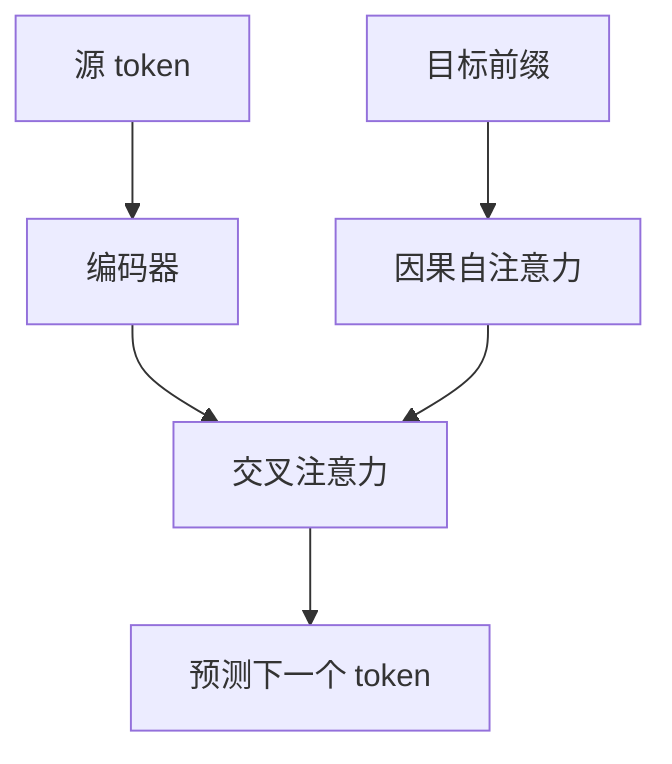

### 10.6 注意力机制
注意力可以理解为一次可学习的加权查询：Q 是查询，K 是用于匹配的键，V 是被汇聚的值。缩放点积注意力为：

$$
Attention(Q,K,V)=softmax\left(\frac{QK^T}{\sqrt{d_k}}+M\right)V
$$

若查询长度为 $L_q$、键长度为 $L_k$，则 $Q\in\mathbb R^{L_q\times d_k}$，$K\in\mathbb R^{L_k\times d_k}$，$V\in\mathbb R^{L_k\times d_v}$。分数矩阵大小为 $L_q\times L_k$，输出大小为 $L_q\times d_v$。

softmax 按每个查询对应的键维度归一化。缩放 $\sqrt{d_k}$ 用于控制点积尺度，避免维度增长使 softmax 过于饱和。掩码 M 在允许位置取 0，在禁止位置取足够小的值或负无穷。

假设某个查询得到两个缩放后的分数 2 和 1，softmax 权重约为 0.731 和 0.269。若两个标量 value 为 10 和 20，输出约 $0.731\times10+0.269\times20=12.69$。注意输出汇聚的是 V，不是把分数本身直接作为答案。

**自注意力**的 Q、K、V 来自同一序列的不同投影；**交叉注意力**的查询来自一个序列，键值来自另一个序列。它不是数据库检索接口，而是网络内部的张量计算。[R6]

**二维算例**。令 $q=(1,0)$，两个键分别为 $(1,0),(0,1)$，两个值为 $(4,2),(0,6)$。缩放后分数是 $1/\sqrt2$ 与0，softmax约为0.670和0.330。输出为约 $(2.679,3.321)$。权重和为1但输出向量各维通常无需加到1。若第二个键被屏蔽，则权重为 $(1,0)$，输出 $(4,2)$。

Q 决定查询条件，K 表示可匹配特征，V 是被加权的内容。点积若由 $d_k$ 个近独立、方差约1的项组成，方差约 $d_k$，除 $\sqrt{d_k}$ 后保持合理规模。位置匹配先打分，再加掩码，沿同一查询的键归一化，再乘 V。分数 $(1,0,-1)$ 的权重约 $(.665,.245,.090)$，值 $(2,4,8)$ 加权得到3.030。屏蔽第三位置后重归一化为 $(.731,.269,0)$，得到2.538。若先 softmax 再把第三权重置零，总权重小于1。

**可运行：掩码 softmax**。先取消不可见项，再减可见最大值以保持稳定。这里的输出为标量，多维 V 可对每一维做同一组权重的加权和。

```python
from math import exp, isclose

def masked_sum(scores, values, allowed):
    if not (len(scores) == len(values) == len(allowed)):
        raise ValueError("分数、值和掩码应逐项对应")
    visible = [(s, v) for s, v, keep in zip(scores, values, allowed) if keep]
    if not visible:
        raise ValueError("本例至少需要一个可见键")
    maximum = max(s for s, _ in visible)
    weights = [exp(s - maximum) for s, _ in visible]
    return sum(weight * item[1] for weight, item in zip(weights, visible)) / sum(weights)

full = masked_sum([1, 0, -1], [2, 4, 8], [True, True, True])
masked = masked_sum([1, 0, -1], [2, 4, 8], [True, True, False])
shifted = masked_sum([1001, 1000, 999], [2, 4, 8], [True, True, False])
assert isclose(full, 3.030, abs_tol=0.005)
assert isclose(masked, 2.538, abs_tol=0.005)
assert isclose(masked, shifted)
print(f"全部可见 {full:.3f}，屏蔽后 {masked:.3f}")
```

整体平移 logit 不改变 softmax。全掩码行处理依框架约定，不应直接把该行交给会返回 NaN 的表达式。

### 10.7 Transformer

一层 Transformer 由跨位置注意力、逐位置前馈、残差和归一化组成。位置机制提供顺序。反复堆叠层形成不同深度的表示。阅读模型要标注哪些操作各位置独立、哪些混合不同位置、哪些依赖掩码。两种归一化放置各有优化特性，不能用教材中的一张图概括所有模型。

#### 10.7.1 Transformer的结构
| 架构类型 | 信息可见性与组织 | 常见用途 |
| --- | --- | --- |
| 编码器 | 通常允许访问完整输入上下文 | 分类、抽取、表示学习 |
| 因果解码器 | 每个位置只访问当前位置及之前的信息 | 自回归文本生成 |
| 编码器—解码器 | 编码输入，解码输出并访问编码结果 | 翻译、条件生成 |

生成训练时可以并行计算多个位置的损失，但必须通过因果掩码阻止当前位置看到未来目标。否则模型训练时能“偷看答案”，推理时却没有该信息。

解码推理仍通常逐 token 生成，虽然有 KV cache 等优化避免反复计算部分历史状态。KV cache 缓存的是当前生成过程中的键值张量，不是永久记忆，不会自动修改模型参数。

标准全注意力的分数矩阵随序列长度 L 按 $L^2$ 增长；具体实现的内存占用和速度还受优化算子与架构影响。因此上下文更长通常有计算代价，也不保证模型能够有效使用所有远处信息。

一层通常先通过注意力混合不同位置，再由共享的逐位置前馈网络进行非线性变换。残差提供短路径，归一化控制表示尺度。原始 Transformer 是编码器—解码器，现代架构可只取编码器或因果解码器，也可调整归一化位置。位置机制、残差与标准注意力共同决定具体行为，不宜把一种布局当成所有实现。

前馈网络先升维再降维，作用在各位置相同权重，不负责跨 token 通信。全可见自注意力若没有位置机制，对输入重排等变，词序需位置编码或其他机制表达。标准注意力分数项数随 L² 增长；优化实现可能不保存完整矩阵。推理 KV cache 保存已经生成位置的 K/V，降低重算，又产生随序列长度增长的显存需求。

#### 10.7.2 Transformer中的多头自注意力机制
多头注意力在多个表示子空间中并行计算：

$$
head_i=Attention(XW_i^Q,XW_i^K,XW_i^V)
$$

$$
MultiHead=Concat(head_1,\ldots,head_h)W^O
$$

不同头有机会学习不同关联，但不能保证每个头都有清晰的人类语义角色。仅看注意力权重也不能把它当作完整的因果解释。

Transformer 层通常还包括前馈网络、残差连接与归一化。前馈网络对各 token 的表示使用共享映射；注意力负责跨位置交换信息。残差与归一化的前后安排存在不同变体，不能把一种布局当作所有模型的固定结构。

没有位置相关机制时，普通自注意力很难区分序列排列，因此需要位置编码或位置相关设计。原始 Transformer 使用正弦位置编码，后续还有可学习位置表示、旋转位置编码等方式。[R6]

若模型维度8、两头各4维、长度3，每个头的 Q、K、V 各为 $3\times4$，分数表 $3\times3$，各头输出 $3\times4$，拼接回 $3\times8$ 后经输出投影。causal mask 只遮住每行未来列。填充 mask 则遮蔽填充键，两者目的不同。

NumPy 示例。为了展示矩阵关系，Q、K、V 使用同一个小输入；真实模型一般使用不同可学习投影。

```python
import numpy as np

X = np.array([[1., 0.], [0., 1.], [1., 1.]])
Q, K, V = X.copy(), X.copy(), X.copy()
scores = (Q @ K.T) / np.sqrt(K.shape[1])
future_mask = np.triu(np.ones(scores.shape, dtype=bool), k=1)
scores[future_mask] = -np.inf

# 每行至少有一个合法位置；减去行最大值使指数计算稳定。
shifted = scores - scores.max(axis=1, keepdims=True)
weights = np.exp(shifted)
weights /= weights.sum(axis=1, keepdims=True)
output = weights @ V

print("权重：\n", np.round(weights, 3))
print("输出：\n", np.round(output, 3))
assert np.allclose(weights.sum(axis=1), 1.0)
assert np.allclose(weights[future_mask], 0.0)
assert np.allclose(output[0], X[0])
```

第一个位置只能访问自己；第二个位置可以访问前两个；第三个位置可以访问全部三个。若未来位置权重不为零，就需要检查掩码方向和 softmax 维度。

**手算因果掩码与交叉注意力的区别**。设三词分数在掩码前每行都是 $(0,1,2)$。因果自注意力第1行只有第1键，归一化为 $(1,0,0)$。第2行可见前两键，归一化为 $(0.269,0.731,0)$。第3行全部可见，约为 $(0.090,0.245,0.665)$。如果用0替换不可见分数再 softmax，隐藏列仍分到正权重，因此应在 softmax 之前加负无穷或使用支持掩码的核。

在交叉注意力里，源序列是整个已知输入，第三个目标位置并不要求只能看源序列前三字。它可访问全部有效源位置。因果限制发生在解码器对目标前缀的自注意力，源序列的填充可用另一类掩码处理。遇到全被遮住的异常行需明确定义输出，直接减行最大值可能得到 NaN。

设长度4、模型宽12、3个头各宽4。每头 Q/K/V 为 $4\times4$，分数表 $4\times4$，输出 $4\times4$，三头拼接 $4\times12$。softmax 在键轴，而非头轴。因果掩码使首行只读第1列、次行只读前2列。全掩码行应规定输出处理，直接计算常出现 NaN。权重表示该层内部汇总比例，不足以做整体因果解释。

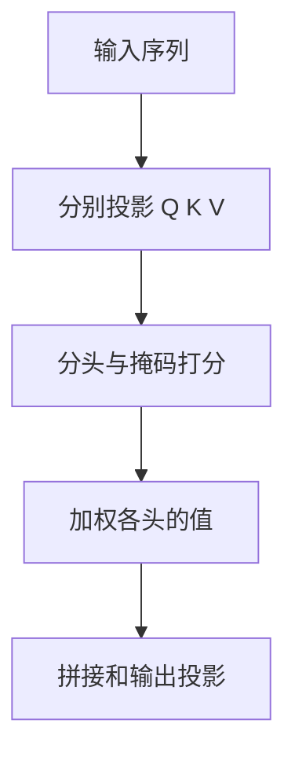

### 10.8 大语言模型的典型应用
用途包括比对、问答、摘要、翻译、代码辅助、信息抽取与工具编排。知识密集任务需要检索真实来源，结构化任务需要业务校验，涉及外部状态的任务需要显式工具结果。运行一次发送消息的接口与生成「已发送」字样是不同事件。

预训练让模型从大规模数据中学习通用表示与预测规律；监督微调利用指令—回答等数据适配任务；偏好优化根据偏好信号调整输出倾向。不同系统采用的具体流程并不完全相同。

需要分清几个容易混淆的概念：

| 方法 | 改变什么 | 适合解决什么问题 |
| --- | --- | --- |
| 提示词 | 当前上下文与任务描述 | 澄清需求、约束格式、给示例 |
| RAG | 当前请求可获得的外部证据 | 接入私有资料和经常更新的知识 |
| 微调 | 模型参数或适配参数 | 稳定任务行为、风格或领域能力 |
| 工具调用 | 接入查询与执行能力 | 查实时状态、计算、操作系统 |
| 量化 | 参数或计算的数值表示 | 降低部分存储和推理成本 |
| 蒸馏 | 学生学习教师输出或表示 | 将能力迁移到另一模型 |

微调不自动解决知识更新和来源追踪；RAG 不直接改变权重；工具调用也不是模型凭文本就完成外部动作。三者可以组合。

典型知识库流程分为离线索引与在线问答：

| 阶段 | 主要步骤 | 应检查的问题 |
| --- | --- | --- |
| 索引 | 解析、清洗、分块、向量化、存储 | 标题、页码、表格和来源是否保留 |
| 检索 | 查询处理、稀疏或向量召回、融合 | 正确段落是否出现在候选中 |
| 精排 | 重排和去重 | 是否优先展示真正支持结论的内容 |
| 生成 | 根据片段回答并引用 | 引用是否确实支持对应句子 |
| 评价 | 检索与回答分别衡量 | 错误发生在哪一阶段 |

RAG 的基本思想是把模型参数中的知识与可检索的外部资料结合。现代工程实现比最初论文中的具体结构更广，不能把所有“搜索后回答”都当作论文原样实现。[R8]

分块过小会丢失上下文，过大可能稀释关键信息。向量相似度只表示表示空间中的接近，不能直接证明答案。权限过滤应进入检索和访问链路，不能把无权访问的片段先给模型，再希望提示词替系统保密。

RAG 错误可以分为：没收进正确资料、解析错、检索没命中、重排错、证据不足、回答误解或引用错。逐层评价才能知道该修哪里。

**RAG 误差定位例**。问「2026版机器学习先修哪些」。先验证正确材料是否收录，再检查页码和表格能否解析、最新版本是否被检索到、重排能否提高证据优先级，最后检查句子与引用是否吻合。若正确片段未进 top-k，先修索引或召回。若已在上下文而答错，检查上下文结构、版本冲突与答案约束。

**RAG 实例**。索引应保留标题、页码、版本、片段ID。问课程先修时先按权限与培养方案过滤，再做关键词和语义召回、合并及重排。答案每个断言需可回到正确片段。若正确资料未在库，先补采集；库内正确却未召回，查解析与检索；片段已在上下文但仍答错，查版本歧义、提示和核验。题库包含单段事实、跨段、同名、旧版本冲突及确实没有答案。分别报告检索命中、无答案判断和引文支持，不要只用总体答案正确率。

需要真实动作时，模型输出候选参数，宿主检查 schema、权限和状态，再执行工具并读结果。仅生成“已安排”不能写成外部状态成功。可把查询、写入、幂等和失败处理分别设计。

### 10.9 小结
学习要点是条件生成如何训练、注意力的形状和掩码怎么计算、模型参数与应用证据怎么协作。**自测**：要接入每天变化的教学通知，首选微调还是检索？先连接可更新的数据源并可追踪来源。若问题是稳定输出格式，再独立比较提示和模型适配。

复习先写条件生成目标，手算一行掩码 softmax，再分析提示、检索、工具调用和蒸馏分别改变的对象。对于时效资料，证据来源和检索通常比让模型“记住最新版”更容易核验。对于输出格式，可独立评估生成模板和业务校验。

## 第11章 AI智能体与多智能体系统


### 11.1 AI智能体的概念与结构
智能体系统以目标和行动为中心。语言模型可用于选择下一步，感知、状态、工具、执行结果和停止条件通常由更完整的系统维护。

要分析一个智能体，先列观察、状态、策略、动作、反馈。大语言模型可以担任策略组件，工具宿主决定是否可执行，真实结果再写回状态。只有文本回答而没有行动过程，也可完成某些任务；当任务依赖外部状态和变化时，闭环变成主要区别。

#### 11.1.1 AI智能体的概念
智能体接收环境观察，根据内部状态和目标选择行动，然后从反馈更新状态。例：教学助手查到某课程缺先修后建议补学。它的观察是课程与进度，目标是可行安排，动作是查询与生成建议，反馈是工具返回和计划校验。

给观察 $o_t$，状态更新为 $s_t=F(s_{t-1},o_t)$，再从允许动作中按策略选择 $a_t$。执行读回结果或错误，作为下一次观察。例：课程名额必须查询后台，模型判断置信度不能代替。系统应能报告成功、未执行、拒绝、超时与结果未知。

#### 11.1.2 AI智能体的特性
常见特性包括自主性、反应性、主动性和社会性。自主性是在授权范围内选择，反应性是响应变化，主动性是依目标采取未被逐步指示的行动，社会性是与其他主体通信协作。软件也可能具备其中一部分，在比较时要按任务说明。

自主性衡量限定范围内是否能独立选择，反应性衡量变化是否及时影响动作，主动性关注根据目标自动推进，社会性关注能否与其他主体协调。增加自主决策未必提升安全或效率。应按时间、人工接管和任务成功率评价，而不是依命名判断。

#### 11.1.3 AI智能体的结构
状态应显式记录目标、输入、证据、计划、已执行动作、尚未完成项及预算。工具调用分为选择、校验参数、执行、接收结果、核对效果。工具返回失败应写入状态，不能误变成已经成功。

ReAct 的研究思路把任务分析与环境行动结合，让外部反馈影响下一步选择。它强调模型能够通过行动取得新信息，而不是只依赖初始输入。[R9]

工程实现可以概括为以下状态关系：

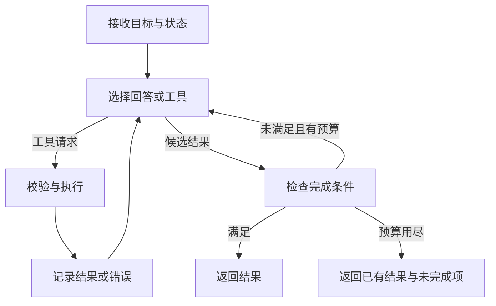

运行循环要限制最大步数、总耗时、调用成本与重复失败次数。停止依据应是任务条件，而不只是模型宣称完成。为了调试，可以记录决策摘要、工具参数、结果和状态变化，不必依赖模型输出冗长的内部思考文本。

工作状态保存下一步所需信息，日志保留发生过什么，长期记忆要附来源、时间、权限。读工具可以有限重试，创建记录超时却可能已经生效，需要幂等键或按请求ID查询。执行器校验动作是否与任务相关、参数有效、资源合规。

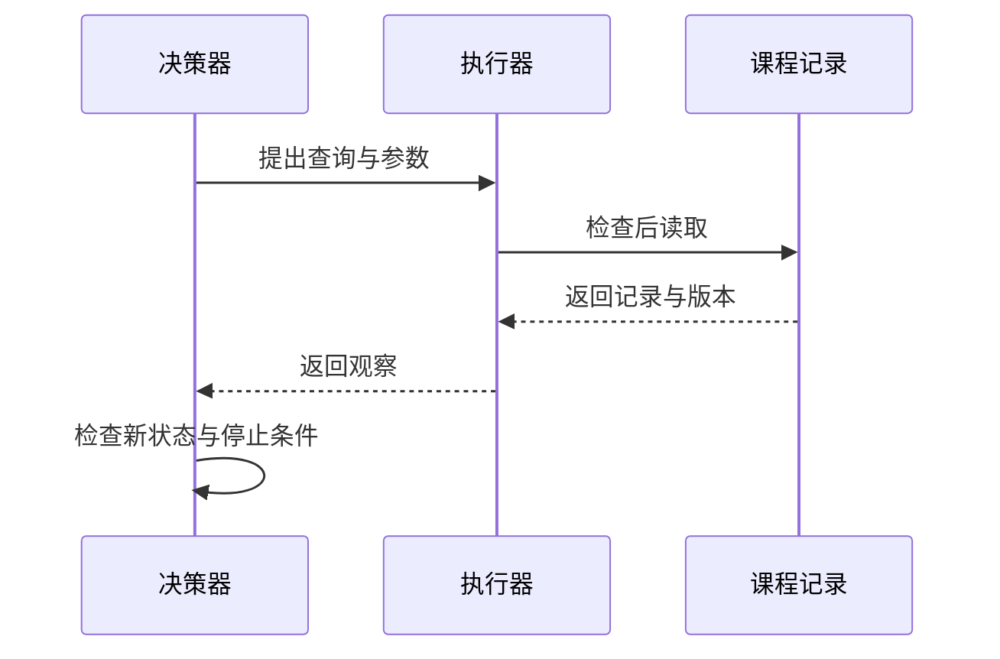

#### 11.1.4 反应式Agent
反应式智能体常用「当前感知—行为」映射，不依赖长程规划。障碍太近就减速是快速反应。单靠反应层，遇到 U 形障碍时可能只局部绕行而找不到出口。可设置无进展阈值，把情况提交给规划层。

反应式将当前条件映射到动作，反应快，适合简单场景。两个规则可能同时命中，如避障左转和沿墙右转，需仲裁。监测值在阈值两侧抖动时可用迟滞或最短保持时间。若不断绕回同一点，规则层还需触发规划或报告无进展。

#### 11.1.5 慎思式Agent
慎思式智能体维护环境模型，比较未来动作序列。例：送货规划先检查地图、状态与约束，再搜索可达路线。计划的价值受模型正确性影响；地图过时就应基于新观察重规划。

慎思式维护环境模型，预测多步影响并寻找计划。执行一段比较真实与预计位置，差异达阈值便重规划。若状态空间大而时间不足，可先返回可行候选，再继续优化。最优判断只相对于给定模型，模型过期时需先更新状态。

#### 11.1.6 复合式Agent
复合式系统可由反应层处理急迫变化、规划层安排长期路线。冲突仲裁必须明示。例如避障可中断全局路径，恢复规划后应根据当前位置重新评估。否则两个组件可能同时发出相反指令。

混合式把慢规划和快反馈接起来。快循环可避障暂停，慢循环重算整体路线。中断消息需包括当前位置、完成进度和计划版本，否则规划层会用旧起点执行剩余步骤。可给动作设互斥资源、优先级和可中断标志。

#### 11.1.7 AI Agent的应用
应用可落在助教、客服、机器人或文档处理。课程助手先用基础流程查询资料和进度，只有下一步确实依赖工具结果时才引入动态选择。对带副作用的动作，应由业务层验证授权和幂等键。

标准库实现。`mock_decider` 是固定的模拟决策器，**不是语言模型**；它使你可以先理解执行骨架，再替换为模型的结构化输出。工具只读取内存中的模拟数据。

```python
def get_prerequisites(course_id):
    data = {"ml": ["python", "probability", "linear_algebra"]}
    if course_id not in data:
        raise ValueError("未知课程")
    return data[course_id]

def get_completed():
    return ["python", "linear_algebra"]

tools = {
    "get_prerequisites": get_prerequisites,
    "get_completed": get_completed,
}

def mock_decider(state):
    if "requirements" not in state:
        return {"tool": "get_prerequisites", "args": {"course_id": "ml"},
                "save_as": "requirements"}
    if "completed" not in state:
        return {"tool": "get_completed", "args": {}, "save_as": "completed"}
    missing = sorted(set(state["requirements"]) - set(state["completed"]))
    return {"final": {"missing_prerequisites": missing}}

state, trace = {}, []
for step in range(4):
    decision = mock_decider(state)
    if "final" in decision:
        if not {"requirements", "completed"} <= state.keys():
            raise RuntimeError("缺少完成判断所需的证据")
        print(decision["final"])
        break

    name = decision["tool"]
    if name not in tools:
        raise ValueError("不在允许工具列表内")
    # 真实系统应在这里按 schema 验证参数和返回值。
    observation = tools[name](**decision["args"])
    state[decision["save_as"]] = observation
    trace.append({"step": step, "tool": name, "result": observation})
else:
    raise RuntimeError("执行预算用尽")

print("工具调用次数：", len(trace))
# {'missing_prerequisites': ['probability']}
# 工具调用次数：2
```

真实系统需要把最终输出与已获得证据做更强校验，还要处理超时、错误返回、参数 schema、存储键限制及用户数据权限。这个例子展示的是决策—执行—观察闭环，不是一个具备通用规划能力的成品 Agent。

学习计划助手可先读时段与先修资料，再查实际完成，安排顺序并核对每天时长。若缺少记录，先补问或给条件计划。若目标量大于可用时段，应说明冲突并退出重复搜索。输出好看的表格只是结果之一，仍需检查来源、可行和失败分支。

### 11.2 多智能体系统的概念与结构

多智能体在共享任务里有多个拥有独立观察、状态或行动权的主体。设计前给每个角色可验证的产出，否则协调者只收到几段相似话，不能有效审核。将通信、状态同步和重复执行成本计入总效率。

#### 11.2.1 多智能体系统的特点
多智能体场景中，各主体可能看见不同局部状态、持不同资源或目标，且执行彼此影响。增加主体带来并行与专业分工，也带来通信、同步、冲突和一致性成本。多个相同模型可能复用同样错误依据，因此投票不等于独立验证。

主体行动会影响彼此的环境。两台配送机器人各自最短的路线同时占用单车道，会出现拥堵或死锁。整体设计应看总完成时间、资源冲突与公平，而非只优化个人成本。消息乱序和局部信息差也是多主体特性。

#### 11.2.2 多智能体系统的基本类型
按目标关系可分合作、竞争与混合。合作示例是多个配送主体共用总完成时间目标；竞争示例是棋局双方；混合示例是多个任务执行者竞争任务，但共享资源仍需遵守冲突规则。按信息和控制可再区分集中或分布式等形态。

合作主体有共同目标；零和对抗中一方收益提高对应另一方降低；一般竞争或混合可能兼有合作需求。区分目标关系与信息组织：协作不意味着人人都读到完整全局，竞争也可能共享一套公共状态。

#### 11.2.3 多智能体系统的体系结构
中央协调者可统一分工，易观察和约束，但会成为瓶颈。点对点通信更分布，局部决策快，但对一致状态依赖协议。共享看板能复用中间成果，需要负责版本、并发写入与任务认领。混合结构可以集中配额、分布执行。

集中协调看全局、易控制，可能有瓶颈或单点故障。点对点决策依协议传播局部信息。分层让上层分资源、下层自治执行。共享看板能重用产物，但要管条目版本与并发写入。架构比较应看一致性、通信时延和恢复成本。

### 11.3 多智能体系统的通信

通信由语义、结构与流程三部分构成。成功发送不等于对方接受，接受不等于任务完成。结构要给会话ID、任务ID、事件ID、版本和期限，便于重复、迟到和失败时追踪。不要让不同流程碰巧使用同名字符串就被误认为同一事件。

#### 11.3.1 智能体通信的类型
通信可按目的分信息通报、查询、请求、承诺与结果回报，也可按覆盖分单播、组播、广播。将所有事件广播做法简单，但接收端成本随主体数增长，且会泄露无关上下文。按任务订阅更可控。

消息可分信息通报、查询、请求、报价、承诺和结果。通报说已发生事实，请求要求未来动作，承诺说明接受责任。单播对确定目标，组播发给一类候选，广播范围最广。扩大可见范围也扩大成本和暴露风险。

#### 11.3.2 Agent通信的方式
直接通信通过消息发送，间接通信通过修改共享环境或看板体现。同步请求易获取反馈但可能阻塞；异步队列易重试和解耦，但要处理延迟、乱序、重复。消息应有运行 ID、任务 ID、唯一事件 ID、版本与截止时间。

同步调用适合等待即时结果但串联会叠加延迟。异步队列便于并行与失败重试，可能重复或乱序。共享状态可作间接通信，仍需订阅、锁或版本控制。重放某事件时依据唯一事件ID判断是否已处理。

#### 11.3.3 智能体通信语言
智能体通信语言可将消息表示为一种有意图的行为，例如 REQUEST、INFORM、PROPOSE、ACCEPT。理解还需要共同的内容语义和协议。JSON 只能规定结构，不能单独说明「接单」是否承诺在期限前提交。历史上 KQML、FIPA ACL 等提供过消息行为建模思路，现代系统也可采用任务专用 schema。

一次交互例为 A 向 B 发 REQUEST(校验引用，任务17)，B 回复 ACCEPT，完成后 INFORM(证据不足，引用3无效)。接受不是完成，任务管理器应分别记录状态。

通信语言把消息标注为 REQUEST、INFORM、PROPOSE 等行为，内容另用领域词汇和结构。接受后等待完成或失败消息，不能用传输 ACK 代替。实现状态机应限制合法转移，旧版本的接受或提交按协议登记而非盲目覆盖。

### 11.4 多智能体系统的协调
协调使行动互相兼容。例如两台机器人都要用单通道，应按时间窗预留并为故障设置释放。若 A 持资源1等资源2、B 持资源2等资源1，就会死锁。可统一资源申请顺序或由协调者原子分配。对软件助手，职责边界、依赖图、合并顺序和超时也属于协调。

| 问题 | 一种控制方式 | 检查点 |
| --- | --- | --- |
| 双重认领 | 原子状态更新或租约 | 同任务当前只有一个有效执行者 |
| 任务依赖 | 等前置产物和版本 | 旧版本结果不能覆盖新版本 |
| 重复提交 | 幂等键和唯一约束 | 同一请求重试不产生两条记录 |
| 过期占用 | 到期与续约 | 迟到结果不能破坏已重新分配的任务 |

**并发任务状态推演**。设协调服务给校验者A分配任务17，任务状态为 running，版本4，租约在10秒到期。到期后协调服务将版本原子更新至5，分配B。A在第12秒返回，其提交条件「任务17仍为版本4且由A认领」为假，不能覆盖结果。B的首次提交通过，网络响应丢失导致其重传，同幂等键应读出刚才的回执。这样可以把「谁计算了」与「谁被允许更新结果」分开。

若执行动作涉及外部系统，数据库版本条件只能保护本地提交。外部端也要支持类似幂等键，或者以先查结果、补偿、人工处理等方式处理不确定结果。仅在提示词中写“不要重复”无法保证并发正确性。

两个共享资源若被以不同顺序锁定，可产生循环等待。可统一锁顺序或由调度器原子分配。例：A需3时隙、B需2，资源只有5格且B在第3格前要完成。先B占1、2，A占3至5才可行。按单体最早请求时间分配不一定满足整体约束。超时重分配还必须拒绝旧执行者迟到写入。

### 11.5 多智能体系统的协作

分工可结合固定工作流、动态合同网、黑板共享和市场分配。先选任务交接粒度，再约定验收证据。过细拆分会增加重复上下文，反而降低效率。可让每个执行者输出与验收要求一一对应的结果。

#### 11.5.1 多智能体的协作类型
协作可按任务分解、共享信息、共享结果、互相纠错等组织。任务若耦合很强，拆分粒度过细反而增加上下文丢失。判断是否值得拆分可用同样任务集比较完成率、工具调用、延迟和复核成本。

按阶段、数据或能力分工。并行适用于互不依赖的检索和检查，紧耦合步骤未必适用。若将一个推导拆成几段，应保留共享变量约定和前提版本。核验人员应读取原证据，以免集体复述错误。

#### 11.5.2 合同网协作方法
合同网常有公布任务、接收标书、选承包者、执行回报。例：A报价2分钟但无课程资料权限，B报价3分钟且有权限，C报价5分钟。先用能力和权限作硬筛，再按时间选B。超时要撤销或重分配，并避免两个承包者同时写最终结果。

合同网从任务公告开始，候选报价或拒绝，管理者选择承包者，随后执行、回报和验收。时长低的提案若无数据权限，应在评分前排除。选中消息需要版本，超时后重新分配不能让旧主体仍有提交权。

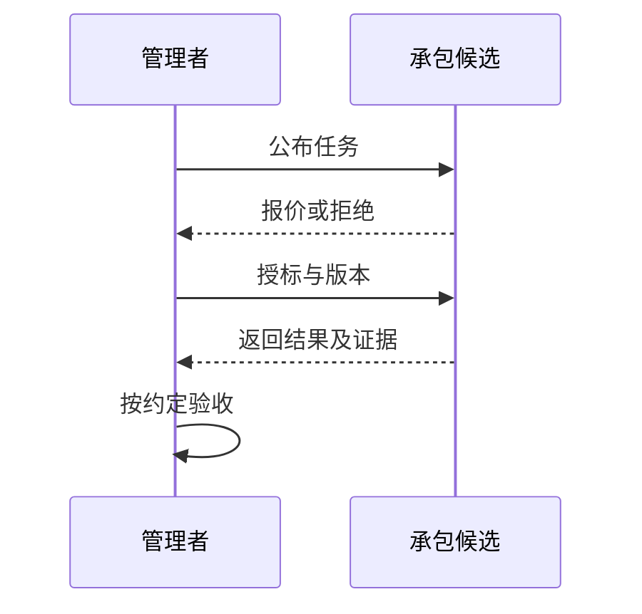

#### 11.5.3 黑板模型协作方法
黑板模型让多个知识源读取共享状态并贡献部分结果。解析者写文档片段，检索者写候选，验证者写引用是否匹配。控制机制决定何时运行哪类知识源。若两个知识源写同一字段，应限定归属或做版本检查，保留每次变更及证据。

黑板需区分原始事实、候选、中间推断、已审核结论。写同一字段可按归属或乐观并发校验。若解析者更新了资料版本，旧版本上的候选应过期，不能继续作为新结论。记录来源与变化可重放某一轮决策。

#### 11.5.4 市场机制协作方法
市场机制用价格、竞价或效用分配资源。例：两任务对同一算力资源的边际收益为7和4，若只有一个名额且其他约束同等，可分给第一个。实现要说明单位、预算、结算及主体是否可能夸大报价。报价和真实社会收益不一定一致。

资源竞争可按边际效益或成本报价。A收益10成本4，B收益8成本1，按净收益B的7大于A的6。若某项违反截止约束，再高收益也不可行。报价有策略性，应制定结算、监测偏差与资源公平性。

### 11.6 多智能体系统的协商
协商让目标不同的主体通过提议、反提议和接受达成协议。例：A只有周三有空，B优先周四但周三可做一部分，两者可将资料准备定周三、复核定周四。需要定义可接受范围、退出策略、截止时间和承诺状态。找不到可行交集时应明确失败或升级，而非无限循环。

协商需要提议、反提议、接受和退出条件。甲本周要交、乙周二不能开始，可以提周三执行、周五验收；若甲必须周一验收就无交集，应更换执行者或修改目标。设提议有效期和版本，双方接受不同版本不构成同一协议。

### 11.7 小结
复习时能解释感知—行动循环、三类架构、通信语义、冲突处理和协商条件。**自测**：两个智能体都把同一来源的旧记录当真，结果一致是否可视为复核？不能。应追踪各自的依据，并让复核使用独立或权威的证据。

自测时构造资料查询超时、重复提交、执行者替换、两个来源冲突。要能解释工作状态如何推进、何时允许重试、何时主动停止。主体数量增加不是改进证据，应对照简化工作流的实际成本和完成率。

## 第12章 人工智能在游戏设计中的应用


### 12.1 人工智能游戏
人工智能可作为游戏内对手、协作角色、内容生成器或测试辅助。任务目标随玩法变化。棋类器可能追求高胜率，训练模式对手则需要可理解和可调难度。玩家体验评价还要看行为一致、反应公平与运行资源。

游戏状态和动作通常容易受控，可用固定种子复现。实际游戏仍需综合设计难度、可观察公平、角色可解释与帧预算。最高胜率对手不一定适合教学关。先规定玩家和 AI 可见的状态、反应窗口、目标与限制。

### 12.2 游戏人工智能

游戏 AI 可作用于角色行为、对手策略、环境内容和开发测试。角色运动可能按帧更新，高层决策可降频，地图内容可预生成。应拆分预算，避免一次很昂贵的全局搜索堵塞碰撞和输入响应。

#### 12.2.1 游戏人工智能的概念与分类
游戏 AI 指为游戏角色、环境或系统提供感知和决策的算法。可按功能分导航、策略、行为组织、体验调节、内容生成与自动测试，也可按技术分规则、搜索、约束、学习。一个巡逻角色可以同时使用状态机、寻路与避障。

FSM 适合少量明确模式；行为树适合层次、多阶段与失败回退；效用法对同时可用动作打分，便于表达软偏好；规划显式找动作序列。若仿真可以大量产生反馈，学习法也可作为策略来源。实践里多种模块经常组合。

#### 12.2.2 基本的游戏人工智能技术
FSM 用离散状态和转移条件。行为树用顺序、选择、条件、动作及装饰节点组织可复用行为。顺序节点遇失败返回失败，选择节点遇成功返回成功，两者遇到执行中的动作通常保留进行态。动作跨多帧时不能把「尚未完成」误记为失败。

对抗游戏还常用 minimax，最小层模拟对手压低己方分数，最大层模拟己方提高分数。Alpha-Beta 在同一评价和树上剪掉不影响结果的分支。

标准库示例。根节点是己方选择，子节点为对方选择，叶子分数均从己方视角计算。

```python
from math import inf

tree = [[3, 5], [2, 9], [4, 1]]

def alphabeta(node, maximizing, alpha=-inf, beta=inf):
    if isinstance(node, (int, float)):
        return node
    if maximizing:
        value = -inf
        for child in node:
            value = max(value, alphabeta(child, False, alpha, beta))
            alpha = max(alpha, value)
            if alpha >= beta:
                break
        return value
    value = inf
    for child in node:
        value = min(value, alphabeta(child, True, alpha, beta))
        beta = min(beta, value)
        if alpha >= beta:
            break
    return value

print(alphabeta(tree, True))  # 3
```

三个子树的 minimax 值分别为 3、2、1，根节点选 3。第二个子树看到 2 后，可知对手至少能让己方只得到 2，根节点已有 3，因此无需再看 9。

行为树选择节点依次尝试撤退、追逐。撤退序列先检查血量低，再取安全点，最后移动。只要移动尚未结束，节点就应返回运行中而非失败。下一帧按具体调度恢复或按优先级抢占。

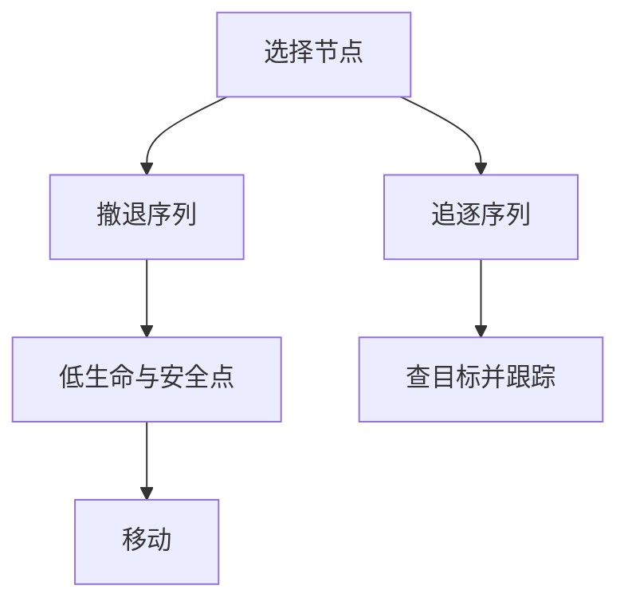

Minimax 在已知对抗树中切换最大和最小效用。若根已知某动作至少得5，另一对手节点看到子叶3，就知道对手能让结果不超过3，后续可剪。剪枝依赖同一收益视角和可靠上下界。

### 12.3 游戏中的角色与分类
可按控制来源分玩家角色、计算机控制角色、半自动协作角色，按游戏职责分对手、队友、引导者、背景角色等。区分职责有助于设置可见性、反应速度和行为限度。引导角色通常优先清楚表达行动，对手角色则强调有挑战且可应对。

玩家控制、计算机控制与混合控制是控制来源；队友、对手、引导角色和环境角色是职责。引导者重清晰，队友要理解协同，对手要有可应对的挑战。明确角色能否感知遮挡、距离及未知信息，一套导航可服务多个不同角色。

### 12.4 智能游戏角色设计基本技术

决策层选择目标，规划层选择经过区域，运动层落实速度、加速度和碰撞。用目标坐标直接驱动角色可能无法过墙，用规划节点直接设位置可能导致不连续跳动。设计职责边界后，分别测试决定去哪里、是否有路、能否走过去。

#### 12.4.1 游戏角色的指导与运动
全局路径负责提供一串位置，局部转向负责当前加速度或期望速度，物理层维护碰撞与速度限制。可用 $\mathbf a=(\mathbf v_{\rm desired}-\mathbf v)/\tau$ 逼近期望速度，再截断最大加速度。近目标应该减速，否则固定高速会越过目标来回振荡。离散时间积分时要明确帧间隔。

方向可取 $(p_{\rm target}-p)/\|p_{\rm target}-p\|$，期望速度按距离减速，再由 $(v_d-v)/\tau$ 求期望加速度。例：离目标2米、减速半径4米、最大速度6m/s，线性期望为3m/s。当前5m/s、时间参数0.5s，期望制动−4m/s²，若物理上仅可达−3需截断。两点重合时不计算零长度单位方向。

#### 12.4.2 游戏角色的追逐与躲避
追逐可估计目标将来的位置 $\hat x=x_t+v_tT$，而后转向该点。例：目标在 $(10,0)$，以 $(0,2)$ 每秒移动，估计拦截时间2秒，目标点为 $(10,4)$。真实目标可能转向，需周期更新 T 并加上上限。躲避可按反方向转向，在障碍场里还要考虑安全连通性。

一维追逐者在0、速度4，目标在10、同方向速度2，$4t=10+2t$，得5秒、拦截位置20。若目标同向速度更快，就无正时刻解。实际可以限制前瞻时长，并在新观测到来时重估。障碍要求结合路径可达，无障碍直线预测未必可用。

#### 12.4.3 游戏角色的群聚
群聚的经典三项是分离、对齐和凝聚。分离远离过近邻居，对齐追随邻居平均速度，凝聚趋向其中心。每步先从快照计算所有个体目标，再统一更新，避免先后顺序带来的系统性偏差。直接对所有个体交叉找邻居是 $O(n^2)$，栅格索引可减少无关检查。

分离、对齐、凝聚分开算向量。自身在原点、速度 $(1,0)$，邻居位置 $(1,0),(0,2)$、速度 $(1,1),(0,1)$。凝聚方向 $(.5,1)$；对齐差 $(-.5,1)$；若分离只来自第一点，取 $(-1,0)$。加权相加再限幅。用同一帧快照可防止更新顺序改变结果。

#### 12.4.4 游戏角色的路径搜索
网格适用于离散地图，导航网格以可行区域及邻接关系表示连续环境。A* 在图上找全局路径，执行器做局部避碰。动态障碍出现时，应区分临时等待、局部绕行与重新规划。

例：四邻网格每步1，$(0,0)$ 到 $(3,2)$ 无墙最少5步。曼哈顿启发给5，加入障碍后真实成本可能变大，启发仍是下界。若允许对角步且代价1，相同目标只要3步，原启发就高估。此时可用 Chebyshev 距离。

导航图节点应对应角色真实可行位置，边按通行能力生成。允许斜走时检查是否切过墙角。路径后处理只在可通行走廊内，不能把安全路径平滑到障碍里。临时拥堵可局部避让，长期堵塞则重规划。至少测不可达、突然换目标和角色体积改变。

#### 12.4.5 智能搜索引擎
在游戏开发中，可以把智能搜索组织为可复用组件：状态输入、后继生成、评分与启发、搜索预算、结果和轨迹。按用途配置不同后端，例如路线使用 A*，对手走法用 minimax 或 MCTS，内容约束用回溯。此处按一般游戏搜索机制展开，教材栏目内部具体指代以原书正文为准。

一次调试应记录展开数、搜索耗时、预算被耗尽的次数以及最后走法的代价。搜索预算用完时可返回当前有效候选并保留后续重算能力，避免误报已经找到最优方案。

搜索引擎组件可暴露后继生成、状态哈希、评分和预算接口，输出路径、代价与终止原因。AI 角色路径、棋局走法、关卡约束各需要不同评分。分帧运行时把候选边界和已查记录保存，下一帧继续。此处按游戏搜索组件的一般设计解释，原书特定图或案例需按正文核对。

### 12.5 智能游戏开发方法与开发工具

开发先用可复现小场景验证，分开动作正确和体验评价。用状态回放检查 NPC 不行动究竟是感知失败、状态条件错误、动作没权限还是路线不可达。优化求解时间不能牺牲动作合法性和过程可解释。

#### 12.5.1 智能游戏开发方法
从行为目标出发，先做最简单基线，再拆分感知、决策、路径、动作与测试。测试包含无路、遮挡、目标突然移动、同时多角色和时限。对可重复案例使用固定随机种子和状态回放。调参指标既有胜率，也有可解释性和流畅性。

巡逻角色可设计巡逻、调查、追逐、回岗状态。先实现进入视野条件与目标丢失后的回退，再测试道路堵塞、突然障碍、多角色抢路。记录每次状态转移的条件及时间。批量回放可检查回退是否总在规定帧内发生。

#### 12.5.2 智能游戏开发工具
工具按职责有场景与物理引擎、导航网格、行为树编辑器、仿真测试和训练框架。例如 Unity 的 NavMesh 生态或 Unreal 的行为树与导航可作为入口。学习先用小地图验证世界坐标、网格坐标和步长转换，再接入高级组件。

地图编辑、导航网格、行为树视图、物理、回放工具各服务不同阶段。先用小场景检查坐标、区域和时间步，再接复杂引擎。可用固定仿真步长验证速度和重规划；图形帧率变化时应保持合适的物理积分策略。

### 12.6 扫雷机智能游戏开发
对每个未揭开格子设二值变量 $x_i\in\{0,1\}$，1 表示有雷。数字提示约束相邻未揭开格子的雷数：

$$
\sum_{i\in N(c)}x_i=number(c)-已确定相邻雷数
$$

若右侧为 0，剩余相邻格子都安全；若等于剩余格子数，则这些格子全是雷。更复杂推理可以比较约束子集。

例如 $x_a+x_b=1$，$x_a+x_b+x_c=1$，两式相减得 $x_c=0$。但仅有 $x_a+x_b=1$ 时，不能确定 a 或 b 谁是雷。

真实扫雷可能出现无法从当前信息确定的局面。若采用概率选择，要明确剩余雷总数、各布局权重及可见证据，不能把一次猜测称为逻辑证明。

下面标准库代码演示子集约束差分，约束假设彼此一致且已经扣除确定雷数：

```python
small_cells, small_count = {"a", "b"}, 1
large_cells, large_count = {"a", "b", "c"}, 1
if small_cells <= large_cells:
    difference = large_cells - small_cells
    mines = large_count - small_count
    if not 0 <= mines <= len(difference):
        raise ValueError("约束不一致")
    if mines == 0:
        print("安全格：", sorted(difference))
    elif mines == len(difference):
        print("雷：", sorted(difference))
# 安全格：['c']
```

**进阶算例**。局部边界有 $a+b=1$ 与 $b+c=1$。代入可得 $a=c=1-b$，合法配置 $(1,0,1)$ 或 $(0,1,0)$，光靠两条约束无法确定。若整个剩余未知区只有 a、b、c，且确定还剩1雷，则再加 $a+b+c=1$，唯一解为 $(0,1,0)$。只有在没有额外未知区时才能直接这样加总。

实际求解循环可先做单约束传播与子集差分，再对小的连通约束分量枚举可行配置。在所有可行配置都安全的格子可确定打开。若需要猜测，雷数或布局采样机制会影响各配置权重，应该把概率选择与确定推理解耦。

**独立运行：对小局部边界枚举并判断确定格**。代码接收由已打开格子生成的二元约束。它列出所有一致赋值，再用「所有赋值同一结果」作为确定性判据。复杂度随未知格指数增长，更大的区域可先按约束连通分量拆分。

```python
from itertools import product

def locally_feasible(cells, constraints):
    layouts = []
    for values in product((0, 1), repeat=len(cells)):
        layout = dict(zip(cells, values))
        if all(sum(layout[cell] for cell in region) == count
               for region, count in constraints):
            layouts.append(layout)
    return layouts

def forced_cells(layouts):
    if not layouts:
        raise ValueError("不存在与观测一致的布局")
    return {cell: value for cell, value in layouts[0].items()
            if all(layout[cell] == value for layout in layouts)}

constraints = [(("a", "b"), 1), (("b", "c"), 1)]
assert len(locally_feasible("abc", constraints)) == 2
assert forced_cells(locally_feasible("abc", constraints)) == {}
constraints.append((("a", "b", "c"), 1))
answer = forced_cells(locally_feasible("abc", constraints))
assert answer == {"a": 0, "b": 1, "c": 0}
print(answer)
```

只有确知 abc 覆盖所有未计入的雷位置，才能加入最后的总量约束。若存在其他未知位置，需将它们纳入约束，或先计算当前局部可能占用的剩余雷数范围。

开格数字2，周围已确定一雷与未知 a、b、c，得到 $a+b+c=1$。另一开格扣已知雷得 $a+b=1$，相减 $c=0$。打开 c 后利用新观测继续传播。无约束可决定的格可以按概率猜测，但要明确与逻辑确定结果的区别。全局雷数使多个约束分量互相依赖，不能简单平均局部布局而宣称全局概率。

### 12.7 人工智能游戏的现状与未来
随着生成模型和代理技术加入游戏，内容适应、NPC 对话与辅助测试的技术空间更大。产品仍需要延迟预算、状态一致性、可复现测试与设计边界。文本对话生成的承诺应检查游戏状态，例如某道具不存在时不能因一段对白就凭空发放。

**拓展：强化学习与奖励**。智能体目标是最大化折扣回报而非单步动作分数。表格 Q-learning 用 $Q\leftarrow Q+\alpha[r+\gamma\max Q'-Q]$ 更新。若旧Q为0.5、奖励1、下一状态最大Q为2、$\alpha=0.1,\gamma=0.9$，新值为0.73。设置奖励后要跑真实任务测试，例如只给移动次数奖励可能诱发原地来回刷分。

模型可辅助对话、内容或策略，游戏状态仍由规则和动作接口守护。NPC 对话提到已给予许可后，应验证许可字段真实变化。强化学习适合可仿真的反馈任务，奖励漏洞与未见关卡仍需测试。实时场景应保留低成本回退。

### 12.8 小结
游戏 AI 要选择适合体验与计算预算的方案。导航、行为组织、对抗和约束推理解决不同子问题。**自测**：对手 AI 胜率提高但会隐式读取玩家看不到的未来操作，是否一定是更好的实现？应根据玩法目标和信息边界评价，并在同规则下测试行为与体验。

综合练习：巡逻角色看见目标切追逐，丢失时到最后可见点搜索，超时回岗。给每态定义数据、动作及退出条件。再用墙角、目标消失、同伴挡路和地图改动四个案例测试。出现卡死时分别检查路径几何、转移条件和局部运动。

## 补充A 数学基础与符号约定

### A.1 用维度检查矩阵式

标量是单个数，向量是有序数列，矩阵是二维数组。若 $A\in\mathbb R^{m\times n}$ 与 $B\in\mathbb R^{n\times p}$，$AB$ 为 $m\times p$。$(AB)_{ik}=\sum_jA_{ij}B_{jk}$ 的求和指标 j 对应中间维度，不能把矩阵乘法当作逐元素乘法。批量网络多用每行一个样本。单样本公式常用列向量。两种习惯变换后，所有矩阵方向需要一起调整。

注意广播。例如列向量形状为 $(n,1)$，标签形状为 $(n,)$，直接相减可能得到 $n\times n$ 个差值。写损失时先检查输出、标签和掩码各轴分别代表什么。对于概率归一化，要说明是沿类别、键、样本还是其他轴。

### A.2 梯度、链式法则与中心差分

若 $z=wx+b$ 且 $L=(z-y)^2/2$，则 $dL/dw=(z-y)x$。梯度表示当前参数附近的变化，沿负梯度做有限步更新还受到学习率影响。同一个中间变量若通过两条路径影响损失，其梯度贡献相加。

取 $x=2,b=0,y=1,w=0.2$，得 $z=0.4$、损失0.18、$dL/dw=-1.2$。用 $\epsilon=0.001$，两个扰动点的损失分别为0.178802和0.181202，差分为−1.2。检验复杂网络时可抽几个权重做相同检查。ReLU折点附近不应要求两种方法完全一致。

### A.3 概率、期望、交叉熵

条件概率 $P(A|B)=P(A\cap B)/P(B)$ 要求 $P(B)>0$。独立是指联合概率可分解为边缘概率乘积，条件独立要求**在给定条件下**能够分解，二者不可替换。期望是分布加权平均，不是一次实验的保证值。

对离散分布 $p,q$，熵 $H(p)=-\sum_i p_i\log p_i$，交叉熵 $H(p,q)=-\sum_i p_i\log q_i$，$KL(p\Vert q)=H(p,q)-H(p)$。当 p 固定时，最小化交叉熵也最小化这一个方向的 KL。KL 不对称。若 $q_i=0$ 且 $p_i>0$，对应代价发散。实现 softmax 常减去该行最大值防止指数溢出，平移前后概率分布相同。

### A.4 复杂度、学习成本与实验公平

$O(\cdot)$ 描述规模增长。理论时间相同的算法可能因内存访问和实现不同，在现实速度上明显不同。搜索比较应记录展开节点、耗时和路径成本，优化比较应记录有效函数评价次数，模型比较应使用同一划分和指标，智能体比较还需记录调用次数、成功任务成本与失败率。

## 补充B 原创综合练习与解答

建议先自主计算，再看解答。题目编号 B1—B12 对应十二章，均为自编。

### B1 控制系统中的「理性」

夜间空教室仍有少量传感噪声。设自动空调任务指标，并说明遇到短暂“有人”信号是否应该立刻切换。

**解答**：可以设舒适度偏差、无人在场时的能耗、频繁切换次数和响应延迟。短暂噪声不必立即切换，可用近几次观测或迟滞决定。若用户确实已进教室，反应过慢也有代价。先测两类代价再定阈值。

### B2 量词、作用域与必要条件

将「每个有导师的学生至少选一门课程」写成谓词公式，并否定整个公式。

**解答**：先定义 $Mentor(t,s)$ 和 $Select(s,c)$。原式 $\forall s[(Student(s)\land\exists t Mentor(t,s))\to\exists c Select(s,c)]$。否定为 $\exists s[Student(s)\land(\exists t Mentor(t,s))\land\forall c\neg Select(s,c)]$，即存在符合前提而没有选课的学生。

### B3 归结证明与不可证

给子句 $P(x)$、$\neg P(a)\lor Q(a)$、$\neg Q(a)\lor R(a)$，证明 R(a)。

**解答**：加入 $\neg R(a)$。$P(x)$ 与第二子句用 $x=a$ 归结得 $Q(a)$，与第三子句归结得 $R(a)$，与否定目标归结得空子句。直接从 $R(a)$ 反推 $P(a)$ 则缺一般有效性。

### B4 证据与模糊计算

框架为 $\{A,B,C\}$。给 $m(A)=0.25,m(A\cup B)=0.5,m(\Theta)=0.25$，求 B 的 Bel、Pl，并解释差值。

**解答**：$Bel(B)=0$，$Pl(B)=0.5+0.25=0.75$。没有证据完全落在单个 B 中，0.75 的质量在集合层面还允许 B。差值反映尚未排除的支持范围，与 B 的模糊隶属度无关。

### B5 一致性与 A* 重开

有边 $S\to A=4,S\to B=2,B\to A=1,A\to G=4$，令 $h(S)=0,h(A)=0,h(B)=4,h(G)=0$。判断可采纳性和一致性，并追踪。

**解答**：最优剩余成本依次为7、4、5、0，所以各启发均未高估。边 B→A 上 $4>1+0$，因此不一致。先 A（$g=4,f=4$）后 B（$g=2,f=6$），A 发现成本3。若允许重开，最后 G 成本7。若永久关闭 A，则很可能得到成本8。

### B6 ACO 概率与信息素

三个允许后继的信息素为 $(1,2,1)$，局部启发 $(0.5,0.5,1)$，$\alpha=1,\beta=2$，求选择概率。如果第三边蒸发率0.2、沉积0.4，更新后是多少？

**解答**：未归一化权重 $(0.25,0.5,1)$，总1.75，概率为 $(1/7,2/7,4/7)$。第三边新值为 $(1-0.2)\cdot1+0.4=1.2$。注意先求权重再归一化。

### B7 分类评价与数据泄漏

1000例中正类20，预测正类30，且其中15个真的为正。求 accuracy、precision、recall、F1。如果同一用户有多条记录，为什么按行随机划分可能不合适？

**解答**：TP=15、FP=15、FN=5、TN=965。准确率0.98，精确率0.5，召回率0.75，F1=0.60。同一用户的相似记录可能分别进入训练和测试，令分数高估新用户表现。以新用户为部署目标时，应该按用户分组。

### B8 反向传播与卷积

在两层网络 $h=ReLU(w_1x)$、$\hat y=w_2h$ 中，取 $x=2,w_1=-0.1,w_2=1,y=1$，采用半平方误差。计算两个权重梯度。

**解答**：隐藏预激活 −0.2，ReLU 输出0且导数0，$\hat y=0$，输出残差−1。$dw_2=(-1)\cdot0=0$，$dw_1=(-1)\cdot1\cdot0\cdot2=0$。单凭这个样本无法让该隐藏单元进入正区间，其他样本或网络设计可能改变它的更新。

### B9 CTC 对齐聚合

帧序列 A、A、空白、A 与 A、空白、A、A 各折叠成什么？它们的概率如何计入目标？

**解答**：先合并临近重复符号，再移除空白，两条都折叠成 AA。目标 AA 的条件概率应累加所有折叠为 AA 的对齐概率。用单条最可能路径，可能忽略大量中等概率但指向同一输出的路径。

### B10 自注意力和交叉注意力

源序列长6，输出前缀长4，每头键维度8，值维度12。交叉注意力的分数矩阵和输出形状分别是什么？如果删掉源键第六列，应改哪个对象？

**解答**：分数为 $4\times6$，输出为 $4\times12$。可通过掩码屏蔽第六键位置，也可同时移除 K、V 中对应行，不能只删 K 而让 V 保留不匹配行。softmax 按键维度，即每行归一化。

### B11 合同网、超时与幂等

协调者把任务派给A，10秒未回报就派给B。A与B都计算完成，如何保护结果？

**解答**：任务认领附版本或租约令牌。B接受后任务版本更新，A迟到写入时被拒绝或登记为参考证据。最终写用任务ID和版本作为条件，并加幂等键防止同一执行者重试写两份。区分「动作已提交」「结果通过校验」「任务已完成」。

### B12 扫雷的约束组合

给 $a+b+c=1,b+c+d=2$，确定哪些变量？

**解答**：两式相减得 $d-a=1$。因 a、d 是0/1，必然 $a=0,d=1$。于是 $b+c=1$，不能仅凭这些约束确定 b 与 c。这里没有子集关系，但线性消元与取值域仍可推出结论。

## 补充C 原创实验指导

### C.1 实验一：用同一张图比较 BFS、UCS 和 A*

**输入**：第5章 OPEN 表例子，再加不可达目标和启发不一致的 B5 例。先预测路径与成本，运行第5章代码。写 BFS 并支持固定邻居顺序，随后令 A* 的 h 全为零作为 UCS 对照。

**记录**：每种方法统计发现边、有效弹出、过期项与最终代价。对等价最优路径可比较成本与合法性，不要求走法字符串完全一样。对不一致启发，关闭重开后观察 B5 退化。

**完成条件**：能够解释 BFS 的步数与加权代价为何分离，能够解释旧堆项为什么不能用来结束搜索。

### C.2 实验二：小模型训练与梯度校验

运行第8章的 XOR 网络。先固定种子复现，记录最终概率。用中心差分检查一项 $W_1$ 和一项 $W_2$ 梯度。再保留同样预算，尝试去掉隐藏非线性，并比较训练损失与分类结果。

**完成条件**：能够说明矩阵形状、批均值因子、参数更新前后顺序，以及为什么拟合4个点不构成泛化验证。比较不同学习率时，每组运行应从同一初始化或配对随机种子开始。

### C.3 实验三：课程资料问答与智能体工具

选有权使用的课程说明，保存文档、版本、适用专业、标题、页码、片段ID。用关键词检索建立基线，再加语义向量召回。先手写十道有答案、五道无答案、五道版本冲突题，分别记录相关证据进入 top-k 的比例与回复引用准确率。

再参考第11章的模拟程序加入 get_completed 与 get_prerequisites，先用确定性工具流程作基线，再试动态路由。完成验证必须检查缺失的先修由两工具的真实结果计算。加入工具超时、非法课程和重复请求三个测试案例。

**完成条件**：每个答案可定位证据，未知或失败有明确状态。可以展示「哪类问题改进」「还存在哪种失败」，并保存同一评价题集的对比记录。

### C.4 实验四：实现证据组合与离散重心

下面用标准库实现第4章的两个运算。第一个函数要求已验证输入质量合法且出自适当证据来源，第二个函数要求给出相同长度的采样点和已聚合隶属度。它们关注数值步骤，不替系统判断应用假设。

```python
from collections import defaultdict
from math import isclose

def combine_mass(left, right):
    raw = defaultdict(float)
    for subset_a, mass_a in left.items():
        for subset_b, mass_b in right.items():
            raw[subset_a & subset_b] += mass_a * mass_b
    conflict = raw.pop(frozenset(), 0.0)
    if isclose(conflict, 1.0, abs_tol=1e-12):
        raise ValueError("完全冲突，标准归一化无定义")
    return {key: value / (1 - conflict) for key, value in raw.items()}

def discrete_centroid(points, grades):
    if len(points) != len(grades):
        raise ValueError("采样点和隶属度应一一对应")
    total = sum(grades)
    if total <= 0:
        raise ValueError("没有有效的输出隶属度")
    return sum(x * grade for x, grade in zip(points, grades)) / total

a, b = frozenset("A"), frozenset("B")
universe = a | b
mass = combine_mass({a: 0.6, universe: 0.4}, {b: 0.5, universe: 0.5})
assert isclose(mass[a], 3 / 7)
assert isclose(mass[b], 2 / 7)
assert isclose(sum(mass.values()), 1)
assert isclose(discrete_centroid([20, 50, 80], [0.2, 0.6, 0.4]), 55)
print("证据合并与离散重心校验通过")
```

把第一份证据全分给 A、第二份全分给 B，应观测到完全冲突异常。把所有隶属度设零，应观测到重心为空的异常。两者都要求上层决定怎样表达「当前无法计算」，不能随意返回一个正常数。

## 补充D 参考资料与目录核对说明

目录以高等教育出版社同 ISBN 的本科图书条目为准。节编号用于对照公开目录，正文和例题依据公开学术资料与通行公式重新组织。出版社提供的样章及纸书可用来进一步核对特定术语、图表和页码。书目入口见 [高等教育出版社图书页](https://xuanshu.hep.com.cn/front/book/findBookDetails?bookId=68a752a4e119ac9729e1801e)。

### 资料索引

| 文中编号 | 来源及用途 |
| --- | --- |
| R2 | [Poole 与 Mackworth，Artificial Intelligence: Foundations of Computational Agents](https://artint.info/3e/html/ArtInt3e.html)，逻辑、搜索、概率与智能体 |
| R3 | [Dive into Deep Learning](https://d2l.ai/)，机器学习、神经网络与算法实现 |
| R4 | [scikit-learn，Cross-validation](https://scikit-learn.org/stable/modules/cross_validation.html)，实验划分与模型选择 |
| R5 | [scikit-learn，Common pitfalls](https://scikit-learn.org/stable/common_pitfalls.html)，预处理与数据泄漏 |
| R6 | [Vaswani 等，Attention Is All You Need](https://arxiv.org/abs/1706.03762)，Transformer |
| R7 | [Hinton 等，Distilling the Knowledge in a Neural Network](https://arxiv.org/abs/1503.02531)，蒸馏与温度 |
| R8 | [Lewis 等，Retrieval-Augmented Generation](https://arxiv.org/abs/2005.11401)，RAG |
| R9 | [Yao 等，ReAct](https://arxiv.org/abs/2210.03629)，模型与行动工具 |
| R10 | [Browne 等，A Survey of Monte Carlo Tree Search Methods](https://repository.essex.ac.uk/4117/)，MCTS |
| R11 | [Kennedy 与 Eberhart，Particle Swarm Optimization](https://staff.washington.edu/paymana/swarm/kennedy95-ijcnn.pdf)，PSO |
| R12 | [Goodfellow 等，Generative Adversarial Networks](https://arxiv.org/abs/1406.2661)，GAN |
| R13 | [Sabour 等，Dynamic Routing Between Capsules](https://arxiv.org/abs/1710.09829)，胶囊网络 |
| R14 | [Shafer 与 Logan，Implementing Dempster’s Rule for Hierarchical Evidence](https://glennshafer.com/assets/downloads/articles/article29_dempster.pdf)，证据函数和组合 |
| R15 | [Heckerman，The Certainty-Factor Model](https://www.microsoft.com/en-us/research/publication/certainty-factor-model/)，可信度方法 |
| R16 | [Zadeh，Fuzzy Sets](https://doi.org/10.1016/S0019-9958%2865%2990241-X)，模糊集 |
| R17 | [Dive into Deep Learning，Q-Learning](https://d2l.ai/chapter_reinforcement-learning/qlearning.html)，强化学习拓展 |
| R18 | [Hopfield，Neural networks and physical systems with emergent collective computational abilities](https://doi.org/10.1073/pnas.79.8.2554)，联想记忆和能量下降 |
| R19 | [Dive into Deep Learning，Long Short-Term Memory](https://d2l.ai/chapter_recurrent-modern/lstm.html)，LSTM |

## 补充E 跨章训练：从任务定义到验证结果

### E.1 学习计划中的图、规则、搜索与智能体

某同学三周内每周三、周六各有2小时，想学六项内容，每项2小时。L 表示矩阵与梯度，P 表示条件概率，S 表示 A*，B 表示反向传播，T 表示注意力，J 表示课程问答工程。B 要先学 L，T 要先学 L 和 B，J 要先学 P 和 T。各项默认不能拆分。

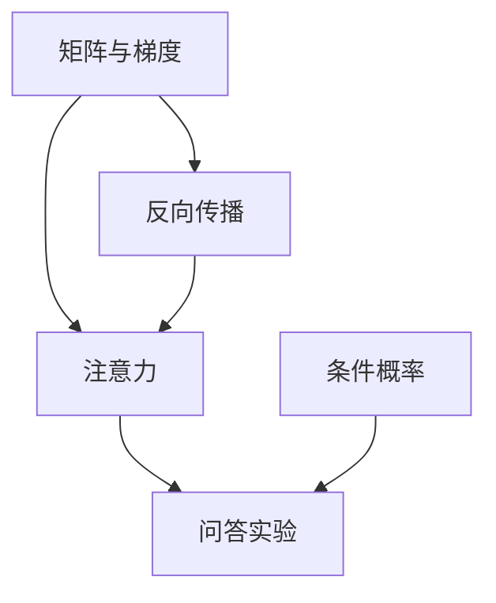

**第一步，写出数据表示。** 先修边方向规定为“前项先于后项”。完成记录与时段预留要分开，安排了先修不代表真实已掌握。S 独立于图中其他节点，可以安排在任何不超过时长限制的时段。保存资料版本，方便版本更新后重算。

**第二步，找可行顺序。** 初始可选 L、P、S。安排 L 后解锁 B，安排 B 后解锁 T，J 等待 T 与 P。顺序 L、P、B、T、J、S 合法，L、B、T、P、J、S 也合法。要优先“第一周完成两个基础”可用前者，要尽快验证依赖较长的支线可考虑后者。拓扑序只检查前后，对每日上限还必须另算。

**第三步，处理时段取消。** 若第二周周六被占用，容量从12降到10小时。学完 J 的先修闭包加 J 自身包括 L、B、T、P、J，恰好占10小时，因此可以把独立 S 延后。若 J 需要连续4小时，则即使总时长12也放不进两小时时段。若允许拆开，J 占4小时会使总预算超出，仍需减目标或延时。

**第四步，核验系统状态。** 如果助手只是生成计划，应给每日总时长、先修检查和未完成事项。若还要真的写入日程，区分“计划生成、请求已发、工具成功返回、查询确认”。网络超时不等于执行失败，应先根据请求标识查询，避免重复创建。

### E.2 对照实验：定位检索问答失误

设计10道有证据题、4道无证据题，标好确切来源。A 的 top 5 命中8道、最终答对6道。B 命中9道、最终也答对6道。若正确题均在命中集内，命中后正确率分别为75%和66.7%。两者最终分数相同，却暴露不同问题。A 先查召回，B 先查生成怎样使用证据。

| 环节 | 要保存的数据 | 实例中的检查 |
| --- | --- | --- |
| 建库与解析 | 页码、版本、标题、片段 | 相关规则是否完整进入索引 |
| 检索与重排 | 每题候选顺序与分数 | 旧版是否错误挤掉新版 |
| 生成与核验 | 引用和具体断言 | 链接能打开且确实支持答案 |
| 无答案策略 | 未命中原因和回复类型 | 不给缺证据的事实承诺 |
| 对照实验 | 同题同权限同预算 | 分别替换检索或生成模块 |

将 B 的候选交给 A 的生成模块，可进一步尝试隔离模块影响。若识别出正确答案但其引用缺证据，应另记录为“结果匹配但无支持”，而不是归进可靠正确。

### E.3 十二个答题自查点

1. 若“提交则可评分”且“可评分”为真，不能倒推提交，除非还有足够的规则。
2. 知识库未记录先修，只有在清单完整且采用闭世界约定时才能推出无先修。
3. 命题归结消一对互补文字。同一公式中出现 A 与非 A 的析取是恒真式，不是矛盾。
4. 温度已知时的“热”隶属度不是未来高温发生的概率。
5. A* 先以较大成本生成目标时不能停止。目标弹出条件和重复节点策略共同维持最优性。
6. GA 若全群第1位都是0且永远没变异，只交换对应位片段无法得到第1位为1。
7. 普通最小二乘有截距时残差和为0，因为损失对截距的导数为0。强制截距后无需满足该式。
8. Hopfield 的同步更新可振荡，不能套用只改一位时的能量下降证明。
9. CTC 对 A、A、空得到 A，对 A、空、A 得到 AA。移除空白与合并重复的顺序不能随意交换。
10. 因果注意力不能把未来位置的分数写成普通0，softmax 会给它正权重。
11. 租约版本用于拒绝旧提交，幂等键用于避免同一操作的重复生效。
12. 游戏路径在离散图可行但实际角色卡在转角，优先检查图节点、碰撞体和运动模型是否匹配。
